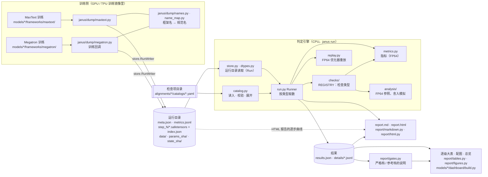

[janus](../../README.md) › [文档](../README.md) › 开发 · 架构 ｜ 改 janus 本身之前先读；只用 janus 的读者看[用户指南](../guide/README.md)就够

# 架构

训练机器贵、环境重，跑一次要几小时；判定却要反复调、要在任何一台机器上复现。所以 janus 把「抓数」钉死在训练那一次，之后的判定和出报告都只读磁盘，想重跑多少次都行。

janus 由三段组成：

- **训练侧抓数**：随训练程序跑，要 torch / jax；
- **判定引擎**：`janus run`，只要 numpy；
- **汇总与展示**：报告、逐级大表、总览。

三段之间只通过磁盘上的三种格式交接：

| 格式 | 谁写 | 谁读 | 规格 |
|---|---|---|---|
| **运行目录** | 训练侧（`janus/dump/`） | 判定引擎；HTML 报告画逐步曲线 | [`reference/dump-format.md`](../reference/dump-format.md) |
| **检查项目录**（YAML） | 人 | 判定引擎 | [`reference/catalog-schema.md`](../reference/catalog-schema.md) |
| **结果文件**（`results.json` + `details/`） | 判定引擎 | 报告、逐级大表、总览 | [`reference/result-schema.md`](../reference/result-schema.md) |

三种都带 `schema_version`。这样：

- 判定可以在任何一台 CPU 机器上重跑，不依赖训练环境；
- 报告可以不重跑检查就重画。

## 组件与数据流

### 一条检查怎么走

以目录里的一条 `L2.layer0.fwd`、类型 `tensor_tolerance` 为例（`janus demo` 生成的目录里就有这一条，门槛是 `calibrated`）：

1. catalog 展开成具体的步号和张量名；
2. Runner 从被测与 golden 两个运行目录各取 `step_1` 下这一层的输出；
3. `checks/tensor.py` 用 `metrics.py` 在 FP64 里算 rel_L2 等指标、对门槛判；
4. 一行写进 `results.json`，逐张量明细写进 `details/`；
5. `report.md`、逐级大表、总览照抄这一行的 status 与数字。

### 产物分三级

- 一次 `janus run` 出一份 `report.md`（加 `--html` 另出 `report.html`）；
- 一个对齐实践下的多份结果，由 `models/<模型>/dashboard/build.py` 调 `report/tables.py` 汇成实践 README 里的逐级大表；
- 再汇一层是跨实践的总览 `dashboard.md`。

## 各组件的职责与边界

| 组件 | 职责 | 依赖 | 不做什么 |
|---|---|---|---|
| `janus/dump/` | 训练时按统一格式写运行目录；框架名 → 规范名；数据与参数指纹 | torch / jax（仅在训练环境里导入）、`store.py`，见注 1 | 不判定；不改框架源码（见注 1） |
| `janus/store.py`、`dtypes.py` | 运行目录的读写与校验（`Run`、`RunWriter`）；BF16 保持原始位模式 | numpy、ml_dtypes | 不知道检查是什么 |
| `janus/catalog.py` | 检查项目录的读入、`include` / `vars` / `foreach` 展开、校验 | pyyaml；`checks` 的 `REGISTRY`（只用来校验类型名） | 不读运行目录 |
| `janus/run.py` | 引擎：对每条检查从运行目录**取数**，交给检查类型，收集结果，写结果、调 `report/` 写报告（见注 2） | catalog、store、checks、metrics、replay、report | 不写判定逻辑：门槛、比较都在 `checks/` |
| `janus/checks/` | 检查类型：注册到 `REGISTRY` 的函数，输入 Runner 取好的数据，输出 `CheckResult`（见注 3） | metrics、`analysis/ops.py` | **不碰运行目录**：所以单测只造数据。例外见下面「三个例外」 |
| `janus/metrics.py` | 指标：rel_L2、cosine、ULP、KL、loss 序列统计……全部 FP64（ULP 除外） | numpy | 不判过不过 |
| `janus/analysis/`、`replay.py` | 不判 pass / fail 的计算；分析子命令的算法（见注 4） | numpy；画图要 matplotlib | 不写 `results.json`（见注 4） |
| `janus/data_layout.py` | 两边数据加载器的样本 → 设备 / rank / microbatch 布局与换序（原生加载器对拍用） | numpy | — |
| `janus/report/`（见注 5） | 从 `results.json` 渲染 `report.md`、HTML 报告、逐级大表、配图；`gates.py` 把每格写成「严格档 / 参考档」两档的说明 | `checks.base`、pyyaml；HTML 报告另按需导入（见注 5） | **不重算原始指标，不改判定**（见注 5） |
| `janus/cli.py`、`__main__.py` | `janus` 总命令（`python -m janus` 等价），子命令按需导入（见注 6） | — | — |
| `janus/validate.py`、`demo.py` | `janus validate`：只校验检查项目录；`janus demo`：造合成运行与目录 | `validate.py`：catalog；`demo.py`：store、pyyaml | 不跑真实运行 |
| `models/<模型>/` | 模型特有的一切（见注 7） | janus | 不放通用逻辑：通用的上移到 `janus/` |

- 注 1（`janus/dump/`）：
  - `dump/megatron.py` 在模块顶层导入 torch，`dump/maxtext.py` 在函数里导入 jax。
  - `dump/runinfo.py` 给 `meta.json` 填版本与镜像，不依赖 torch。
  - 不改框架源码：Megatron 用回调，MaxText 由模型层的训练循环调用。
- 注 2（`janus/run.py`）：
  - 写的是 `results.json`、`details/`。
  - 取数里包括少量预处理：路由对 FP64 重选（`discrete_agreement` 的 `reference: fp64_replay`）、优化器多步重放的串接。
- 注 3（`janus/checks/`）：
  - 输入：数组、逐步序列，少数类型是文本或清单。
  - 输出 `CheckResult`：状态、指标、门槛、证据。
- 注 4（`janus/analysis/`、`replay.py`）：
  - 计算：FP64 正确舍入、GEMM 舍入模拟、R-ratio、FP64 优化器重放、loss / 路由 / 串跑分析。
  - 分析子命令：`janus curves / offsets / drift / fault-matrix`。
  - 分析子命令输出自己的 JSON / PNG / Markdown，`fault-matrix --strict` 只用退出码报「该报没报」。
- 注 5（`janus/report/`）：
  - 模块：`markdown.py`、`html.py`、`tables.py`、`figures.py`、`gates.py`。
  - 旧名 `janus/report_html.py`、`janus/figures.py`、`janus/alignment.py` 是转发，见 [`CHANGES-PATHS.md`](CHANGES-PATHS.md)。
  - 依赖：pyyaml 是 `gates.py` 读 `reference_gates.yaml` 用；matplotlib 与 `analysis/`、`store.py` 只在 HTML 报告里，按需导入。
  - 严格档只照抄结果里的 `status`；参考档拿结果里已有的指标比 `reference_gates.yaml` 的固定线，只并列显示。
- 注 6（`janus/cli.py`）：子命令清单在 `cli.py` 的 `COMMANDS`。
  - `run`、`validate` 属判定引擎；
  - `curves`、`offsets`、`drift`、`fault-matrix` 属 `analysis/`；
  - `demo` 造合成数据。
- 注 7（`models/<模型>/`）：
  - 名字映射、权重转换、训练与抓数脚本、对齐实践（目录、结果）、总览、日常回归（`regression/`）；
  - 专用分析脚本放 `models/<模型>/analysis/`。

## 三个例外

上面的边界有三处有意的例外：第 1 条进判定，后两条只为展示、不改 `status`：

1. **`checkpoint_equal` 的目录模式自己读文件**：对两个存档目录逐文件算 sha256，没法先取成数组。
2. **HTML 报告直接读运行目录**：逐步曲线、路由逐层表、串跑表不在 `results.json` 里，所以 `--render-only --html` 需要运行目录还在。
3. **参考档由 `report/gates.py` 现比**：拿结果里已有的指标比外部实践的固定线，只并列显示，不改 `status`（[`judging.md`](../reference/judging.md#两档门槛严格档与参考档)「两档门槛」）。

## 几条不变式

改代码时守住这几条；它们是「结果可信、可复现」的前提。

1. **判定与数字只从结果文件来**。
   - `report.md` 由 `results.json` 生成，`--render-only` 能不跑检查就重画。
   - 大表、总览也只读结果文件。
   - 文档里引用的数字写明出自哪个结果文件的哪条检查。
   - 例外是 HTML 报告的几张图表（上一节第 2 条）。
2. **取数与判定分开**。
   - `run.py` 负责从磁盘取数，`checks/` 只做比较。
   - 新检查类型先写成纯函数加单测，再在 `Runner` 里接取数。
3. **指标在 FP64 里算**（`tests/test_metrics.py::test_metrics_are_computed_in_fp64` 守着）。
   - 相近的数相减是精确的，丢精度的是后面的平方和、点积和除法。
   - 在 FP32 里算，指标自己的误差会和要测的差一样大。
4. **判定引擎不依赖训练框架，也不依赖 matplotlib**（`tests/test_imports.py` 守着：在子进程里导入引擎模块、跑一遍 demo，查 `sys.modules`）。
   - `janus run` 只要 numpy、ml_dtypes、pyyaml。
   - torch / jax 只出现在 `janus/dump/` 与模型层脚本里，引擎侧的模块都不导入 `janus/dump/`。
   - 画图只在 `--html` 与分析子命令里按需导入。
   - CI 不装 torch / jax。
5. **工具先自证**。
   - 每个比较工具都要有「故意改坏的数据会被发现」的测试。
   - 抓数工具先证明开不开抓数结果逐位相同。
6. **格式有版本**。
   - 运行目录、检查项目录（YAML）、结果文件都带 `schema_version`。
   - 改格式要升版本并保持读旧版本，或在 CHANGELOG 写明不兼容。

## 扩展点

能加的东西与各自落在哪一层：

- 检查类型：`janus/checks/`
- 指标：`janus/metrics.py`
- 子命令：`janus/cli.py`
- 训练框架的抓数：`janus/dump/`
- 模型：`models/<模型>/`
- 对齐实践：`models/<模型>/alignments/`

每一种要同时改哪些文件，清单只维护一份：

- [`../../CONTRIBUTING.md`](../../CONTRIBUTING.md)「常见改动要动哪些地方」
- 加子命令的步骤见 [`reference/cli.md`](../reference/cli.md)「加一个子命令」

## 再往下读

- 各磁盘格式：
  - [`reference/dump-format.md`](../reference/dump-format.md)（运行目录）
  - [`reference/catalog-schema.md`](../reference/catalog-schema.md)（检查项目录）
  - [`reference/result-schema.md`](../reference/result-schema.md)（结果）
- 每种检查类型的判据：[`reference/checks/README.md`](../reference/checks/README.md)。
- 两档门槛（严格档 / 参考档）为什么这样分：[`judging.md`](../reference/judging.md#两档门槛严格档与参考档)。
- 仓库为什么这样组织：[`design/0001-repo-standards.md`](design/0001-repo-standards.md)。

---

[回文档索引](../README.md) ｜ [回用户指南](../guide/README.md)
