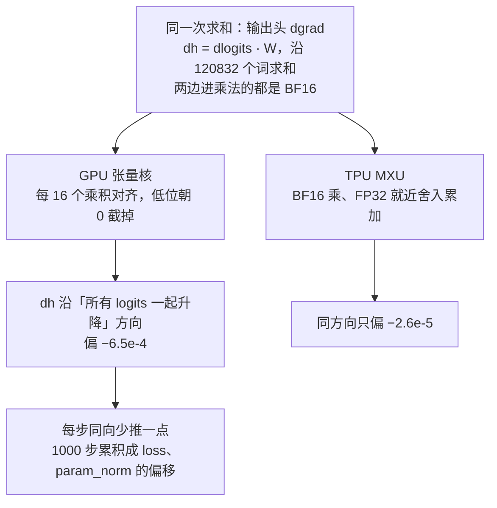
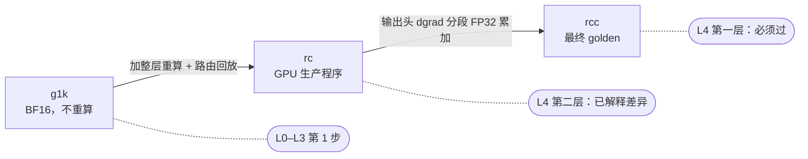

[janus](../../README.md) › [用户指南](README.md) › 第 2 章

[← 上一章：第 1 章 准备环境与数据](01-environment-data.md) ｜ [回目录](README.md) ｜ [下一章：第 3 章 TPU 侧准备 →](03-tpu-setup.md)

# 第 2 章 · 制作 GPU golden

TPU 要对齐的对象是 GPU。这一章在 GPU 上造出两样东西：

- **[golden](../glossary.md#golden)**：GPU 跑出的参照数据，包括逐步 loss 与各项范数，以及第 1 步逐层激活与梯度；
- **噪声带**（术语表里叫[噪声参照](../glossary.md#noise-reference)）：同样的配置多跑几份，两两之间本来就有多大的差。
  - 第 4 章判过不过用的就是这把尺子，不手写门槛。

| 这一步 | |
|---|---|
| 做什么 | GPU 先自己和自己比，证明工具可信（2.1）；再跑三组 golden（2.2、2.3，见表下） |
| 怎么做 | 2.3 的命令，在 GPU Pod 里用 `run.sh` 跑 |
| 做完看到什么算对 | `DONE`、`RUN_DONE <运行名> rc=0`；噪声上限和 2.4 同量级（见表下） |
| 下一步 | [第 3 章](03-tpu-setup.md)：把同一份权重、同一批数据搬到 TPU |

三组 golden（代号怎么读见[术语表](../glossary.md#golden-codenames)）：

- [`g1k`](../glossary.md#g1k)：第 1 步比较用（第一阶段 GPU golden，BF16、不开重算，1000 步，3 份）
- [`rc`](../glossary.md#rc)：GPU 生产 golden（整层重算加路由回放，即原版生产程序，5 份）
- [`rcc`](../glossary.md#rcc)：最终 golden（GPU 生产程序只把输出头 dgrad 改成分段 FP32 累加，其余设置与 `rc` 相同，10 份）

做完看到什么算对：

- 每份运行目录有 `DONE`。
- 日志最后一行 `RUN_DONE <运行名> rc=0`。
- `rcc-a..j` 10 份两两配对的 45 对算出的噪声上限，和 2.4 的表同量级。
  - 混元 3：loss 带符号均值 9.47e-5。

## 本章做完手里有什么

代号：`g1k`（第一阶段 GPU golden）、`rc`（GPU 生产 golden）、`rcc`（最终 golden）、`rcc-a`（最终 golden 的第 1 份，验收的比较基线）。

| 产物 | 给谁用 | 锚点 |
|---|---|---|
| 三组 golden 运行目录：`g1k-a/b/c`、`rc-a..e`、最终 golden `rcc-a..j`（2.3） | 第 4 章各级（每组给哪一级见 2.3 的表） | 每份运行目录里有 `DONE`；`run.sh` 最后一行 `RUN_DONE <运行名> rc=0` |
| 带 `data/batches` 的 golden | 第 3 章 TPU 回放同一批数据 | `g1k-a`、`rc-a`、`rcc-a` 都带 `--save-batches` |
| 第一层的噪声带 | 第 4 章 calibrated 判定 | `rcc-a..j` 10 份两两配对得到 45 对，2.4 的表 |

耗时：

- B200×8 上，30 步、第 1 步全量抓数一次约 3–4 分钟（[`frameworks/megatron/README.md`](../../models/hunyuan3/frameworks/megatron/README.md#6-训练并抓数)「6. 训练并抓数」）。
- 最终 golden `rcc` 每步约 0.38 s。
  - 生产 `rc` 约 0.24 s。
  - 多出的是输出头 dgrad 的分段循环，没做性能优化（[对齐报告](../../models/hunyuan3/ALIGNMENT-REPORT.md)第 6 节）。

## 2.1 先让 GPU 自己和自己比

工具本身会误报，或者 GPU 自己重跑就差很多，后面 TPU 的任何判定都没有意义。

所以在碰 TPU 之前，先用两次 GPU 运行，一个当被测、一个当 golden：

- 对齐实践 [`00-gpu-noise-and-drills`](../../models/hunyuan3/alignments/00-gpu-noise-and-drills/README.md)，下文叫「第一阶段」。
- 它回答下面三个问题。

### 要回答的三个问题

| 要回答的 | 怎么证明 | 混元 3 的结果 |
|---|---|---|
| 工具可信吗：该逐位的地方逐位，埋进去的错能抓到 | 确定性设置跑两次逐位；9 种故意埋的错每种都报警 | 见表下 ① |
| GPU 自己的噪声多大 | 默认设置跑多份，两两比 | 见表下 ② |
| GPU 参照本身是不是我们以为的样子 | 读运行时实际生效的配置；单算子回放 | 见表下 ③ |

混元 3 的结果：

- ① 工具可信：
  - 1000 步 loss、学习率逐步逐位（`phase1-determinism`）。
  - 期望抓到的错全部抓到（[故障矩阵](../../models/hunyuan3/alignments/00-gpu-noise-and-drills/faults/phase1-faults.md)）。
- ② GPU 自己的噪声：8 份 100 步运行两两 28 对，46 条检查 45 条过、1 条待定（`phase1-full-noise28`）。
- ③ GPU 参照本身（[00 README「三、GPU 参照本身」](../../models/hunyuan3/alignments/00-gpu-noise-and-drills/README.md#三gpu-参照本身)）：
  - 配置写 0.1 的权重衰减，实际生效 0.033。
  - 路由 GEMM 实际是「BF16 入、FP32 出」。

### 最小复现

只想复现最小的一条路（两次确定性运行 + 两个故意埋错，约 30 分钟）：

- 照 GPU 侧操作手册 [`frameworks/megatron/README.md`](../../models/hunyuan3/frameworks/megatron/README.md#7-复现第一阶段的代表性结果约-30-分钟)「7. 复现第一阶段的代表性结果」做。
- 期望值写在那一节的表里。

### 两种设置

| 设置 | 怎么开 | 性质 | 用途 |
|---|---|---|---|
| **确定性** | `run.sh … --deterministic` | 同配置重跑逐步逐位相同 | 基线、故障演练、「应当逐位」的检查：任何一位不同都是信号 |
| **默认** | 不加 `--deterministic`，三个确定性环境变量都不设 | 第 1 步前向逐位相同，第 2 步起反向的原子加不确定，重跑自然散开 | 量噪声 |

**噪声带只能用同一种设置的运行对**：

- 「设置」包括确定性开关和分布式优化器开关。
- 第一阶段 9 次 1000 步运行里，「分布式优化器开 + 默认设置」这一组比其他三组都持续低 2–7e-5（[方法详解：指标与判定](../reference/judging.md#噪声参照尺子从哪来)「噪声参照：尺子从哪来」）。
- 混着当参照，尺子会被撑松。

## 2.2 为什么最终 golden 是生产程序只修一处

<a id="22-为什么最终-golden-是精确轨迹"></a>

### GPU 生产程序自己有偏

最自然的 golden 就是 GPU 生产那样的 BF16 训练（[`rc`](../glossary.md#rc)）。

- 但混元 3 查出来（[案例 01](../../models/hunyuan3/alignments/01-v5p-acceptance/cases/01-loss-offset-param-norm.md) 的结论），**GPU 生产程序自己每一步都同向偏一点**。
- 偏在输出头那次沿 12 万词表的长求和（输出头 dgrad，dh = dlogits · W）：在 B200 上算得有偏。
- 所有 GPU 重跑都带着同一个偏差。噪声带再准，也会把算得正确的 TPU 判成「偏」。



- [张量核与 MXU](../glossary.md#tensor-core-mxu) 是两边做矩阵乘的硬件单元。
- 图里的数出自[对齐报告](../../models/hunyuan3/ALIGNMENT-REPORT.md)第 5 节台账 #1。
- 连「关 TF32 的 FP32 乘法」在 B200 上一次累加整个词表也有偏（台账 #2）。
  - 只有把词表分段、段间 FP32 累加才精确。

### 只修这一处：`rcc`

**所以最终 golden 是 `rcc`**（[术语表](../glossary.md#rcc)）：

- GPU 生产程序 `rc` 原样不动，只把输出头 dgrad 改成 FP32、词表按 1024 分段、段间 FP32 累加（[`rr_arms.py`](../../models/hunyuan3/frameworks/megatron/rr_arms.py) 的 `dgrad-chunk`）。
- 这是 GPU 生产与 TPU 生产之间唯一会累积到 1000 步、超出噪声的差。其余差别都已核对，在噪声内或两边共有（对齐报告第 5 节偏差台账）。
- 修掉它，TPU 生产就落在 `rcc` 自己重跑的散布里（第 4 章）。

三条理由：

- golden 应当是真正在跑的生产程序。`rcc` 只多了这一处修正，其余都是生产程序本身。
- `rcc` 和生产程序一样不确定，同设置重跑就是噪声样本。
  - 噪声带按一般规矩取它自己的重跑，不需要任何例外。
- 「全程 FP32」的精确轨迹只当查偏差的裁判，不当 golden：
  - 两边的生产程序都把流进输出头反向的 dlogits 舍成 BF16（台账 #4），这一份两边共有。
  - 拿精确轨迹当 golden，会把它算到 TPU 头上。

### 对 `rc` 的差：已解释差异

对 GPU 生产 `rc` 的差写成[已解释差异](../glossary.md#explained-difference)：

- TPU 对 `rc` 的第 1000 步 param_norm +2.09e-2（v5p、v7x 相同）。
- v5p 第 301–1000 步 loss 逐步相对差带符号均值 −1.37e-4（[`case01-tpu-vs-rc.json`](../../models/hunyuan3/alignments/01-v5p-acceptance/results/case01-tpu-vs-rc.json)）。
  - v7x 的定义与出处见[对齐报告](../../models/hunyuan3/ALIGNMENT-REPORT.md)第 3 节末。
- 全部来自这一处长求和。

排查是怎么一步步走到这里的（包括中间当过裁判的精确轨迹），见：

- [案例 01「一页看完」](../../models/hunyuan3/alignments/01-v5p-acceptance/cases/01-loss-offset-param-norm.md)
- [对齐报告](../../models/hunyuan3/ALIGNMENT-REPORT.md)第 2 节

### `rcc` 相对上游 Megatron-Bridge 改了什么

- 上游 = Megatron-Bridge `v0.7.0` 的预训练默认配置，容器 `nvcr.io/nvidia/nemo:26.10`。
- **Megatron 源码一行没改**，下面全是配置或 janus 侧的运行时补丁。
- 出处：
  - [对齐报告](../../models/hunyuan3/ALIGNMENT-REPORT.md)第 7 节
  - 逐项的出处、`meta.json` 字段与理由在 [`../../models/hunyuan3/goldens.md`](../../models/hunyuan3/goldens.md#主表最终-golden-rcc-对上游默认的全部改动以及试过的开关)「主表」

代号：下表的 `rcc` 是最终 golden；`dgrad-chunk` 是 GPU 侧运行时补丁脚本 [`rr_arms.py`](../../models/hunyuan3/frameworks/megatron/rr_arms.py) 里的一项（脚本按「臂」组织，每个臂只改一处数值行为），把输出头 dgrad 改成分段 FP32 累加。

| 改了什么 | 上游默认 | `rcc` | 为什么 | 改不改数值 |
|---|---|---|---|---|
| 输出头 dgrad（`dgrad-chunk`） | BF16 张量核一次乘完 | FP32、词表按 1024 分段、段间 FP32 累加，结果舍回 BF16 | 去掉 B200 长求和的偏差；唯一的数值改动 | 改：GPU 向精确值、向 TPU |
| 模型截断 | HF 全模型，带 MTP | 前 4 层，去掉 MTP | 单机能做完全部对齐；两边截法相同 | 两边同一个子模型 |
| 学习率 | cosine，warmup 500 步，3e-4 → 3e-5 | 常数 1e-5，无 warmup | 不让调度器成为变量；TPU 用 `wsd` 加 0 warmup、0 decay 得到同一个常数 | 两边设成一样 |
| 批与梯度累积 | 全局批 32，microbatch 2 | 全局批 16，microbatch 1，DP 8 → 每 rank 2 个 microbatch 累加 | 累加分组决定舍入位置；TPU 设成同样的 1 + 2 | 两边设成一样 |
| 数据 | Mock 数据 | fineweb-edu 实际数据，`split` 9999,1,0；TPU 原样回放 GPU 每一步每个 rank 的 batch | Mock 数据会被记住，量不出噪声；回放保证每步输入逐位相同 | 两边设成一样 |
| 并行 | recipe 没设 | EP 8，TP / PP / CP 1，DP 8，`alltoall` 分发 | 所有 golden 与噪声参照固定同一种切分 | golden 的一部分 |
| 分布式优化器、通信重叠 | 开、开 | 关、关 | 开着时 loss 比其余设置持续偏低 2–7e-5（相对）；全量抓数也要求关 | 关掉后是确定的一种 |
| 重算与路由回放 | 不重算 | 整层重算（`full / uniform / 1`）+ 路由回放 | 生产配置开重算；回放保证重算时不重选专家 | 1000 步统计在噪声内 |
| 运行环境 | 节点 NCCL 2.27、GCP NCCL 插件 | `env.sh`：前置容器里的 NCCL 2.31.2、关插件、Triton 缓存目录 | 只为了让程序跑起来 | 不改 |
| 抓数回调 | 无 | `JanusDump`：每步记 loss、范数、路由偏置 | 观测 | 不改（只读张量） |

- 其余都和上游相同：结构参数、优化器 β / ε / 实际生效的权重衰减 0.033、裁剪 1.0、种子、TF32、注意力实现、混合精度、梯度规约精度。
- [重算](../glossary.md#remat)是反向时重新算一遍前向的中间量、省显存。
- 路由回放是重算时沿用第一次前向选出的专家（MaxText 侧叫 rmap，TPU 运行名里的 `rmap` 就是它）。

### 三组 golden 的关系和用处



- 图里的代号：[`g1k`](../glossary.md#g1k)（第一阶段 GPU golden，BF16、不重算），[`rc`](../glossary.md#rc)（GPU 生产 golden，即原版生产程序），[`rcc`](../glossary.md#rcc)（最终 golden）。
- 图里的「L4 第一层 / 第二层」是第 4 章的[两层验收](04-level-by-level.md#两层验收l4-对哪份-golden)（验收的两层，不是模型的层）。

> **重算设置以你们生产实际用的为准**：
> - 这里取的是 Megatron 最常见的整层、逐层重算（`full` / `uniform` / `1`）。
> - 生产配置不同时，按实际配置重跑 `rc` / `rcc`（[03 README](../../models/hunyuan3/alignments/03-gpu-remat-golden/README.md) 开头）。

## 2.3 要造哪几组 golden、怎么跑

### 每组给哪一级用

代号怎么读见[术语表](../glossary.md#golden-codenames)：`g1k`（第一阶段 GPU golden，BF16、不重算），`rc`（GPU 生产 golden，即原版生产程序），`rcc`（最终 golden）。

| golden | 份数 | 给哪一级用 | 为什么 |
|---|---|---|---|
| `g1k-a/b/c` | 3 | L0 数据回放；L1、L2、L3 的第 1 步 | 第 1 步的单算子、逐层比较要一份 **BF16** golden（见表下） |
| `rc-a..e` | 5 | L4 第二层（[已解释差异](../glossary.md#explained-difference)） | GPU 生产程序 |
| `rcc-a..j` | 10 | L4 第一层（必须过）（见表下） | 最终 golden：`rc` 的配置加 `--rr-arm dgrad-chunk` |

- `g1k` 为什么要 BF16：
  - [R-ratio](../glossary.md#r-ratio)（被测离 FP64 的距离 ÷ GPU 离 FP64 的距离）的分母是「GPU 离 FP64 多远」。
  - 全程 FP32 的 golden 离 FP64 太近，R 会被放大（推断）。
- `rcc-a..j` 在 L4 第一层的用法：
  - 基线 `rcc-a`。
  - 噪声带 `rcc-a..j` 10 份两两配对得到 45 对。
  - 路由偏置曲线、健康信号也对它。

### 跑命令

- 命令都在 GPU Pod 里、仓库检出目录下执行。
- `--janus-run` 要写**绝对路径**（`run.sh` 会先切到工作目录），下面用 `/data/janus-runs`。
- 每次用一个新目录。

```bash
cd /data/janus-src
GC="--load /data/hy3-4l-mcore --data /data/ds/fw_hy3_text_document"      # 其余取 train_hy3.py 默认：gbs 16、mbs 1、seq 4096、EP 8、lr 1e-5、seed 1234
MG=models/hunyuan3/frameworks/megatron/run.sh

# g1k：默认设置，不重算。g1k-a 另存每步原始输入，TPU 回放用
flock /data/gpu.lock bash $MG g1k-a 1000 $GC --janus-run /data/janus-runs/g1k-a --side golden-g1k-a --dump-steps 1,1000 --full --save-batches
flock /data/gpu.lock bash $MG g1k-b 1000 $GC --janus-run /data/janus-runs/g1k-b --side golden-g1k-b --dump-steps 1,1000 --full   # g1k-c 同

# rc：再加整层重算 + 路由回放
flock /data/gpu.lock bash $MG rc-a 1000 $GC --recompute --routing-replay --janus-run /data/janus-runs/rc-a --side golden-rc-a --dump-steps 1,1000 --full --save-batches
flock /data/gpu.lock bash $MG rc-b 1000 $GC --recompute --routing-replay --janus-run /data/janus-runs/rc-b --side golden-rc-b --dump-steps 1 --full   # rc-c..e 同

# rcc（最终 golden）：rc 的配置 + 输出头 dgrad 分段 FP32 累加。rcc-a 是基线，另存每步原始输入
flock /data/gpu.lock bash $MG rcc-a 1000 $GC --recompute --routing-replay --rr-arm dgrad-chunk --no-dist-opt --janus-run /data/janus-runs/rcc-a --side golden-rcc-a --dump-steps 1000 --save-batches
# rcc-b..j：同设置原样重跑，只造噪声带（--dump-steps 100000 等于不抓张量，只记逐步指标）
flock /data/gpu.lock bash $MG rcc-b 1000 $GC --recompute --routing-replay --rr-arm dgrad-chunk --no-dist-opt --janus-run /data/janus-runs/rcc-b --side golden-rcc-b --dump-steps 100000   # rcc-c..j 同
```

### 命令说明

- 命令的出处：
  - `rcc`（最终 golden）：按运行目录 `meta.json` 里记下的参数写出。
    - `rr_arm: dgrad-chunk`、`no_dist_opt: true`、`full: false`。
    - `rcc-a` 的 `dump_steps` 是 `1000` 并存了输入，`rcc-b..j` 是 `100000`。
  - `rc`（GPU 生产 golden）：照 [`frameworks/megatron/README.md`](../../models/hunyuan3/frameworks/megatron/README.md#第一阶段每次运行的参数)「第一阶段每次运行的参数」下面的重算 golden 表。
  - `g1k`（第一阶段 GPU golden）：参数照 01 [`setup.md`](../../models/hunyuan3/alignments/01-v5p-acceptance/setup.md#两边)「两边」表的「训练配置」一行（`--save-batches` 是 TPU 回放的要求）。
  - 复现以运行目录 `meta.json` 里记下的实际配置为准。
- **全量抓数只在最小的那个抓数步做**：
  - `--dump-steps 1,1000 --full` 是第 1 步全量（梯度、更新前后主权重、Adam 动量），第 1000 步只抓前向。
  - `rcc` 只用于 L4，第 1 步的逐层比较用 `g1k`，所以 `rcc-a` 只抓第 1000 步、不带 `--full`。
  - 不带 `--full` 时要显式写 `--no-dist-opt`：golden 一律关分布式优化器（[`../../models/hunyuan3/goldens.md`](../../models/hunyuan3/goldens.md)「分布式优化器」行）。
- **TF32 只有 `NVIDIA_TF32_OVERRIDE=0` 关得干净**：
  - 容器默认开着 TF32。
  - torch 的开关管不到 Transformer Engine 的 FP32 GEMM。
  - 读回来的开关值也不能当证据（[方法详解：环境](../reference/environment.md#第一阶段踩到的坑)「第一阶段踩到的坑」第 4 条）。
  - 训练脚本把一次实测写进 `meta.json` 的 `tf32`，以实测为准。
- 不加 `--deterministic`：`run.sh` 会把三个确定性环境变量清掉。
- 全部参数的说明在 [`train_hy3.py`](../../models/hunyuan3/frameworks/megatron/train_hy3.py) 的 `--help`。
- `--fp32`、`--bf16-weights` 这类「全程 FP32」的参数只在排查时当裁判用，造 golden 用不到。

### 做完看到什么算对

- 每份运行目录里有 `DONE`。
- `run.sh` 最后一行 `RUN_DONE <运行名> rc=0`。

## 2.4 噪声带与基线

### 比较协议

出处：[`../../models/hunyuan3/goldens.md`](../../models/hunyuan3/goldens.md#比较协议几份-golden-只造噪声带正式比较只对一份)「比较协议：几份 golden 只造噪声带，正式比较只对一份」。

loss 这类逐步曲线用三个**判定量**来比：

- 带符号均值（有没有固定方向的偏移）
- MARE（平均波动）
- 最大单步

算法见 [`reference/metrics.md`](../reference/metrics.md#逐步序列lossgrad_normparam_norm)「逐步序列」。

1. 几份 golden **只用来造噪声带**：
   - 两两比，每一对算一遍判定量。
   - 所有对里的最大值就是[噪声上限 N](../glossary.md#noise-ceiling)。
   - 带符号均值另有一个按标准误给的下限，算法见 [`reference/metrics.md`](../reference/metrics.md#噪声上限-n)「噪声上限 N」。
2. **正式比较只对一份事先指定的 golden（[基线](../glossary.md#baseline)）**：
   - 混元 3 是 [`rcc-a`](../glossary.md#rcc-a)（最终 golden `rcc` 的第一份）。
   - 噪声带是 `rcc-a..j` 10 份两两配对得到的 45 对，和基线同一种设置。
   - 不对几份取平均，也不取对各份里最差的那个。
   - 理由：N 量的是「两份运行之间差多少」，被测也该是「和一份运行之间的差」，口径才一致。
3. 换一份当基线，r（被测的差 ÷ N）可能挪动约 1：
   - N 取所有对里的最大值，已经把这个挪动算进去了。
   - 基线 `rcc-a` 第 2 步 loss 就比其余九份都高约 8e-5（绝对值），之后回到散布里。

> **写检查项目录时注意**：
> - 要么 `golden` 只列基线一份、噪声对写进 `runs.noise`；
> - 要么列多份并写 `params.baseline: <名>`。
> - **列了多份 golden 却不写 `baseline`，janus 默认取对各份里最差的一份**，和上面的协议不一样（[`reference/checks/multi_golden.md`](../reference/checks/multi_golden.md)）。

### 两处测量口径

这两处口径也写进了第一层的检查项目录：

- grad_norm 用两边均值作分母（`params: {denominator: mean}`；这是混元 3 的做法，混元 4 自 2026-11-10 起一律用参照作分母）。
- param_norm 的被测读分组合成的 `param_norm_from_groups`（`select.test_field`）。
- 原口径的结果作为只报项 `L4.grad_norm.golden_den`、`L4.param_norm.raw` 并排保留。
  - 用 `rcc-a..j`（最终 golden 的 10 份）两两 45 对的噪声上限判，也全部过。
- 为什么要改见[方法详解：指标与判定](../reference/judging.md#两处测量口径被测与参照的量要一样准统计量要对称)「两处测量口径：被测与参照的量要一样准、统计量要对称」。

### 现在的噪声带有多宽

下表是 loss 的带符号均值，噪声上限 N。代号：[`rcc`](../glossary.md#rcc)（最终 golden），[`rcc-a`](../glossary.md#rcc-a)（最终 golden 的第 1 份，验收的比较基线），[`rc`](../glossary.md#rc)（GPU 生产 golden）。

| golden | 份数 / 对数 | 第 1–1000 步 | 第 301–1000 步 | 出处 |
|---|---|---|---|---|
| `rcc`（最终，基线 `rcc-a`） | 10 / 45 | 9.47e-5 | 1.21e-4 | `phase2-acceptance-rcc-on.results.json` |
| `rcc`（起初只有 `a..e`） | 5 / 10 | 6.72e-5 | 7.92e-5 | 案例 01「附录：rcc 的散布（10 份）与 TPU 执行扰动系综」 |
| `rc` | 5 / 10 | 6.83e-5 | 6.58e-5 | `phase2-acceptance-rc.results.json` |

为什么从 5 份加到 10 份：

- `rcc` 从 5 份（10 对）加到 10 份（45 对），N 变宽。
  - N 取所有对里的最大值，对数越多越接近真实的散布上沿。
- 10 对时：
  - v5p 的 grad_norm、v7x 的 grad_norm 与 param_norm 落在 1.02–1.24 倍的待定区。
  - 所有比值都在 0.7–1.3 之间、没有一项明显偏大，像是参照太少。
- 再跑 `rcc-f..j` 五份、凑成 10 份 45 对，N 把它们全部收进来（[案例 01「附录：rcc 的散布（10 份）与 TPU 执行扰动系综」](../../models/hunyuan3/alignments/01-v5p-acceptance/cases/01-loss-offset-param-norm.md#附录rcc-的散布10-份与-tpu-执行扰动系综)）。

另一个量级参照：

- `g1k`（[第一阶段 GPU golden](../glossary.md#g1k)，BF16、不重算）那种设置的 GPU 跑 10 份，第 301–1000 步 loss 带符号均值的标准差是 2.7e-5。
- 出处：[案例 01](../../models/hunyuan3/alignments/01-v5p-acceptance/cases/01-loss-offset-param-norm.md) 第 6 节「噪声带」行。

### 份数够不够

- [方法详解：指标与判定](../reference/judging.md#参照要几对)「参照要几对」建议：
  - 正式签字前每种设置至少 6 份（15 对）；
  - 最大单步这类极值统计量最好 8 份（28 对）。
- 第一层的噪声带（`rcc`，最终 golden）10 份 45 对，两条都满足。

## 2.5 上传与登记

### 上传

运行目录传到桶里（传完逐文件核对大小）：

```bash
python /data/jw/upload_run.py /data/janus-runs/<运行名> gs://<POC 桶>/janus/hunyuan3-4l/golden/<运行名>
```

- Pod 的 `/data` 删 Pod 就没了，跑完就传。
- 体积：带第 1 步全量抓数的 1000 步运行目录每份约 50 GB（实测四份共 198 GB，[`frameworks/maxtext/README.md`](../../models/hunyuan3/frameworks/maxtext/README.md#在-tpu-上跑)「在 TPU 上跑」）。
  - 几组 golden 加起来远超一块本地盘，边跑边传。

### 登记

- 每次运行在对应对齐实践的 `runs.yaml` 登记一条。
- 运行名前缀的含义统一在 [`models/hunyuan3/README.md`](../../models/hunyuan3/README.md#运行名前缀)「运行名前缀」。
- 每份运行的逐步原值（`metrics.jsonl`）拷一份进实践的 `results/series/`，总览画逐步曲线用。

---

下一步：GPU 一侧的参照与尺子都有了。第 3 章把同一份权重和同一批数据搬到 TPU 上，配置逐项对齐，跑出第一次能和 golden 比的 TPU 运行。

[← 上一章：第 1 章 准备环境与数据](01-environment-data.md) ｜ [回目录](README.md) ｜ [下一章：第 3 章 TPU 侧准备 →](03-tpu-setup.md)
