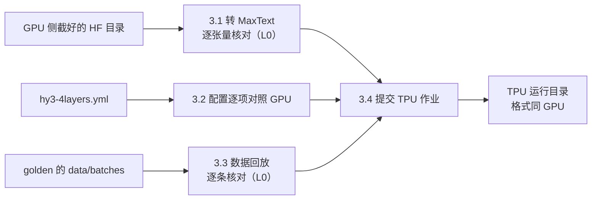

[janus](../../README.md) › [用户指南](README.md) › 第 3 章

[← 上一章：第 2 章 制作 GPU golden](02-gpu-golden.md) ｜ [回目录](README.md) ｜ [下一章：第 4 章 逐级对齐 L0 → L4 →](04-level-by-level.md)

# 第 3 章 · TPU 侧准备

目标：在 TPU（MaxText）上跑出**输入与 golden 逐位相同**的训练，第 4 章才能逐级去比：

- 同一份权重
- 同一份配置
- 同一批数据

前三件事在 CPU 上做完、都有正式检查兜底，最后才上 TPU。



两个平台都是 8 个 JAX 设备，对上 GPU 的 8 卡：

- **v5p-8**（2x2x2，2 台主机）先调通。
- 之后 **v7x-4**（2x2x1，1 台主机，4 芯片 8 个 device）。
- 本仓库的「v5p-8」指 8 颗芯片（拓扑 2x2x2、2 台主机、8 个 JAX 设备）。
  - 云上的型号名按 TensorCore 计数（每颗芯片 2 个），同一拓扑在云上叫 v5p-16。
  - 申请资源时以拓扑为准。

完整命令与每个参数在 TPU 侧操作手册 [`frameworks/maxtext/README.md`](../../models/hunyuan3/frameworks/maxtext/README.md)。

| 这一步 | |
|---|---|
| 做什么 | 在 TPU 上跑出输入与 golden 逐位相同的训练（见表下） |
| 怎么做 | 3.1–3.3 在 CPU 上做；3.4 用 `run.sh` 提交 TPU 作业 |
| 做完看到什么算对 | 权重、配置、输入三项检查全过；同一程序重跑逐位（见表下） |
| 下一步 | [第 4 章](04-level-by-level.md)：逐级比 L0 → L4 |

做什么：

- 同一份权重：转成 MaxText 并逐张量核对。
- 逐项对齐的配置（含四个精度开关）。
- 回放同一批数据。

怎么做：

- CPU 上：3.1 权重转换与 L0 核对、3.2 配置对照、3.3 数据回放核对。
- TPU 上：3.4 用 `run.sh` 提交 TPU 作业。

做完看到什么算对：

- `phase2-ckpt-convert` 3 条全过（1781 个张量逐位）。
- 30 步冒烟的配置对照、输入指纹两行全过。
  - 混元 3 v5p：6 个字段、1950 个单元一致。
- 同一程序重跑逐位。

## 本章做完手里有什么

| 产物 | 位置 | 锚点 |
|---|---|---|
| MaxText 检查点（FP32） | `gs://<POC 桶>/janus/hunyuan3-4l/maxtext/hy3-4l-maxtext/0/items` | `phase2-ckpt-convert` 3 条 L0 检查全过：1781 个张量逐位 |
| 一次 30 步的 TPU 冒烟运行 | `gs://<POC 桶>/janus/hunyuan3-4l/tpu/<运行名>/` | L0 配置对照、输入指纹两行全过 |
| 第 4 章要的几次 TPU 运行 | 同上 | 运行目录里有 `DONE`；日志里有 `JANUS_READY` |

耗时：

- 权重转换在 CPU 上约 4 分钟、要约 60 GB 内存。
- 当前对齐配置每步：
  - v5p-8 1.607 s（`t-rmap-on-1000`，TPU v5p 当前对齐配置 1000 步）；
  - v7x-4 0.980 s（`t-v7x-on-1000`，同一配置在 v7x 上 1000 步）。
  - 都是各运行 `metrics.jsonl` 第 50–1000 步步时中位数，读数见 [`../../models/hunyuan3/goldens.md`](../../models/hunyuan3/goldens.md)「对照：TPU 侧为对齐配的开关」的 EP 行。
- v5p 上 1000 步纯训练约 27 分钟（推断：1.607 s × 1000，不含编译、排队与取回）。
  - 第 7 章 T1 的「约 25 分钟」是另一次运行、另一版配置下提交到取回的实测。

## 3.0 准备：代码、镜像、要搬的东西

- **代码**：`maxtext` 的 `hunyuan` 分支，要 `0622774` 或更新。
  - 对齐配置打开的四个精度开关要这个版本，见 3.2。
  - 训练循环、数据回放、抓数都在 janus 里，**不改 MaxText 源码**。
- **镜像**：MaxText 官方 `tpu_pre_training` 0.2.5，按 digest 钉死在 `run.sh` 里。
  - 实际的 jax / jaxlib / libtpu 版本在运行时读出来写进 `meta.json`；在 Pod 里另装 libtpu 时以 `meta.versions.libtpu_pip` 为准。
  - 这个镜像带 jax 0.11.1、libtpu 0.0.46，两个模型的对齐都在它上面测；混元 3 的运行只记了构建号 `cl/963683785`，按构建号认作 0.0.46，构建号到 pip 版本的对应已由同构建号的探针运行核过（[环境「两个模型实测用的版本」](../reference/environment.md#两个模型实测用的版本)）。
  - **libtpu 版本会改数值，不只改求和顺序**：混元 4 上 0.0.46 → 0.0.52，「RMSNorm 多舍一次」的影响从 r 1.06 变成 5.50，词嵌入 scatter 插排序的门槛也变了。换版本前先看 [`libtpu-052.md`](../../models/hunyuan4/alignments/04-tpu-self/libtpu-052.md)：先建新 golden、重测已知敏感项，再做别的。0.0.50 / 0.0.50.1 不用（[环境](../reference/environment.md#tpu-侧)）。
  - **v5p 上 0.0.46、0.0.48、0.0.51、0.0.52 都有一个 jit 静默算错的编译器 bug**（多输出 fusion 含 DUS，[混元 4 案例 16](../../models/hunyuan4/cases/16-jit-miscompile-sub8-row-block.md)）。存档的 292 份训练步程序扫出 0 处，覆盖混元 3 截 4 层与混元 4 mini 存了 HLO 的运行；mini 现行比较 `tz-off-rep` 与推荐组合 `x5-prod` 没存 HLO，在 CPU 上按 `meta.json` 重编后扫也是 0 处（离线程序与上卡程序是同一份是推断）；混元 3 正式被测不在内；新形状、新切分上线前先用 `models/hunyuan4/analysis/hlo_mof_dus_scan.py` 扫一遍训练步的优化后程序（[差异清单 F8](../reference/tpu-vs-gpu-differences.md#f8-jit-静默算错dus-和读同一缓冲的算子被合进一颗多输出-fusion)）。
- **对齐阶段不加性能类 libtpu 参数**（`LIBTPU_INIT_ARGS` 默认空）。
  - 要加，先用「同程序、只改这一个开关」证明它不改数学（[方法详解：环境](../reference/environment.md#tpu-侧)「TPU 侧」）。
- **把 GPU 侧的产物搬到桶里**：
  - 截好的 HF 目录（约 24 GB）整份传到 `gs://<POC 桶>/janus/hunyuan3-4l/hf/hy3-4l/`。
  - golden 运行目录照第 2 章「上传与登记」传到 `…/golden/<运行名>/`。
  - CPU 机器上做 3.1、3.3 时再拉到本地。
- **CPU 上装 MaxText 环境**（3.1 要用）：几条命令在 [`frameworks/maxtext/README.md`](../../models/hunyuan3/frameworks/maxtext/README.md#步骤)「步骤」表下面。
- **提交机**要能 `kubectl` 到 TPU 集群（集群里装了 JobSet 控制器），并有 `gs://<POC 桶>/janus/hunyuan3-4l/tpu/` 的写权限。

## 3.1 权重：转换与 L0 逐位核对

- TPU 用第 1 章截好的**同一份 HF 目录**，不重新截。
- 映射全写在 [`name_map.yaml`](../../models/hunyuan3/model/name_map.yaml)：只有转置、改形状、切片、拼接，没有算术。
- 逐参数对照见 [`frameworks/maxtext/README.md`](../../models/hunyuan3/frameworks/maxtext/README.md#权重映射与核对)「权重：映射与核对」。

### 跑命令

- 在 CPU 机器上，于 `models/hunyuan3/model/` 下执行。
- `<运行根>` 是本地放运行目录的文件夹，第 4 章还会用。

```bash
# 1 核对映射：都打印 OK
python verify_ckpt.py names --hf <HF 目录>
python verify_ckpt.py megatron --hf <HF 目录> --gpu-run <运行根>/g1k-a          # 对一份 BF16 golden 的参数清单
# 2 转换：约 60 GB 内存、4 分钟；输出目录名取 hy3-4l-maxtext
JAX_PLATFORMS=cpu python convert_hf_to_maxtext.py --hf <HF 目录> --out <工作目录>/hy3-4l-maxtext
# 3 L0 正式检查：两边各写一个运行目录，名字必须是这两个（检查项目录按名字找）
python verify_ckpt.py hf-manifest --hf <HF 目录> --janus-run <运行根>/hy3-4l-hf
JAX_PLATFORMS=cpu python verify_ckpt.py maxtext --ckpt <工作目录>/hy3-4l-maxtext/0/items --hf <HF 目录> --janus-run <运行根>/hy3-4l-maxtext-ckpt
cd ../../.. && python -m janus run models/hunyuan3/alignments/01-v5p-acceptance/catalogs/phase2-ckpt-convert.yaml --root <运行根> --out /tmp/ckpt-convert
# 4 上传
gcloud storage cp -r <工作目录>/hy3-4l-maxtext gs://<POC 桶>/janus/hunyuan3-4l/maxtext/
```

### 命令说明

- 第 1 步对 golden 的核对要用 **BF16** 的 golden（`g1k-a`，[`g1k`](../glossary.md#g1k) 是第一阶段 GPU golden，BF16、不重算）：
  - 它带第 1 步全量抓数，存的参数和 HF 原件同为 BF16。
- 第 3 步不是看脚本打印，而是 janus 的正式检查：
  - 把 MaxText 检查点按映射**反向还原**回 HF 的命名与形状；
  - 逐张量算原始字节的 sha256，对 HF 原件的清单。
- 检查点存 FP32：MaxText 的 `weight_dtype=float32` 就是主权重。
  - BF16 → FP32 精确，转回 BF16 逐位还原。

### 做完看到什么算对

- 第 3 步期望 3 条全过，退出码 0。
- 混元 3 的结果（[`phase2-ckpt-convert`](../../models/hunyuan3/alignments/01-v5p-acceptance/results/phase2-ckpt-convert.report.md)）：
  - 1781 个张量逐位相同、0 个只在一边；
  - dtype 3 个 FP32（`expert_bias`）、1778 个 BF16。
- 同一份检查点给 v5p、v7x 共用。

## 3.2 配置逐项对照

### 对照表分六块

两边配置逐项对照在 [`../../models/hunyuan3/config-alignment.md`](../../models/hunyuan3/config-alignment.md)，所有对齐实践共用。

- 每一行写：为什么关键、GPU 怎么配、TPU 怎么配、对齐方式（相同 / 等价 / 不可避免差异）、状态、证据。
- 它分六块：

| 块 | 看什么 |
|---|---|
| [模型结构](../../models/hunyuan3/config-alignment.md#模型结构) | 层数、头数、专家数、路由打分、RoPE、归一化 |
| [数值精度](../../models/hunyuan3/config-alignment.md#数值精度) | 每一处 BF16 / FP32 舍入点；四个精度开关；输出头 dgrad |
| [优化器与调度](../../models/hunyuan3/config-alignment.md#优化器与调度) | AdamW 超参、**实际生效**的权重衰减 0.033、学习率曲线、裁剪 |
| [数据](../../models/hunyuan3/config-alignment.md#数据) | 回放、loss 平均方式、microbatch 切法 |
| [并行与确定性](../../models/hunyuan3/config-alignment.md#并行与确定性) | GPU DP8 + EP8 对 TPU FSDP8（[并行方式](../glossary.md#parallel)）；重算；种子 |
| [为对齐改过的代码](../../models/hunyuan3/config-alignment.md#为对齐改过的代码) | MaxText 里加的开关，各自对上哪一处 GPU 写法 |

### 最容易错的几项

TPU 一侧的配置文件 [`hy3-4layers.yml`](../../models/hunyuan3/frameworks/maxtext/hy3-4layers.yml) 每一行都注明了 GPU 一侧的值与出处。最容易错的几项：

代号：重算一行的 [`rc`](../glossary.md#rc) 是 GPU 生产 golden，[`rcc`](../glossary.md#rcc) 是最终 golden（第 2 章）。

| 项 | GPU（golden 的 `meta.json`） | TPU |
|---|---|---|
| 权重衰减 | **实际 0.033**（调度器覆盖了配置里的 0.1）；一维参数不衰减 | `adam_weight_decay=0.033`，`adamw_mask: ["norm/scale"]` |
| 学习率 | 1e-5 常数，无预热 | `wsd`，预热与衰减都为 0 → 常数 1e-5 |
| 路由 | sigmoid + `expert_bias`，top-8，FP32 出，偏置更新率 1e-3，缩放 2.826 | 同值；`float32_gate_logits: True`；`matmul_precision=default`（BF16 乘、FP32 累加）。这是混元 3 的取值；新模型按[差异清单 B3](../reference/tpu-vs-gpu-differences.md#b3-路由-logits-的精度决定选哪个专家) 设 `router_matmul_precision: highest`（混元 4 已设，L1 路由 logits 对 FP64 R 0.106；默认精度下 top-k 约 1%–2% 的 token 与 FP64 不同是测试模型上的测量，不是混元 4 的读数，见[环境「测试模型上的答案」注 1](../reference/environment.md#测试模型上的答案换到被测模型要再核)） |
| microbatch | gbs 16、每卡 2 个 microbatch 分两次前反向再累加 | `per_device_batch_size=1`、`gradient_accumulation_steps=2` |
| 重算 | 整层重算 + 路由回放（`rc` / `rcc`） | 命令行覆盖，见 3.4「生产配置」 |
| MTP / dropout | 关 / 0 | `mtp_num_layers=0`（`train_hy3.py` 自动加）/ `dropout_rate=0` |
| 并行 | DP8 + EP8 | FSDP8：归约顺序不同，列为已知差异。TPU 一侧换切法不一定只换顺序：混元 4 上纯数据并行（词嵌入梯度 BF16 scatter）、上下文并行（sink 梯度在 BF16 里算）都改了精度路径，要开对应开关（[TPU 自比「一页看完」](../../models/hunyuan4/alignments/04-tpu-self/README.md#一页看完六件真有影响的和三条规律)）；生产切法与验收用的切法不同时要重测 |

### 四个精度开关

**四个精度开关都打开**，让 TPU 的舍入点和 GPU 写法一致：

| 开关 | 作用 | 去掉哪一处差（量级） | 对齐必需？ | 对照行 |
|---|---|---|---|---|
| `dense_fp32_accumulation` | 切开的收缩维部分和改用 FP32 相加（见表下） | 不开时 qkv、稠密层 fc1 的前向 R-ratio 超线（v5p 1.24 / 1.29，v7x 1.57 / 1.58） | 必需 | [「收缩维被 FSDP 切开的投影的累加精度」](../../models/hunyuan3/config-alignment.md#数值精度) |
| `rmsnorm_single_rounding` | RMSNorm 在 FP32 里算完只舍一次 | 见表下 | 混元 3 推荐（显式保证，对齐、生产都开；libtpu 0.0.46 上不开前向也逐位不变）；换 libtpu 时必需（混元 4 在 0.0.52 上不开时主 loss 系统性偏高，见表下） | [「RMSNorm 舍入次数」](../../models/hunyuan3/config-alignment.md#数值精度) |
| `mlp_activation_round_per_op` | 门控激活 silu(gate)·up 按 GPU 的两个算子分别舍入 | 默认写法与 GPU 只有 73.7% 元素逐位，打开后 100% | 推荐 | [「门控激活舍入」](../../models/hunyuan3/config-alignment.md#数值精度) |
| `routed_gate_bf16_rounding` | 路由权重按 GPU 的写法先舍成 BF16 | 路由默认精度下开和不开编出同一个程序（混元 3）；路由设 `highest` 后开关有差别（[精度边界第 8 类](../reference/precision-boundaries.md)） | 可选（显式保证） | [「路由核 BF16 舍入」](../../models/hunyuan3/config-alignment.md#数值精度) |

- `dense_fp32_accumulation` 的作用：
  - FSDP 把矩阵乘的收缩维切成几段，默认每段的部分和用 BF16 相加、多舍入一次；
  - 打开后改成 FP32 相加、最后只舍一次。
- `rmsnorm_single_rounding` 去掉哪一处差：
  - 混元 3（libtpu 0.0.46，v5p）：前向已被 XLA 编成只舍一次，打开后前向逐位不变；反向 `in.grad` 对 golden 略降（2.09e-3 → 2.06e-3）。
  - 混元 4 TPU 自比：libtpu 0.0.46 上不开它曲线 r 1.06，能忍；0.0.52 上不开它主 loss 系统性偏高，r 5.50（1000 步 3.68），不能忍。所以对齐、生产都要开，不依赖「编译器碰巧省掉中间那次舍入」。机理见 [impacts/04](../../models/hunyuan4/alignments/04-tpu-self/impacts/04-rmsnorm-double-rounding.md)。
- 数字出自[对齐报告](../../models/hunyuan3/ALIGNMENT-REPORT.md)第 6 节开关表。
- 每一行 GPU 怎么写、TPU 怎么写、证据在哪，点最后一栏进 [`../../models/hunyuan3/config-alignment.md`](../../models/hunyuan3/config-alignment.md#数值精度)。

### 代价与配置版本

- 打开 `dense_fp32_accumulation` 的代价：生产配置 100 步，步时 v5p +0.66%、v7x +1.9%，显存峰值不变。
  - 出处：[01 README](../../models/hunyuan3/alignments/01-v5p-acceptance/README.md) 结论中「对齐配置打开 `dense_fp32_accumulation`」一条（这个开关让 FSDP 切开收缩维的投影改用 FP32 累加）。
- TPU 侧为对齐配的全部开关与理由，另见 [`../../models/hunyuan3/goldens.md`](../../models/hunyuan3/goldens.md#对照tpu-侧为对齐配的开关)「对照：TPU 侧为对齐配的开关」。
- `hy3-4layers.yml` 改过几个版本，各运行用的哪一版记在 01 [`setup.md`](../../models/hunyuan3/alignments/01-v5p-acceptance/setup.md#配置文件版本)「配置文件版本」：结论按当时的配置读。

## 3.3 数据：回放同一批输入

不重新分词，也不走 MaxText 的数据管线：

- [`replay.py`](../../models/hunyuan3/frameworks/maxtext/replay.py) 读 golden 运行目录里的 `data/batches`。
  - 内容是 GPU 每个 rank、每步、每个 microbatch 原样的 tokens / labels / loss_mask / position_ids。
- 每个字段先核 sha256，再拼成 TPU 的全局 batch。

### 怎么拼

- **全局第 r·M + m 行 = GPU rank r 的第 m 个 microbatch**（M = 2）。
  - MaxText 把全局 batch 按 batch 维均分到 8 个分片，第 d 个分片正好拿到 GPU rank d 的两个 microbatch。

  ```mermaid
  flowchart LR
    subgraph GPU["GPU：8 个 rank，每步各 2 个 microbatch（rank 2–6 同理）"]
      G0["rank 0：mb 0、mb 1"]
      G1["rank 1：mb 0、mb 1"]
      G7["rank 7：mb 0、mb 1"]
    end
    subgraph TPU["TPU：全局 batch 16 行，按 batch 维切成 8 片"]
      T0["第 0、1 行 → 分片 0"]
      T1["第 2、3 行 → 分片 1"]
      T7["第 14、15 行 → 分片 7"]
    end
    G0 --> T0
    G1 --> T1
    G7 --> T7
  ```

### 怎么核

- TPU 每步把喂进设备的 batch **从设备读回来**算 sha256，写成和 GPU 同格式的输入指纹。
  - 第 4 章的 `L0.data.fingerprint` 按「步 · rank · microbatch」逐位对 golden。
- 上 TPU 之前先在 CPU 上核一遍（只要 `data/`）：

  ```bash
  python models/hunyuan3/frameworks/maxtext/replay.py check <运行根>/g1k-a
  ```

  - 做完看到什么算对：打印 `OK`（1000 步 × 16 个 microbatch 的 sha256 全对）。

### 生产用 TPU 原生的数据加载器时

- MaxText 的 Grain 管线可以直接读 GPU 用的 Megatron `.bin/.idx`。
- 逐样本对拍 GPU 的结果：换序后 1000 步 64000 个单元逐元素相同。
  - 前提：只在混元 3 上、只在 CPU 上对拍（MaxText 上游 `ce608b9`），多主机是模拟的；TPU 首步 loss、TPU 续训位置、真多机都没做（[混元 3 覆盖审计](../../models/hunyuan3/alignments/00-gpu-noise-and-drills/coverage.md)「TPU 原生数据加载器」）。混元 4 全程用回放，原生加载器没有对拍。
- 另有两处约定差异（设备分配、pad id 处理）要知道。
  - 说明：[`data/README.md`](../../models/hunyuan3/data/README.md)
  - 结果：[`phase2-native-loader`](../../models/hunyuan3/alignments/01-v5p-acceptance/results/phase2-native-loader.report.md)
- 对齐阶段用回放，排除数据管线的影响。

## 3.4 提交 TPU 作业

### 打包

- `stage.sh` 把 MaxText 与 janus 各打成一个包传到桶里，打印 `run.sh` 要的环境变量。
- 它只打 git 里**已提交**的内容，要求 janus 工作树干净。
  - 本地改过的文件（例如第 1 章改的 `pod.yaml`）先提交到自己的分支或复制到仓库外。

```bash
export BUCKET=gs://<POC 桶>
source <(bash models/hunyuan3/frameworks/maxtext/stage.sh <maxtext 克隆> [maxtext 提交，默认 origin/hunyuan])   # 先 git fetch
```

### 提交

- 默认提交到你自己的节点池。
- `run.sh` 提交一个 JobSet，每台主机跑同一条命令，进程 0 写运行目录。
- 提交机等训练结束（Pod 打出 `JANUS_READY`）后：
  - 把运行目录取回本地 `~/janus-runs/`；
  - 再传到 `gs://<POC 桶>/janus/hunyuan3-4l/tpu/<运行名>/`。

```bash
export CONTEXT=<TPU 集群的 kubectl 上下文> NODEPOOL=<你的 TPU 节点池>
export GOLDEN=gs://<POC 桶>/janus/hunyuan3-4l/golden/g1k-a      # 回放谁的 data/batches（不设就是这个默认值）
REMAT="context=remat query_proj=remat key_proj=remat value_proj=remat out_proj=remat mlpwi_0=remat mlpwi_1=remat mlpwo=remat moe_mlpwi_0=remat moe_mlpwi_1=remat moe_mlpwo=remat moe_routing_maps=device"
MT=models/hunyuan3/frameworks/maxtext/run.sh

# ① 冒烟：30 步，不加钩子、不抓张量，只写逐步标量与输入指纹（第 4 章 L0 用）
PLATFORM=v5p bash $MT t-smoke30 30 --no-hooks --dump-steps none --no-param-sha
# ② 第 1 步状态读（在两个训练步之间直接读出状态，梯度之后从 Adam 动量反推，见第 4 章 4.8）：2 步，不加钩子，第 1 步全量读出主权重、两个动量、expert_bias（第 4 章 L0、L3 用）
PLATFORM=v5p bash $MT t-st1 2 --no-hooks --dump-steps 1 --full $REMAT
# ③ 生产配置 1000 步：不加钩子（第 4 章 L4 用）
PLATFORM=v5p bash $MT t-prod-1000 1000 --no-hooks --dump-steps 1,1000 $REMAT
# ④ 逐层隔离回放：换成回放脚本，另拉 golden 第 1 步的逐层输入（<步数> 不用，给 0；第 4 章 L1、L2 用）
SCRIPT=layer_replay.py GOLDEN_STEP1=1 PLATFORM=v5p bash $MT r-l2 0 --layers 0,1,2,3 --grad --l1
```

- 回放默认用 `g1k-a` 的 `data/batches`（[`g1k`](../glossary.md#g1k) 是第一阶段 GPU golden，BF16、不重算）。

### 命令说明

- **生产配置** = `hy3-4layers.yml` 当前版本（四个精度开关都开）+ 上面 `$REMAT` 那组重算覆盖：
  - 除层输入与路由结果外全部重算，路由结果存 HBM，和 GPU 的 [`rc`](../glossary.md#rc)（GPU 生产 golden）对齐。
  - 这组覆盖照 02 的 [`runs.yaml`](../../models/hunyuan3/alignments/02-v7x-acceptance/runs.yaml) 里 `t-v7x-rmap-1000-a`（v7x 上换代前的生产配置 1000 步，第一次运行）一条抄的。
  - 每次运行实际用的覆盖记在运行目录 `meta.json` 的 `config.overrides`，复现以它为准。
- **为什么都不加钩子**：
  - TPU 上往训练步里加输出会改变编译器的融合、从而改数值（[第 4 章 4.8](04-level-by-level.md#48-tpu-上第-1-步的证据为什么不用钩子)）。
  - 所以正式证据都从不加钩子的运行里取。
- **集群特有的提交设置**（队列标签、节点选择、配额检查、结果由谁上传等）**放在仓库外的站点配置文件里，通过 `JANUS_SITE_PROFILE` 指定**：
  - 从 [`site-profile.example.sh`](../../models/hunyuan3/frameworks/maxtext/site-profile.example.sh) 复制一份按自己的集群改。
  - 可重定义的几个函数见 [`frameworks/maxtext/README.md`](../../models/hunyuan3/frameworks/maxtext/README.md#站点配置janus_site_profile)「站点配置（`JANUS_SITE_PROFILE`）」。
  - 只换提交方式，镜像、拓扑、Pod 里的命令都不变。
- **权限**：
  - 默认方式下 Pod 只读桶（golden、检查点、代码包），写桶的是提交机自己的账号。
  - Pod 用的是节点的服务账号，换集群或换桶前先用一个 CPU 小 Job 试读。
- 运行名一次性：同名 JobSet 还在就拒绝提交。
  - 提交命令会一直等到训练结束。
  - `NO_WAIT=1` 只提交，之后 `COLLECT_ONLY=1 bash $MT <运行名> 0` 取回。
  - 跑完删掉 JobSet。
- `train_hy3.py` 的全部参数（存档与续训、故障演练、HLO 导出……）见 [`frameworks/maxtext/README.md`](../../models/hunyuan3/frameworks/maxtext/README.md#在-tpu-上跑)「在 TPU 上跑」下面的参数表。

### 第一次跑完先看什么

#### 冒烟运行：L0 的两项

拿 30 步的冒烟运行先跑 L0 的两项（配置对照、输入指纹）：

```bash
python -m janus run models/hunyuan3/alignments/01-v5p-acceptance/catalogs/phase2-t-loss30.yaml --root <运行根> --test t-smoke30 --out /tmp/t-smoke30
```

**看到退出码 1 是正常的**：

- 这份检查项目录里另有一条 30 步的 `L4.loss`，对 GPU 的噪声（3 份运行两两 3 对）判不过。
- 这一步只看 `L0.config.diff.dropout` 与 `L0.data.fingerprint` 两行。
- 做完看到什么算对（混元 3 v5p 上这两行的结果，[`phase2-t-loss30`](../../models/hunyuan3/alignments/01-v5p-acceptance/results/phase2-t-loss30.report.md)）：
  - 配置 6 个字段一致；
  - 输入指纹 1950 个单元一致。

#### 同程序重跑逐位

**TPU 同程序重跑必须逐位相同**，这是 TPU 侧一切比较的前提。

- 验证办法：同一份代码包、同一条命令跑两次，比两份 `metrics.jsonl`。
- 混元 3：v7x 上生产配置 1000 步跑两次，loss、梯度范数、参数范数逐步逐位相同。
  - 结果文件 `phase2-v7x-rmap-repro`。这是 2026-11-05 配置换代之前的配置；当前对齐配置在 v7x 上没有逐步逐位的结果文件（v5p 有日常回归 LKG 双跑）。
  - [02 README](../../models/hunyuan3/alignments/02-v7x-acceptance/README.md#排查与补齐记录2026-11-05--11-06)「排查与补齐记录」第 1 条另记了 `metrics.jsonl` 全部 60 个字段相同。
- 不逐位就先查数据顺序、随机数有没有钉住。

---

下一步：TPU 的输入和 golden 对上了。第 4 章从 L0 开始逐级比：每一级用哪几次运行、怎么判、每个指标怎么算。

[← 上一章：第 2 章 制作 GPU golden](02-gpu-golden.md) ｜ [回目录](README.md) ｜ [下一章：第 4 章 逐级对齐 L0 → L4 →](04-level-by-level.md)
