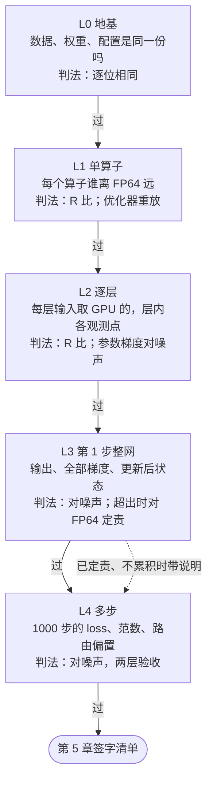

[janus](../../README.md) › [用户指南](README.md) › 第 4 章

[← 上一章：第 3 章 TPU 侧准备](03-tpu-setup.md) ｜ [回目录](README.md) ｜ [下一章：第 5 章 读结果与签字 →](05-reading-results.md)

# 第 4 章 · 逐级对齐 L0 → L4

从「两边拿到的输入是不是同一份」查起，一级一级往上，到「1000 步训练是不是同一条轨迹」。每一级的比较都假设它的输入两边相同，所以低一级没过，不进高一级。



- 任何一级不过，就停在这一级排查（[第 6 章](06-debugging.md)）。
- 例外：不过的原因已经定责、并且确认不累积，可以带着说明往上走。混元 3 第 1 步的梯度就是这样（L3 一节）。

每一级具体比哪些模块和张量、用什么门槛、混元 3 在 v5p / v7x 上的逐项结果，都在[检查清单 `CHECKS.md`](../../models/hunyuan3/CHECKS.md)。本章讲每一级为什么比、怎么跑、怎么读、不过时先查什么；清单里有的数这里不重抄。

| 这一步 | |
|---|---|
| 做什么 | L0 到 L4 逐级比 TPU 和 GPU |
| 怎么做 | 任意一台 CPU 机器上，每一级跑一份检查项目录或一个判定脚本（命令在各节） |
| 做完看到什么算对 | L0 全部逐位；L1、L2 的 R 比 ≤ 1.2（超线的格子已定责）；L4 第一层全过 |
| 下一步 | [第 5 章](05-reading-results.md)：读清单、总览和报告，对照签字清单 |

## 本章做完手里有什么

- 每一级一组结果文件（`results.json` + `report.md`），每条检查一个判定：过 / 待定 / 不过。
- 跑 `make dashboard` 后，[检查清单](../../models/hunyuan3/CHECKS.md)和[总览](../../models/hunyuan3/dashboard/dashboard.md)按新结果重画。

本章先讲跑之前的准备（4.1）和怎么判（4.2），再逐级做（4.3–4.7），最后讲 TPU 上第 1 步证据的拿法（4.8）。每个指标的精确算法在 [`reference/metrics.md`](../reference/metrics.md)，每一级的设计理由在 [`reference/levels.md`](../reference/levels.md)。

## 4.1 跑之前：运行根、检查项目录、每级对哪份 golden

### 检查项目录

- 每一级跑一份**检查项目录**，或一个写同样格式结果的判定脚本。检查项目录（catalog）是一个 YAML 文件，列出要比的运行和要跑的检查。FP64 R 比要在 CPU 上算真值，所以走脚本。
- 命令在仓库根目录执行，`janus run` 只要 numpy。
- 混元 3 的检查项目录在 [`../../models/hunyuan3/alignments/01-v5p-acceptance/catalogs/`](../../models/hunyuan3/alignments/01-v5p-acceptance/catalogs/)；v7x 在 02 下，文件名加 `v7x`。

### 下载运行目录到 `<运行根>`

- 把要比的运行目录（每次训练或回放的产物）下载到同一个本地文件夹 `<运行根>`，每个运行一个子文件夹，名字就是运行名。
- L4 只读 `meta.json`、`metrics.jsonl`、`DONE` 三个文件；L0–L3 要张量，整个运行目录都要。

```bash
ROOT=<运行根>; B=gs://<POC 桶>/janus/hunyuan3-4l
# L4：只拉三个文件（第一层最终 golden rcc-a..j、第二层 GPU 生产 golden rc、被测）
for n in golden/rcc-{a,b,c,d,e,f,g,h,i,j} golden/rc-{a,b,c,d,e} tpu/t-prod-1000; do
  mkdir -p $ROOT/$(basename $n); for f in meta.json metrics.jsonl DONE; do gcloud storage cp $B/$n/$f $ROOT/$(basename $n)/; done
done
# L0–L3：整个运行目录（第一阶段 GPU golden g1k、TPU 冒烟、第 1 步状态读、逐层隔离回放）
gcloud storage cp -r $B/golden/g1k-{a,b,c} $B/tpu/t-smoke30 $B/tpu/t-st1 $B/tpu/r-l2 $ROOT/
```

上面只拉了主线的运行。L3 另要 6 份只改执行参数的第 1 步状态读（`t-st1n-*`）、整网只前向的回放、FP64 整步参照；L1 的连续 8 步重放与 L0 的续训各要自己的运行。名字写在各检查项目录开头。

### 每级对哪份 golden、被测是哪次运行

被测是第 3 章 3.4 造的运行；golden 是第 2 章造的运行。

| 级 | golden 与噪声参照 | 被测 |
|---|---|---|
| L0 | [`g1k-a`](../glossary.md#g1k)：同一份检查点、同一批数据 | 冒烟 `t-smoke30`；第 1 步状态读 `t-st1` |
| L1、L2 前向与反向 | `g1k-a` 第 1 步的逐层输入；FP64 真值在这份输入上算 | 逐层隔离回放 `r-l2` |
| L2 参数梯度、L3 | `g1k-a`；噪声参照 `g1k-a/b/c` 3 份两两 3 对，并上 TPU 只改执行参数的 7 份两两 21 对 | `t-st1` 反推梯度后的 `t-st1-gm` |
| L4 第一层、路由偏置、健康信号 | [基线](../glossary.md#baseline) [`rcc-a`](../glossary.md#rcc-a)；噪声参照 [`rcc-a..j`](../glossary.md#rcc) 10 份两两 45 对 | 生产配置 `t-prod-1000` |
| L4 第二层 | [`rc-a`](../glossary.md#rc)；噪声参照 `rc-a..e` 5 份两两 10 对 | 同上 |

- L1–L3 的第 1 步比较用 BF16、不重算的 `g1k`，理由见第 2 章 2.3 的表。
- 代号：`g1k` 是第一阶段 GPU golden（1000 步，3 份）；`rcc` 是最终 golden（GPU 生产程序只把输出头 dgrad 改成分段 FP32 累加）；`rc` 是 GPU 生产 golden（整层重算加路由回放）。

### 指南里的运行名与混元 3 结果里的名字

本指南用短名，混元 3 的结果文件里是当时的运行名：

| 本指南 | 混元 3 的结果里 | 是什么 |
|---|---|---|
| `t-smoke30` | `t-loss30` | 30 步冒烟 |
| `t-st1` / `t-st1-gm` | `t-st1n-base` / `t-st1n-base-gm` | 第 1 步状态读 / 反推梯度后；另有 6 份只改执行参数的 `t-st1n-*` |
| `r-l2` | `r-l2-on` | 逐层隔离回放（带 `--l1 --grad`） |
| `r-ff` | `r-ff-prod` | 整网只前向的回放（`--full-forward`），L3 的 logits 与逐 token loss 用 |
| `t-prod-1000` | `t-rmap-on-1000`（v5p）、`t-v7x-on-1000`（v7x） | 生产配置 1000 步 |

- 名字里带 `-on` 的运行和结果文件，是 MaxText 对齐配置四个精度开关都开（第 3 章 3.2）的版本。不带 `-on` 的同名结果是打开 `dense_fp32_accumulation` 之前的旧配置，清单末尾「未列入本页的结果文件」一节逐个写了取代关系。

### 换成你的运行

- 被测用 `--test <运行名>` 换，`runs.root` 用 `--root <运行根>` 换。
- 有些检查项目录另外写死了混元 3 当时的运行名（如 `phase2-l0-state.yaml` 里的 `select.test_run`、`select.run`，`phase2-st1-on-state-xnoise.yaml` 里的噪声对），`--test` 管不到。复制一份改成你的，改完先 `janus validate <检查项目录>`。

## 4.2 怎么判

### 三种严格门槛

| 门槛 | 判法 | 用在哪 |
|---|---|---|
| 逐位（`exact`） | 逐位相同才过 | L0、续训、同程序重跑 |
| R 比（数值门槛 1.2） | R = TPU 离 FP64 真值的 rel_L2 ÷ GPU 离 FP64 真值的 rel_L2，≤ 1.2 过 | L1、L2 前向与反向、L3 logits 与逐 token loss、第 1 步梯度的定责 |
| 噪声上限 N（[`calibrated`](../glossary.md#calibrated)） | r = 被测值 ÷ N：r ≤ 1 过，r > 2 不过，之间待定 | L2 参数梯度、L3 梯度与状态、L4 逐步曲线 |

- R 比的门槛 1.2 是推断：只差舍入顺序时 R ≈ 1，多一次同量级的独立舍入 R ≈ √2 ≈ 1.41，取两者之间。FP64 只用来定谁离精确更远，不当标准答案。
- 读 R 之前先看分母：GPU 一侧恰好几乎精确时 R 会被放大；两边精度路径本来不同时 R 可以远小于 1（路由打分 0.013），只说明 TPU 更近精确。门槛只拦 R > 1.2。
- 噪声上限 N 是同一种设置的几次运行两两之间同一指标的最大值。参照对少于 3 对时最多待定。待定不能直接签：先加参照重判，仍在 1–2 倍之间的用 FP64 定责（单算子回到 L1，第 1 步整步梯度用 L3 的 FP64 整步参照）。
- 还有一种 `pending`（噪声参照还没标定，最多待定），只在日常回归里用（第 7 章）。
- 每种门槛的依据、参照要几对、为什么取最大值和 2 倍：[方法详解：指标与判定](../reference/judging.md)。

### 一个数是怎么聚合出来的

清单与报告里的每个数属于三种之一：

| 种类 | 怎么算 | 用在哪 |
|---|---|---|
| 逐步标量 | 每步一个数，算逐步相对差，再在窗口内算带符号均值、MARE、最大单步，各自对 N 判 | L4。loss 是全局批的平均 loss；grad_norm、param_norm 是全部可训练参数（约 124 亿个元素，不含路由偏置）的全局 L2 范数 |
| 逐张量取最差 | 每个张量拉直，单独算 rel_L2（‖a − b‖ / ‖b‖）或 R 比；一条检查选中一批张量时取最差的那个，不取平均 | L1–L3 的判定 |
| 按能量合成 | 一组张量当成一个大向量：√(Σ‖a − b‖²) ÷ √(Σ‖b‖²)，R 比同理 | 只用于定责，如第 1 步梯度「整网只差 1.3e-3」「整网 R 比 1.20」 |

清单每一行「对象」格最后一句写明是哪一种。张量个数为什么有 1781、1193、1480、50 几种，见[术语表](../glossary.md#tensor-counts)。

### 两层验收：L4 对哪份 golden

噪声参照只量「重跑会差多少」，量不出 golden 自己的系统偏差。混元 3 的 GPU 生产 golden 在输出头 dgrad 那次长求和上每一步都同向偏一点，所以 L4 分两层：

| 层 | 对谁 | 怎么判 |
|---|---|---|
| 第一层（必须过） | 最终 golden [`rcc`](../glossary.md#rcc)，只对基线 `rcc-a` 比 | calibrated，噪声取 `rcc-a..j` 10 份两两 45 对 |
| 第二层 | GPU 生产 golden [`rc`](../glossary.md#rc) | 差不判过不过，写成[已解释差异](../glossary.md#explained-difference)：量级、由哪一处 GPU 偏差解释、证据 |

- 这里的「第一层 / 第二层」是验收的两层，不是模型的层。
- 为什么这样修、修了哪一处：[方法详解：指标与判定](../reference/judging.md#golden-本身有系统偏差时修掉偏差再按一般规矩比)「golden 本身有系统偏差时」；混元 3 的排查过程在[对齐报告](../../models/hunyuan3/ALIGNMENT-REPORT.md)第 2 节。

### 两档门槛：严格档与参考档

清单、总览和逐级大表每一格同时报两档：

| 档 | 线从哪来 | 用途 |
|---|---|---|
| [严格档](../glossary.md#strict-reference) | janus 自己的门槛（上面三种） | 验收只看这一档 |
| 参考档 | 同类 GPU→TPU 迁移项目上线用过的固定线，如 loss 首步与窗口带符号均值 ≤ 2e-4、没有路由的层逐层 rel_L2 < 0.01（MoE 层不适用，受路由翻转影响） | 并列报告：看离别人上线的线还有多远 |

- 参考档普遍比严格档宽，所以常见「严格档 ❌、参考档 ✅」：差已经超出噪声能解释的范围、要定责，但还在别人认为可以上线的范围里。
- 参考值是外部实践，janus 没有独立验证过；param_norm 一条外部没有，是本项目设定的。全部参考值与口径：[方法详解：指标与判定](../reference/judging.md#两档门槛严格档与参考档)「两档门槛」。

## 4.3 L0 · 地基：数据、权重、配置逐位相同

**目的**：证明两边从同一份输入、同一份权重、同一套配置出发。

**比什么**：配置字段、每步输入指纹、载入后的参数（含 FP32 主权重与 `expert_bias`）、dtype 清单、模型结构、权重转换、续训的数据位置。逐项见[清单 L0 一节](../../models/hunyuan3/CHECKS.md#l0--地基数据权重配置)。

**怎么判**：全部逐位相同；模型结构按规则逐条满足。

**怎么跑**：

| 检查项目录 | 被测 | 比什么 |
|---|---|---|
| `phase2-ckpt-convert`（第 3 章 3.1 已跑） | — | 权重转换后逐张量、dtype 清单 |
| `phase2-t-loss30` 的两条 L0 检查 | `t-smoke30` | 配置逐项对照、每步输入指纹 |
| `phase2-l0-state` | `t-st1` | 载入后的参数、FP32 主权重、`expert_bias`、dtype、模型结构 |
| `phase2-resume` | 一次存档、一次续训（`train_hy3.py --save-state-at` / `--resume-state`） | 续训的数据位置与状态 |

```bash
python -m janus run models/hunyuan3/alignments/01-v5p-acceptance/catalogs/phase2-l0-state.yaml --root <运行根> --test t-st1 --out /tmp/l0-state
```

全过时退出码 0。`phase2-t-loss30` 里另有一条 30 步的 `L4.loss` 判不过，这一步不看它（第 3 章 3.4）。

**混元 3 的结果**：两平台除「TPU 原生数据加载器」外全部逐位。原生加载器的样本本身逐位相同，只是分到 microbatch 的顺序与 pad id 的处理两处约定不同；验收不走这条路，TPU 原样回放 GPU 每步每个 rank 的 batch。

**不过先查**：先查数据管线（分词器、packing、读取顺序与种子），再查权重转换（转置、拆分、拼接、dtype），最后查配置默认值是否被别处覆盖。FP32 主权重上小于 BF16 半格的错，在 BF16 参数和第 1 步前向里都看不见，所以主权重单独比。

## 4.4 L1 · 单算子：谁离 FP64 远

**目的**：把每个算子单独拿出来，看 TPU 的实现是否不比 GPU 离 FP64 真值远。整网的差是各算子的差叠起来的，这一级定位到具体算子。

**比什么**：输入 RMSNorm + q / k / v 投影、q / k 每头 RMSNorm、注意力核心、输出投影、MLP 前 RMSNorm、路由 GEMM、路由 top-8、MoE 块、稠密 MLP 两段，以及 AdamW 的单步和连续 8 步重放。哪个算子由哪条检查覆盖、哪些算子只在更高一级才比，见[清单 L1 的算子对照表](../../models/hunyuan3/CHECKS.md#模型的每个算子由哪条检查覆盖)。

**怎么判**：

- 算子：R 比 ≤ 1.2。主判是「两侧各用自己的输入」：每一侧的真值都从这一侧自己抓到的算子输入在 FP64 里算，上游的差不进来。v5p 另有一组「用 golden 的输入」，可以直接和 GPU 的输出比、核对舍入方式。
- 路由：本侧输入在 FP64 里重新取 top-8，与本侧实际选中的集合相同的比例 ≥ 0.97。
- 优化器：用 TPU 读出的主权重、梯度、实际超参在 FP64 里重放 AdamW，比更新量的 rel_L2 ≤ 5e-3（GPU 实测 1.79e-3 的 2.8 倍）。不比更新后参数：参数比更新量大约三个数量级。

**怎么跑**：

```bash
# 单算子，两侧各用自己的输入（v5p / v7x）
python models/hunyuan3/analysis/fwd_rratio.py --mode ops --hf <HF 目录> --golden <运行根>/g1k-a --test <运行根>/r-l2 --out <结果目录> --stage <名>
# 单算子，用 golden 的输入（v5p）
python models/hunyuan3/analysis/l1_replay_results.py --hf <HF 目录> --golden <运行根>/g1k-a --test <运行根>/r-l2 --out <结果目录>
# 优化器：单步重放在 L3 的那份检查项目录里；连续 8 步另跑
python -m janus run models/hunyuan3/alignments/01-v5p-acceptance/catalogs/phase2-st8-opt8.yaml --root <运行根> --test <8 步状态读的 -gm 运行> --out /tmp/opt8
```

参数与几种模式见 [`fwd_rratio.py`](../../models/hunyuan3/analysis/fwd_rratio.py) 与 [`l1_replay_results.py`](../../models/hunyuan3/analysis/l1_replay_results.py) 的文件头。

**混元 3 的结果**：v5p 全部算子 ≤ 1.2；v7x 除第 2 层 MoE 块（R 比 1.27）外全部 ≤ 1.2。那一格是 4096 个 token 里 1 个在近似平局处选了和 FP64 不同的专家，去掉它是 0.95。v5p 连续 8 步重放 4.80e-3，已到门槛的 96%（门槛来自单步重放，多步时 FP32 存储舍入会累积）。

**不过先查**：先看回放写法是不是训练走的那条代码路径，再看两边的精度设置（矩阵乘默认精度、TF32），最后看是否多舍入了一次，R ≈ 1.41 是它的特征。混元 3 的 qkv 与第 0 层 fc1 曾经超线（1.24 / 1.29），根因是 FSDP 切开收缩维的投影在 BF16 里累加部分和，打开 `dense_fp32_accumulation` 后全过（台账 #6（「台账 #n」指混元 3 对齐报告第 5 节偏差台账的行号，不是 issue 号））。

## 4.5 L2 · 逐层：每层输入取 GPU 的

**目的**：一层一层比，误差不跨层累积。TPU 用逐层隔离回放：第 k 层的输入用 golden 的 `layers.k.in`，只编译这一层，超线的那层就是出错的那层。

**比什么**：每层 11 个前向观测点（注意力的 qkv、q / k 归一化、核心、输出投影，MLP 前归一化，路由 logits 或稠密 fc1 / fc2，共享专家，MLP 输出，层输出）、层输入的梯度、每层路由选中集合、每层参数梯度。观测点和张量名单见[清单 L2 一节](../../models/hunyuan3/CHECKS.md#l2--逐层)。

**怎么判**：

- 前向、反向：R 比 ≤ 1.2。GPU 第 1 步前向逐位可复现、反向只差原子加的顺序，两份 GPU 之间的噪声当不了跨平台的尺子，所以改用 FP64。
- 路由：被测对 FP64 的翻转率不超过 GPU 对 FP64 的 1.2 倍。
- 参数梯度：对 GPU 第 1 步重跑的噪声，超出的对 FP64 定责（L3 一节；混元 3 当时用两侧执行噪声的并集）。

**怎么跑**：

```bash
python models/hunyuan3/analysis/fwd_rratio.py --mode isolated --hf <HF 目录> --golden <运行根>/g1k-a --test <运行根>/r-l2 --out <结果目录> --stage <名>   # 前向与路由
python models/hunyuan3/analysis/fwd_rratio.py --mode bwd      --hf <HF 目录> --golden <运行根>/g1k-a --test <运行根>/r-l2 --out <结果目录> --stage <名>   # 反向
```

参数梯度和 L3 用同一份检查项目录，见下一节。

**混元 3 的结果**：两平台四层前向、反向、路由全过。每层参数梯度超出噪声，原因与 L3 相同。

**不过先查**：先找哪一层第一个超线，再查这一层的权重映射（转置、q / k 归一化的分组布局），然后回到 L1 回放这一层的算子。

## 4.6 L3 · 整网第 1 步

**目的**：整网跑完第 1 步，比输出、全部参数梯度、优化器状态、更新后的权重。L2 隔离了层，这一级看层与层串起来、加上优化器以后还对不对。

**比什么**：logits 与逐 token loss（整网只前向的回放，对 FP64）；50 个参数梯度、100 个动量、50 个更新后主权重、3 个更新后路由偏置（对 GPU）；名单覆盖率。张量组见[清单 L3 一节](../../models/hunyuan3/CHECKS.md#l3--整网第-1-步)。

**怎么判**：

- logits、逐 token loss：R 比 ≤ 1.2。
- 梯度与状态（混元 3 当时的做法；2026-11-07 起改为噪声只用 GPU、超出的对 FP64 定责，见[判定](../reference/judging.md#第-1-步张量两侧执行噪声的并集)）：对噪声，噪声取两侧执行噪声的并集：GPU 第 1 步重跑 3 份两两 3 对 ∪ TPU 只改执行参数（splash 分块、编译器片上内存上限）的 7 份两两 21 对。GPU 重跑第 1 步路由一个都不翻，只拿它当尺子量不到「近似平局在两种硬件上各落一边」；TPU 只改执行参数就会翻同类的路由，并集能看见它。依据见[方法详解：判定](../reference/judging.md#第-1-步张量两侧执行噪声的并集)。
- 超出噪声的部分，用 FP64 整步参照定责：同一份权重、同一个全局 batch 在 FP64 里求梯度，比 TPU 和 GPU 谁离精确更远。只报不判。
- 梯度要配范数比：cosine 对整体缩放完全看不见，梯度整体乘 1/8 时 cosine 仍是 1。

**怎么跑**：

```bash
# 从状态读反推梯度（零扰动，4.8），7 份 TPU 运行都要做；运行名见检查项目录开头
python models/hunyuan3/analysis/grads_from_moments.py --src <运行根>/t-st1 --out <运行根>/t-st1-gm
python -m janus run models/hunyuan3/alignments/01-v5p-acceptance/catalogs/phase2-st1-on-state-xnoise.yaml --root <运行根> --test t-st1-gm --out /tmp/st1
# 对 FP64 定责：先在 CPU 上算 FP64 整步参照（fp64_step.py），再比
python models/hunyuan3/analysis/fwd_rratio.py --mode step --hf <HF 目录> --golden <运行根>/g1k-a --test <运行根>/t-st1-gm --fp64-step <FP64 整步参照目录> --out <结果目录> --stage <名>
# logits 与逐 token loss：被测是整网只前向的回放（layer_replay.py --full-forward，混元 3 是 r-ff-prod）
python models/hunyuan3/analysis/fwd_rratio.py --mode chain --hf <HF 目录> --golden <运行根>/g1k-a --test <运行根>/r-ff --out <结果目录> --stage <名>
# 名单覆盖率
python -m janus run models/hunyuan3/alignments/01-v5p-acceptance/catalogs/phase2-t-a-coverage.yaml --root <运行根> --test <第 1 步全量抓数的运行> --out /tmp/coverage
```

FP64 整步参照的参数见 [`fp64_step.py`](../../models/hunyuan3/analysis/fp64_step.py) 文件头；回放怎么提交见 TPU 操作手册「[在 TPU 上拿第 1 步的正式证据：三条路](../../models/hunyuan3/frameworks/maxtext/README.md#在-tpu-上拿第-1-步的正式证据三条路)」。

**混元 3 的结果**：logits、逐 token loss、覆盖率全过；梯度、动量多数落在噪声的 1–2 倍，几层参数梯度超 2 倍。退出码 1 是预期的。原因已定责、不累积（[对齐报告](../../models/hunyuan3/ALIGNMENT-REPORT.md)第 4 节；这一判定用的是两侧执行噪声的并集，按 2026-11-07 的决定待重判，见[判定](../reference/judging.md#第-1-步张量两侧执行噪声的并集)）：

- 大头是路由近似平局：第 1 步每层 0.44%–0.56% 的路由槽位两边各落一边，分到 token 少的专家梯度相对差到 0.10；按梯度能量加权，整网只差 1.3e-3（台账 #5）。
- 一维 norm 权重、输出层与 embedding 的梯度 TPU 先以 BF16 落地，离 FP64 比 GPU 远；有三个前向不变的可选开关能消掉（台账 #20）。
- L4 的 1000 步统计在噪声内。
- 专家参数每层只比了 192 个里的 0、1 号两个（检查清单「已知的覆盖缺口」）。

**不过先查**：依次查 loss 的约定（平均方式、loss_mask、EOS）、embedding 与输出层（是否共享、转置）、梯度缩放。梯度缩放出错时，范数比常接近某个整数倍，如 microbatch 数。最后回到 L1 做优化器重放。

## 4.7 L4 · 多步：1000 步的轨迹

**目的**：训练 1000 步，看逐步曲线是否落在 GPU 自己重跑的散布里。前三级的差如果会累积，在这里显出来。

**比什么**：loss（全程与第 301–1000 步）、grad_norm、param_norm、学习率、路由偏置曲线、健康信号；另有 EP = 8、可选开关、对 `rc` 三组对照。见[清单 L4 一节](../../models/hunyuan3/CHECKS.md#l4--多步训练)。

**怎么判**：每条序列算带符号均值、MARE、最大单步三个判定量，各自对 N 判，最差的决定结果；首步差只报。学习率逐步逐位。健康信号看 NaN / Inf 与突跳。算法见 [`reference/metrics.md`](../reference/metrics.md#逐步序列lossgrad_normparam_norm)。

**怎么跑**：

```bash
python -m janus run models/hunyuan3/alignments/01-v5p-acceptance/catalogs/phase2-acceptance-rcc-on.yaml --root <运行根> --test t-prod-1000 --out /tmp/acc-rcc     # 第一层
python -m janus run models/hunyuan3/alignments/01-v5p-acceptance/catalogs/phase2-acc-health-rcc.yaml   --root <运行根> --test t-prod-1000 --out /tmp/acc-health  # 路由偏置、健康
python -m janus run models/hunyuan3/alignments/01-v5p-acceptance/catalogs/phase2-acceptance-rc.yaml    --root <运行根> --test t-prod-1000 --out /tmp/acc-rc      # 第二层
```

**混元 3 的结果**：第一层两平台每一项都在噪声内，最差 r = 0.85。第二层对 `rc` 的差：param_norm 全部来自 GPU 输出头 dgrad 的长求和（台账 #1、#2）；loss 主要来自同一处，另有一部分对 TPU 执行方式敏感（台账 #10）。这把尺子能看出多大的差，见对齐报告第 3 节「这把尺子能看出多大的差」。

**要点**：

- loss 只能证伪：第 1 步 loss 一位不差、梯度却错了的 bug 很常见，loss 曲线重合只是必要条件。
- 健康检查要看 grad_norm：在第 5 步埋一个梯度 NaN，grad_norm 第 5 步就报警，loss 第 6 步才变 NaN，那时参数已经坏了。
- grad_norm 的分母用两边均值、TPU 的 param_norm 读按组合成的列，这两处测量口径见[方法详解：判定](../reference/judging.md#两处测量口径被测与参照的量要一样准统计量要对称)。

**不过先查**：依次查学习率曲线与实际生效的权重衰减、路由偏置更新率、梯度通信与主权重 dtype，最后回到 L3 看第 1 步的梯度。

## 4.8 TPU 上第 1 步的证据为什么不用钩子

- GPU 抓数是在算好的张量上读一下，不改数值。TPU 是整图编译，往训练步里加输出会改变 XLA 的融合，从而改变舍入位置。v5p 上加钩子的程序和生产程序第 1 步 loss 就不逐位（清单 L4「加抓数不改数值」一行）。
- 所以 L1–L3 的正式证据用三种「程序本身就是测量对象」的办法：

| 办法 | 拿到什么 | 扰不扰动生产轨迹 |
|---|---|---|
| 状态读 + 一阶动量反推梯度 | 主权重、两个动量、`expert_bias`（训练步之间从状态读）；梯度 g = (m_k − β1·m_{k−1}) / (1 − β1) / 裁剪系数 | 不扰动 |
| 隔离回放（逐层、单算子、整网只前向） | 前向各观测点、层输入的梯度、logits 与逐 token loss | 回放程序单独编译，生产轨迹不受影响 |
| 观测构建（每一步都跑同一个加钩子的程序） | 全部中间量 | 要先当[扰动臂](../glossary.md#perturbation-arm)过标定三关（[第 7 章 7.6](07-daily-regression.md#76-标定tpu-自己的执行噪声)）；v5p 上没过，只当诊断值 |

用法见 TPU 操作手册「[在 TPU 上拿第 1 步的正式证据：三条路](../../models/hunyuan3/frameworks/maxtext/README.md#在-tpu-上拿第-1-步的正式证据三条路)」。

**回放是诊断证据，不是生产程序的逐位证据。** 隔离回放和单算子回放单独编译，图和生产训练步不同：只编一层或一个算子，把一条序列复制成整个 batch，没有优化器。它们的结果用来定责、确认修复方向；清单每一行的「证据来源」一栏写明证据来自生产程序、回放还是离线 FP64 计算。

回放尽量贴近生产：`layer_replay.py` 用同一份 MaxText 配置（`hy3-4layers.yml` 加同样的覆盖项）、同样的设备网格与切分规则（`mt_common.make_mesh`、同一组 logical axis rules），由同一个 `run.sh` 提交，`XLA_FLAGS` 与 `LIBTPU_INIT_ARGS` 和训练一样透传。

精度开关在生产程序里是否真的生效，由日常回归直接看生产训练步优化后的 HLO（`hlo/train_step.after_optimizations.txt`）核对：R20 数 `reduce-precision`、all-reduce、`tpu_custom_call`、megablox 分组 GEMM、splash 注意力的个数，要和 LKG 相等，FP8 类型与随机数算子必须是 0（v5p 当前对齐配置 `reduce-precision` 63、all-reduce 8，[`regression/README.md`](../../models/hunyuan3/regression/README.md)）。窗口化 collective matmul 的个数和路由 GEMM 的精度还没有可靠的匹配规则，暂由 R21 的 HLO 指纹兜底：变了会报，但说不出是哪一条。

---

下一步：每一级都有了结果文件。第 5 章讲怎么读检查清单、总览和报告，把任何一个数追到它的出处，并对照签字清单看还差什么。

[← 上一章：第 3 章 TPU 侧准备](03-tpu-setup.md) ｜ [回目录](README.md) ｜ [下一章：第 5 章 读结果与签字 →](05-reading-results.md)
