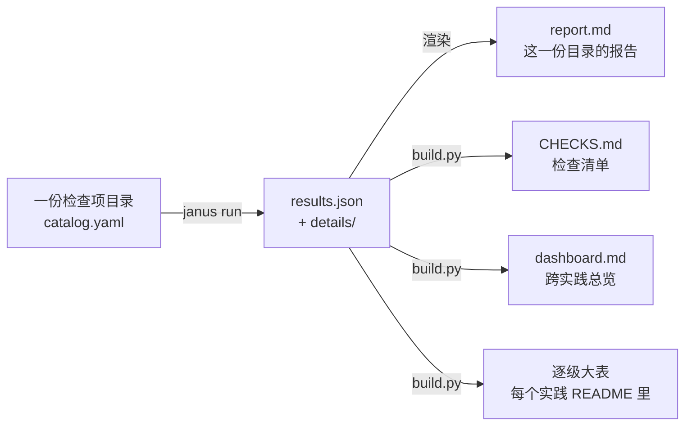

[janus](../../README.md) › [用户指南](README.md) › 第 5 章

[← 上一章：第 4 章 逐级对齐](04-level-by-level.md) ｜ [回目录](README.md) ｜ [下一章：第 6 章 发现不对齐时怎么排查 →](06-debugging.md)

# 第 5 章 · 读结果与签字

`janus run` 跑完一份检查项目录，产出一份结果。`make dashboard` 再从全部结果生成三样汇总：检查清单、跨实践总览、每个实践的逐级大表。连同 `report.md`，这四样都由脚本生成，数字和判定不手写，任何一个数都能追回结果文件。



| 想知道 | 看哪 |
|---|---|
| 比了哪些量、对象是哪些模块和张量、怎么判、v5p / v7x 结果 | [检查清单 `CHECKS.md`](../../models/hunyuan3/CHECKS.md) |
| 同一项检查在 GPU 自比、故障演练、v5p、v7x、重算 golden 各列的结果 | [总览 `dashboard.md`](../../models/hunyuan3/dashboard/dashboard.md) |
| 某个实践每条检查的完整推导 | 实践 README 的「逐级大表」，如 [01 的大表](../../models/hunyuan3/alignments/01-v5p-acceptance/README.md#逐级大表) |
| 一份检查项目录里每条检查的数、门槛、最差的张量 | `results/<目录名>.report.md`，原始数据在同名 `.results.json` |
| 结论、偏差的机制、开关 | [对齐报告](../../models/hunyuan3/ALIGNMENT-REPORT.md) |
| 现在能不能签字 | 本章 5.6 |

| 这一步 | |
|---|---|
| 做什么 | 读懂四样产物，把任何一个数追回结果文件，对照签字清单 |
| 怎么做 | 先看检查清单的规模表，再看各级的表与表下原因，需要时点进 `report.md` |
| 做完看到什么算对 | 能说清每个非 ✅ 格子为什么、算不算问题 |
| 下一步 | 有没定责的 ❌ / 🟡，转[第 6 章](06-debugging.md)排查；签字清单都满足，转[第 7 章](07-daily-regression.md)日常回归 |

## 5.1 检查清单：比了什么、结果如何

[`../../models/hunyuan3/CHECKS.md`](../../models/hunyuan3/CHECKS.md) 是给验收方读的那一页。

- 规模表：每一级的检查项、检查条数、张量级比较次数、两平台的判定计数。先看这一张知道全貌。
- 每级一节：开头一句话写这一级的目的；表里一行一项检查，栏目是「比什么、对象、判法（严格｜参考）、v5p、v7x」。
  - 「对象」栏写到具体的模块、观测点或张量组，并附结果文件里实际比了多少个张量或用例。
  - L1 另有一张「模型的每个算子由哪条检查覆盖」：按前向顺序列出模型的算子，写清哪些算子单独比过、哪些只在更高一级（L2 观测点、L3 整网链路）里比。
- 表下的「非 ✅ 格子的原因」：每个不是 ✅ 的格子写一句原因，并对到对齐报告偏差台账的编号。生成脚本要求每个非 ✅ 格子都有原因，缺了生成就失败。
- 文末：GPU 侧的检查（参照本身怎么验过）、已知的覆盖缺口、不在清单里的结果文件及原因。

### 读一格

以 L4 的 param_norm、v5p 一格为例：

```
[2.44e-07（最大单步，0.502×N） ✅｜参✅](…/phase2-acceptance-rcc-on.report.md)
     │         │        │       │    └─ 参考档判定
     │         │        │       └────── 严格档判定：✅ 过 ｜ 🟡 待定 ｜ ❌ 不过 ｜ — 不适用
     │         │        └────────────── 离严格门槛多远：被测值 ÷ 这个判定量的噪声上限 N
     │         └─────────────────────── 起决定作用的判定量（三个判定量里离 N 最远的那个）
     └───────────────────────────────── 实测值
```

- 一格选中多条检查（例如 4 层各一条）时，写最差的那条。
- 本列的指标或 N 和「判法」栏不同时，括号里另写本列自己的，以格子里的为准。
- 点格子打开那份结果的 `report.md`。

## 5.2 总览：每行一项检查，每列一个实践

[`dashboard.md`](../../models/hunyuan3/dashboard/dashboard.md) 一行一项检查，一列一个对齐实践：

| 列 | 是什么 |
|---|---|
| gpu | 00 · GPU 自比（默认设置，噪声参照 8 份运行两两 28 对） |
| drill | 00 · 故障演练：故意埋错，期望报警的都报了才算 ✅ |
| v5p | 01 · B200 × 8 → TPU v5p-8 |
| v7x | 02 · B200 × 8 → TPU v7x-4 |
| remat | 03 · GPU 自比，整层重算 + 路由回放 |

- 格子的写法和清单相同；每组表下的「说明」写非 ✅ 格子的完整推导：实测｜严格档｜参考档。
- 总览的行比清单粗（一行常合并几条检查），清单逐个列出对象；两者引用同一批结果，生成时核对清单没有漏掉总览引用的任何一条检查。
- **gpu 列里的 ❌ 不是工具出错**：它们是只换执行方式（专家并行度、梯度累积切分、激活重算）时实测到的真实差异，说明这些设置本身就是数值的一部分，所以全部 golden 固定同一种设置（[00 README「四、只换执行方式，哪些仍逐位」](../../models/hunyuan3/alignments/00-gpu-noise-and-drills/README.md#四只换执行方式哪些仍逐位)）。

## 5.3 逐级大表与实践结论

- 每个实践 README 里有一张逐级大表，夹在 `janus:table:begin` 与 `janus:table:end` 两行注释之间，由脚本生成。表头一行写总数，如「共 N 行。严格档：✅ …　🟡 …　❌ …」。
- 一行一条检查，L4 的逐步量三个判定量（带符号均值、MARE、最大单步）各占一行。「说明」栏一律写成「实测（指标）｜严格档 门槛 → 离门槛多远，判定｜参考档 门槛：实测（倍数），判定」；「证据」栏链到那一行出自的 `report.md`。
- 大表之外是人写的「结论」，数字只引用表里的行或结果文件。v5p 的结论里有一张「v5p 列的 ❌ 怎么读」，按门槛用的尺子把 ❌ 分成几类：已解决、真实系统偏差、尺子对跨平台偏紧、按定义不逐位、程序本身改了数值。见 [01 README](../../models/hunyuan3/alignments/01-v5p-acceptance/README.md#v5p-列的--怎么读)。

## 5.4 一份结果：report.md 与 results.json

`report.md` 首屏是汇总（过 / 不过 / 待定 / 出错各几条），下面每条检查一行。原始数据在 `results.json`，字段定义在 [`reference/result-schema.md`](../reference/result-schema.md)，常看的几个：

| 字段 | 看什么 |
|---|---|
| `status` | `pass` / `fail` / `inconclusive` / `error`。`error` 表示没法判（数据缺失、选空、目录不合规），不是过 |
| `metrics` | 实测值。`loss_series` 给 `d0`、`signed_mean`（带符号）、`mare`、`max_step` 与 `max_step_at`、`window`、`denominator`；`multi_golden` 的同名量带 `_max` 后缀、已取绝对值 |
| `threshold.noise.upper` | calibrated 时算出的噪声上限 N；`refs` 是参照对数 |
| `r1`、`r2` | 序列检查：`r1` = MARE ÷ N，`r2` = \|带符号均值\| ÷ N；最大单步的 r 没有单独字段，用 `metrics` 里的最大单步除以 `threshold.noise.upper.max_step`。三个里最差的决定判定。张量检查：`r1` = 各指标 r 的最大值 |
| `noise_dropped`、`noise_loo` | 被剔除的逐位参照对；留一法互判（只报） |
| `worst` | 最差的几个张量、在哪个坐标 |
| `runs`、`catalog`、`janus` | 用了哪些运行（含 `meta.json` 的 sha256）、哪份目录（内容指纹）、哪个 janus 提交：复现靠这三样 |
| `details/<检查 id>.jsonl` | 逐张量 / 逐步明细，不随结果提交 |

`janus run` 的退出码：0 = 没有硬检查不过或出错；1 = 有硬检查不过；2 = 有硬检查出错或目录不合规。待定不影响退出码，但在报告首屏单列。

## 5.5 把一个数追回出处，结果怎么更新

文档里引用的数都写成「结果文件 + 检查 id」。追的顺序：

1. 从清单或总览的格子点进 `results/<目录名>.report.md`，找这个检查 id 的一行；
2. 同名 `.results.json` 的 `checks[]` 里这一项：`metrics` 是实测，`threshold` 是门槛；
3. 要复现：照 `results.json` 里的 `catalog.path`、`runs`、`janus.commit` 重跑 `janus run`。只想重画报告：`janus run <检查项目录> --out <结果目录> --render-only`。

逐步曲线图在实践的 `figures/` 里，命名见 [`conventions.md`](../dev/conventions.md#结果与图)「结果与图」。

结果更新的规矩：

- 新结果提交时，同一个 PR 里跑 `make dashboard` 重画清单、总览与逐级大表，提交前跑 `make dashboard-check` 核对。不要手改生成的部分。
- 已提交的结果是证据，不覆盖、不删；发现错了追加更正并写明原因。修复后的新运行用新的结果文件名，和修复前的并排比。被取代的结果在清单末尾写明取代关系。

## 5.6 签字清单：现在离签字还差什么

签字＝对外承诺「TPU 训出的就是 GPU 上那个模型」。下表三组条件全部满足，才能说 TPU 和 GPU 对齐了（[方法详解：原则](../reference/principles.md#什么时候能签字)「什么时候能签字」）：1 输入与可复现，2 在噪声内，3 超线已定责。状态以[检查清单](../../models/hunyuan3/CHECKS.md)为准，按 2026-11-08 起的第 1 步判法（只用 GPU 第 1 步重跑当尺子，「两侧执行噪声的并集」已撤回）。

| # | 条件 | 证据 | v5p | v7x |
|---|---|---|---|---|
| 1a | L0 全部逐位：数据指纹、权重（含 FP32 主权重与 `expert_bias`）、配置 | 清单 L0（原生数据加载器一行不在验收路径上） | ✅ | ✅ |
| 1b | TPU 同程序重跑逐位 | v7x `phase2-v7x-rmap-repro`（1000 步，换代前配置 `t-v7x-rmap-1000-a/-b`，在清单 L4）；当前配置在 v7x 上的双跑（`t-v7x-on-1000` / `t-v7x-on-b-1000`）案例 01 记为逐位相同，但仓库里只有两份的汇总统计相同（[`case01-v7x-split-arms.json`](../../models/hunyuan3/alignments/01-v5p-acceptance/results/case01-v7x-split-arms.json)），没有逐步逐位的结果文件；v5p 只有间接证据：日常回归 [LKG](../glossary.md#lkg) `reg-t0-fa-a`、`reg-t1-fa-a` 同一提交双跑逐位（[regression/README](../../models/hunyuan3/regression/README.md)，不在清单里），但回归跑的是累积 1、不重算的程序，不是验收的 `t-rmap-on-1000`（累积 2 + rmap 重算，[回归守的不是正式验收的那个程序](../../models/hunyuan3/regression/README.md#回归守的不是正式验收的那个程序)）；验收程序本身在 v5p 上没有双跑 | 间接：回归程序逐位，验收程序没双跑 | ✅ |
| 1c | 抓数不改数值 | 清单 L4「加抓数不改数值」 | 不适用：TPU 上加钩子会改融合，正式证据不经过钩子（第 4 章 4.8） | 同左 |
| 2a | L4 第一层对最终 golden [`rcc`](../glossary.md#rcc) 全过 | 清单 L4「正式验收」；最差 r = 0.85。结论对正式被测程序成立，改执行参数（splash 分块、片上内存上限等）要重判（[`case01-rcc-ensemble.json`](../../models/hunyuan3/alignments/01-v5p-acceptance/results/case01-rcc-ensemble.json)） | ✅ | ✅ |
| 2b | L2、L3 用噪声判的检查全部过 | 清单 L2、L3；定责在对齐报告第 4 节 | 不满足：第 1 步梯度与动量按 GPU 3 对的尺子全部超 2 倍（GPU 重跑几乎逐位，尺子接近 0，第 3 层梯度按 rel_L2 是 2.7e4 倍 N），判「不过 · 已解释」；更新后主权重待定（1−cos 1.63 倍 N）；更新后 `expert_bias` 过。机理都已查到、实测不累积，但一部分张量未达逐张量 R ≤ 1.2 的定责线（见 3a），是否接受由验收方决定（见下） | 不满足：同左，更新后主权重待定（1.61 倍 N）；更新后 `expert_bias` 不过（台账 #17） |
| 2c | 噪声参照够多：单一设置签字前至少 6 份、15 对（短窗口）；1000 步这样的长窗口要 16 份、120 对（[judging.md](../reference/judging.md#参照要几对)） | L4：`rcc-a..j` 10 份两两 45 对，少于长窗口的 16 份。份数少只会低估 N、判得更严，对基线 `rcc-a` 照样全过；但换基线时 v7x 有三份待定（`rcc-d` loss 后段 1.08、`rcc-e` grad_norm 1.01、`rcc-j` grad_norm 1.11，[`case01-rebaseline-rcc.json`](../../models/hunyuan3/alignments/01-v5p-acceptance/results/case01-rebaseline-rcc.json)）。第 1 步整步：只有 GPU 3 份两两 3 对（对齐报告「适用范围」） | L4：够短窗口下限、不够长窗口的 16 份（偏严，结论不受影响）；第 1 步不满足 | 同左 |
| 3a | 超线处都已用 FP64 定责：TPU 离 FP64 不比 GPU 远，或开最高精度后差降下来 | 清单 L1、L2 前向（R 比）与 L3「对 FP64 定责」。路由翻转的那部分两边离精确差不多远；梯度以 BF16 落地的那部分（台账 #20）TPU 更远，打开三个梯度 FP32 开关后按能量合计降到 0.67（v7x 0.72），但逐张量最差仍超 1.2（见右），而且这三个开关不在当前对齐配置里。3a 满足不代表 2b 满足（签字原则第 3 条不替代第 2 条） | 待定（待拍板）：路由翻转那部分已定责。当前对齐配置下逐张量未达 R ≤ 1.2：梯度最差 2.20（v7x 2.70，一维 norm 权重，#20），优化器状态 7.95（v7x 7.86，第 2 层 q norm 的二阶动量），更新后主权重 6.42（v7x 51.3，第 1 层 q norm）；按能量合计梯度、动量 1.20 / 1.21，主权重 0.92 / 0.94。打开不在对齐配置里的三个梯度 FP32 开关后（v5p，[`phase2-st1-fp64-gradfp32`](../../models/hunyuan3/alignments/01-v5p-acceptance/results/phase2-st1-fp64-gradfp32.results.json)），按能量合计梯度、动量降到 0.67、主权重 0.92，但逐张量最差仍超 1.2：梯度 1.79（第 2 层 MLP 前 RMSNorm，开关前 1.43，反升的原因没查）、动量 6.17（第 2 层 q norm 的二阶动量）、主权重 5.49（第 1 层 q norm）。后两者在 128 维的 q / k norm 上，来自 Adam 第 1 步更新量近似 lr·sign(g) 的符号效应，开关消不掉，不归 #20（对齐报告注 20）。所以开开关也不能让 3a 按逐张量的字面满足。要拍板的是：逐张量 R ≤ 1.2 对 128 维这类小张量是否适用（只改执行参数、对 TPU 基线的逐张量 R 就能到 2.91，[第 7 章](07-daily-regression.md)扰动臂第 1 步梯度一段），以及按开关对照算不算定责；由验收方决定 | 待定（待拍板）：同左。开开关后梯度按能量 0.72，一维 norm、输出层、embedding 这 19 个张量逐张量最大 1.17（[`case01-grad-fp32-arms.json`](../../models/hunyuan3/alignments/01-v5p-acceptance/results/case01-grad-fp32-arms.json)）；其余梯度、优化器状态与更新后主权重开开关后没测；专家梯度最高 1.44，属路由翻转 |
| 3b | 对 GPU 生产 golden 的差写成[已解释差异](../glossary.md#explained-difference) | 清单 L4「对未修的 GPU 生产 golden」；对齐报告第 2、3 节 | 已解释 | 已解释 |

一句话：第 1 步的差超出了噪声，每一处都查到了机理，而且在 1000 步内实测不随步数累积；但一部分张量按逐张量 R ≤ 1.2 的字面还没定责，打开三个梯度 FP32 开关也消不完（3a 待定）。签字原则要求「在噪声内」，定责也替代不了它。

2b 的现状如下，细节在[对齐报告](../../models/hunyuan3/ALIGNMENT-REPORT.md)第 4 节与台账。按签字原则（[`principles.md`](../reference/principles.md#什么时候能签字)），L2–L4 用噪声判的检查要全部过，第 1 步的梯度与状态目前不满足。我们给出的是机理、对 FP64 的比值与「不累积」的证据，是否据此接受由验收方决定。

- 逐层前向、反向对 FP64 不比 GPU 远，两平台都过。
- 整步的梯度与动量按 GPU 第 1 步重跑 3 对的尺子全部超 2 倍（按原来的两侧并集多数落在 1–2 倍）。倍数很大：GPU 重跑几乎逐位，第 3 层梯度 rel_L2 的 N 只有 3.85e-6，按 rel_L2 是 2.7e4 倍 N，1−cos 最差 7.3e8 倍（v7x 2.6e4 / 6.7e8）。尺子接近 0，判不过只说明 GPU 重跑量不到近似平局翻转，不说明差有这么大。原因有三处：
  - 大头是路由近似平局在两种硬件上各自落到一边（台账 #5）。
  - 一维 norm 权重、输出层与 embedding 的梯度，TPU 先以 BF16 落地（台账 #20）。有三个前向不变的可选开关，按能量合计能消掉这一处；逐张量仍有超线（见 3a）。
  - v7x 一个专家的偏置更新方向和 GPU 相反，按 FP64 判是 GPU 偏（台账 #17）。
- 这些差不累积：2a 的 1000 步统计在噪声内（截 4 层、1000 步、常数学习率 1e-5 下；更长的训练和生产学习率没测）。
- 专家参数每层只比了 192 个里的 2 个，定责针对比到的张量。
- 三个可选开关是否加进对齐配置另行确定（会改日常回归的 LKG）。

**待定的检查不能直接签**：先加参照重判；加完还在 1–2 倍之间的，用 FP64 定责（单算子回到 L1，第 1 步整步梯度用 L3 的 FP64 整步参照）。loss 曲线重合只是必要条件，不是充分条件。

---

下一步：看到 ❌ 或 🟡、或者所有检查都过了但某个量「很小却不像噪声」时，到第 6 章：怎么一步步收窄到原因。

[← 上一章：第 4 章 逐级对齐](04-level-by-level.md) ｜ [回目录](README.md) ｜ [下一章：第 6 章 发现不对齐时怎么排查 →](06-debugging.md)
