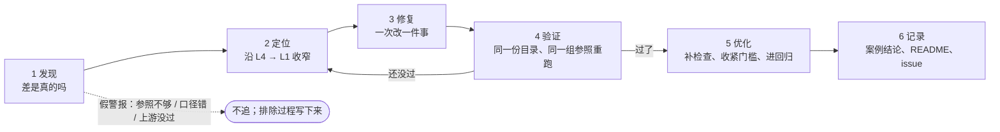

[janus](../../README.md) › [用户指南](README.md) › 第 6 章

[← 上一章：第 5 章 读结果与签字](05-reading-results.md) ｜ [回目录](README.md) ｜ [下一章：第 7 章 日常回归 →](07-daily-regression.md)

# 第 6 章 · 发现不对齐时怎么排查

对齐不是跑一遍检查就结束，而是一轮一轮地收窄差异。每一轮分六步：发现、定位、修复、验证、优化、记录。

本章规定每一轮怎么走、每一步的产物放在哪里，目的是让任何人接手时都能从仓库里看出查到了哪里、判断的依据是什么、下一步做什么。本章先给一个完整走过的例子，再逐步讲做法。


| 这一步 | |
|---|---|
| 做什么 | 一轮轮收窄到原因：发现、定位、修复、验证、优化、记录 |
| 怎么做 | 开 issue 和案例文件（`cases/NN-*.md`），从 L4 往下收窄到 L1 |
| 做完看到什么算对 | 案例有定了责的结论，并用同一份目录、同一组参照重跑过 |
| 下一步 | 签字清单都满足后转[第 7 章](07-daily-regression.md)日常回归 |

看到没定责的 ❌ / 🟡，或者检查全过、但某个量「很小却不像噪声」时，进入本章。排查时假设表按成本从低到高验证，分析工具是 `janus offsets`、`janus curves compare` 和 `janus drift`。

做完的标准是：案例有定了责的结论，落成修复的 PR，或写进验收的「已解释差异」；修复后的新运行用同一份目录、同一组参照重跑过。混元 3 的案例 01 就是这样结案的，摘要见下文。

## 本章做完手里有什么

一份排查案例（实践下的 `cases/NN-*.md`），里面有：

- 排除掉的方向；
- 带出处的事实；
- 标「推断」的假设；
- 按成本排的验证表；
- 最后是一个定了责的结论，落成修复的 PR，或者写进验收的「已解释差异」。

## 案例摘要：TPU 1000 步 loss 偏低万分之一点五

完整记录在[案例 01](../../models/hunyuan3/alignments/01-v5p-acceptance/cases/01-loss-offset-param-norm.md)，已结案。只想几分钟看懂整件事，先读案例开头的[`01-loss-offset-param-norm.md`](../../models/hunyuan3/alignments/01-v5p-acceptance/cases/01-loss-offset-param-norm.md)「一页看完」，它按问题、证据、机制、结论的顺序写，带机制图。下文各步都拿这个案例举例。

### 每步做了什么

| 步 | 这个案例里做了什么 | 在案例里哪一节 |
|---|---|---|
| 发现 | TPU 的 loss 比 GPU 一直低约 1.5e-4（见表下） | 第 1 节 |
| 排除口径 | 把 TPU 曲线故意错开一步再比，差反而大 100 倍：说明两边步号是对齐的 | 第 2 节 |
| 拆现象 | 把偏移拆成「偏」和「抖」：误差不随步数累积，是固定方向的偏移 | 第 3 节 |
| 找先漂的量 | loss 之外，`param_norm` 线性漂移；后来定位到几乎全在输出层冷门词的那些行 | 第 5、7 节 |
| 按成本验证 | 先查配置与名单，再跑短运行，最后才跑 1000 步（见表下） | 第 0 节总表、第 6 节 |
| 找机制 | 推手是输出头流回隐状态的梯度 dh（见表下） | 开头「一页看完」的机制图 |
| 裁判也要核对 | 精确轨迹这个裁判自己也有偏（见表下） | 「TPU 对精确轨迹那一成的账」 |
| 落地 | 参照换成最终 golden [`rcc`](../glossary.md#rcc)，验收分两层（见表下） | [对齐报告](../../models/hunyuan3/ALIGNMENT-REPORT.md)第 3 节 |
| 结论（已结案） | TPU 没有算错：两边在真精确算术下是同一条轨迹（见表下） | 开头「一页看完」、第 0 节 |

### 逐步细节

- 发现：所有检查都「够好」，但 TPU 的 loss 比 GPU 一直低约 1.5e-4。方向不变，幅度超出 GPU 两两之间的差好几倍。
- 按成本验证：先查配置与名单（几分钟），再跑短运行（几十分钟），最后才跑 1000 步。这样排除了重算、注意力实现、权重衰减掩码、TF32 等十几项。
- 找机制：漂移的推手是输出头流回隐状态的梯度 dh 沿「所有 logits 一起升降」方向的分量。GPU 生产的输出头 dgrad 要沿 12 万词表做长求和，这次求和在 B200 张量核上被系统地朝 0 截断。
- 裁判也要核对：排查用「BF16 权重、全程 FP32」的精确轨迹当裁判，逐处对 FP64 后发现裁判自己也有偏。B200 上 cuBLAS 的 FP32 乘法一次累加整个词表也不精确，只有分段累加才精确。改正后，GPU 精确与 TPU 精确重合。教训是：「全程 FP32」的参照也要逐处对 FP64，第 1 步对得上不代表训练中途对得上。
- 落地：参照答案（golden）原本是 GPU 生产训练程序的结果，现在换成最终 golden [`rcc`](../glossary.md#rcc)。`rcc` 保持生产程序其余设置不变，只把输出头 dgrad 修成分段 FP32 累加，参照从此不带 GPU 一侧这处偏差。验收分两层，见[第 4 章](04-level-by-level.md#两层验收l4-对哪份-golden)「两层验收」：
  - 第一层：TPU 只和事先指定的一份 [`rcc-a`](../glossary.md#rcc-a)（最终 golden 的第 1 份）比 L4 的 loss、范数、学习率、路由偏置与健康信号。噪声上限取 `rcc` 10 份重跑两两配对得到的 45 对。这一层必须过，v5p、v7x 全过，最差 r = 0.85。
  - 第二层：对 GPU 生产 golden [`rc`](../glossary.md#rc) 的差写成[已解释差异](../glossary.md#explained-difference)。

  `rcc` 只是对参照的一处修正。TPU 一侧的精度开关、数据回放等其余环节见对齐报告第 5、6 节。
- 结论（已结案）：TPU 对 GPU 生产的 param_norm 偏差全部来自 GPU 输出头 dgrad 的长求和，loss 偏差主要来自同一处。TPU 生产离真精确还差一份：第 1000 步 param_norm 低 6.5e-3（绝对值），即[对齐报告](../../models/hunyuan3/ALIGNMENT-REPORT.md)第 2 节「第 1000 步 param_norm 的阶梯」上的那一级。这一份来自两边生产程序共有的一步，即流进输出头反向的 dlogits 舍成 BF16，不是两边的差。

### 用到的 janus 能力

案例结尾的「这次排查用到的 janus 能力」一节列出了每个能力在哪一步起了作用。用到的能力有：

- 同设置[噪声参照](../glossary.md#noise-reference)；
- 逐步原值全精度落盘；
- L0 数据指纹；
- 每步记 `param_norm` 与路由偏置统计；
- 抓数钩子自检。

## 一张表看全



| 步 | 要回答的问题 | 产物 | 放哪 |
|---|---|---|---|
| 1 发现 | 这个差是真的吗，值得追吗 | issue；案例文件（状态「调查中」）；计划里加一项 | 见表下 |
| 2 定位 | 差从哪一级、哪一层、哪个量开始 | 分析脚本的原始输出；案例里的事实与假设表 | 实践的 `results/<案例>-*.json`；`cases/NN-*.md` |
| 3 修复 | 改哪里、改成什么 | 代码或配置的 PR（一个 PR 一件事） | 见表下 |
| 4 验证 | 改完以后该过的过了吗，别的没坏吗 | 新的运行与结果文件（不覆盖旧的） | 实践的 `runs.yaml` 加一条；`results/` 新文件名 |
| 5 优化 | 怎么让它不再发生、判得更准 | 收紧的门槛、新检查、回归行 | 见表下 |
| 6 记录 | 结论是什么，凭什么 | 案例的结论节；实践 README 的结论；issue 评论；总览重画 | 见表下 |

各步产物放哪：

- 1 发现：
  - issue：本仓库的 GitHub issue；
  - 案例文件：实践的 `cases/NN-*.md`；
  - 计划：实践的 `plan.md`。
- 3 修复：
  - 模型代码在 MaxText，我们的修改公开在 [yangwhale/maxtext](https://github.com/yangwhale/maxtext)（见[关于公开版](../public-edition.md)）；
  - 配置在 `models/<模型>/frameworks/`；
  - 工具在本仓库 `janus/`。
- 5 优化：实践的 `catalogs/`；`models/<模型>/regression/`；`docs/reference/checks/`。
- 6 记录：`cases/`；实践的 `README.md`；issue；`models/<模型>/dashboard/`。

## 1 · 发现：先确认差是真的

### 入口

出现下面任一情况，就进入发现这一步：

- `janus run` 有检查不过或待定；
- 总览或大表上出现 ❌ / 🟡；
- 日常回归的[回归门](07-daily-regression.md#72-每天的流程)不逐位；
- 或者像案例 01 那样，所有检查都过了，但某个量「很小、却不像噪声」（方向一致、超出 GPU 两两的差好几倍）。

### 先排除三种假警报

先排除下面三种假警报。排除的过程要写进案例，参见案例 01 第 2 节。

1. 参照不够：噪声参照少于 3 对，即少于 3 份运行，或混了不同设置的运行，尺子本身不准。待定的检查先加参照重判，见[方法详解：指标与判定](../reference/judging.md#参照要几对)「参照要几对」。
2. 统计口径：步号错位、窗口或分母写错。案例 01 比较了同步号与错一步的平均绝对差，错一步大 100 倍，由此排除了错位。
3. 上游没过：L0 没有逐位就去看 L3、L4，看到的差混着输入的差。见[方法详解：分级流程](../reference/levels.md#为什么低一级不过高一级的结论不可信)「为什么低一级不过，高一级的结论不可信」。

### 确认是真的以后

- 开 issue 记下来。贴结果文件与检查 id，不贴截图里的数。
- 预计要查不止一天、或要跑新运行的，在实践下开案例文件 `cases/NN-<英文简述>.md`。模板是 [`templates/case.md`](../../templates/case.md)，状态写「调查中」。
- 在实践的 `plan.md` 里加一项，链到案例。

## 2 · 定位：沿着分级往下收窄

从发现问题的那一级往下走，每一步都把嫌疑范围缩小一圈。每一步的结论都要能用一个结果文件或分析输出复现。

### 每一级往下看什么

| 从 | 往下看 | 用什么 |
|---|---|---|
| L4 多步 | 偏移何时出现、是「偏」还是「抖」、哪个逐步量先漂、漂的是哪一组参数 | `janus offsets`、`janus curves compare`、`janus drift`（见表下） |
| L3 第一步 | 第一步的 loss、梯度、更新量是否已经不同；按参数分组看更新量 | `tensor_tolerance`、`optimizer_step`（FP64 重放） |
| L2 单层 | 第几层第一个超线；注入后是否仍超线（超线就是本层的） | 逐层注入、串跑找台阶、`step1_compare.py` / `layer_replay.py` |
| L1 单算子 | 这个算子两边谁离 FP64 远 | `op_replay`、[R 比](../glossary.md#r-ratio)、降精度复现 |

L4 的三个工具：

- `janus offsets`：偏移归因；
- `janus curves compare`：逐步曲线与 \|d_t\| 包络；
- `janus drift`：几组运行两两比、分组参数范数、输出层逐行。

### 事实与推断分开写

在案例里分清两类内容：

- **事实**：带出处的数，出处是结果文件加检查 id，或分析输出的 JSON。分析脚本的原始输出提交到实践的 `results/<案例>-<内容>.json`，案例里的表从它抄，复现命令写在案例开头。
- **推断**：写明「推断」，给推导链，并列进下一步的假设表。案例 01 第 5 节从「参数涨得略快」把嫌疑收窄到更新规则，这就是推断，第 6 节再逐项验证。

### 假设表按成本排

假设表按成本从低到高排，参见案例 01 第 6 节。每行写假设、怎么验、判据。先查名单与配置对照（几分钟），再跑短运行（几十分钟），最后才跑 1000 步。

## 3 · 修复：一次改一件事

### 改哪里

| 差在哪 | 改哪里 | 同时要改 |
|---|---|---|
| 模型代码（算子写法、精度、融合） | MaxText（`hunyuan` 分支）上的修改 | 本仓库 `models/<模型>/config-alignment.md` 的「为对齐改过的代码」 |
| 配置（超参、开关、并行） | `models/<模型>/frameworks/<框架>/` 下的配置 | `config-alignment.md` 对应行 |
| janus 自己（检查、指标、抓数） | 本仓库 PR；检查类型的规格与实现同 PR 改 | 见表下 |

改配置时，在行尾注明 GPU 一侧的值与出处。改 janus 自己时，同时改 `docs/reference/checks/<类型>.md` 和 [`CHANGELOG.md`](../../CHANGELOG.md)，并先补一个能复现 bug 的测试。

### 规矩

- **一个 PR 只做一件事**。会改数值的改动和别的改动捆在一起，验证时分不开是谁起的作用。
- 训练代码的 PR 写[「数值影响」声明](07-daily-regression.md#72-每天的流程)（[`reference/regression.md`](../reference/regression.md) 第三节），日常回归按它判。

## 4 · 验证：该过的过了，别的没坏

- **用同一份目录、同一组 golden 与噪声参照重跑**。只有被测换成修复后的运行；参照一换，前后就不可比。
- **r 在 1–2 之间的改动，一份运行判不了好坏**。混元 4 上只改一个按理不改数值的开关，TPU 融合一变，1000 步主 loss r 就从 0.36 变成 1.44（[差异清单 G17](../reference/tpu-vs-gpu-differences.md#g17-单次运行的-r-在-1-附近不分好坏)）；关 base2 时一份运行看着离 GPU 更远，开、关各补到 4 份只改执行方式的重复后两组交叠，是轨迹偶然（[`mini-base2-loo.json`](../../models/hunyuan4/alignments/01-mini/gpu-noise/results/mini-base2-loo.json)）。这种时候修前、修后各补几份只改执行方式的 TPU 重复，看两组交不交叠，并用 GPU 留一法看纯噪声能到多大（[尺子 1.6](ruler.md#16-r-与判法)）。
- 新运行、新结果文件，不覆盖旧的。`runs.yaml` 加一条，写清相对哪次运行改了什么。结果文件用新名字，见 [`conventions.md`](../dev/conventions.md#结果与图)「结果与图」。旧结果是修复前的证据，留着并排比。
- 看全表，不只看出问题的那条，因为修复可能让别的检查变差。L4 的问题修完，要回到 L4 的窗口重跑确认：带符号均值回到噪声参照内，先漂的那个量不再漂。案例 01 里这个量是 `param_norm`，第 6 节第 5 项「修复验证」就是这一步。
- 修的是 janus 本身时，`make check` 要通过。新增检查要有测试证明故意改坏的数据会被抓到，工具先自证。

```bash
make check
```

## 5 · 优化：让它不再发生、判得更准

问题过了只是这一轮的终点。下面几件事决定下一轮会不会再踩同样的坑：

- 收紧推断的门槛：目录里写着「推断」的数值门槛，有了实测就换成实测，并改 `source`。
- 补检查：这次靠手工分析才发现的差，尽量变成一条检查或一个工具。案例 01 用到的「逐步记 `param_norm`」已经是检查。它逼出来的分组参数范数与输出层逐行统计已经进了抓数（`--group-norms`、`--row-stats-every`）和 `janus drift`，下一步是看要不要变成目录里的检查。
- 升级进日常回归：每次改代码都可能再犯的，加到 `models/<模型>/regression/` 的回归目录，或升级进训练代码仓库的 CI，见[根目录 `README.md`](../../README.md#其他)「其他」。
- 删掉临时的东西：只为这次诊断加的开关、打印、一次性脚本，要么删掉，要么整理成正式工具并写文档。

## 6 · 记录：结论只写一处，其余链过去

- 案例：补「结论」一节，写原因、修复的 PR 链接、修复后的结果文件与关键数，并把状态行改成「已结案」。之前各节的数不改，后来发现错了就追加更正，写明哪条、为什么。
- 实践 README 的结论：一两句话，加链接到案例；数字只引用表里的行或结果文件。
- issue：追加一条评论，写结论与证据（结果文件、运行名），再关闭。
- 总览与大表：重画，和结果文件在同一个 PR 里提交。

  ```bash
  python models/<模型>/dashboard/build.py
  ```

- 方法上的教训：换平台也会遇到的，写进通用文档，例如 [方法详解：环境](../reference/environment.md#第一阶段踩到的坑) 的「踩到的坑」；只和这个模型有关的，写进模型层，例如 `models/<模型>/config-alignment.md`。

## 怎么写一份排查案例

照 [`templates/case.md`](../../templates/case.md) 写。下面几条要点都来自案例 01：

1. 标题就是发现：一句话说清现象和量级，不写「问题排查」这种空标题。
2. 开头三样：状态行（调查中 / 已结案）；数据从哪来，即分析脚本和原始输出文件；复制就能跑的复现命令。
3. 按调查顺序写节，每节一个问题。顺序依次是起点、排除口径、拆解现象、排除的方向、线索、下一步验证、结论。每节先给表，再给一两句读法。
4. 事实与推断分开：推断写「推断」并给推导。排除了的方向也要写，写清做了什么、结果如何、为什么不是主因，省得后人再查一遍。
5. 结尾列「用到的 janus 能力」，写哪个能力在哪一步起了作用。这一节是给工具改进看的：没有现成能力、靠手工做的，就是下一轮该补的工具。

---

下一步：修复验证过、签字清单（[第 5 章](05-reading-results.md#56-签字清单现在离签字还差什么)「签字清单」）都满足以后，转入日常运维：第 7 章讲怎么用日常回归守住「每次改代码都不悄悄改数值」。

[← 上一章：第 5 章 读结果与签字](05-reading-results.md) ｜ [回目录](README.md) ｜ [下一章：第 7 章 日常回归 →](07-daily-regression.md)
