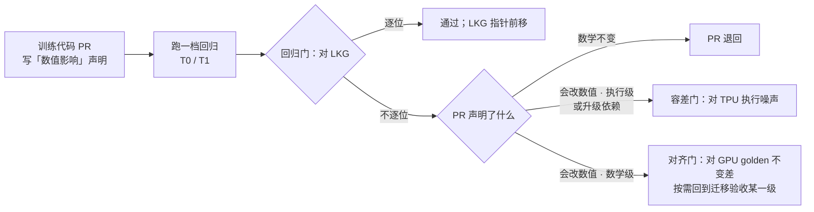
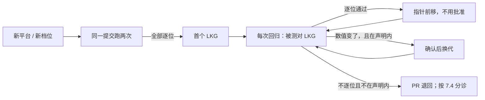

[janus](../../README.md) › [用户指南](README.md) › 第 7 章

[← 上一章：第 6 章 发现不对齐时怎么排查](06-debugging.md) ｜ [回目录](README.md) ｜ [下一章：第 8 章 接入新模型 →](08-new-model.md)

# 第 7 章 · 日常回归

迁移验收过了以后，模型在 TPU 上投产，每天都有提交合进训练代码。日常回归回答另一个问题：**这段时间合进来的代码、库版本、编译开关，有没有悄悄改变数值。**

TPU 同一程序重跑本来就逐位相同，所以日常回归默认要求逐位不变。只有 PR 声明了「会改数值」时，才用 TPU 自己的噪声来量（7.6）。参照是 [LKG](../glossary.md#lkg)，即上一次全部通过的 TPU 运行。

本章依次讲：7.1 和迁移验收的区别，7.2 每天的流程，7.3 档位，7.4 怎么跑，7.5 LKG 怎么换，7.6 标定 TPU 执行噪声。

| 这一步 | |
|---|---|
| 做什么 | 每次改训练代码、库版本、编译开关，都对 LKG 比，守住数值不悄悄变 |
| 怎么做 | `run_regression.sh` 跑 T0 或 T1（命令见下）；会改数值时带 `--declare` 与 `--scope`（7.4） |
| 做完看到什么算对 | 退出码 0：回归门逐位通过，LKG 指针前移 |
| 下一步 | 换模型时看[第 8 章](08-new-model.md) |

日常回归从验收通过、TPU 投产以后开始，LKG 是上一次验证过的 TPU 运行。「怎么做」一行的命令：

```bash
bash models/hunyuan3/regression/run_regression.sh T0 <名>   # 20 步冒烟
bash models/hunyuan3/regression/run_regression.sh T1 <名>   # 1000 步主力
```

混元 3 v5p 当前配置下，T0 / T1 的 LKG `reg-t0-fa-a`、`reg-t1-fa-a` 双跑逐位，并已批准。TPU 执行噪声由基线加 7 个扰动臂共 8 份运行组成，两两 28 对；T1 loss 带符号均值上限是 4.76e-5。

## 本章做完手里有什么

| 产物 | 锚点 |
|---|---|
| 一档能手动跑的回归 | `run_regression.sh` 退出码 0 |
| 你自己的首个 LKG，登记在 `lkg.yaml` | 同一提交跑两次全部逐位 |
| 你当前配置下的 TPU 执行噪声 | 至少 15 对；没有一对独自撑起上限 |

回归先跑 T0 20 步冒烟，再跑 T1 1000 步主力，档位见 7.3。执行噪声一行的「没有一对独自撑起上限」指留一法互判的结果，见 [`reference/metrics.md`](../reference/metrics.md#噪声上限-n)「噪声上限 N」里的留一法。

## 7.1 迁移验收和日常回归是两件事

| | 迁移验收（第 4 章） | 日常回归（本章） |
|---|---|---|
| 证明什么 | TPU 和 GPU 训的是同一个模型 | 今天的 TPU 和上一次验证过的 TPU 训的是同一个模型 |
| 参照 | GPU golden | LKG（last-known-good） |
| 尺子 | GPU 自己重跑的噪声 | 逐位为主；不逐位时用 TPU 自己的执行噪声 |
| 频率 | 一次（换平台、换模型、开新配方时重做） | 目标是每次合并、每 2–4 小时、每天 |
| 放哪 | `models/<模型>/alignments/<实践>/` | `models/<模型>/regression/` |

LKG 指同一平台、同一档位、同一并行变体上，上一次全部通过的 TPU 运行。

### 为什么能以逐位为主

TPU 编译期排定累加顺序，同一程序、同一输入重跑逐位相同（第 3 章最后一节；实测在单切片 v5p 8 片、16 片与 v7x 4 片上；多切片没测，换 libtpu 版本要重测）。所以「数学不变」的提交应当逐位不变，任何一位不同都是信号。

这条是实测出来的，不是定理：混元 3 在 v5p-8、v7x-4 单切片上、一个 libtpu 构建下验过；混元 4 在 v5p 上 libtpu 0.0.46、0.0.52 各自验过（[TPU 自比](../../models/hunyuan4/alignments/04-tpu-self/README.md)「完全没影响：逐位相同」）。换新平台、新规模（多切片）、新版本，先重测一次。

### 标准和参数在哪

- 通用标准（验收清单 R01–R28、PR 声明、标定、LKG 换代、二分）：[`reference/regression.md`](../reference/regression.md)
- 混元 3 的参数：[`regression/README.md`](../../models/hunyuan3/regression/README.md)

## 7.2 每天的流程



### PR 声明：三选一

训练代码的 PR 正文要写「数值影响」一栏，三选一（[`reference/regression.md`](../reference/regression.md#三pr-声明)「三、PR 声明」）：

| 声明 | 什么时候用 | 回归门怎么判 |
|---|---|---|
| 数学不变 | 重构、加日志、不进训练图的代码 | 全部逐位；不逐位就退回 |
| 会改数值 | 改精度、算法、公式、默认配置等 | 范围外逐位；范围内按幅度判 |
| 升级依赖 | jax / libtpu、kernel 库、镜像、编译开关 | 先要求逐位；不逐位时不能假定只换了求和顺序，先建新 golden、重测已知敏感项，排除数学级变化后才按执行级判（见下） |

#### 数学不变

- 什么时候用：重构、加日志、改不进训练图的代码、预期逐位不变的性能改动。
- 怎么判：全部逐位；不逐位就退回。
- 没写声明的按这一档判。

#### 会改数值

- 什么时候用：
  - 改精度、算法、公式、默认配置、并行或重算设置；
  - 会改变融合、调度、分块的性能改动。
- 要写三样：幅度（执行级 / 数学级）、范围（清单里哪几行会变）、理由。
- 怎么判：
  - 范围外的行仍要逐位。
  - 范围内、执行级：用 TPU 执行噪声判（容差门）。
  - 范围内、数学级：只报，由对齐门拦（对 GPU golden 不能变差）。

#### 升级依赖

- 什么时候用：jax / libtpu、kernel 库、镜像、编译开关。
- 怎么判：先要求逐位。不逐位时，照混元 4 升 libtpu 0.0.52 的做法（[`libtpu-052.md`](../../models/hunyuan4/alignments/04-tpu-self/libtpu-052.md)）：
  1. 离线编译比程序指纹判不了：换 libtpu 时后端代码生成一起换了，HLO 相同也不代表机器码相同。
  2. 不能假定「只换了求和顺序」：0.0.46 → 0.0.52，「RMSNorm 多舍一次」从 r 1.06 变成 5.50（主 loss 系统性偏高），词嵌入 scatter 插排序的门槛也变了。变的不是矩阵乘。
  3. 新版本先建 golden（同一命令只换版本，重跑一次确认逐位），和旧 golden 比；再把已知敏感项在新版本上重测（混元 4 是 TPU 自比的六件）。
  4. 这些都没有数学级变化，才按执行级判，并按 [`reference/regression.md`](../reference/regression.md#九升级-jax--libtpu--kernel-库)「九」归因。结论只对实测过的版本对和配置成立。

### 数值变了要回到迁移验收的哪一级

对照表见 [`reference/regression.md`](../reference/regression.md#十和迁移验收的关系)「十、和迁移验收的关系」。例如数学级改动要重跑 L3 第 1 步和 L4，改了数据管线要重跑 L0 数据对拍。

## 7.3 档位

| 档 | 混元 3 的配置 | 现状 |
|---|---|---|
| T0 冒烟 | 4 层，20 步 | 能手动跑；LKG `reg-t0-fa-a` 已重建并批准 |
| T1 主力 | 4 层，1000 步（= golden 长度）；另对 GPU golden [`g1k`](../glossary.md#g1k)（第一阶段 GPU golden，不开重算）比「不变差」（见下） | 能手动跑；LKG `reg-t1-fa-a` 已重建并批准 |
| T2 每日 | 4 层，1000 步，第 1 步抓张量，两个并行变体 | 未实施 |
| T3 生产形状 | 80 层、生产切分与数据管线，100 步 | 待定：生产配置与切片资源未定 |
| T4 低精度配方 | — | 未启用：混元 3 目前没有 FP8 配方 |

T0 / T1 的 LKG 都是当前配置的，已确认。

T1 对 [`g1k`](../glossary.md#g1k) 比「不变差」，对的是 `g1k` 的 3 份 `g1k-a/b/c`：R25 只对基线 `g1k-a` 算，`g1k-b/c` 只组噪声带。它对的是不重算的 BF16 golden，不是[两层验收](../glossary.md#two-tier)的最终 golden [`rcc`](../glossary.md#rcc)。以 [`regression/README.md`](../../models/hunyuan3/regression/README.md) 的 R25 行为准。

### 触发方式与耗时

现在全部手动触发。7.1 表里「频率」那一行的节奏，即每次合并、每 2–4 小时、每天，是目标（[`regression/README.md`](../../models/hunyuan3/regression/README.md#三档位)「三、档位」）。

v5p 上从提交到取回，T0 一次约 10 分钟，T1 约 25 分钟（[`regression/README.md`](../../models/hunyuan3/regression/README.md#二平台档案)「二、平台档案」）。

## 7.4 怎么跑

### 第一次跑之前：换成你自己的

在你自己的环境里第一次跑之前，仓库里的回归检查项目录与登记都指向混元 3 当前项目里已有的运行，要先换成你的：

1. 标定 TPU 执行噪声（7.6）。
   - 检查项目录的 `runs.noise` 指向标定运行，它们要在你自己的桶里。
   - 重标的命令在 [`regression/README.md`](../../models/hunyuan3/regression/README.md#五tpu-自噪声标定)「五、TPU 自噪声标定」末尾。
2. 核对 R02 钉死的值。
   - `catalogs/regression-common.yaml` 钉了权重清单、数据清单和训练配置 `hy3-4layers.yml` 的 sha256。
   - 仓库里现有的登记钉的是当前配置 `hy3-4layers.yml` a238883b（[`lkg.yaml`](../../models/hunyuan3/regression/lkg.yaml) 开头有说明）。
   - 你的配置不同就要改这几个值。
3. 建首个 LKG，并把打印出的条目追加进 `lkg.yaml`、提交到你的分支。
   - 之后不带 `--lkg` 时默认取这一档最新的一条。

### 跑命令

```bash
export BUCKET=gs://<POC 桶> CONTEXT=<TPU 集群的 kubectl 上下文> NODEPOOL=<你的 TPU 节点池>
source <(bash models/hunyuan3/frameworks/maxtext/stage.sh <maxtext 克隆> [提交，默认 origin/hunyuan])
# 建首个 LKG：同一提交跑两次，第二次对第一次判，全部逐位才是候选，打印 lkg.yaml 条目
bash models/hunyuan3/regression/run_regression.sh T0 <名> --first-lkg
# 日常：被测对 LKG（不给 --lkg 就取 lkg.yaml 里这一档最新的一条）
bash models/hunyuan3/regression/run_regression.sh T0 <名>
# PR 声明了「会改数值」：带上声明与范围，报告按声明改判
bash models/hunyuan3/regression/run_regression.sh T0 <名> --declare 数学级 --scope R02,R05,R15,R20
```

### 一条命令做了什么

1. 提交训练：复用第 3 章的 `run.sh`，集群设置同样由 `JANUS_SITE_PROFILE` 指定。
2. 取回运行目录。
3. janus 对 LKG。
4. 写回归报告。
5. 上传。

### 做完看到什么算对

退出码：0 通过，1 数值失败，2 工具出错或跑不完，3 无结论。报告首屏怎么读、各行从哪来，见 [`regression/README.md`](../../models/hunyuan3/regression/README.md#八手动跑)「八、手动跑」。

### 失败了怎么办

先补跑一次 LKG 那个提交，作为对照臂。对照臂也不逐位，说明变的是环境（镜像、硬件、集群），不是代码；对照臂逐位，再在两次提交之间二分。详见 [`reference/regression.md`](../reference/regression.md#八失败了怎么办分诊与二分)「八、失败了怎么办：分诊与二分」。

## 7.5 LKG：谁能当、怎么换



### 规则

- 每个「平台 × 档位 × 并行变体」一条，登记在 [`lkg.yaml`](../../models/hunyuan3/regression/lkg.yaml)。
- 首个 LKG：同一提交跑两次逐位，才能当。这证明这一档在这个平台上「同程序重跑逐位」。
- 数值没变，即回归门逐位通过：指针前移，记一条，不用批准。
- 数值变了，即会改数值、升级依赖：每一次换代都要确认。

### 红灯期间

红灯期间只冻结声明「会改数值」与「升级依赖」的 PR，「数学不变」的照常合并（[`regression/README.md`](../../models/hunyuan3/regression/README.md#九决定2026-11-04)「九、决定」）。

## 7.6 标定：TPU 自己的执行噪声

### 为什么要扰动臂

TPU 同一程序重跑逐位相同，噪声为 0，当不了「执行级」改动的尺子。所以用[扰动臂](../glossary.md#perturbation-arm)造噪声。扰动臂是只改执行方式、不改数学的 TPU 运行，例如改编译器的片上内存上限，或换注意力反向的分块大小。

### 每个臂要过三关

每个候选臂要过三关才能进参照（[`reference/regression.md`](../reference/regression.md#五tpu-自噪声怎么标定)「五、TPU 自噪声：怎么标定」）：

1. 臂自己重跑逐位；
2. 配置、版本、编译出的 HLO 计数等「只改执行」应当不变的东西对基线不变；
3. 1000 步 loss 对基线的差不大于 GPU 自噪声的上限；第 1 步梯度离 FP64 整步参照不比基线远，按能量合起来 R ≤ 1.2。第 1 步梯度不直接和 GPU 噪声比，因为只改执行方式的臂会翻近似平局的路由，GPU 重跑不翻（[`reference/regression.md`](../reference/regression.md#五tpu-自噪声怎么标定)第三关）。

### 混元 3 v5p 的标定结果

旧版训练配置下先标定过一次。旧版指 `hy3-4layers.yml` 一个精度开关都没开的那一版，当时试了 14 个臂，7 个进参照。

训练配置换成四个开关都开（a238883b）以后，按下一节的规则，旧标定作废。这 7 个臂在新配置下重跑，三关全过；加上基线共 8 份运行，两两配对得到 **28 对**，绑定 a238883b。正式启用线是 15 对，即 6 份运行。

第三关的 loss 一半由 `calibrate.py` 判；第 1 步参数梯度一半是 FP64 版，2026-11-06 补做。补做的是当前配置下的 6 个臂：sabwd256、sabwd1k、combo、vmem40、vmem56，外加 vmem48 + sabwd256（sabwd256 / sabwd1k 是 splash 注意力反向块取 256 / 1024，vmemN 是编译器片上内存上限取 N MiB，combo 是 vmem48 与 sabwd1k 一起开）；7 个参照臂里的 vmem64、vmem48 没有单独补。对基线 R：v5p 1.001 – 1.008，v7x 1.003 – 1.039，全过（[`arms-step1-vs-fp64.json`](../../models/hunyuan3/regression/results/arms-step1-vs-fp64.json)）。这几个臂对基线的第 1 步梯度差到 0.080，出现在第 3 层专家 0，原因是改片上内存上限翻了近似平局的路由。这个差远超 GPU 第 1 步噪声上限，所以这一半不拿 GPU 噪声比。

当前配置下 loss 三个量的上限：

| 档 | 步数 | 带符号均值 | MARE | 最大单步 |
|---|---|---|---|---|
| T1 | 第 1–1000 步 | 4.76e-5 | 1.192e-4 | 7.16e-4 |
| T0 | 第 1–20 步 | 4.05e-6 | 9.60e-6 | 3.25e-5 |

这些全部写在 [`calibration.yaml`](../../models/hunyuan3/regression/calibration.yaml)。每个臂进没进、为什么，见 [`regression/README.md`](../../models/hunyuan3/regression/README.md#五tpu-自噪声标定)「五、TPU 自噪声标定」。v7x 还没标定。

### 什么时候要重标

标定绑定平台、档位配置、训练配置 `hy3-4layers.yml`、镜像与依赖版本。任何一样变了，参照作废，要重标。

---

下一步：混元 3 这一套走通以后，换模型（例如混元 4）时哪些能原样复用、哪些要重做，见第 8 章。

[← 上一章：第 6 章 发现不对齐时怎么排查](06-debugging.md) ｜ [回目录](README.md) ｜ [下一章：第 8 章 接入新模型 →](08-new-model.md)
