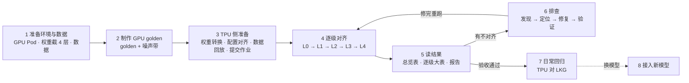

[janus](../../README.md) › 用户指南

# janus 用户指南

这份指南从零走一遍完整流程：把一个已经在 GPU 上训稳的模型迁到 TPU，并证明两边训的是同一个模型。

每一章是工作流里的一步，按顺序读、按顺序做，每章末尾有「下一步」。例子全部用混元 3，截 4 层，从 B200×8 迁到 TPU v5p-8 / v7x-4。

## 一段话讲完这份指南

模型在 GPU 上训稳了，要迁到 TPU，怎么证明两边训的是同一个模型？光看 loss 曲线重合不够，loss 一位不差、梯度却错了的情况很常见。janus 的办法分五步：

1. 先让 GPU 自己和自己比，量出「重跑一遍本来就差多少」（[第 2 章](02-gpu-golden.md)）。
2. 把同一份权重、同一批数据搬到 TPU（[第 3 章](03-tpu-setup.md)）。
3. 从「输入是不是同一份」一级级查到「1000 步是不是同一条轨迹」（[第 4、5 章](04-level-by-level.md)）。每一级按需用三种尺子之一：逐位相同；TPU 不比 GPU 离 FP64 真值远（R 比）；GPU 自己重跑的噪声，不超过它算过、超过两倍算不过（第 4 章 4.2）。
4. 混元 3 走这一遍时发现，GPU 这把参照尺子自己也有系统偏差（[第 6 章的案例](06-debugging.md#案例摘要tpu-1000-步-loss-偏低万分之一点五)）。偏差来自输出头梯度沿 12 万词表的长求和，这次求和在 B200 上有偏。修掉这一处以后，1000 步的 L4 就落进噪声内；第 1 步的梯度仍超出噪声，除了开三个梯度 FP32 开关后第 2 层 MLP 前 RMSNorm 梯度的 R 反升（1.43 → 1.79，定位到 norm 那个开关，原因没确认），机理都已查到，是否接受由验收方决定（[第 5 章 5.6](05-reading-results.md#56-签字清单现在离签字还差什么)）。
5. 验收过了以后，每次改代码都对上一次验证过的 TPU 运行比，守住数值不悄悄变（[第 7 章](07-daily-regression.md)）。

## 工作流一张图

## 章节

| 章 | 做什么 | 做完手里有什么 |
|---|---|---|
| [第 1 章 准备环境与数据](01-environment-data.md) | 起 8 卡 B200 Pod，下权重、截 4 层、转 Megatron，准备分词好的数据 | 一份带 sha256 清单的 4 层权重、一份数据；每一步都有可核对的锚点 |
| [第 2 章 制作 GPU golden](02-gpu-golden.md) | 先让 GPU 自己和自己比，证明工具可信、量出噪声；再跑最终 golden | 一份基线 golden、几份造噪声带的 golden，知道「GPU 重跑本来就差多少」 |
| [第 3 章 TPU 侧准备](03-tpu-setup.md) | 权重转成 MaxText 并逐张量核对，配置逐项对齐，回放同一批数据，提交 TPU 作业 | 一次能和 golden 逐位对上输入的 TPU 运行 |
| [第 4 章 逐级对齐 L0 → L4](04-level-by-level.md) | 先讲三种门槛（逐位、FP64 R 比、GPU 重跑的噪声） 再从「输入是不是同一份」一级级查到「1000 步是不是同一条轨迹」：每级的目的、怎么跑、怎么读、不过先查什么 | 每一级的结果文件和判定 |
| [第 5 章 读结果与签字](05-reading-results.md) | 看懂检查清单、总览、逐级大表、`report.md` 把任何一个数追到结果文件；对照签字清单 | 能自己判断「现在过了哪些、离签字还差什么」 |
| [第 6 章 发现不对齐时怎么排查](06-debugging.md) | 发现、定位、修复、验证、优化、记录六步 完整案例：TPU loss 偏低万分之一点五 | 一份排查案例、一个定了责的结论 |
| [第 7 章 日常回归](07-daily-regression.md) | 验收通过以后，每次改训练代码都对上一次验证过的 TPU 运行（LKG）比 | 能手动跑的回归档位、LKG、TPU 自己的噪声尺子 |
| [第 8 章 接入新模型](08-new-model.md) | 换成混元 4 这类新模型：哪些复用、哪些重做、按什么顺序 | 一张照着做的清单 |
| [专题 · 尺子](ruler.md) | 每个指标怎么定义、怎么算；噪声尺子 N 怎么造、r 怎么取；第 1 步逐张量怎么对 FP64 定责。带混元 4 的完整算例 | 照着能自己算出任何一格的 r，知道每条曲线看得见什么、看不见什么 |
| [附录](appendix.md) | 查用的材料在哪：术语、参考、混元 3 的全部材料 | 查用 |

只想先看结论：

- 混元 3 的结论：[对齐报告](../../models/hunyuan3/ALIGNMENT-REPORT.md)。
- 比了哪些量、每项结果：[检查清单](../../models/hunyuan3/CHECKS.md)。
- 全部检查一张表（含 GPU 自比与故障演练）：[总览](../../models/hunyuan3/dashboard/dashboard.md)。怎么读见[第 5 章](05-reading-results.md)。

## 名字速查

指南里反复出现的名字，每样只用一个主称呼：

| 主称呼 | 也会看到 | 意思 |
|---|---|---|
| golden | GPU 参照 | GPU 跑出的参照数据。混元 3 用到的代号见表下 |
| 基线 | baseline | 正式比较只对的那一份 golden，混元 3 是 [`rcc-a`](../glossary.md#rcc-a)（最终 golden 的第 1 份）；其余几份只用来量噪声 |
| 被测 | test、`--test` | 拿来和 golden 比的那次运行（迁移验收里是 TPU） |
| 噪声带 / 噪声上限 N | 噪声参照 | 几份 golden 两两比的差；N 是所有对里的最大值，判过不过的尺子 |
| 待定 | inconclusive、🟡 | 被测在 N 的 1–2 倍之间，证据不足 |
| 检查项目录 | catalog | 一个 YAML 文件，列出要比的运行和要跑的检查；`janus run` 读它 |
| 运行目录 / 运行根 | run | 一次训练的产物（`meta.json`、逐步标量、张量）；运行根是放这些运行目录的本地文件夹 |
| 对齐实践 | alignment | 一组「源平台 → 目标平台」的对比，一个文件夹 `00-gpu-noise-and-drills`（GPU 自比，下文叫第一阶段）、`01-v5p-acceptance`、`02-v7x-acceptance`、`03-gpu-remat-golden`（GPU 自比，重算） |
| 方法详解 | `docs/reference/` | 每一步「为什么这样做」的完整论证（原则、分级流程、指标与判定、环境、抓数） |
| 第一阶段 / 第二阶段 | `phase1-` / `phase2-` | 结果文件名的前缀：第一阶段是 GPU 自比（00），第二阶段是 TPU 对 GPU（01、02） 03 是 GPU 自比的补充，结果文件前缀 `remat-` |
| 输出头 dgrad | dh | 输出层对隐状态的梯度 dh = dlogits · W，要沿 12 万的词表做一次长求和 |
| 重算 | remat、recompute | 反向时重新算前向的中间量，省显存；rmap 指重算时把路由结果存下来、不重算 |
| 档位 | T0–T4 | 日常回归的几档配置（20 步冒烟、1000 步主力……），见第 7 章 |

混元 3 用到的 golden 代号（见第 2 章；每个代号一条定义见[术语表](../glossary.md#golden-codenames)）：

- [`g1k`](../glossary.md#g1k)：第一阶段 GPU golden。BF16，不重算，跑 1k 步，3 份。
- [`rc`](../glossary.md#rc)：GPU 生产 golden。加整层重算 + 路由回放，即原版生产程序，5 份。
- [`rcc`](../glossary.md#rcc)：最终 golden。`rc` 只把输出头 dgrad 改成分段 FP32 累加，其余设置不变，10 份。
- [`rce`](../glossary.md#rce)：精确轨迹，参考用。BF16 权重、全程 FP32 计算。
- [`rcec`](../glossary.md#rcec)：真精确轨迹，参考用。在精确轨迹上加输出头 dgrad 分段累加。
- [`rcx`](../glossary.md#rcx)：历史上用过。生产 golden 的输出头 dgrad 换成 FP32 一次累加。

## 读之前约定的几件事

- 数字都有出处。文中的数写明来自哪个结果文件（`results/<检查项目录名>.results.json`）的哪条检查，或哪次运行。推出来的写「推断」并给推导。
- 上表之外的名词查[术语表](../glossary.md)。
- 每段命令前写明在哪跑：GPU Pod、TPU 作业，还是任意一台 CPU 机器。`janus run` 判定只要 CPU。
- 桶名、集群名一律是占位，写成 `gs://<POC 桶>/…`。集群特有的提交设置不在仓库里，见[第 3 章](03-tpu-setup.md#34-提交-tpu-作业)「提交 TPU 作业」。
- 引用某一节时写成「文件名「节标题」」。标题改了，本地 `make test`（`make docs-check`）会拦下；带锚点的链接也一样，所以这些引用都能点到。

[回到根目录 README](../../README.md) ｜ [开始第 1 章 →](01-environment-data.md)
