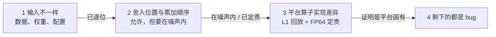

[janus](../../README.md) › [文档](../README.md) › 参考 · 原则 ｜ 对应的操作：[第 5 章「签字清单」](../guide/05-reading-results.md#56-签字清单现在离签字还差什么)

# 原则：对齐什么、差从哪来、什么时候能签字

## 一句话

模型在 GPU 上已经训稳了。迁到 TPU，要证明的是 **TPU 和 GPU 算的是同一个东西**：
两边的差不大于 GPU 自己重跑一遍的差，而且没有固定方向的偏移。

## 对齐的目标：以 GPU 为参照

### 为什么尺子是 GPU

TPU 直接对 GPU 比，不对「数学精确值」比。理由有三条。

训练能不能稳、超参调得对不对，是在 GPU 上验证过的。迁移的风险是「TPU 跑出来和 GPU 不一样」，所以尺子是 GPU。

「更准」不等于「对齐」。TPU 在某一步比 GPU 更接近精确值，但舍入位置和 GPU 不同，结果反而和 GPU 对不上。我们不追求 TPU 比 GPU 准，只追求两边落在同一个噪声范围里。

GPU 自己也不完美。第一阶段实测，B200 上路由 logits 对 FP64 正确舍入的逐位相同率只有 0.002%–0.04%（`models/hunyuan3/alignments/00-gpu-noise-and-drills/results/phase1-l1.results.json` 的 `L1.gemm.router.replay`）。拿 FP64 当标准，GPU 自己都过不了。

### FP64 只用来定责

FP64 用来定责，不当标准答案。某个算子两边差超线时，在这个算子上用同一份真实输入算一遍 FP64：

| 现象 | 结论 |
|---|---|
| 两边离 FP64 一样远 | 平台固有的舍入差，不是任何一边的错 |
| TPU 离 FP64 远、GPU 近 | TPU 这边有问题（舍入点多了、精度设低了、算法不同） |
| TPU 近、GPU 远 | GPU 的写法本身就粗；TPU 要对 GPU，就得复现 GPU 的舍入方式，见表后 |

GPU 张量核的累加方式已在 CPU 上逐位复现，见 [`design/0003-l1-op-replay.md`](../dev/design/0003-l1-op-replay.md#结论modelshunyuan3alignments00-gpu-noise-and-drillsresultsphase1-l125-条全-pass)「结论」第 4 条。

FP64 只用在一次计算上：单个算子、单层，或第 1 步一整步（第 1 步整网梯度超出噪声时，用 CPU 上的 FP64 整步参照定责，[第 4 章 4.6](../guide/04-level-by-level.md#46-l3--整网第-1-步)）。不跑多步的 FP64 训练：它慢，而且多步以后和两边的训练都不是同一条轨迹，比出来没有意义。

### golden 自己有偏差时

golden 自己有系统偏差时，先修掉偏差，再按一般规矩比。

混元 3 的 GPU 生产 golden 每一步都同向偏一点，原因是输出头 dgrad 沿词表的长求和在 B200 上有偏。用 GPU 上跑的[精确轨迹](../glossary.md#exact-trajectory)当裁判找到这一处以后，最终 golden 定为 [`rcc`](../glossary.md#rcc)：GPU 生产程序其余设置不变，只把这一处改成分段 FP32 累加。第一层对它比，噪声带取它自己同设置的重跑，没有例外。

精确轨迹仍是 GPU 跑出来的，和 BF16 训练的权重语义相同，不是整网 FP64，只作参考。对 GPU 生产 golden 的差写成已解释差异，见 [`judging.md`](judging.md#golden-本身有系统偏差时修掉偏差再按一般规矩比)「golden 本身有系统偏差时：修掉偏差，再按一般规矩比」。

## 术语

golden、被测、噪声参照、门槛、calibrated、逐位相同、ULP 等词的定义统一在 [`glossary.md`](../glossary.md)，这里不重复。

## 差从哪来：按顺序排除

两边对不上时，差只可能来自下面四类。**按顺序排查**：前一类没排除，后一类的结论不可信。

1. 输入不一样：数据、权重、配置。例如 token 错位、权重转换错、某个超参或开关两边不同。这一类不是精度问题，必须做到逐位相同或逐项说明（L0）。第一阶段的实例：配置写的权重衰减是 0.1，实际生效的是调度器默认值 0.033（`phase1-full` 的 `L1.optim.adamw.replay`，`weight_decay: 0.033`）。
2. 舍入位置与累加顺序。同一串计算，在哪一步舍成 BF16 不同、加法的先后不同，末位就不同。这是浮点运算的固有性质，允许存在，但要在噪声范围内。GPU 上浮点原子加的先后随执行时刻变，所以 GPU 同配置重跑也不逐位相同：第一阶段默认设置下，第 1 步前向逐位相同，第 2 步起 loss 就不同（`phase1-noise`）。TPU 编译期排定顺序，同一程序重跑逐位相同。
3. 平台算子的实现差异。两边的基本算子本身就不一样：
   - 初等函数的近似：GPU 上 FP32 exp 按 CUDA 文档最大 2 ulp，B200 实测 sigmoid / silu 最大 3.4 ulp；TPU 默认的 FP32 exp / log 是快速近似（v5p 实测最大 105 / 62 ulp，[差异清单第 4 节](tpu-vs-gpu-differences.md#4-c-超越函数与除法开方)）；
   - 矩阵乘的累加方式：实测 B200 张量核按每 16 个乘积一组对齐、截断低位，这是能逐位复现的经验模型，不是厂商公开规格；
   - top-k 打平时选谁。

   这些用 L1 单算子回放加 FP64 定责，证明是「平台固有」后可以接受，但要写进报告。
4. bug。前三类之外的差都是 bug：
   - 约定写错（如 loss 的平均方式）；
   - 梯度送错设备；
   - 优化器状态精度被降；
   - 某个开关一边开一边关。

## 什么时候能签字

三条都满足，才能说「TPU 和 GPU 对齐了」：

1. 地基逐位、两边可复现。
   - L0 全部逐位：数据指纹、权重（含 FP32 主权重与浮点 buffer）、配置逐项对照。
   - TPU 同程序重跑逐位相同。
   - 开不开抓数钩子逐位相同。TPU 上往训练步里加输出会改编译器的融合：混元 3 因此 L1–L3 只用不加钩子的证据，见[第 4 章 4.8](../guide/04-level-by-level.md#48-tpu-上第-1-步的证据为什么不用钩子)；混元 4 改成在训练步之外从训练状态取全量抓数，抓与不抓前 30 步 47 个逐步量 0 处不同（[mini 对齐细节](../../models/hunyuan4/alignments/01-mini/DETAILS.md#离签字还差什么) 1c）。
2. 差在噪声内，且没有方向性偏移。
   - L2–L4 用噪声标定的检查全部过。
   - 几份 golden 只用来造噪声带，正式比较只对事先指定的一份基线（[`judging.md`](judging.md#golden-怎么用几份只造噪声带比较只对一份)「golden 怎么用：几份只造噪声带，比较只对一份」）。
   - 噪声参照来自同一种设置的运行：3 份两两 3 对是下限；签字前单一设置至少 6 份、15 对（短窗口）；长窗口要更多，混元 4 的 1000 步 8 份（28 对）偏紧，用 16 份（120 对）；第 1 步跨平台的张量，2026-11-07 起噪声只用参照一侧、超出的对 FP64 定责（混元 3 当时用「两侧执行噪声的并集」，总数不少于 15 对、两侧各至少 3 份）。原因见 [`judging.md`](judging.md#参照要几对)。
   - 待定不能直接签，先加参照重判。加完还在 1–2 倍之间的，按第 3 条定责。
3. 超线的地方都已定责。
   - 每一条超线的检查，以及加了参照仍待定的检查，都用 FP64 查清来源（单算子在 L1，第 1 步整步梯度用 L3 的 FP64 整步参照）。判据是 TPU 离 FP64 不比 GPU 远，或开最高精度后差降下来。
   - 第 3 条不替代第 2 条：用噪声判的检查不过时，定责说明了原因，但第 2 条仍记为不满足，是否接受由验收方决定。
   - 定责结论与证据（运行名、结果文件）写进报告。

### loss 曲线重合不够

loss 曲线重合只是必要条件，不是充分条件。**loss 只能证伪**：第 1 步 loss 一位不差、梯度却错了的 bug 很常见。

第一阶段的实例是 `f-grad`（[`../../models/hunyuan3/alignments/00-gpu-noise-and-drills/faults/phase1-faults.md`](../../models/hunyuan3/alignments/00-gpu-noise-and-drills/faults/phase1-faults.md)）。一个参数的梯度在进优化器前被缩小 8 倍，第 1 步 loss 不受影响；之后的 loss 会变，但说不出错在哪。指出「这一步更新不是用抓下的梯度算的」，靠的是 FP64 优化器重放。

---

[回文档索引](../README.md) ｜ [回用户指南](../guide/README.md)
