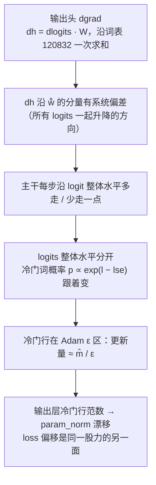
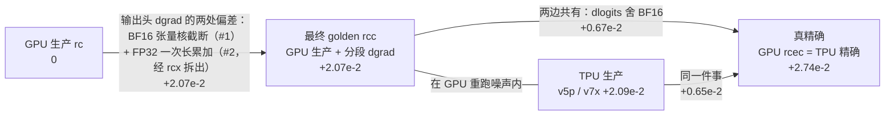

[janus](../../README.md) › [用户指南](../../docs/guide/README.md) › [混元 3](README.md) ｜ 对齐报告：结论、全部偏差、开关表

# 混元 3 · GPU → TPU 数值对齐报告

**对象。** 混元 3 截成 4 层（MoE，192 个专家 top-8，词表 120832），两边用同一份权重、同一份数据训练 1000 步，常数学习率 1e-5。GPU 一侧是 B200 × 8 上的 Megatron-Bridge；TPU 一侧是 MaxText，在 TPU v5p-8（8 芯片，拓扑 2x2x2；云上型号名按 TensorCore 计数叫 v5p-16）与 v7x-4（4 芯片 8 device）上各跑一遍。

**这份报告回答三件事**：两边对上了没有；我们测到的每一处差别是什么、在 GPU 和 TPU 上各是什么机制、有多大；想要两边尽量对上，要动哪些开关、各花多少代价，打开全部开关以后还剩哪些差。每个数都能追到仓库里的结果文件（第 9 节）。每一项检查比了什么、怎么判、两平台的逐项结果，在[检查清单 `CHECKS.md`](CHECKS.md)。

> **结论**
>
> - L4（1000 步）：TPU v5p 与 v7x 的当前对齐配置每一项都在 GPU 自己重跑的噪声内，最差 r = 0.85（第 3 节；r 是 TPU 对参照的差除以噪声上限 N，≤ 1 判过）。这是对事先定下的基线 `rcc-a` 说的；十份 golden 每份轮流当基线，v7x 当前配置有三份落进待定（最高 1.11），没有不过（第 3 节）。
> - 参照：最终 golden `rcc` 是 GPU 生产程序只修一处，输出头 dgrad 改成分段 FP32 累加（第 2 节）。为什么这不是挪球门，见第 2 节「为什么 rcc 不是挪球门」。
> - 对未经修改的 GPU 生产 golden `rc`，TPU 仍然不过（param_norm 带符号均值约 24 倍噪声），记为已解释差异，全部归到 GPU 输出头 dgrad 的长求和偏差（第 3 节末）。
> - 尺子是看到待定结果之后改过的：噪声参照从 5 份（10 对）补到 10 份（45 对），两处测量口径也改了。用原口径、45 对同样全部过，最差 0.84（第 3 节「我们怎么走到 45 对的」）。
> - L0 验收路径上全部逐位。L1 单算子（只比前向）离 FP64 不比 GPU 远，例外是 v7x 第 2 层 MoE 块：一个 token 路由翻转，R 比 1.27。L2 逐层前向、反向全过；L2 的参数梯度来自整网第 1 步，和下一条同源。
> - 验收路径上严格档不过或待定的，集中在第 1 步的梯度与优化器状态，主要来源是路由近似平局，已对 FP64 查明机理、不累积；其中一部分张量未达 R ≤ 1.2 的定责线：梯度逐张量最差 R 2.20（v7x 2.70），优化器状态 7.95（v7x 7.86，最差在二阶动量），更新后主权重 6.42（v7x 51.3），后两者的最差都在 128 维的 q norm 上（按能量合计梯度、动量 1.20 / 1.21，主权重 0.92 / 0.94）（第 4 节注 3）。按签字原则这一项不满足「噪声检查全部过」，是否据定责接受由验收方决定（签字清单 2b）。另有三项不在验收路径上：TPU 原生数据加载器、加抓数改数值（原因见第 4 节）、跨平台激活逐位（按定义不要求，见检查清单 L3）。

**适用范围。** 结论只对下面这组条件成立：GPU 一侧是 B200 × 8、CUDA 13.4、cuBLAS 13.8（输出头 dgrad 的长累加偏差只在这套软硬件上量过）、NeMo 26.10 镜像（Megatron-Core 0.20.0、Megatron-Bridge 0.7.0、Transformer Engine 2.20.2）；TPU 一侧是 MaxText 官方镜像 `tpu_pre_training`（digest `b152355a…`）、jax 0.11.1、libtpu 构建 `cl/963683785`（`meta.json` 只记了构建号，按同一构建号认作 0.0.46）、`maxtext` `hunyuan` 分支 `0622774a`（正式 L4 的 `t-rmap-on-1000`、`t-v7x-on-1000`；逐项与出处见 [01 设置「软件版本」](alignments/01-v5p-acceptance/setup.md#软件版本)），换 libtpu 或 jax 要按混元 4 [`libtpu-052.md`](../hunyuan4/alignments/04-tpu-self/libtpu-052.md) 的做法重建 golden、重测（混元 4 上换到 0.0.52，有的结论变了）；混元 3 截前 4 层（1 层稠密 + 3 层 MoE）、去掉 MTP；1000 步、常数学习率 1e-5、无 warmup 与 decay；全局批 16、序列 4096、fineweb-edu 数据；BF16 混合精度（没有 FP8）；GPU 一侧关分布式优化器与通信重叠（`no_shard`，开着时 loss 会持续偏低 2–7e-5，台账 #13）；TPU 主配置是非专家参数 FSDP 8，EP = 8 只验了 L4 的 loss、grad_norm、param_norm 与学习率。TPU 的 CP、TP、PP 一次都没测（GPU 侧 TP 2、CP 2 只比了前 3 步标量），而据 一次实际排查，混元 3 生产在用 CP。没有覆盖的，最主要的三项：80 层生产形状（日常回归 T3 档位待定）、日常回归用的 TPU 执行噪声在 v7x 上还没标定（v5p 做了）、第 1 步专家参数只比了每层 192 个里的 2 个。另外，这个 libtpu 构建（0.0.46）在 v5p 上实测有一个 jit 静默算错的编译器 bug；存档 HLO 扫描只扫了混元 3 的 72 份回归与标定程序（0 处命中；但 72 份里 71 份有含 DUS 的多输出 fusion，bug 的前提条件普遍存在，[`jit-miscompile-hlo-scan.json`](../hunyuan4/results/jit-miscompile-hlo-scan.json) 的 `summary`），正式被测 `t-rmap-on-1000`、`t-v7x-on-1000`、EP = 8 的运行和第 1 步被测都没扫，所以正式 L4 的程序没有排除它，扫正式被测是优先项；v7x 上同一构建的探针算对（混元 4 [案例 16](../hunyuan4/cases/16-jit-miscompile-sub8-row-block.md)：同一颗多输出 fusion 照样生成，0.0.46 / 0.0.52 / nightly 都对；「v7x 对」的机理是从 v5p 错、v7x 对推的），所以 v7x 正式被测的扫描优先级低于 v5p；特征只是必要条件，扫描仍要做（[01 设置「软件版本」](alignments/01-v5p-acceptance/setup.md#软件版本)）。全部未覆盖项见检查清单「[已知的覆盖缺口](CHECKS.md#已知的覆盖缺口)」。第 1 步整步的噪声参照 2026-11-08 起只用 GPU 第 1 步重跑 3 对（「两侧执行噪声的并集」已撤回，见下方判法变更记录）：GPU 一侧只有 3 份（一般规则对单一设置建议 6 份），而且 GPU 重跑路由一个都不翻、量不到近似平局翻转，所以这几格超出的部分全部另对 FP64 定责。

**搬到 TPU 时另外几处没覆盖的**（下表各行连同 TPU 的 CP、TP、PP 都已并进检查清单的缺口表）：

| 维度 | 测过的取值 | 没测的取值 | 搬到 TPU 时怎么办 |
|---|---|---|---|
| 训练中途从 GPU 接到 TPU | 检查点只测了从 HF（第 0 步，值都是 BF16）转 MaxText，逐位（[`CHECKS.md`](CHECKS.md) L0）。案例 01 的 `t-sw-g99b` 把 GPU 的 FP32 主权重导进 TPU，只作诊断、不带优化器状态（[案例 01](alignments/01-v5p-acceptance/cases/01-loss-offset-param-norm.md)「状态互换」行） | Megatron 存档（FP32 主权重、Adam 两个动量、路由偏置、步数、数据位置）直接转 MaxText，没实现（[00 覆盖表](alignments/00-gpu-noise-and-drills/coverage.md)「待做」）；TPU 训完的权重导回 HF / Megatron 也没查 | 先实现带全部训练状态的转换，L0 逐张量逐位；再从 GPU 第 N 步接 TPU 跑若干步，对 GPU 连续训练比第 1 步张量与 L4 |
| TPU 存档续训 | v5p、v7x 各一次：20 步里第 10 步存档、同一拓扑恢复，走本仓库 `train_hy3.py` 的 orbax 存取（[续训目录](alignments/01-v5p-acceptance/catalogs/phase2-resume.yaml)） | MaxText 原生存档（`hy3-4layers.yml` 里 `enable_checkpointing: false`）；换拓扑、换切片大小、v5p ↔ v7x 恢复 | 「20 步」对「10 步存档再续 10 步」逐位，换成要用的存档方式和拓扑再做一次 |
| 多切片 | 单切片：v5p 2x2x2、v7x 2x2x1（`dcn_data_parallelism: 1`） | 多切片（跨切片的数据并行与归约） | 同一起点只改执行方式比单切片（L4），超了做第 1 步张量 |
| TPU 原生数据管线 | 只在 CPU 上对拍过：换序后 1000 步 64000 个单元逐元素对上 GPU（[`data/README.md`](data/README.md)）。所有 TPU 训练都是原样回放 GPU 的 batch | 原生加载器进 TPU 训练：首步 loss、续训位置、真多机（[00 覆盖表](alignments/00-gpu-noise-and-drills/coverage.md) 注 2） | 在 TPU 上用原生加载器（加换序）跑首步 loss 和一次存档续训，L0 输入指纹逐位 |
| libtpu / jax 版本 | 一个 libtpu 构建（2026-08-12，[`runs.yaml`](alignments/02-v7x-acceptance/runs.yaml) 与 [`lkg.yaml`](regression/lkg.yaml) 记的构建号；混元 4 按同一构建号认作 0.0.46）；jax 0.11.1（[v5p setup](alignments/01-v5p-acceptance/setup.md)） | 其它版本，没做过换版本对照。混元 4 上换 libtpu 改过结论（[环境说明](../../docs/reference/environment.md)） | 换版本先重建 golden，再重跑 L4，结论只对实测过的版本成立 |
| 日常回归守的程序 | 回归 T0 / T1：`per_device_batch_size=2`、累积 1（[`tiers/t1.yaml`](regression/tiers/t1.yaml)），yml 默认中间量都存着、不重算；只在 v5p 上跑过 | 正式 L4 的 `t-rmap-on-1000` 用 yml 的累积 2，命令行另加重算覆盖（除层输入与路由结果外都重算，写法见 [v7x `runs.yaml`](alignments/02-v7x-acceptance/runs.yaml)）。重算会换舍入点（[回归 README](regression/README.md) `rematqkv` 行：`reduce-precision` 31 → 24），所以回归绿了不等于验收的那个程序没变 | 回归绿了只说明它自己那份程序没变；要守验收程序，得给它（累积 2 + 重算覆盖）单独建回归变体和 LKG，建不建待定 |

## 结论展开

### 拿什么当参照

golden 是对齐的参照答案，取 GPU 生产训练程序（B200 × 8 上的 Megatron-Bridge）跑出来的结果。本报告的「生产程序」指第 7 节定义的配置（上游预训练默认配置加整层重算与路由回放，关分布式优化器），不等于线上的训练配置。TPU 要做到和它的差不超过 GPU 自己重跑的噪声。

最终 golden [`rcc`](../../docs/glossary.md#rcc) 在生产程序上只改一处：输出头反向（dgrad）沿 12 万词表的那次长求和，改成分段 FP32 累加。原因是 B200 上这次长求和有系统偏差，不修的话参照本身就是偏的（第 2 节）。其余设置一律不变。

`rcc` 只是对参照的一处修正。对齐还包括另外几部分：TPU 一侧的精度开关（第 6 节）；TPU 不用 MaxText 自己的数据管线，按 golden 存下的每步 batch 原样回放（[`config-alignment.md`](config-alignment.md)「数据来源」行）；测到的每一处差别（第 5 节）；两处测量口径（第 8 节）。

### 怎么比、比的结果

`rcc` 跑了 10 份（`rcc-a..j`）。GPU 默认设置不确定，各份之间略有不同；10 份两两配对得到 45 对比较，量出噪声上限 N。TPU 只和事先指定的一份 [`rcc-a`](../../docs/glossary.md#rcc-a) 逐步比，不取平均、不挑最差。

比的是 L4 的 loss 全程、loss 第 301–1000 步、grad_norm、param_norm、路由偏置曲线、健康信号；逐步学习率两边逐位相同，它是设置的常数，归 L0 设置核对（「判法变更记录」末行）。判定量是 r = TPU 对 `rcc-a` 的差 ÷ N，≤ 1 判过。TPU v5p 与 v7x 的当前对齐配置每一项都过，最差的 r 是 0.85（第 3 节）；换别的一份当基线，v7x 当前配置十份里有三份落进待定（第 3 节「基线」一段）。

### 其余各级

- **L0**：验收路径上全部逐位。
- **L1、L2**：单算子、逐层前向与反向离 FP64 不比 GPU 远，两个平台都按当前配置核对过。v7x 打开 `dense_fp32_accumulation`（FSDP 切开收缩维的投影改用 FP32 累加）后，四层前向 R 比 1.06 / 1.01 / 1.01 / 1.02，打开前是 1.53 – 1.57。v7x 第 2 层 MoE 块的单算子回放里有一个 token 路由翻转，R 比 1.27，去掉它是 0.95。
- **第 1 步整步（[签字清单](../../docs/guide/05-reading-results.md#56-签字清单现在离签字还差什么) 2b）**：梯度与优化器状态按只用 GPU 第 1 步重跑 3 对的尺子判（2026-11-08 起；判法见 [`judging.md`](../../docs/reference/judging.md#第-1-步张量两侧执行噪声的并集)）全部超 2 倍，判「不过 · 已解释」：超出的张量都已对 FP64 定责到偏差台账 #5 / #17 / #20 的机理，但其中一部分未达 R ≤ 1.2，按字面不算「已定责」（梯度逐张量最差 2.20 / 2.70，优化器状态 7.95 / 7.86，更新后主权重 6.42 / 51.3，见第 4 节注 3）。大头是路由近似平局在两种硬件上各自落到一边。另一处是一维 norm 权重、输出层与 embedding 的梯度：TPU 离 FP64 比 GPU 远（台账 #20；检查按逐张量最大 R 比判，v5p 2.20；整网按能量合计 1.20 只作参考），因为 TPU 把这几类 FP32 参数先转成 BF16 再参与计算，梯度先以 BF16 落地再转回 FP32。三个前向不变的开关能把按能量合计压到 0.67，但逐张量仍有 1 个 1.785（第 2 层 MLP 前 RMSNorm，开关前 1.43，上升原因没确认，注 20），第 1 步这两条检查开了开关也不过。打开后 v7x 的 L4 grad_norm 最大单步到噪声上限的 1.05 倍、待定，这和只改 splash 块大小就到 1.15 倍（下文「TPU 这一侧不是挑出来的一个好样本」）同量级，不能算作开关的代价。是否把它们加进对齐配置另行确定（第 6 节）。这些差都不累积，1000 步的统计在噪声内。

## 1. 先说怎么判「对上了」

### 尺子：GPU 自己重跑的噪声

比较不手写门槛。GPU 同一个程序重跑几次，每次都会差一点，因为反向里的规约顺序不确定；任意两次之间的最大差就是**噪声上限 N**。TPU 对 GPU 的差 ≤ N 判过，> 2N 判不过，中间待定。这把尺子问的是：TPU 这一次，像不像 GPU 又多跑了一次（[`judging.md`](../../docs/reference/judging.md)）。

噪声量不到的地方换一把尺子：GPU 第 1 步前向逐位可复现、隔离回放里路由也不翻，这时问 TPU 是否不比 GPU 离 FP64 真值远。量法是 R 比 = rel_L2(TPU, FP64) ÷ rel_L2(GPU, FP64)，≤ 1.2 过（[术语表](../../docs/glossary.md#r-ratio)）。注意它和上面的 r 不是一回事：r 是差除以噪声，R 比是两边离精确值的距离之比。

### 五级检查

| 级 | 比什么 | 参照 | 尺子 |
|---|---|---|---|
| L0 | 数据、权重转换、载入后的参数、配置；设置核对（逐步学习率） | `g1k-a`（第一阶段 GPU golden）与 HF 原件 | 逐位相同 |
| L1 | 单个算子 | `g1k-a` 第 1 步抓到的算子输入 | 离 FP64 真值不比 GPU 远（R 比 ≤ 1.2） |
| L2 | 单层，每层输入取 GPU 的 | `g1k-a` 第 1 步 | 前向、反向同上；参数梯度（来自整网第 1 步、按层分组）对噪声 |
| L3 | 第 1 步整网 | `g1k-a`；噪声 `g1k-a/b/c` 3 对（2026-11-08 起；之前并上 TPU 21 对） | logits、逐 token loss 同上；梯度与状态对 GPU 3 对的噪声，超出时对 FP64 定责 |
| L4 | 1000 步的 loss、grad_norm、param_norm、路由偏置 | 基线 `rcc-a`；噪声 `rcc-a..j` 45 对 | 对 `rcc` 重跑的噪声 |

第 1 步的比较用 `g1k`：BF16、不重算、也没有分段 dgrad 的修正。输出头 dgrad 的那处偏差（台账 #1）在第 1 步只表现为 dh 沿 ŵ̄ 分量 −6.5e-4 的相对误差，量级远小于第 1 步梯度差的主要来源（路由翻转的专家梯度相对差到 0.10）。我们据此推断它不影响第 1 步的定责，没有单独做「第 1 步改用 `rcc`」的对照；这处偏差要累积几百步才显出来，那是 L4 的事。重算的不一致见检查清单「已知的覆盖缺口」。

另有一档参考档：同类 GPU→TPU 迁移项目用过的经验门槛，只并列报告，不决定验收。

每一级具体比了哪些模块和张量、各用什么门槛、v5p / v7x 的逐项结果，列在[检查清单 `CHECKS.md`](CHECKS.md)（由结果文件生成，开头有每一级的规模）。

### 判法变更记录

下面几次改判法都发生在看到结果之后。改前的结果文件全部保留（检查清单末尾「未列入本页的结果文件」），改前改后的判定并列在这里，读者可以自己判断每次改动是否合理。

| 改了什么 | 为什么 | 改前 | 改后 |
|---|---|---|---|
| L4 第一层的参照从精确轨迹 `rce-a`（方案 A）换成最终 golden `rcc-a` | 精确轨迹的输出头 dgrad 仍是 cuBLAS FP32 一次累加，本身有偏（台账 #2），而且它是确定性的，造不出自己的噪声带 | param_norm v5p 3.45 倍、v7x 3.53 倍，不过 | 全过（第 3 节） |
| L4 噪声参照从 `rcc-a..e` 5 份两两 10 对扩到 `rcc-a..j` 10 份两两 45 对，并改正两处测量口径 | 判定项的 MARE 比值在 0.71 – 1.24 之间、没有一项明显偏大，像参照太少；两处口径见第 8 节。补跑是看到待定后决定的，事先没有停止规则 | v5p grad_norm、v7x grad_norm 与 param_norm 在 1.02 – 1.24 倍，待定 | 最差 0.85；不改口径、只扩参照时最差 0.84 |
| 第 1 步整步的噪声从 GPU 重跑 3 对改成 GPU 3 对 ∪ TPU 只改执行参数的 7 份两两 21 对（这 7 份和第 3 节 L4 用的扰动运行是两组） | GPU 重跑第 1 步路由一个都不翻，量不到近似平局翻转；TPU 只改执行参数就会翻 | 换代前配置的被测（`phase2-st1-prod-state`，打开 `dense_fp32_accumulation` 之前）：v5p 过 4、不过 7、待定 1；v7x 过 3、不过 8、待定 1 | 当前对齐配置的被测（`phase2-st1-on-state-xnoise`）：v5p 过 4、不过 3、待定 5；v7x 过 4、不过 2、待定 6。计数是这一份结果文件里的检查条数，含优化器重放与假 FP32 检查 |
| 第 1 步整步的噪声撤回并集，改回只用 GPU 第 1 步重跑 3 对（`phase2-st1-on-state-gpuonly`、`phase2-v7x-st1-on-state-gpuonly`；并集结果 `*-xnoise` 留作历史） | 尺子只来自参照一侧（GPU），被测一侧的波动不能给自己定门槛；2026-11-08 起按此重判。参照量不到的差直接对 FP64 定责 | v5p 过 4 / 不过 3 / 待定 5，v7x 过 4 / 不过 2 / 待定 6（并集 24 对） | v5p 过 4 / 不过 7 / 待定 1，v7x 过 3 / 不过 8 / 待定 1：变严 11 项（待定→不过 10，v7x 更新后主权重 过→待定 0.99 → 1.61），没有一项变松；不过的各项标「已解释」（FP64 定责见台账 #5 / #17 / #20）；L4 结论不变 |
| 逐层隔离回放的反向从 GPU 噪声改成 FP64 R 比 | 隔离回放里两侧只改执行方式都不翻路由，并集也量不到；只能用外部尺子 | 4 层里 3 层不过（两平台） | 4 层都过 |
| 报告口径（2026-11-07，不是判法）：逐步学习率从 L4 的比较项移到 L0 的设置核对（总览 L0 组「设置核对：学习率逐步」、检查清单 L0 同名一行） | 学习率是设置的常数（1e-5，无 warmup、无衰减），不是观测量，不该和 loss、grad_norm 并列算 L4 的过与不过（混元 4 先做了同样的改动） | L4 一项「学习率逐步」：GPU 自比、v5p、v7x 都 ✅（容差为 0 的逐步比较），故障演练抓到 `f-lr` | L0 一项，判定不变（同一批检查 `L4.lr`，检查 id、目录与结果文件都没改）；L4 少一项。各实践 README 的逐级大表按检查 id 自己的级排序，这一行仍排在 L4 |

TPU 只改执行参数时自己的散布（最差张量 rel_L2 0.080）和 TPU 对 GPU 的差（0.105）同量级，而现行尺子只有 GPU 3 对、量不到路由翻转，所以这一级的结论不能只看判定符号。超出部分另用 FP64 定责（第 4 节注 3），回答的是「谁离精确算术更远」，不依赖噪声宽度。L4 的基线按规则取 golden 列表的第一份 `-a`，这条规则写在比较协议里（[`judging.md`](../../docs/reference/judging.md#golden-怎么用几份只造噪声带比较只对一份)），先于补跑 `rcc-f..j`。

## 2. 故事：从「TPU 的 loss 偏低万分之一点五」到「两边重合」

### 起点：TPU 稳定偏离 GPU 生产 golden

对照的是 GPU 生产 golden [`rc`](../../docs/glossary.md#rc)：生产配置，BF16 混合精度、整层重算、路由回放。TPU 训 1000 步，loss 比它稳定偏低：当时的 TPU 配置 `t-rmap-1000`（打开 `dense_fp32_accumulation` 之前）第 301–1000 步 loss 相对差（TPU − GPU）/ GPU 的带符号均值是 −1.34e-4（对 `rc-a..e` 五份的均值），第 1000 步 param_norm 多 +2.1e-2（[01 README](alignments/01-v5p-acceptance/README.md)「结论」）。第 301–1000 步里 TPU 更低的步占 88%（当前配置 `t-rmap-on-1000` 对 `rc` 均值），`rc` 五份两两之间是 32% – 68%：逐步差在抖，偏的是中心，不是噪声。L0、L1 与 L2 前向都过，问题只在多步上出现。案例 01 标题里的「万分之一点五」是最早对第一阶段 GPU golden `g1k` 看到的偏移（300 步以后稳定在 −1.5e-4 左右）。

### 定位：一股「所有 logits 一起升降」的力

漂移几乎全在输出层里训练数据中没出现过的那些词（冷门行）。推它的力是输出头流回隐状态的梯度 dh 沿输出层行均值方向 ŵ̄ 的分量。这股力每步差一点点，主干就每步沿「logit 整体水平」多走或少走一点；logits 整体水平一变，冷门词的概率按指数跟着变；冷门行的梯度小到落在 Adam 的 ε 区（√v̂ < ε），更新量和梯度成正比，冷门行被压多压少就分开了。loss 偏移和 param_norm 漂移是同一股力的两面。

param_norm 在 3042 附近有记录刻度：TPU 按 FP32 记录，一个刻度 2.44e-4；GPU 以 FP64 写盘、平方和在 FP32 里求，刻度约 1.64e-4（FP32 平方和约 9.25e6 处刻度为 1，开方后 1 ÷ (2 × 3042) ≈ 1.64e-4）。下文第 1000 步 param_norm 的绝对差相差不到一个刻度的视为相同（例如 +2.07e-2 与 +2.09e-2、6.74e-3 与 6.84e-3）。

下文「沿 ŵ̄ 偏 x」指这个分量相对 FP64 参照的相对误差：Σₜ (dhₜ − dhₜ^FP64)·û ÷ Σₜ |dhₜ^FP64·û|，û 是 ŵ̄ 的单位向量，求和遍历一个 microbatch 的 token（[`head_bwd_ref.py`](analysis/head_bwd_ref.py)）。同一种实现在不同训练状态上量出的值可以差很多：训练后冷门词的概率变得很小，它们的输出层行在 ŵ̄ 上大多同号，长求和的偏差不再互相抵消。

### 根子在 GPU 一侧

GPU 生产程序的这次长求和在 B200 张量核上做：每 16 个乘积对齐到最大指数，低位向零截掉。这个累加模型不是假设：在 CPU 上按它复现 B200 的路由 logits 与 BF16 输出的 GEMM，和实测逐位相同（`phase1-l1` 的 `L1.emulate.gemm`；模型的思路见 Fasi 等 2021《Numerical behavior of NVIDIA tensor cores》）。截掉的总是低位，在 12 万长的求和里积成朝 0 的系统偏差，沿 ŵ̄ 偏 −6.5e-4（[`gemm_accum_bias.py`](analysis/gemm_accum_bias.py)）。这个模型在 K = 4096 的路由 GEMM 上逐位核过；12 万长的输出头没有单独逐位核对，偏差朝 0、随 K 增长与模型一致，说它就是这一机制是推断。TPU 的 MXU 同样吃 BF16 输入，乘积在 FP32 里累加，第 1 步沿 ŵ̄ 只偏 −2.6e-5（v7x 回放；v5p 回放 −2.4e-5）；累加是否就近舍入没有直接证据，路由打分对 FP64 只差 4.8e-8 是旁证（推断）。

### 「精确」也要核对

我们先把 GPU 改成「BF16 权重、全程 FP32」的精确轨迹当裁判（`rce`）。它离 TPU 近了，但和 TPU 自己的精确轨迹仍差 +8.7e-3（第 1000 步 param_norm）。逐处对 FP64 才查到：B200 上 cuBLAS 的 FP32 矩阵乘一次累加整个词表时也有偏：θ₂₉₉（第 299 步更新后、第 300 步开始时的状态）上，cuBLAS FP32 沿 ŵ̄ 偏 −2.6e-4（同一状态下 TPU 生产只偏 −4.5e-6，v7x 回放，差约 60 倍），方向和同一状态下的 BF16 张量核（−4.4e-4 量级）一样，大小约是它的六成。关 TF32、换 IEEE 模式、换 cuBLAS 后端都不变，只有把词表分段、段间 FP32 累加才精确。问题在 B200 上 cuBLAS 13.8 的长累加内核，不在 FP32 本身：同一份数据在 CPU 上 FP32 一次累加只偏 −3.4e-8；内核内部怎么累加没有源码，机制是推断。分段起作用、升 FP32 不起作用，是在三个训练状态上单步离线重算得出的；1000 步训练上 FP32 分段（`rcc`）与 BF16 张量核分段（`rcb`）都过，二者不可分（案例 01 注 42）。GPU 精确改成分段（`rcec`）后，和 TPU 精确在噪声内重合：两边在真精确算术下是同一条轨迹。

### 最终 golden：只改输出头 dgrad 这一处

GPU 生产程序只改这一处，输出头 dgrad 分段 FP32 累加（`rcc`），TPU 生产就落在它的重跑散布里。

TPU 生产离真精确还差的那一份两边都有（[`case01-tpu-budget.json`](alignments/01-v5p-acceptance/results/case01-tpu-budget.json)）：第 1000 步 param_norm，TPU 生产对 GPU 真精确 `rcec-a` 是 −6.5e-3，对 TPU 自己的精确轨迹（在 v7x 上跑）是 −6.35e-3。原因是两边的生产程序都把流进输出头反向的 dlogits 舍成 BF16：GPU 精确轨迹加上这一次舍入后少漂 6.7e-3，TPU 精确轨迹加上这一次舍入后少漂 6.8e-3（v7x；v5p 是 6.1e-3，台账 #4）。

### 为什么 rcc 不是挪球门

`rc`、`rcx`、`rce`（方案 A）先后当过参照，都没过；`rcc` 最后一个上，定为正式 golden 时 `rcc-a` 对 TPU 的交叉核对已经看过。所以下面列出不依赖 TPU 的证据（详见[案例 01](alignments/01-v5p-acceptance/cases/01-loss-offset-param-norm.md)「为什么 rcc 不是挪球门」）：

- 单算子对 FP64：生产写法沿 ŵ̄ −6.5e-4（第 1 步）；分段写法 +9.9e-9 / +3.5e-7 / +1.1e-7（第 1 / 100 / 300 步）。判据是 FP64，不是 TPU。
- 只用 GPU 也闭合：GPU 精确轨迹加分段 dgrad、再把 dlogits 舍 BF16（`g-bwcr-1k`），和 `rcc-a` 的 param_norm 带符号均值差 +1.3e-7，在 N（2.27e-7）内。
- 只改一处：10 份 `rcc` 与 `rc` 同镜像、同配置、同检查点与数据，唯一的数值改动是 `dgrad-chunk`；段长 1024 在跑 `rcc` 之前就定了。
- 事先定的：golden 是 GPU 生产程序、比较只对 `-a`、噪声取同设置重跑、1 / 2 倍门槛。事后定的：修哪一处，以及采用 `rcc` 本身。

### 第 1000 步 param_norm 的阶梯

对 `rc`（GPU 生产 golden，即原版生产程序）五份均值的差：

排查过程和每一步的干预实验在[案例 01](alignments/01-v5p-acceptance/cases/01-loss-offset-param-norm.md)。第 1000 步的数字出自 [`case01-tpu-budget.json`](alignments/01-v5p-acceptance/results/case01-tpu-budget.json) 与案例 01 第 0 节「GPU 生产 + 精确输出头 dgrad `rcc-a`」行。

## 3. 换成最终 golden 以后：L4 对基线 rcc-a 全部在噪声内

### 第一层结果

正式第一层：TPU 只和最终 golden 的基线 `rcc-a` 逐步比；噪声上限 N 取 `rcc-a..j` 10 份重跑两两配对的 45 对比较里的最大值。每格是带符号均值、MARE、最大单步三个判定量里对 N 最差的比值 r，≤ 1 过、> 2 不过。

| 平台 · 配置 | loss 全程 | loss 301–1000 | grad_norm | param_norm | 学习率（设置核对，归 L0） | 路由偏置曲线 | 健康信号 | 结果 |
|---|---|---|---|---|---|---|---|---|
| v5p-8 · 当前对齐配置（FSDP 8） | 0.80 ✅ | 0.80 ✅ | 0.85 ✅ | 0.50 ✅ | 逐位 ✅ | 0.81 ✅ | ✅ | [`phase2-acceptance-rcc-on`](alignments/01-v5p-acceptance/results/phase2-acceptance-rcc-on.report.md)、[`phase2-acc-health-rcc`](alignments/01-v5p-acceptance/results/phase2-acc-health-rcc.report.md) |
| v7x-4 · 当前对齐配置（FSDP 8） | 0.82 ✅ | 0.83 ✅ | 0.85 ✅ | 0.53 ✅ | 逐位 ✅ | 0.81 ✅ | ✅ | [`phase2-v7x-acceptance-rcc`](alignments/02-v7x-acceptance/results/phase2-v7x-acceptance-rcc.report.md)、[`phase2-v7x-acc-health-rcc`](alignments/02-v7x-acceptance/results/phase2-v7x-acc-health-rcc.report.md) |
| v5p-8 · EP = 8（专家并行度与 GPU 相同） | 0.76 ✅ | 0.78 ✅ | 0.74 ✅ | 0.48 ✅ | 逐位 ✅ | — | — | [`phase2-acceptance-rcc-ep8`](alignments/01-v5p-acceptance/results/phase2-acceptance-rcc-ep8.report.md) |
| v7x-4 · EP = 8 | 0.77 ✅ | 0.81 ✅ | 0.68 ✅ | 0.35 ✅ | 逐位 ✅ | — | — | [`phase2-v7x-acceptance-rcc-ep8`](alignments/02-v7x-acceptance/results/phase2-v7x-acceptance-rcc-ep8.report.md) |

基线 `rcc-a` 按比较协议在看结果之前定为列表的第一份。换一份当基线，被测的差最多挪动一个 N（任意两份 golden 之间的差不超过 N），所以 r 最多挪动 1。实际挪动：`rcc-a..j` 十份每一份都当一次基线，噪声对、窗口、分母不变，四个配置各判一遍（[`case01-rebaseline-rcc.json`](alignments/01-v5p-acceptance/results/case01-rebaseline-rcc.json)）。四个判定量的 r 在十份基线之间相差最多 0.47。v5p 两个配置和 v7x EP = 8 十份基线全过；v7x 当前配置有三份基线落进待定，没有不过：`rcc-j` 当基线时 grad_norm 1.11（MARE），`rcc-e` 时 grad_norm 1.01，`rcc-d` 时 loss 301–1000 步 1.08（最大单步）。所以「L4 全过」是对事先定下的基线 `rcc-a` 说的；换基线后 v7x 当前配置在过与待定之间。只报不判的两项也有落进待定的：v5p 当前配置读原始 param_norm（`L4.param_norm.raw`）在 `rcc-f`、`rcc-g`、`rcc-h` 当基线时 1.18、1.00、1.01；v7x 当前配置以 golden 为分母的 grad_norm 在 `rcc-e`、`rcc-j` 时 1.00、1.11（同一文件，未舍入值都略大于 1）。

### TPU 这一侧不是挑出来的一个好样本

TPU 程序是确定性的，同一提交重跑逐位相同（v7x 换代前配置 1000 步双跑 `phase2-v7x-rmap-repro`；v5p 是日常回归程序 `reg-t0-fa-a…e`、`reg-t1-fa-a…e`，验收程序本身在 v5p 上没有双跑）。我们只改不影响数学的执行参数（splash 注意力块大小、片上内存上限），造了一组扰动运行：正式被测加 4 份扰动（v7x 加 3 份），即 v5p 5 份、v7x 4 份，各自对 `rcc-a` 判一遍。

v5p 5 份（含正式被测 `t-rmap-on-1000`）的四个 L4 量 r 全部 ≤ 0.85。v7x 4 份（含 `t-v7x-on-1000`）里 3 份 ≤ 0.85；splash 块 1024 的那一份 grad_norm MARE 1.02、最大单步 1.15，落在待定区。这一份是诊断用的扰动成员，不是正式被测；按 GPU 尺子判，它就是待定，不拿 TPU 自己的散布来解释（尺子只来自参照一侧）。它说明被测只改 splash 块大小，v7x 的 L4 grad_norm 就可能落进待定区：「过」是对正式被测那一个程序说的，换执行参数要重判。扰动运行两两之间的散布只作诊断参考：v7x 上 grad_norm 的 MARE 上限 3.92e-2，GPU `rcc` 45 对是 3.30e-2；loss、param_norm 两平台都比 GPU 小（[`case01-rcc-ensemble.json`](alignments/01-v5p-acceptance/results/case01-rcc-ensemble.json)）。

### 我们怎么走到 45 对的

最先只有 `rcc-a..e` 五份重跑（两两 10 对）。那时 v5p 的 grad_norm、v7x 的 grad_norm 与 param_norm 落在 1.02 – 1.24 倍的待定区。排查分两步：

1. 查出两处测量口径问题（第 8 节）：TPU 的 param_norm 自己测得粗；grad_norm 的带符号均值在交换两边时不对称。改正以后，5 份两两 10 对下仍有两项在 1.02 / 1.24 倍。
2. 补参照。判定项的 MARE 比值在 0.71 – 1.24 之间、没有一项明显偏大，像是参照太少：N 取最大值，样本越少越窄。再跑 `rcc-f..j` 五份，补到 10 份、两两 45 对，上限把它们全部收进来，最差 0.85。原口径（不做第 8 节的两处改正）在 45 对下也全部过，最差 0.84。

这两步都是看到待定之后做的，事先没有写停止规则；跑完 f..j 以后没有再加。为了让读者自己判断，下面把两批分开报：

- f..j 批内 10 对的上限在全部 12 个统计量上比 a..e 批内宽 1.04 – 3.06 倍；45 对的最大值都出在含 `rcc-j` 的配对上。
- 只用 f..j 批内 10 对当 N，最差 r 不变（v5p 0.846、v7x 0.851）；只用 a..e 批内 10 对，v7x param_norm MARE 1.24，待定（就是当初的读数）。
- 去掉 `rcc-j`（9 份 36 对）：全部过，最差 r v5p 0.976、v7x 0.982。N 改取 45 对的第 90 百分位：最差 r 0.92 / 0.93（由结果文件里每对的 `noise_loo` 还原，推导值）。
- 合并两批的理由：10 份的镜像、库版本、配置、种子、检查点、数据和 `dgrad-chunk` 代码相同；`rr_arms.py` 两版只差一个没开的诊断臂；两批同一天相隔约 3 小时跑。`rcc-j` 最宽是偶然还是这一份特有，10 份分辨不了。
- 两处口径：grad_norm 改用两边均值作分母，被测与噪声两侧同样算；param_norm 的被测改读分组合成值，golden 与噪声一侧仍读 GPU 自己的 `param_norm`（GPU 的 `rcc` 运行没有记分组范数）。GPU 这一列与它的分组合成值单步最多差 8.2e-8，小于 N（2.27e-7）。

v7x 当时的待定是不是 v7x 特有的数值差，没有可复算的证据：曾记过 v7x 对 v5p 的 grad_norm 带符号均值 1.3e-3、param_norm −1.1e-7，但出处未入库（没有结果文件、运行名与口径，v7x 的逐步序列也不在仓库），不作依据。

### 这把尺子能看出多大的差

L4 全过，还要知道它能不能看出真实的偏差。仓库里有三组阳性对照：

| 对照 | 结果 | 出处 |
|---|---|---|
| 当时的 TPU 配置对没修的 GPU 生产 golden `rc-a`，噪声取 `rc` 5 份两两 10 对 | param_norm 带符号均值 r 约 24（v5p 23.9、v7x 23.9），不过；loss 第 301–1000 步带符号均值 v5p 1.95 倍待定、v7x 2.43 倍不过 | `phase2-acceptance-rc`、`phase2-v7x-acceptance-rc` |
| 只改 TPU 一侧的输出头精度（logmm），对 `rcc-a` | param_norm 4.80 倍、loss 全程 3.16 倍，不过 | 第 6 节 |
| GPU 上埋 9 种错（学习率差 1 个 FP32 ULP、路由偏置不更新、主权重扰动 1e-3 等） | L4 的 loss、grad_norm、路由偏置曲线各抓到其中 8 种；剩下一种（抓数之前把一个参数的梯度乘 1/8）由 L2、L3 的梯度检查抓到 | [总览](dashboard/dashboard.md)「故障演练」 |

param_norm 是最灵敏的一项：GPU 输出头 dgrad 那处偏差让它偏出噪声二十多倍。loss 不够灵敏：第 301–1000 步带符号均值的 N（`rcc-a..j` 两两 45 对）是 1.21e-4，和那处 GPU 偏差造成的 loss 差（`rcc-a` 对 `rc` 均值 −1.71e-4）同量级，单看 loss 只能勉强分辨出这么大的系统偏差。所以 L4 的结论主要靠 param_norm 与 grad_norm 撑着，不靠 loss 曲线重合。

### 对 GPU 生产 golden `rc`：已解释差异

TPU 对 GPU 生产 golden [`rc`](../../docs/glossary.md#rc) 本身仍有差，这是[已解释差异](../../docs/glossary.md#explained-difference)。param_norm 的差全部来自 GPU 输出头 dgrad 长求和的偏差（台账 #1、#2）。loss 的偏移主要来自同一处，另有一部分对 TPU 的执行方式敏感：关掉 excess precision 时 loss 偏移变小一半，param_norm 不变（台账 #10）。`rcc` 只修输出头 dgrad 这一处，两项都落进噪声。

| 量 | v5p | v7x |
|---|---|---|
| 第 1000 步 param_norm（TPU − `rc-a..e` 五份均值） | +2.09e-2 | +2.09e-2 |
| 第 301–1000 步 loss，当前配置，逐步相对差（TPU − `rc` 同步均值）/ `rc` 同步均值的带符号均值 | −1.37e-4（[`case01-tpu-vs-rc.json`](alignments/01-v5p-acceptance/results/case01-tpu-vs-rc.json)） | −1.07e-4（[`v7x-tpu-vs-rc.json`](alignments/02-v7x-acceptance/results/v7x-tpu-vs-rc.json)） |
| 同一窗口，打开 `dense_fp32_accumulation` 之前的配置，对单基线 `rc-a`（`phase2-acceptance-rc`、`phase2-v7x-acceptance-rc`） | −1.28e-4 | −1.60e-4 |
| 同一窗口，打开之前的配置，对 `rc-a..e` 五份均值（第 2 节） | −1.34e-4 | — |

v7x 一格是用 `t-v7x-on-1000` 的逐步序列直接算的（同一脚本算 v5p，与上面的 −1.372e-4 逐位相同）。它也等于两段之和：v7x 对 `rcc-a` 的 +6.32e-5，加上 `rcc-a` 对 `rc` 均值的 −1.71e-4；两段不取整相加，v5p、v7x 与直接算的都只差约 2e-8。

## 4. 各级现状（严格档 / 参考档）

每一项检查的逐格结果在[检查清单](CHECKS.md)。下表只列 v5p / v7x 里不是「严格档过」的格子，每一格都对到台账里的一条机制，表下逐条说明。

第 1 步的张量（签字项 2b）2026-11-06 换了尺子（判法见 [`judging.md`](../../docs/reference/judging.md#第-1-步张量两侧执行噪声的并集)，测量过程见案例 01「第 1 步张量换尺子」）。逐层隔离回放的反向改按 FP64 R 比判：v5p 0.98 / 0.74 / 0.83 / 1.01、v7x 0.98 / 0.96 / 0.88 / 0.95，全过，不再列在下表。整步的梯度与优化器状态 2026-11-08 起只用 GPU 第 1 步重跑 3 对判（并集撤回，并集结果 `*-xnoise` 留作历史，见第 2 节判法变更记录）。

| 级 · 检查 | v5p | v7x | 为什么（台账） | 参考档 |
|---|---|---|---|---|
| L0 · TPU 原生数据加载器与 GPU 逐样本一致 | ❌ | ❌ | 样本分到 microbatch 的顺序不同（#16），见注 1 | — |
| L1 · MoE 块对 FP64（`L1.ops.kernel.moe`） | ✅ | ❌ R 比 1.27（第 2 层） | 1 个 token 路由近似平局翻转（#5），见注 2 | — |
| L2 · 各层参数梯度；L3 · 全部参数梯度、梯度分布、优化器状态 | ❌ 全部（各格取最差的量，多为 1 − cos）：第 0 层参数梯度 10.6 倍 N，第 1 – 3 层 5.3e3 – 7.3e8 倍，梯度分布 52 倍（不过 · 已解释） | ❌ 全部：第 0 层 16.4 倍 N，第 1 – 3 层 5.3e3 – 6.7e8 倍，梯度分布 559 倍（不过 · 已解释） | 路由近似平局翻转（#5），GPU 3 对里路由不翻、尺子接近 0；另有梯度以 BF16 落地的一处（#20），见注 3 | 参数梯度没有参考档 |
| L3 · 更新后主权重 | 🟡 1.63 | 🟡 1.61 | 同上的下游，量级很小（rel_L2 5e-5）；对 FP64 按能量 R 比 0.92，TPU 的更新量反而更接近精确 | rel_L2 ≤ 0.02、cos ≥ 0.9999 过 |
| L3 · 更新后 expert_bias | ✅ | ❌（噪声 0） | v7x 第 1 层 65 号专家翻号（#17）；按 FP64 是 GPU 偏，见注 5 | — |
| L4 · 观测不改数值（开 / 不开抓数） | ❌ | ❌ | 抓数输出改变 XLA 融合，见注 4 | — |

1. **原生数据加载器**：MaxText 梯度累积把样本分到 microbatch 的顺序不同（#16）。对齐时 TPU 原样回放 GPU 每一步每个 rank 的 batch，「每步输入指纹」0 / 1950 不同。
2. **MoE 块对 FP64**（[`v7x-l1-moe-routeflip.json`](alignments/02-v7x-acceptance/results/v7x-l1-moe-routeflip.json)）：v7x 当前配置的回放里，第 2 层 4096 个 token 有 1 个在近似平局处选了和 FP64 不同的专家（#5），去掉这一个 token，R 比是 0.95；v5p 同一层有 2 个这样的 token，R 比 0.94。一两个 token 就能让这个比值跨线，它反映的是路由翻转。路由本身另有检查（路由选中集合对 FP64、各层路由选中集合），两平台都过。
3. **第 1 步梯度与优化器状态**：第 1 步每层 0.44% – 0.56% 的槽位两边各落一边，分到 token 少的专家梯度相对差到 0.10。TPU 只改片上内存上限就会翻同类的近似平局路由（最差张量 0.080，TPU 对 GPU 0.105），GPU 3 份重跑却一个都不翻，所以只用 GPU 3 对的尺子时这几格都远超 2 倍（曾改用两侧执行噪声的并集，2026-11-08 撤回）。超出的部分对 FP64 定责（`phase2-st1-fp64-on`、`phase2-v7x-st1-fp64-on`）：
   - 专家与路由权重的梯度对 FP64 的 R 比 v5p 0.76 – 1.32、v7x 最高 1.44（第 2 层 1 号专家 fc2，同层 fc1 1.24），两边离精确差不多远：这些张量的差来自分到哪个专家的 token 不同，随近似平局翻转变（v5p 打开三个开关后同一个张量仍是 1.32），不是 TPU 的算法离精确更远；
   - 投影、共享专家、稠密 MLP 的梯度 R 比 0.45 – 0.96，TPU 更接近精确；
   - 一维 norm 权重、输出层与 embedding 的梯度 R 比最高 2.20（v7x 2.70；整网按能量合计 1.20，只作参考）（#20）。第 0 层是稠密层，v5p 第 0 层参数梯度的 ❌ 一部分来自这一处：打开三个开关后第 0 层对 FP64 的 R 比 2.18 → 0.96，过线（`phase2-st1-fp64-gradfp32` 的 `L2.layer0.grads`）。但对 GPU 3 对仍是 5.41 倍噪声上限（`phase2-st1-gradfp32-gpuonly`，最差是第 0 层 q / k norm），见下段。剩下这部分来源是推断，没验证：第 0 层自己没有路由，但它的参数梯度要乘上从第 1–3 层 MoE 反传下来的梯度；上层近似平局的路由两边各落一边（#5），反传的梯度就不同；GPU 3 份重跑不翻路由，这把尺子量不到这份差。所以对 FP64 已过、对 GPU 仍超。机制见台账注 20。

   更新后主权重对 FP64 的 R 比逐张量最差 v5p 6.42、v7x 51.3，都是第 1 层 q norm；优化器状态（两个动量）逐张量最差 v5p 7.95、v7x 7.86，都是第 2 层 q norm 的二阶动量（检查清单 L3「对 FP64 定责」）。q / k norm 只有 128 维：Adam 第 1 步的更新量近似 lr · sign(g)，小张量上少数元素的符号就决定比值。超过 1.2 的不止 q / k norm：结果文件每项只存最差 5 个，其中优化器状态里还有一维 norm 权重、输出层与第 2 层专家 1 的 fc1（2.66–4.41），更新后主权重里有最后的 RMSNorm（1.54 / 1.62）与第 0 层 MLP 前 RMSNorm（v7x 1.62）；超线张量的完整名单（逐张量明细）没有入库。按能量算整体，更新后主权重是 0.92（v7x 0.94），TPU 更接近精确；两个动量是 1.20（v7x 1.21），和梯度的 1.20 同源（#20），打开三个开关后降到 0.67。逐张量看，开关后 v5p 两个动量最差仍是 6.17（开关前 7.95），更新后主权重 5.49（开关前 6.42），都是 q norm 小张量（同上面 sign 的机理），两条检查仍不过（`phase2-st1-fp64-gradfp32`）。

   按梯度能量加权，TPU 对 GPU 整网只差 1.3e-3。打开 #20 的三个开关后同样判一遍（v5p）：并集尺子下（`phase2-st1-gradfp32-xnoise`，历史）第 0 层参数梯度 2.12 → 1.34（❌ → 🟡）；只用 GPU 3 对（`phase2-st1-gradfp32-gpuonly`）是 10.6 → 5.41（仍不过）。其余格子由路由近似平局主导。
4. **观测不改数值**：加抓数输出会改变 XLA 的融合，第 1 步 loss 就不逐位。所以正式 L4 用不加钩子的生产构建，抓数用单独的观测构建（01 README「观测构建」）。
5. **更新后 expert_bias**：GPU 3 对（以及当时并集的 24 对）里没有一对翻号，所以宽度是 0。FP64 整步参照里 65 号专家选中 2730 个 token，比平均 2730.67 少 0.67，偏置应当加：v7x 和精确算术一致，GPU 三份与 v5p 都减（`phase2-v7x-st1-fp64-on` 的 `L3.step1.bias_after`）。

参考档（同类迁移项目的经验门槛）：L4 两平台全部过；L3 更新后主权重过。L2 逐层对 GPU 的那条线（rel_L2、超差元素比例、均值差都 < 1%）来自同类项目逐层前向的检查，那边用在注意力层的输出上，层内没有路由，实测 rel_L2 3e-3 – 5.4e-3。所以这里只用在第 0 层稠密层：前向 rel_L2 0.0040、反向 0.0021（两平台相同），都过。第 1–3 层是 MoE 层，路由之后的观测点和层输入梯度随近似平局翻转变，参考档不适用，按严格档 R 比判。

## 5. 全部偏差台账

下表是我们测到过的每一处 GPU↔TPU 差别。「处理」一栏有五种取值：

| 处理 | 意思 |
|---|---|
| golden | 在最终 golden 里修掉 |
| TPU 开关 | 对齐配置里打开（各开关改什么见同一行「TPU 一侧的机制」） |
| 两边共有 | 两边都有，不构成两边的差 |
| 测量口径 | 是量法的问题，不是数值差 |
| 不可避免 | 两种硬件或框架的写法不同，量级已核对、在噪声内 |

另有三行写的是具体做法：两边设成一样（#12）、golden 里关（#13）、对齐时回放 GPU 的 batch（#16）。

表里用到的代号（「对 `rcc-a`」指对最终 golden 的基线 [`rcc-a`](../../docs/glossary.md#rcc-a) 比）：

| 代号 | 是什么 |
|---|---|
| `dgrad-chunk` | 输出头 dgrad 分段 FP32 累加。去掉偏差的是分段（每段 ≤ 1024、段结果留 FP32），不是升 FP32：BF16 张量核按同样分段也一样准，1000 步与 `rcc` 不可分（`rcb`，案例 01 注 41、42） |
| `rcx` | 生产 golden，输出头 dgrad 换 FP32 一次累加。归因用的中间版，FP32 一次累加本身仍有偏 |
| `rce` | 精确轨迹：BF16 权重、全程 FP32 计算。排查时当裁判用；输出头 dgrad 仍是 cuBLAS FP32 一次累加，有偏，不是真精确 |
| `rcec-a` | 真精确轨迹：精确轨迹加输出头 dgrad 分段累加 |
| `g-bwc-1k`、`g-bwcr-1k` | 默认配置、不重算下的 GPU 精确轨迹加分段 dgrad，1000 步；后者再把 dlogits 舍 BF16 |
| `g-notf32` | GPU 关 TF32，路由反向不走 TF32，400 步 |
| `t-v5p-bw-rd-hcot/hcd/hcw-1000` | v5p 上的 TPU 精确轨迹只把流进输出头反向的 dlogits 舍 BF16，1000 步。hcot 两路都用舍过的，hcd 只给 dgrad，hcw 只给权重梯度 |

| # | 差别 | GPU 一侧的机制 | TPU 一侧的机制 | 量级 | 处理 | 证据 |
|---|---|---|---|---|---|---|
| 1 | 输出头 dgrad 的长求和（dh = dlogits · W，K = 120832） | B200 张量核[累加截断](../../docs/glossary.md#truncation)：每 16 个乘积连同累加值对齐到最大指数，移出窗口的低位直接丢弃，写回也向零舍；每一组都朝 0，长求和里同向累积，随 K 增长（为什么只在这里显出来，见注 1） | MXU：BF16 乘积精确，FP32 累加（是否就近舍入无直接证据，推断） | 沿 [ŵ̄](../../docs/glossary.md#w-bar) GPU −6.51e-4 / −6.10e-4（第 1 / 100 步），TPU −2.4e-5 / −7.4e-5（v5p 同步号的输出头回放）；1000 步 param_norm +2.07e-2 中的大头、loss 偏移 | golden（`dgrad-chunk`；起作用的是分段，不是升 FP32，案例 01 注 41） | 案例 01「输出头反向实际用到的张量」行、[`gemm_accum_bias.py`](analysis/gemm_accum_bias.py)、`rcc-a` |
| 2 | cuBLAS FP32 长累加（关 TF32 的「精确」乘法） | B200 上 cuBLAS FP32 GEMM 一次累加 12 万长的收缩维，rel_L2 是 CPU FP32 的 59 – 129 倍且有偏（见注 2） | — | 沿 ŵ̄ 第 1 步 −1.8e-6，θ₂₉₉ −2.6e-4；GPU 精确轨迹因此少漂 8.5e-3 – 8.9e-3 | golden（分段累加；`rcx`、`rce` 带着它，只作参考） | [`case01-cublas-fp32-longk.json`](alignments/01-v5p-acceptance/results/case01-cublas-fp32-longk.json)、`g-bwc-1k`、`rcec-a` |
| 3 | TF32 override | 容器设 `TORCH_ALLOW_TF32_CUBLAS_OVERRIDE=1`，FP32 GEMM 进 TF32 张量核（见注 3） | 没有 TF32 | BF16 程序里只有路由反向两个 GEMM 是 FP32 输入，关 TF32 跑 400 步无可见影响（1000 步没跑）；FP32 乘法里开着时输出头 dgrad 沿 ŵ̄ −8.1e-4 | golden 里同原始；`dgrad-chunk` 在它那次乘法里关 | [`goldens.md`](goldens.md)「TF32」行、`g-notf32` |
| 4 | 流进输出头反向的 dlogits 舍 BF16 | 融合交叉熵写出 BF16 梯度 | logits 在 BF16 出，反向的 dlogits 也是 BF16；只经 dgrad 那一路起作用 | 第 1000 步 param_norm 相对真精确（舍 − 不舍）：GPU −6.74e-3，TPU −6.84e-3（v7x）/ −6.10e-3（v5p） | 两边共有（想更接近精确值，两边都让 dlogits 留在 FP32，见开关表） | `g-bwcr-1k`、`t-v5p-bw-rd-hcot/hcd/hcw-1000`，案例 01「TPU 那一份再拆」「GPU 一侧的同一件事」两行 |
| 5 | 路由 GEMM 的累加与近似平局 | 张量核截断，路由 logits 对 FP64 3.8e-6 | MXU，4.8e-8（R 比约 0.013，TPU 更近精确） | 第 1 步每层 0.44% – 0.56% 的路由槽位在近似平局处翻转（隔离回放里翻转 token 的第 8、9 名分差中位数 2.7e-5 – 6.3e-5，全部 token 3.1e-4 – 8.0e-4）；1000 步统计在噪声内（见注 5） | 不可避免（TPU 的 FP32 sigmoid 是近似实现，可能也贡献一部分翻转，推断，见注 5） | 案例 01「第 1 步整网梯度」一节、[`config-alignment.md`](config-alignment.md)「路由 GEMM」行 |
| 6 | 窗口化 collective matmul 的 BF16 部分和 | — | 收缩维被 FSDP 切开的投影（q / k / v、稠密 MLP 的 wi）被编成窗口化 collective matmul，分片部分积在 BF16 里累加 | 逐层前向（`attn.qkv.out`）对 FP64 的 R 比 v5p 1.21 – 1.24、v7x 1.53 – 1.57（单算子 qkv / 第 0 层 fc1：v5p 1.24 / 1.29、v7x 1.57 / 1.58）；打开开关后各层最差观测点 v5p 1.01 – 1.09、v7x 1.01 – 1.06（qkv 本身约 1.00）；对 L4 影响很小（见注 6） | TPU 开关 `dense_fp32_accumulation` | [`config-alignment.md`](config-alignment.md)「收缩维被 FSDP 切开」行、02 README 第 5 条 |
| 7 | RMSNorm 舍入次数 | TE RMSNorm 在 FP32 里算完只舍一次（对 FP64 正确舍入 99.999%） | MaxText 写法是归一化结果、scale 各舍一次；v5p 上 XLA 把中间那次省掉，前向实际只舍一次 | 打开开关后前向逐位不变，各层 `in.grad` 对 golden 2.09e-3 → 2.06e-3 | TPU 开关 `rmsnorm_single_rounding` | 同上「RMSNorm 舍入次数」行 |
| 8 | 门控激活的舍入位置（silu · up） | 路由专家非融合 GLU：silu 舍一次、乘积再舍一次 | 默认编成 FP32 算完舍一次 | 默认写法与 GPU 只有 73.7% 元素逐位（rel_l2 2.8e-3），打开后 100% | TPU 开关 `mlp_activation_round_per_op` | 同上「门控激活舍入」行 |
| 9 | 路由核 BF16 舍入 | 路由 GEMM 的权重操作数是 BF16 | DEFAULT 精度下 FP32 操作数本来就先舍 BF16 | 开和不开逐位相同（显式保证） | TPU 开关 `routed_gate_bf16_rounding` | 同上「路由核 BF16 舍入」行 |
| 10 | excess precision | 每个算子各舍一次 | XLA 在融合内部跳过中间的 BF16 舍入 | 关掉：param_norm 漂移不变，loss 偏移变小一半 | 保持默认开，现行配置在噪声内。不是不可避免：要和 GPU 一样舍的点可以用 `reduce_precision` 显式补（#7、#8 就是这么做的；混元 4 [根源一览第 16 行](../hunyuan4/ROOT-CAUSES.md#r16)）。混元 3 关掉后减半的那部分是哪几处，没再拆 | 案例 01「TPU excess precision」行 |
| 11 | 切分方式 | DP 8 + EP 8 | 非专家参数 FSDP 8、专家不切 | 规约顺序不同；EP = 8 的 TPU 对 `rcc-a` 同样在噪声内 | 不可避免（可选：TPU 改 EP = 8，步时反而更短；只在 libtpu 构建 `cl/963683785`（按构建号认作 0.0.46）、截 4 层、L4 四个量上验过，见注 11） | `phase2-acceptance-rcc-ep8`、`phase2-v7x-acceptance-rcc-ep8` |
| 12 | 梯度累积的分组 | GA 2（每 rank 2 个 microbatch） | 同 | 只换累积切分，embedding 梯度差到噪声上限的 31 倍（GPU 一侧机理是推断；TPU 一侧同类机理见注 12） | 两边设成一样 | [`goldens.md`](goldens.md)「全局批」行 |
| 13 | 分布式优化器 | 开分布式优化器 | — | loss 比其余三组设置持续低 2–7e-5（相对，[00 README](alignments/00-gpu-noise-and-drills/README.md) 第 6 条） | golden 里关 | [`goldens.md`](goldens.md)「分布式优化器」行 |
| 14 | 注意力缩放常数 | 1/√128 精确值 | MaxText 在 BF16 query 上乘 Python 标量，得到 BF16 舍过的 0.08837890625 | 300 步看不出 | 不可避免（试过把 GPU 改成一样，无影响） | 案例 01「反向复现」行 |
| 15 | 交叉熵、Adam、裁剪、最后一层 RMSNorm、输出层 wgrad、残差流、MoE 加权求和的写法 | Megatron / TE 写法 | MaxText / optax 写法 | 逐项换成对方写法，300 – 1000 步都在 GPU 噪声内 | 不可避免（已核对无影响；Adam 的 TPU 一侧另见注 15） | [`goldens.md`](goldens.md)「试过、没有采用的开关」 |
| 16 | 原生数据加载器的两处约定 | Megatron 把 pad id 换成 0，label 为 pad id 的位置不计 loss | MaxText 梯度累积按另一种顺序把样本分到 microbatch；pad id 原样保留、照常算 loss | 原样布局只有 2000 / 16000 个单元与 GPU 同号 rank 相同，换序后等价；pad id 只在数据里出现时触发（4 种组合共 8 处） | 对齐时回放 GPU 的 batch | 01 `phase2-native-loader` |
| 17 | 更新后 expert_bias 的符号（v7x 第 1 层 65 号专家） | 第 1 步负载 ≥ 均值，偏置减（GPU 三份与 v5p 都这样） | ≤ 均值，偏置加 | 192 个里 1 个翻号；按 FP64 是 GPU 偏（见注 17） | 不可避免（同 #5 的下游） | 02 `phase2-v7x-st1-on-state-xnoise`、`phase2-v7x-st1-fp64-on` |
| 18 | param_norm 的测量精度 | Megatron 的范数：与分组平方和合成的值比，单步最大差 8e-8 | MaxText 整网一次 FP32 归约：与分组 FP32 求和、组间 FP64 相加的值比，单步最大差 2.6e-7 | 和 GPU `rcc` 重跑两两的单步差同量级（45 对的上限 4.86e-7） | 测量口径：被测读分组合成的 `param_norm_from_groups` | 本报告第 8 节 |
| 19 | grad_norm 带符号均值的偏置 | grad_norm 逐步涨落约 ±3%；以 golden 为分母，mean((t − g) / g) 有 +E[δ²] ≈ 1e-3 的偏置 | 同 | 噪声对按 a~b 与 b~a 列，N 差一倍（1.26e-3 对 2.49e-3） | 测量口径：用两边均值作分母 | 本报告第 8 节 |
| 20 | 第 1 步一维 norm 权重、输出层、embedding 的梯度 | 离 FP64 4e-4 – 6.3e-3（norm）、9.5e-4（输出层）、1.4e-3（embedding） | 离 FP64 最多是 GPU 的 2.2 倍（v7x 2.7 倍），见注 20 | 整网按能量 TPU 离 FP64 9.22e-4、GPU 7.66e-4（R 1.20）；1000 步统计在 `rcc` 噪声内 | TPU 开关（可选，三个，前向不变，见第 6 节） | 01 / 02 `phase2-st1-fp64-on`、`phase2-v7x-st1-fp64-on`，案例 01「第 1 步张量换尺子」 |

**台账注**

- **注 1**（为什么是输出头）：B200 上所有 BF16 GEMM 都按同一个模型截断，合成的全正输入在 K = 4096 时已朝 0 偏 7e-5（[`gemm_accum_bias.py`](analysis/gemm_accum_bias.py)）。输出头 dgrad 同时满足三个条件，偏差才累积成可测的漂移：
  - 收缩维最长（120832）；
  - 沿 ŵ̄ 的各项大多同号：训练后冷门词概率很小，它们的输出层行在 ŵ̄ 上大多同号，截断误差不再互相抵消；
  - 下游有放大：ŵ̄ 分量推动 logits 整体水平，冷门行处在 [Adam ε 区](../../docs/glossary.md#eps-regime)，更新与梯度成正比，每步的小差原样累积。

  其余 GEMM 的输入有正有负，截断误差大部分抵消，下游也没有这样的放大环节（推断，未逐个量）。
- **注 2**（cuBLAS FP32 长累加）：rel_L2 是 CPU FP32 的 59 – 129 倍，第 1 步 2.18e-5 对 3.73e-7，θ₂₉₉ 4.17e-5 对 3.22e-7。`fp32_precision=ieee`、去掉 TF32 override、换后端、emulation 都不改变它。
- **注 3**（TF32 override）：输入尾数截到 10 位，FP32 GEMM 对 FP64 2.94e-4。torch 开关读回来不可信，只有 `NVIDIA_TF32_OVERRIDE=0` 能连 TE 一起关。
- **注 5**（路由近似平局）：分到 token 少的专家梯度相对差到 0.10；整网按梯度能量加权只差 1.3e-3。路由 logits 的矩阵乘 TPU 比 GPU 更近 FP64，但后面的 FP32 sigmoid 在 TPU 上默认是近似实现：混元 4 在 v5p 上实测离正确舍入最多 83 ulp（GPU 3.4 ulp），一个近乎平局的 token 因此换了专家，改用精确写法后收拢（[根源一览第 11、14 行](../hunyuan4/ROOT-CAUSES.md#r11)）。混元 3 的翻转里有多少来自它，没有在混元 3 上验证（推断）：单算子检查 `L1.ops.router.topk` 把 TPU 的 logits 拿到主机上用 FP64 过 sigmoid 再取 top-8（`analysis/l1_replay_results.py`），测不到 TPU 上的 sigmoid。
- **注 6**（窗口化 collective matmul）：打开开关后的数出自 `phase2-l2-replay-rratio-on`、`phase2-v7x-l2-replay-rratio-on`（四层前向）。对 L4 的影响：把窗口化整个关掉（`t-wcoff-1000`，TPU 生产配置只关窗口化，1000 步），第 1000 步 param_norm 对 `rcx` 的差 8.74e-3 → 8.50e-3，少 2.7%。
- **注 11**（切分方式）：EP = 8 时词嵌入表沿隐藏维按 expert 轴切 8 份（逻辑轴 `embed_vocab` 映射到 expert 轴，每卡 [120832, 512]），所以对词嵌入它和 FSDP 8 是同一种切法；其余非专家参数怎么切没有读 HLO 核，按同一组逻辑轴规则推断也沿 expert 轴切。读优化后 HLO 核实：反向 scatter 每卡 32768 个下标，超过 15104（表行数的 1/8），v5p 上被排序；v7x 上交给 SparseCore，按什么精度累加没有实测（推断与排序后同样只舍一次）；混元 4 [案例 14](../hunyuan4/cases/14-ddp-fsdp-embedding.md) 的纯数据并行问题在这里不出现（[`goldens.md`](goldens.md) 注 50）。EP = 8 只在 libtpu 构建 `cl/963683785`（按构建号认作 0.0.46）、截 4 层、8 个 device、L4 四个量上验过；生产规模的切法一定和这两种都不同，要另验。
- **注 12**（梯度累积的分组）：GPU 一侧「累加分组改变舍入点」是推断，没有单算子验证。TPU 一侧的同类机理混元 4 查清了：词嵌入 scatter-add 是否排序由每次的下标数决定，排序时只舍一次、不排序时每加一次舍一次（[案例 14](../hunyuan4/cases/14-ddp-fsdp-embedding.md)），可作旁证。
- **注 15**（Adam）：写法换成对方的在噪声内。另一件事是 TPU 默认的 FP32 除法、sqrt、1 − β^t 不精确（混元 4 实测 2 / 3 / 108 ulp，[根源一览第 17 行](../hunyuan4/ROOT-CAUSES.md#r17)）。混元 3 的 8 步优化器重放已到门槛的 0.96 倍（[`config-alignment.md`](config-alignment.md) 注 24），其中有多少来自这几处，没有单独测（推断）。
- **注 17**（expert_bias 翻号）：平均负载 65536 × 8 / 192 = 2730.67 个 token，差一个 token 就能落在均值两边。FP64 整步参照里这个专家选中 2730 个，比均值少 0.67，偏置应当加：v7x 和精确算术一致，GPU 差一个 token 落到了均值另一边。其余 191 个专家三方方向一致。
- **注 20**（第 1 步一维参数与输出层、embedding 的梯度）：
  - 量级。TPU 离 FP64 的 rel_L2 是 GPU 的：各层输入 RMSNorm 1.16 – 1.59 倍、第 0 层 MLP 前 RMSNorm 2.18 倍、最后的 RMSNorm 1.57 倍、输出层 1.60 倍、embedding 1.21 倍（v5p；v7x 按组是 norm 1.34、输出层 1.61、embedding 1.40，embedding 比 v5p 大，v7x 上 embedding 的 scatter 走什么路径没读 HLO，三个梯度 FP32 开关全开后降到 0.88；v7x 没有只开 `embedding_grad_fp32` 的臂）；q / k 每头 norm 也在这一类，v5p 最高的 2.20 是第 3 层 q_norm，v7x 最高的 2.70 是第 1 层 MLP 前 RMSNorm（MoE 层，梯度也经过路由，主要来自 #20，可能混有 #5）。同一批里投影、共享专家、稠密 MLP 的梯度反而比 GPU 更接近 FP64（0.45 – 0.96 倍）。误差几乎全在和梯度正交的方向上，约是 GPU 的 √2 倍，符合「多了一次同量级的独立舍入」。逐张量读数不稳：TPU 只改执行参数（片上内存上限、splash 分块），这类小张量对 TPU 基线的逐张量 R 就到 2.91（v5p vmem40 臂，第 1 层 MLP 前 RMSNorm；v7x 最高 1.61），按能量合计只差 1.001–1.039（[`arms-step1-vs-fp64.json`](regression/results/arms-step1-vs-fp64.json)）。所以单个张量超线不能单独作 #20 的证据，#20 的证据是下面按组的诊断臂。
  - 机制（已用诊断臂逐一验证，[`case01-grad-fp32-arms.json`](alignments/01-v5p-acceptance/results/case01-grad-fp32-arms.json)）。MaxText 把这几类 FP32 参数先转成 BF16 再参与计算，梯度在每个设备、每个 microbatch 上先以 BF16 落地，再累加回 FP32。RMSNorm（`rmsnorm_single_rounding`）用 `reduce_precision` 把 scale 舍到 BF16，JAX 把它当线性算子，反向对梯度做同样的舍入，scale 舍入改直通后 norm 组 R 比 1.35 → 0.58。输出层先把 kernel 转成 BF16，wgrad 以 BF16 输出，kernel 以 FP32 进乘法后 R 比 1.60 → 0.91。embedding 先把整张表转成 BF16 再取行，梯度以 BF16 落地：FSDP 8 下每卡一次 scatter-add 收全部 token，被排序（读的是观测构建 `obs-t1` 的优化后 HLO：加钩子、每设备微批 2、GA 1，每卡 65536 个下标，不是正式被测的程序；正式程序 GA 2 时每个微批每卡 32768 个，同样过 15104 这条线，推断同样排序，没有直接读，[`ep8-embed-scatter-hlo.json`](alignments/01-v5p-acceptance/results/ep8-embed-scatter-hlo.json)）。排序后在片上 FP32 里累加、每个微批每行只舍一次 BF16，是照混元 4 [案例 14](../hunyuan4/cases/14-ddp-fsdp-embedding.md) 的机理推的，混元 3 没测，从 FP32 表取行后 R 比 1.21 → 0.87。三个一起开：整网按能量 R 比 1.20 → 0.67，第 1 步 loss 逐位不变，其余参数组的梯度一位不变。GPU（Megatron）把 wgrad 直接累加进 FP32 的 main_grad，norm 的 dγ 在 FP32 kernel 里归约，没有这一次舍入。
  - 正式开关在我们修改过的 MaxText 里。三开关全开（`t-mts-all`，2 步）与诊断臂（`t-g32-all`）第 1 步的 50 个梯度张量逐位相同。v7x 同样核过：整网 R 比 1.21 → 0.72，第 1 步 loss 逐位不变。一次 MaxText 修改开关本身只核过这第 1 步：下面开关表里的 1000 步读数与步时都来自 janus `train_hy3.py` 的 `--grad-fp32` 诊断路径（1000 步 `t-rmap-on-g32-1000`，步时 `t-perf-g32all` / `t-v7x-perf-g32all`）。`t-mts-all` 的 maxtext 提交结果文件记的是 `0d306c0e`（与 goldens 注 50 说的开关起点 `998a2e37` 不是同一个号，两者的关系没核），命令行覆盖（含是否梯度累积 2）未登记；梯度累积下 `embedding_grad_fp32` 有静默丢梯度的先例（[`goldens.md`](goldens.md) 注 50），所以用 一次 MaxText 修改开关跑多步的行为与代价没有直接测过。
  - 开关打开后仍高于 1.2 的单个张量：第 2 层专家 1 的 fc2 1.32（开关前后相同，随近似平局翻转变，#5）；第 2 层 MLP 前 RMSNorm 1.79，开关前是 1.43，反而升了。开关前向不变、路由翻转前后相同，#5 解释不了这次上升。上升只在 norm 臂出现（`t-g32-norm` 1.785，`t-g32-head`、`t-g32-embed` 两臂 1.433 不动），v7x 同一张量开三开关也从 1.02 升到 1.15，所以来自 scale 梯度改直通本身，不是另外两个开关（[`case01-grad-fp32-arms.json`](alignments/01-v5p-acceptance/results/case01-grad-fp32-arms.json)）；候选解释是这类一维 norm 的逐张量 R 本来就不稳：只改执行参数，v5p 6 个臂里 5 个的最差张量都是第 1 层 MLP 前 RMSNorm，对 TPU 基线 1.74–2.91（[`arms-step1-vs-fp64.json`](regression/results/arms-step1-vs-fp64.json)，分母是 TPU 基线，不是 GPU），没确认；更新量与二阶动量里几个 128 维的 q / k norm，Adam 第 1 步的更新量近似 lr·sign(g)，小张量上少数元素的符号就决定比值，按能量整体 0.92 / 0.67。

## 6. 开关表：怎样做到在可解释范围内完全对齐

打开全部开关以后，仍剩台账里处理写「不可避免」的几处，最主要的是路由近似平局（#5）；这些差都已核对在噪声内。

**生产上是否打开由使用方决定。** 是否把一个开关加进本仓库的对齐配置（会改日常回归的 LKG）另行确定。下面两张表写清每个开关改什么、去掉哪一处差、代价多大。「对齐必需」指不开它，按本报告的尺子会出现可测的差。步时口径各行不同：表里没注的取 1000 步运行第 50 – 1000 步的中位数，以 v7x-4 / v5p-8 各自的当前对齐配置为基准；补充说明里写「100 步对比」的取 100 步运行第 10（或 11）– 100 步的中位数，两种口径的基准值因此略有不同（如 v5p 1.607 s 与 1.6111 s）；显存没有逐项测，标「未测」。「对 `rcc-a`」指对最终 golden 的基线 [`rcc-a`](../../docs/glossary.md#rcc-a) 比。

### GPU 一侧（只影响 golden 的制作，不影响 TPU 训练）

代号：`rcc`（最终 golden）；`rcb`（`rcc` 的设置只把输出头 dgrad 换成 BF16 张量核分段，便宜的等价修法）；`rce`（精确轨迹，BF16 权重、全程 FP32 计算）；`rcec`（真精确轨迹，精确轨迹加输出头 dgrad 分段累加）。

| 开关 | 改什么 | 去掉哪一处差 | 代价 | 对齐必需？ |
|---|---|---|---|---|
| `rr_arms.py` 的 `dgrad-chunk` | 输出头 dgrad 改成 FP32、词表按 1024 分段、段间 FP32 累加，结果舍回 BF16 | #1、#2 | 步时 0.236 → 0.381 s（+61%，`rcc-a..j` 十份 0.380 – 0.382 s 的中位数，同机对照 `rcc-chk` 0.381 s，见案例 01 注 42；Python 循环 118 段，未做性能优化）；显存未测 | 必需（这是最终 golden 唯一的数值改动） |
| `rr_arms.py` 的 `dgrad-chunk-bf16`（`rcb`） | 同上的分段，但不升精度：每段 BF16 张量核乘法、输出留 FP32，段间 FP32 累加，结果舍回 BF16 | #1、#2（与 `dgrad-chunk` 等价：`rcb-a` 对 `rcc-a` L4 全过，最差 r 0.91） | 步时 0.236 → 0.250 s（+6%；单次乘法 2.45 → 7.2 ms，`dgrad-chunk` 71.7 ms）；显存未测 | 可替代上一行（便宜的等价修法；正式基线仍是 `rcc`） |
| 只升 FP32、不分段（`dgrad-exact`） | 输出头 dgrad 改成关 TF32 的 FP32 一次乘完 | 去不掉：训练中途沿 ŵ̄ 仍偏 −2.6e-4 | 单次乘法 65.6 ms | 不可用（案例 01「输出头 dgrad 消融」行） |
| `--fp32 --bf16-weights`（精确轨迹，`rce` / `rcec`） | 算术全换 FP32，保留 BF16 权重语义 | #4（让 GPU 一侧也不舍 dlogits） | 步时 2.21 – 2.35 s（推导：`rcc` 0.381 s 的 5.8 – 6.2 倍） | 否，只作参考裁判 |
| 整层重算 + 路由回放（`--recompute --routing-replay`） | 生产配置的重算；重算时回放首次前向的 top-k | 让 golden 是生产配置 | 计算 + 1 次前向 | golden 的组成部分 |
| 关分布式优化器、梯度累积 2、常数学习率、真实数据 | 见第 7 节 | #12、#13 与调度器变量 | — | golden 的组成部分 |

### TPU 一侧（MaxText 对齐配置 `hy3-4layers.yml`，版本 `a238883b`）

| 开关 | 改什么 | 去掉哪一处差 | 步时 / 显存 | 对齐必需？ |
|---|---|---|---|---|
| `dense_fp32_accumulation: true` | 窗口化 collective matmul 的分片部分和留在 FP32 | #6 | v7x +1.9%，v5p +0.66%；显存峰值不变（见下） | L1 / L2 必需；L4 不需要（见下） |
| `rmsnorm_single_rounding: true` | RMSNorm 在 FP32 里算完只舍一次 | #7（scale 梯度仍舍成 BF16，#20 留着，见注 20） | 未单独测 | 推荐（显式保证），见下 |
| `mlp_activation_round_per_op: true` | silu 输出先舍 BF16，乘完再舍 | #8 | 未单独测 | 推荐，见下 |
| `routed_gate_bf16_rounding: true` | 路由核先舍 BF16 再乘 | #9 | 无（编出同一个程序） | 可选（显式保证） |
| `per_device_batch_size=1`、`gradient_accumulation_steps=2` | 与 GPU 同样的累积分组 | #12 | — | 必需 |
| 重算覆盖（rmap，命令行给，不在 yml 里）：`context`、`query_proj`、`key_proj`、`value_proj`、`out_proj`、`mlpwi_0`、`mlpwi_1`、`mlpwo`、`moe_mlpwi_0`、`moe_mlpwi_1`、`moe_mlpwo` 都设 `remat`，`moe_routing_maps=device` | 照 golden 的整层重算，只存层输入与路由结果（路由不在反向里重选） | 让被测是生产配置（重算设置是假设的，见第 7 节第 8 行） | 未单独测 | 验收被测的组成部分（yml 默认全存 `device`，照抄 yml 跑出来的不是验收的那个程序） |
| `ici_expert_parallelism=8`（EP = 8，替代 FSDP 8） | 专家并行度与 GPU 相同；词嵌入表沿 expert 轴切 8 份（读 HLO 核过），其余非专家参数按逻辑轴规则推断同样切，≈ FSDP 8，和 GPU 的 DP 8 不是同一种切法（注 11） | #11 | v7x 0.980 → 0.710 s（−28%）；v5p 1.607 → 0.999 s（−38%） | 可选：两种并行方式对 `rcc-a`（最终 golden 的第 1 份，验收的比较基线）都在噪声内。前提是这里的 EP = 8 对词嵌入仍是 FSDP 那种切法（读 HLO 核过）；只在 libtpu 构建 `cl/963683785`（按构建号认作 0.0.46）、截 4 层上验过，换版本或切法要重验（注 11） |
| `logits_dot_in_fp32: true` + `matmul_precision: highest`（logmm） | 让 dlogits 在 FP32 里进输出头反向 | #4（TPU 一侧单方面更接近真精确） | v7x 0.980 → 1.075 s（+9.6%） | 否，而且对最终 golden 有害（见下） |
| `XLA_FLAGS=--xla_allow_excess_precision=false` | 融合内部不跳过 BF16 舍入 | #10 | 未测 | 否（不改 param_norm，loss 偏移变小一半） |
| `rmsnorm_scale_grad_fp32`、`logits_dense_wgrad_fp32`、`embedding_grad_fp32`（默认关） | norm scale、输出层、embedding 的梯度直接以 FP32 落地，前向不变 | #20 | v5p +0.79%、v7x +1.6%（100 步对比，用的是 janus `--grad-fp32` 诊断路径，不是 一次 MaxText 修改开关）；显存未测 | L4 不需要；能把第 1 步这三类梯度按能量合计压到不比 GPU 离 FP64 远（1.20 → 0.67），但逐张量最差仍 1.785，第 1 步检查照样不过（见下；一次 MaxText 修改开关只核过第 1 步，注 20） |

#### TPU 开关的补充说明

**三个梯度 FP32 开关**（`rmsnorm_scale_grad_fp32`、`logits_dense_wgrad_fp32`、`embedding_grad_fp32`，台账 #20）。下面的步时与 1000 步读数都用 janus `--grad-fp32 norm,head,embed` 诊断路径跑（与 一次 MaxText 修改三开关第 1 步逐位相同，多步没对过，注 20）。步时按 100 步对比（第 10–100 步中位数，同一种切片）：v5p 1.6111 → 1.6239 s（+0.79%），v7x 0.9796 → 0.9952 s（+1.6%），显存未测。第 1 步 loss 与不开逐位相同（v5p、v7x 都核过），第 2 步起变。第 1 步对 FP64 的 R 比：norm 组 1.35 → 0.58、输出层 1.60 → 0.91、embedding 1.21 → 0.87，整网按能量合计 1.20 → 0.67（v7x 1.21 → 0.72），只作参考；检查按逐张量最大 R 比判，v5p 2.20 → 1.785，仍不过（第 2 层 MLP 前 RMSNorm，开关前 1.43，上升原因没确认，注 20）。打开后 1000 步对 `rcc-a`（每项取三个判定量里最差的 r）：v5p 全过（loss 0.88、尾段 0.91、grad_norm 0.79、param_norm 0.60、路由偏置曲线 0.85）；v7x 的 loss 0.78、尾段 0.73、param_norm 0.53、路由偏置曲线 0.68 过，grad_norm 待定（最大单步差 0.482，噪声上限 0.459，1.05 倍；带符号均值 0.10 倍、MARE 0.97 倍）。L4 不需要它们：不开时两平台对 `rcc-a` 已全过（第 3 节）。它们不在当前对齐配置里。

**`dense_fp32_accumulation`**（窗口化 collective matmul 的分片部分和留在 FP32）。步时按 100 步对比（第 11–100 步中位数）：v7x 0.9615 → 0.9798 s（+1.9%），v5p 1.6005 → 1.6110 s（+0.66%）；显存峰值不变（23.09 / 23.08 GiB）。L1 / L2 必需：不开时 qkv、稠密层 fc1 的前向 R 比超线（v5p 1.24 / 1.29，v7x 1.57 / 1.58）。L4 不需要：打开之前的配置对 `rcc-a` 也全过（v5p 0.79、v7x 0.78，[`case01-tpu-arms-vs-rcc.json`](alignments/01-v5p-acceptance/results/case01-tpu-arms-vs-rcc.json)）。

**`rmsnorm_single_rounding`**（RMSNorm 在 FP32 里算完只舍一次）。v5p 上默认写法的前向已被 XLA 编成只舍一次，打开后前向逐位不变；反向 `in.grad` 对 golden 略降（2.09e-3 → 2.06e-3 等）。对 L4 的影响没有单独测。

**`mlp_activation_round_per_op`**（silu 输出先舍 BF16，乘完再舍）。默认写法与 GPU 只有 73.7% 元素逐位，打开后 100% 逐位（L1）。对 L4 的影响没有单独测。

**`logits_dot_in_fp32` + `matmul_precision: highest`（logmm）**（让 dlogits 在 FP32 里进输出头反向）。GPU 生产程序同样把 dlogits 舍成 BF16，只改 TPU 一侧时对 `rcc-a` 的 param_norm 4.80 倍、loss 全程 3.16 倍，不过。它只在两侧都改成精确时用，那时对 `rcec` 比。它还让输出头用 FP32 主权重，权重语义和 GPU 不同。

## 7. 最终 golden `rcc` 相对上游 Megatron-Bridge 改了什么

上游指 Megatron-Bridge `v0.7.0` 的预训练默认配置（`recipes/common.py::_pretrain_common`），容器 `nvcr.io/nvidia/nemo:26.10`。**Megatron 的源码一行没改**，下面全是配置或 janus 侧的运行时补丁。逐项的出处、meta 字段与理由在 [`goldens.md`](goldens.md) 主表。`rcc` 共 10 份，除第 1 行外其余设置与 `rc` 相同。

| # | 改了什么 | 上游默认 | `rcc` | 为什么 | 改不改数值 |
|---|---|---|---|---|---|
| 1 | 输出头 dgrad（`rr_arms.py` 的 `dgrad-chunk`） | BF16 张量核一次乘完 | FP32、词表按 1024 分段、段间 FP32 累加，结果舍回 BF16 | 去掉偏差台账 #1、#2；唯一的数值改动 | 改：GPU 向精确值、向 TPU |
| 2 | 模型截断 | HF 全模型，带 MTP | 前 4 层，去掉 MTP | 把规模缩到单机能做对齐；两边截法相同 | 是同一个子模型，两边一样 |
| 3 | 学习率 | cosine，warmup 500 步，3e-4 → 3e-5 | 常数 1e-5，无 warmup | 1000 步的对齐里不让调度器成为变量；TPU 用 `wsd` 加 0 warmup、0 decay 得到同一个常数 | 两边设成一样 |
| 4 | 批与梯度累积 | 全局批 32，microbatch 2 | 全局批 16，microbatch 1，DP 8 → 每 rank 2 个 microbatch 累加 | 累加分组决定舍入位置（台账 #12）；TPU 设成同样的 1 + 2 | 两边设成一样 |
| 5 | 数据 | Mock 数据 | fineweb-edu 实际数据（`.idx` sha256 `83d5a23b14d3…`），`split` 9999,1,0；TPU 原样回放 GPU 每一步每个 rank 的 batch | Mock 数据会被记住，量不出噪声；回放保证两边每步输入逐位相同 | 两边设成一样 |
| 6 | 并行 | recipe 没设 | EP 8，TP / PP / CP 1，DP 8，`alltoall` 分发 | 所有 golden 和噪声参照固定同一种切分（只换 EP 度反向就不逐位） | 是 golden 的一部分 |
| 7 | 分布式优化器、通信重叠 | 开、开 | 关（`no_shard`）、关 | 开着时 loss 比其余设置持续偏低（台账 #13）；全量抓数也要求关 | 关掉后是确定的一种 |
| 8 | 重算与路由回放 | 不重算 | 整层重算（`full / uniform / 1`）+ 路由回放（见表下） | 生产配置开重算；回放保证重算里路由不重选 | 1000 步统计在噪声内（03 README 结论 4） |
| 9 | 运行环境 | 节点 NCCL 2.27、GCP NCCL 插件 | `env.sh`：前置容器里的 NCCL 2.31.2、关插件、Triton 缓存目录 | 只为了让程序跑起来 | 不改 |
| 10 | 抓数回调 | 无 | `JanusDump`：每步记 loss、范数、路由偏置；基线 `rcc-a` 第 1000 步存档 | 观测 | 不改（只读张量） |

第 8 行的路由回放是 `routing_replay.py`：首次前向记 top-k，反向重算时回放。其余设置（结构参数、优化器 β / ε / 实际权重衰减 0.033（配置写 0.1，运行时被调度器的默认值覆盖，见 [`config-alignment.md`](config-alignment.md)）、裁剪 1.0、种子、TF32、注意力实现、混合精度、梯度规约精度）都和上游相同。

## 8. 两处测量口径

尺子量的是「两次运行之间差多少」。被测那一列如果自己测得更粗，或者统计量交换两边时不只差一个符号，r 就会被测量口径撑大，而不是被数值差撑大。

换成 `rcc` 尺子后查到两处，都写进了检查项目录，原口径的结果作为只报项并排保留。

### param_norm：TPU 自己测得粗

TPU 记的 param_norm 是整网一次 FP32 归约。拿同一次运行里按组记录的平方和开方来对比（每组在设备上 FP32 求和、组间在主机上 FP64 相加）：TPU 单步最大相对差 2.6e-7，GPU 同样比法只有 8e-8（约一个 FP32 记录刻度），而 GPU `rcc` 重跑两两的单步最大相对差上限是 4.86e-7（45 对）。也就是说，TPU 这一列自己的测量误差就占了尺子的一半以上。

改法：正式检查的被测改读派生列 `param_norm_from_groups`（`select.test_field`，由已记录的 `group_sq.*` 现算），GPU 仍读 `param_norm`。

### grad_norm：带符号均值交换两边不对称

grad_norm 逐步涨落约 ±3%（MARE），个别步会突跳：GPU `rcc` 重跑两两之间单步最大相对差是 0.46，TPU 对 `rcc-a` 最大 0.27（v5p 第 175 步）。所以 grad_norm 的分辨力主要来自 MARE 与带符号均值，最大单步只防极端情况。以 golden 为分母时，带符号均值 mean((t − g) / g) 有 +E[δ²] 的偏置（约 1e-3），交换两边两个方向都偏正。后果是噪声对按 a~b 还是 b~a 列，N 从 1.26e-3 变成 2.49e-3（当时 `rcc-a..e` 两两 10 对），N 取决于列表顺序。

改法：用两边均值作分母（`params: {denominator: mean}`），交换两边只差一个符号。

混元 4 自 2026-11-10 起所有曲线一律以参照作分母（[`judging.md`](../../docs/reference/judging.md)「逐步涨落大的量」），两个模型的口径不同。混元 3 两种口径都过：以 `rcc-a` 为分母的只报项 `L4.grad_norm.golden_den`，最差 r v5p 0.84、v7x 0.84（都是 MARE；[`phase2-acceptance-rcc-on`](alignments/01-v5p-acceptance/results/phase2-acceptance-rcc-on.results.json)、[`phase2-v7x-acceptance-rcc`](alignments/02-v7x-acceptance/results/phase2-v7x-acceptance-rcc.results.json)）。

通用写法见 [`docs/reference/judging.md`](../../docs/reference/judging.md)「两处测量口径」。

## 9. 证据索引

| 内容 | 文件 |
|---|---|
| 每一项检查比什么、对象、门槛、结果 | [检查清单 `CHECKS.md`](CHECKS.md) |
| 全部检查一张表（含 GPU 自比与故障演练列） | [`dashboard/dashboard.md`](dashboard/dashboard.md) |
| v5p / v7x 逐项判定 | [01 README](alignments/01-v5p-acceptance/README.md)、[02 README](alignments/02-v7x-acceptance/README.md) |
| 正式第一层 | [`phase2-acceptance-rcc-on`](alignments/01-v5p-acceptance/results/phase2-acceptance-rcc-on.report.md)、[`phase2-v7x-acceptance-rcc`](alignments/02-v7x-acceptance/results/phase2-v7x-acceptance-rcc.report.md) |
| 排查全过程、每个干预实验 | [案例 01](alignments/01-v5p-acceptance/cases/01-loss-offset-param-norm.md) |
| golden 每一处设置与出处 | [`goldens.md`](goldens.md) |
| 两边配置逐项对照 | [`config-alignment.md`](config-alignment.md) |
| 第 1000 步的账 | [`case01-tpu-budget.json`](alignments/01-v5p-acceptance/results/case01-tpu-budget.json) |
| cuBLAS FP32 长累加 | [`case01-cublas-fp32-longk.json`](alignments/01-v5p-acceptance/results/case01-cublas-fp32-longk.json) |
