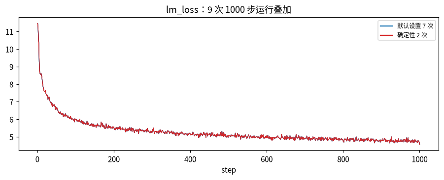
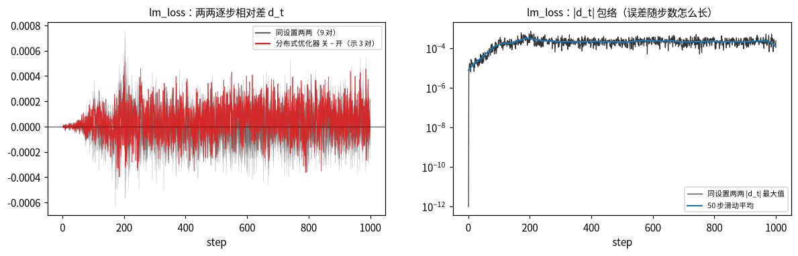
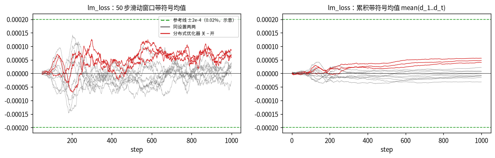
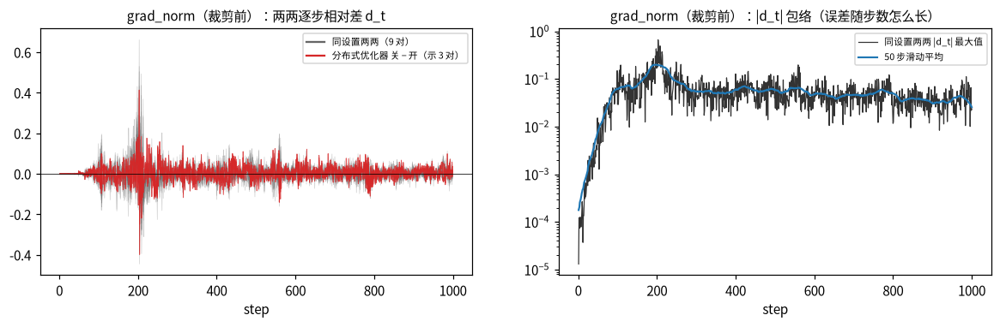

[janus](../../../../README.md) › [用户指南](../../../../docs/guide/README.md) › [混元 3](../../README.md) ｜ 对齐实践 00；怎么读见指南[第 2 章 制作 GPU golden](../../../../docs/guide/02-gpu-golden.md)

# 混元 3 · 第一阶段结果（GPU 对 GPU）

**这个实践干什么**：GPU 和 GPU 自己比。先证明工具可信（确定性逐位、抓数不改数值、埋的错都被抓到），再量出「GPU 重跑本来就差多少」这把噪声尺子。故事的第一步；后面所有判定都拿这里的做法当尺子。

每一项检查在 GPU 自比、故障演练、TPU v5p、TPU v7x 上的状态总览见 [`../../dashboard/dashboard.md`](../../dashboard/dashboard.md)（由结果文件自动生成）。

<!-- janus:table:begin（以下由脚本生成，不要手改） -->

## 逐级大表

### 来源

- 由 `models/<模型>/dashboard/build.py` 调 `janus/report/tables.py` 生成。
- 数据来自本文件夹 `results/` 下的 `results.json`，数字不手写。

### 两档门槛

- 含义见 `docs/reference/judging.md`「两档门槛」。
- **严格档**是验收判定：
  - calibrated 检查对噪声上限 N 判：≤ N 过，> 2N 不过，中间待定；
  - 参照不足 3 对最多待定；
  - 逐位类必须逐位相同；
  - 数值门槛（如 FP64 R 比）照目录里写的线。
  - 符号：✅ 过 ｜ 🟡 待定 ｜ ❌ 不过或出错 ｜ ⬜ 还没跑 ｜ — 不适用。
- **参考档**是同类 GPU→TPU 迁移项目的实践门槛：
  - 只并列报告、不决定验收。
  - 符号：✅ 过 ｜ ☑️ 记录了的都过，但有门槛项没记录 ｜ ❌ 不过 ｜ ❔ 所需指标未记录 ｜ — 无对应门槛。

### 说明栏怎么读

- 格式一律是「实测（指标）｜严格档 门槛 → 离门槛多远，判定｜参考档 门槛：实测（实测 / 门槛的倍数），判定」。
- calibrated 检查先写主判指标 rel_L2：
  - 没有 rel_L2 就写最差的指标；
  - 最差的不是它时，补一句最差的那个。
- L4 逐步量三个指标各占一行：
  - 各自按同一规则判；
  - 整条检查取最差，见报告。
- 首步差：严格档只报不判，参考档要判（MARE＝平均绝对相对差）。
- 进行中的项在证据栏写证据位置。
- 严格档里「N=…（k 对）」的 k 是算 N 用的噪声参照对数：
  - 一对是两份运行的一次比较，k 对不是 k 份运行；
  - 用了哪几份运行、怎么配对见该检查项目录的 `runs.noise`。

### 逐行结果

- 共 101 行。
- 严格档：✅ 94　🟡 1　❌ 3　— 3
- 参考档（有对应门槛的 8 行）：✅ 4　☑️ 4

| 级 | 检查项 | 严格档 | 参考档 | 说明 | 证据 |
|---|---|---|---|---|---|
| L0 | 配置逐项对照 `L0.config.diff` | ✅ | — | 实测 全部 17 个字段一致｜严格档 逐位 / 逐项相同，过｜参考档 无对应门槛 | [phase1-full-noise28](results/phase1-full-noise28.report.md) |
| L0 | 每 rank 每步输入指纹（回放数据） `L0.data.fingerprint` | ✅ | — | 实测 全部 6,500 个单元一致｜严格档 逐位 / 逐项相同，过｜参考档 无对应门槛 | [phase1-full-noise28](results/phase1-full-noise28.report.md) |
| L0 | 加载后全部参数逐位 `L0.weights.loaded` | ✅ | — | 实测 全部 50 个张量一致｜严格档 逐位 / 逐项相同，过｜参考档 无对应门槛 | [phase1-full-noise28](results/phase1-full-noise28.report.md) |
| L0 | FP32 主权重逐位 `L0.main_params.loaded` | ✅ | — | 实测 全部 50 个张量一致｜严格档 逐位 / 逐项相同，过｜参考档 无对应门槛 | [phase1-full-noise28](results/phase1-full-noise28.report.md) |
| L0 | 浮点 buffer（expert_bias）逐位 `L0.buffers.loaded` | ✅ | — | 实测 全部 3 个张量一致｜严格档 逐位 / 逐项相同，过｜参考档 无对应门槛 | [phase1-full-noise28](results/phase1-full-noise28.report.md) |
| L0 | dtype 清单 `L0.dtype.manifest` | ✅ | — | 实测 全部 2,960 项一致｜严格档 逐位 / 逐项相同，过｜参考档 无对应门槛 | [phase1-full-noise28](results/phase1-full-noise28.report.md) |
| L0 | 模型结构（实例化结果） `L0.model.structure` | ✅ | — | 实测 全部规则满足｜严格档 按规则，过｜参考档 无对应门槛 | [phase1-full-noise28](results/phase1-full-noise28.report.md) |
| L0 | 权重转换 HF → Megatron → HF 往返逐位 `L0.ckpt.roundtrip.bitwise` | ✅ | — | 实测 全部 1,781 个参数一致｜严格档 逐位 / 逐项相同，过｜参考档 无对应门槛 | [phase1-ckpt-roundtrip](results/phase1-ckpt-roundtrip.report.md) |
| L0 | 续训数据位置逐位 `L0.resume.data` | ✅ | — | 实测 全部 650 个单元一致｜严格档 逐位 / 逐项相同，过｜参考档 无对应门槛 | [phase1-resume](results/phase1-resume.report.md) |
| L1 | 优化器单步 FP64 重放 `L1.optim.adamw.replay` | ✅ | ☑️ | 实测 0.00179（rel_L2）｜严格档 ≤ 0.005 → 0.358×，过｜参考档 rel_L2（Frobenius） ≤ 0.02：0.00179（0.0894×），过（cos未记录） | [phase1-full-noise28](results/phase1-full-noise28.report.md) |
| L1 | 优化器连续 8 步重放 `L1.optim.adamw.8steps` | ✅ | — | 实测 0.00337（rel_L2）｜严格档 ≤ 0.005 → 0.674×，过｜参考档 无对应门槛 | [phase1-opt8](results/phase1-opt8.report.md) |
| L1 | 路由选中集合对 FP64 `L1.router.topk.fp64` | ✅ | — | 实测 1（集合相同比例）｜严格档 ≥ 0.97 → 过｜参考档 无对应门槛 | [phase1-full-noise28](results/phase1-full-noise28.report.md) |
| L1 | 单算子回放（路由 / 投影 / qkv / norm）与 CPU 复现舍入 `L1.gemm.router.replay` | ✅ | — | 实测 逐位全中（bit_match_frac）｜严格档 逐位 / 逐项相同，过｜参考档 无对应门槛 | [phase1-l1](results/phase1-l1.report.md) |
| L1 | 单算子回放（路由 / 投影 / qkv / norm）与 CPU 复现舍入 `L1.gemm.router.upcast_fp32` | ✅ | — | 实测 诊断：只报数，不判｜严格档 只诊断，不判｜参考档 无对应门槛 | [phase1-l1](results/phase1-l1.report.md) |
| L1 | 单算子回放（路由 / 投影 / qkv / norm）与 CPU 复现舍入 `L1.gemm.attn_proj.replay` | ✅ | — | 实测 逐位全中（bit_match_frac）｜严格档 逐位 / 逐项相同，过｜参考档 无对应门槛 | [phase1-l1](results/phase1-l1.report.md) |
| L1 | 单算子回放（路由 / 投影 / qkv / norm）与 CPU 复现舍入 `L1.gemm.qkv.replay` | ✅ | — | 实测 逐位全中（bit_match_frac）｜严格档 逐位 / 逐项相同，过｜参考档 无对应门槛 | [phase1-l1](results/phase1-l1.report.md) |
| L1 | 单算子回放（路由 / 投影 / qkv / norm）与 CPU 复现舍入 `L1.norm.replay` | ✅ | — | 实测 逐位全中（bit_match_frac）｜严格档 逐位 / 逐项相同，过｜参考档 无对应门槛 | [phase1-l1](results/phase1-l1.report.md) |
| L1 | 单算子回放（路由 / 投影 / qkv / norm）与 CPU 复现舍入 `L1.elem.exp.fp32` | ✅ | — | 实测 2（ulp_max）｜严格档 ≤ 2 → 1×，过｜参考档 无对应门槛 | [phase1-l1](results/phase1-l1.report.md) |
| L1 | 单算子回放（路由 / 投影 / qkv / norm）与 CPU 复现舍入 `L1.elem.sigmoid.fp32` | ✅ | — | 实测 3（ulp_max）｜严格档 ≤ 4 → 0.75×，过｜参考档 无对应门槛 | [phase1-l1](results/phase1-l1.report.md) |
| L1 | 单算子回放（路由 / 投影 / qkv / norm）与 CPU 复现舍入 `L1.elem.silu.fp32` | ✅ | — | 实测 3（ulp_max）｜严格档 ≤ 4 → 0.75×，过｜参考档 无对应门槛 | [phase1-l1](results/phase1-l1.report.md) |
| L1 | 单算子回放（路由 / 投影 / qkv / norm）与 CPU 复现舍入 `L1.elem.rsqrt.fp32` | ✅ | — | 实测 2（ulp_max）｜严格档 ≤ 2 → 1×，过｜参考档 无对应门槛 | [phase1-l1](results/phase1-l1.report.md) |
| L1 | 单算子回放（路由 / 投影 / qkv / norm）与 CPU 复现舍入 `L1.elem.tail` | ✅ | — | 实测 诊断：只报数，不判｜严格档 只诊断，不判｜参考档 无对应门槛 | [phase1-l1](results/phase1-l1.report.md) |
| L1 | 单算子回放（路由 / 投影 / qkv / norm）与 CPU 复现舍入 `L1.elem.bf16_vs_fp32` | ✅ | — | 实测 诊断：只报数，不判｜严格档 只诊断，不判｜参考档 无对应门槛 | [phase1-l1](results/phase1-l1.report.md) |
| L1 | 单算子回放（路由 / 投影 / qkv / norm）与 CPU 复现舍入 `L1.elem.basic` | ✅ | — | 实测 0（nonfinite_mismatch）｜严格档 ≤ 0 → 0×，过｜参考档 无对应门槛 | [phase1-l1](results/phase1-l1.report.md) |
| L1 | 单算子回放（路由 / 投影 / qkv / norm）与 CPU 复现舍入 `L1.rratio.clean` | ✅ | — | 实测 1（R 比）｜严格档 ≤ 1.2 → 0.833×，过｜参考档 无对应门槛 | [phase1-l1](results/phase1-l1.report.md) |
| L1 | 单算子回放（路由 / 投影 / qkv / norm）与 CPU 复现舍入 `L1.rratio.drill` | ✅ | — | 实测 1.32e+04（R 比）｜严格档 ≤ 1.2 → 1.1e4×，过｜参考档 无对应门槛 | [phase1-l1](results/phase1-l1.report.md) |
| L1 | 单算子回放（路由 / 投影 / qkv / norm）与 CPU 复现舍入 `L1.emulate.gemm` | ✅ | — | 实测 逐位全中（emulate_match_frac）｜严格档 逐位 / 逐项相同，过｜参考档 无对应门槛 | [phase1-l1](results/phase1-l1.report.md) |
| L1 | 单算子回放（路由 / 投影 / qkv / norm）与 CPU 复现舍入 `L1.emulate.other_guesses` | ✅ | — | 实测 诊断：只报数，不判｜严格档 只诊断，不判｜参考档 无对应门槛 | [phase1-l1](results/phase1-l1.report.md) |
| L1 | 单算子回放（路由 / 投影 / qkv / norm）与 CPU 复现舍入 `L1.extreme.rmsnorm` | ✅ | — | 实测 1（ulp_max）｜严格档 ≤ 2 → 0.5×，过｜参考档 无对应门槛 | [phase1-l1](results/phase1-l1.report.md) |
| L1 | 单算子回放（路由 / 投影 / qkv / norm）与 CPU 复现舍入 `L1.extreme.rmsnorm.overflow` | ✅ | — | 实测 诊断：只报数，不判｜严格档 只诊断，不判｜参考档 无对应门槛 | [phase1-l1](results/phase1-l1.report.md) |
| L1 | 单算子回放（路由 / 投影 / qkv / norm）与 CPU 复现舍入 `L1.extreme.sigmoid` | ✅ | — | 实测 1（ulp_max）｜严格档 ≤ 4 → 0.25×，过｜参考档 无对应门槛 | [phase1-l1](results/phase1-l1.report.md) |
| L1 | 单算子回放（路由 / 投影 / qkv / norm）与 CPU 复现舍入 `L1.extreme.softmax` | ✅ | — | 实测 5.22e-08（rel_L2）｜严格档 ≤ 1.00e-05 → 0.00522×，过｜参考档 无对应门槛 | [phase1-l1](results/phase1-l1.report.md) |
| L1 | 单算子回放（路由 / 投影 / qkv / norm）与 CPU 复现舍入 `L1.ties.synthetic` | ✅ | — | 实测 逐位全中（expect_match_frac）｜严格档 逐位 / 逐项相同，过｜参考档 无对应门槛 | [phase1-l1](results/phase1-l1.report.md) |
| L1 | 单算子回放（路由 / 投影 / qkv / norm）与 CPU 复现舍入 `L1.ties.cpu_torch` | ✅ | — | 实测 诊断：只报数，不判｜严格档 只诊断，不判｜参考档 无对应门槛 | [phase1-l1](results/phase1-l1.report.md) |
| L1 | 单算子回放（路由 / 投影 / qkv / norm）与 CPU 复现舍入 `L1.ties.real` | ✅ | — | 实测 逐位全中（expect_match_frac）｜严格档 逐位 / 逐项相同，过｜参考档 无对应门槛 | [phase1-l1](results/phase1-l1.report.md) |
| L1 | 单算子回放（路由 / 投影 / qkv / norm）与 CPU 复现舍入 `L1.vjp.fp32` | ✅ | — | 实测 1.88e-07（rel_L2）｜严格档 ≤ 1.00e-05 → 0.0188×，过｜参考档 无对应门槛 | [phase1-l1](results/phase1-l1.report.md) |
| L1 | 单算子回放（路由 / 投影 / qkv / norm）与 CPU 复现舍入 `L1.vjp.bf16` | ✅ | — | 实测 0.00172（rel_L2）｜严格档 ≤ 0.01 → 0.172×，过｜参考档 无对应门槛 | [phase1-l1](results/phase1-l1.report.md) |
| L1 | 专家 GEMM / 核心注意力回放、MoE 分阶段 `L1.kernel.experts.fwd.replay` | ✅ | — | 实测 逐位全中（bit_match_frac）｜严格档 逐位 / 逐项相同，过｜参考档 无对应门槛 | [phase1-kernels](results/phase1-kernels.report.md) |
| L1 | 专家 GEMM / 核心注意力回放、MoE 分阶段 `L1.kernel.experts.bwd.replay` | ✅ | — | 实测 逐位全中（bit_match_frac）｜严格档 逐位 / 逐项相同，过｜参考档 无对应门槛 | [phase1-kernels](results/phase1-kernels.report.md) |
| L1 | 专家 GEMM / 核心注意力回放、MoE 分阶段 `L1.kernel.experts.vs_loop` | ✅ | — | 实测 诊断：只报数，不判｜严格档 只诊断，不判｜参考档 无对应门槛 | [phase1-kernels](results/phase1-kernels.report.md) |
| L1 | 专家 GEMM / 核心注意力回放、MoE 分阶段 `L1.kernel.experts.wgrad` | ✅ | — | 实测 3.50e-06（rel_L2）｜严格档 ≤ 1.00e-05 → 0.35×，过｜参考档 无对应门槛 | [phase1-kernels](results/phase1-kernels.report.md) |
| L1 | 专家 GEMM / 核心注意力回放、MoE 分阶段 `L1.kernel.gemm_row_invariance` | ✅ | — | 实测 诊断：只报数，不判｜严格档 只诊断，不判｜参考档 无对应门槛 | [phase1-kernels](results/phase1-kernels.report.md) |
| L1 | 专家 GEMM / 核心注意力回放、MoE 分阶段 `L1.kernel.attn.fwd.replay` | ✅ | — | 实测 逐位全中（bit_match_frac）｜严格档 逐位 / 逐项相同，过｜参考档 无对应门槛 | [phase1-kernels](results/phase1-kernels.report.md) |
| L1 | 专家 GEMM / 核心注意力回放、MoE 分阶段 `L1.kernel.attn.bwd.replay` | ✅ | — | 实测 逐位全中（bit_match_frac）｜严格档 逐位 / 逐项相同，过｜参考档 无对应门槛 | [phase1-kernels](results/phase1-kernels.report.md) |
| L2 | 第 0 层前向 `L2.layer0.fwd` | ✅ | ☑️ | 实测 0（rel_L2），cos 1.000000｜严格档 N=0（28 对）→ 0×N；最差的是 1−cos 2.22e-16 = 1×N，过｜参考档 rel_L2 < 0.01：0（0×）；cos ≥ 0.99995：1.000000，只报，过（超差元素比例、均值差未记录） | [phase1-full-noise28](results/phase1-full-noise28.report.md) [图·noise28](figures/L2-step1-layers.phase1-full-noise28.png) |
| L2 | 第 1 层前向 `L2.layer1.fwd` | ✅ | — | 实测 0（rel_L2），cos 1.000000｜严格档 N=0（28 对）→ 0×N；最差的是 1−cos 2.22e-16 = 1×N，过｜参考档 参考档不适用：这一层是 MoE 层，路由之后的观测点受近似平局翻转影响，按严格档 R 比判 | [phase1-full-noise28](results/phase1-full-noise28.report.md) [图·noise28](figures/L2-step1-layers.phase1-full-noise28.png) |
| L2 | 第 2 层前向 `L2.layer2.fwd` | ✅ | — | 实测 0（rel_L2），cos 1.000000｜严格档 N=0（28 对）→ 0×N；最差的是 1−cos 2.22e-16 = 1×N，过｜参考档 参考档不适用：这一层是 MoE 层，路由之后的观测点受近似平局翻转影响，按严格档 R 比判 | [phase1-full-noise28](results/phase1-full-noise28.report.md) [图·noise28](figures/L2-step1-layers.phase1-full-noise28.png) |
| L2 | 第 3 层前向 `L2.layer3.fwd` | ✅ | — | 实测 0（rel_L2），cos 1.000000｜严格档 N=0（28 对）→ 0×N；最差的是 1−cos 2.22e-16 = 1×N，过｜参考档 参考档不适用：这一层是 MoE 层，路由之后的观测点受近似平局翻转影响，按严格档 R 比判 | [phase1-full-noise28](results/phase1-full-noise28.report.md) [图·noise28](figures/L2-step1-layers.phase1-full-noise28.png) |
| L2 | 各层反向（激活梯度） `L2.layer0.bwd` | ✅ | ☑️ | 实测 0.00428（rel_L2），cos 0.999991｜严格档 N=0.0045（28 对）→ 0.9522×N，过｜参考档 rel_L2 < 0.01：0.00428（0.428×）；cos ≥ 0.99995：0.999991，只报，过（超差元素比例、均值差未记录） | [phase1-full-noise28](results/phase1-full-noise28.report.md) [图·noise28](figures/L2-step1-layers.phase1-full-noise28.png) |
| L2 | 各层反向（激活梯度） `L2.layer1.bwd` | ✅ | — | 实测 0.00348（rel_L2），cos 0.999994｜严格档 N=0.00364（28 对）→ 0.9577×N，过｜参考档 参考档不适用：这一层是 MoE 层，路由之后的观测点受近似平局翻转影响，按严格档 R 比判 | [phase1-full-noise28](results/phase1-full-noise28.report.md) [图·noise28](figures/L2-step1-layers.phase1-full-noise28.png) |
| L2 | 各层反向（激活梯度） `L2.layer2.bwd` | ✅ | — | 实测 5.22e-04（rel_L2），cos 1.000000｜严格档 N=5.69e-04（28 对）→ 0.9165×N，过｜参考档 参考档不适用：这一层是 MoE 层，路由之后的观测点受近似平局翻转影响，按严格档 R 比判 | [phase1-full-noise28](results/phase1-full-noise28.report.md) [图·noise28](figures/L2-step1-layers.phase1-full-noise28.png) |
| L2 | 各层反向（激活梯度） `L2.layer3.bwd` | ✅ | — | 实测 1.04e-05（rel_L2），cos 1.000000｜严格档 N=1.22e-05（28 对）→ 0.854×N，过｜参考档 参考档不适用：这一层是 MoE 层，路由之后的观测点受近似平局翻转影响，按严格档 R 比判 | [phase1-full-noise28](results/phase1-full-noise28.report.md) [图·noise28](figures/L2-step1-layers.phase1-full-noise28.png) |
| L2 | 各层参数梯度 `L2.layer0.grads` | ✅ | — | 实测 4.13e-04（rel_L2），cos 1.000000｜严格档 N=4.89e-04（28 对）→ 0.844×N，过｜参考档 无对应门槛 | [phase1-full-noise28](results/phase1-full-noise28.report.md) [图·noise28](figures/L2-step1-layers.phase1-full-noise28.png) |
| L2 | 各层参数梯度 `L2.layer1.grads` | ✅ | — | 实测 5.10e-04（rel_L2），cos 1.000000｜严格档 N=6.67e-04（28 对）→ 0.764×N，过｜参考档 无对应门槛 | [phase1-full-noise28](results/phase1-full-noise28.report.md) [图·noise28](figures/L2-step1-layers.phase1-full-noise28.png) |
| L2 | 各层参数梯度 `L2.layer2.grads` | ✅ | — | 实测 1.45e-04（rel_L2），cos 1.000000｜严格档 N=2.11e-04（28 对）→ 0.689×N，过｜参考档 无对应门槛 | [phase1-full-noise28](results/phase1-full-noise28.report.md) [图·noise28](figures/L2-step1-layers.phase1-full-noise28.png) |
| L2 | 各层参数梯度 `L2.layer3.grads` | ✅ | — | 实测 4.35e-06（rel_L2），cos 1.000000｜严格档 N=4.82e-06（28 对）→ 0.9025×N，过｜参考档 无对应门槛 | [phase1-full-noise28](results/phase1-full-noise28.report.md) [图·noise28](figures/L2-step1-layers.phase1-full-noise28.png) |
| L2 | 各层路由选中集合 `L2.layer1.router` | ✅ | — | 实测 0（集合不一致）｜严格档 N=0（28 对）→ 0×N，过｜参考档 无对应门槛 | [phase1-full-noise28](results/phase1-full-noise28.report.md) [图·noise28](figures/L2-step1-layers.phase1-full-noise28.png) |
| L2 | 各层路由选中集合 `L2.layer2.router` | ✅ | — | 实测 0（集合不一致）｜严格档 N=0（28 对）→ 0×N，过｜参考档 无对应门槛 | [phase1-full-noise28](results/phase1-full-noise28.report.md) [图·noise28](figures/L2-step1-layers.phase1-full-noise28.png) |
| L2 | 各层路由选中集合 `L2.layer3.router` | ✅ | — | 实测 0（集合不一致）｜严格档 N=0（28 对）→ 0×N，过｜参考档 无对应门槛 | [phase1-full-noise28](results/phase1-full-noise28.report.md) [图·noise28](figures/L2-step1-layers.phase1-full-noise28.png) |
| L2 | DP 副本一致 `L2.dp.replica` | ✅ | — | 实测 41 个对象副本全部一致｜严格档 逐位 / 逐项相同，过｜参考档 无对应门槛 | [phase1-full-noise28](results/phase1-full-noise28.report.md) |
| L2 | 截断模型前缀逐位 `L2.truncate.embed` | ✅ | — | 实测 全部 1 个张量一致｜严格档 逐位 / 逐项相同，过｜参考档 无对应门槛 | [phase1-truncate](results/phase1-truncate.report.md) |
| L2 | 截断模型前缀逐位 `L2.truncate.layer0` | ✅ | — | 实测 全部 10 个张量一致｜严格档 逐位 / 逐项相同，过｜参考档 无对应门槛 | [phase1-truncate](results/phase1-truncate.report.md) |
| L2 | 截断模型前缀逐位 `L2.truncate.layer1` | ✅ | — | 实测 全部 10 个张量一致｜严格档 逐位 / 逐项相同，过｜参考档 无对应门槛 | [phase1-truncate](results/phase1-truncate.report.md) |
| L2 | 截断模型前缀逐位 `L2.truncate.router1` | ✅ | — | 实测 全部 3 个张量一致｜严格档 逐位 / 逐项相同，过｜参考档 无对应门槛 | [phase1-truncate](results/phase1-truncate.report.md) |
| L2 | 并行等价 EP8 ↔ EP4（前向） `L2.parallel.fwd.bitwise` | ✅ | — | 实测 全部 43 个张量一致｜严格档 逐位 / 逐项相同，过｜参考档 无对应门槛 | [phase1-parallel](results/phase1-parallel.report.md) |
| L2 | 并行等价 EP8 ↔ EP4（反向、更新后参数） `L2.parallel.grads.tol` | ❌ | — | 实测 0.00103（rel_L2），cos 0.999999｜严格档 N=6.64e-04（3 对）→ 1.56×N；最差的是 1−cos 5.34e-07 = 4.1×N，不过｜参考档 无对应门槛 | [phase1-parallel-ext](results/phase1-parallel-ext.report.md) |
| L2 | 激活重算首次前向 = 重算 `DET.remat.vs_first` | ❌ | — | 实测 9 / 51 个张量不同｜严格档 逐位 / 逐项相同，不过｜参考档 无对应门槛 | [phase1-remat](results/phase1-remat.report.md) |
| L3 | 张量 / 上下文并行等价（整网标量） `L3.loss.step1` | ✅ | — | 实测 4.99e-06（首步差）｜严格档 ≤ 1.00e-04 → 0.0499×，过｜参考档 无对应门槛 | [phase1-tp-cp.tp2](results/phase1-tp-cp.tp2.report.md) |
| L3 | 梯度累积等价 `L3.ga.grads` | ❌ | — | 实测 0.0206（rel_L2），cos 0.999812｜严格档 N=6.64e-04（3 对）→ 31.1×N；最差的是 1−cos 1.88e-04 = 1.45e+03×N，不过｜参考档 无对应门槛 | [phase1-ga](results/phase1-ga.report.md) |
| L3 | 全部激活逐位 `L3.step1.act.bitwise` | ✅ | — | 实测 全部 46 个张量一致｜严格档 逐位 / 逐项相同，过｜参考档 无对应门槛 | [phase1-full-noise28](results/phase1-full-noise28.report.md) |
| L3 | 逐 token loss `L3.step1.loss.per_token` | ✅ | — | 实测 0（rel_L2）｜严格档 N=0（28 对）→ 0×N，过｜参考档 无对应门槛 | [phase1-full-noise28](results/phase1-full-noise28.report.md) |
| L3 | logits（含 KL） `L3.step1.logits` | ✅ | — | 实测 0（rel_L2），cos 1.000000｜严格档 N=0（28 对）→ 0×N，过｜参考档 无对应门槛 | [phase1-full-noise28](results/phase1-full-noise28.report.md) |
| L3 | 全部参数梯度 `L3.step1.grads.all` | ✅ | — | 实测 5.10e-04（rel_L2），cos 1.000000｜严格档 N=6.67e-04（28 对）→ 0.764×N，过｜参考档 无对应门槛 | [phase1-full-noise28](results/phase1-full-noise28.report.md) |
| L3 | 梯度分布（std 比、零比例、逐元素 p99） `L3.step1.grads.dist` | ✅ | — | 实测 0.0428（逐元素相对误差 p99）｜严格档 N=0.0443（28 对）→ 0.9649×N，过｜参考档 无对应门槛 | [phase1-full-noise28](results/phase1-full-noise28.report.md) |
| L3 | 更新后主权重 `L3.step1.updated` | ✅ | ☑️ | 实测 1.84e-06（rel_L2）｜严格档 N=4.76e-05（28 对）→ 0.0386×N；最差的是 max_abs 1.63e-05 = 0.863×N，过｜参考档 rel_L2（Frobenius） ≤ 0.02：1.84e-06（9.18e-05×），过（cos未记录） | [phase1-full-noise28](results/phase1-full-noise28.report.md) |
| L3 | 优化器状态（两个动量） `L3.step1.optim_state` | ✅ | — | 实测 0.00122（rel_L2），cos 1.000000｜严格档 N=0.00166（28 对）→ 0.731×N，过｜参考档 无对应门槛 | [phase1-full-noise28](results/phase1-full-noise28.report.md) |
| L3 | 更新后 expert_bias `L3.step1.bias_after` | ✅ | — | 实测 0（rel_L2）｜严格档 N=0（28 对）→ 0×N，过｜参考档 无对应门槛 | [phase1-full-noise28](results/phase1-full-noise28.report.md) |
| L3 | 比全了没有（覆盖率） `L3.step1.coverage` | ✅ | — | 实测 全部比到｜严格档 逐位 / 逐项相同，过｜参考档 无对应门槛 | [phase1-full-noise28](results/phase1-full-noise28.report.md) |
| L4 | 设置核对：学习率逐步（学习率是设置的常数，不是观测量；检查 id 仍是 L4.lr） `L4.lr` | ✅ | — | 实测 逐步在容差内｜严格档 rtol ≤ 0、abs_ulp ≤ 0，过｜参考档 无对应门槛 | [phase1-full-noise28](results/phase1-full-noise28.report.md) |
| L4 | 张量 / 上下文并行等价（整网标量） `L4.grad_norm` | ✅ | — | 实测 2.37e-04（首步差）｜严格档 ≤ 0.001 → 0.237×，过｜参考档 无对应门槛 | [phase1-tp-cp.tp2](results/phase1-tp-cp.tp2.report.md) [图·overlay](figures/grad_norm-overlay.png) [图·pairdiff](figures/grad_norm-pairdiff.png) [图·mean](figures/grad_norm-mean.png) |
| L4 | loss（首步、带符号均值、MARE、最大单步） `L4.loss` | — | ✅ | 实测 0（首步差）｜严格档 只报，不判｜参考档 首步差 ≤ 2e-4：0（0×），过 | [phase1-full-noise28](results/phase1-full-noise28.report.md) [图·overlay](figures/lm_loss-overlay.png) [图·pairdiff](figures/lm_loss-pairdiff.png) [图·mean](figures/lm_loss-mean.png) |
| L4 | loss（首步、带符号均值、MARE、最大单步） `L4.loss` | ✅ | ✅ | 实测 2.87e-05（带符号均值）｜严格档 N=5.72e-05（28 对）→ 0.502×N，过｜参考档 带符号均值 ≤ 2e-4：2.87e-05（0.144×），过 | [phase1-full-noise28](results/phase1-full-noise28.report.md) [图·overlay](figures/lm_loss-overlay.png) [图·pairdiff](figures/lm_loss-pairdiff.png) [图·mean](figures/lm_loss-mean.png) |
| L4 | loss（首步、带符号均值、MARE、最大单步） `L4.loss` | ✅ | — | 实测 3.94e-05（MARE）｜严格档 N=5.92e-05（28 对）→ 0.665×N，过｜参考档 这个量无对应门槛 | [phase1-full-noise28](results/phase1-full-noise28.report.md) [图·overlay](figures/lm_loss-overlay.png) [图·pairdiff](figures/lm_loss-pairdiff.png) [图·mean](figures/lm_loss-mean.png) |
| L4 | loss（首步、带符号均值、MARE、最大单步） `L4.loss` | 🟡 | — | 实测 2.41e-04（最大单步）｜严格档 N=2.34e-04（28 对）→ 1.027×N，待定｜参考档 这个量无对应门槛 | [phase1-full-noise28](results/phase1-full-noise28.report.md) [图·overlay](figures/lm_loss-overlay.png) [图·pairdiff](figures/lm_loss-pairdiff.png) [图·mean](figures/lm_loss-mean.png) |
| L4 | grad_norm `L4.grad_norm` | — | — | 实测 -1.25e-05（首步差）｜严格档 只报，不判｜参考档 无对应门槛 | [phase1-full-noise28](results/phase1-full-noise28.report.md) [图·overlay](figures/grad_norm-overlay.png) [图·pairdiff](figures/grad_norm-pairdiff.png) [图·mean](figures/grad_norm-mean.png) |
| L4 | grad_norm `L4.grad_norm` | ✅ | — | 实测 0.00178（带符号均值）｜严格档 N=0.00543（28 对）→ 0.328×N，过｜参考档 无对应门槛 | [phase1-full-noise28](results/phase1-full-noise28.report.md) [图·overlay](figures/grad_norm-overlay.png) [图·pairdiff](figures/grad_norm-pairdiff.png) [图·mean](figures/grad_norm-mean.png) |
| L4 | grad_norm `L4.grad_norm` | ✅ | — | 实测 0.00766（MARE）｜严格档 N=0.00857（28 对）→ 0.894×N，过｜参考档 无对应门槛 | [phase1-full-noise28](results/phase1-full-noise28.report.md) [图·overlay](figures/grad_norm-overlay.png) [图·pairdiff](figures/grad_norm-pairdiff.png) [图·mean](figures/grad_norm-mean.png) |
| L4 | grad_norm `L4.grad_norm` | ✅ | — | 实测 0.0642（最大单步）｜严格档 N=0.124（28 对）→ 0.516×N，过｜参考档 无对应门槛 | [phase1-full-noise28](results/phase1-full-noise28.report.md) [图·overlay](figures/grad_norm-overlay.png) [图·pairdiff](figures/grad_norm-pairdiff.png) [图·mean](figures/grad_norm-mean.png) |
| L4 | param_norm `L4.param_norm` | — | — | 实测 0（首步差）｜严格档 只报，不判｜参考档 这个量无对应门槛 | [phase1-full-noise28](results/phase1-full-noise28.report.md) [图·overlay](figures/param_norm-overlay.png) [图·pairdiff](figures/param_norm-pairdiff.png) [图·mean](figures/param_norm-mean.png) |
| L4 | param_norm `L4.param_norm` | ✅ | ✅ | 实测 5.46e-10（带符号均值）｜严格档 N=1.09e-08（28 对）→ 0.05×N，过｜参考档 带符号均值 ≤ 5e-6：5.46e-10（0.000109×），过 | [phase1-full-noise28](results/phase1-full-noise28.report.md) [图·overlay](figures/param_norm-overlay.png) [图·pairdiff](figures/param_norm-pairdiff.png) [图·mean](figures/param_norm-mean.png) |
| L4 | param_norm `L4.param_norm` | ✅ | — | 实测 1.36e-08（MARE）｜严格档 N=1.64e-08（28 对）→ 0.833×N，过｜参考档 这个量无对应门槛 | [phase1-full-noise28](results/phase1-full-noise28.report.md) [图·overlay](figures/param_norm-overlay.png) [图·pairdiff](figures/param_norm-pairdiff.png) [图·mean](figures/param_norm-mean.png) |
| L4 | param_norm `L4.param_norm` | ✅ | ✅ | 实测 1.08e-07（最大单步）｜严格档 N=1.08e-07（28 对）→ 1×N，过｜参考档 最大单步 ≤ 1.25e-5：1.08e-07（0.00864×），过 | [phase1-full-noise28](results/phase1-full-noise28.report.md) [图·overlay](figures/param_norm-overlay.png) [图·pairdiff](figures/param_norm-pairdiff.png) [图·mean](figures/param_norm-mean.png) |
| L4 | 路由偏置 / 负载曲线 `L4.router.bias_std` | ✅ | — | 实测 7.11e-04（带符号均值）｜严格档 N=0.00137（28 对）→ 0.519×N，过｜参考档 无对应门槛 | [phase1-full-noise28](results/phase1-full-noise28.report.md) |
| L4 | 路由偏置 / 负载曲线 `L4.router.bias_std` | ✅ | — | 实测 0.00126（MARE）｜严格档 N=0.00155（28 对）→ 0.808×N，过｜参考档 无对应门槛 | [phase1-full-noise28](results/phase1-full-noise28.report.md) |
| L4 | 路由偏置 / 负载曲线 `L4.router.bias_std` | ✅ | — | 实测 0.00497（最大单步）｜严格档 N=0.00594（28 对）→ 0.837×N，过｜参考档 无对应门槛 | [phase1-full-noise28](results/phase1-full-noise28.report.md) |
| L4 | 路由偏置 / 负载曲线 `L4.router.load_cv` | ✅ | — | 实测 0.0013（带符号均值）｜严格档 N=0.00392（28 对）→ 0.333×N，过｜参考档 无对应门槛 | [phase1-full-noise28](results/phase1-full-noise28.report.md) |
| L4 | 路由偏置 / 负载曲线 `L4.router.load_cv` | ✅ | — | 实测 0.00884（MARE）｜严格档 N=0.0091（28 对）→ 0.9712×N，过｜参考档 无对应门槛 | [phase1-full-noise28](results/phase1-full-noise28.report.md) |
| L4 | 路由偏置 / 负载曲线 `L4.router.load_cv` | ✅ | — | 实测 0.0612（最大单步）｜严格档 N=0.0921（28 对）→ 0.665×N，过｜参考档 无对应门槛 | [phase1-full-noise28](results/phase1-full-noise28.report.md) |
| L4 | 健康信号（NaN、突跳） `L4.health` | ✅ | — | 实测 健康｜严格档 spike_ratio ≤ 3，过｜参考档 无对应门槛 | [phase1-full-noise28](results/phase1-full-noise28.report.md) |
| L4 | 观测不改数值（开 / 不开抓数） `DET.hooks.noop` | ✅ | — | 实测 全部 8 个字段一致｜严格档 逐位 / 逐项相同，过｜参考档 无对应门槛 | [phase1-hooks](results/phase1-hooks.report.md) |
| L4 | 存档续训重叠步逐位 `L4.resume.overlap` | ✅ | — | 实测 重叠步全部逐位相同｜严格档 逐位 / 逐项相同，过｜参考档 无对应门槛 | [phase1-resume](results/phase1-resume.report.md) |

### 故障演练（确定性基线上真埋错）

由故障矩阵 `faults/phase1-faults.md` 与注入类结果文件判定：✅ 期望报警的都报了；❌ 该报没报；· 没有哪种故障要求它报警。

代号：`f-weight`（第 2 层 linear_proj 的 FP32 主权重 ×(1+1e-3)）、`f-weight2`（同一权重 ×(1+1e-2)）、`f-data`（rank 0 输入 token 错位一格）、`f-router`（路由改在 BF16 算）、`f-lr`（学习率差 1 个 FP32 ULP）、`f-drop`（开 dropout 0.1）、`f-grad`（第 1 层 qkv 梯度在抓数之后 ×1/8）、`f-gscale`（同一梯度在抓数之前 ×1/8）、`f-bias`（路由偏置不更新）。

| 级 | 检查项 | 判定 | 说明 |
|---|---|---|---|
| L0 | 配置逐项对照 | ✅ | 抓到：f-bias、f-drop、f-lr、f-router |
| L0 | 每 rank 每步输入指纹（回放数据） | ✅ | 抓到：f-data、f-drop、f-gscale、f-router、f-weight2 |
| L0 | 加载后全部参数逐位 | ✅ | 抓到：f-weight2 |
| L0 | FP32 主权重逐位 | ✅ | 抓到：f-weight、f-weight2 |
| L0 | 设置核对：学习率逐步（学习率是设置的常数，不是观测量；检查 id 仍是 L4.lr） | ✅ | 抓到：f-lr |
| L1 | 优化器单步 FP64 重放 | ✅ | 抓到：f-grad |
| L2 | 第 0 层前向 | ✅ | 抓到：f-data、f-drop |
| L2 | 第 1 层前向 | ✅ | 抓到：f-data、f-drop、f-router |
| L2 | 第 2 层前向 | ✅ | 抓到：f-data、f-drop、f-router、f-weight2 |
| L2 | 第 3 层前向 | ✅ | 抓到：f-data、f-drop、f-router、f-weight2 |
| L2 | 各层反向（激活梯度） | ✅ | 抓到：f-data、f-drop、f-router、f-weight2 |
| L2 | 各层参数梯度 | ✅ | 抓到：f-data、f-drop、f-gscale、f-router、f-weight2 |
| L2 | 各层路由选中集合 | ✅ | 抓到：f-data、f-drop、f-router、f-weight2 |
| L2 | 逐层注入（误差隔离到单层） | ✅ | 演练（期望报警）：按期望报警｜本条原判定 不过：6 / 10 个张量不同 |
| L3 | 逐 token loss | ✅ | 抓到：f-data、f-drop、f-router、f-weight2 |
| L3 | logits（含 KL） | ✅ | 抓到：f-data、f-drop、f-router、f-weight2 |
| L3 | 全部参数梯度 | ✅ | 抓到：f-data、f-drop、f-gscale、f-router、f-weight2 |
| L3 | 更新后主权重 | ✅ | 抓到：f-data、f-drop、f-grad、f-gscale、f-lr、f-router、f-weight、f-weight2 |
| L3 | 更新后 expert_bias | ✅ | 抓到：f-bias、f-drop、f-router、f-weight2 |
| L4 | loss（首步、带符号均值、MARE、最大单步） | ✅ | 抓到：f-bias、f-data、f-drop、f-grad、f-lr、f-router、f-weight、f-weight2 |
| L4 | grad_norm | ✅ | 抓到：f-bias、f-data、f-drop、f-grad、f-lr、f-router、f-weight、f-weight2 |
| L4 | 路由偏置 / 负载曲线 | ✅ | 抓到：f-bias、f-data、f-drop、f-grad、f-lr、f-router、f-weight、f-weight2 |
| L4 | 健康信号（NaN、突跳） | ✅ | 演练（期望报警）：按期望报警｜本条原判定 不过：grad_norm@16=387（中位数 19.1 的 20.2 倍） |
| L4 | 梯度 NaN 先于 loss 报警 | ✅ | 演练（期望报警）：按期望报警｜本条原判定 不过：grad_norm@5=非有限 |

<!-- janus:table:end -->

## 这一阶段做了什么

这一阶段在 TPU 上线前做：先在 GPU 上**自己比自己**。同配置的两次 GPU 运行，一次当被测、一次当 golden。目的有三个：

1. 证明工具可信：该逐位的地方确实逐位，埋进去的错确实能抓到；
2. 量出 GPU 自己的噪声，作为将来 TPU 对 GPU 的尺子；
3. 把 GPU 参照本身摸清楚（实际生效的配置、算子的舍入方式），免得 TPU 去对一个想当然的参照。

### 环境

- **硬件与镜像**：单机 8 卡 B200，镜像 `nvcr.io/nvidia/nemo:26.10`。
- **模型与数据**：混元 3 截前 4 层（真权重，关 MTP）；fineweb-edu 真实数据。
- **训练设置**：全局 batch 16、序列 4096、学习率 1e-5 常数。
- **两种设置**（确定性 / 默认）的含义，与第一阶段每次运行实际设了哪些环境变量，见 [`docs/reference/environment.md`](../../../../docs/reference/environment.md)。
- **运行原件**不随仓库发布，每个结果的 `runs` 字段记有 `meta.json` 的 sha256。
- **复现材料**：
  - 每次运行的完整参数见 [`../../frameworks/megatron/README.md`](../../frameworks/megatron/README.md#第一阶段每次运行的参数)「第一阶段每次运行的参数」；
  - 从零复现代表性结果的步骤见[同页第 7 节](../../frameworks/megatron/README.md#7-复现第一阶段的代表性结果约-30-分钟)；
  - 复现记录见 [`results/repro-audit.md`](results/repro-audit.md)。

### 运行批次

| 批次 | 运行 | 步数 | 用途 |
|---|---|---|---|
| 噪声底 | `rd-golden-1`（确定性）、`rd-det-b`（确定性复跑）、`rd-golden-2..5`（默认） | 1000 | 量 loss 噪声；确定性自证 |
| 全覆盖 | `s-a`..`s-g`（默认）、`d-a` / `d-b`（确定性）、`f-*`（确定性 + 埋一个错）、`i-weight`（埋错 + 逐层注入）、`r-cont` / `r-resume`（存档续训） | 100 | `s-a` 当被测，`s-b..d` 当 golden；故障注入的基线是 `d-a` |
| 补充 | `p-*`（只换并行方式）、`h-light2`（轻量抓数）、`m-opt8`（第 1–8 步抓数，供优化器连续重放）、`f-nan`（第 5 步埋梯度 NaN）、`f-spike`（第 15 步学习率 ×300）、`r-remat`（开整层激活重算）、`t-2l`（截 2 层的 GPU 运行，不是 TPU）等，均确定性 | 3–30 | 并行等价、抓数不改数值、健康信号、重算、截断 |
| 剩余检查（见注 1） | `g61-obs`（另开可选观测点）、`g61-notf32`（关 TF32）、`g61-sv-save` / `g61-sv-load`（特殊值存档 / 续训），均确定性 | 2–30 | kernel 回放、MoE 分阶段、poison 与因果性的真实输入；TF32；特殊值存恢复 |

1. 剩余检查的设计见 [0004](../../../../docs/dev/design/0004-l1-gpu-kernels.md)。

## 结果一览

每行的数字都出自同名的 `<目录>.results.json`；`report.md` 是从它渲染的。

代号：`s-*` 默认设置的 100 步全覆盖运行；`d-a` 第一阶段确定性基线运行（故障注入的基线）；`f-w2` 复现审计重跑的 `f-weight2`（第 2 层权重 ×(1+1e-2) 埋错）；`f-lr` 学习率差 1 个 FP32 ULP 的埋错；`g1k-a`（第一阶段 GPU golden 的第 1 份；`g1k` 不开重算，1000 步，3 份）。

| 目录 | 比什么 | 结果 | 结论 |
|---|---|---|---|
| [`phase1-determinism`](results/phase1-determinism.report.md) | 确定性设置同配置两次 1000 步 | 5 pass | loss、学习率逐步逐位；第 1、1000 步各 24 个张量逐位 |
| [`phase1-noise`](results/phase1-noise.report.md) | 默认设置三份 1000 步 | 5 pass、1 inconclusive | loss 噪声底见下文；第 1 步激活三份逐位；第 1000 步已分叉 |
| [`phase1-full`](results/phase1-full.report.md) | L0–L4 全部 GPU 可测检查，`s-a` 对 `s-b..d`；噪声参照是 `s-b..d` 3 份运行两两得到的 3 对 | 38 pass、0 fail、8 inconclusive | 地基全过；前向逐位；反向起在噪声内或 1–2 倍 |
| [`phase1-noise15`](results/phase1-noise15.report.md) | 同上那 8 条加 `L4.grad_norm`（共 9 条），噪声参照扩到 6 份运行两两得到的 15 对 | 6 pass、3 inconclusive | inconclusive 8 条 → 3 条，剩下 3 条超上限 6% – 13% |
| [`phase1-full-noise28`](results/phase1-full-noise28.report.md) | 全部 46 条，噪声参照扩到 8 份默认设置运行两两得到的 28 对 | 45 pass、1 inconclusive、0 fail | 只剩 `L4.loss`：最大单步 2.41e-4 对上限 2.34e-4（1.03 倍） |
| `phase1-faults` | `d-a` 上 9 种埋错 | 每种都有检查报警，期望抓到的全部抓到 | 见 [`faults/phase1-faults.md`](faults/phase1-faults.md) 的矩阵 |
| [`phase1-inject`](results/phase1-inject.report.md) | 第 2 层权重埋错 + 逐层注入 | 第 0、1 层逐位；第 2 层 6 / 10 不同；第 3 层只有专家分发缓冲区不同 | 注入能把误差隔离到单层 |
| [`phase1-l1`](results/phase1-l1.report.md) | 单算子回放与合成用例 | 25 pass | 见 [`docs/dev/design/0003-l1-op-replay.md`](../../../../docs/dev/design/0003-l1-op-replay.md) |
| [`phase1-opt8`](results/phase1-opt8.report.md) | 第 1–8 步连续 FP64 重放 AdamW | pass | 更新量最大 rel_L2 3.37e-3（FP32 存储舍入量级），门槛见注 1 |
| [`phase1-hooks`](results/phase1-hooks.report.md) | 轻量抓数对全量抓数，30 步 | 2 pass | 数据指纹与 8 个逐步标量逐位相同：抓数不改数值 |
| [`phase1-resume`](results/phase1-resume.report.md) | 第 10 步存档续训对连续训练 | 4 pass | 数据位置、重叠 10 步全部标量、第 11 步 74 个张量逐位 |
| [`phase1-truncate`](results/phase1-truncate.report.md) | 截 2 层对 4 层（同一份权重），第 1 步 | 4 pass | embedding 与前 2 层前向、路由逐位 |
| [`phase1-ckpt-roundtrip`](results/phase1-ckpt-roundtrip.report.md) | HF → Megatron → HF 往返 | 3 pass | 1781 / 1781 个张量逐位，dtype 不变 |
| [`phase1-parallel`](results/phase1-parallel.report.md) | 专家并行 EP8 → EP4，第 1 步前向 | 6 pass | 43 个激活、路由、逐 token loss 逐位 |
| [`phase1-parallel-ext`](results/phase1-parallel-ext.report.md) | EP8 → EP4，第 1 步梯度与更新后参数 | 1 pass、2 fail、1 inconclusive | 反向不再逐位，超默认设置噪声 |
| `phase1-tp-cp` | EP4 + TP2、EP4 + CP2 对 EP4，前 3 步标量 | 各 2 pass | 在推断出的宽松门槛（首步相对差 d₀ ≤ 1e-4）内 |
| [`phase1-ga`](results/phase1-ga.report.md) | 每 rank 2 个 microbatch 对 1 个（全局 batch 相同） | 1 pass、1 fail、1 inconclusive | embedding 梯度差 2.1% |
| [`phase1-remat`](results/phase1-remat.report.md) | 开整层激活重算 | 4 fail | 第一个 MoE 层：重算与基线逐位、首次前向与两者都不同；往后各层连带不同 |
| [`phase1-nan`](results/phase1-nan.report.md) | 第 5 步在一个梯度元素里埋 NaN | 梯度范数检查报警 | 梯度范数先于 loss 报 |
| [`phase1-spike`](results/phase1-spike.report.md) | 第 15 步学习率 ×300 | 健康检查报警 | 第 16 步梯度范数是前 10 步中位数的 20.2 倍 |
| `repro-audit.*` | 只照文档从零复现：确定性两次 30 步 + 两个故障注入（`repro-audit.md`） | 确定性 4 pass；`f-w2` 25 / 32、`f-lr` 7 / 32 报警 | 首步 loss 与第一阶段逐位相同，报警项逐项相同 |
| [`phase2-native-loader`](../01-v5p-acceptance/results/phase2-native-loader.report.md) | 第二阶段准备（CPU）：MaxText Grain `mmap_npy` 读同一份数据，对 `g1k-a` 的整批输入 | 12 pass、2 fail（两条都不是硬检查） | 换序后 1000 步 64000 个单元逐元素相同；两处差异见注 2 |
| [`phase1-obs`](results/phase1-obs.report.md) | 新加的可选观测点（注意力 q/k/v、MoE 各阶段、专家权重、GEMM 清单）对 `d-a` | 4 pass | 第 1 步 425 个张量、前 2 步标量、输入指纹逐位：新观测点不改数值 |
| [`phase1-tf32`](results/phase1-tf32.report.md) | 关 TF32（`NVIDIA_TF32_OVERRIDE=0` 等）对 `d-a`，第 1 步全部张量与前 30 步 | 4 pass、3 fail、2 inconclusive | 前向逐位；反向从路由 dx 起不同，参数梯度到噪声 4.95 倍；loss 在噪声内 |
| [`phase1-kernels`](results/phase1-kernels.report.md) | TF32 开关矩阵与运行内实测、GEMM 清单；专家分组 GEMM 与核心注意力回放；GEMM 逐行与批大小；poison 与注意力因果性 | 16 pass、0 fail | 见下文第 15、16、18 条 |
| [`phase1-moe-stages`](results/phase1-moe-stages.report.md) | MoE 层内 10 个阶段对 FP64（链式 / 本阶段），搬运逐位 | 5 pass、0 fail | 见下文第 17 条 |
| [`phase1-causal-model`](results/phase1-causal-model.report.md) | 整网（真实模块，单卡 EP1）只改未来 token | 3 pass、3 fail | 过去位置不逐位，起点在第一个 MoE 层（见下文第 18 条） |
| [`phase1-ckpt-special`](results/phase1-ckpt-special.report.md) | 存档前埋 −0.0 与次正规数，恢复后逐位 | 3 pass | 72 个张量逐位保真 |

1. **`phase1-opt8` 的门槛**：
   - 门槛 rel_L2 5e-3 = FP32 存储舍入地板实测最大 1.79e-3 的 2.8 倍（`phase1-full` 的 `L1.optim.adamw.replay` 同一门槛）；
   - 目录 `source` 里写的「约 3 倍」指的就是它。
2. **`phase2-native-loader` 的两处差异**：
   - 设备分配约定、pad id 处理；
   - 对齐时 TPU 原样回放 GPU 的 batch，不走原生加载器；
   - 见 [`../../data/README.md`](../../data/README.md)。

---

## 发现

每条按「结论 → 证据 → 意味着什么 → 该怎么做」写。共 19 条，分七组：

- 一、工具与流程（第 1–3 条）
- 二、噪声：尺子怎么量（第 4–9 条）
- 三、GPU 参照本身（第 10–14 条）
- 四、只换执行方式，哪些仍逐位（表 + 原因）
- 五、健康信号
- 六、工具自己的问题（已修）
- 七、GPU 侧剩余检查（第 15–19 条）

### 一、工具与流程

**1. 确定性基线可用，抓数不改数值。**

- 证据：
  - 确定性设置同配置两次 1000 步，loss、学习率逐步逐位，第 1、1000 步各 24 个张量逐位（`phase1-determinism`）。
  - 轻量抓数的运行对全量抓数的运行（两边优化器配置一致），30 步数据指纹与 loss、grad_norm、param_norm、num_zeros、lr、3 层路由偏置标准差逐位（`phase1-hooks`）。
    - 轻量抓数：第 1 步只抓前向张量，不挂梯度钩子、不包优化器。
- 意味着：在确定性基线上，任何一位不同都是信号，可以拿来做故障注入和「应当逐位」的检查。
- 该怎么做：TPU 侧每种配置都先过同样两关（同程序重跑逐位、开不开抓数逐位）。

**2. 检查确实能抓错，并能定位。**

- 证据：9 种埋错每种都有检查报警，期望抓到的全部抓到（[`faults/phase1-faults.md`](faults/phase1-faults.md)）。要点：
  - 配置检查抓「非数值项」：开 dropout、改路由精度、改学习率、关偏置更新，`L0.config.diff` 都报警；
  - 梯度在抓数之后、优化器之前被缩小 8 倍（`f-grad`）：抓下的梯度本身没问题，只有 FP64 优化器重放（`L1.optim.adamw.replay`）发现更新不是用它算的；
  - 梯度在抓数之前被缩小 8 倍（`f-gscale`）：cosine 看不出缩放，范数比检查 `L3.step1.grads.scale` 报警；
  - 串跑找台阶：第 2 层权重 ×(1+1e-2) 时第 0、1 层前向逐位，第 2 层起不同；
  - 逐层注入：只有第 2 层输出不同，第 3 层 token 空间的输出逐位（`phase1-inject`）。
- 意味着：L0–L4 每一级都有检查能对上一类错；故障出现时能指到层。
- 该怎么做：新加一种检查，先配一个故障注入运行证明它会红。

**3. 专家并行分发后的缓冲区不能跨运行逐位比。**

- 证据：逐层注入时，第 3 层唯一不同的张量是 `layers.3.mlp.experts.out`（`phase1-inject` 的 `L2.inject.layer3`）。
  - 它的行数取决于其他 rank 发来多少 token；
  - 其他 rank 没注入，所以多了一行。
- 该怎么做：逐位比较选 token 空间的 `mlp.out`，排除 `*.experts.out`。

### 二、噪声：尺子怎么量

**4. 首步差不能当尺子。**

- 证据：
  - 默认设置三份运行第 1 步激活逐位相同，loss 首步差为 0（`phase1-noise` 的 `L3.step1.act`、`L4.loss` 的 `d0_max`）；
  - 差从第 2 步起，来自反向与更新里的非确定累加。
- 该怎么做：首步差单独给门槛（`first_step_tol` + 出处），calibrated 不判它。

**5. 逐层比较只能在同一份权重上做。**

- 证据：三份运行各走 1000 步后，激活 rel_L2 最大 0.15，路由选中集合一致的 token 只剩 34%（`phase1-noise` 的 `L4.step1000.act`、`L4.step1000.router`）。
- 意味着：权重各自走了，比的是两个不同的模型。
- 该怎么做：逐层、逐张量只在第 1 步比（或逐层注入）；多步只比 loss 与统计量。

**6. 噪声参照只能用同一种设置的运行对；「设置」包括是否用分布式优化器。**

- 证据：9 次 1000 步运行按两项设置分四组。
  - `results/series/` 是逐步原值；
  - `figures/offsets.json` 是下表的原始数，由 [`../../analysis/curves.py`](../../analysis/curves.py) 生成；
  - 窗口第 2–1000 步，均值 / 标准误用 20 段分批均值。

  | 组 | 运行 |
  |---|---|
  | 分布式优化器关、默认设置 | `g1k-a` `g1k-b` `g1k-c`（第一阶段 GPU golden，3 份） |
  | 分布式优化器关、确定性 | `g1k-det`（确定性设置的一份，只用来归因） |
  | 分布式优化器开、默认设置 | `rd-golden-2..5` |
  | 分布式优化器开、确定性 | `rd-golden-1` |

  两批运行的区别：

  - `g1k-*` 开了全量抓数，全量抓数要求关分布式优化器。
  - `rd-golden-*` 当时只抓前向，用的是默认的分布式优化器。
    - 推断：这批老运行的 meta 没记优化器配置，按当时训练脚本的默认值。
  - 两批的抓数钩子版本也不同，钩子开关已证明不改数值，见 `phase1-hooks`。

  | 对比 | 对数 | 带符号均值 | \|均值 / 标准误\| 最大 |
  |---|---|---|---|
  | 组内两两（各组内部） | 3 + 6 | −3.1e-5 – 2.2e-5 | 3.3 |
  | 「分布式优化器开、默认」对其余三组 | 20 | 全部同号，相差 1.9e-5 – 6.6e-5 | 9.1 |
  | 其余三组之间 | 7 | −1.6e-5 – 2.8e-5 | 2.9 |

- 意味着：
  - 持续偏移只出现在「分布式优化器开 + 默认设置」这一组。
    - 它比另外三组的 loss 都低，相对差 1.9e-5 – 6.6e-5（上表第 2 行，20 对）；
    - 另外三组之间分不出偏移。
  - 第一阶段早先只有这一组的默认运行和一份确定性运行时，看起来像「确定性运行偏高」。
    - 其实是这一组偏低；
    - 确定性模式本身没有显出偏移。
  - 原因：两种设置的梯度规约方式不同（推断，未单独实测）。
- 该怎么做：
  - 噪声参照与 golden 必须同一种设置，分布式优化器开关、确定性开关都算设置；
  - TPU 侧对应的切分与规约方式要写进 `config_diff` 并在报告里注明。

**多次运行按步对标的曲线**（9 次 1000 步，`../../analysis/curves.py` 从 `results/series/` 生成）：

**两两逐步相对差**（同设置 9 对，由 `results/series/` 现算）：

- 第 2 步最大 5.2e-6；
- 第 2–50 步不超过 5.9e-5；
- 第 51–150 步涨到 3.7e-4；
- 第 151–400 / 401–700 / 701–1000 步的最大值分别是 7.54e-4 / 4.68e-4 / 5.45e-4。
- 轨迹分叉以后差在一个范围里上下波动，不是越跑越大。

**同设置两两**（灰线）：`g1k-a..c` 3 份两两 3 对 + `rd-golden-2..5` 4 份两两 6 对，共 9 对。

- 50 步滑动窗口的带符号均值最大 1.47e-4；
- 累积带符号均值（第 2–1000 步）最大 4.19e-5；
- 都在 ±2e-4 参考线（0.02%，示意）以内，累积均值随步数收向 0。

**跨设置**（红线，分布式优化器关 − 开，图上只画 3 对）：

- 累积均值不回 0，停在正的一侧——就是上面第 6 条的持续偏移；
- `g1k-a..c` × `rd-golden-2..5` 共 12 对，带符号均值 1.9e-5 – 6.6e-5，全部为正。

数字见 `figures/curves-summary.json`。

> **注**：正式迁移验收后来改用最终 golden [`rcc`](../../../../docs/glossary.md#rcc)，本节的噪声底用于第一阶段自比和归因。
> - `rcc`：GPU 生产训练程序其余不变，只把输出头 dgrad 改成分段 FP32 累加。
> - TPU 只和其中事先指定的一份 [`rcc-a`](../../../../docs/glossary.md#rcc-a) 比。
> - 噪声取 `rcc` 自己的 10 份重跑（`rcc-a..j`）两两配对得到的 45 对（[`goldens.md`](../../goldens.md#比较协议几份-golden-只造噪声带正式比较只对一份)「比较协议」）。

**7. loss 噪声底（1000 步，窗口 1–1000，分母 golden）。**

| 参照 | 带符号均值上限 | MARE 上限 | 最大单步上限 | 出处 |
|---|---|---|---|---|
| 确定性与默认混用（`rd-golden-1..3` 3 份两两，3 对） | 4.99e-5 | 1.05e-4 | 5.48e-4 | `phase1-noise` 的 `L4.loss` |
| 只用默认设置（`rd-golden-2..5` 4 份两两，6 对） | 1.54e-5 | 1.05e-4 | 7.54e-4 | [`figures/curves-summary.json`](figures/curves-summary.json)（窗口第 2–1000 步） |

首步差 0。

**8. 3 对参照不够：inconclusive 多是样本少，不是问题。**

- 证据：
  - `phase1-full` 的噪声参照是 3 份运行两两的 3 对，46 条检查里 8 条 inconclusive、0 fail。
  - 多跑 `s-e/f/g`，6 份运行两两得到 15 对，重判这 8 条和 `L4.grad_norm`（`phase1-noise15`）：剩 3 条 inconclusive，0 fail。
  - 剩下 3 条都只超上限 6% – 13%：

  | 检查 | 超线的量 | 被测 / 上限 |
  |---|---|---|
  | `L4.loss` | 最大单步 | 2.41e-4 / 2.27e-4 |
  | `L2.layer3.bwd` | 范数比偏离 | 6.57e-9 / 5.81e-9（1.13 倍） |
  | `L4.router.bias_std` | 最大单步 | 4.97e-3 / 4.38e-3 |

- 意味着：
  - 一个纯噪声的被测超过 n 个同分布样本最大值的概率是 1/(n+1)，n = 3 时是 1/4。
  - 一条检查又同时判好几个指标，所以 3 对参照下 inconclusive 常见。
  - 15 对共用 6 份运行，不是 15 个独立样本，上限仍偏紧；最大单步这种极值统计量最吃样本数。
  - 再加 `s-h` `s-i`，8 份运行两两得到 28 对，重判全部 46 条（`phase1-full-noise28`）：
    - 45 pass、1 inconclusive、0 fail；
    - 剩下那条是 loss 的最大单步，超上限 3%（2.41e-4 / 2.34e-4 = 1.03 倍）。
    - GPU 自己的一份对 8 份 28 对的尺子就超线，说明 28 对的最大值偏窄。混元 4 实测：1000 步 GPU 重跑从 8 份扩到 16 份，上限放大 1.0–2.1 倍（[混元 4 知识库](../../../hunyuan4/knowledge.md#gpu-1000-步尺子扩到-16-份要点与出处)）。混元 3 验收用的 10 份 45 对也可能偏窄；尺子偏窄只会让判定更严，不会把不该过的判过，所以不影响已有的「过」。
- 该怎么做：
  - 正式签字前每种设置至少 6 份运行（推断，依据本条实测）。
  - 迁移验收最终用了 10 份：最终 golden 重跑 `rcc-a..j`，两两配对得到 45 对比较（[`goldens.md`](../../goldens.md#比较协议几份-golden-只造噪声带正式比较只对一份)「比较协议」）。
  - 道理见 [`docs/reference/judging.md`](../../../../docs/reference/judging.md#参照要几对)「参照要几对」。

**9. 两条轨迹分叉后，累积均值的标准误会低估。**

- 意味着：逐步差不平稳，标准误只能做提示。
- 该怎么做：判定以同设置噪声参照为尺子；标准误用于给带符号均值的上限加下限（`signed_mean_se_k`），不单独判。

### 三、GPU 参照本身

**10. 实际生效的权重衰减是 0.033，不是配置的 0.1。**

- 证据：FP64 重放优化器对不上才发现。
  - 一维参数（不衰减）对到 FP32 舍入；
  - 二维参数的更新量差 1e-3 量级（rel_L2），最小二乘拟合出 0.033。
  - 原因是 Megatron-Bridge 的调度器默认 `start/end_weight_decay = 0.033`，覆盖了 `optimizer.weight_decay`。
  - 重放现在用每步记录的 `wd`，`phase1-full` 的 `L1.optim.adamw.replay` 记录 `weight_decay: 0.033`。
- 意味着：只读配置文件，TPU 会去对一个错误的超参。
- 该怎么做：抓数每步记录实际生效的 `wd`；`meta.json` 同时记优化器与调度器的配置；两边对照用运行时实际值。

**11. FP32 主权重上的小扰动，在 BF16 权重里完全看不见。**

- 证据：`f-weight` 把第 2 层一个权重的 FP32 主权重乘 (1+1e-3)。
  - 主权重初值正好落在 BF16 格点上，小于半格（相对 2⁻⁹ – 2⁻⁸，即 1.95e-3 – 3.91e-3）的扰动舍回原值；
  - BF16 参数逐位相同、第 1 步前向逐位相同，第 2 步起才分叉；
  - 第 1 步的检查里只有 `L0.main_params.loaded` 和 `L3.step1.updated` 报警，其余报警的都是多步检查（`phase1-faults.md`）。
- 意味着：只哈希 BF16 参数的权重检查会漏掉主权重、优化器状态的转换错。
- 该怎么做：L0 单独逐位比 FP32 主权重（`L0.main_params.loaded`）。

**12. 路由 GEMM 是「BF16 入、FP32 出」，舍入方式已能在 CPU 上逐位复现。**

- 证据（`phase1-l1`，详见 [`docs/dev/design/0003-l1-op-replay.md`](../../../../docs/dev/design/0003-l1-op-replay.md)）：
  - `moe_router_dtype=fp32` 在这版 Megatron 里走 TE `general_gemm`（BF16 入、FP32 出），不是「先升 FP32 再 matmul」；后者与训练逐位相同率只有 0.002%–0.05%。
  - CPU 上的张量核累加模型（16 个乘积一组、按输入指数和对齐、保留 25 位、向零截断）逐位复现路由 logits 与 BF16 出的 GEMM，100%。
  - GPU 对 FP64 正确舍入的逐位相同率：
    - 路由 logits 0.002%–0.04%（rel_L2 3.76e-6 – 3.96e-6；同一输入先升 FP32、关 TF32 的 matmul 是 7.5e-7 – 7.6e-7，差 5.0 – 5.3 倍；0003 第 3 条）；
    - 注意力投影 99.48%–99.61%；
    - qkv 99.78%–99.81%；
    - RMSNorm 99.9988%–99.9993%。
- 意味着：
  - TPU 的路由 GEMM 要对的是这个写法和这个舍入，不是 FP32 matmul；
  - GPU 的路由 logits 本身离 FP64 就不近，不能要求 TPU 比它更近才算过。
- 该怎么做：
  - TPU 侧用同一套 CPU 模型做降精度复现；
  - 路由 logits 的门槛按 GPU 自己的地板定。

**13. 容器里 TF32 默认是开的；训练里受影响的是路由反向的两个 GEMM。**

- 证据：
  - `phase1-l1.results.json` 的 `environment`：`allow_tf32` 两个开关默认 True，`float32_matmul_precision` 为 high。
  - 第 1 步 GEMM 清单（`phase1-kernels` 的 `TF32.gemm_inventory`）：rank 0 共 154 次 GEMM 调用，输入是 FP32 的 12 次全是路由反向（dgrad、wgrad 各 6 次）。详见第 15 条。
- 意味着：
  - 路由与各投影的前向 GEMM 输入都是 BF16，不受影响；
  - 第一阶段所有运行的路由反向都是 TF32。
- 该怎么做：
  - 要关 TF32 的运行用 `run_check.sh` 的 `TF32=off`，以 `meta.json` 里 `tf32` 的实测值为准（[`docs/reference/environment.md`](../../../../docs/reference/environment.md) 第 4 条）。
  - 最终 golden `rcc` 保留容器默认的 TF32（开，与上游相同；只有 `dgrad-chunk`（输出头 dgrad 分段 FP32 累加）在它那一次 FP32 乘法里关）。
    - 原因：BF16 程序里受影响的只有路由反向两个 GEMM，关 TF32 跑 400 步看不出影响（1000 步没跑，[`goldens.md`](../../goldens.md)「TF32」行）。

**14. 几个容易误判的算子行为。**

- RMSNorm 平方和超过 FP32 最大值时，torch 与 TE 四种实现都**静默输出全 0**，不报 NaN / Inf。
  - 健康检查不能只靠 NaN 报警。
- GPU `torch.topk` 打平时取下标小者，和 `jax.lax.top_k` 默认规则相同。
  - CPU 上的 `torch.topk` 不是，不能当打平规则的参照。
  - 真实数据第 8 / 9 名打平 0 行。
- R-ratio 能抓「多舍一次」：多舍一次的 RMSNorm R = 1.41。
  - 它对 FP64 的 cosine 仍是 0.9999973，0.9999 的 cosine 门槛看不出来。
- FP32 初等函数：exp、rsqrt 最大 2 ULP，sigmoid、silu 最大 3 ULP。

### 四、只换执行方式，哪些仍逐位

这一组决定了：TPU 和 GPU 的执行方式哪些必须对齐，哪些可以当噪声参照的扰动臂。

| 改动 | 结果 | 证据 |
|---|---|---|
| 专家并行 EP8 → EP4 | 第 1 步前向逐位；**反向不再逐位**：30 / 32 个稠密参数梯度不同 → fail（见注 1） | `phase1-parallel`、`phase1-parallel-ext` |
| 张量并行 TP2（开序列并行）、上下文并行 CP2 | 首步 loss 相对差 5.0e-6（TP）、2.9e-6（CP），grad_norm 2.4e-4 / 4.6e-5，在推断的宽松门槛内（d₀ ≤ 1e-4） | `phase1-tp-cp` |
| 梯度累积：每 rank 2 个 microbatch 对 1 个 | loss 差 ≤ 6.4e-6；**embedding 梯度 rel_L2 2.1%**（噪声上限的 31 倍），其余参数 ≤ 1.2e-3；更新后参数 1.09 倍（inconclusive） | `phase1-ga` |
| 整层激活重算 | 首次前向对重算 9 / 51 个张量不同，路由选中的专家相同；**第一个 MoE 层（第 1 层）：重算与不开重算的基线逐位相同，首次前向与两者都不同**（见注 2） | `phase1-remat` |
| 存档续训 | 全部逐位 | `phase1-resume` |
| 截掉后 2 层 | 前 2 层全部逐位 | `phase1-truncate` |

1. **EP8 → EP4**：
   - 第 1 步前向（43 个激活、路由、逐 token loss）逐位。
   - 反向：30 / 32 个稠密参数梯度不同。
     - 最差 rel_L2 是 embedding 梯度 1.03e-3（默认设置噪声上限 6.6e-4 的 1.6 倍）；
     - 最差 cosine 偏离 5.3e-7（上限的 4.1 倍）→ fail；
     - 更新后参数 1.41 倍（inconclusive）。
2. **整层激活重算**：
   - 首次前向对重算 9 / 51 个张量不同：3 个 MoE 层各自的专家输出、MLP 输出、层输出。
   - 第一个 MoE 层（第 1 层）三方输入相同。
   - 重算那次前向对不开重算的基线 26 / 51 不同（`DET.remat.recompute_vs_baseline`）：
     - 最早从第 2 层开始；第 2、3 层的输入已经不同，是连带的。
     - 分母是全部 `*.recompute`：44 个层内输出，加 4 个层输入 `layers.N.in`、3 个 MoE 层的路由下标 `router.topk_idx`。
     - 26 ＝ 第 2、3 层各 12 个张量，加这两层的路由下标。
   - 首次前向对基线另有一条：26 / 46 不同（`DET.remat.fwd_vs_baseline`）。
     - 分母是第 1 步全部 `*.out`：同样 44 个层内输出，加 `embed.out`、`final_norm.out`。
     - 26 ＝ 第 1 层专家输出、MLP 输出、层输出，加第 2、3 层各 11 个输出，加 `final_norm.out`。
     - 两条恰好都是 26 个不同，分母不同是因为选的张量不同。
   - 首步 loss 相对差 7.5e-7。

#### 梯度累积为什么差这么多

推断，没有单独做算子级验证：

- 同一 microbatch 里的样本在 embedding 反向里一起累加、再舍入到 BF16；
- 累加分组变了，舍入点就变了。
- 对齐配置让两边分组相同（GPU 与 TPU 都是每 rank 2 个 microbatch，[`goldens.md`](../../goldens.md)「全局批」行），所以这条机制不进入 TPU 对 GPU 的比较。
- 旁证（TPU 一侧，不是 GPU 的验证）：混元 4 查清了 TPU 上词嵌入 scatter-add 的累加路径，每次的下标数决定排不排序，排序时只舍一次、不排序时每加一次舍一次（[案例 14](../../../hunyuan4/cases/14-ddp-fsdp-embedding.md)）。GPU 一侧要验证，得对 embedding 反向做一次单算子回放。

#### 重算为什么不逐位

- **现象**：第 1 层三方输入相同，重算（建计算图）与不开重算的基线逐位相同，只有首次前向（不建计算图）不同。
- **原因已查清**（2026-11-04，[`03` 的 README](../03-gpu-remat-golden/README.md)）：不是专家内核，是路由。
  - Megatron 的 `torch.topk(..., sorted=torch.is_grad_enabled())` 在不建图的首次前向里不排序；
  - 选中的专家集合相同、顺序不同，top-k 权重归一化时求和顺序跟着变；
  - 第一个 MoE 层 probs 有 0.84% 的元素差 1 ULP 量级，专家输出随之不同。
  - 验证：用抓下的 logits 与 expert_bias 重算 probs，`sorted=True` 与基线逐位、`sorted=False` 与首次前向逐位。
- **后果**：
  - loss 由首次前向算出，反向用的是重算的激活，两者对不上；
  - 往后的层输入不同，第 2、3 层的路由选中集合与基线也有少量不同。
- **解法**：开路由回放（重算沿用首次前向记下的下标，连顺序一起）后，重算与首次前向逐位相同，见 `03`。

#### 结论

- 意味着：
  - 专家并行度、microbatch 切分、是否重算，都是数值的一部分，不是「只改执行方式」。
  - golden 和它的噪声参照必须用同一套设置。
  - TPU 和 GPU 这几项不同时，会出现超出 GPU 噪声的差，要单独定责，不能直接判 TPU 错。
  - 反过来，这些开关不能未经验证就拿来当扰动臂。
- 该怎么做：
  - 对齐运行里两边的 EP、microbatch 切分、重算设置写进 `config_diff`；
  - 做不到相同的，在报告里列出并用 L1 / L2 定责。

### 五、健康信号

- **梯度 NaN**：第 5 步在第 0 层一个梯度元素里埋 NaN（关掉框架的梯度 NaN 检查）。
  - 梯度范数第 5 步就非有限，loss 那一步还正常；
  - 框架没有跳过这次更新（BF16 无损失缩放）；
  - 第 6 步 loss 才变 NaN，训练报错退出（过程记在 [`models/hunyuan3/alignments/00-gpu-noise-and-drills/catalogs/phase1-nan.yaml`](catalogs/phase1-nan.yaml) 的注释里）。
  - 只查 loss 的守卫晚一步，而且那时参数已经坏了。
- **学习率尖峰**：第 15 步学习率 ×300。
  - 健康检查在第 16 步报梯度范数突跳（387，前 10 步中位数 19.1 的 20.2 倍）。
- 该怎么做：
  - 健康检查同时看 loss 和梯度范数；
  - 不要指望 NaN 来报所有数值事故（见第 14 条 RMSNorm 溢出）。

### 六、工具自己的问题（已修）

- DP 副本一致性检查曾把各 rank 上同名的专家参数当副本（专家并行下它们是不同专家）。现在按专家并行切开的参数要在目录里 exclude。
- `norm_ratio` 曾按「越小越好」判，应按 |比值 − 1| 判。

### 七、GPU 侧剩余检查

- 做法、复现命令与全部数字见 [`docs/dev/design/0004-l1-gpu-kernels.md`](../../../../docs/dev/design/0004-l1-gpu-kernels.md)。
- 新加的可选观测点先证了不改数值（`phase1-obs`：对 `d-a`（第一阶段确定性基线运行）第 1 步 425 个张量、前 2 步标量、输入指纹逐位）。

**15. 只有 `NVIDIA_TF32_OVERRIDE=0` 能关掉全部 TF32；关掉后前向不变，反向从路由 dx 起不同。**

- 证据 · 开关矩阵（`phase1-kernels` 的 `TF32.switch.matrix`），FP32 输入的 1024 × 4096 · 4096 × 1024：
  - 默认：torch 与 TE 都是 2.94e-4（TF32）；
  - torch 开关设 False 后：torch 1.15e-6，TE 仍是 2.94e-4；
  - `NVIDIA_TF32_OVERRIDE=0` 后：两者都是 1.15e-6，torch 开关读回值仍是 True；
  - 关 TF32 的运行 `g61-notf32`：训练进程里实测两者 2.30e-7（`TF32.in_run`）。
- 证据 · 对 `d-a`（`phase1-tf32`）：
  - 第 1 步前向 46 个张量逐位；
  - 反向第一个不同的是第 3 层 `mlp_norm.out.grad`（路由 dx 汇入处），其上游的 `mlp.out.grad`、专家与共享专家输出梯度都逐位；
  - 参数梯度最大 rel_L2 1.14e-3（embedding），是默认设置噪声上限的 4.95 倍（fail）；
  - 30 步 loss 在噪声内（r1 = 0.61）。
- 意味着：
  - torch 开关的读回值不能证明 TF32 关了；
  - TF32 对这个模型只影响路由反向，影响到梯度、短期内看不出 loss 差。
- 该怎么做：
  - 需要关 TF32 的运行用 `run_check.sh` 的 `TF32=off`，以 `meta.json` 的 `tf32.probe_rel_l2_*` 为准（≤ 1e-5 才算关了）；
  - TPU 侧路由反向的 GEMM 精度写进 `config_diff`；
  - 最终 golden `rcc` 的 TF32 设置见第 13 条末尾。

**16. 专家分组 GEMM 与核心注意力能离开训练单独回放，逐位对上；分组与逐专家循环逐位相同。**

- 证据（`phase1-kernels`）：
  - 3 层专家 GEMM1 / 激活 / GEMM2 的前向与 dgrad、4 层注意力的前向与 dq / dk / dv 全部与训练 100% 逐位；
  - 分组 GEMM 前向、dgrad 与逐专家 `F.linear` 逐位，wgrad 与逐专家 TE GEMM 逐位。
- 证据 · 对 FP64：
  - GEMM 输出与 dgrad 1.66e-3（BF16 出）；
  - wgrad（FP32 主梯度）1.9e-6–3.5e-6；
  - 注意力输出 1.66e-3–1.95e-3；
  - dq / dk / dv 2.1e-3–4.0e-3。
- 该怎么做：TPU 侧用同一份输入（`g61-obs`（另开可选观测点的确定性运行）第 1 步）回放这两个 kernel，GPU 的地板就是上面的 FP64 数。
- 后续（已做）：
  - TPU 当前对齐配置的回放 `L1.ops.kernel.attn_core` v5p / v7x 都过；
  - `L1.ops.kernel.moe` v5p 过，v7x 不过：
    - R 比 1.27，第 2 层 4096 个 token 里 1 个在近似平局处选了和 FP64 不同的专家；
    - 去掉这个 token R 比 0.95。
  - 见：
    - [`../01-v5p-acceptance/results/phase2-l1-ops-own-on.report.md`](../01-v5p-acceptance/results/phase2-l1-ops-own-on.report.md)
    - [`../02-v7x-acceptance/results/phase2-v7x-l1-ops-own-on.report.md`](../02-v7x-acceptance/results/phase2-v7x-l1-ops-own-on.report.md)
    - [对齐报告](../../ALIGNMENT-REPORT.md)第 4 节

**17. MoE 层内误差有两个台阶：GEMM1 的 BF16 输出，和激活的三次 BF16 舍入。**

- 证据（`phase1-moe-stages`，链式 = 从 MoE 层输入全程 FP64，本阶段 = 输入取训练实值）：
  - 路由 logits / scores / probs 链式 3.8e-6 / ≤ 3.1e-6 / ≤ 1.8e-6，top-k 与 FP64 全同；
  - GEMM1 跳到 1.66e-3；
  - 激活本阶段 2.8e-3–3.0e-3（各阶段里最大），链式升到 3.7e-3；
  - 之后 GEMM2、unpermute、加共享专家链式停在 3.3e-3–4.0e-3；
  - unpermute 与最后的相加对正确舍入 100%；
  - permute、all-to-all、combine 的搬运逐位。
- 意味着：激活这一段的舍入写法两边可能不同，那是写法不同，不是错。TPU 的激活舍入位置后来核实了（见下「后续」）；整块看，v5p 当前配置 MoE 块对 FP64 的 R 0.94（最差的第 2 层：TPU rel_L2 3.68e-3，GPU 各层最大 4.03e-3；01 [`phase2-l1-ops-own-on`](../01-v5p-acceptance/results/phase2-l1-ops-own-on.report.md)），没有明显更小。
- 该怎么做：逐阶段对齐时按 GPU 的舍入位置写激活，或在报告里注明。
- 后续（已核实，[对齐报告](../../ALIGNMENT-REPORT.md)偏差台账 #8）：
  - MaxText 默认写法确实编成 FP32 算完舍一次，与 GPU 只有 73.7% 元素逐位；
  - TPU 开关 `mlp_activation_round_per_op`（门控激活按算子舍入：silu 输出先舍 BF16，乘完再舍一次）打开后 100% 逐位。

**18. poison 与因果性：分组 GEMM、THD padding 都隔离得住；因果掩码挡不住 NaN；整网的逐位因果性被小批 GEMM 打破。**

- 证据 · poison（`phase1-kernels`）：
  - 分组 GEMM 尾部越界内存填 NaN / Inf、某个专家全 NaN，其余结果全部逐位不变；
  - 注意力 THD padding 填 NaN / Inf，有效行逐位不变。
- 证据 · 注意力因果性（`phase1-kernels`）：
  - 只改未来 token（p = 2048、3001），过去位置逐位不变；
  - 但未来位置填 NaN 时 dk / dv 全部被污染；
  - p = 3001 时输出还有 185 行（p 所在的 128 行块）被污染。
- 证据 · 整网（`phase1-causal-model`，真实 Megatron 模块，单卡 EP1）：
  - 同一输入两次 1287 个张量逐位；
  - 只改未来 token 后，embedding、第 0 层、第 1 层注意力与共享专家都逐位；
  - 第一个不同的是第 1 层（第一个 MoE 层）的 `mlp.out`，之后全部连带不同；
  - 输出不同的 61 / 83 个过去 token（p = 2048 / 3001）全部路由到了「token 数变了且 ≤ 32」的专家。
- 证据 · 单独测 GEMM（`L1.kernel.gemm_row_invariance`）：
  - 专家 GEMM1 的形状下 M ≤ 32 时逐行结果会随同组其他行变，M ≥ 33 不变；
  - GEMM2 的形状都不变。
- 意味着：
  - padding 被因果掩码挡着时必须是有限值；
  - MoE 的逐位因果性 / 批不变性在专家 token 数很少时 GPU 自己就做不到。
    - 本次训练第 1 步 rank 0 的专家最少 183 个 token，不在这个区间。
- 该怎么做：
  - padding 要么用 THD 切出去，要么保证是有限值；
  - 逐位因果性 / 批不变性的检查要把专家 token 数很少的情况单列。

**19. Megatron 存档 / 恢复对 −0.0 与次正规数逐位保真。**

- 证据（`phase1-ckpt-special`）：
  - 第 2 步存档前，往 BF16 参数、FP32 主权重、Adam 两个动量、FP32 expert_bias 埋 −0.0、±1e-40、±2⁻¹⁴⁹、最大次正规、最小正规；
  - 8 个 rank × 9 个张量恢复后 100% 逐位；
  - FP32 主权重里的 1e-40 原样回来，说明主权重按 FP32 存取、不经 BF16（torch_dist 格式，不开分布式优化器）。
- 该怎么做：TPU 侧存档与两边权重转换过同一个用例。
- 没测的：分布式优化器的存档路径。
  - golden 与全部噪声参照都关分布式优化器（`no_shard`，[`goldens.md`](../../goldens.md)「分布式优化器」行），用不到这条路径；
  - 生产里若开分布式优化器，要另配一个同样的用例才算覆盖。
