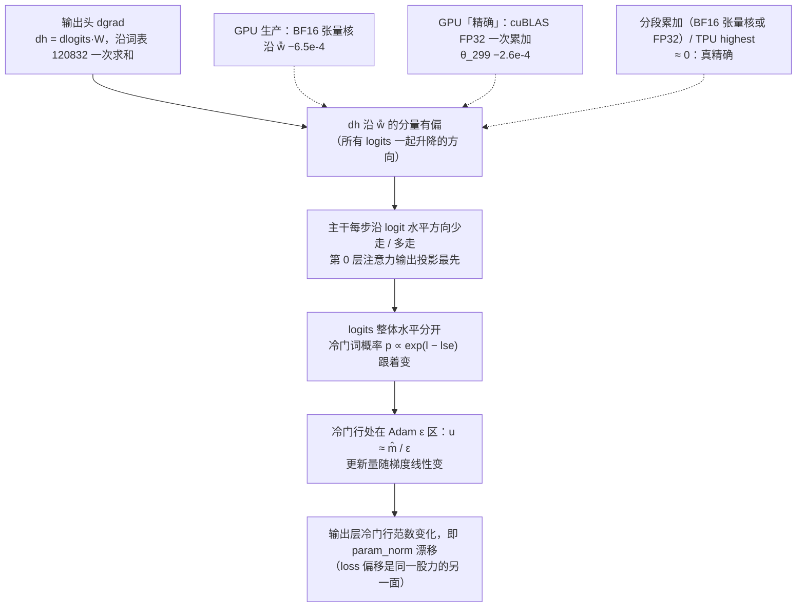
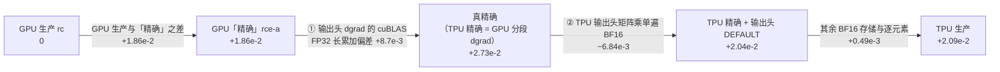

[janus](../../../../../README.md) › [用户指南](../../../../../docs/guide/README.md) ｜ 完整案例；摘要在指南[第 6 章 发现不对齐时怎么排查](../../../../../docs/guide/06-debugging.md)

# 案例 01：TPU 1000 步 loss 稳定偏低万分之一点五——根因在 GPU golden 的输出头 dgrad 长求和

本页是混元 3 对齐结论背后的证据台账：每一项测试、读数和判定都记在第 0 节，对齐报告引用的是这里的行。

> **状态：已结案（2026-11-06）**
> - 对未经修改的 GPU 生产 golden [`rc`](../../../../../docs/glossary.md#rc)，TPU 仍然不过：param_norm 带符号均值约 24 倍噪声。这是已解释差异，差异全部归到 GPU 输出头 dgrad 的长求和偏差。
> - 对最终 golden [`rcc`](../../../../../docs/glossary.md#rcc)（GPU 生产程序只把输出头 dgrad 改成分段 FP32 累加），v5p、v7x 当前对齐配置的 [L4](../../../../../docs/glossary.md#分级l0l4)（1000 步多步训练） 全部过，最差 r = 0.85。
> - 尺子是看到待定结果之后改过的：噪声参照从 5 份重跑（10 对比较）补到 10 份（45 对），两处测量口径也改了。用原口径、45 对，同样全部过，最差 0.84。改动经过见「尺子是怎么定下来的」。
> - 范围：B200 × 8、cuBLAS 13.8，4 层模型，1000 步，一种重算设置（整层重算加路由回放）。
> - 结论与全部偏差在 [`ALIGNMENT-REPORT.md`](../../../ALIGNMENT-REPORT.md)。

## 读这页之前

### 计数口径与记号

- 「N 份重跑」指同设置独立运行的份数。「M 对比较」指两两配对数：5 份得 10 对，8 份得 28 对，10 份得 45 对。
- 噪声上限 N 是所有配对比较里的最大值（[噪声上限](../../../../../docs/glossary.md#noise-ceiling)），所以份数越多 N 越宽。
- r = |被测统计量| / N，≤ 1 过，> 2 不过，中间待定。
  - 每个量算三个统计量：带符号均值、MARE（逐步相对差绝对值的平均，[MARE](../../../../../docs/glossary.md#mare)）、最大单步。r 取三者里最差的。
- 「第一层 / 第二层」指验收的两层（[两层验收](../../../../../docs/glossary.md#two-tier)）：第一层对最终 golden 判过不过，第二层对 GPU 生产 golden 只记差异。
- 相对差一律是（被测 − 参照）/ |参照|，正号表示被测更大。「带符号均值」是逐步相对差在 1–1000 步（或注明的步段）上的平均。
- param_norm 的「第 1000 步差」是绝对差。
  - param_norm 按 FP32 记录，3042 附近一个记录刻度是 2.44e-4，单个第 1000 步值只能分辨到这个刻度。
  - 同设置重跑之间，第 1000 步值最多差 3.3e-4（`rce` 五份）到 1.15e-3（`rcc` 十份），比较时以带符号均值为主。
  - 2.09e-2 相对 3042 是 6.9e-6。
- 「沿 ŵ̄ 偏 x」：ŵ̄ 是输出层行均值方向，即「所有 logits 一起升降」的方向，û 是它的单位向量。
  - x = Σₜ (dhₜ − dhₜ^FP64)·û ÷ Σₜ |dhₜ^FP64·û|，求和遍历一个 microbatch 的 4096 个 token。
  - 第 1 步 Σₜ dhₜ^FP64·û 与分母同号、大小几乎相等，负值即朝 0。训练后期不再如此（第 100 步 Σₜ dhₜ^FP64·û 只有分母的 14%），负值只表示沿 −û。
  - 同一处偏差有两个第 1 步读数：−6.5e-4 只算矩阵乘（参照是同一份 BF16 dlogits 的 FP64 乘积，`head-log` 抓的张量）；−4.4e-4 是整个输出头反向（参照由 logits 在 FP64 里重算，g1k-a 的 dump）。分母相同。
  - 第 0 节「残差流探针」「第 0 层隔离」行另有一个 û，指最后归一化输出均值的方向，在那两行里定义。
- 正文常用记号：
  - θ_k：第 k 步更新后的整套参数（θ_299 即第 300 步开始时的状态）。
  - lse：log-sum-exp，即 log Σᵥ exp(lᵥ)，logits 的整体水平；h̄：最后隐状态在 token 上的均值向量。
  - MXU：TPU 的矩阵乘单元；FTZ：把非正规数冲成 0。
  - splash：MaxText 的注意力内核；megablox、`ragged_dot`：MaxText 路由专家矩阵乘的两种实现。
  - 签字项 2b：用户指南[签字清单](../../../../../docs/guide/05-reading-results.md#56-签字清单现在离签字还差什么)里的 2b 项：L2、L3 用噪声判的检查全部过（实际卡在第 1 步梯度与优化器状态）。
  - 回归 T1：日常回归最小档位的 TPU 执行噪声标定（用户指南第 7 章）。
- Adam 的 ε 是 1e-8（两侧相同，[`config-alignment.md`](../../../config-alignment.md)「优化器」行）。「ε 区」指 √v̂ < ε 的元素。
- 「GPU 生产程序」指对齐报告第 7 节定义的配置：Megatron-Bridge 上游预训练默认配置，加整层重算与路由回放，关分布式优化器。它不等于线上的训练配置。
- 「TPU 生产 / 当前对齐配置」指 MaxText 加对齐用的设置：GA 2、三个精度开关、`dense_fp32_accumulation`（FSDP 切开收缩维的投影改用 FP32 累加）、除层输入和 `moe_routing_maps` 外整层重算（[`../setup.md`](../setup.md)，[`config-alignment.md`](../../../config-alignment.md)）。
- 「已被取代」标在后来被推翻或改判的结论上，最终结论一律见「一页看完」。第 1–6 节是排查当时的记录，「推断（当时）」「当时没定」等字样保留原样，去向在同一处注明。

## 一页看完

代号（本节通用）：

- `rc`（`rc-a..e`）：GPU 生产 golden，5 份。`rcc`（`rcc-a..j`）：最终 golden，GPU 生产程序只把输出头 dgrad 改成分段 FP32 累加，10 份；`rcc-a` 是第 1 份，验收的比较基线。
- `rce-a`：精确轨迹（BF16 权重、全程 FP32 计算）的第 1 份，输出头 dgrad 仍是 cuBLAS FP32 一次累加。`rcec-a`：真精确轨迹，精确轨迹加输出头 dgrad 分段累加。
- `rcx`：生产 golden 把输出头 dgrad 换成 cuBLAS FP32 一次累加，5 份。`dgrad-exact`：同一处改用关 TF32 的 cuBLAS FP32 一次乘完的诊断臂。
- `g-bwc-1k`：默认配置（不重算）下的 GPU 精确轨迹加分段 dgrad，1000 步；`g-bwcr-1k`：再把 dlogits 舍 BF16。
- `t-rmap-1000`：v5p 生产配置 1000 步，打开 `dense_fp32_accumulation` 之前。`t-rmap-on-1000`、`t-v7x-on-1000`：v5p、v7x 当前对齐配置 1000 步。`t-v7x-bw-rd-1000b`：v7x 上的 TPU 精确轨迹（BF16 权重、全程 FP32），1000 步。

### 问题

同一个混元 3 四层模型、同一份数据，TPU（MaxText）训 1000 步，loss 比 GPU 生产 golden（B200 + Megatron-Bridge，`rc`）稳定偏低。

- 第 301–1000 步 loss 相对差的带符号均值 −1.37e-4（`t-rmap-on-1000` 对 `rc-a..e` 逐步均值）。
  - 开关打开前的 `t-rmap-1000` 是 −1.34e-4。标题里的「万分之一点五」是最早对第一阶段 GPU golden `g1k` 看到的偏移（第 1–3 节）。
- 这一窗口里 88% 的步 TPU 更低；`rc` 五份两两之间是 32% – 68%。逐步差本身在抖，偏的是中心。
- 第 1000 步 param_norm 多 +2.09e-2（`t-rmap-on-1000`，对 `rc` 五份均值）。

### 原因：GPU 输出头 dgrad 的长求和有偏

- 输出头 dgrad 是 dh = dlogits·W，沿词表 120832 一次求和。
- GPU 生产用 BF16 张量核做这次求和，沿 ŵ̄ 偏 −6.5e-4（第 1 步，只算矩阵乘）。
  - B200 张量核每 16 个乘积对齐到最大指数、低位向零截掉。这个累加模型在 CPU 上复现 B200 GEMM 逐位相同（第一阶段 `phase1-l1` 的 `L1.emulate.gemm`）。
  - 输出改 FP32、关 reduced-precision reduction，读数都不变，偏差在累加里（「输出头 dgrad 消融：分段还是 FP32」行）。
- cuBLAS 13.8 在 B200 上的 FP32 一次累加（关 TF32）也有偏：第 1 步 −1.7e-6，训练到 θ_299（第 300 步开始时的状态）上 −2.6e-4（「GPU 精确的输出头 dgrad」行）。
  - 同一份数据在 CPU 上 FP32 一次累加只有 −3.4e-8，所以问题在这个库的长累加内核，不在 FP32 本身。内核内部怎么累加没有源码，机制是推断。
- 在 B200 / cuBLAS 13.8 上，分段累加去掉偏差（同一份训练张量在一张 B200 上换写法重算 dh，单步离线）。第 1 / 100 / 300 步沿 ŵ̄：
  - BF16 张量核按 1024 分段、段间 FP32 累加：−6.9e-7 / +8.3e-7 / +3.1e-7。
  - FP32 按 1024 分段（`rcc` 的写法）：+9.9e-9 / +3.5e-7 / +1.1e-7。
  - FP32 不分段：−1.7e-6 / −2.6e-4 / −2.6e-4。
  - 1000 步训练两种分段都跑过：FP32 分段即 `rcc`；BF16 张量核分段 `rcb` 与 `rcc` 不可分，步时只比生产多 6%（第 0 节「便宜的等价修法 `rcb`：BF16 张量核分段 1000 步」行）。

### 放大：冷门行在 Adam 的 ε 区



- 漂移几乎全在输出层冷门词的行（第 0 节「定位」三行）。
- 冷门行的梯度随训练变小，√v̂ 跟着变小（没出现过的词那些行，√v̂ 均值第 50 步 1.04e-7，第 300 步 4.3e-9）。
  - 落在 ε 区的元素因此从第 1 步的 12% 升到第 300 步的 92%。更新量近似 m̂ / ε，对梯度线性放大（「冷门行放大链：同一步直接量」行）。
- 两侧去掉 dh 沿 ŵ̄ 的分量，loss 偏移回到噪声内；GPU 反向加力能定量复现 TPU 的漂移（「机制」行）。
- 另有一条路没直接量到：dlogits 舍 BF16 让 param_norm 少漂 6.8e-3，但它让 dh 沿 ŵ̄ 的均值只偏 −2.6e-5。推断是逐 token 的舍入噪声经主干 Adam 的二阶矩起作用（「TPU 那一份再拆」行）。

### 证据链

每条后面括号里是第 0 节对应的行。param_norm 都是第 1000 步、对 `rc` 五份均值。

1. GPU 生产的输出头 dgrad 沿 ŵ̄ 偏 −6.5e-4（「输出头反向」行）。
   - 换成 `dgrad-exact` 后，GPU param_norm 从 0 挪到 +1.24e-2（`rcx` 五份均值），是 TPU 生产 +2.09e-2 的 59%。
2. GPU 精确轨迹 `rce-a` 走到 +1.86e-2（「剩下约四成：rc 配置下的精确轨迹（第一份）」行）。
3. TPU 精确轨迹到 +2.73e-2，差在 GPU 一侧（「GPU 精确的输出头 dgrad」「GPU 精确 + 分段 dgrad：1000 步」两行）。
   - GPU 精确只把输出头 dgrad 换成分段累加，就和 TPU 精确重合：带符号均值差 7.9e-8，在 GPU 精确五份两两的上限 1.07e-7 内（`rce-a..e`，b..e 带 1e-6 / 3e-6 的权重扰动）。
4. GPU 生产只修这一处（`rcc-a`），+2.071e-2；TPU 生产 +2.092e-2。带符号均值差 v5p +5.2e-8、v7x −5.5e-8，噪声上限 2.27e-7（「GPU 生产 + 精确输出头 dgrad `rcc-a`」行）。
5. TPU 生产与 GPU 生产离真精确的剩余部分是同一件事：两侧都把 dlogits 舍成 BF16（下面「两侧共有的 dlogits 舍 BF16」）。

### 修法与现状

- 最终 golden `rcc`：GPU 生产程序其余不变，只把输出头 dgrad 改成分段 FP32 累加。
- 第一层验收（第 0 节「最终 golden：第一层换成 rcc」行）：
  - TPU 被测只和 `rcc-a` 比，不取平均、不挑最差。`-a` 当基线是比较协议的既有规则（[`judging.md`](../../../../../docs/reference/judging.md#golden-怎么用几份只造噪声带比较只对一份)）。
  - N 取 `rcc-a..j` 10 份重跑两两 45 对比较里的最大值。
  - 比的量：loss 全程、loss 301–1000 步、grad_norm、param_norm、学习率、路由偏置曲线、健康信号。
  - 结果：v5p、v7x 当前对齐配置全部过。最差 r 在两个平台都是 grad_norm MARE（v5p 0.846、v7x 0.851）。
- 第二层：对 `rc` 不过，记为已解释差异（「验收」行，注 39）。

第 1000 步 param_norm 对 `rc` 五份均值：

| 运行 | 差 |
|---|---|
| GPU 生产 `rc` | 0 |
| GPU `rcx`（输出头 dgrad 换 cuBLAS FP32 一次累加）五份均值 | +1.24e-2 |
| GPU 精确轨迹 `rce-a` | +1.86e-2 |
| 最终 golden 基线 `rcc-a` | +2.07e-2 |
| TPU 生产（v5p、v7x 同值） | +2.09e-2 |
| TPU 精确 `t-v7x-bw-rd-1000b` | +2.73e-2 |
| 真精确 `rcec-a` | +2.74e-2 |

表中相邻两格差不到一个记录刻度（2.44e-4）的视为相同；`rcc` 十份之间的第 1000 步值最多差 1.15e-3。

### 为什么 rcc 不是挪球门

`rc`、`rcx`、`rce`（方案 A）先后当过参照，都没过；`rcc` 最后一个上，而且是 `rcc-a` 的交叉核对已经过了之后才定为正式 golden（11-06）。所以要单独说明：`rcc` 是对 GPU 的修正，不是按 TPU 调出来的。

不依赖 TPU 的证据：

- 单算子对 FP64：生产写法沿 ŵ̄ −6.5e-4（第 1 步）；分段写法 +9.9e-9 / +3.5e-7 / +1.1e-7（第 1 / 100 / 300 步）。判据是 FP64，不是 TPU。
- 只用 GPU 也闭合：GPU 精确轨迹加分段 dgrad、再把 dlogits 舍 BF16（`g-bwcr-1k`，全部在 GPU 上跑），和 `rcc-a` 的带符号均值差 +1.3e-7，在噪声上限 2.27e-7 内（「GPU 一侧的同一件事」行）。
- 只改一处：10 份 `rcc` 与 `rc` 用同一镜像、同一配置、同一检查点与数据，唯一的数值改动是 `rr_arms.py` 的 `dgrad-chunk`（[`goldens.md`](../../../goldens.md)）。段长 1024 在跑 `rcc` 之前就定了，消融是之后做的。
- 方向事先可预期：修正让 GPU 向 FP64 靠，TPU 恰好也在那一侧（TPU 生产的同一处对 FP64 第 1 步只偏 −2.6e-5 / −2.4e-5，v7x / v5p 两次回放）。

哪些是事先定的，哪些不是：

- 事先定的：golden 必须是 GPU 生产程序；比较只对 `-a`；噪声取同设置重跑两两；判定量与 1 / 2 倍的门槛。
- 事后定的：「golden 修哪一处」是在查出偏差之后定的；`rcc` 定为正式 golden 时，`rcc-a` 对 TPU 的交叉核对已经看过。

### 尺子是怎么定下来的

- 最先只有 `rcc-a..e` 5 份重跑（10 对比较）。v5p grad_norm MARE 1.02、v7x grad_norm MARE 1.02 与 param_norm MARE 1.24 落在待定区。
- 之后改了两处，都在看到待定之后：
  - 测量口径（「param_norm 的测量精度」「grad_norm 带符号均值的偏置」两行）。
    - grad_norm 改用两边均值作分母，被测与噪声两侧同样算。
    - param_norm 的被测改读 `param_norm_from_groups`（分组平方和 FP64 相加后开方）。golden 与噪声一侧读 GPU 自己的 `param_norm`：GPU 的 `rcc` 运行没有记分组范数，两列不同。GPU 原始列与它自己的分组合成值单步最多差 8.2e-8，小于噪声上限 2.27e-7。
  - 补跑 `rcc-f..j` 5 份，凑成 10 份 45 对。补跑是看到待定后决定的，事先没有写停止规则；跑完 f..j 后没有再加。
- 原口径（两侧都读原始列、grad_norm 以 golden 为分母）对基线 `rcc-a`、45 对下也全部过，最差 0.84（v7x grad_norm MARE 0.844）；换基线时原口径也会出待定（见第 0 节「换基线」一条）。
- 两批分开看（N 分别取批内 10 对、批间 25 对）：
  - f..j 批内的 N 在全部 12 个统计量上比 a..e 宽 1.04 – 3.06 倍；45 对的最大值都出在含 `rcc-j` 的配对上。
  - 只用 f..j 批内 10 对当 N：最差 r 不变（v5p 0.846、v7x 0.851）。
  - 只用 a..e 批内 10 对：v7x param_norm MARE 1.24，待定（就是当初的读数）。
  - 去掉 `rcc-j`（剩 9 份 36 对）：全部过，最差 r v5p 0.976、v7x 0.982。
  - N 改取 45 对的第 90 百分位而不是最大值：全部过，最差 r v5p 0.92、v7x 0.93（推导：由结果文件 `noise_loo` 还原每对的值）。
- 合并两批的理由：10 份的镜像、库版本、配置、种子、检查点、数据与 `dgrad-chunk` 代码相同；`rr_arms.py` 两版只差一个没开的诊断臂；两批在同一天相隔约 3 小时跑。`rcc-j` 宽是偶然还是这一份特有，10 份样本分辨不了。

### 各项能看出多大的差

- param_norm 最灵敏：GPU 输出头 dgrad 那处偏差让 TPU 对 `rc` 的 param_norm 带符号均值到约 24 倍噪声（`rc` 5 份 10 对，`phase2-acceptance-rc`）。
- loss 不够灵敏：loss 尾段的 N 是 1.21e-4，那处偏差造成的 loss 差（`rcc-a` 对 `rc` 均值）是 −1.71e-4，TPU 对 `rc` 是 −1.37e-4，r 约 1.1 – 1.4。单看 loss 只能勉强分辨出这么大的系统偏差。
- 只改 TPU 一侧的输出头精度（logmm），对 `rcc-a` param_norm 4.80 倍、loss 全程 3.16 倍，不过：说明第一层量的是「和 GPU 生产程序同样的误差预算」，比 GPU 生产更精确也会被判出来。
- L4 的结论主要靠 param_norm 与 grad_norm，不靠 loss 曲线重合。

### TPU 自己的两处 BF16

两侧共有的 dlogits 舍 BF16：

| 只多舍 dlogits 这一次 | 参照 | 第 1000 步 param_norm |
|---|---|---|
| TPU 精确，只舍 dlogits（v7x，输出头单遍 BF16） | TPU 精确 v7x | −6.84e-3 |
| TPU 精确，只舍 dlogits（v5p `--head-round cotangent`） | TPU 精确 v5p | −6.10e-3 |
| GPU 精确加分段 dgrad，再舍 dlogits（`g-bwcr-1k`） | `g-bwc-1k` | −6.74e-3 |
| GPU：`rcc-a` 对 `rcec-a`（生产与真精确之差，主要是这一项） | `rcec-a` | −6.74e-3 |

- 三个单一变量的读数相差最多 7.4e-4，约 3 个记录刻度，在 `rcc` 十份第 1000 步值的散布（1.15e-3）内。带符号均值上 v5p 与 v7x 精确对 `rcec-a` 都在噪声内（−6.8e-8 / +8.3e-9）。
- 另两个常见读数含其余 BF16 存储与逐元素运算（+0.49e-3）：TPU 生产对 TPU 精确 −6.35e-3，对 `rcec-a` −6.52e-3。
- 它在两侧生产程序里都有，所以不构成 GPU 与 TPU 之间的差，不是「对 L4 没影响」。
- 诊断臂 logmm（当前配置加 `logits_dot_in_fp32` 与 `matmul_precision=highest`）让 TPU 的 dlogits 留在 FP32，步时多 9.6%（v7x 中位数 0.98016 s 到 1.07457 s）。只改 TPU 一侧对 `rcc-a` 反而不过（见上一小节），不采用。

梯度先以 BF16 落地（「第 1 步张量换尺子」节的「机制：这三类梯度在 TPU 上先以 BF16 落地」）：

- 一维 norm scale、输出层、embedding 的梯度在 TPU 上先以 BF16 输出，再累加回 FP32。
- 第 1 步整网按能量的 R 比 1.204（TPU 离 FP64 ÷ GPU 离 FP64，[R 比](../../../../../docs/glossary.md#r-ratio)），超过 1.2：第 1 步逐层参数梯度与全部参数梯度两条检查不过。
  - 对齐报告把它列为签字清单 2b 的已定责差异，是否接受由使用方决定。
- 三个可选开关 `rmsnorm_scale_grad_fp32`、`logits_dense_wgrad_fp32`、`embedding_grad_fp32`（默认关）让这几类梯度直接以 FP32 落地，前向不变；全开后 R 比 v5p 0.67、v7x 0.72。
- 没有放进当前对齐配置：打开后 v7x 的 L4 grad_norm 最大单步 1.05 倍，待定。这一项没有再用扰动系综去分辨，因为不开开关时 L4 已全部过。
- 不累积：不开开关，L4 在 `rcc` 的 45 对噪声内。

### 还开着的事

- 生产重算配置下的验收：本案例只用「整层重算 + 路由回放」一种重算设置，结论不自动外推到真实训练的重算策略（「0.2 排查当时列的待办」）。
- 已关闭：BF16 张量核分段在 1000 步训练里同样让 L4 通过，和 `rcc` 不可分，步时只多 6%（第 0 节「便宜的等价修法 `rcb`：BF16 张量核分段 1000 步」行）。最终 golden 仍是 `rcc`。
- 其他 GPU 型号与 cuBLAS 版本：长累加偏差只在 B200 / cuBLAS 13.8 上量过。
- v7x 的 TPU 执行扰动系综缺两份（`-vmem40` 与关窗口化），结案不依赖（附录「TPU 执行扰动系综」）。
- 换基线：`rcc-a..j` 十份每份都当一次基线重判过（[`case01-rebaseline-rcc.json`](../results/case01-rebaseline-rcc.json)）。四条检查的最差 r 在十份之间相差最多 0.47；v7x 当前配置有三份基线落进待定（grad_norm 1.11、1.01，loss 301–1000 步 1.08），没有不过，其余三个配置全过。只报的原口径（读原始 param_norm）下 v5p 当前配置也有三份基线待定：`rcc-f` 1.18、`rcc-g` 1.00、`rcc-h` 1.01（未舍入值都略大于 1；JSON 的 `L4.param_norm.raw`）；v7x 以 golden 为分母的原口径（`L4.grad_norm.golden_den`）下 `rcc-e` 1.00、`rcc-j` 1.11 待定。

## 排查过程的注记

### 本页结构

- 第 0 节：排查总表（证据台账），每行一项测试；完整读数在「0.1 各行的注」。
- 「第 1 步整网梯度」「第 1 步张量换尺子」：第 1 步梯度差的定责。
- 「TPU 对精确轨迹那一成的账」：TPU 生产离真精确的那一份怎么拆（以 `rce-a` 为参照，属历史）。
- 第 1–6 节：排查当时按时间写下的记录，是第 0 节各行的出处。
- 两个附录：`rce` 与 `rcc` 各份之间的散布，以及 TPU 执行扰动系综。

### 已被取代的绕路

- 「59% / 29% / 12%」拆法：把 TPU 对 `rc` 的 param_norm 差拆成三份，已作废（第 0 节「rc 配置下的精确轨迹（第一份）」行的注）。
- `rce` 当第一层基线：`rce` 的输出头 dgrad 仍是 cuBLAS FP32 一次累加，有偏，现只作参考。
  - TPU 生产对 `rce-a` 多 +2.35e-3，是两份相反的偏差相减的结果（「TPU 对精确轨迹那一成的账」）。
- 方案 A：第一层基线取 `rce-a`、噪声例外地取 `rcx-a..e` 5 份的 10 对比较，2026-11-05 晚到 11-06 早使用，已退役（第 0 节「验收」行的注 17）。
- 「小约 18 倍」的尺子：只看 `rce-a`/`rce-b` 一对时以为扰动发散太慢、当不了噪声；五份齐了以后散布和 GPU 重跑同量级，这一判断作废（附录「rce 五份的散布」）。
- 「路由近似平局翻转造成两侧精确轨迹之差」：已撤回，实际是 TPU 的 FP32 参照里路由专家按 BF16 算（第 0 节「剩下约四成：TPU FP32 参照本身」行）。
- `rcx` 当第一层基线（「新协议」）：`rcx` 的一次累加本身有偏，现只作参考。
- `rcec` 始终只作参考交叉核对。

### 排查当时给残差起的名字

第 0 节有几行以这些名字开头。行名被仓库其他文件引用，保留不改，含义如下：

- 「剩下约四成」：第 1000 步 param_norm 的 TPU − `rcx` +8.7e-3，占 TPU − `rc` +2.12e-2（`t-rmap-1000`）的 41%。
- 「剩下 1/3」：TPU − `dgrad-exact` = +2.1e-2 − +1.3e-2 = +0.8e-2，占 +2.1e-2 的 38%（`t-a` 对 g1k，推导自第 0 节「验收」两行与「剩下 1/3」行的数）。
- 「TPU 自己的一成」「那一成」：已作废的「59% / 29% / 12%」拆法里的 12%，即 TPU − `rce-a` +0.26e-2 占 +2.12e-2。
- 三者最后都归到 cuBLAS FP32 长累加偏差与两侧共有的 dlogits 舍 BF16（「TPU 对精确轨迹那一成的账」）。

### 已删除的交叉核对目录

- 文中提到的 `phase2-acceptance-rce*`、`-rcec*`、`-rcx*`（及 02 的 `phase2-v7x-` 同名目录）只服务于排查过程，已从仓库删除。
- 读数都记在引用它们的那一行，原件在 git 历史里。

## 0. 排查总表（证据台账）

- 判定：🔴 有影响（是原因或直接参与）｜🟡 部分，或只是放大器｜🟢 查过、没影响。
- 标「已被取代」的行，结论后来被推翻或改判；对应的注写明最终结论在哪一行。
- 表里只留要点。测试细节、全部读数和完整判定在表下「0.1 各行的注」，早期排查各行的出处在第 6 节对应行。
- 「对照」都是同设置 GPU 运行之间的差（噪声）。

### 0.1 已经测过的

代号（本表与下面「0.1 各行的注」通用）：

- golden：
  - `rc`（`rc-a..e`）：GPU 生产 golden，整层重算加路由回放，5 份。
  - `rcx`（`rcx-a..e`）：生产 golden，输出头 dgrad 换 FP32 一次累加；归因用的中间版，FP32 一次累加本身仍有偏。
  - `rce`（`rce-a..e`）：精确轨迹，BF16 权重、全程 FP32 计算；输出头 dgrad 仍是 cuBLAS FP32 一次累加，有偏，不是真精确。
  - `rcec-a`：真精确轨迹，精确轨迹加输出头 dgrad 分段累加。
  - `rcc`（`rcc-a..j`）：最终 golden，GPU 生产程序只把输出头 dgrad 改成分段 FP32 累加，10 份；`rcc-a` 是第 1 份，验收的比较基线。
  - `rcb`（`rcb-a`、`rcb-b`）：`rcc` 的设置只把输出头 dgrad 换成 BF16 张量核分段（`dgrad-chunk-bf16`），2 份；便宜的等价修法，不是基线。`rcc-chk` 是同一台机器上 `rcc` 设置原样的对照，不进噪声带。
- TPU 运行：
  - `t-rmap-1000`：v5p 生产配置（整层重算、只存路由）1000 步，打开 `dense_fp32_accumulation` 之前；`t-rmap-sh-1000` 是它在另一个 v5p-8 切片上的重跑，1000 步逐位相同。
  - `t-rmap-on-1000`：v5p 当前对齐配置 1000 步（多开 `dense_fp32_accumulation`：FSDP 切开收缩维的投影改用 FP32 累加）；`t-v7x-on-1000`：同一配置在 v7x 上。
  - `t-ep8-1000` / `t-v7x-ep8-1000`：v5p / v7x 生产配置只把并行方式改成 EP = 8，1000 步。
  - `t-v7x-bw-*`、`t-v5p-bw-rd-*`：TPU 精确轨迹（BF16 权重、全程 FP32）及在它上面只降一处精度的变体。
  - logmm（`t-v7x-logmm-1000`）：诊断臂，当前配置加 `logits_dot_in_fp32` 与 `matmul_precision=highest`，让输出头反向的 dlogits 留在 FP32。
- GPU 臂与运行：
  - `dgrad-exact`：输出头 dgrad 改用关 TF32 的 cuBLAS FP32 一次乘完（后来查出本身仍有偏）；`p2-dgradx-*` 是开这一臂的运行。
  - `dgrad-chunk`：输出头 dgrad 分段 FP32 累加（词表按 1024 一段），真精确。
  - `dgrad-chunk-bf16`：同 `dgrad-chunk` 的分段，但不升精度：每段 BF16 张量核乘法、输出留 FP32，段间 FP32 累加。
  - `g-bw-1k`：默认配置（不重算）下的 GPU 精确轨迹 1000 步；`g-bwc-1k`：再加分段 dgrad（真精确）；`g-bwcr-1k`：在 `g-bwc-1k` 上再把 dlogits 舍 BF16。
- 其余 `g-*`、`p2-*`、`rr-*` 是案例 01 的 GPU 诊断运行，其余 `t-*` 是 TPU 诊断运行；每个做了什么写在同一行的「测试」格和对应的注里。

| 类别 | 假设 | 测试（运行） | 关键结果 | 判定 |
|---|---|---|---|---|
| 统计口径 | 步号错位 | 同步号 vs 错一步对比 | 错一步平均绝对差大 90 多倍 | 🟢 |
| 数据 | 两边吃的数据不同 | L0 指纹 | 1000 步 × 8 rank × 2 microbatch 逐位相同 | 🟢 |
| 并行切法 | microbatch 切法（TPU 一次 2 行 / GPU 分 2 次累加） | `t-ga2-30` | 偏移没变小 | 🟢 |
| 优化器 | 权重衰减作用的参数集合 | 第 1 步按 Megatron 公式重算更新量 | 逐参数吻合 | 🟢 |
| 优化器 | Adam 公式（ε 位置、偏差修正）与状态精度 | 同上 + HLO | 吻合；动量 FP32 | 🟢 |
| 优化器 | 第 1 步更新量 | 逐张量比 ΔT / ΔG | 0.997–1.003 | 🟢 |
| 前向精度 | RMSNorm 舍入、激活舍入、路由权重 BF16 舍入（三个精度开关） | L1 回放；`t-fix-f32-30`、`t-fix-perop-30`；`t-rmap-1000`（生产 yml，三个开关都开） | 开关对齐 GPU 写法后偏移不变 | 🟢 |
| 前向精度 | excess precision | L1 回放；`t-ga2-noexcess-30` | 关掉后每个张量对 GPU 都更差，30 步偏移更大 | 🟢 |
| 前向精度 | 输出层矩阵乘与 logits 精度 | `t-gn-l32-300`（FP32 logits 与输出层梯度） | 输出层漂移不变 | 🟢 |
| 前向精度 | 注意力实现 | GPU `g-attn-unfused`、`g-attn-flash` ×2；TPU `t-dpa-300` | 都在噪声内 / TPU 照样漂 | 🟢 |
| 规约 | 梯度按 BF16 规约 | GPU `g-bf16grad` | 噪声内 | 🟢 |
| 重算 | 反向重算与前向不逐位 | TPU `t-noremat-1000`；GPU 重算 golden `rc-a..e` | 偏移照样出现 / 对 rc 不变 | 🟢 |
| 执行 | 片上内存上限（执行级差异） | `t-vmem24-1000` | 同样漂移，说明是 TPU 系统性的 | 🟢 |
| 反向复现 | GPU 一项项换成 MaxText 写法（交叉熵、Adam、裁剪、最后 RMSNorm、输出层 wgrad、注意力缩放、query 缩放、残差 FP32、MoE 合并 FP32、七项合并、路由反向 BF16、TF32、交叉熵 / 激活融合） | 12+ 个 GPU 臂，各 300–400 步 | 全部复现不出 | 🟢 |
| 舍入残差 | dlogits 舍 BF16 留下的行和残差（目标项截断） | GPU `k=0`、`dh-center`；TPU `t-center-1000`、`t-dh0-300`、`t-dh3-300` | 去掉后 TPU 反而漂更多；GPU 指纹对不上 | 🟢 |
| 输出头反向 | TPU 输出头反向在「所有 logits 一起动」方向（ŵ̄）上有偏 | 输出头回放对 FP64（第 1、100 步） | TPU 相对误差 −2.4e-5 / −7.4e-5（v5p 回放 `t-head-replay`），不偏 | 🟢 |
| 输出头反向 | dump 的 `logits.grad` / `final_norm.out.grad` 不是输出层 dgrad 实际用到的那份 | `head-log` 臂在 Megatron 线性层反向里取实际张量（`p2-hl-det`、`p2-hl-100`，第 1、100 步） | 和 dump 逐位相同，权重也逐位相同 | 🟢 |
| 输出头反向 | GPU 交叉熵反向沿 ŵ̄ 有偏 | 同上，对 FP64 参照拆开；按融合交叉熵在 FP32 里重算 | 第 1 / 100 步 +2.7e-6 / −3.0e-5，全部来自最后舍到 BF16 | 🟢 |
| 输出头反向 | GPU 输出层 dgrad 的 BF16 矩阵乘有偏（改判，原记 🟢） | 同上一行；离线重做几种写法；新臂 `dgrad-exact`（`p2-dgradx-*`） | 沿 ŵ̄ 第 1 / 100 步 −6.5e-4 / −6.1e-4；换精确 dgrad 后 GPU 复现约六成 param_norm 漂移 | 🔴 根因（GPU golden 一侧）；11-06 有更正，见注 1 |
| 逐步拆分 | 每一步「更新计算」与「梯度计算」各对精确参照，看偏在哪一半、哪一侧 | GPU `g-sd-300` + 同状态参照；TPU `t-sd-300c` | GPU BF16 梯度每步多走 \|d\|² 的 0.23% – 0.56%；TPU 是 GPU 的 1/3 – 1/20 | 🔴 GPU 一侧的梯度计算；TPU 侧 🟢，见注 2 |
| 输出层 wgrad | GPU 输出层权重梯度（沿 token 求和）的 BF16 矩阵乘也有偏，是剩下约 1/3 漂移的来源 | 新臂 `wgrad-exact` + `dgrad-exact`，1000 步（`g-dwx-1k-a`） | param_norm +1.25e-2，和只开 `dgrad-exact` 一样 | 🟢，见注 3 |
| 状态互换 | 同一个状态，两侧这一步算出来的梯度本身就不一样（每一步的数值问题），还是只因为状态不同（反馈） | GPU θ_99 导入 TPU（`t-sw-g99b`），同状态梯度探针 | 同一状态：TPU BF16 对 GPU BF16 沿 d 每步 +0.36% | 🔴 是每一步的数值，见注 4 |
| 剩下 1/3 | 剩下约 1/3 的 param_norm 漂移来自 GPU 其余写法（交叉熵、Adam、裁剪、最后 RMSNorm、输出层 wgrad 舍入、query 缩放、MoE 合并、路由反向、残差流精度） | 与 `dgrad-exact` 一起开，1000 步：`g-dxall-1k`、`g-dxr-1k`、`g-dxrm-1k` | param_norm +1.23e-2 – +1.28e-2，和只开 `dgrad-exact` 一样 | 🟢，见注 5 |
| 剩下约四成：规范分量 | 剩下的漂移来自两侧输出层梯度规范分量（dlogits 舍 BF16 的行和残差）不同 | 两侧去掉规范分量：TPU `t-gc0-1000`，GPU `g-dxg0-1k-a/b` | param_norm TPU +5.58e-2、GPU +3.81e-2 / +3.85e-2 | 🟢 不是：两侧的差反而更大，见注 6 |
| 剩下约四成：同状态输出层 | 同一个状态下，两侧输出层梯度在冷门行上的大小或方向（w·g，决定 Adam 把行压多少）不同 | GPU θ_99 同状态：`t-sw-g99o` / `t-sw-g99b`，`g-sdo-b100` / `g-sdo-r100` | 没出现过的词那些行：Σ w·g TPU 对 GPU +1.7e-4 | 🟢 同一状态下冷门行梯度两侧一样，见注 7 |
| 剩下约四成：输出层的更新计算 | 冷门行处在 Adam 的 ε 区，两侧的 AdamW 在这些行上算得不一样 | 只抓输出层的逐步拆分：`g-sd-o300`、`t-sd-o300` | 两侧各桶相对误差都在 1e-6 量级 | 🟢 两侧更新都按公式算得对，见注 8 |
| 剩下约四成：两侧「精确」计算本身 | 同一状态下两侧的 FP32 参照也不一样，剩下的力在两边实现的数学差里 | 同状态两侧全程 FP32 前向逐点比（`t-swf-g99b` / `g-sdf-100`）；θ_299 导入 TPU（`t-sw-g299`） | 第 0 层 1e-6 量级；路由近似平局翻转后 MoE 输出差 3e-3 | 🟢 已查清：TPU FP32 参照里路由专家按 BF16 算，见注 9 |
| 剩下约四成：TPU FP32 参照本身 | TPU「全程 FP32」参照程序（`dtype=float32`、`matmul_precision=highest`、megablox 加大 tile）并不处处 FP32 | `moe_fp64_ref.py`：同状态路由专家输出在 FP64 里重算 | 第 1 层 GPU 对 FP64 1.2e-6，TPU 3.2e-3（和全部舍 BF16 一样） | 🔴 TPU 的 FP32 参照不是 FP32，见注 10 |
| 剩下约四成：TPU 窗口化 collective matmul 的 BF16 累加 | FSDP 收缩维的矩阵乘被 XLA 编成窗口化 collective matmul，分片部分积按 BF16 累加（v5p 列排查发现，输出层权重梯度 dW_out 的部分积缓冲是 bf16[512,120832]） | `t-wcoff-1000`：关掉窗口化，1000 步 | param_norm 对 `rcx` +8.50e-3（`t-rmap-sh-1000` +8.74e-3） | 🟢 不是：只少 3%，见注 11 |
| 剩下约四成：同一状态多个 batch | θ_99 / θ_299 两个点的符号会不会是巧合；对共同精确参照（GPU 全程 FP32）各侧每步偏多少 | θ_299 上 lr = 0 跑 6 步：`t-mb299`、`g-mbf-299b`、`g-mbb-299`、`g-mbx-299b` | 对 GPU FP32：TPU BF16 −0.02% – +0.10%，GPU BF16 −0.31% – −0.47%，GPU 精确 dgrad −0.05% – −0.22% | 🟡 每个 batch 都同号，不是巧合，见注 12 |
| 剩下约四成：GPU 精确 dgrad 之外再换一处（单步） | GPU 剩下的每步 −0.22%（θ_299）在哪一处 | θ_299 单步，`dgrad-exact` 之外再换一处（`g-s3-*`） | 只有残差流 FP32 把 −0.22% 降到 −0.10% | 🟡 但 1000 步 param_norm 不动，见注 13 |
| 剩下约四成：精确轨迹 | BF16 训练的精确版本（权重语义同生产：主权重 FP32、计算用它的 BF16 舍入；前向反向全部 FP32）走到哪里——离 TPU 近还是离 GPU 近 | GPU `g-bw-1k`（`--fp32 --bf16-weights`），1000 步 | 第 975 步 param_norm：精确轨迹 +1.82e-2，TPU +1.99e-2 | 🔴 精确轨迹站在 TPU 一边（〔已被取代〕），见注 14 |
| 剩下约四成：反向互换（TPU 状态）与 θ_99 多 batch | 换到 TPU 自己的状态上、换个状态的多个 batch，结论还在不在 | TPU θ_99 / θ_299 导入 GPU；GPU θ_99 上 6 个 batch | TPU BF16 每步对精确值在 ±0.1% 内 | 🟡 四个状态、12 个 batch 结论一样，见注 15 |
| 剩下约四成：rc 配置下的精确轨迹（第一份） | 生产近似配置（整层重算 + 路由回放）下，精确轨迹在哪；GPU 生产 golden `rc` 对它的偏差怎么拆 | `rce-a` 对 `rc`、`rcx` 均值与 TPU | 第 1000 步 param_norm：`rcx` +1.24e-2，`rce-a` +1.86e-2，TPU +2.12e-2 / +2.09e-2 | 🟡 〔已被取代〕：「59% / 29% / 12%」拆法作废，见注 16 |
| 验收 | **已被取代**：正式迁移验收第一层的基线改成精确轨迹（「方案 A」，已退役） | 只对 `rce-a` 比；噪声取 `rcx-a..e` 的 10 对比较 | param_norm：v5p 当前配置 3.45 倍、v7x 开关前配置 3.53 倍，不过 | 🔴 第一层不通过，见注 17 |
| 并行方式 | TPU 对精确轨迹剩下的那一份（param_norm 约 +2.4e-3）是不是并行方式带来的 | EP = 8：v7x `t-v7x-ep8-1000`、v5p `t-ep8-1000` | param_norm 带符号均值：v7x 3.74e-7（当前 FSDP 3.19e-7），v5p 3.52e-7（当前 FSDP 4.27e-7） | 🟡 并行方式只占一小部分，见注 18 |
| TPU 自己的一成：拆分臂（v7x） | 注意力、logits、矩阵乘精度、路由权重写法里哪一处让 TPU 离精确轨迹 | `t-v7x-on-1000` 上一次改一处：`attn32`、`logit32`、`mmhi` 及组合 | 单项都在噪声附近；logit+mm 1.20e-6 | 🟡 单项分辨不出；合并变差已定位，见注 19 |
| TPU 自己的一成：`matmul_precision=highest` 改了哪些算子 | 单项臂里只有 highest 让 param_norm 往精确轨迹挪（−1.0e-7，约 1 倍噪声），它到底改了哪一类矩阵乘 | 两次编译只差 `matmul_precision`，比 HLO 里的 dot | 202 个 dot 里 64 个带 `highest` | 🟢 highest 不改权重语义，见注 20 |
| TPU 精确轨迹：同一套机器能不能复现 GPU 的精确轨迹 | TPU 上「BF16 权重、全程 FP32」（`train_hy3.py --bf16-weights`：对求导参数做直通 BF16 舍入）和 GPU `g-bw-*` 是不是同一条轨迹 | v7x `t-v7x-bw-mb-*` / `t-v7x-bw-rd-*`，5 步与 1000 步 | 前 3 步 loss 相同；1000 步 param_norm（对 4 份 GPU 默认运行均值）TPU 精确 +2.743e-2，GPU 精确 +1.873e-2 / +1.841e-2 | 🔴 两侧「精确」不是同一条轨迹，差在 GPU 一侧，见注 21 |
| 精确对精确：第 1 步同一份权重逐项对 | 两侧「精确」的差是不是某处算法或写法不同（第 1 步权重、batch 完全相同，任何写法差都该在这一步现形） | GPU `g-bw-d1` 当参照：逐层回放、输出头反向、整批梯度、路由偏置 | 非 MoE 观测点 rel_l2 7e-7 – 7.6e-6；192 个偏置逐位相同 | 🟢 第 1 步两侧精确实现逐项一样，见注 22 |
| 精确轨迹对 FP32 矩阵乘精度的敏感度 | 精确轨迹本身稳不稳：FP32 矩阵乘换一种精度（GPU 开 TF32，TPU 用 `high` 三遍 BF16），1000 步漂移变不变 | GPU `g-bw-tf32-1k`、`g-bwt-d1`；TPU `t-v7x-bw-high-1000` | GPU 开 TF32 param_norm −1.35e-2；TPU 三份相同 | 🔴 GPU 精确轨迹对 dgrad 精度极敏感，见注 23 |
| TPU 自己的 BF16 那一份（−6.35e-3）：逐元素存储还是矩阵乘 | TPU 生产比 TPU 精确少漂，是 BF16 存储 / 逐元素运算，还是矩阵乘操作数按单遍 BF16 乘 | TPU 精确为基线：① 矩阵乘全部 DEFAULT；② 只有输出头 DEFAULT | ① ② 都是 +1.861e-3（精确 +8.697e-3，生产 +2.349e-3） | 🔴 几乎全在输出头矩阵乘，见注 24 |
| TPU 那一份再拆：输出头前向的 h 还是反向的 dlogits | 输出头矩阵乘单遍 BF16 同时舍了两样东西：前向的隐状态 h（FP32 → BF16），反向流进来的 dlogits（FP32 → BF16，dgrad 与权重梯度都用它）。是哪一样 | v5p `--head-round`：只舍 h / 只舍 dlogits | 只舍 h +8.209e-3，只舍 dlogits +1.861e-3 | 🔴 全部在输出头反向的 dlogits 舍入，见注 25 |
| GPU 一侧的同一件事：精确 + 分段 dgrad + dlogits 舍 BF16 | `rcc` → 真精确的 +6.74e-3（GPU 生产除输出头 dgrad 长累加以外的那份）是不是和 TPU 一样，来自 dlogits 舍 BF16 | `g-bwcr-1k`：`g-bwc-1k` 加新臂 `dlogits-bf16` | param_norm 对 `g-bwc-1k` −6.738e-3 | 🔴 证实：两侧共有的 BF16 误差，见注 26 |
| 精确对精确：θ_299 | 训练中途的状态上，两侧精确实现哪一处不再是 FP32 量级 | θ_299：GPU `g-lv-f300`，TPU `t-v5p-rpx-299` | dgrad 沿 ŵ̄：GPU 精确 −2.58e-4，TPU 精确 −4.5e-6 | 🔴 找到那一处：GPU 精确的输出头 dgrad，见注 27 |
| GPU 精确的输出头 dgrad：B200 上 cuBLAS 的 FP32 矩阵乘 | 上一行的偏差出在 FP32 乘法本身还是别处；哪个开关能去掉 | 同一台 B200 上换各种算法重算 dh，对 FP64 | FP32 一次乘完沿 û −2.58e-4，与训练逐位相同；分段累加 +1.1e-7 | 🔴 机制：cuBLAS FP32 长累加有偏，见注 28 |
| 输出头 dgrad 消融：分段还是 FP32 | `rcc` 的 `dgrad-chunk` 同时做了两件事（升 FP32、词表分段），去掉偏差的是哪一件；只分段、保留 BF16 张量核行不行 | 训练实际用到的张量（`p2-hl-abl-s1`、`p2-hl-100`、`p2-hl-abl-s300`），同一对 BF16 值换写法重算 dh，对 FP64 | 沿 ŵ̄ 第 300 步：BF16 一次乘完 −4.6e-4，FP32 一次乘完 −2.6e-4，BF16 张量核按 1024 分段 +3.1e-7，FP32 按 1024 分段（`rcc`）+1.1e-7 | 🔴 机制：B200 上起作用的是分段，不是 FP32，见注 41 |
| 便宜的等价修法 `rcb`：BF16 张量核分段 1000 步 | 只把 `rcc` 的输出头 dgrad 换成 BF16 张量核分段（`dgrad-chunk-bf16`），1000 步和 `rcc` 分不分得开；TPU 生产对它是否同样在噪声内 | `rcb-a`、`rcb-b` 对 `rcc-a`；TPU 当前配置对 `rcb-a` / `rcb-b`；尺子都是 `rcc` 45 对 | `rcb-a` 对 `rcc-a` 最差 r 0.91（路由偏置）；TPU 对 `rcb-a` 除 v7x grad_norm 1.09（待定）外都过；步时 0.250 s，`rcc` 0.381 s，`rc` 0.236 s | 🟢 和 `rcc` 不可分，步时多 6% 而不是 62%，见注 42 |
| GPU 精确 + 分段 dgrad：1000 步 | 只把 GPU 精确轨迹里这一处换成分段 FP32，两侧精确能不能变成同一条轨迹 | 新臂 `dgrad-chunk`；`g-bwc-1k` 1000 步 | `g-bwc-1k` +8.546e-3，TPU 精确 +8.697e-3 | 🔴 闭合：TPU 精确 = GPU 真精确，见注 29 |
| rc 配置下的真精确轨迹 `rcec-a` | 生产近似配置（整层重算 + 路由回放）下，把 `rce` 的输出头 dgrad 也换成分段 FP32，是否同样走到 TPU 精确上；拿它当基线时 TPU 各配置的判定 | `rcec-a`：`rce-a` + `dgrad-chunk`；交叉核对目录 | `rcec-a` − `rce-a` +8.874e-3；TPU 精确对它 +8.3e-9 | 🔴 rc 配置下也重合；logmm 三项过，见注 30 |
| GPU 生产 + 精确输出头 dgrad `rcc-a` | GPU 生产程序只把输出头 dgrad 的长累加修成精确（分段 FP32），离 TPU 生产多远；`rcx` 当初想做的就是这个，但它的 dgrad 不精确 | `rcc-a`：rc 配置 + `dgrad-chunk`；`rcc-b..j` 同设置重跑 | 第 1000 步 param_norm：`rcc-a` +2.071e-2，TPU 生产 +2.092e-2 | 🟢 TPU 生产 = GPU 生产修掉 dgrad 长累加偏差，见注 31 |
| param_norm 的测量精度 | 换成 `rcc` 尺子后，v5p 当前配置 param_norm 的单步最大差 3.55e-7 超过 `rcc` 重跑的 2.70e-7（1.31 倍）。是 TPU 的轨迹真的抖得更大，还是 TPU 这一列自己测得粗 | 同一运行的两种参数范数：`param_norm` 与分组合成 | 单步测量误差最大：TPU 2.57e-7，GPU 8.2e-8 | 🟢 测量口径：被测改读 `param_norm_from_groups`，见注 32 |
| grad_norm 带符号均值的偏置 | 换成 `rcc` 尺子后，grad_norm 带符号均值 v5p 1.98e-3、v7x 2.51e-3，`rcc` 重跑上限 1.26e-3（1.57 / 1.99 倍） | a~b、b~a 两种顺序各算一次 N；再换均值作分母 | golden 分母 N 1.26e-3 / 2.49e-3；均值分母 1.81e-3 | 🟢 测量口径：改用均值作分母，见注 33 |
| **最终 golden：第一层换成 `rcc`**（11-06 07:06 定） | 第一层基线从 `rce-a` 换成 `rcc-a`（GPU 生产 + 分段 dgrad），噪声带改用 `rcc` 自己的重跑——同一种设置，一般规矩，取消方案 A 的例外。换了尺子以后 v5p、v7x 是不是 L4 全过 | `phase2-acceptance-rcc-on`、`phase2-v7x-acceptance-rcc`；10 份重跑的 45 对比较 | L4 全部过，两个平台最差 r 都是 0.85 | 🟢 TPU 生产与 GPU 生产在噪声内不可分，见注 34 |
| TPU 自己的一成：路由 logits 用 FP32（`float32_gate_logits=True`） | 路由打分在 BF16 里出，近似平局被舍入翻转 | v7x 当前对齐配置只加 `float32_gate_logits=True`（`t-v7x-gate32-1000b`），1000 步 | 1000 步 loss、param_norm、grad_norm 与基线 `t-v7x-on-1000` 逐位相同 | 🟢 不是：这个配置下路由 GEMM 本来就按 FP32 出，开不开编译出同一个程序 |
| 冷门行放大链：同一步直接量 | logits 水平 → 冷门行梯度沿 w 的分量 → Adam ε 区 → Σ w·u | 两侧第 300 步输出层 m、v、w，拆 Σ w·u 之差 | 没出现过的词：Σ w·u 差 −4994，m̂ 那份 −5450 | 🔴 放大链在同一步上量到了，见注 35 |
| 剩下约四成：冷门行逐环核对 | 冷门行更新链一环一环单独核：① g_v；② p 与 Σp·h；③ ε 区算术与 FTZ；④ 累积 300 步 | GPU θ_99 四份输出层梯度；`p2-hl-100` 实际张量；`--row-stats-every 100` | 同一状态 Σ w·u 只差 1e-5 量级；各自轨迹第 100 步就差 13% | 🟢 每一环两侧都一样，差在状态已经不同，见注 36 |
| 剩下约四成：TPU excess precision | TPU 默认在融合里跳过中间的 BF16 舍入（包括把 FP32 主权重转 BF16 的那次），冷门行或 logit 水平因此不同 | `t-noexc-1000`：与 `t-probe-1000` 同配置，只加 `XLA_FLAGS=--xla_allow_excess_precision=false`，1000 步 | param_norm +2.13e-2；loss −6.0e-5（`t-probe-1000` −1.27e-4） | 🟢 不是：param_norm 漂移一点不少，见注 37 |
| 剩下约四成：路由偏置的动态 | 剩下的漂移来自路由偏置更新（两侧偏置的走法不同，或偏置把更多 token 推到平局附近） | 两侧冻结偏置：TPU `t-bfreeze-1000`，GPU `g-dxbf-1k-a` | param_norm TPU +2.18e-2、GPU（精确 dgrad）+1.28e-2 | 🟢 不是，见注 38 |
| 路由 | 路由偏置更新 | 两侧冻结偏置（`t-bfreeze-1000`、`g-bfreeze-a/b`） | param_norm 漂移不变，loss 偏移剩一半 | 🟡 放大器 |
| 定位 | 漂移在哪一组参数 | 分组参数范数 `t-gn-300` 对 `g-gn-a/b` | 几乎全在输出层冷门词的行 | 🔴 现象定位 |
| 定位 | 主干哪一层先分开 | 残差流探针（两侧固定序列每 25 步） | 第 0 层输出第 50 步起最先偏低 | 🔴 现象定位 |
| 定位 | 第 0 层：权重长歪还是前向数值 | 第 0 层隔离回放（换 TPU / GPU 权重） | 权重长歪（−1.9e-3 对 7.5e-6），大头在注意力输出投影 | 🔴 现象定位 |
| 机制 | 输出头流回隐状态的梯度里，沿 ŵ̄ 的分量 | 两侧去掉该分量（`t-dhproj1-1000`、`rr-dhproj1-1k` ×2）；GPU 反向加力（`dhscale` k=−8 ×2） | 去掉后 loss 偏移回到噪声内；GPU 加力定量复现 TPU | 🔴 直接参与 |
| 机制 | 剩下三成 param_norm 漂移是输出层权重梯度的规范分量 | 两个开关一起开（`t-dhpc-300`、`rr-dhpc-a/b`） | 主干对上，但输出层漂移反而提前出现 | 🟢 假设作废 |
| 验收 | 正式迁移验收（对整层重算 + 路由回放 golden，生产路径） | `t-rmap-1000` 对 `rc-a..e`（第二层） | loss 偏低约 5 个标准差，param_norm 多 +2.1e-2 | 🔴 不通过（对 GPU 生产 `rc` 的第二层，记为已解释差异），见注 39 |
| 验收 | **已被取代**：正式迁移验收第一层对输出头精确的 golden（`rcx`） | `t-rmap-1000` 对 `rcx-a..e` | loss 1.1 / 1.25 倍噪声；param_norm 10 倍噪声 | 🟡 loss 1–2 倍噪声；🔴 param_norm 不通过，见注 40 |

#### 0.1 各行的注

表里写不下的测试细节、全部读数和完整判定都在这里，编号对应表中「见注 N」。

1. 输出头反向
   - 假设：GPU 输出层 dgrad 的 BF16 矩阵乘有偏（改判：原来记 🟢，依据是 `dgrad-f32` 不改训练，但那一臂实际跑的是 TF32，比 BF16 偏得还多）
   - 测试：同「GPU 交叉熵反向沿 ŵ̄ 有偏」那一行；离线在 GPU 上重做几种写法；新臂 `dgrad-exact`（关 TF32 的 FP32 乘法）：`p2-dgradx-a/b` 300 步、`p2-dgradx-1k-a/b` 1000 步
   - 关键结果：
     - 沿 ŵ̄ 第 1 / 100 步 −6.5e-4 / −6.1e-4，朝 0 截断、随收缩长度 K 增大。
     - 换成精确 dgrad 后，GPU 复现 TPU 的 h̄·û、第 0 层漂移和约六成的 param_norm 漂移（`p2-dgradx-1k-a/b` +1.27e-2 – +1.31e-2 对 TPU +2.11e-2，60% – 62%）。
     - 更正（11-06）：`dgrad-exact` 用的 B200 cuBLAS FP32 乘法第 1 步对 FP64 −1.7e-6，训练中途并不精确（θ_299 −2.6e-4，见「GPU 精确的输出头 dgrad」行），所以这一臂只去掉了 BF16 那一部分偏差；分段累加的 `dgrad-chunk` 才是精确的。
   - 判定：🔴 根因（GPU golden 一侧）
2. 逐步拆分
   - 测试：GPU `g-sd-300` + 同状态参照 `g-sdr-K` / `g-sdx-K` / `g-sdb-K`；TPU `t-sd-300c`（独立梯度探针，FP32 参照权重先舍 BF16）
   - 关键结果：
     - GPU：更新计算不偏；BF16 梯度每步沿「TPU − GPU 权重差」往远离 TPU 的一侧多走 |d|² 的 0.23% – 0.56%（第 0 层输出投影 0.8% – 1.6%），噪声方向 ≤ 0.1% 量级，精确 dgrad 去掉 45% – 84%。
     - TPU：同样的量 −0.03% – −0.16%（第 0 层输出投影 −0.03% – −0.47%），是 GPU 的 1/8 – 1/2.3（全体，第 25 – 300 步，见注 24）。
   - 判定：🔴 GPU 一侧的梯度计算（主要是输出头 dgrad）；TPU 侧 🟢
3. 输出层 wgrad
   - 测试：新臂 `wgrad-exact`（输出层权重梯度换 FP32 关 TF32 精确乘法），和 `dgrad-exact` 一起跑 1000 步（`g-dwx-1k-a`）
   - 关键结果：
     - 逐 microbatch 的 BF16 贡献对精确值 rel_l2 7e-6、整体尺度 +3e-6 – +7e-6，冷门行（范数最小一半）尺度 −1e-5；只有沿词表的均值（规范分量，本身只有行尺度的 1e-6）大 47% – 63%。
     - 1000 步 param_norm +1.25e-2、输出层平方和 +78.8，和只开 `dgrad-exact` 的 +1.27e-2 – +1.31e-2、+78 – +79 一样。
   - 判定：🟢
4. 状态互换
   - 测试：GPU 第 99 步的整套 FP32 主权重导入 TPU（`t-sw-g99b`，1193 个张量 sha256 逐个核过），第 100 步 batch 上跑独立梯度探针；对 GPU 同状态的 BF16、BF16 + dgrad-exact、FP32
   - 关键结果：
     - 同一状态：FP32 损失两侧差 3e-6。
     - 沿 d 每步多走（全体 / 第 0 层 / 第 0 层输出投影）：TPU BF16 对自己的 FP32 −0.13% / −0.25% / −0.44%，GPU BF16 −0.36% / −0.56% / −1.30%，GPU BF16 + dgrad-exact −0.10% / −0.21% / −0.41%。
     - TPU BF16 对 GPU BF16 +0.36% / +0.48% / +1.32%。
   - 判定：🔴 是每一步的数值：同一状态下 TPU 和 GPU 的梯度就差这么多；GPU 换成精确 dgrad 后，两侧对 FP32 的偏差一样大
5. 剩下 1/3
   - 测试：都和 `dgrad-exact` 一起开，1000 步：`g-dxall-1k`（前八项一起）、`g-dxr-1k`（残差 FP32）、`g-dxrm-1k`（残差 FP32 + MoE 合并 FP32），对照 `p2-dgradx-1k-a/b`
   - 关键结果：第 1000 步 param_norm +1.23e-2 – +1.28e-2、输出层平方和 +78.3 – +78.9，和只开 `dgrad-exact` 的 +1.27e-2 – +1.31e-2、+78.0 – +79.3 一样；TPU 第 975 步 +1.99e-2、+126.7
   - 判定：🟢
6. 剩下约四成：规范分量
   - 测试：两侧都去掉规范分量：TPU `t-gc0-1000`（`center_lm_head_grad`），GPU `g-dxg0-1k-a/b`（`dgrad-exact,ogauge-0`），1000 步
   - 关键结果：
     - param_norm 第 1000 步 TPU +5.58e-2、GPU +3.81e-2 / +3.85e-2；输出层平方和 +344、+234；lse −0.32、−0.21（都对 4 次默认 GPU 运行）。
     - 带规范分量时是 +1.99e-2 / +1.3e-2、+127 / +79、−0.29 / −0.20。
   - 判定：🟢 不是：去掉后两侧的差反而更大，TPU 冷门行的增长一直是 GPU 的约 1.5 倍，lse 差一直约 0.1
7. 剩下约四成：同状态输出层
   - 测试：GPU θ_99、第 100 步 batch：TPU `t-sw-g99o`（全量输出层梯度）/ `t-sw-g99b`，GPU `g-sdo-b100`（BF16）/ `g-sdo-r100`（FP32）
   - 关键结果：
     - 没出现过的词那些行：Σ w·g 各自对 FP32 TPU −1.4e-4、GPU −3.1e-4，TPU 对 GPU +1.7e-4；逐行范数各自对 FP32 在 ±1e-3 内，两侧 FP32 之间 4e-7。
     - 规范分量范数 TPU BF16 6.2e-3、GPU BF16 4.5e-3（FP32 都在 1e-5 量级）。
   - 判定：🟢 同一状态下冷门行的梯度两侧一样（差 1e-4 量级），剩下的漂移不是这一步输出层梯度算出来的
8. 剩下约四成：输出层的更新计算
   - 测试：只抓输出层的逐步拆分 (a)：GPU `g-sd-o300`、TPU `t-sd-o300`（第 1、99/100、299/300 步全量抓数），按词频分桶比 Σ_v Δθ·θ 的实际值与 FP64 重算值
   - 关键结果：
     - 两侧各桶相对误差都在 1e-6 量级（GPU 第 300 步没出现过的词那一桶本身接近 0，绝对差 9e-7）；二阶动量核对 2e-7 – 4e-7。
     - 同一时期没出现过的词那些行：GPU 第 100 / 300 步 Σ Δθ·θ −0.221 / −2.7e-5，TPU −0.200 / +0.050。
   - 判定：🟢 两侧的更新都按公式算得对；差在梯度的方向（TPU 到第 300 步这些行已经开始变大）
9. 剩下约四成：两侧「精确」计算本身
   - 测试：
     - ① 同一状态（GPU θ_99）两侧全程 FP32 前向逐点比：TPU `t-swf-g99b`（FP32 程序加钩子抓数）对 GPU `g-sdf-100`。
     - ② 第二个状态：GPU θ_299 导入 TPU（`t-sw-g299`），和 θ_99 一样比梯度（GPU 对照 `g-sd-300` 第 300 步、`g-sdr-300`、`g-sdx-300`）。
   - 关键结果：
     - ① 第 0 层各点 1e-6 量级；第 1 层路由 logits 6e-6，top-k 只有 1 / 32768 个槽位不同（这个 token 两个专家的「分数 + 偏置」只差 1.6e-6），MoE 输出就差 3e-3；第 2、3 层 0.4%、0.9% 的槽位不同（翻转的都是差 1e-6 – 7e-5 的近似平局）；最后归一化输出 8.8e-3。
     - ② 沿 d 每步多走（全体 / 第 0 层 / 第 0 层输出投影）：TPU FP32 对 GPU FP32 在 θ_99 是 +0.13% / +0.17% / +0.46%，在 θ_299 是 +0.20% / +0.27% / +0.89%（rel_l2 2.3e-3、5.2e-3；FP32 损失 θ_299 两侧相同到 float32 末位）。
       - θ_299 上 TPU BF16 对自己的 FP32 −0.10%，GPU BF16 −0.47%，GPU BF16 + dgrad-exact −0.22%，TPU BF16 对 GPU BF16 +0.57%。
   - 判定：
     - 🟢 已查清（见下一行）：两侧「精确」之差不是两边实现的数学差，而是 TPU 的 FP32 参照程序里路由专家实际按 BF16 算；路由平局翻转只是下游后果。
     - 已撤回的推断：「差别全部从路由近似平局的翻转开始，由 FP32 求和顺序触发」。当时只看了稠密层和路由 logits，没看路由专家本身。
10. 剩下约四成：TPU FP32 参照本身
    - 测试：[`moe_fp64_ref.py`](../../../analysis/moe_fp64_ref.py)：同一状态（GPU θ_99、第 100 步 batch）两侧全程 FP32 前向抓数（`t-swf-g99b`、`g-sdf-100`，都用 FP32 主权重），取两侧 top-k 相同的 token（各 48 个），每侧用自己的 `mlp_norm.out` 在 FP64 里重算路由专家输出
    - 关键结果：
      - 第 1 层：GPU 对 FP64 1.2e-6，TPU 对 FP64 3.2e-3，而「输入和权重全部先舍 BF16 再算」对 FP64 是 3.2e-3；第 2 层同样（GPU 1.3e-6，TPU 3.2e-3，全 BF16 3.2e-3）。
      - 同一层共享专家两侧差 1.6e-5，路由概率 3.8e-6；路由相同的 token 上路由专家输出两侧差 3.1e-3，按专家、按设备分组都均匀（每个专家 2.6e-3 – 4.3e-3）。
      - 附带：`t-f32-300b` 与 `g-f32-1k` 第 1 步 loss、grad_norm 相同，第 2 步 loss 就差 +3.5e-2（BF16 两侧只差 2.6e-4），TPU 一侧像是第 1 步更新有一部分没生效——和路由专家权重按 BF16 用一致（推断）。
    - 判定：
      - 🔴 TPU 的 FP32 参照不是 FP32：路由专家这一段误差和全部舍 BF16 一样大。
      - 推断：megablox Pallas 核里的 `dot_general` 没给 precision，FP32 操作数在 MXU 上按单遍 BF16 乘（没有看编译结果确认，这一点仍是推断；结案不依赖它，因为后来改用 GPU 全程 FP32 当共同参照）。
      - 影响：
        - ① 上一行「两侧精确实现之差」作废，翻转是这份 BF16 误差的下游。
        - ② TPU 侧逐步拆分（TPU BF16 对 TPU FP32 −0.03% – −0.16%）漏掉了路由专家那一份。
        - ③ `t-f32-300b` 当不了精确轨迹（GPU 全程 FP32 自己加 1e-6 扰动的两份 `g-f32p-±1e-6` 第 100 – 300 步 lse 散布 0.01 – 0.05）。
          - 改用 GPU 全程 FP32（已核对到 FP64 1e-6）当同一状态下两侧共同的精确参照：θ_99 / θ_299 上 TPU BF16 对精确值沿 d 每步 0.00% / +0.10%（= TPU BF16 对 TPU FP32 + TPU FP32 对 GPU FP32），GPU BF16 −0.36% / −0.47%，GPU 精确 dgrad −0.10% / −0.22%。
          - 即同一状态下 TPU 比精确 dgrad 的 GPU 更接近精确值，剩下约四成的大头更像是 GPU 其余 BF16 误差（推断；`g-s3-*` 单步拆分已做，见下面「GPU 精确 dgrad 之外再换一处（单步）」行；最终归因见「TPU 对精确轨迹那一成的账」）。
11. 剩下约四成：TPU 窗口化 collective matmul 的 BF16 累加
    - 测试：`t-wcoff-1000`：生产配置（同 `t-rmap-sh-1000`）只加 `LIBTPU_INIT_ARGS=--xla_jf_spmd_threshold_for_windowed_einsum_mib=1000000` 关掉窗口化，1000 步，对 `rcx-a..e` 均值比
    - 关键结果：
      - 开关生效（第 1 步 loss 就和 `t-rmap-sh-1000` 差 5e-5）。
      - 第 1000 步 param_norm 对 `rcx` +8.50e-3（`t-rmap-sh-1000` +8.74e-3）；301–1000 步 loss 相对 −5.1e-5（`t-rmap-sh-1000` −3.6e-5，`rcx` 自身标准差 2.1e-5）。
    - 判定：🟢 不是：param_norm 差只少 3%，loss 变化在 1 倍噪声内
12. 剩下约四成：同一状态多个 batch
    - 测试：
      - θ_299（GPU 状态）上 lr = 0 加冻结路由偏置跑 6 步，状态不动（两侧 param_norm 6 步逐位不变），每步就是同一个 θ 在第 300 – 305 步 batch 上的梯度：TPU `t-mb299`（每步算 BF16 与 FP32 参照），GPU `g-mbf-299b`（全程 FP32，BF16 权重；第 300 步和 `g-sdr-300` 逐位相同）、`g-mbb-299`（BF16）、`g-mbx-299b`（BF16 + 精确 dgrad）。
      - 同样量（沿 d、Adam 缩放；本行和下面「单步」「反向互换」行的数都由 [`grad_pair_drift.py`](../../../analysis/grad_pair_drift.py) 算）。
    - 关键结果：
      - 第 300 / 301 / 302 / 303 / 304 / 305 步 batch，对 GPU FP32：TPU BF16 +0.10% / +0.04% / +0.05% / +0.09% / −0.02% / +0.04%。
      - GPU BF16 −0.47% / −0.41% / −0.36% / −0.31% / −0.43% / −0.42%。
      - GPU 精确 dgrad −0.22% / −0.16% / −0.09% / −0.05% / −0.17% / −0.18%。
      - TPU FP32 参照（路由专家 BF16）+0.20% / +0.19% / +0.18% / +0.19% / +0.15% / +0.18%。
      - TPU BF16 对自己的 FP32 参照 −0.10% / −0.15% / −0.13% / −0.11% / −0.17% / −0.14%。
      - 原始数字在 [`../results/case01-multibatch-299.json`](../results/case01-multibatch-299.json)。
    - 判定：
      - 🟡 每个 batch 都同号，不是巧合：同一状态下 TPU 生产程序每步对精确值只偏 −0.02% – +0.10%，GPU 换成精确 dgrad 后仍偏 −0.05% – −0.22%，TPU − 精确 dgrad 的 GPU 每个 batch 都是正的（+0.14% – +0.32%）。
      - TPU FP32 参照对 GPU FP32 稳定 +0.15% – +0.20%：路由专家输入舍到 BF16 这一件事沿 d 就系统地往正方向推（推断：舍入本身无偏，偏向来自经过非线性的二阶效应）；TPU 自己的其余 BF16 误差（−0.10% – −0.17%）和精确 dgrad 的 GPU 同号同量级。
      - 推断：生产程序里两侧路由专家的输入都是 BF16，这一项按理两侧共有，那么 GPU 除输出头 dgrad 以外的 BF16 误差比 TPU 大；但 GPU 这一项没有直接测（需要「全程 FP32 只把路由专家输入舍 BF16」的 GPU 臂）。
      - 结案后不再需要：`rcc-a` 与 TPU 生产 1000 步在噪声内重合，说明这一项不构成可测的 GPU↔TPU 差。
13. 剩下约四成：GPU 精确 dgrad 之外再换一处（单步）
    - 测试：同一状态（θ_299、第 300 步 batch），`dgrad-exact` 之外再：关 TF32（`g-s3-ntf`，`--no-tf32` 加 `NVIDIA_TF32_OVERRIDE=0`）、MoE 加权求和 FP32（`g-s3-mc`）、残差流 FP32（`g-s3-rs`）、精确输出层 wgrad（`g-s3-wx`）、unfused 注意力（`g-s3-att`），对 `g-sdr-300`
    - 关键结果：沿 d（全体 / 第 0 层）：只开 `dgrad-exact` −0.22% / −0.28%；关 TF32 −0.21% / −0.25%；MoE 加权 FP32 −0.22% / −0.24%；精确 wgrad −0.22% / −0.27%；unfused 注意力 −0.23% / −0.40%；残差流 FP32 −0.10% / −0.12%
    - 判定：
      - 🟡 只有残差流 FP32 能把主干上剩下的每步偏差去掉一半；但同样设置跑 1000 步（`g-dxr-1k`，第 0 节「剩下 1/3」行）param_norm、输出层平方和、lse 一点不动。
      - 推断：沿 d（只含第 0 层、各层注意力输出投影、最后归一化、路由权重）的每步偏差管的是主干，剩下的 param_norm 漂移在输出层冷门行，两者在这一段不是一回事。
14. 剩下约四成：精确轨迹
    - 测试：
      - GPU `g-bw-1k`：`--fp32 --bf16-weights`（每步前向前把参数舍到 BF16，优化器更新前换回主权重；关 TF32、unfused 注意力），1000 步，带探针。
      - 3 步自检：第 2 / 3 步 loss 11.23569 / 10.58785，GPU BF16 11.23543 / 10.58775，TPU 11.23569 / 10.58784（全程 FP32 第 2 步是 10.763）。
      - 和 TPU `t-probe-1000` / `t-noexc-1000`、GPU 精确 dgrad `p2-dgradx-1k-a/b` 一起对 4 份默认 GPU 运行（`g-probe-a/b/e/f`）的逐步均值比。
    - 关键结果：
      - 第 975 步（括号里是第 1000 步）对 GPU 默认均值：param_norm 精确轨迹 +1.82e-2（+1.87e-2），TPU `t-probe-1000` +1.99e-2（第 1000 步没有记录；同设置的 `t-noexc-1000` 第 1000 步 +2.13e-2），精确 dgrad +1.23e-2 – +1.28e-2（+1.27e-2 – +1.31e-2），4 份 GPU 参照自己 ±4.5e-4。
      - lse 精确轨迹 −0.262（−0.298），TPU −0.286（`t-noexc-1000` 第 1000 步 −0.320），精确 dgrad −0.16 – −0.19（−0.19 – −0.22），参照 ±0.013。
      - 301–1000 步 loss 相对 精确轨迹 −1.53e-4，TPU −1.27e-4，精确 dgrad −4.3e-5 / −1.02e-4，参照 ±9e-6。
      - 原始数字在 [`../results/case01-exact-traj.json`](../results/case01-exact-traj.json)。
    - 判定：
      - 🔴 精确轨迹站在 TPU 一边：param_norm 漂移 TPU 对 GPU 的差里，精确轨迹走了约九成（第 975 步 1.82 / 1.99），精确 dgrad 只走了约六成（1.23 – 1.28 / 1.99，62% – 64%）；lse 走了九成以上；loss 偏移精确轨迹比 TPU 还低。
      - 即 GPU BF16 golden 才是离精确值远的那一侧，「剩下约四成」是 GPU 除输出头 dgrad 以外的 BF16 误差，不是 TPU 多出来的。
      - TPU 对精确轨迹还剩 param_norm +1.7e-3（参照散布 ±4.5e-4 的约 4 倍），loss +2.6e-5（1 倍噪声左右）。
      - 加扰动的第二份 `g-bw-1k-p`（第 0 层注意力输出投影权重 ×(1+1e-6)）第 1000 步 param_norm +1.84e-2（第一份 +1.87e-2）、lse −0.287（−0.298）、301–1000 步 loss −1.16e-4（−1.53e-4）：两份之差和 GPU 默认运行之间的散布同量级，结论稳定。
      - 据此第一层参照曾改为 rc 配置下的精确轨迹 `rce-a..e`（目录 `phase2-acceptance-rce`；`rce-a..e` 五份已跑完，散布见附录「rce 五份的散布」）。
      - 〔已被取代〕（见第 0 节「最终 golden：第一层换成 rcc」行 / 「一页看完」）：`g-bw-1k` / `rce`（两份 GPU 精确轨迹）自己带 cuBLAS FP32 长累加偏差（「GPU 精确的输出头 dgrad」行），不是真精确，第一层的基线最终改成 `rcc-a`（最终 golden 的第 1 份），`rce` 只作参考。
15. 剩下约四成：反向互换（TPU 状态）与 θ_99 多 batch
    - 测试：
      - TPU θ_99 / θ_299（`t-exp-99c` / `t-exp-299` 导出，与 `t-sd-300c` 前 299 步逐位相同）导入 GPU 算第 100 / 300 步 batch：全程 FP32（BF16 权重）`g-rs-f100/f300` 当参照，BF16 `g-rs-b*`、精确 dgrad `g-rs-x*`；TPU 自己的梯度取 `t-sd-300c` 同一步的探针。
      - 另：GPU θ_99 上第 100 – 105 步 batch（`t-mb99`、`g-mbf-99`，lr = 0 加冻结偏置）。
    - 关键结果：
      - TPU θ_99 / θ_299 上沿 d 每步（对精确值）：TPU BF16 −0.04% / +0.05%，GPU BF16 −0.41% / −0.44%，GPU 精确 dgrad −0.16% / −0.20%，TPU FP32 参照 +0.12% / +0.18%。
      - GPU θ_99 上 6 个 batch：TPU BF16 +0.00% / +0.01% / +0.01% / −0.03% / −0.02% / −0.04%，TPU FP32 参照 +0.11% – +0.13%。
    - 判定：🟡 四个状态（两侧各两个）、共 12 个 batch，结论一样：TPU 生产程序每步对精确值在 ±0.1% 内，GPU 精确 dgrad 之后仍偏 −0.05% – −0.22%，GPU 生产 −0.3% – −0.47%
16. 剩下约四成：rc 配置下的精确轨迹（第一份）
    - 测试：`rce-a`（rc 配置 + `--fp32 --bf16-weights`，真关 TF32，1000 步；`rce-b..e` 当时在跑，后已跑完，散布见附录「rce 五份的散布」）对 `rc-a..e` 均值、`rcx-a..e` 均值、TPU `t-rmap-1000` / `t-rmap-on-1000`（打开 `dense_fp32_accumulation`）
    - 关键结果：
      - 第 1000 步 param_norm 对 `rc` 均值：`rcx` 五份均值 +1.24e-2，`rce-a` +1.86e-2，TPU +2.12e-2 / +2.09e-2；TPU − `rce-a` +2.6e-3 / +2.3e-3。
      - 301–1000 步 loss 相对 `rc` 均值：`rcx` −9.8e-5，`rce-a` −2.09e-4，TPU −1.34e-4 / −1.37e-4；TPU − `rce-a` +7.6e-5 / +7.2e-5（`rc` 各份标准差 2.6e-5）。
    - 判定：
      - 🟡 〔已被取代〕（见第 0 节「最终 golden：第一层换成 rcc」行 / 「一页看完」）：下面这份「59% / 29% / 12%」的拆法作废——`rcx` 与 `rce-a` 的输出头 dgrad 都用 cuBLAS FP32 一次累加，本身有偏，拿它们当中间参照把同一份偏差拆到了三处。
      - 最终的账是：`rc`（GPU 生产 golden）→ `rcc`（最终 golden，生产程序只把输出头 dgrad 改成分段 FP32 累加）+2.071e-2（GPU 输出头 dgrad 长累加，BF16 与 cuBLAS FP32 两段合计），TPU 生产 − `rcc-a` +0.02e-2，在噪声内。
      - 已被取代的原拆法（只留作历史）：+2.12e-2 = 输出头 dgrad 截断 +1.24e-2（59%）+ GPU 其余 BF16 误差 +0.62e-2（29%）+ TPU 对精确轨迹 +0.26e-2（12%）。
      - loss 上精确轨迹比 TPU 还低 7.6e-5（约 3 倍 `rc` 标准差）：TPU 的 loss 偏移落在 GPU 生产与精确值之间。
      - 历史：这两项（param_norm +2.6e-3、loss +7.6e-5）当时要拿 `rce-b..e` 的散布去量（附录「rce 五份的散布」）；方案 A 退役后不再作判定依据。
17. 验收
    - 假设：〔已被取代〕（见第 0 节「最终 golden：第一层换成 rcc」行 / 「一页看完」）：正式迁移验收第一层的基线改成精确轨迹（2026-11-05 晚定，即「方案 A」，已退役）
    - 测试：
      - 只对 `rce-a` 比；噪声带例外地取 GPU 生产程序重跑 `rcx-a..e` 5 份重跑两两配对的 10 对比较（当时的理由：`rce-a` 对 `rce-b` 的散布 6.9e-9 比 `rcx` 两两 1.24e-7 小约 18 倍，以为扰动发散太慢、代表不了执行噪声。已被取代：五份齐了以后，`rce` 两两上限 1.07e-7 与 `rcx` 同量级，见附录「rce 五份的散布」）；交叉核对把噪声换成 TPU 执行噪声（回归 T1 标定的 8 份 TPU 运行两两配对的 28 对比较，当前配置重标）。这是历史做法，已不用：现行尺子只来自参照一侧（GPU），TPU 执行噪声只作诊断。
      - 目录 `phase2-acceptance-rce{,-on}{,-tpunoise}`、02 `phase2-v7x-acceptance-rce`。
    - 关键结果：
      - v5p 当前配置 `t-rmap-on-1000`：param_norm 带符号均值 4.27e-7（N 1.24e-7，3.45 倍）不过；loss 全程 8.62e-5（N 4.48e-5，1.92 倍）、301–1000 步 7.23e-5（N 5.62e-5，1.29 倍）待定；grad_norm 待定（1.14 倍）；lr 过。
      - 开关之前的 `t-rmap-1000`：param_norm 4.36e-7 不过，loss 两项待定，grad_norm 过。
      - TPU 尺子（当前配置重标的 8 份运行两两 28 对比较）：param_norm 5.03 倍不过，loss 两项待定，grad_norm 过（带符号均值 2.32e-3，0.99 倍）。
      - 这几个目录已删除，原件在 git 历史 `d82c074^` 的 `phase2-acceptance-rce-on{,-tpunoise}.results.json`。
      - v7x `t-v7x-rmap-1000-a`：param_norm 4.36e-7（3.53 倍）不过，loss 全程待定、尾段过，grad_norm 过。
    - 判定：
      - 🔴 第一层不通过，但 param_norm 从对 `rcx` 的 10 倍噪声降到 3.5 倍：TPU 对精确轨迹还剩约 +2.4e-3（第 1000 步），是 TPU 自己的部分，量级是对 `rc` 差的一成。
      - loss 待定的方向是「精确轨迹比 TPU 更低」，不是 TPU 偏离了 GPU。
18. 并行方式
    - 假设：TPU 对精确轨迹剩下的那一份（param_norm 约 +2.4e-3）是不是并行方式带来的：TPU 现在非专家参数 FSDP 切 8 份、专家不切，GPU 是 DP8 + EP8
    - 测试：
      - TPU 生产配置只改并行方式为 EP=8（`ici_fsdp_parallelism=1`、`ici_expert_parallelism=8`：批按 expert 轴切 8 份；非专家参数不是整份复制：读 HLO 核过的只有词嵌入表（逻辑轴 `embed_vocab` 映射到 expert 轴，沿 expert 轴切 8 份，见下面判定末条），其余非专家参数按同一组逻辑轴规则推断同样沿 expert 轴切），1000 步：v7x `t-v7x-ep8-1000`、v5p `t-ep8-1000`；按第一层目录判（`phase2-v7x-acceptance-rce-ep8`、`phase2-acceptance-rce-ep8`）。
      - GPU 反过来换成 Megatron-FSDP（`g-fsdp-1k-a/b`）在 rce 跑完后做。
    - 关键结果：
      - v7x EP=8：第 1 步 loss 11.465963（FSDP 版 11.465931，相对差 3e-6）。
      - 对 `rce-a`：param_norm 带符号均值 3.74e-7，第 1000 步 +2.35e-3。
        - v7x 当前 FSDP 配置 `t-v7x-on-1000`：带符号均值 3.19e-7，第 1000 步同为 +2.349e-3。
        - 排查当时比的是 v7x 开关前的 FSDP 配置（带符号均值 4.36e-7），记过「少 14%」；EP = 8 跑在当前配置上，这个比较口径不一致，已更正。
      - 301–1000 步 loss +7.5e-5（v7x 当前 FSDP 配置 +1.02e-4，开关前配置 +4.4e-5，v5p 当前配置 +7.2e-5）。
      - 判定 param_norm 不过、loss 全程不过（2.05 倍）、尾段待定、grad_norm 过。
      - v5p EP=8：第 1 步 loss 11.465902（FSDP 版 11.465883）。
      - param_norm 带符号均值 3.52e-7（FSDP 版 4.27e-7，少 18%），第 1000 步 +1.86e-3（FSDP 版 +2.35e-3）。
      - 301–1000 步 loss +5.9e-5（FSDP 版 +7.2e-5）。
      - 判定 param_norm 不过（2.8 倍）、loss 两项待定、grad_norm 过（FSDP 版待定）。
    - 判定：
      - 🟡 并行方式只占一小部分：换成专家并行度和 GPU 相同的 EP=8（词嵌入表沿 expert 轴切、读 HLO 核过，其余非专家参数按逻辑轴规则推断同样切，≈ FSDP 8），param_norm 带符号均值 v5p 少 18%（3.52e-7 对 4.27e-7），v7x 反而多 17%（3.74e-7 对 3.19e-7）。
        - 两个平台方向相反，差值 7.5e-8、5.5e-8 都在 GPU 精确五份两两的上限 1.07e-7 以内（下面「GPU 精确 + 分段 dgrad：1000 步」行）。
        - EP = 8 仍是 2.8 – 3.0 倍噪声，不过；剩下的大部分不是切分方式带来的。
      - GPU 一侧换 Megatron-FSDP 的对照没做成（Megatron-FSDP 载入 `torch_dist` 检查点报缺 `sharded_state_dict`，torch FSDP2 在专家权重上报 `Invalid sharding pattern`，见 [`config-alignment.md`](../../../config-alignment.md)「切分方式」行），是已知限制。
      - EP = 8 的词嵌入切法（2026-11-11 读优化后 HLO 核实，[`../results/ep8-embed-scatter-hlo.json`](../results/ep8-embed-scatter-hlo.json)）：词嵌入表沿隐藏维按 expert 轴切 8 份，每卡 [120832, 512]；反向 scatter-add 每卡收全部 32768 个 token，超过 15104（表行数的 1/8），v5p 上被排序；v7x 上交给 SparseCore，按什么精度累加没有实测（推断）；没有整表 all-reduce。所以 EP = 8 对词嵌入和 FSDP 8 是同一种切法，不是纯数据并行，混元 4 [案例 14](../../../../hunyuan4/cases/14-ddp-fsdp-embedding.md) 那种不排序、每加一次舍一次的问题在这里不出现（libtpu 0.0.46，CPU 离线编译）。
      - 它是确认性实验，结案不依赖它：对最终 golden `rcc-a`，TPU 的 FSDP 8 与 EP = 8 两种切分在 v5p、v7x 上 L4 都过（「最终 golden：第一层换成 rcc」行）。
19. TPU 自己的一成：拆分臂（v7x）
    - 测试：当前对齐配置 `t-v7x-on-1000`（同提交重跑 `t-v7x-on-b-1000` 1000 步逐位相同）上一次改一处，1000 步：注意力 FP32 点积 `attn32`、输出头 logits 在 FP32 里乘 `logit32`、`matmul_precision=highest` `mmhi`，两两组合与三项合并；对 `rce-a` 量 param_norm 带符号均值、第 1000 步差、loss
    - 关键结果：
      - param_norm 带符号均值：基线 3.19e-7；attn32 3.85e-7，logit32 3.77e-7，mmhi 2.15e-7（第 1000 步 +2.35e-3 → +1.62e-3），attn+mm 3.53e-7，attn+logit 3.52e-7，logit+mm 1.20e-6（第 1000 步 +8.94e-3），三项合并 1.23e-6；EP = 8 3.74e-7。
      - loss 尾段在 −4e-6 – +1.4e-4 之间。
      - 原始数字在 [`../results/case01-v7x-split-arms.json`](../results/case01-v7x-split-arms.json)。
    - 判定：
      - 🟡 单项臂都在噪声附近：param_norm 带符号均值以 GPU 精确五份两两的上限 1.07e-7 为尺子（尺子只来自参照一侧），mmhi 少 1.0e-7 约 1 倍，其余多 0.3e-7 – 0.7e-7，分辨不出哪一处是 TPU 那一成的来源。loss 各臂之间的差（≤ 1.5e-4）是 TPU 执行噪声 5.9e-5 的 1 – 2.5 倍，loss 分辨不了这么小的效应。TPU 执行噪声（param_norm 上限 9e-8、loss 5.9e-5）只作诊断，不当尺子。
      - 合并变差的原因已定位：变差只出在「logits 在 FP32 里乘 + highest」这一对。
      - `logits_dot_in_fp32` 把输出头的输入和权重升到 FP32，DEFAULT 精度下 MXU 仍按单遍 BF16 乘（等于用 BF16 权重），highest 下才真按 FP32 乘——输出头用的变成了 FP32 主权重，不再是 BF16 舍入后的权重。
      - 当时推断：这是改了权重语义（和全程 FP32 训练学得更快同一回事），不是「更精确」，所以 param_norm 漂得更多。
      - 已被取代：logmm 漂得多，是因为它让 dlogits 留在 FP32、离真精确更近（「TPU 那一份再拆」行）；对真精确 `rcec-a` 它的 param_norm 在噪声内（「rc 配置下的真精确轨迹 `rcec-a`」行）。
      - HLO 核对已做（下一行），但只比了基线与 `mmhi` 两份编译，没单独编 logmm；logmm 的作用后来由「TPU 那一份再拆」行的干预实验定位到「dlogits 留在 FP32」。
      - 这一组不能当拆分臂用。
20. TPU 自己的一成：`matmul_precision=highest` 改了哪些算子
    - 测试：v7x 同提交两次编译只差 `matmul_precision`（`t-v7x-hlo-base` / `t-v7x-hlo-mmhi`，`XLA_DUMP=1`，2 步），比优化前 HLO 里每个 dot 的 `operand_precision` 与操作数类型
    - 关键结果：
      - 两份都有 202 个 dot；highest 版里 64 个带 `highest`：29 个是 BF16 × BF16（乘积本来就精确，没影响），28 个是 FP32 × BF16 的反向 dot（传进来的梯度是 FP32），7 个 FP32 × FP32：路由 GEMM 前向与反向 4 个（`[8,4096,4096] × [4096,192]`，输入是 FP32 激活）、MoE 加权求和 3 个（`weight_sum`）。
      - DEFAULT 下这些 FP32 操作数在 MXU 上按单遍 BF16 乘。
    - 判定：
      - 🟢 highest 不改权重语义：它把反向里 FP32 梯度、路由输入、MoE 加权求和的 FP32 操作数从「单遍 BF16」变成多遍精确。
      - GPU 生产程序在这几处都是 BF16 操作数（反向的 grad_output 是 BF16，路由输入是 BF16 隐状态），所以 DEFAULT 与 GPU 同口径，highest 比 GPU 生产更精确——它往精确轨迹挪是对得上的，只是挪的量在噪声附近。
      - 对比：「logits FP32 + highest」那一对改的是输出头权重本身（FP32 主权重），所以变差。
21. TPU 精确轨迹：同一套机器能不能复现 GPU 的精确轨迹
    - 测试：
      - v7x：专家走 megablox（`t-v7x-bw-mb-*`）与走 XLA `ragged_dot` 并把默认矩阵乘精度设成 highest（`t-v7x-bw-rd-*`）。
      - 其余 `dtype=float32 matmul_precision=highest attention=dot_product float32_qk_product=True float32_logits=True logits_dot_in_fp32=True`，每设备 2 行不累积。
      - 5 步冒烟与 1000 步，对 GPU `g-bw-t3`、`g-bw-1k`、`g-bw-1k-p`（默认配置不重算）与 4 份默认 GPU 运行的均值。
    - 关键结果：
      - 前 3 步 loss：GPU 11.465899 / 11.235687 / 10.587846，TPU megablox 11.465902 / 11.235687（打印的全部位数相同）/ 10.587849。
      - 1000 步：param_norm 对 GPU 默认均值 TPU 精确 +2.743e-2（megablox 与 ragged_dot 两份在 FP32 记录精度内相同），GPU 精确 +1.873e-2 / +1.841e-2，TPU 生产 +2.108e-2；301–1000 步 loss 相对 TPU 精确 −1.56e-4 / −1.98e-4，GPU 精确 −1.53e-4 / −1.16e-4。
      - TPU 精确对 GPU 精确的 param_norm 带符号均值 1.16e-6（GPU 两份精确之间 8.8e-8）；TPU 精确对 TPU 生产，多出来的几乎全在输出层（输出层平方和 +41.5，其余各组 ≤ 1.8）。
    - 判定：
      - 🔴 两侧的「精确」不是同一条轨迹（11-06 查清：差在 GPU 一侧，B200 上 cuBLAS FP32 矩阵乘在输出头 dgrad 的长累加有偏，见下面「GPU 精确的输出头 dgrad」「GPU 精确 + 分段 dgrad」两行）：loss 一样，但 TPU 精确比 GPU 精确多漂 +8.7e-3（按 param_norm 带符号均值，是 GPU 两份精确之间的 13 倍），专家走哪条路不影响。
      - 所以 TPU 生产对精确轨迹剩下的那一成（第 1000 步 +2.4e-3）是两份相反的量叠起来的：两侧在精确算术下的实现差（+8.70e-3，TPU 精确对 `rce-a`）减去 TPU 自己的 BF16 误差（TPU 生产比 TPU 精确少漂 6.35e-3 = 8.697e-3 − 2.349e-3）。
      - 两份各自的定位见下面三行与「TPU 对精确轨迹那一成的账」一节。
      - 已撤回的推断：「实现差在输出层冷门行」。第 1 步同一权重下输出层梯度两侧只差 3.6e-5，见下一行。
22. 精确对精确：第 1 步同一份权重逐项对
    - 测试：
      - GPU `g-bw-d1`（`--fp32 --bf16-weights`、关 TF32，第 1 步全量抓数）当参照。
      - ① 逐层隔离回放（[`layer_replay.py`](../../../frameworks/maxtext/layer_replay.py) 新加 `--round-weights-bf16`、`--jax-default-matmul-precision`）：TPU 精确配置、每层输入取 GPU 的，`t-v7x-rpx-bwd1-f`（专家走 `ragged_dot`）与 `-mbf`（megablox）。
      - ② 输出头反向沿 ŵ̄ 对 FP64（`head_bwd_ref.py`）。
      - ③ 整个 global batch 的参数梯度：TPU 独立梯度探针 `t-v7x-xs-1b`（`gp_f32`）对 GPU `grad.*`。
      - ④ 路由偏置更新后的值。
    - 关键结果：
      - ① 各层非 MoE 观测点 rel_l2 7e-7 – 7.6e-6，沿 û 的带符号差 ≤ 7e-7；第 3 层路由专家 5.1e-6（0 个槽位翻转，megablox 与 `ragged_dot` 相差 ≤ 2e-8）；第 1、2 层各有 1 / 3 个槽位翻转（分差 1.6e-8、≤ 6e-7 的近似平局），MoE 输出因此 8.6e-4 / 2.4e-3。
      - ② 沿 ŵ̄ 的带符号相对误差：GPU 精确 −1.6e-6，TPU 精确 −1.2e-6（highest）/ +2.1e-6（high）；对照 GPU 生产 −4.4e-4、TPU 生产 −2.6e-5（v7x 回放 `t-v7x-headx-prod`；第 6 节 v5p 回放 `t-head-replay` 同一 batch 是 −2.4e-5）。
      - ③ 非路由张量 rel_l2 8.5e-6 – 3.1e-5、尺度比 1 ± 3e-5；输出层 3.6e-5（尺度比 0.999994）；路由权重 1.1e-3 – 1.2e-3（翻转带来）。
      - ④ 三层 192 个偏置逐位相同。
      - 原始数字在：
        - [`../results/case01-exact-replay-step1.json`](../results/case01-exact-replay-step1.json)
        - [`../results/case01-exact-head-dgrad.json`](../results/case01-exact-head-dgrad.json)
        - [`../results/case01-exact-grads-step1.json`](../results/case01-exact-grads-step1.json)
    - 判定：
      - 🟢 第 1 步两侧精确实现逐项一样（FP32 量级，翻转只出在近似平局上）。
      - 所以 +8.7e-3 不是哪一处算法写法不同，而是沿轨迹累积出来的；要在训练中途的状态上找（θ_299 上的结果见下面「精确对精确：θ_299」行）。
23. 精确轨迹对 FP32 矩阵乘精度的敏感度
    - 测试：GPU `g-bw-tf32-1k`（同 `g-bw-1k`，只是不关 TF32）与第 1 步抓数 `g-bwt-d1`；TPU `t-v7x-bw-high-1000`（`matmul_precision=high`、专家走 megablox）
    - 关键结果：
      - GPU：第 1000 步 param_norm 对 `rce-a` −1.35e-2（关 TF32 的 `g-bw-1k` 0），输出头 dgrad 沿 ŵ̄ −4.0e-4（同一 batch 关 TF32 −1.6e-6）。
      - TPU：high 与 highest、megablox 与 `ragged_dot` 三份第 1000 步 param_norm 相同（3042.531006），带符号均值 1.135e-6 – 1.204e-6。
    - 判定：
      - 🔴 GPU 精确轨迹对输出头 dgrad 的精度极敏感：TF32 也让 dgrad 沿 ŵ̄ 偏到 BF16 的量级（−4.0e-4 对 −4.4e-4），漂移只剩四分之一。
      - TPU 精确轨迹对矩阵乘实现不敏感。
      - 两侧的漂移都由输出头矩阵乘的数值主导。
24. TPU 自己的 BF16 那一份（−6.35e-3）：逐元素存储还是矩阵乘
    - 测试：
      - 都以 TPU 精确（`t-v7x-bw-rd-1000b`）为基线，1000 步：
        - ① 全程 FP32 存储、BF16 权重，只把 `matmul_precision` 降回 DEFAULT（MXU 单遍 BF16，`t-v7x-bw-def-1000`）。
        - ② 其余全精确，只有输出头那一个矩阵乘用 DEFAULT（[`train_hy3.py`](../../../frameworks/maxtext/train_hy3.py) 新加 `--head-matmul-precision`，`t-v7x-bw-rd-hd-1000`）。
    - 关键结果：
      - 对 `rce-a`：第 1000 步 param_norm ① +1.861e-3、② +1.861e-3（TPU 精确 +8.697e-3，TPU 生产 +2.349e-3）；带符号均值 3.51e-7 / 2.74e-7（生产 3.19e-7，精确 1.20e-6）；输出层平方和比 TPU 精确少 42.8 / 42.8（生产少 42.2）。
      - 301–1000 步 loss ① −1.2e-5、② +2.2e-5（生产 +1.02e-4，精确 −6e-6）。
    - 判定：
      - 🔴 TPU 自己那份 BF16 误差几乎全在输出头矩阵乘：只把这一个矩阵乘降回单遍 BF16，就从精确的 +8.70e-3 掉到 +1.86e-3，和 TPU 生产（+2.35e-3）在 FP32 记录精度的两个刻度内。
      - 逐元素存储换成 FP32（①）不改变 param_norm。
      - loss 偏移在①②里都回到 ±2.2e-5 内，但主干 BF16、输出头精确的 `t-v7x-logmm-1000` 也只有 −4e-6，所以 loss 那一项只在「BF16 存储 + 输出头单遍 BF16」同时存在时出现；loss 的分辨力只有约 2 倍噪声（`rcx` 两两 5.6e-5），这一条只作参考。
      - 再拆一层见下一行：全部在反向的 dlogits 舍入上。
25. TPU 那一份再拆：输出头前向的 h 还是反向的 dlogits
    - 测试：
      - v5p，TPU 精确为基线（`t-v5p-bw-rd-1000`），只改一处（[`train_hy3.py`](../../../frameworks/maxtext/train_hy3.py) 新加 `--head-round`）：`input` = h 直通舍 BF16（前向 logits 与权重梯度看到 BF16 的 h，dh 不舍）`t-v5p-bw-rd-hin-1000`。
      - `cotangent` = 流进输出头反向的 dlogits 舍 BF16、前向不变 `t-v5p-bw-rd-hcot-1000`。
      - 1000 步。
    - 关键结果：
      - 对 `rce-a` 第 1000 步：v5p 精确 +7.965e-3，只舍 h +8.209e-3，只舍 dlogits +1.861e-3（v7x 输出头整个 DEFAULT 也是 +1.861e-3）。
      - 对 v5p 精确的带符号均值：只舍 h +3.2e-8，只舍 dlogits −8.05e-7；输出层平方和 +0.8 / −39.9。
      - v5p 精确对 `rcec-a` 的带符号均值 −6.8e-8（v7x +8.3e-9）。
      - 另：`t-v7x-logmm-1000` 比 `t-v7x-on-1000` 步时多 9.6%（中位数 0.980 s 到 1.075 s）。
    - 判定：
      - 🔴 TPU 那一份全部在输出头反向的 dlogits 舍入：只把 dlogits 舍成 BF16，就和整个输出头单遍 BF16 一样（第 1000 步落在同一个记录刻度上；带符号均值 −8.05e-7 对 v5p 精确）；只舍 h 和精确在噪声内。
      - 这也解释了单项臂：生产配置里 logits 先在 BF16 出，流回来的 dlogits 在转换处就被舍成 BF16，`mmhi`（highest）救不回来；`logit32` 让 dlogits 留在 FP32，但 DEFAULT 精度在 MXU 上又把它按单遍 BF16 乘；两样一起（logmm）才保住 FP32 的 dlogits。
      - 再拆（`--head-round cot-dgrad / cot-wgrad`，v5p 1000 步）：只让 dgrad 用舍过的 dlogits（`t-v5p-bw-rd-hcd-1000`）就是全部效果（对 v5p 精确带符号均值 −7.70e-7，第 1000 步对 `rce-a` +2.349e-3，输出层平方和 −39.3），只让权重梯度用（`-hcw-`）与精确在噪声内（+6.6e-8）。
      - 已撤回的推断：「主要经权重梯度」。实测是经 dgrad。
      - dgrad 沿 ŵ̄ 的均值偏差却很小（舍过的 dlogits 第 1 步 −2.6e-5、θ_299 −4.5e-6），所以不是 dh 沿 ŵ̄ 的系统偏；推断是舍入给每个 token 的 dh 加了逐元素无偏的噪声（含每个 token 的行和残差 s_t·w̄），经主干的 Adam 二阶矩改变了每步走的量，这一环没有直接量。
26. GPU 一侧的同一件事：精确 + 分段 dgrad + dlogits 舍 BF16
    - 测试：`g-bwcr-1k`：`g-bwc-1k` 再加 [`rr_arms.py`](../../../frameworks/megatron/rr_arms.py) 新臂 `dlogits-bf16`（流进输出层反向的 dlogits 先按 RNE 舍到 BF16，dgrad 与权重梯度都用它；对应 TPU `--head-round cotangent`），1000 步
    - 关键结果：
      - 第 1000 步 param_norm 对 `g-bwc-1k` −6.738e-3（TPU 精确只舍 dlogits 对 TPU 精确：v7x −6.836e-3、v5p −6.104e-3）。
      - 带符号均值：`g-bwcr-1k` 对 `g-bwc-1k` −8.80e-7；TPU 只舍 dlogits（v5p）对 `g-bwcr-1k` +7.7e-8，TPU 生产（v7x）对它 +7.4e-8，`rcc-a` 对它 +1.3e-7。
      - 漂移比（对 GPU「精确」）第 300 / 500 / 700 / 1000 步 1.06 / 1.10 / 1.09 / 1.09，TPU 生产 1.09 / 1.19 / 1.11 / 1.10。
    - 判定：
      - 🔴 证实：GPU 精确轨迹只多舍一次 dlogits，就少漂 6.7e-3，落到 TPU 生产与 `rcc-a` 的位置上。
      - 所以 `rcc` 离真精确的那一份，和 TPU 生产离真精确的那一份，是同一件事：两侧生产程序都把流进输出头反向的 dlogits 舍成 BF16（GPU 融合交叉熵写出 BF16 梯度；TPU 见上一行）。
      - 它是两侧共有的 BF16 误差，不构成 GPU↔TPU 差。
27. 精确对精确：θ_299
    - 测试：
      - GPU 导出的 θ_299 主权重舍 BF16，第 300 步 batch。
      - GPU：`g-lv-f300`（`--import-round-bf16 --fp32 --no-tf32`、unfused 注意力）的第 1 步全量抓数。
      - TPU：逐层隔离回放（[`layer_replay.py`](../../../frameworks/maxtext/layer_replay.py) 新加 `--params-from`）`t-v5p-rpx-299`，精确配置。
      - 输出头反向两侧都用 `head_bwd_ref.py` 对各自 logits 的 FP64 参照。
    - 关键结果：
      - 逐层前向：非 MoE 观测点 rel_l2 8e-7 – 1.3e-5；第 3 层路由专家 4.1e-6（0 个槽位翻转）；第 1、2 层各有 1 / 2 个槽位翻转（分差 ≤ 5.6e-8 / 2.9e-7），MoE 输出因此 1.4e-3 / 3.2e-3。
      - 输出头 dgrad 沿 ŵ̄：GPU 精确 −2.58e-4（dh rel_l2 4.2e-5），TPU 精确 −4.5e-6（1.6e-6）；第 1 步时 GPU 精确是 −1.6e-6。
      - 原始数字在 [`../results/case01-exact-replay-299.json`](../results/case01-exact-replay-299.json)。
    - 判定：
      - 🔴 找到两侧精确不一样的那一处：GPU 精确的输出头 dgrad。
      - 前向在 θ_299 上仍是 FP32 量级，但 GPU「精确」的 dgrad 沿 ŵ̄ 偏了 −2.6e-4，方向和 BF16（−4.4e-4 量级）一样，大小是它的六成；第 1 步时还看不出来（−1.6e-6），所以第 1 步的逐项对比抓不到。
28. GPU 精确的输出头 dgrad：B200 上 cuBLAS 的 FP32 矩阵乘
    - 测试：
      - 拿 `g-lv-f300` 训练里实际的 FP32 dlogits 与 BF16 值的输出层权重（rank 0 第一个 microbatch，4096 个 token），在同一台 B200 上换各种算法重算 dh，对 FP64。
      - B200、CUDA 13.4、cuBLAS 13.8、torch 2.14 nv26.09 构建（结果 JSON 记为「NeMo 26.09 容器」；推断即 golden 所用 NeMo 26.10 镜像里的 torch，见 goldens.md 环境一行）。
    - 关键结果：
      - θ_299：FP32 一次乘完（关 TF32）rel_l2 4.17e-5、沿 û −2.58e-4，与训练里的 dh 逐位相同。
      - `fp32_precision=ieee`、去掉容器的 `TORCH_ALLOW_TF32_CUBLAS_OVERRIDE`、`NVIDIA_TF32_OVERRIDE=0`、`CUBLAS_EMULATION_STRATEGY` 两种取值、cublasLt / cublas 两个后端、转置写法，结果全都一样。
      - 开 TF32 4.3e-4 / −4.6e-4。
      - BF16 2.0e-3 / −4.6e-4。
      - 把词表按 1024 一段分开乘、段间 FP32 累加 5.9e-7 / +1.1e-7（按 128 一段 7.7e-7 / −1.1e-7）。
      - CPU FP32 3.2e-7 / −3.4e-8。
      - GPU FP64 7e-15。
      - 第 1 步：FP32 一次乘完 2.2e-5 / −1.8e-6，CPU FP32 3.7e-7 / +3e-9。
      - 原始数字在 [`../results/case01-cublas-fp32-longk.json`](../results/case01-cublas-fp32-longk.json)。
    - 判定：
      - 🔴 机制：在这台 B200 上，cuBLAS 的 FP32 矩阵乘（IEEE 模式、不走 TF32）一次累加整个词表时，误差比 CPU FP32 大两个数量级（θ_299 dh rel_l2 4.17e-5 对 3.22e-7，129 倍），而且沿 ŵ̄ 有偏；同样的数分段累加就回到 FP32 应有的水平、不再有偏。
      - 偏差随训练长大（第 1 步 −1.8e-6，θ_299 −2.6e-4）。
      - 推断：内核里对很长的收缩维用了更粗的累加（例如一个累加器吃完很长一段），而训练后期 dlogits 里大量很小的冷门词概率乘上沿 ŵ̄ 大多同号的 W_v·û，小项在长累加里被系统地吃掉；内核内部实际怎么累加没有看到源码，这一点没有证实。
      - 这也改写了 `dgrad-exact` 的结论：它用的就是这个乘法：第 1 步对 FP64 只偏 −1.7e-6（生产程序的张量）/ −1.8e-6（本行 `g-bw-d1` 的张量），训练中途并不精确。
29. GPU 精确 + 分段 dgrad：1000 步
    - 测试：
      - [`rr_arms.py`](../../../frameworks/megatron/rr_arms.py) 新臂 `dgrad-chunk`（同 `dgrad-exact`，但词表按 1024 一段分开乘、段间 FP32 累加）。
      - `g-bwc-1k`：`g-bw-1k` 的配置（`--fp32 --bf16-weights`、关 TF32、unfused 注意力）加这个臂，1000 步。
    - 关键结果：
      - 第 1000 步 param_norm 对 `rce-a`：`g-bwc-1k` +8.546e-3，TPU 精确 +8.697e-3（差 1.5e-4，不到一个记录刻度 2.44e-4；单个第 1000 步值分辨不了更小的差，下一条的带符号均值才是判据），GPU 精确 `g-bw-1k` 0。
      - TPU 精确对 `g-bwc-1k` 的带符号均值 7.9e-8，在 GPU 精确五份两两的最大值 1.07e-7 内。
      - 漂移比（对 GPU 精确）第 300 / 500 / 700 / 1000 步：`g-bwc-1k` 1.32 / 1.49 / 1.45 / 1.45，TPU 精确 1.41 / 1.53 / 1.48 / 1.45。
      - 301–1000 步 loss 对 `rce-a`：−1.1e-5（TPU 精确 −6e-6）。
    - 判定：
      - 🔴 闭合：GPU 精确只修这一处，就走到 TPU 精确的轨迹上，剩下的差在噪声内。
      - 两侧「精确」之差 +8.7e-3 全部是 GPU cuBLAS FP32 长累加在输出头 dgrad 上的偏差；TPU 精确 = GPU 真精确。
30. rc 配置下的真精确轨迹 `rcec-a`
    - 测试：
      - `rcec-a`：`rce-a` 的设置加 `--rr-arm dgrad-chunk`，1000 步。
      - 交叉核对目录（只报；`rcec` 始终只作参考，正式第一层的基线当时是 `rce-a`，最终是 `rcc-a`）：v5p `phase2-acceptance-rcec-on`（`t-rmap-on-1000`）、v7x `phase2-v7x-acceptance-rcec`（`t-v7x-on-1000`）与 `phase2-v7x-acceptance-rcec-logmm`（诊断臂 `t-v7x-logmm-1000`：当前配置 + `logits_dot_in_fp32` + `matmul_precision=highest`），噪声同当时的正式目录（`rcx` 5 份重跑的 10 对比较）。
    - 关键结果：
      - 第 1000 步 param_norm `rcec-a` − `rce-a` +8.874e-3（默认配置下 `g-bwc-1k` − `g-bw-1k` +8.546e-3）。
      - 对 `rcec-a` 的带符号均值：TPU 精确（默认配置）+8.3e-9，GPU `g-bwc-1k` −7.1e-8；TPU 生产 v7x −8.77e-7、v5p −7.70e-7（噪声上限 1.24e-7，6 – 7 倍）；logmm +7.0e-9。
      - 判定：v5p 生产 loss 全程不过、尾段待定、grad_norm 待定、param_norm 不过；v7x 生产 loss 两项不过、grad_norm 待定、param_norm 不过；logmm 的 param_norm、grad_norm、loss 尾段都过，loss 全程不过（单步最大差 3.1e-3 超线，出在前几百步：logmm 的输出头用 FP32 主权重，权重语义和 GPU 不同）。
    - 判定：
      - 🔴 rc 配置下也一样：修掉 cuBLAS 长累加后的 GPU 真精确与 TPU 精确在噪声内重合。
      - 对真精确 `rcec-a`，TPU 生产是少漂 6.52e-3（第 1000 步 param_norm）、param_norm 6 – 7 倍噪声不过，比对 `rce-a` 的 3.5 倍更远——因为对 `rce-a` 时两份偏差有一大半抵消了。
      - 只要让 TPU 输出头精确（logmm），param_norm、grad_norm、loss 尾段都过：当时认为 TPU 剩下要处理的只有输出头反向的 dlogits 精度这一处（见「TPU 那一份再拆」行）。
      - 〔已被取代〕：GPU 生产同样把 dlogits 舍成 BF16（「GPU 一侧的同一件事」行），这一处两侧共有，不需要 TPU 单方面处理。
      - 代价：logmm 步时多 9.6%；要保持 BF16 权重语义（loss 全程也过），还需要把输出头权重舍 BF16 后再升 FP32 乘（MaxText 目前只有路由 GEMM 有这个开关 `routed_gate_bf16_rounding`，推断照样加一个即可）。
      - logmm 最终不采用：GPU 生产同样把 dlogits 舍成 BF16，只改 TPU 一侧，对最终 golden `rcc-a` 反而不过（见「一页看完」）。
31. GPU 生产 + 精确输出头 dgrad `rcc-a`
    - 测试：
      - `rcc-a`：rc 配置（BF16 生产程序、整层重算 + 路由回放）加 `--rr-arm dgrad-chunk`，1000 步；`rcc-b..e` 同设置重跑（与 `rcx-b..e` 同法；后来又加 `rcc-f..j`，10 份的散布见附录「rcc 的散布（10 份）与 TPU 执行扰动系综」）。
      - 交叉核对目录（当时只报，最终 golden 定下后成为正式第一层目录）：01 `phase2-acceptance-rcc-on`（`t-rmap-on-1000`）、`phase2-acceptance-rcc-ep8`（`t-ep8-1000`）。
      - 02 `phase2-v7x-acceptance-rcc`（`t-v7x-on-1000`）、`phase2-v7x-acceptance-rcc-ep8`（`t-v7x-ep8-1000`）。
      - 噪声同当时的正式目录（`rcx` 5 份重跑的 10 对比较）。
    - 关键结果：
      - 第 1000 步 param_norm 对 `rc` 五份均值：`rcx-a` +1.200e-2（`rcx` 五份均值 +1.24e-2），`rcc-a` +2.071e-2，`rce-a` +1.857e-2，`rcec-a` +2.744e-2，TPU 生产 +2.092e-2（v5p、v7x 同值）。
      - TPU 对 `rcc-a` 的 param_norm 带符号均值：v5p +5.2e-8、v7x −5.5e-8、EP = 8 v5p −2.3e-8 / v7x −1e-9（噪声上限 1.24e-7）；301–1000 步 loss +3.3e-5 / +6.3e-5 / +2.0e-5 / +3.7e-5（上限 5.6e-5）。
      - 判定（噪声取 `rcx` 5 份重跑的 10 对比较；〔已被取代〕（见第 0 节「最终 golden：第一层换成 rcc」行 / 「一页看完」）：正式判定改用 `rcc` 10 份重跑的 45 对比较，四个 TPU 配置全部过）：v5p 当前配置、v5p EP = 8、v7x EP = 8 五项全过；v7x 当前配置 param_norm、lr 过，loss 两项与 grad_norm 待定（1.1 – 1.5 倍噪声）。
      - 噪声换成 `rcc` 自己 5 份重跑的 10 对比较（当时的临时目录 `-rccnoise`，后来并进正式目录，见「最终 golden：第一层换成 rcc」行）：两个平台 loss 两项都过，param_norm 与 grad_norm 待定（param_norm 带符号均值 +5.2e-8 / −5.5e-8 在上限 7.4e-8 内，单步最大差 1.3 / 1.03 倍超线）。
      - TPU 对 `rcc-a..e` 每一份的 param_norm 带符号均值都在 ±1e-7 内，301–1000 步 loss 在 ±6.3e-5 内（`rcc` 两两最大 7.4e-8、7.9e-5）。
    - 判定：
      - 🟢 TPU 生产 = GPU 生产修掉输出头 dgrad 长累加偏差：只修这一处，GPU 生产就和 TPU 生产在噪声内重合。
      - 所以两侧生产程序之间唯一测得出的差，就是 GPU 输出头 dgrad 的长累加（BF16 张量核与 cuBLAS FP32 都有）。
      - `rcc`（最终 golden）离真精确 `rcec`（精确轨迹加输出头 dgrad 分段累加）还有 +6.74e-3，TPU 生产离真精确 +6.52e-3，两者差 2.2e-4（一个 FP32 记录刻度 2.44e-4 以内）：两边是同一件事——生产程序里流进输出头反向的 dlogits 都是 BF16，属于两侧共有的 BF16 误差，不构成 GPU↔TPU 差（已证实，见「GPU 一侧的同一件事」行）。
32. param_norm 的测量精度
    - 测试：
      - 同一次运行里有两种算法记下的参数范数：MaxText 的 `param_norm`（整网一次 FP32 归约）与 `--group-norms` 的分组平方和（每组在设备上 FP32 求和，组间在主机上 FP64 相加，开方即范数，[`janus/store.py`](../../../../../janus/store.py) 的派生列 `param_norm_from_groups`）。
      - GPU 的 `g-probe-a` 也两种都有，同样比。
    - 关键结果：
      - TPU `t-rmap-on-1000`：两者逐步相对差均值 −3.6e-8、最大 2.57e-7；GPU：均值 6.0e-9、最大 8.2e-8。
      - 被测改读分组合成的值：v5p 对 `rcc-a` 单步最大差从 3.55e-7 降到 2.44e-7、带符号均值从 5.2e-8 到 1.6e-8；v7x 单步最大差从 2.79e-7 到 2.58e-7，带符号均值从 −5.5e-8 到 −9.0e-8。
    - 判定：
      - 🟢 测量口径：TPU 记的 param_norm 自己就有 1e-7 量级的单步测量误差，和 GPU 重跑的单步差一样宽。
      - 正式检查的被测改读 `param_norm_from_groups`（`select.test_field`），原始列作为只报项 `L4.param_norm.raw` 保留。
33. grad_norm 带符号均值的偏置
    - 测试：
      - 逐步相对差 d = (t − g) / g 在 grad_norm 上逐步涨落约 ±3%，带符号均值 mean(d) 有 +E[d²] 的偏置。
      - 量法：同一组 `rcc` 10 对比较（`rcc-a..e` 5 份重跑两两），按 a~b 与 b~a 两种顺序各算一次 N；再换成两边均值作分母 (t − g) / ((t + g)/2)。
    - 关键结果：
      - 以 golden 为分母：按列表顺序 N = 1.26e-3，反过来列 N = 2.49e-3；`rcc` 两两（两种顺序都算）对 loss 的线性回归 grad_norm = 24.6 × loss + 7.5e-4（相关 0.96），截距就是这份偏置。
      - 以均值为分母：N = 1.81e-3（两种顺序相同），v5p 1.12e-3（0.62 倍）、v7x 1.50e-3（0.83 倍）、v5p / v7x EP = 8 0.13 / 0.43 倍。
    - 判定：
      - 🟢 测量口径：以一边为分母时，N 取决于噪声对的列表顺序，这是统计量本身的问题。
      - grad_norm 改用均值作分母（`params: {denominator: mean}`），原口径作为只报项 `L4.grad_norm.golden_den` 保留。
      - loss、param_norm 逐步涨落在 1e-4 以下，偏置可忽略。
34. 最终 golden：第一层换成 `rcc`（11-06 07:06 定）
    - 测试：
      - 正式目录 `phase2-acceptance-rcc-on`（v5p `t-rmap-on-1000`）、`phase2-v7x-acceptance-rcc`（v7x `t-v7x-on-1000`），并行方式诊断臂 `-ep8`。
      - 先用 `rcc-a..e` 5 份重跑的 10 对比较；几项待定后查测量口径（上面两行）、再跑 `rcc-f..j` 5 份，10 份重跑两两配对得到 45 对比较；另做 TPU 执行扰动系综（附录「rcc 的散布」）。
    - 关键结果：
      - 45 对比较作噪声：v5p、v7x 当前配置与两个 EP = 8 臂的 loss、loss 尾段、grad_norm、param_norm、lr 全部过，最差的 r 在两个平台都是 grad_norm MARE 0.85（v5p 0.846、v7x 0.851），其次是 v7x loss 尾段 MARE 0.83；原口径的只报项也全部过（最差 0.84 / 0.73）。
      - （历史）只用 5 份重跑的 10 对比较时，v5p grad_norm 1.02、v7x grad_norm 1.02 与 param_norm 1.24 落在待定区，45 对下全部收进。
      - TPU 扰动系综（v5p 5 份、v7x 4 份）对 `rcc-a`：v5p 全部 ≤ 0.85，v7x 3 份 ≤ 0.85、splash 块 1024 那一份 grad_norm MARE 1.02、最大单步 1.15（判定档为待定；这一份是诊断用的扰动成员、不是正式被测，落在 v7x 自己的执行噪声里：v7x 系综两两 grad_norm MARE 最大 3.92e-2，GPU `rcc` 45 对比较 3.30e-2；附录「rcc 的散布（10 份）与 TPU 执行扰动系综」，[`../results/case01-rcc-ensemble.json`](../results/case01-rcc-ensemble.json)）。
    - 判定：
      - 🟢 TPU 生产与 GPU 生产（只修输出头 dgrad 长累加）在 GPU 自己重跑的噪声内不可分。
      - v7x 在只有 10 对比较时的待定不是 v7x 特有的数值差：v7x 对 v5p 的 grad_norm 带符号均值 1.3e-3、param_norm −1.1e-7，都在 45 对的噪声内。
      - 新配置（打开 `dense_fp32_accumulation`）下的 v7x 逐层 R 比已做：四层前向 1.06 / 1.01 / 1.01 / 1.02（02 README 第 5 条，`phase2-v7x-l2-replay-rratio-on`）。
      - v7x 关窗口化的 1000 步运行没跑成（两次都在 v7x 资源上被平台回收），未补；不影响结案：v7x 当前配置已在 45 对噪声内，关窗口化在 v5p 上的 1000 步效应只有 param_norm 差的 3%（「TPU 窗口化 collective matmul」行）。
35. 冷门行放大链：同一步直接量
    - 测试：两侧各自第 300 步的输出层 m、v、w（GPU `g-sd-o300`、TPU `t-sd-o300`），g 由一阶动量反推；按词频分桶，把 Σ w·u 的两侧之差拆成 w、m̂、v̂ 三份
    - 关键结果：
      - 没出现过的词：两侧冷门行 |g| 的均方根几乎一样（TPU / GPU 0.990）；Σ w·g GPU 8.1e-5、TPU 1.2e-6，Σ w·m̂ 1.16e-4 对 4.0e-5；92% 的元素 √v̂ < ε（中位数 2.6e-9），u 近似 m̂ / ε；Σ w·u GPU −5129、TPU −10122（由第 300 步 m、v、w 快照重算；「冷门行逐环核对」行④的 −5.47e3 / −1.05e4 是训练中 `--row-stats-every` 记下的值），差 −4994：m̂ 那份 −5450、v̂ 那份 +1179、w 不同 −628、交叉 −96。
      - 出现 1 – 100 次的词 |g| 小 5%，差主要也在 m̂。
      - 原始数字在 [`../results/case01-rare-row-chain.json`](../results/case01-rare-row-chain.json)。
    - 判定：
      - 🔴 放大链在同一步上量到了：冷门行梯度的大小两侧一样，差在它沿 w 的分量。
      - 没有偏置的输出层里 w_v·g_v = Σ_t (p_tv − y_tv)·l_tv 是精确恒等式（l_tv = w_v·h_t 是原始 logit），所以 Σ w·g 就是「按概率加权的冷门词原始 logit 水平」：TPU 的 logits 整体更低，这个量就小。
      - 它经一阶动量累积进 m̂，而冷门行几乎全在 ε 区（√v̂ < ε），u ≈ m̂ / ε 对它线性放大：Σ w·u 的差主要来自 m̂ 这一份（−5450，v̂ 那份抵掉 +1179）。
      - 所以「logits 水平 → 冷门行压缩量」这一环是测出来的，不再是推断。
36. 剩下约四成：冷门行逐环核对
    - 假设：
      - 冷门行的更新 Δw_v = −lr·[m̂_v/(√v̂_v+ε) + wd·w_v]，g_v ≈ Σ_t p_tv·h_t，处在 ε 区。
      - 按这条链一环一环单独核：
        - ① 同一状态下 g_v 本身。
        - ② 同一份 logits 上 p 与 Σp·h（交叉熵反向写法）。
        - ③ ε 区的 Adam 算术与 FTZ。
        - ④ 每步差累积 300 步够不够。
    - 测试：
      - ① GPU θ_99、第 100 步 batch，四份输出层梯度（TPU BF16 / TPU FP32 参照 `t-sw-g99o`，GPU BF16 `g-sdo-b100`，GPU FP32 `g-sdo-r100` 当参照），按前 300 步出现次数分桶；再把每份 g 代入 GPU 第 99 步的 m、v（`g-sd-o300`）算这一步的 Adam 更新 u，比 Σ w·u。
      - ② GPU `p2-hl-100` 第 100 步 rank 0 第一个 microbatch 实际用到的 BF16 logits、h、dlogits：FP64 softmax 当参照。
        - GPU 实际 dlogits。
        - TPU 写法（MaxText `cross_entropy_with_logits`：转 FP32、减最大值、exp、求和、exp/sum − onehot、乘 c、舍 BF16）在 numpy 里逐式重算。
        - 三份都用 FP64 累加乘 h。
      - ③ 同 ① 的数据查 g、(1−β2)·g²、v 的最小值；更新公式本身见上面「输出层的更新计算」行。
      - ④ 各自轨迹上的 Σ w·u（`--row-stats-every 100`）对 ① 的每步差。
    - 关键结果：
      - ① 没出现过的词（58 638 行）：rel_l2 对 GPU FP32 是 TPU BF16 3.1e-3、GPU BF16 1.1e-3、TPU FP32 3.0e-4；Σ w·g −1.4e-4 / −3.1e-4 / +3.5e-5；这一步 Adam 更新的 Σ w·u 只差 +2.2e-5 / −7.7e-7 / +1.1e-5（其余桶 ≤ 2.3e-4）。
      - ② 两种写法的 dlogits 99.997% 逐位相同；冷门词 dlogits 对 FP64 rel_l2 都是 1.1e-3、总和 −4.9e-6；乘 h 以后没出现过的词那些行 g 对 FP64 rel_l2 都是 1.5e-4、Σ w·g 都是 −1.75e-5。
      - ③ 没出现过的词：裁剪后 |g| 最小 1.2e-16，(1−β2)·g² 最小 6.7e-34，v 最小 2.1e-25，没有为 0 的元素，都远在 FP32 最小正规数 1.2e-38 之上；√v̂ < ε 的元素 11.6%。
      - ④ 各自轨迹上没出现过的词的 Σ w·u：第 100 / 200 / 300 步 GPU +1.64e4 / +6.59e3 / −5.47e3，TPU +1.42e4 / +2.61e3 / −1.05e4，TPU 相对少 13% / 60% / 91%（以 GPU 为分母）。
      - 原始数字在 [`../results/case01-rare-rows-links.json`](../results/case01-rare-rows-links.json)。
    - 判定：
      - 🟢 输出层这一段的每一环两侧都一样：同一状态、同一 batch，g_v 差 1e-4 量级，换成 Adam 更新沿 w 只差 1e-5 量级；同一份 logits 上两种交叉熵写法逐位几乎相同、对 FP64 误差相同；ε 区没有 FTZ / 非正规数问题；Adam 公式两侧都对（上面那行）。
      - 而各自轨迹上 Σ w·u 第 100 步就差 13%——按每步 1e-5 累积 100 步只有 1e-3，差四个数量级。
      - 所以冷门行多压少压不是输出层这一步怎么算出来的，而是两侧状态已经不同：p_tv 对 logits 整体水平是指数敏感的（g_v ∝ p_tv ∝ exp(l_tv − lse_t)），ε 区里 u 又随 |g| 变，主干让 logits 水平分开以后，冷门行的压缩量跟着分开（推断：这一环「logits 水平差改变 p，p 再改变 u」当时还没在同一步上直接量；后来在「冷门行放大链：同一步直接量」行量到）。
      - 剩下要找的是主干里让 logits 水平分开的那部分每步差。
37. 剩下约四成：TPU excess precision
    - 关键结果：第 1000 步 param_norm +2.13e-2、输出层平方和 +130.7、lse −0.320（`t-probe-1000` 第 975 步 +1.99e-2、+126.7、−0.286）；301–1000 步 loss −6.0e-5（`t-probe-1000` −1.27e-4）
    - 判定：🟢 不是：param_norm 漂移一点不少；loss 偏移变小一半，说明 loss 这一项对执行方式敏感（和 `t-vmem24-1000` 一致）
38. 剩下约四成：路由偏置的动态
    - 测试：两侧都冻结路由偏置：TPU `t-bfreeze-1000`（已有），GPU `g-dxbf-1k-a`（`dgrad-exact` + `--fault bias_freeze`），对 GPU 冻结偏置的 `g-bfreeze-a/b`
    - 关键结果：第 1000 步 param_norm TPU +2.18e-2、GPU（精确 dgrad）+1.28e-2；输出层平方和 +135.7、+81.1；301–1000 步 loss −6.6e-5、−5.1e-5
    - 判定：🟢 不是：冻结偏置后，精确 dgrad 解释的比例和不冻结时一样（GPU 精确 dgrad +1.28e-2 对 TPU +2.18e-2；不冻结时 +1.27e-2 – +1.31e-2 对 +2.1e-2），剩下的也一样；loss 偏移在冻结时基本都被精确 dgrad 复现
39. 验收
    - 判定：🔴 不通过（这是对 GPU 生产 golden `rc` 的第二层；差异全部是 GPU 输出头 dgrad 长累加偏差，`rcc`（最终 golden）只修这一处就和 TPU 重合，记为已解释差异，见「GPU 生产 + 精确输出头 dgrad `rcc-a`」行）
40. 验收
    - 假设：〔已被取代〕（见第 0 节「最终 golden：第一层换成 rcc」行 / 「一页看完」）：正式迁移验收第一层：对输出头精确的 golden（rc 配置 + `dgrad-exact`；`rcx` 的 dgrad 用 cuBLAS FP32 一次累加，并不精确，现只作参考）
    - 测试：`t-rmap-1000` 对 `rcx-a..e`（目录 `phase2-acceptance-rcx`）；另一个 v5p-8 切片上重跑的 `t-rmap-sh-1000` 和它 1000 步逐位相同
    - 关键结果：
      - loss（全程 / 301–1000）1.1 / 1.25 倍噪声，🟡 证据不足；grad_norm 过；param_norm 带符号均值 10 倍噪声（对 rc 是 24 倍），不通过。
      - 301–1000 步 loss：TPU − rcx −3.6e-5（rcx 自身标准差 2.1e-5），rcx − rc −9.8e-5；第 1000 步 param_norm：TPU − rcx +8.7e-3，rcx − rc +1.24e-2。
    - 判定：🟡 loss 进入 1–2 倍噪声；🔴 param_norm 剩约四成不通过（历史判定；剩下那份最终归因见「TPU 对精确轨迹那一成的账」）

41. 输出头 dgrad 消融：分段还是 FP32
    - 测试：
      - 脚本 [`dgrad_accum_ablation.py`](../../../analysis/dgrad_accum_ablation.py)，1 张 B200，`NVIDIA_TF32_OVERRIDE=0` 加 torch 开关关 TF32（FP32 探针对 FP64 1.1e-6）。
      - 输入是三份 `head-log` 抓的训练实际张量（BF16 dlogits、BF16 W）：
        - 第 1 步 `p2-hl-abl-s1`（lm_loss 与 `p2-hl-100` 第 1 步逐位相同）；
        - 第 100 步 `p2-hl-100`；
        - 第 300 步 `p2-hl-abl-s300`：GPU 生产程序导入 `g-sd-300` 的 θ_299，算第 300 步的 batch（lm_loss 与 `g-lv-b300` 逐位相同）。
      - 同一对 BF16 值换写法算 dh，对 GPU 上 FP64 的积：
        - A：BF16 张量核一次乘完（生产路径，三步都与训练里的 dh 逐位相同）；A32：同 A，输出 FP32；E：同 A，关 `allow_bf16_reduced_precision_reduction`；
        - B：BF16 张量核分段，每段输出 FP32、段间 FP32 累加，段长 256 / 1024 / 4096 / 16384；Bh：同 B，每段输出先舍 BF16；
        - C：升 FP32 一次乘完（`dgrad-exact`、`rce` 的写法）；D：升 FP32 分段，段长同 B（1024 即 `rcc`）。
    - 关键结果（沿 ŵ̄ 的相对偏差，第 1 / 100 / 300 步）：
      - A −6.51e-4 / −6.10e-4 / −4.60e-4；A32 −6.52e-4 / −6.11e-4 / −4.60e-4，E 与 A 读数相同：偏差在张量核的累加里，不在输出舍 BF16，也不是 split-K 的 BF16 归约。
      - C −1.7e-6 / −2.56e-4 / −2.58e-4：不分段时 FP32 到第 100 步就偏到这个量级。
      - B256 / B1024 / B4096 / B16384：
        - 第 1 步 −1.8e-7 / −6.9e-7 / −5.6e-6 / −4.3e-5；
        - 第 100 步 +1.5e-7 / +8.3e-7 / +2.0e-7 / −2.3e-5；
        - 第 300 步 +1.0e-7 / +3.1e-7 / −1.8e-6 / −2.5e-5。
      - D256 / D1024 / D4096 / D16384：
        - 第 1 步 +1.4e-9 / +9.9e-9 / +3.0e-8 / −3.4e-11；
        - 第 100 步 +2.8e-9 / +3.5e-7 / +1.4e-6 / −1.8e-6；
        - 第 300 步 −5.3e-8 / +1.1e-7 / −2.1e-7 / −7.5e-6。
      - 第 300 步 rel_l2：A 1.7e-3，C 4.2e-5，B1024 1.5e-6，D1024 5.9e-7。
      - 舍回 BF16 之后（进主干的那份）：B1024 +2.6e-8 / +4.6e-6 / +3.5e-7，D1024 +9.6e-7 / +4.1e-6 / +1.5e-8，FP64 精确积直接舍 BF16 +9.6e-7 / +3.6e-6 / −2.1e-8，三者同一量级。
      - Bh 沿 ŵ̄ −2.7e-4 – +9.5e-5，符号随段长变：段输出必须留 FP32。
      - 耗时（每次调用的中位数，4096 token × 词表 120832 × 4096，4.05 TFLOP）：
        - A 2.45 ms；B256 / B1024 / B4096 / B16384 20.8 / 7.2 / 3.8 / 3.3 ms；C 65.6 ms；D1024 71.7 ms，D256 90.9 ms。
        - B 是 Python 循环逐段调 cuBLAS，没做融合；B1024 是 A 的 2.9 倍、D1024 的十分之一。
      - 原始数字在 [`../results/case01-dgrad-accum-ablation.json`](../results/case01-dgrad-accum-ablation.json)。
    - 判定：
      - 🔴 机制：在 B200 / cuBLAS 13.8 上，去掉偏差的是分段（每段累加 ≤ 1024，段间 FP32 累加），不是升 FP32。
      - 范围：这里的 FP32 一次乘完是 cuBLAS 的长累加内核；同一份数据在 CPU 上 FP32 一次累加不偏（「GPU 精确的输出头 dgrad」行，−3.4e-8）。证据是三个状态上的单步离线重算。
      - 升 FP32 不分段（C），第 100、300 步仍偏 −2.6e-4。
      - BF16 张量核分段到 1024、段输出留 FP32（B1024），沿 ŵ̄ 与 `rcc` 的写法（D1024）同一量级，比生产小约 700 – 1500 倍。
      - 段长到 4096 还剩最多 −5.6e-6，到 16384 剩 −2.3e-5 – −4.3e-5。偏差随段长增长，与张量核累加截断随 K 增长一致（[`gemm_accum_bias.py`](../../../analysis/gemm_accum_bias.py) 的合成输入）。
      - 已关闭：BF16 张量核分段在 1000 步训练里同样让 L4 通过，见注 42（`rcb`）。最终 golden 仍是 `rcc`。
42. 便宜的等价修法 `rcb`：BF16 张量核分段 1000 步
    - 测试：
      - 新臂 [`rr_arms.py`](../../../frameworks/megatron/rr_arms.py) `dgrad-chunk-bf16`：同 `dgrad-chunk` 的分段（1024），每段是 BF16 dlogits × BF16 W 的张量核乘法、输出留 FP32，段间 FP32 累加，最后舍回 BF16。
      - 训练前自检（`dgrad_accum_ablation.py --check-arm`）：臂的乘法在 `p2-hl-abl-s1`、`p2-hl-abl-s300` 上与注 41 的 B1024 逐位相同，沿 ŵ̄ 与 rel_l2 和已提交读数一致。
      - `rcb-a`：`rcc-a` 的设置原样（同一种子、数据、整层重算 + 路由回放、`--no-dist-opt --dump-steps 1000 --save-batches`），只把 `--rr-arm dgrad-chunk` 换成 `dgrad-chunk-bf16`，1000 步；逐步 batch 记录与 `rcc-a` 逐字节相同。`rcb-b` 同设置，同 `rcc-b..j` 不抓张量。
      - 对照 `rcc-chk`：同一台机器、同一份检出，`rcc` 设置原样，看这次的环境能否复现 `rcc` 的分布。
      - 判法：
        - (a) `rcb` 对 `rcc-a`，目录 [`phase2-rcb-vs-rcc`](../catalogs/phase2-rcb-vs-rcc.yaml)，尺子与正式第一层相同（`rcc-a..j` 两两 45 对），另加路由偏置标准差曲线与健康信号；
        - (b) 交叉核对，只报：TPU 当前配置对 `rcb-a`，v5p [`phase2-acceptance-rcb-on`](../catalogs/phase2-acceptance-rcb-on.yaml)、v7x [`phase2-v7x-acceptance-rcb`](../../02-v7x-acceptance/catalogs/phase2-v7x-acceptance-rcb.yaml)，噪声同上。
    - 关键结果（r = 判定量对噪声上限最差的比值；loss 全程 / 尾段、grad_norm、param_norm、路由偏置）：
      - (a) `rcb-a` 对 `rcc-a`：0.77 / 0.77 / 0.84 / 0.67 / 0.91，学习率、健康信号过，8 项全过。
      - `rcb-b` 对 `rcc-a`：0.74 / 0.80 / 0.84 / 0.33 / 0.70；对照 `rcc-chk` 对 `rcc-a`：0.77 / 0.87 / 0.77 / 0.44 / 0.91。
      - (b) v5p 对 `rcb-a`：0.79 / 0.87 / 0.86 / 0.72 / 0.82，全过（对 `rcc-a` 是 0.80 / 0.80 / 0.85 / 0.50 / 0.81）。
      - v7x 对 `rcb-a`：0.85 / 0.87 / **1.09** / 0.52 / 0.74，grad_norm 待定（对 `rcc-a` 是 0.82 / 0.83 / 0.85 / 0.53 / 0.81）。
        - 超的是 MARE（逐步相对差的绝对值均值，不带方向），带符号均值只有 0.09 倍。
        - 同一个 v7x 运行改对 `rcc` 的单份当 golden，grad_norm r 0.70 – 1.11，`rcc-e` 1.01、`rcc-j` 1.11 同样待定：这是单份 golden 自身的逐步起伏，不是 `rcb` 的偏差。
        - 对 `rcb-b`，v7x 0.82 / 0.84 / 0.96 / 0.57 / 0.67，v5p 0.78 / 0.76 / 0.93 / 0.41 / 0.87，都过。
      - 第 1000 步 param_norm 相对 `rc` 五份均值：`rcb-a` +2.005e-2、`rcb-b` +2.054e-2，`rcc` 十份 +2.005e-2 – +2.120e-2（记录刻度约 1.6e-4，`rcb-a` 与 `rcc-f` 逐位相同）。
      - 301–1000 步 loss 相对 `rc` 均值：`rcb-a` −1.22e-4、`rcb-b` −1.52e-4，`rcc` 十份 −1.99e-4 – −7.8e-5。
      - 步时（第 50 – 1000 步中位数）：`rcb-a` / `rcb-b` 0.250 s，`rcc-a..j` 0.380 – 0.382 s（同机对照 `rcc-chk` 0.381 s），`rc-a..e` 0.236 s。即 `rcb` 比生产多 6%，`rcc` 多 61%。
      - 原始数字在 [`../results/case01-rcb-1000.json`](../results/case01-rcb-1000.json)、`phase2-rcb-vs-rcc`、`phase2-acceptance-rcb-on`、`phase2-v7x-acceptance-rcb` 的结果文件。
    - 判定：
      - 🟢 `rcb` 和 `rcc` 在 1000 步上不可分：两份 `rcb` 对 `rcc-a` 全过，最差 r 0.91，与同机重跑 `rcc-chk` 的 0.91 一样。
      - 单步消融的结论（去掉偏差的是分段，不是 FP32）在训练上成立。
      - GPU 侧修法的代价可以从步时 +61% 降到 +6%。
      - 正式基线不变，仍是 `rcc-a`；`rcb` 记为便宜的等价修法。

### 0.2 排查当时列的待办

- 已结案或过时的四项（最终 golden `rcc` 下 v5p、v7x L4 全部过，见第 0 节「最终 golden：第一层换成 rcc」行）：
  - 第 1 项：「新协议」（对 `rcx`）验收里 param_norm 不过、loss 在 1–2 倍噪声之间。已过时，方案与基线都已换掉。
  - 第 2 项：第一层对 `rce-a` 不通过的那一份。已拆清为 `rce` 自己的 cuBLAS 长累加偏差与两侧共有的 dlogits 舍入（「TPU 对精确轨迹那一成的账」）。
  - 第 3 项：GPU 输出头 dgrad 沿 ŵ̄ 对 FP64 偏小 4e-4 – 6.5e-4。已查清，是 BF16 张量核累加截断；剩下约四成是 cuBLAS FP32 长累加偏差与 dlogits 舍入。
  - 第 5 项：v7x 上同样流程。已在 02 实践完成。
- 第 4 项仍开放，不属于本案例的结论范围：生产重算配置下的验收。
  - 本案例的 golden 与被测都用「整层重算 + 路由回放 / 只存路由」这一种重算设置；真实训练用的重算策略不同，数值可能不同，结论不自动外推。
  - 拿到真实重算配置后，按同样流程重做 golden（GPU 生产 + 分段 dgrad）、10 份重跑的噪声与第一层验收。

### 0.3 第 1–3 节 loss 偏移数字的出处

第 1–3 节 `t-a`（最初的 TPU v5p 被测，1000 步）对 `g1k-a/b/c`（第一阶段 GPU golden，不开重算，1000 步，3 份）的 loss 偏移数字由 [`../../../analysis/offset_attribution.py`](../../../analysis/offset_attribution.py) 从逐步原值算出，原始输出在 [`../results/case01-offset-attribution.json`](../results/case01-offset-attribution.json)。复现命令：

```bash
A=models/hunyuan3/alignments/01-v5p-acceptance
S=models/hunyuan3/alignments/00-gpu-noise-and-drills/results/series
python models/hunyuan3/analysis/offset_attribution.py \
  --test t-a=$A/results/series/t-a.metrics.jsonl \
  --golden g1k-a=$S/g1k-a.metrics.jsonl --golden g1k-b=$S/g1k-b.metrics.jsonl --golden g1k-c=$S/g1k-c.metrics.jsonl
```

## 第 1 步整网梯度：总览里的 rel_L2 0.102 是哪几个张量、为什么

总览（[`dashboard.md`](../../../dashboard/dashboard.md)）v5p 列「第 1 步全部参数梯度」最差张量 rel_L2 0.102（1 − cos 0.0051），v7x 0.106。下面逐张量拆开（[`../results/case01-step1-grads.json`](../results/case01-step1-grads.json)）。

### 先核对被测梯度本身

- TPU 不加钩子，梯度从一阶动量反推。
- 第 1 步裁剪触发了：原始范数 17.54 ≥ 阈值 1，裁剪系数 0.0570，裁剪后范数 0.99999988。
- 反推按 g = m₁ / (1 − β₁) / 裁剪系数，还原成裁剪前的整批 FP32 梯度。
- 用二阶动量独立核对：v₁ 与 (1 − β₂)·(m₁ / (1 − β₁))² 的 rel_L2 是 6e-8，最大 2e-7。
  - 只差 FP32 舍入，所以反推是精确的。

### 整网与差最大的 14 个张量

整网：比到的 50 个张量合起来 rel_L2 1.28e-3。下表是差最大的 14 个：

- 「GPU 噪声」：GPU 自己重跑的差，取 g1k-b 对 g1k-a、g1k-c 对 g1k-a 两个里较大的那个（[`g1k`](../../../../../docs/glossary.md#g1k) 是第一版 GPU golden，共 3 份）。
- 「占梯度范数²」：该张量在梯度范数平方里的份额。

| 张量 | rel_L2 | cos | 范数比 TPU / GPU | GPU 噪声 | 占梯度范数² |
|---|---|---|---|---|---|
| `layers.3.mlp.experts.linear_fc2.weight0` | 0.102 | 0.994869 | 1.0084 | 0 | 1.8e-09 |
| `layers.3.mlp.experts.linear_fc1.weight0` | 0.102 | 0.994905 | 1.0088 | 0 | 2.5e-09 |
| `layers.2.mlp.experts.linear_fc2.weight0` | 0.0727 | 0.997380 | 1.0049 | 4.5e-06 | 1.7e-09 |
| `layers.2.mlp.experts.linear_fc1.weight0` | 0.0712 | 0.997487 | 1.0044 | 2.4e-05 | 2.2e-09 |
| `layers.3.mlp.experts.linear_fc1.weight1` | 0.0607 | 0.998173 | 1.0037 | 0 | 7.9e-09 |
| `layers.3.mlp.experts.linear_fc2.weight1` | 0.0482 | 0.998852 | 1.0038 | 0 | 9.1e-09 |
| `layers.1.mlp.experts.linear_fc2.weight1` | 0.0387 | 0.999256 | 0.9956 | 0.0001 | 1.4e-09 |
| `layers.1.mlp.experts.linear_fc1.weight1` | 0.0375 | 0.999303 | 0.9960 | 0.00032 | 1.9e-09 |
| `layers.3.mlp.router.weight` | 0.0351 | 0.999384 | 1.0002 | 0 | 1.2e-08 |
| `layers.2.mlp.router.weight` | 0.0299 | 0.999553 | 0.9998 | 9.6e-05 | 4.5e-09 |
| `layers.1.mlp.experts.linear_fc1.weight0` | 0.0289 | 0.999584 | 0.9983 | 0.00033 | 9.9e-10 |
| `layers.1.mlp.experts.linear_fc2.weight0` | 0.0266 | 0.999649 | 0.9976 | 0.00014 | 1.1e-09 |
| `layers.1.mlp.router.weight` | 0.0208 | 0.999784 | 0.9990 | 0.00052 | 3.4e-09 |
| `layers.2.mlp.experts.linear_fc1.weight1` | 0.00409 | 0.999992 | 1.0001 | 4.7e-06 | 8.4e-07 |

其余张量 rel_L2 都在 3e-3 以下，cos ≥ 0.999996。

### 机制：路由翻转

机制：差最大的全是路由专家的权重梯度（TPU 只存了每层专家 0、1）和路由权重。三条证据：

1. 它们的梯度范数极小（5.5e-4 – 1.9e-3），在整网梯度范数平方里的份额只有 1e-9 – 1e-8。
   - 份额最大的那个专家（第 2 层专家 1，范数 1.6e-2）rel_L2 只有 4e-3。
2. GPU 自己重跑这些张量的差几乎是 0。
   - GPU 前向是确定性的，路由每次一样，只有反向原子加的顺序不同。
3. TPU 逐层隔离回放（`r-l2-on`，各层输入取 GPU 的同一批 token）对 GPU 的 top-8 专家集合：每层 0.44% – 0.56% 的路由槽位不同。
   - 3.5% – 4.5% 的 token 至少换了一个专家。
   - 第 3 层专家 0 在这 4096 个 token 里换出 3 个、换进 1 个（共 139 个）。
   - 差最小的第 2 层专家 1 在这批里一个都没换。

推断：

- 一个专家的梯度是分给它的那些 token 的贡献之和，换掉 k 个 token，相对变化约 √(k / n)。
  - 按 n ≈ 139 × 16、k ≈ 4 × 16 估是 0.17，和实测的 0.10 同量级。
- 路由不同的来源是近似平局：BF16 下「分数 + 偏置」差在末位的 token，两侧的舍入落到不同的一边。

> **结论**
> - 0.102 不是 TPU 算错了梯度，而是路由翻转在「分到的 token 少、梯度本来就小」的专家上被放大成的相对误差。
> - 按梯度能量加权，整网只差 1.3e-3。
> - 门槛用的是 GPU 自己重跑的噪声，而 GPU 重跑路由不变，所以这把尺子对路由翻转是 0 宽度。

## 第 1 步张量换尺子（签字项 2b，11-06 下午）

上一节的结论是「GPU 重跑路由不翻，这把尺子对路由翻转是 0 宽度」。签字前要把它变成可判的检查，按两条路各量了一遍。判法写进 [03 指标与判定](../../../../../docs/reference/judging.md#第-1-步张量两侧执行噪声的并集)「第 1 步张量：两侧执行噪声的并集」。

代号（本节通用）：

- `g1k-a`：第一阶段 GPU golden（不开重算，1000 步，3 份）的第 1 份。
- `r-l2n-*`：TPU 当前配置的逐层隔离回放，7 份只改执行参数。
- `t-st1n-base-gm`：v5p 当前配置第 1 步状态读取的基线份，梯度由动量反推。

### 一、TPU 自己的第 1 步执行噪声（整步）

- 当前对齐配置，每个平台 7 份只改执行参数的运行：基线、splash 分块 256 / 1024、编译器片上内存上限 40 / 56 MiB、48 MiB 与分块组合各一份。
- 每份 `--no-hooks` 跑 2 步、第 1 步全量状态读，梯度由动量反推。
- 7 份两两得 21 对比较（不含 embedding、输出层，逐张量 rel_L2 取最差）：

| | 只改 splash 分块的三份之间 | 改了片上内存上限的和没改的之间 | TPU 基线对 GPU `g1k-a` |
|---|---|---|---|
| v5p | 1.4e-3 – 1.5e-3（第 1 层专家 0） | 0.080（第 3 层专家 0，四份都一样） | 0.105 |
| v7x | 约 1.8e-3 | 0.067 – 0.081（第 3 层专家 0，见注） | 0.100 |

- 注：v7x 上 40 / 48 / 56 MiB 三份彼此之间也到 0.07；v5p 上它们之间只差 2.6e-3。
- 改片上内存上限会改 XLA 的融合与切块，上游激活的 BF16 舍入跟着变，第 3 层的近似平局路由就翻了。
- 所以 TPU 只改执行方式，第 1 步就能差出和 TPU 对 GPU 同量级的差。
- 整步检查的噪声因此取 GPU 3 对 ∪ TPU 21 对（`phase2-st1-on-state-xnoise`、`phase2-v7x-st1-on-state-xnoise`）。
- 更正：本节初稿曾写「TPU 只改执行参数时第 1 步梯度只差 1e-7、路由不翻」，是把逐层回放的结论套到了整步上，已撤回。

### 二、逐层隔离回放里，两侧执行噪声都不含路由翻转

- 每层输入是 GPU 的同一份，TPU 7 份只改执行参数的回放（`r-l2n-*`）之间路由一个不翻。
- GPU 3 对 ∪ TPU 21 对的上限从第 0 层 2.2e-3 降到第 3 层 1.7e-4；TPU 对 GPU 是 2.1e-3 – 6.5e-3。
- v5p（`phase2-l2-replay-bwd-on-xnoise`）：按 rel_L2，第 0 层在并集内（0.96），第 1–3 层是上限的 3.2、9.7、37.9 倍；按 1 − cos 是 10、94、1437 倍。
- v7x（`phase2-v7x-l2-replay-bwd-on-xnoise`）：第 1–3 层按 rel_L2 是 2.5、3.7、2.7 倍，按 1 − cos 是 6.4、13、7.5 倍。
- 更正：这里原来把 1 − cos 的倍数写在 rel_L2 的句子里。
- 结论：执行噪声这条路在逐层回放上走不通。

### 三、灵敏度参考：给路由加抖动（诊断臂，不进尺子）

- `--router-jitter 2e-5:<种子>` 只在选专家用的分数上加固定种子的高斯抖动，路由权重不变。
- 它故意改了数学，只用来看「翻多少 token 会差多少」。
- v5p 逐层回放 6 个种子，对不加抖动的回放：
  - 第 1 / 2 / 3 层各翻约 137 / 112 / 55 个 token（TPU 对 GPU 是 184 / 143 / 163）。
  - 逐层反向 rel_L2 2.4e-3 – 4.0e-3（TPU 对 GPU 5.4e-3 – 6.5e-3）。
- 推断：TPU 对 GPU 的逐层反向差，大小和「每层一两百个 token 换了专家」相当。
- 抖动幅度没有原则上的取法，所以只作参考。

### 四、FP64 当外部的尺子

逐层反向：

- [`fp64_backward.py`](../../../analysis/fp64_backward.py) 在 FP64 里对 golden 的层输入、层输出端余切求 dx，R = rel_L2(TPU, FP64) / rel_L2(GPU, FP64)。
- 四层 R：v5p 0.98 / 0.74 / 0.83 / 1.01，v7x 0.98 / 0.96 / 0.88 / 0.95，全部 ≤ 1.2（`phase2-l2-replay-bwd-fp64-on`、`phase2-v7x-l2-replay-bwd-fp64-on`）。
- GPU 与 TPU 各自离 FP64 2.5e-3 – 6e-3，两者之间也差这么多：两份同样大小、互相独立的舍入误差，不是 TPU 算错。

整步梯度：

- [`fp64_step.py`](../../../analysis/fp64_step.py) 用同一份 BF16 权重、golden 第 1 步的全局 batch（16 条 × 4096）在 FP64 里前向加自动求导。
- 口径核对：GPU 梯度对 FP64 梯度的投影系数整体 0.9998（逐张量 0.990 – 1.004）；16 条的平均 loss 11.465902，GPU 记录的是 11.465756。
- 逐张量 R（v5p 当前配置 `t-st1n-base-gm`，v7x 相近）：

| 张量类别 | GPU 对 FP64 的 rel_L2 | R（TPU 离 FP64 ÷ GPU 离 FP64） |
|---|---|---|
| 注意力 qkv / 输出投影、共享专家、第 0 层 dense MLP | 5e-4 – 1.4e-3 | 0.45 – 0.96：TPU 更接近精确 |
| 路由专家 0、1 与路由权重 | 2e-3 – 0.099 | 0.76 – 1.32：两边差不多远，都由近似平局路由主导 |
| 一维 norm 权重（见注） | 4e-4 – 6.3e-3 | 0.58 – 2.20（v7x 0.64 – 2.70） |
| 输出层、embedding | 9.5e-4、1.4e-3 | 1.60、1.21（v7x 1.61、1.40） |

- 注：一维 norm 权重包括各层输入 RMSNorm、MLP 前 RMSNorm、q / k norm、最后的 RMSNorm；其中各层输入 RMSNorm 的 R 是 1.16 – 1.59，第 0 层 MLP 前 RMSNorm 2.18。
- 整网按能量合起来：GPU 离 FP64 7.66e-4，TPU 9.22e-4（v7x 9.24e-4），R 1.20。
- 逐层参数梯度与全部参数梯度两条检查按 R ≤ 1.2 判都不过。
  - 超线的是一维 norm 权重、输出层与 embedding 的梯度。
  - TPU 那一侧多了一次同量级的独立舍入，误差几乎全在和梯度正交的方向上。

### 五、机制：这三类梯度在 TPU 上先以 BF16 落地

- MaxText 把这几类 FP32 参数先转成 BF16 再参与计算，梯度在每个设备、每个 microbatch 上先以 BF16 输出，再累加回 FP32。
- GPU 把 wgrad 直接累加进 FP32 的 main_grad。
- 诊断臂 `train_hy3.py --grad-fp32 norm,head,embed`（[`grad_fp32.py`](../../../frameworks/maxtext/grad_fp32.py)，只改反向精度）逐一验证（[`../results/case01-grad-fp32-arms.json`](../results/case01-grad-fp32-arms.json)，v5p 当前配置）：

| 臂 | 改了什么 | norm 组 R | 输出层 R | embedding R | 整网按能量 R |
|---|---|---|---|---|---|
| 基线 | — | 1.35 | 1.60 | 1.21 | 1.20 |
| norm | RMSNorm 的 scale 舍入改直通（见注） | 0.58 | 1.60 | 1.21 | 0.72 |
| head | 输出层 kernel 以 FP32 进乘法，wgrad 以 FP32 输出 | 1.35 | 0.91 | 1.21 | 1.18 |
| embed | embedding 从 FP32 表取行再转 BF16，scatter-add 在 FP32 | 1.35 | 1.60 | 0.87 | 1.20 |
| 三个都开 | | 0.58 | 0.91 | 0.87 | 0.67 |

- 注：norm 臂改直通，是因为 JAX 把 `reduce_precision` 当线性算子，反向对梯度也舍一次。head 臂在 DEFAULT 精度下仍是单遍 BF16 乘。
- 每个臂的第 1 步 loss 都和基线逐位相同（11.465883255），没动的参数组 R 一位不变。
- 正式开关在我们修改过的 MaxText 里：`rmsnorm_scale_grad_fp32`、`logits_dense_wgrad_fp32`、`embedding_grad_fp32`，默认关。
  - 三开关全开与诊断臂逐位相同。
  - v7x 上整网 R 1.21 → 0.72。
- 开关打开后 1000 步对 `rcc-a`（最终 golden 的第 1 份）：v5p 全过，v7x 只有 grad_norm 最大单步 1.05 倍、判为待定（`phase2-acceptance-rcc-gradfp32`、`phase2-v7x-acceptance-rcc-gradfp32`）。
  - v7x 的只报项 `L4.grad_norm.golden_den`（以 golden 为分母的原口径）也待定，最大单步 1.135 倍。
  - 开关打开后 v5p 最差的 r 是 0.91（loss 尾段 MARE）。
  - 步时 v5p +0.79%、v7x +1.6%。
  - 因为 v7x 这一项待定，三个开关没有放进当前对齐配置。
- 这一处不累积：不开开关，L4 第一层 1000 步 loss、grad_norm、param_norm 全部在 `rcc` 的 45 对噪声内（r 最差 0.85）。

## TPU 对精确轨迹那一成的账

> 历史记录：11-06 02:00 初版，03:10 补上①的机制。
> - 本节以精确轨迹 `rce-a`（BF16 权重、全程 FP32 计算的第 1 份）为参照，是排查当时的账，保留作历史。
> - `rce` 后来降为参考（它的输出头 dgrad 仍是 cuBLAS FP32 一次累加，有偏），最终第一层以 `rcc-a`（最终 golden 的第 1 份，验收的比较基线）为基线，见本节结论 3、4。

### 问题

当时正式验收第一层的基线是精确轨迹 `rce-a`：TPU 生产第 1000 步 param_norm 还多 +2.35e-3（带符号均值 3.45 倍噪声，不过）。这一成从哪来？

### 证据

- 把 TPU 也做成精确轨迹（`--bf16-weights` + 全程 FP32），再从精确一侧一处一处降回生产精度。
- GPU 一侧把输出头 dgrad 换成分段 FP32 累加。
- 下表是第 1000 步 param_norm 对 `rce-a`（GPU 精确轨迹）的差。
  - GPU 默认配置的精确轨迹 `g-bw-1k` 在这一步与 `rce-a` 相同，3042.522309。

代号：`rce-a` 是精确轨迹（BF16 权重、全程 FP32 计算）的第 1 份；`g-bw-1k`、`g-bw-1k-p` 是默认配置（不重算）下的 GPU 精确轨迹，后者加了 1e-6 扰动；`g-bwc-1k` 再加分段 dgrad（真精确）；`t-v7x-bw-*` 是 v7x 上的 TPU 精确轨迹及只降一处精度的变体；`t-v7x-on-1000`、`t-v7x-ep8-1000`、`t-rmap-on-1000` 分别是 v7x 当前对齐配置、v7x EP = 8、v5p 当前对齐配置，各 1000 步。

| 运行 | 和 TPU 精确的区别 | 第 1000 步差 | 带符号均值 |
|---|---|---|---|
| GPU 精确 `rce-a` / `g-bw-1k` / `g-bw-1k-p` | 输出头 dgrad 用 cuBLAS FP32 一次累加整个词表（有偏） | 0 / 0 / −3.3e-4 | 0 / 7e-9 / −8.1e-8 |
| GPU 精确 + 分段 dgrad `g-bwc-1k` | — | +8.546e-3 | 1.124e-6 |
| TPU 精确 `t-v7x-bw-rd-1000b` / `-mb-` / `-high-` | — | +8.697e-3（三份相同） | 1.135e-6 – 1.204e-6 |
| TPU 精确，只有输出头矩阵乘降回 DEFAULT `t-v7x-bw-rd-hd-1000` | 输出头操作数按单遍 BF16 乘 | +1.861e-3 | 2.74e-7 |
| TPU 全程 FP32 存储，矩阵乘全部 DEFAULT `t-v7x-bw-def-1000` | 全部矩阵乘按单遍 BF16 乘 | +1.861e-3 | 3.51e-7 |
| TPU 生产 `t-v7x-on-1000`（`t-v7x-ep8-1000`、v5p `t-rmap-on-1000` 同值） | 另加 BF16 存储与逐元素运算 | +2.349e-3 | 3.19e-7 |

噪声：

- GPU 精确五份（`rce-a..e`）第 1000 步两两最大差 3.3e-4、带符号均值最大 1.07e-7。
- TPU 三份精确变体第 1000 步相同、带符号均值相差 7e-8。
- TPU 精确对 `g-bwc-1k`（GPU 默认配置精确轨迹加分段 dgrad，真精确）的带符号均值 7.9e-8。
- param_norm 按 FP32 记录，3042 附近一个刻度是 2.44e-4。



图怎么读：

- 图里的数都是第 1000 步 param_norm 对 `rc`（GPU 生产 golden）五份均值的差。
  - 前两格取自第 0 节「剩下约四成：rc 配置下的精确轨迹（第一份）」行。
  - 后三格 = `rce-a` 的 +1.86e-2 加上表里对 `rce-a` 的差。
  - 真精确一格用 TPU 精确的值；GPU 分段 dgrad 低 1.5e-4，在一个记录刻度内。
- 初版图在 rc 和 `rce-a` 之间又插了一格 `rcx`，把 +1.86e-2 拆成「输出头 dgrad BF16 偏差 +1.24e-2」与「GPU 其余 BF16 误差 +0.62e-2」。
  - 〔已被取代〕：`rcx` 的 dgrad 也是 cuBLAS FP32 一次累加，带①的偏差；那份「其余 BF16 误差」主要是两侧共有的 dlogits 舍 BF16（推断，依据见「GPU 一侧的同一件事」行）。
  - 从 rc 出发的最终拆法见「一页看完」的 param_norm 表。

### 账

TPU 生产 − GPU「精确」 = ① + ② + 其余 = +8.697e-3 − 6.836e-3 + 0.488e-3 = +2.349e-3，与实测相同（param_norm 记录在 2.44e-4 的刻度上，各项都是刻度的整数倍，等式按构造成立）。

- 等式按定义成立，下表给每一份的机制和证据。
- 两份大的都已用干预实验证实。

| 份 | 大小（第 1000 步） | 机制 | 证据 |
|---|---|---|---|
| ① GPU「精确」轨迹自己的偏差 | +8.70e-3（GPU 分段 dgrad 实测 +8.55e-3） | B200 上 cuBLAS 的 FP32 矩阵乘一次累加整个词表（120832），输出头 dgrad 沿 ŵ̄ 有偏，随训练长大（第 1 步 −1.8e-6，θ_299 −2.6e-4） | 同一份张量分段累加就不偏；GPU 精确只修这一处，1000 步走到 TPU 精确上（带符号均值差 7.9e-8） |
| ② TPU 自己的 BF16 误差 | −6.84e-3 | TPU 输出头反向流进来的 dlogits 被舍成 BF16（生产里 logits 在 BF16 出，或 MXU 单遍 BF16 乘），起作用的是 dgrad 那一路 | 只把这一个矩阵乘降回 DEFAULT，其余全精确，就到 +1.86e-3；只舍 dlogits 也是 +1.86e-3，只舍前向 h 与精确在噪声内（v5p 两臂） |
| 其余 | +0.49e-3 | BF16 存储与逐元素运算 | 两个 FP32 记录刻度、约 1.5 倍 GPU 精确散布，单独看分辨不清 |

原始数字在 [`../results/case01-tpu-budget.json`](../results/case01-tpu-budget.json)。

### 比例

漂移（对 4 份 GPU 默认运行的均值，前后 25 步平均）和 GPU「精确」之比，第 300 步以后几乎不变：

| 第几步 | 300 | 500 | 700 | 1000 |
|---|---|---|---|---|
| TPU 精确 / GPU「精确」 | 1.41 | 1.53 | 1.48 | 1.45 |
| GPU 分段 dgrad / GPU「精确」 | 1.32 | 1.49 | 1.45 | 1.45 |
| TPU 生产 / GPU「精确」 | 1.09 | 1.19 | 1.11 | 1.10 |
| TPU FP32 存储、矩阵乘 DEFAULT / GPU「精确」 | 1.16 | 1.20 | 1.14 | 1.09 |
| GPU「精确」开 TF32 / GPU「精确」 | 0.22 | 0.21 | 0.25 | 0.28 |

### 机制

- 整个 param_norm 漂移由输出头矩阵乘的数值主导，两侧都是。
  - GPU 精确轨迹上只换输出头 dgrad 的算法：TF32（沿 ŵ̄ −4e-4 量级）漂移比 0.28，cuBLAS FP32 一次累加（θ_299 −2.6e-4）1，分段 FP32（≈ 0）1.45。
  - TPU 输出头精确时 1.45，单遍 BF16 时约 1.1。
  - 主干精度不影响：`t-v7x-logmm-1000`（主干 BF16、输出头 FP32 主权重 + highest）也到 +8.9e-3。
- ①是 GPU 一侧的：B200 上 cuBLAS 的 FP32 乘法在这个长收缩维上不精确也不无偏。
  - 第 1 步看不出来（dlogits 还很均匀）。
  - 训练后冷门词概率变得很小、W_v·û 沿 ŵ̄ 大多同号，偏差长到 BF16 的六成。
  - 推断：小项在长累加里被系统地吃掉；cuBLAS 内核怎么累加没有源码可看。
- ②是 TPU 一侧的，而且只在一处：输出头反向流进来的 dlogits 被舍成 BF16。
  - v5p 两臂：只舍 dlogits 与整个输出头单遍 BF16 的第 1000 步值相同，只舍前向 h 与精确在噪声内。
  - TPU 生产的输出头 dgrad 沿 ŵ̄ 只偏 −2.6e-5（同一 batch 上 GPU BF16 −4.4e-4 的 1/17）。
  - 再拆一层：只让 dgrad 用舍过的 dlogits 就是全部效果，只让权重梯度用则没有影响（已撤回「经输出层权重梯度」的推断）。
  - 舍过的 dlogits 让 dgrad 沿 ŵ̄ 的均值偏差很小；推断起作用的是逐 token 的舍入噪声经主干 Adam 的二阶矩，未直接量。
- loss：301–1000 步 loss 对 `rce-a`（GPU 精确轨迹），生产 +1.0e-4（约 1.8 倍 `rcx` 噪声 5.6e-5；`rcx` 是生产 golden 把输出头 dgrad 换成 FP32 一次累加的版本）。
  - FP32 存储（`bw-def` −1.2e-5、`bw-rd-hd` +2.2e-5）或输出头精确（`logmm` −4e-6、TPU 精确 −6e-6、GPU 分段 dgrad −1.1e-5），任一项都让它回到 ±2.2e-5 内。
  - loss 的分辨力只有约 2 倍噪声，只能说生产的 loss 偏移要 BF16 存储和输出头单遍 BF16 同时在才出现。
  - param_norm 则只跟输出头矩阵乘走。

### 结论（到 03:10）

1. TPU 对 `rce-a`（GPU 精确轨迹，BF16 权重、全程 FP32 计算）剩的 +2.35e-3 是两份相反的量叠出来的。
   - GPU「精确」基线自己少漂的 +8.70e-3（B200 cuBLAS FP32 长累加，GPU 一侧）。
   - 减去 TPU 输出头单遍 BF16 少漂的 −6.84e-3（TPU 一侧）。
   - 两份都已用干预实验证实。
2. TPU 精确 = GPU 真精确（GPU 只修一处就重合，差在噪声内）。所以两侧的数学实现没有差别。
3. 验收基线 `rce`（精确轨迹）本身带①的偏差。
   - rc 配置下的真精确 `rcec-a`（`rce` + `dgrad-chunk`）比 `rce-a` 多 +8.87e-3，TPU 精确对它带符号均值 8.3e-9。
   - 以真精确 `rcec-a` 为基线，TPU 生产低 6.52e-3（第 1000 步 param_norm），来源是两侧共有的 dlogits 舍 BF16（见 4）。
   - 11-06 07:06 定：第一层基线换成 `rcc-a`（最终 golden 的第 1 份），`rce` / `rcec` 只作参考交叉核对。
4. 「GPU 生产 + 分段 dgrad」`rcc-a` 与 TPU 生产重合，它就是最终 golden。
   - GPU 一侧重拆：生产 → `rcc`（最终 golden，生产程序只把输出头 dgrad 改成分段 FP32 累加）+2.07e-2（输出头 dgrad 长累加，BF16 与 cuBLAS FP32 两段合计）。
   - `rcc` → 真精确 +6.74e-3（两侧共有的 dlogits 舍 BF16，GPU 精确多舍这一次就少漂 6.7e-3）。
   - 噪声取 `rcc` 10 份重跑的 45 对比较，v5p、v7x 当前配置 L4 全部过（第 0 节「最终 golden：第一层换成 rcc」行）。

## 1. 起点：一个「够好」的结果

| 项 | 值 |
|---|---|
| 被测 | `t-a`：TPU v5p-8（2x2x2），MaxText，1000 步，配置见 [`../setup.md`](../setup.md) |
| golden | GPU B200×8 的三次默认设置运行 `g1k-a/b/c`（第一阶段 GPU golden，不开重算，1000 步，3 份；同权重、同数据、同顺序） |
| L0 | 数据逐位相同（每步每 rank 的 token 指纹）；权重转换 1781 个张量逐位相同 |
| 首步 loss | 相对差 +2.5e-6 |
| 1000 步带符号均值 | −1.1e-4 ～ −1.4e-4（对三份 golden） |

- 带符号均值在 ±2e-4 以内，按「平均值小于万分之二」的经验线已经可以接受。
- 但 GPU 自己两两比只有 |均值| ≤ 3.1e-5，而且 TPU 对三份 golden 方向一致。
- 后来把同设置的 GPU 运行扩到 10 次（第 6 节「噪声带」）：
  - 301–1000 步对 g1k-a 的带符号均值是 −2.5e-5 ± 2.7e-5（均值 ± 标准差）。
  - TPU 的三个对照臂偏出 2.9–5.3 个标准差——不是噪声能解释的，值得追。
  - 但比只用 3 份 golden 估的要小（g1k-a 正好在 10 次的最上沿）。

## 2. 先排除统计口径：是不是步号错位了

如果被测的第 N 步误对了 golden 的第 N−1 步，也会得到一个稳定的差。检查：

| 对齐方式 | 平均绝对相对差 |
|---|---|
| 同步号 | 1.53e-4 |
| 被测第 N 步对 golden 第 N−1 步 | 1.41e-2 |
| 被测第 N 步对 golden 第 N+1 步 | 1.41e-2 |

错一步就大 90 多倍（1.41e-2 对 1.53e-4；每步吃不同的数据，相邻步 loss 本来就不同：错一步的平均绝对相对差 1.41e-2）。步号是对的。

另外，首步只差 2.5e-6，偏移是后来长出来的（见下节），所以也不是「loss 统计分母不同」这类常数口径差——那种差第 1 步就该在。

## 3. 把偏移拆成「偏」和「抖」

### 3.1 偏移什么时候出现、会不会继续长

分段带符号均值（相对差 d_t =（被测 − golden）/ |golden|）：

代号：TPU 指被测 `t-a`（最初的 TPU v5p 被测，1000 步）；`g1k-a/b/c` 是第一阶段 GPU golden 的 3 份。

| 对比 | 2–100 步 | 101–300 步 | 301–600 步 | 601–1000 步 |
|---|---|---|---|---|
| TPU − g1k-a | +8.3e-6 | −7.4e-5 | −1.7e-4 | −1.7e-4 |
| TPU − g1k-b | −9.1e-6 | −8.8e-5 | −1.4e-4 | −1.2e-4 |
| TPU − g1k-c | +1.3e-5 | −1.2e-4 | −1.8e-4 | −1.5e-4 |
| GPU 两两（3 对） | −1.7e-5 ～ +2.2e-5 | −4.9e-5 ～ −1.4e-5 | −4.6e-5 ～ +2.8e-5 | −3.2e-5 ～ +4.5e-5 |

前 100 步看不出；100–300 步之间拉开；300 步以后稳定在 −1.5e-4 左右，不再变大。两条轨迹岔开以后平行往前走，没有各奔东西。

### 3.2 后段是「中心挪了」还是「整体平移不抖」

第 301–1000 步逐步 d_t 的分布（TPU 指 `t-a`，g1k-a/b/c 是第一阶段 GPU golden 的 3 份）：

| 对比 | 均值 | 标准差 | 被测更低的步数占比 | 一阶自相关 |
|---|---|---|---|---|
| TPU − g1k-a | −1.66e-4 | 1.33e-4 | 90% | 0.06 |
| TPU − g1k-b | −1.28e-4 | 1.46e-4 | 80% | 0.02 |
| TPU − g1k-c | −1.66e-4 | 1.37e-4 | 90% | 0.12 |
| GPU 两两 | −3.8e-5 ～ +3.8e-5 | 1.33e-4 ～ 1.34e-4 | 39%–63% | 0.00–0.07 |

- 抖动部分和 GPU 自己一样：标准差几乎相同，相邻两步的差几乎不相关——每步的差都在独立地抖。
- 只是中心挪了：GPU 两两有正有负（约一半对一半）；TPU 对 GPU 九成的步都更低。
- 「完全平行、一点不抖」反而不正常：两条轨迹只要不逐位相同，逐步差就一定会抖，GPU 自己对自己也一样。

小结：随机部分 TPU 和 GPU 对得跟 GPU 自己对自己一样齐；在此之上多了一个训练中逐渐形成、然后稳定的系统偏差。

> loss 更低不等于「更精确」。
> - 训练 loss 系统性地低，只说明两边轨迹有系统差别。
> - 有效学习率、权重衰减、规约方式的差别都能造成这种偏移。
> - 第一阶段 GPU 自比里，分布式优化器开着的那组也比其它组低 2–7e-5（[`00` 结果说明第 6 条](../../00-gpu-noise-and-drills/README.md)），那是规约方式不同，不是谁更准。

## 4. 两个被排除的方向

| 假设 | 做了什么 | 结果 |
|---|---|---|
| microbatch 切法（TPU 一次算 2 行，GPU 分 2 次累加） | 改成 `per_device_batch_size=1` + `gradient_accumulation_steps=2` 跑 30 步（`t-ga2-30`） | 没变好：带符号均值 0.9e-5–1.4e-5，对照 `t-loss30`（TPU 30 步冒烟）是 0.4e-5–1.0e-5。不是主因 |
| 数据不同 | L0 指纹 | 1000 步 × 8 rank × 2 microbatch 全部逐位相同 |

## 5. 线索：param_norm 线性漂移

偏移是「慢慢长出来」的，所以去看其它每步都记的量里，谁也在慢慢长。第 301–1000 步的平均相对差：

代号（本节两张表通用）：TPU 指被测 `t-a`（最初的 TPU v5p 被测，1000 步）；g1k-a 是第一阶段 GPU golden 的第 1 份；「GPU 两两」是第一阶段 GPU golden 3 份之间的 3 对差（b − a、c − a、c − b，噪声）；「GPU b − a」是其中一对。

| 逐步量 | TPU − g1k-a | GPU 两两（3 对） |
|---|---|---|
| `param_norm` | +4.0e-6 | +5.4e-8 ～ +1.2e-7 |
| `grad_norm` | −4.6e-3 | −3.3e-3 ～ +1.7e-3 |
| `router.bias_std.3`（第 3 层路由偏置标准差） | −1.35e-2 | −4.0e-4 ～ +1.5e-4 |
| `router.bias_mean.1` / `.3` | −4.1e-2 / +4.0e-2 | −2.1e-2 ～ +6.6e-4 / −1.5e-2 ～ −7.2e-3 |

- `param_norm` 超出噪声约 34 倍（4.0e-6 对 1.2e-7）。
- 第 3 层路由偏置的标准差也明显偏离（约 34 倍），路由偏置均值约 2 – 3 倍，记为第二条线索。
- 更正：本表噪声列原来只取了 b − a、c − a 两对，param_norm 一行又用了相反的符号，倍数记成「约 40 倍」「约 50 倍」；现按 3 对、统一符号重算。
  - 推断：可能是参数更新差异的结果，也可能是独立原因。

看 `param_norm` 绝对差随步数的轨迹：

| 步 | 1 | 100 | 200 | 300 | 500 | 700 | 1000 |
|---|---|---|---|---|---|---|---|
| TPU − g1k-a | +1.7e-4 | +3.9e-4 | +2.1e-3 | +4.6e-3 | +8.4e-3 | +1.3e-2 | +2.1e-2 |
| GPU b − a | 0 | −3.3e-4 | +3.3e-4 | 0 | +1.6e-4 | +1.6e-4 | +3.3e-4 |

- 第 1 步的 +1.7e-4 是记录分辨率，不是差异：TPU 的 param_norm 按 FP32 记录（3042 附近刻度 2.44e-4），GPU 的由 FP32 平方和开方得到（刻度约 1.64e-4）。
- 从约 100 步起，TPU 的参数范数近似线性地多涨：1000 步里 GPU 总共涨了 0.127（3042.3765 → 3042.5031），TPU 多涨了 0.021，多 17%（0.021 / 0.127）。
- 出现时间（约 100 步）和 loss 偏移拉开的时间一致。

推断（当时）：每一步的参数更新有一个系统性的差别，参数涨得略快；嫌疑从「某个前向算子」收窄到「优化器 / 更新规则」。第 6 节逐项验证。

- 〔已被取代〕：更新计算本身两侧都对（第 6 节「逐步拆分：更新计算 vs 梯度计算」行），偏差在 GPU 输出头 dgrad 的梯度计算里，见「一页看完」。

## 6. 验证（按成本从低到高）

运行目录与数字的出处：

- TPU 运行的 `metrics.jsonl` 在各运行的产物目录 `tpu/<运行名>/`。
- GPU 侧新加的对照运行在 GPU 机器上，由同一份 janus 代码写出。
- 分组与逐行的比较由下面两个脚本算出，输出在 `../results/case01-*.json`：
  - [`../../../analysis/group_norm_drift.py`](../../../analysis/group_norm_drift.py)
  - [`../../../analysis/output_row_drift.py`](../../../analysis/output_row_drift.py)
- 分组平方和、逐行平方和都是 FP32 主权重（两侧 `--group-norms`、`--row-stats-every`，组名一致）。
- 表里长的格子只留要点，完整读数在表下「第 6 节各行的注」。

代号（本表与下面「第 6 节各行的注」通用）：

- `t-a`：最初的 TPU v5p 被测，1000 步；`g1k-a/b/c`：第一阶段 GPU golden，不开重算，1000 步，3 份。
- `rc-a..e`：GPU 生产 golden，整层重算加路由回放，5 份；`rcc`（`rcc-a..j`）：最终 golden，GPU 生产程序只把输出头 dgrad 改成分段 FP32 累加，10 份，`rcc-a` 是验收的比较基线。
- `dgrad-f32`：GPU 输出头 dh 改成 FP32 乘法的早期臂，实际走的是 TF32；`dgrad-exact`：同一处改成关 TF32 的 cuBLAS FP32 一次乘完（后来查出本身仍有偏）。
- 其余 `g-*`、`p2-*`、`rr-*` 是 GPU 诊断运行，`--rr-arm` 后面的名字（如 `ce-mt`、`ogauge-k`、`dhscale-<k>`）是 GPU 诊断臂，其余 `t-*` 是 TPU 诊断运行；每个做了什么写在同一行和对应的注里。

| # | 假设 | 怎么验 | 结果 | 结论 |
|---|---|---|---|---|
| 1 | 权重衰减作用的参数集合不同 | 按 Megatron 公式重算第 1 步更新量，逐参数比 | 残差 1.7e-5 – 2.1e-3；掩码反过来大 13 倍以上 | 排除，见注 1 |
| 2 | Adam 细节不同 | 同上，另查 HLO 里优化器状态的 dtype | ε 加在根号外、偏差修正、β1 / β2 都与公式吻合；`mu`、`nu` 都是 FP32（`t-hlo2` 优化前 HLO 的入口参数） | 排除（第 1 步） |
| 3 | 第 1 步更新量 | 逐张量比 TPU 与 GPU 第 1 步的 Δ（golden 只抓了每层专家 0、1） | 50 个张量 \|ΔT\|/\|ΔG\| = 0.997–1.003 | 第 1 步没有差别；差别是后来长出来的，见注 2 |
| 4 | 漂移来自哪一组 | TPU `t-gn-300`（与 `t-a` 逐步逐位相同）对 GPU `g-gn-a`，GPU `g-gn-b` 对 `g-gn-a` 当噪声 | 第 300 步 param_norm 差 +4.39e-3，输出层 +3.83e-3 | 定位到输出层，见注 3 |
| 4a | 输出层里是哪些行 | `t-rs-300` 对 `g-rs-a`，按词在前 300 步数据里出现的次数分桶（`../results/case01-output-rows-t-rs-300.json`） | 第 300 步输出层平方和差 +23.2，没出现过的词 +17.1 | 输出层多涨的，是冷门词那些行缩得少，见注 4 |
| 4a′ | 这些行缩得少，是梯度大小不同还是更新方向不同 | `t-rs2-400` 对 `g-rs2-a/b`，每 25 步记每行 √v̂ 均值与 Σ w·u（u = m̂/(√v̂+ε)，Δ‖w‖² ≈ −2·lr·Σ w·u 再加衰减项） | 梯度大小两边一样；Σ w·u 从第 25 步起就分开 | 差在更新方向，不在梯度大小，见注 5 |
| 4b | 输出层矩阵乘精度 | `t-gn-l32-300`：`logits_dot_in_fp32=true`（logits 不舍 BF16、输出层权重梯度 FP32） | 输出层贡献 +3.85e-3，与 `t-gn-300` 相同（`../results/case01-group-drift-t-gn-l32-300.json`） | 排除 |
| 4c | 梯度用 BF16 规约（TPU 上专家、embedding、归一化的梯度在 8 个设备间按 BF16 规约） | GPU 侧反过来做：`g-bf16grad` 加 `--grad-reduce-bf16`，1000 步 | param_norm +6.6e-4、loss −3.1e-5，都在 GPU 对的范围内 | 排除（GPU 侧不复现），见注 6 |
| 4d | 冷门词的 logits 在第 1 步就不同 | `t-a` 与 g1k-a 第 1 步 logits（rank 0 第一个 microbatch），按桶比 log 概率 | 各桶平均 log 概率差 −1.9e-5 – −5.3e-5，概率质量之比 0.9994 – 1.0000 | 第 1 步没有差别 |
| 4e | 到第 1000 步冷门词被压得少 | 同上，第 1000 步；g1k-b 对 g1k-a 当噪声 | 没出现过的词概率质量：TPU 1.081 倍，g1k-b 1.015 倍 | TPU 对冷门词压得更少；因果后来定了，见注 7 |
| 4h | TPU 算冷门词的极小概率、或交叉熵的设置与 GPU 不同 | 第 1 步输出层梯度逐行比；查 z-loss、soft-cap、标签平滑 | 逐行范数之比中位数 0.99999；三项设置两边都没有 | 第 1 步没有差别，见注 8 |
| 反向复现 | 把 GPU 一项一项改成 TPU 的做法，看 GPU 会不会也出现输出层冷门行漂移 | 400 步：`g-cefuse-off`、`g-actfuse`、`g-notf32` | 输出层贡献都在 GPU 对之间的量级 | 五项都复现不出来，见注 9 |
| 反向复现（续） | 同上，GPU 再一项一项换成 MaxText 的写法（诊断臂 `--rr-arm`） | 300 步，十二臂对 7 次同设置 GPU 运行的均值 | 输出层平方和差 −0.24 ～ +0.09；TPU +23.3 | 十二臂都复现不出来，见注 10 |
| 敏感度 | 输出层漂移对什么敏感 | 裁剪后把梯度再乘 x（`gscale-*`、`ogscale-*`、`egscale-1.25`） | 全部 ×0.5 −38.2、×2 +48.5；只 embedding ×1.25 +0.04 | 冷门行对自身梯度大小敏感；指纹和 TPU 不同，见注 11 |
| 规范分量（GPU 侧） | softmax 对「每行加同一个向量」不变，输出层梯度的跨行和精确算术下是 0；舍入留下的残差在冷门行上被 Adam 放大 | `ogauge-k`（k = 0 / 3 / 10）、`dh-center`；离线第 1 步 | k = 0 撑到 TPU 量级；logits 水平、lse、loss 对不上 | 规范分量不是根因，见注 12 |
| logit 水平 | TPU 的输出层漂移是不是 logits 整体水平变低的结果 | 第 1000 步 logits；`t-rs2-400` 对 `g-rs2-a` 的逐行 w·u | TPU logits 整体低 0.27，lse 低 0.33 | 冷门行差在更新方向；根因往主干找，见注 13 |
| 偏置 | 路由偏置的更新放大了差别 | 两侧都冻结路由偏置（GPU `--fault bias_freeze` 两次；TPU `routed_bias_update_rate=0`） | 冻结后 param_norm 漂移不少，loss 偏移剩一半左右 | 偏置不是根因，但放大 loss 偏移，见注 14 |
| 规范分量 | softmax 对「每个词的输出列都加同一个向量」不变，精确算术下输出层梯度沿词表的均值（规范分量）为零；舍入留下的残差在冷门行上被 Adam 放大（GPU 侧反向复现提出） | TPU `t-center-1000`（k = 0）、`t-gauge2-300` / `t-gauge4-300`；离线第 1 步 | 去掉后输出层漂移变成两倍多（+5.65e-2） | 规范分量不是根因，见注 15 |
| 残差流探针 | 最后隐状态的公共分量从哪一层、哪一步开始变小 | 固定序列每 25 步前向：TPU `t-probe-1000`，GPU `g-probe-a/b` | 第 0 层输出最先分开，往后逐层放大 | 差从第 0 层开始，见注 16 |
| 第 0 层隔离 | 第 0 层输出在 w 上偏低，是第 0 层权重长歪了，还是前向数值 | 两侧第 0 层全量参数，换权重在 CPU 上重算 | 第 100 步 −1.94e-3，大头 `linear_proj` −1.33e-3 | 是第 0 层权重长歪，见注 17 |
| dh 里的 logit 水平分量 | 输出头流回隐状态的梯度里，沿 ŵ̄（输出层行均值方向，所有 logits 一起动的方向）的分量在 TPU 上有系统偏差 | ① 缩放行和残差（`t-dh0/3-300`、`dhscale-<k>`）；② 去掉 dh 沿 ŵ̄ 的分量（`t-dhproj1-*`、`rr-dhproj1-*`） | ② 两侧都去掉后回到噪声量级；GPU k = −8 复现 TPU | 力从 dh 沿 ŵ̄ 进来，但不是行和残差，见注 18 |
| 输出头反向数值 | TPU 的输出头反向（dlogits 与矩阵乘）在 ŵ̄ 方向上有偏；或者反过来，是 GPU 的有偏 | ① 输出头回放 `t-head-replay`；② `dgrad-f32`；③ `dhscale` k = −8、−11 跑 1000 步 | Σ dh·û 对 FP64：TPU −2.4e-5，GPU −4.4e-4 | TPU 头反向更准（〔已被取代〕），见注 19 |
| 两个开关一起开、dgrad-f32 生效核对 | ① 剩下的 param_norm 漂移是不是输出层权重梯度那一侧的规范分量；② `dgrad-f32` 到底有没有改到 dh | ① `t-dhpc-300`、`rr-dhpc-a/b`；② `rr-dgradf32-log` | ① 主干对上，输出层平方和 +11.0；② dh 确实改到了 | ① 不是规范分量；② 的结论作废，见注 20 |
| 输出头反向实际用到的张量 | dump 的 dlogits / dh 不是 dgrad 实际用到的那份；GPU dh 沿 û 偏小的那份来自交叉熵反向还是矩阵乘 | ① 新臂 `head-log-<步>`；② `head_bwd_used.py`；③ `gemm_accum_bias.py`；④ 新臂 `dgrad-exact` | dump 与实际张量逐位相同；矩阵乘那份 −6.51e-4 / −6.10e-4 | GPU golden 的输出层 dgrad 有偏（〔已被取代〕），见注 21 |
| 逐步拆分：更新计算 vs 梯度计算 | 每一步权重怎么变，拆成两半各对一个精确参照：(a) 给定这一步实际的梯度和优化器状态，更新算得对不对；(b) 同一状态、同一 batch，梯度算得对不对。看偏在哪一半、哪一侧、从哪一步起 | GPU `g-sd-300`：(a) 更新重算；(b) 同状态另起 1 步（`g-sdr-K`、`g-sdx-K`） | (a) 更新不偏；(b) BF16 沿 d 每步 −0.23% – −0.56% | GPU 偏差在梯度计算，见注 22 |
| 输出层 wgrad | GPU 输出层权重梯度 dW = dlogitsᵀ·h（收缩长度 = token 数）的 BF16 矩阵乘是不是也朝 0 偏，并且是剩下约 1/3 param_norm 漂移（冷门行）的来源 | 新臂 `wgrad-exact`；`g-dwx-1k-a` 1000 步 | 第 1000 步 param_norm +1.25e-2，和只换 dgrad 一样 | 输出层 wgrad 不是来源，见注 23 |
| 逐步拆分（TPU 侧）与状态互换 | ① TPU 自己的 BF16 梯度对它的全程 FP32 参照，沿漂移方向偏不偏；② 同一个状态下两侧的梯度差多少（把「状态不同」和「这一步的数值不同」分开） | ① `t-sd-300c`；② `t-sw-g99b`（GPU θ_99 导入 TPU） | TPU BF16 对自己 FP32 每步 +0.036% – −0.159%；同状态 TPU BF16 对 GPU BF16 +0.36% | TPU 梯度基本不偏；同一状态两侧就不一样，见注 24 |
| 剩下 1/3：GPU 其余写法 | 主偏差去掉以后，剩下约 1/3 的 param_norm 漂移是不是在 GPU 其余几处写法里（单开时被主偏差盖住了） | 第 1 步筛 `g-k1-*`；1000 步 `g-dxall-1k`、`g-dxr-1k`、`g-dxrm-1k` | 1000 步 param_norm +1.23e-2 – +1.28e-2 | 都不是，见注 25 |
| 对照 | 偏移只是执行级差异 | `t-vmem24-1000`：与 `t-a` 同数据同调度，只加 `--xla_tpu_scoped_vmem_limit_kib=24576` | param_norm 对 g1k-a +2.11e-2，与 `t-a` 相同 | param_norm 漂移是 TPU 系统性的，见注 26 |
| remat | 反向里重算的值与前向不逐位 | `t-noremat-1000`：`remat_policy=save_everything` | param_norm 漂移与 `t-a` 相同；loss 301–1000 −1.35e-4 | 排除重算，见注 27 |
| 重算（GPU 侧） | 偏移来自重算设置不同（GPU golden `g1k` 不重算；TPU 重算，路由结果保存） | 换成 `rc-a`..`rc-e` 重比 `t-a` | 后段 loss 对 `rc` 均值 −1.45e-4，没变小 | 重算不是原因，见注 28 |
| 噪声带 | 3 份 golden 两两比，是不是低估了 GPU 自己的抖动 | GPU 同设置再跑 7 次 | 10 次运行 loss 带符号均值标准差 2.7e-5 | 噪声带比原来估的宽，见注 29 |
| 4f | 注意力实现 | GPU `g-attn-unfused`、`g-attn-flash(-b)`；TPU `t-dpa-300` | GPU 都在参照范围内；TPU 输出层 +3.82e-3 照旧 | 排除注意力实现，见注 30 |
| 4g | 舍入写法（三个精度开关）、excess precision | TPU `t-fix-300`（生产 yml）、`t-noexcess-300` | 两个 300 步运行没单独记录，由其它运行回答 | 排除（不是根因），见注 31 |
| 5 | 修复验证 | 改掉找到的差异，重跑 1000 步 | 已完成：GPU 生产只把输出头 dgrad 改成分段 FP32（`rcc`）；TPU 当前配置不改，L4 全过 | 结案，见注 32 |

### 第 6 节各行的注

编号对应上表「见注 N」。

1. 第 1 项：权重衰减作用的参数集合不同
   - 怎么验：用 `t-a` 第 1 步的 `main_param` / `exp_avg` / `exp_avg_sq` 按 Megatron 公式重算更新量，与 `main_param_after` 逐参数比（[`../../../analysis/adamw_step_check.py`](../../../analysis/adamw_step_check.py)）
   - 结果：按「二维、名字不含 norm 才衰减」：50 个张量的更新量相对残差 1.7e-5 – 2.1e-3（FP32 舍入量级）；把衰减掩码反过来，所有二维参数的残差大 13 倍以上（`../results/phase2-t-a-adamw-step1.json`）
   - 结论：排除
2. 第 3 项：第 1 步更新量
   - 结果：
     - 50 个张量 |ΔT|/|ΔG| = 0.997–1.003；平方和变化总和 TPU −8.36675、GPU −8.36819，差 +1.4e-3，折成范数 +2.4e-7。
     - 第 5 节第 1 步的 +1.7e-4 是 FP32 打印分辨率。
   - 结论：第 1 步没有差别；差别是后来长出来的
3. 第 4 项：漂移来自哪一组
   - 结果：
     - 第 300 步 param_norm 差 +4.39e-3，输出层（lm head）贡献 +3.83e-3，GPU 对之间 +6.0e-6；其余各组都在 GPU 对的量级。
     - 第 100 / 200 步输出层是 +4.1e-4 / +1.85e-3，逐步变大（`../results/case01-group-drift-t-gn-300.json`）。
   - 结论：定位到输出层
4. 第 4a 项：输出层里是哪些行
   - 结果：
     - 第 300 步输出层平方和差 +23.2，其中没出现过的词 +17.1、出现 1–10 次的 +3.1、11–100 次的 +2.5，出现 101–1000 次的 +0.48，更常见的词约 0（+0.004、−0.005）；GPU 对之间各桶的绝对值 ≤ 0.21。
     - 没出现过的词的行（58 638 行），从初值算起 GPU 缩了 66.3、TPU 只缩了 49.2；权重衰减两边都贡献 −31.8，剩下由 Adam 更新造成的收缩 GPU −34.5、TPU −17.3。
   - 结论：输出层多涨的，是冷门词那些行缩得少
5. 第 4a′ 项：这些行缩得少，是梯度大小不同还是更新方向不同
   - 结果：
     - 没出现过的词那些行：梯度大小两边一样（√v̂ 均值第 50 / 200 / 300 步 TPU 1.041e-7 / 9.26e-9 / 4.31e-9，GPU 1.041e-7 / 9.09e-9 / 4.15e-9；|u| 均值只差 1%–3%）。
     - Σ w·u 从第 25 步起就分开：第 25 / 50 / 100 / 200 / 300 / 400 步 TPU −5.968e4 / −3.686e3 / +1.416e4 / +2.615e3 / −1.048e4 / −1.803e4，GPU 两次 −5.956e4 / −3.02e3 / +1.64e4 / +6.4e3 / −5.5e3 / −1.27e4（两次之间最多差 1.8e2）。
     - 第 1 步差 −10（1.8e5 中的 6e-5）。
   - 结论：
     - 差在更新方向与行权重的夹角，不在梯度大小。
     - 梯度在 1e-8 – 4e-9（小于 ε），每步的更新几乎正比于梯度，方向上一点系统差就累积成范数差。
6. 第 4c 项：梯度用 BF16 规约（TPU 上专家、embedding、归一化的梯度在 8 个设备间按 BF16 规约）
   - 结果：param_norm 对 g1k-a +6.6e-4、loss 301–1000 −3.1e-5，都在 GPU 对的范围内；同设置的 `g-ctl` +8.2e-4 / +2.4e-6（`../results/case01-arms-1000.json`）
   - 结论：排除（GPU 侧不复现）
7. 第 4e 项：到第 1000 步冷门词被压得少
   - 结果：
     - 没出现过的词：TPU 的概率质量是 g1k-a 的 1.081 倍（平均 log 概率高 0.091），g1k-b 是 1.015 倍（+0.025）。
     - 最后归一化输出在 token 上的均值向量：范数 TPU 29.12、g1k-a 29.64、g1k-b 29.60。
   - 结论：
     - TPU 对冷门词压得更少；最后隐状态的公共分量小 1.7%（GPU 对之间 0.1%）。
     - 哪个是因、哪个是果当时没定；后来定了：logits 整体水平是因、冷门行是果（「logit 水平」「冷门行放大链：同一步直接量」两行）。
8. 第 4h 项：TPU 算冷门词的极小概率、或交叉熵的设置与 GPU 不同
   - 怎么验：第 1 步输出层梯度逐行比（golden 的 `grad` 走无扰动的状态 / 梯度路径；TPU 的是诊断值），按词频分桶；查 z-loss、logits soft-cap、标签平滑
   - 结果：
     - 逐行梯度范数之比中位数 0.99999，逐行相对差中位数 1.8e-3；只看没出现过的词那 58 638 行：rel_l2 2.0e-3，逐元素符号一致 99.97%，范数之比 0.99995；没出现过的词那些行，FP32 主权重梯度的 1% / 50% / 99% 分位两边都是 8e-10 / 5.2e-8 / 6.2e-7，小于 ε 的比例都是 12%。
     - z-loss 两边都是 0，logits soft-cap 都没开，标签平滑都没有（MaxText `z_loss_multiplier`、`final_logits_soft_cap` 都是 0；GPU meta `moe_z_loss_coeff` 为空）。
   - 结论：
     - 第 1 步没有差别；差别是训练中长出来的。
     - 逐步看这些行的 √v̂ 与 w·u（`--row-stats-every`）的两侧运行已跑完，结果见 4a′ 行（`t-rs2-400` 对 `g-rs2-a/b`）。
9. 反向复现
   - 怎么验：
     - 400 步，带分组与逐行统计，对同设置的 `g-rs2-a`（`g-rs2-b` 当噪声）：`g-cefuse-off`（关交叉熵融合，`cross_entropy_loss_fusion` 默认是开）、`g-actfuse`（`bias_activation_fusion=True`：silu·up 走融合核一次算完，接近 TPU 默认的「FP32 算完舍一次」）、`g-notf32`（`NVIDIA_TF32_OVERRIDE=0` 加 `--no-tf32`：路由反向不走 TF32，TPU 也没有 TF32）。
     - 此前已做的 `g-bf16grad`、`g-attn-*` 也属于这一类。
   - 结果：
     - 输出层贡献：`g-cefuse-off` 第 200 / 300 / 400 步 −5.6e-5 / −2.2e-5 / −2.1e-5，`g-actfuse` +7.6e-6 / −6.8e-6 / +4.6e-5，`g-notf32` −1.8e-5 / −2.4e-5 / +4.6e-5。
     - GPU 对之间 +1.9e-4 / −3.2e-5 / +1.1e-4。
     - TPU 同步数 +1.85e-3 / +3.83e-3（第 200 / 300 步）。
   - 结论：五项都复现不出来（之后的 GPU 反向复现见下一行「反向复现（续）」）
10. 反向复现（续）
    - 假设：同上，GPU 再一项一项换成 MaxText 的写法（诊断臂 `--rr-arm`，[`../../../frameworks/megatron/rr_arms.py`](../../../frameworks/megatron/rr_arms.py)，运行时打补丁，不改 Megatron）
    - 怎么验：
      - 300 步，对 7 次同设置 GPU 运行的均值（`g-ctl`、`g-ctl-b`、`g-ctl-c`、`g-gn-a/b`、`g-rs2-a/b`）：交叉熵按 MaxText 的自定义 VJP（`ce-mt`）。
      - Adam 按 optax `adamw` 逐式重写（`adam-optax`）。
      - 裁剪按 optax `clip_by_global_norm`，先除后乘、不加 1e-6（`clip-optax`）。
      - 最后 RMSNorm 按 MaxText 默认写法舍两次 / 舍一次（`fnorm-mt` / `fnorm-f32`）。
      - 输出层权重梯度每个 microbatch 舍 BF16（`wgrad-bf16`）。
      - 注意力缩放用 BF16 舍过的 1/√128 = 0.08837890625（`attn-scale-bf16`，比精确值小 1.07e-4：MaxText 在 BF16 的 query 上乘 Python 标量，JAX 按弱类型把它转成 BF16 常量，`t-hlo` 优化前 HLO 里是 `bf16[] constant(0.08838)` 广播后乘 `bf16[16,4096,64,128]`）与 MaxText 原样先在 BF16 里乘 query（`attn-qscale-mt`）。
      - 残差流 FP32（`resid-fp32`）。
      - 路由权重在 fc2 之后乘、k 个专家输出在 FP32 里加权求和（`moe-combine-f32`，MaxText `float32_weight_sum`；GPU 默认先把 act·p 舍 BF16 再进 fc2）。
      - 前七项合在一起（`allmt`）。
      - 路由 logits 的梯度先舍 BF16 再进路由 GEMM 的两次反向（`router-bwd-bf16`，TPU `matmul_precision: default` 下 FP32 操作数先舍 BF16，GPU 默认是 TF32）。
      - z-loss、logits soft-cap、标签平滑两边都没有（MaxText `base.yml` 的 `z_loss_multiplier`、`final_logits_soft_cap` 都是 0，交叉熵的 targets 是 one-hot），不设臂。
    - 结果：
      - 第 300 步输出层平方和与对照均值之差全部在 −0.24 ～ +0.09（7 次对照之间约 ±0.3）；TPU `t-gn-300` +23.3（`../results/case01-rr-arms.json`）。
      - `router-bwd-bf16` 第 300 步 −0.08，第 3 层路由偏置标准差 z = +0.5（TPU `t-gn-300` −11.1，z 以 7 次对照的总体标准差计）。
    - 结论：十二臂都复现不出来
11. 敏感度
    - 怎么验：同上，裁剪之后把梯度再乘 x：全部参数（`gscale-0.5` / `gscale-2`）、只输出层（`ogscale-1.25` / `ogscale-1.5`）、只 embedding（`egscale-1.25`）；不是 TPU 的行为，只看敏感度
    - 结果：第 300 步输出层：全部 ×0.5 −38.2、×2 +48.5（loss 101–300 对对照 +1.2e-3 / −7.8e-4）；只输出层 ×1.25 +14.6、×1.5 +27.0；只 embedding ×1.25 +0.04
    - 结论：
      - 冷门行处在 Adam 的 ε 区，对自身梯度大小敏感；embedding 不敏感。
      - 只放大输出层梯度时增量几乎全在没出现过的词（第 300 步 +14.5，1–10 次 +0.7，11–100 次 −0.5），TPU 在 1–10 次、11–100 次的行也各有 +3.1、+2.5，指纹不同。
12. 规范分量（GPU 侧）
    - 怎么验：
      - GPU 裁剪前对输出层 FP32 梯度做 G ← G + (k − 1)·mean_v(G)（`ogauge-k`）：k = 0（去掉跨行均值）三次（300 步两次、1000 步一次）、k = 3、k = 10；另一臂只去掉这份残差经 dh 流回主干的部分 s_t·w̄（`dh-center`，300 步与 1000 步），以及两者一起（1000 步）。
      - 1000 步的臂在第 1000 步 dump rank 0 第一个 microbatch 的 logits 与最后归一化输出。
      - 离线第 1 步：`t-a` 与 g1k-a 的输出层梯度（[`gauge_analysis.py`](../../../analysis/gauge_analysis.py) `step1`）。
    - 结果：
      - 第 300 步输出层：k = 0 +19.3 / +19.5 / +19.6，k = 3 −40.5，k = 10 −182.2，对 k − 1 线性（≈ −20.2·(k − 1)），TPU 的 +23.3 相当于 k ≈ −0.15。
      - k = 0 跑 1000 步：param_norm 对 g1k-a +2.58e-2（TPU +2.11e-2），输出层 +154.6，但 loss 301–1000 −5.0e-5（z = −1.0；TPU −1.66e-4，z = −5.3）。
      - 第 1000 步 rank 0 第一个 microbatch（g1k-a / k = 0 / TPU）：logits 在词表上的均值 −1.444 / −1.537 / −1.715，lse 17.43 / 17.39 / 17.10，没出现过的词的概率质量 2.05e-4 / 1.84e-4 / 2.22e-4，最后归一化输出 token 均值的范数 29.64 / 29.50 / 29.12（`../results/case01-logits-1000.json`）。
      - `dh-center` 1000 步：loss +1.3e-6（z = +1.0），param_norm +6.6e-4，lse 17.40，都在噪声里；两者一起（`rr-center-both-1k`）：param_norm +2.61e-2，loss −8.0e-5（z = −2.1），lse 17.40，冷门词概率质量 1.8e-4，和 k = 0 单独一样。
      - 离线第 1 步：GPU 的跨行和（范数 1.39e-3）与「FP32 算 (p − y)/N 再舍 BF16」按一个 microbatch 重算的方向余弦 0.97，第 1 步 99.6% 的 token p_y < 2⁻⁹，目标那一项被舍成 −1/N（`../results/case01-gauge-step1.json`）。
    - 结论：
      - 输出层范数对规范分量非常敏感，k = 0 能把它撑到 TPU 的量级；但 logits 水平、lse、冷门词概率质量（方向相反）、隐状态均值、loss 偏移都对不上，机制不同。
      - 流回主干的那份不起作用。
      - 和 TPU `t-center-1000` 合起来看，规范分量不是根因。
13. logit 水平
    - 怎么验：第 1000 步 logits 与最后归一化输出（同上）；`t-rs2-400` 对 `g-rs2-a`（`g-rs2-b` 当噪声）的逐行 w·u（`gauge_analysis.py rows`，Adam 对一行平方和的收缩 = −2·lr·Σ w·u）
    - 结果：
      - TPU 的 logits 在词表上整体低 0.27（g1k-b 对 g1k-a 0.0001），lse 低 0.33，没出现过的词的平均 log 概率只高 0.09。
      - 没出现过的词那 58 638 行的 Σ w·u：第 25 步 TPU −59 684、GPU −59 560 / −59 557，第 100 步 14 159 / 16 396 / 16 473，第 300 步 −10 478 / −5 440 / −5 624；√v̂ 两边只差 0–4%（`../results/case01-rows-wu-t-rs2-400.json`）。
    - 结论：
      - 冷门行的更新量大小两边一样，差在方向：w·g 正比于这行在各 token 上按概率加权的原始 logit，TPU 的原始 logit 整体更低，所以 Adam 把这些行压得少。
      - 从第 25 步起就分开。
      - 推断：输出层漂移是「logits 整体水平（softmax 不变方向）在 TPU 上走低」的结果，根因要往决定这个水平的主干去找。
14. 偏置
    - 结果：
      - GPU 两次互相只差 +1.9e-6（301–1000），对 g1k-a 都是 −1.80e-3（冻结本身改了训练）。
      - TPU `t-bfreeze-1000`（`routed_bias_update_rate=0`，其余同 `t-a` 的设置）对 `g-bfreeze-a` / `-b`：loss 带符号均值 2–100 / 101–300 / 301–600 / 601–1000 步 +1.8e-5 / −3.5e-6 / −6.5e-5 / −6.4e-5（对 b 几乎一样，301–1000 −6.7e-5）。
      - param_norm 第 1000 步相对 +7.2e-6（约 +2.2e-2），输出层平方和 +135.8（GPU 两次之间 +0.2）。
    - 结论：
      - 偏置不是根因，但会放大 loss 偏移：冻结后 param_norm 漂移一点没少；loss 偏移剩一半左右（−6.5e-5，不冻结时对 g1k-a −1.66e-4），而 GPU 两次之间的差从默认设置的 2.7e-5 量级缩到 2e-6，偏移是这个噪声的 30 多倍。
      - 推断：GPU 自己的抖动主要来自偏置更新把小差别放大；TPU 的偏移有一半是同样的放大，另一半在偏置之外。
15. 规范分量
    - 怎么验：离线：第 1 步输出层梯度沿行求和；TPU `t-center-1000`：`center_lm_head_grad=true`（maxtext 分支 `feat/59-center-lm-head-grad`，裁剪前减去沿词表的均值，即 k = 0）；`t-gauge2-300` / `t-gauge4-300`：k = 2 / 4（`lm_head_grad_gauge_scale`）
    - 结果：
      - 第 1 步：沿行求和的范数 GPU 1.39e-3、TPU 4.46e-3（梯度总范数都是 2.39）；在最后隐状态均值方向 h̄ 上的投影 GPU −1.36e-3、TPU −1.79e-3，两边同号同量级，TPU 另有一块和 h̄ 不相关的分量（与 h̄ 夹角余弦 −0.40，GPU −0.98）。
      - 用 golden 第 1 步 logits 离线算：dlogits 舍到 BF16 时，目标词那一项 (p_y − 1)/N 的舍入误差均值 −4.5e-10、方向一致（p_y < 2⁻⁹ 的 token 全被舍成 −1/N），这是 h̄ 方向那部分的来源。
      - `t-center-1000`：输出层漂移变成两倍多（第 1000 步 +5.65e-2，原来 +2.15e-2），loss 301–1000 −1.06e-4（`t-a` −1.66e-4）。
      - 第 300 步输出层贡献随 k 近似线性变化：k = 0 / 1 / 2 / 4 是 +8.26e-3 / +3.83e-3 / −6.6e-4 / −9.96e-3（GPU 对之间 +6e-6），过零点约 k = 1.85；k = 2 时 101–300 步 loss −5.3e-5（k = 1 是 −7.4e-5）。
    - 结论：
      - TPU 自己的规范分量也在压漂移，去掉后漂得更多；loss 偏移基本不受影响。
      - GPU 侧 k = 0 能把输出层漂移复现到 TPU 的量级，但另外几项特征（logits 整体下移、lse、冷门词概率、隐状态均值）对不上，说明不是同一个机制（GPU 侧「规范分量（GPU 侧）」行的结论）。
      - 规范分量不是根因：它能线性地放大或抵消输出层漂移，但改它 loss 偏移基本不动（GPU 侧把这部分残差从 dh 里去掉，1000 步也全在噪声内）。
      - 输出层漂移和 loss 偏移是两件事。
16. 残差流探针
    - 怎么验：两侧都在固定一条序列（g1k-a 第 1 步 rank 0 第一个 microbatch）上每 25 步另跑一次前向，记各层输出、最后归一化输出在 token 上的均值向量、lse 均值、最后归一化的 scale：TPU `t-probe-1000`（`--resid-probe-every 25`，单独编译，训练轨迹与 `t-a` 逐位相同），GPU `g-probe-a/b`（`frameworks/megatron/resid_probe.py`），`../../../analysis/resid_probe_compare.py`
    - 结果：
      - 第 0 层的输出最先分开，往后逐层放大。
      - 按「对最后隐状态均值方向的贡献」看：取 w = γ ⊙ û（γ 是 GPU 该步最后归一化的 scale，û 是 GPU 该步最后归一化输出均值的单位方向；最后归一化输出 = γ ⊙ x/rms(x)，所以各层输出均值在 w 上的投影就是它对 h̄·û 的贡献，脚本的 `proj` 列），TPU 对 g-probe-a 的相对差（括号里是 g-probe-b 对 g-probe-a）：embedding 输出在 GPU 两次之间的量级（第 1–975 步 TPU 最大 2.3e-4，GPU 两次之间最大 1.5e-4）。
      - 第 0 层（稠密层）输出第 25 / 50 / 75 / 100 / 150 步 +1.4e-4（−1.4e-6）/ −1.4e-4（+3.6e-5）/ −8.5e-4（−5.5e-5）/ −1.8e-3（+7.7e-5）/ −3.5e-3（−6.8e-5）。
      - 第 100 步第 1 / 2 / 3 层输出 −2.3e-3 / −2.3e-3 / −3.3e-3、最后归一化输出 −3.8e-3。
      - 第 300 步第 0–3 层 −5.4e-3 / −6.8e-3 / −7.2e-3 / −1.14e-2、h̄·û −1.25e-2。
      - 均值向量范数之比只在最后归一化输出上显出来（第 25 / 50 / 100 步 −6.4e-5 / −8.2e-4 / −3.9e-3，GPU 两次之间 −1.6e-5 / +4.6e-5 / +2.8e-4），因为这个方向在 γ 加权前占比小。
      - 最后归一化的 scale 两边几乎一样（第 975 步相对差 2.5e-5，GPU 两次之间 1.4e-5）；lse 均值第 25 / 50 / 100 步差 −0.0016 / −0.016 / −0.078（GPU 两次之间 −0.0001 / +0.0013 / −0.0062）（`../results/case01-resid-probe-t-probe-1000.json`）。
    - 结论：
      - 差从第 0 层开始，不是只在最后归一化的 RMS 加权上（早先按范数之比这么推断过，作废）。
      - 第 1 步第 0 层输出在 w 上已差 +2.7e-5（GPU 两次之间 −6e-9），是前向数值差；第 50 步起转负并随步数增长，推断是第 0 层权重本身慢慢长歪。
      - 下一行「第 0 层隔离」确认是权重长歪。
17. 第 0 层隔离
    - 怎么验：
      - 两侧在第 50、100 步抓第 0 层全量参数与 Adam 状态：GPU `g-l0full-100`、`-b`、`-c`（三次同设置），TPU `t-l0f-100`、`t-l0f-50`（各只抓一步；一次抓三步的 `t-l0full-100` 在第 100 步有个 Pod 无日志退出，推断是主机内存，未核实）。
      - 取 GPU `g-l0full-100` 该步 rank 0 第一个 microbatch 的第 0 层输入，在 CPU 上 FP32 重算第 0 层，权重分别用两侧的（[`l0_weight_swap.py`](../../../analysis/l0_weight_swap.py)）。
      - 实现先拿 GPU 自己的权重核过：第 1 步各观测点对 GPU dump 的 rel_l2 是 1.8e-3 – 3.8e-3。
      - 另在第 1 步比了两侧第 0 层的梯度（GPU `g-l0g-2`，TPU `t-a` 第 1 步）。
    - 结果：
      - 第 0 层输出在 w 上的相对差（权重换成 TPU 的；括号里是换成 GPU-b / GPU-c 的）：第 50 步 −2.1e-4（+1.8e-5 / +5.5e-5），第 100 步 −1.94e-3（+7.5e-6 / −2.4e-4）。
      - 探针实测第 50 / 100 步是 −1.4e-4 / −1.8e-3，对得上。
      - 逐组只换一组：第 100 步注意力输出投影 `linear_proj` −1.33e-3、`linear_qkv` −2.6e-4、`linear_fc2` −2.2e-4，两个 norm 的 scale 和 q/k norm 都在 6e-5 以下；`linear_proj` 的权重相对差 2.3e-4，GPU 两次之间 9.2e-5。
      - 按 Adam 状态算每步更新量在这个方向上的分量：第 100 步 `linear_proj` 每步把这个分量推高约 1.35e-3（TPU 1.344e-3，GPU 三次 1.357e-3 / 1.381e-3 / 1.387e-3），TPU 累积下来少的约等于 1 步的量（累积增长的约 1%）。
      - 第 1 步两侧权重相同，第 0 层梯度 rel_l2 1.9e-3、余弦 0.999998，在这个方向上的分量 TPU 反而大 0.1%（`../results/case01-l0-weight-swap.json`）。
    - 结论：
      - 是第 0 层权重长歪，不是前向数值。
      - 大头在注意力输出投影。
      - 第 1 步梯度在这个方向上没有偏小，第 50 → 100 步差从 −2.1e-4 涨到 −1.9e-3（步数翻倍、差涨 9 倍）。
      - 推断：不是每步固定的一点偏差在线性累积，是有反馈在放大。
      - 即 logits 水平一旦走低，梯度跟着变，再往同一方向推。
18. dh 里的 logit 水平分量
    - 怎么验：
      - 两个诊断开关，两侧同口径：
        - ① 只缩放 dlogits 行和残差那一份 s_t·w̄：dh ← dh + (k − 1)·s_t·w̄。
          - TPU 是 `lm_head_dh_gauge_scale`，跑 `t-dh0-300`、`t-dh3-300`；GPU 是 `dhscale-<k>`，跑 k = 3、10、−3、−8。
        - ② 去掉 dh 沿 ŵ̄ 的全部分量：dh ← dh − (dh·ŵ̄)ŵ̄。
          - TPU 是 `lm_head_dh_wbar_remove=1`（`t-dhproj1-300`），GPU 是 `dhproj-1`（`rr-dhproj1-a/b`）。
          - 都是 300 步，带残差流探针。
    - 结果：
      - ① 第 300 步对 g-probe-a（括号里是 g-probe-b 对 a）：GPU k = 10 时 lse +0.219（−0.021），h̄·û +1.18e-2，第 0 层输出在 w 上 +3.5e-3，输出层平方和 −17.8；k = −8 时 lse −0.168，h̄·û −9.6e-3，第 0 层 −4.9e-3，输出层 +18.6，param_norm +3.0e-3，101–300 步 loss −7.3e-5。
        - TPU 原样是 lse −0.218，h̄·û −1.25e-2，第 0 层 −5.4e-3，输出层 +23.3；param_norm +4.6e-3、loss −7.4e-5 这两项是对 g1k-a。
        - k = 3、−3 都接近噪声。
        - TPU 侧 k = 0 / 1 / 3 时输出层 +28.2 / +23.3 / +13.9，lse −0.251 / −0.218 / −0.106。
      - ② 两侧都去掉这个分量后，训练本身变了很多（lse 对 g-probe-a 约 −3.5），但 TPU 对 GPU 的差回到 GPU 两次之间的量级：第 300 步 lse −0.019（GPU 两次之间 +0.017），h̄·û −9.6e-4（−8.6e-5），第 0 层 −6.1e-4（−3.8e-4），输出层平方和 −1.3（−0.9），param_norm −8.8e-4（−4.9e-4）。
        - 1000 步（`t-dhproj1-1000` 对 `rr-dhproj1-1k`；同设置 GPU 第二份 `rr-dhproj1-1k-b` 对第一份：lse −0.012，301–1000 步 loss −2.5e-5，param_norm +4.9e-4，输出层平方和 −1.1）：第 1000 步 lse −0.007（原设置 TPU 对 GPU 约 −0.33），301–1000 步 loss −3.4e-5（301–600 +4.9e-5，601–1000 −9.6e-5；原设置 −1.66e-4），param_norm +6.1e-3（原设置 +2.1e-2），输出层平方和 +30.4。
        - GPU 反号加力的 1000 步复现再跑一份（`rr-dhscale-m8-1k-b`）：−1.27e-4、+2.01e-2，和第一份一样。
    - 结论：
      - TPU 多出来的那股把 logits 整体往下压的力，从输出头的 dh 沿 ŵ̄ 的分量进来：把这个分量两边都去掉，TPU 和 GPU 就对上了。
      - GPU 把自己的行和残差反号放大 9 倍（k = −8），就能复现 TPU 的整套特征，包括 logits 整体下移、输出层冷门行范数偏大、param_norm 漂移、loss 偏低，所以这几项是同一股力的后果。
      - 1000 步上 logits 水平的差和 loss 偏移都回到 GPU 两次之间的量级，param_norm 漂移还剩约三成（是 GPU 两次之间的 12 倍）（当时推断剩下的是输出层权重梯度那一侧的规范分量；已被取代：两侧都去掉规范分量后输出层漂移反而提前出现，见下面「两个开关一起开」行，剩下那份最终归到 `dgrad-exact` 自己的 cuBLAS FP32 长累加偏差）。
      - 但 TPU 的这股力不是行和残差：TPU 自己的行和残差和 GPU 同号（推 logits 往上），量级约 GPU 的 2.4 倍（按 TPU 剂量响应的斜率推断），去掉它反而漂得更多。
      - 推断：差在 dh 沿 ŵ̄ 分量里行和以外的部分，即 dlogits 去行和以后的舍入误差，或者输出头反向矩阵乘本身。
      - 输出头回放（`layer_replay.py --head`）直接测 TPU 的 dh 已做，见下一行；最终来源是 GPU 输出头 dgrad 少掉了这份力（后来查清：见第 0 节「GPU 精确 + 分段 dgrad：1000 步」「GPU 一侧的同一件事」两行与「TPU 对精确轨迹那一成的账」）。
19. 输出头反向数值
    - 怎么验：
      - ① 输出头回放（`layer_replay.py --head`，`t-head-replay`）：把 g1k-a 第 1 步 rank 0 第一个 microbatch 的最后隐状态 h 放进 MaxText 真实的 `apply_output_head` 加交叉熵，在 v5p 上算 dlogits 和 dh。
        - 两侧都和 FP64 参照比（用各自的 BF16 logits 算 softmax − onehot，乘输出层 BF16 权重；[`head_bwd_ref.py`](../../../analysis/head_bwd_ref.py)），GPU 用 golden 自己 dump 的 `final_norm.out.grad`。
      - ② GPU 新臂 `dgrad-f32`：输出层 dh 改成 FP32 精确矩阵乘，dlogits 仍用 BF16 的值（`rr-dgradf32-a/b`，300 步）。
      - ③ GPU 反号加力跑满 1000 步：`dhscale-<k>` 取 k = −8、−11（`rr-dhscale-m8-1k`、`-m11-1k`）。
    - 结果：
      - ① Σ_t dh·û 对 FP64 参照的相对误差：TPU −2.4e-5（v5p 回放 `t-head-replay`），GPU −4.4e-4。
        - 把 dh 误差在 û 上的分量（Σ_t，统一换到 1/65536 的损失尺度）拆开看：GPU 的行和残差那份 −3.4e-7，去行和后的 dlogits 误差 +3.9e-6，矩阵乘本身 −1.1e-5；TPU 三份的绝对值都在 5e-7 以下。
        - TPU 的 dlogits 按 RNE 舍到 BF16 后，行和那份也是 −3.4e-7，和 GPU 一样。
        - 后续（2026-11-05）：第 100 步同口径再量一次，TPU 用自己第 100 步的 h 和输出层权重（`t-hd100` 加钩子抓数，`layer_replay.py --head-from`，`t-head-replay100`），相对误差 −7.4e-5。
        - GPU 用 `g-head-100` 第 25 / 100 步自己 dump 的 dh，是 −6.1e-4 / −6.5e-4，大头仍在矩阵乘那份，第 1 / 25 / 100 步同号。
      - ② `dgrad-f32` 两次第 300 步对 g-probe-a：lse +0.007 / +0.035，输出层平方和 −0.1 / +0.2，第 0 层在 w 上 −7.4e-4 / +3.1e-4，都在 GPU 两次之间的量级。
      - ③ k = −8 跑 1000 步：301–1000 步 loss 对 g1k-a −1.26e-4，第 1000 步 param_norm +2.05e-2；k = −11：−1.44e-4，+3.27e-2。
        - TPU `t-a` 是 −1.66e-4、+2.1e-2。
    - 结论：
      - 第 1 步和第 100 步，TPU 的输出头反向在这个方向上都比 GPU 更接近精确值，「TPU 的输出头反向偏了」不成立。
      - GPU dump 的 dh 一直比精确值小 4e-4 – 6.5e-4（方向上等于 logits 往下压得少，和 TPU 对 GPU 的差同向），但把 GPU 输出层 dgrad 换成 FP32 精确矩阵乘，训练不动。
      - 两者怎么对得上还没查清：一种可能是参照口径（比如 GPU 反向实际用的权重副本和 dump 的主权重不完全一致），这样矩阵乘那份就是参照造成的假象。
      - （更正，2026-11-05：参照口径的猜测作废，dump 与实际用到的张量逐位相同；`dgrad-f32` 不改训练，是因为它实际跑的是 TF32，沿 ŵ̄ 比 BF16 偏得还多。见下面「输出头反向实际用到的张量」一行）
      - 注意 dump 看不到 `dgrad-f32` 的效果：GPU dump 的梯度钩子挂在最后归一化的输出上，比臂的钩子注册得早，看到的是改之前的梯度（`rr-dgradf32-head` 第 25 步的 dump 里，矩阵乘那份仍是 −5.5e-5）。
      - GPU 反号加力跑满 1000 步，loss 偏移和 param_norm 漂移都能定量复现，说明这几项确实是同一股力。
      - 推断：TPU 多出的这股力要到训练若干步后才出现（第 1 步两侧梯度在这个方向上只差 +0.1%），来源当时没找到。
      - 〔已被取代〕（见第 0 节「最终 golden：第一层换成 rcc」行 / 「一页看完」）：不是 TPU 多出一股力，而是 GPU 输出头 dgrad 少掉一份（下面「输出头反向实际用到的张量」行），GPU 修掉这一处（`rcc`）就和 TPU 生产重合。
20. 两个开关一起开、dgrad-f32 生效核对
    - 怎么验：
      - ① 两侧同时去掉 dh 沿 ŵ̄ 的分量，并去掉输出层权重梯度沿词表的均值：TPU `t-dhpc-300`（`lm_head_dh_wbar_remove=1` + `center_lm_head_grad=true`，maxtext 分支 `feat/59-dhproj-center`）；GPU `rr-dhpc-a/b`（`dhproj-1,ogauge-0`），300 步带探针。
      - ② GPU `rr-dgradf32-log`（30 步）：`dgrad-f32` 的钩子里打印改前、改后的 dh，前 40 次调用（janus 分支 `feat/59-dgrad-log`）。
    - 结果：
      - ① 第 300 步 TPU 对 `rr-dhpc-a`（括号里是 `-b` 对 `-a`）：lse −0.041（−0.028），h̄·û −4.6e-3（−4.5e-3），第 0 层 −4.2e-4（−2.8e-4），101–300 步 loss +1.6e-5（−4.8e-5），都在噪声内；但输出层平方和 +11.0（+0.9），param_norm +1.2e-3（−1.6e-4）。
        - 只开 dhproj 时第 300 步输出层平方和 −1.3（−0.9）。
      - ② 改前改后 dh 的 rel_l2 平均 1.1e-3，说明确实改到了；沿 û 的总和相对变化平均 +1.1e-5，单次在 −2.0e-4 – +4.4e-4 之间，正负都有。
    - 结论：
      - ① 剩下的漂移不是规范分量：两侧都去掉规范分量后，输出层漂移反而提前冒出来（和 TPU 单侧 `t-center-1000` 漂得更多一致）。
        - logits 水平和主干在两个开关下都对上了，当时据此推断输出层冷门行上还有一个跟 logits 水平无关的 TPU 侧来源，规范分量原本在压它。
        - 〔已被取代〕：剩下那份不是 TPU 侧来源，是 GPU `dgrad-exact` 自己的 cuBLAS FP32 长累加偏差（第 0 节「GPU 精确 + 分段 dgrad：1000 步」行）。
      - ② 原结论「GPU 的 BF16 矩阵乘沿 û 不偏」已作废（2026-11-05）：这里的「改后」是 `dgrad-f32` 的 FP32 乘法，而容器里 `TORCH_ALLOW_TF32_CUBLAS_OVERRIDE=1`、`allow_tf32 = True`，它走的是 TF32 张量核，不是精确值，拿它当基准就看不出 BF16 的偏差。
        - 「是假象」「来自交叉熵反向」两个推断也一起作废，实测见下一行。
21. 输出头反向实际用到的张量
    - 怎么验：
      - ① 新臂 `head-log-<步>`：在 Megatron `LinearWithGradAccumulationAndAsyncCommunication` 的 forward / backward 里记下输出层实际用到的 h、logits、权重、交给 backward 的 dlogits、`.to(input_dtype)` 之后真正进矩阵乘的 dlogits、返回的 dh，只记录不改值。
        - `p2-hl-det`（确定性设置，5 步，第 1 步）与不开臂的 `p2-nohl-det` 比；`p2-hl-100`（默认设置，第 1、100 步）；`p2-hl-cefoff`（`--ce-fusion off`，第 1 步）。
      - ② 离线 [`head_bwd_used.py`](../../../analysis/head_bwd_used.py)：在 FP64 里拆成「矩阵乘 dh − dlogits @ W」「交叉熵反向 dlogits − (softmax_FP64 − onehot)·c」，c = 1/8192（由目标列反推再取最近的 2 的幂）；`--gpu-gemm` 拿抓到的张量在一张卡上重做 dgrad 的几种写法。
      - ③ [`gemm_accum_bias.py`](../../../analysis/gemm_accum_bias.py)：合成正数 / 负数输入，以及真实头张量截前 K 个词表行，看偏差随收缩长度 K 怎么变。
      - ④ 新臂 `dgrad-exact`：输出层 dh 改成 FP32 乘法，乘的时候临时设 `allow_tf32 = False`；`p2-dgradx-a/b` 300 步，`p2-dgradx-1k-a/b` 1000 步，都带探针和分组范数。
    - 结果：
      - ① 确定性设置下开不开臂，5 步里所有逐步量逐位相同；默认设置 100 步对 `g-head-100` 和 g1k-a 在噪声内。
        - dump 的 `logits`、`logits.grad`、`final_norm.out(.grad)`、输出层权重和实际用到的逐位相同（第 1、100 步），交给 backward 的 dlogits 本来就是 BF16。
      - ② Σ_t dh·û 对 Σ_t |dh_ref·û| 的相对误差（第 1 步 / 第 100 步）：总 −6.48e-4 / −6.39e-4。
        - 矩阵乘 −6.51e-4 / −6.10e-4。
        - 交叉熵反向 +2.7e-6 / −3.0e-5（行和 −2.0e-5 / −1.1e-4，其余 +2.3e-5 / +8.1e-5），按融合交叉熵在 FP32 里重算的结果和 GPU 实际值 99.999% 逐位相同，误差全部来自最后舍到 BF16。
        - 关掉融合（`p2-hl-cefoff`）第 1 步是 +2.66e-6，和融合时一样。
        - 只把精确乘积舍到 BF16 是 +1e-6 / +3.6e-6。
        - 在一张卡上用抓到的张量重做 dgrad（第 1 步）：BF16 与 dh_used 逐位相同，−6.51e-4；关掉 `allow_bf16_reduced_precision_reduction` 结果逐位不变；FP32 + TF32 −8.08e-4（这就是 `dgrad-f32`，和 `rr-dgradf32-log` 打印的改后值对得上）；FP32 关 TF32 −1.7e-6；FP64 0。
        - 误差朝 0：dh 对精确值的最小二乘尺度比 BF16 是 1 − 2.4e-4，TF32 是 1 − 4.6e-4，FP32 关 TF32 是 1 − 2e-7。
        - 第 100 步 BF16 −6.10e-4（尺度 1 − 2.1e-4），FP32 关 TF32 也有 −2.6e-4（尺度不偏，第 100 步 Σ_t dh_ref·û 只有 Σ_t |·| 的 14%，这个相对值对小误差很敏感）。
      - ③ 合成正数输入时 BF16 GEMM 朝 0 的相对偏差在 K = 256 / 4096 / 65536 时是 2.2e-5 / 7.0e-5 / 3.1e-4，负数输入几乎一样（−9.5e-6 / −6.9e-5 / −3.4e-4，同样是朝 0，不是朝负方向）；K = 120832 时降到 6.4e-5（推断：cuBLAS 对这个形状换了算法）；TF32 小一个量级，FP32 关 TF32 ≤ 5e-8。
        - 真实头张量（词表行打乱后截前 K 行）：朝 0 的偏差 K = 16384 / 65536 / 120832 时是 1.9e-5 / 7.3e-5 / 2.3e-4，沿 û 是 −6.9e-5 / −2.0e-4 / −6.5e-4。
      - ④ 第 300 步对 g-probe-a（括号里是 g-probe-b 对 g-probe-a）：lse −0.144 / −0.131（−0.021），输出层平方和 +15.0 / +15.8（−0.1），param_norm +2.3e-3 / +2.3e-3（0），`rr-dhscale-m8` 是 −0.168、+18.6、+3.0e-3。
        - 1000 步（`off1k.py`，对 g1k-a）：301–1000 步 loss −1.40e-4 / −8.2e-5（`t-a` −1.66e-4；默认 GPU 运行 `g-probe-e/f` −3.0e-5 / −4.3e-5，`g-head-1k` −1.18e-4），param_norm 第 1000 步 +1.36e-2 / +1.31e-2（`t-a` +2.11e-2；默认 GPU ≤ +1.2e-3），输出层平方和 +79.6 / +78.3（默认 −0.2 / +0.8）。
        - 第 1000 步对 `g-probe-e`（括号里是 `g-probe-f` 对 `g-probe-e`）：lse −0.195 / −0.225（−0.010），h̄·û −1.36e-2 / −1.39e-2（−1.3e-3），第 0 层输出在 w 上 −4.6e-3 / −4.4e-3（−7.4e-4）；TPU `t-probe-1000` 第 975 步同口径 −0.278、−1.29e-2、−4.3e-3。
      - 原始数字在 [`../results/case01-head-bwd-used.json`](../results/case01-head-bwd-used.json)。
    - 结论：
      - GPU golden 的输出层 dgrad 有偏，TPU 的头反向更接近精确值。
      - dump 口径没问题，交叉熵反向贡献很小；偏差来自 BF16 张量核矩阵乘本身：结果系统地朝 0 偏，沿 ŵ̄ 第 1、100 步都是 −6e-4 量级，正负输入对称、随 K 增大。
      - 当时推断：张量核累加时对齐 / 规格化截断而不是就近舍入，旁证是「正负对称朝 0」「随 K 增长」「同一份输入 FP32 非张量核不偏」。
      - 后来证实：按「每 16 个乘积对齐到最大指数、低位向零截」的累加模型在 CPU 上复现 B200 GEMM，逐位相同（第一阶段 `phase1-l1` 的 `L1.emulate.gemm`，对齐报告第 2 节「根子在 GPU 一侧」）。
      - GPU 换成精确 dgrad 以后，h̄·û、第 0 层漂移基本到 TPU 的量级，lse 复现约七到八成、param_norm 漂移约六成（60% – 62%），loss 偏移落在 TPU 一侧，但默认 GPU 运行的 loss 自己也能到 −1.2e-4，这一项分辨力不够。
      - 所以「TPU 多出的力」主要是 GPU golden 少掉的那份；剩下约 1/3 的 param_norm 漂移另有来源（和上一行①里输出层冷门行上的 TPU 侧来源一致，推断）。
      - 〔已被取代〕（见第 0 节「最终 golden：第一层换成 rcc」行 / 「一页看完」）：剩下那份不是 TPU 侧来源：`dgrad-exact` 用的 cuBLAS FP32 一次累加本身有偏，换成分段 FP32 累加就闭合（后来查清：见第 0 节「GPU 精确 + 分段 dgrad：1000 步」「GPU 一侧的同一件事」两行与「TPU 对精确轨迹那一成的账」）。
22. 逐步拆分：更新计算 vs 梯度计算
    - 怎么验：
      - 工具（[`step_decomp.py`](../../../analysis/step_decomp.py)、[`level_traj.py`](../../../analysis/level_traj.py)，GPU `param_swap.py`）。
      - GPU `g-sd-300`：默认设置 300 步，第 K−1、K 步全量抓数（K = 1/25/50/100/200/300；只抓第 0 层、各层注意力输出投影、最后归一化、路由权重），第 K−1 步导出整套 FP32 主权重。
      - (a) 由 Adam 一阶动量反推梯度 g_k = (m_k − β1·m_{k−1}) / (1 − β1)，用二阶动量核对，再在 FP64 里按 AdamW 公式重算 m、v、θ，对实际写回的值。
      - (b) 在 θ_{K−1} 上用第 K 步的 batch 另起 1 步（`--import-params` 加 `--skip-steps`，导入后读回逐位、loss 与输入指纹核过）：全程 FP32（`--fp32`、关 TF32、unfused 注意力，导入时主权重先舍到 BF16，即 BF16 程序实际用的那份权重，`--import-round-bf16`）`g-sdr-K`。
      - BF16 只把输出头 dgrad 换成精确值（`dgrad-exact`）`g-sdx-K`。
      - BF16 原样重跑 `g-sdb-50/100/300` 当噪声。
      - 方向 d：第 100 步 TPU（`t-l0f-100`）与 GPU（`g-sd-300`）主权重之差，即漂移已经累积的方向；噪声对照方向：另三份 GPU（`g-l0full-100/-b/-c`）与 `g-sd-300` 第 100 步之差（只有第 0 层）。
      - 量：梯度差经 Adam 逐元素缩放 1/(√v̂+ε)、乘 −lr·c（c 是裁剪系数）后投到 d 上，按 |d|² 归一，即「这一步因为梯度算得不精确，沿 d 多走了漂移本身的几分之几」，负 = 远离 TPU。
      - TPU 侧同样的拆分 `t-sd-300`（`--grad-probe-at`：独立 jit 程序算生产精度与全程 FP32 的梯度，FP32 参照同样先把权重舍到 BF16）已提交，当时 v5p 节点 09:31 起被平台回收没跑成；后来在另一个 v5p-8 切片上以 `t-sd-300c` 跑完（「逐步拆分（TPU 侧）与状态互换」行）。
    - 结果：
      - (a) GPU：反推梯度对抓到的 main_grad rel_l2 2e-7 – 4e-7（反推在可信的一侧核过）；m、v 重算误差 ≤ 2e-7；θ 的更新误差只有 FP32 存储舍入（‖e‖/‖Δθ‖ ≤ 1.2e-2，大的是归一化 scale），沿更新方向的系统分量 +2e-8 – +7e-8，沿 d 是更新本身的 1e-6 量级。
      - (b) GPU：BF16 重跑同一状态只差 1e-4 – 1e-3；BF16 对 FP32 参照第 100 步 rel_l2 约 1%（路由权重约 5%），范数比 0.9996 – 1.0009。
      - 沿 d 每步多走（第 25 / 50 / 100 / 200 / 300 步，选中参数全体）：BF16 −0.23% / −0.56% / −0.36% / −0.40% / −0.47%，换成精确 dgrad −0.06% / −0.20% / −0.10% / −0.17% / −0.22%。
      - 只看第 0 层：BF16 −0.32% / −0.63% / −0.56% / −0.54% / −0.62%，精确 dgrad −0.09% / −0.20% / −0.21% / −0.21% / −0.28%（第 1 步权重相同：BF16 −0.49%，精确 dgrad −0.27%，噪声方向 −0.01% – +0.01%），三个噪声方向 −0.31% – +0.19%（第 100 步以前 −0.02% – −0.13%）。
      - 第 0 层注意力输出投影：BF16 −0.83% / −1.52% / −1.30% / −1.19% / −1.40%，精确 dgrad −0.13% / −0.27% / −0.41% / −0.28% / −0.46%（第 1 步 −1.58% → −0.63%）。
      - 第 1 步（权重相同）dh 沿 û：BF16 对 FP32 −6.5e-4，精确 dgrad +9e-7；往下各层激活梯度沿 û 的误差 BF16 −5.3e-4 – −5.5e-4，精确 dgrad +4e-5 – +1.0e-4（最后归一化的反向补了 +1e-4）。
      - 原始数字在 [`../results/case01-step-decomp.json`](../results/case01-step-decomp.json)。
    - 结论：
      - GPU 一侧：更新计算不偏，偏差在梯度计算里，而且是系统性的：同一状态、同一 batch，GPU 的 BF16 梯度每一步都往「远离 TPU」的方向多走漂移本身的 0.2% – 0.6%（第 0 层输出投影 0.8% – 1.5%），GPU 对 GPU 的方向上同样的量小一个量级、正负都有。
      - 按每步 0.4% 算，100 步就累积到和观测到的漂移同量级（推断：只是量级对上，没有逐步积分）。
      - 换成精确 dgrad，这个量去掉 45% – 84%，所以大头是输出头 dgrad，和上一行的 1000 步结果一致；剩下每步 0.1% – 0.3%，比噪声方向大（第 1 步权重相同时尤其明显：剩 −0.27%，噪声方向约 0），当时没定是哪一处（后来查清：`dgrad-exact` 自己的 cuBLAS FP32 长累加偏差，见「GPU 精确的输出头 dgrad」行）。
      - 更正：本行最早用 FP32 主权重原样当参照，得出「BF16 梯度范数系统性地比 FP32 小约 1.5%」「第 50 步差 25%」，作废——那是 BF16 程序用的舍入后权重和 FP32 主权重本身的差（半个 BF16 格），不是算术误差；改成先把权重舍到 BF16 以后，第 100 步只剩约 1%、范数比回到 1。
      - 附带：GPU 全程 FP32 训练（`g-f32-1k`，跑到第 430 步停）前 100 步 loss 就比 BF16 低 1.75%，和两侧 BF16 都差得远（没有 BF16 权重舍入，学得更快），当不了这点偏差的「精确轨迹」参照。
      - TPU 侧的拆分当时没跑，后来在另一个 v5p-8 切片上跑完（`t-sd-300c`，见「逐步拆分（TPU 侧）与状态互换」行）。
23. 输出层 wgrad
    - 怎么验：
      - 新臂 `wgrad-exact`（[`rr_arms.py`](../../../frameworks/megatron/rr_arms.py)）：输出层反向开始前存一份 main_grad，反向写完后把这个 microbatch 的贡献换成 float(dlogits)ᵀ·float(h)（临时关 TF32），前 4 次调用打印 BF16 贡献对精确值的整体尺度、沿词表均值（另在 FP64 里精确算）、范数最小一半的行上的尺度。
      - `g-wx-log`、`g-wx-log2`（30 / 3 步看日志）；`g-dwx-1k-a`：`dgrad-exact,wgrad-exact` 1000 步带探针和分组范数（对照是 p2 的 `p2-dgradx-1k-a/b`，只开 `dgrad-exact`）；轨迹比较用 [`level_traj.py`](../../../analysis/level_traj.py) 对 4 次默认 GPU 运行的逐步均值。
    - 结果：
      - 第 1 步 4 个 microbatch：BF16 贡献对 FP32 精确值 rel_l2 6.6e-6 – 9.1e-6，整体尺度 +3.3e-6 – +6.4e-6，范数最小一半的行 −9.6e-6 – −9.8e-6；沿词表的均值对 FP64 大 47% – 63%（FP32 对 FP64 差 2% – 5%），但这一分量本身只有行尺度的 8e-7 – 1.0e-6。
      - 1000 步（对 4 次默认 GPU 运行的逐步均值；括号里是 `p2-dgradx-1k-a / -b`）：第 1000 步 param_norm +1.25e-2（+1.31e-2 / +1.27e-2），输出层平方和 +78.8（+79.3 / +78.0），lse −0.169（−0.189 / −0.219），301–1000 步 loss −6.6e-5（−1.02e-4 / −4.3e-5）。
      - TPU `t-probe-1000` 第 975 步 +1.99e-2、+126.7、−0.286。
      - 原始数字在 [`../results/case01-level-traj.json`](../results/case01-level-traj.json)。
    - 结论：
      - 输出层 wgrad 不是剩下那部分的来源：GPU 的权重梯度直接在 FP32 里累加，误差在 1e-5 量级，冷门行上不偏；换成精确值，1000 步的 param_norm、输出层平方和、lse 都和只换 dgrad 一样。
      - 剩下约 1/3 当时没解释（后来查清：见第 0 节「GPU 精确 + 分段 dgrad：1000 步」「GPU 一侧的同一件事」两行与「TPU 对精确轨迹那一成的账」）。
24. 逐步拆分（TPU 侧）与状态互换
    - 怎么验：
      - v5p-8（2026-11-05 下午起换了一个切片：原来的节点被平台回收）。
      - ① `t-sd-300c`：与 `t-a` 同配置 300 步，第 1/25/50/100/200/300 步训练前跑独立梯度探针（`--grad-probe-at`，生产精度 `gp_bf16` 与全程 FP32 `gp_f32`；FP32 程序 `matmul_precision=highest`、dot-product 注意力、megablox 用 256/512/512 的块（默认块 FP32 下 vmem 超限）、权重先舍到 BF16）。
      - ② `t-sw-g99b`：把 `g-sd-300` 第 99 步导出的整套 FP32 主权重导入 TPU（`--params-from`，1193 个张量放回后读出 sha256 逐个核过），`--first-step 100` 跑同样的探针。
        - 量和 GPU 侧同一把尺子：Adam 缩放（v̂、裁剪系数取 GPU 同一步）后投到 d 上、按 |d|² 归一。
        - 更正：第一次提交的 `t-sd-300b`、`t-sw-g99` 里 FP32 参照的「权重舍到 BF16」没生效（写成 astype 来回，TPU 上 XLA 默认允许 excess precision，把这一对 convert 消掉了；参照损失等于 FP32 主权重的值，第 100 步 5.990948 对 GPU 主权重 FP32 的 5.990804），改用 `lax.reduce_precision` 后重跑，下面只用重跑的。
    - 结果：
      - ① 第 1 / 25 / 50 / 100 / 200 / 300 步，TPU BF16 对 FP32 沿 d 每步多走（全体）+0.036% / −0.030% / −0.071% / −0.159% / −0.062% / −0.127%，第 0 层 +0.031% / −0.047% / −0.074% / −0.240% / −0.114% / −0.214%，第 0 层输出投影 −0.026% / −0.15% / −0.27% / −0.47% / −0.29% / −0.46%。
        - 梯度 rel_l2 2.4e-3 – 1.6e-2。
        - GPU 同一把尺子（第 25 – 300 步）全体 −0.23% – −0.56%，是 TPU 的 2.3 – 8 倍，第 1 步 −0.72% 对 +0.036%。
      - ② 同一状态（GPU θ_99、第 100 步 batch）：FP32 损失 TPU 5.991766、GPU 5.991786。
        - 全体 / 第 0 层 / 第 0 层输出投影：TPU BF16 对自己的 FP32 −0.13% / −0.25% / −0.44%，GPU BF16 对自己的 FP32 −0.36% / −0.56% / −1.30%，GPU BF16 + dgrad-exact −0.10% / −0.21% / −0.41%，TPU FP32 对 GPU FP32 +0.13% / +0.17% / +0.46%（rel_l2 2.3e-3；第 1 步权重相同时两侧 FP32 只差 3e-5 – 1e-4，路由权重 1e-3 – 6e-3，推断第 100 步多出的是路由近似平局翻转），TPU BF16 对 GPU BF16 +0.36% / +0.48% / +1.32%。
      - 原始数字在 [`../results/case01-step-decomp-tpu.json`](../results/case01-step-decomp-tpu.json)。
    - 结论：
      - TPU 一侧的梯度计算基本不偏：自己状态上沿 d 的偏差是 GPU 的几分之一，第 1 步几乎为 0。
      - 同一个状态下两侧的梯度就不一样，所以这是每一步的数值问题，不是「状态不同带出来的反馈」（排查当时的一项待办，答案是前者）：TPU BF16 对 GPU BF16 每步沿 d 多走 0.36%，其中约 0.26% 来自 GPU 的输出头 dgrad（换成精确值后 GPU 的偏差从 −0.36% 降到 −0.10%，和 TPU 的 −0.13% 一样大）。
      - 推断：主干上剩下的 −0.1% 是两侧共有的 BF16 误差，不构成 TPU 对 GPU 的差。
25. 剩下 1/3：GPU 其余写法
    - 怎么验：
      - 第 1 步（权重相同）先筛：`dgrad-exact` 之外再换一处，看沿 d 剩下的 −0.27%/步（第 0 层）降不降（`g-k1-*`）。
      - 降得最多的几项和全部合起来跑 1000 步：`g-dxall-1k`（交叉熵、Adam、裁剪、最后 RMSNorm、输出层 wgrad 舍入、query 缩放、MoE 合并、路由反向按 MaxText 写法）、`g-dxr-1k`（残差流 FP32）、`g-dxrm-1k`（残差 FP32 + MoE 合并 FP32）。
    - 结果：
      - 第 1 步筛查（第 0 层，`dgrad-exact` 单独 −0.268%）：残差流 FP32 −0.172%、unfused 注意力 −0.205%、query 缩放 −0.237%、MoE 合并 FP32 −0.244%，其余 −0.265% – −0.279%。
      - 1000 步第 1000 步 param_norm / 输出层平方和 / lse：`g-dxall-1k` +1.28e-2 / +78.4 / −0.182，`g-dxr-1k` +1.28e-2 / +78.3 / −0.175，`g-dxrm-1k` +1.23e-2 / +78.9 / −0.191。
      - 只开 `dgrad-exact` +1.27e-2 – +1.31e-2 / +78.0 – +79.3 / −0.19 – −0.22。
      - 数字在 [`../results/case01-level-traj.json`](../results/case01-level-traj.json)。
    - 结论：
      - 都不是：这些写法在第 1 步能把沿 d 的小偏差再降一些，但 1000 步的 param_norm、输出层平方和、lse 一点不动。
      - 剩下的 1/3 不在主干的这些地方（后来查清：是 `dgrad-exact` 自己的 cuBLAS FP32 长累加偏差，见第 0 节「GPU 精确 + 分段 dgrad：1000 步」行）。
26. 对照
    - 结果：
      - 第 1 步起就和 `t-a` 不逐位。
      - param_norm 第 1000 步对 g1k-a +2.11e-2，与 `t-a` 相同（对 g-gn-a 是 +2.06e-2，其中输出层贡献 +2.15e-2）；loss 301–1000 带符号均值 −1.03e-4（`t-a` −1.66e-4）。
      - 它对 `t-a`：param_norm 差 ≤ 7.3e-4，loss +6.2e-5。
    - 结论：
      - param_norm 漂移是 TPU 系统性的：换一种执行方式，漂得一模一样。
      - loss 偏移的大小随执行方式变（−1.0e-4 – −1.7e-4），但方向和量级不变。
      - 原判据「对照也漂就按执行级解释」不适用：这条对照对 `t-a` 不漂，对 golden 漂。
27. remat
    - 怎么验：
      - `t-noremat-1000`：`remat_policy=save_everything`（前向中间值全部留给反向，等于不开重算，与 golden 一致）。
      - 现行 `custom` 策略存进 HBM 的只有层输入、`moe_routing_maps`、注意力输出与 q/k/v/out 投影、MLP 与专家的 wi/wo 输出；其余在反向里重算：各 RMSNorm 与 q/k 归一化的输出、RoPE、splash 的内部量、路由打分与 top-k 权重（专家编号与排序存了）、`moe_x_sorted`、门控激活、残差加。
    - 结果：param_norm 漂移与 `t-a` 相同（第 300 步输出层 +3.86e-3，出自同设置 300 步运行的 `case01-group-drift-t-noremat-300.json`）；loss 带符号均值 2–100 / 101–300 / 301–600 / 601–1000 步：+2.0e-5 / +3.0e-5 / −9.8e-5 / −1.64e-4（`t-a`：+8.3e-6 / −7.4e-5 / −1.66e-4 / −1.65e-4），301–1000 均值 −1.35e-4
    - 结论：排除重算：不重算，偏移照样出现，只是晚 100–200 步起跳
28. 重算（GPU 侧）
    - 怎么验：换成「整层重算 + 路由回放」的 GPU golden `rc-a`..`rc-e`（`03`，5 份、两两 10 对）重比 `t-a`，用 `pair_summary.py` 与 `offset_attribution.py`
    - 结果：
      - 没变小：后段 loss 带符号均值对 `rc` −1.24e-4 ～ −1.90e-4（均值 −1.45e-4），对 `g1k` −1.28e-4 ～ −1.66e-4（均值 −1.53e-4），`rc` 自己两两 |≤ 6.6e-5|。
      - 第 1000 步 `param_norm` 多涨 +2.01e-2 ～ +2.08e-2（对 `g1k` +2.03e-2 ～ +2.11e-2）。
      - 第 3 层偏置标准差 −1.1e-2 ～ −1.4e-2 不变（[`remat-pair-summary.json`](../../03-gpu-remat-golden/results/remat-pair-summary.json)）。
    - 结论：重算不是原因；当时嫌疑仍放在更新规则，后来定到 GPU 输出头 dgrad（「一页看完」）（[`03` README](../../03-gpu-remat-golden/README.md) 结论 6，[`remat-pair-summary.json`](../../03-gpu-remat-golden/results/remat-pair-summary.json)）
29. 噪声带
    - 怎么验：GPU 同设置（默认、不开分布式优化器）再跑 7 次：`g-ctl`、`g-ctl-b`、`g-ctl-c`、`g-gn-a/b`、`g-rs-a/b`（后四次只多记分组 / 逐行统计，读状态不改训练）
    - 结果：
      - 10 次运行（含 g1k-a/b/c）对 g1k-a 的 301–1000 步 loss 带符号均值：均值 −2.5e-5，标准差 2.7e-5，范围 −6.5e-5 – +2.4e-6；g1k-a（自身为 0）在 10 次里排第 3 高，高于它的两次只多 +2.5e-7、+2.4e-6。
      - param_norm 第 1000 步对 g1k-a 都在 +3.3e-4 – +8.2e-4。
    - 结论：
      - 噪声带比原来估的宽。
      - 以 10 次为参照，TPU 三臂（`t-a` −1.66e-4、`t-vmem24` −1.03e-4、`t-noremat` −1.35e-4）偏出 2.9 – 5.3 个标准差，仍是真偏差，扣掉参照均值后是 −0.8e-4 – −1.4e-4；param_norm 漂移（+2.1e-2）在任何参照下都是系统性的。
30. 第 4f 项：注意力实现
    - 怎么验：GPU 换注意力实现：`g-attn-unfused`（PyTorch 实现）、`g-attn-flash` / `g-attn-flash-b`（flash-attn，两次）；TPU `t-dpa-300`（dot-product + FP32 logits）
    - 结果：
      - GPU：unfused 301–1000 均值 −1.2e-5，flash 两次 −6.9e-5、−3.5e-5（z = −1.7、−0.4），都在 10 次参照的范围内；param_norm、输出层都不漂。
      - TPU `t-dpa-300`（dot-product + FP32 logits，不走 splash）：第 300 步输出层贡献 +3.82e-3，与 `t-gn-300` 的 +3.83e-3 一样。
    - 结论：排除注意力实现：GPU 上换注意力实现不产生漂移，TPU 换掉 splash 漂移照旧
31. 第 4g 项：舍入写法（三个精度开关）、excess precision
    - 结果：
      - 这两个 300 步运行的结果没有单独记录。
      - 同样的问题由其它运行回答：三个精度开关（`t-fix-f32-30`、`t-fix-perop-30`，以及三个开关都开的生产 yml `t-rmap-1000`）开关对齐 GPU 写法后偏移不变。
      - excess precision 关掉（`t-ga2-noexcess-30`、1000 步的 `t-noexc-1000`）param_norm 漂移不变（第 1000 步 +2.13e-2），loss 偏移变小一半（第 0 节「前向精度」两行、「TPU excess precision」行）。
    - 结论：排除（不是根因）
32. 第 5 项：修复验证
    - 结果：已完成：根因在 GPU golden 一侧（输出头 dgrad 长累加），修复是 GPU 生产程序只把这一处改成分段 FP32 累加（`rcc`），GPU 重跑 10 份（`rcc-a..j`）；TPU 当前配置不改，对 `rcc-a` 的 L4 在 v5p、v7x 上全部过，最差 r 0.85（第 0 节「最终 golden：第一层换成 rcc」行）
    - 结论：结案

### 正式迁移验收另走一条

- GPU 新出的 golden `rc`（GPU 生产 golden，最终 5 份 `rc-a..e`）是整层重算加路由回放（反向重算时专家编号用前向存下的）。
- TPU 对应的设置是「整层重算、只存路由」：`custom` 策略里除层输入和 `moe_routing_maps` 外全部改成 `remat`（`t-rmap-1000`，生产 yml）。
- `t-a`（最初的 TPU v5p 被测）对 g1k（第一阶段 GPU golden）留作定责对照。

验收结果（`t-rmap-1000`，第一次运行在约 930 步时节点被平台回收，换一个 v5p-8 切片重跑完成）：

- 301–1000 步 loss 带符号均值：
  - 对 `rc-a`..`rc-e` 是 −1.28e-4 / −1.13e-4 / −1.78e-4 / −1.18e-4 / −1.30e-4。
  - 对 5 份 `rc` 的逐步均值是 −1.34e-4。
  - `rc` 各份对自己均值的标准差 2.6e-5，`rc` 两两 |均值| ≤ 6.6e-5。
  - `t-a` 对 `rc` 均值是 −1.45e-4。
- 分段（对 `rc` 均值）：2–100 +5.6e-5，101–300 −2.9e-5，301–600 −1.15e-4，601–1000 −1.47e-4。
- param_norm 第 1000 步比 `rc-a/b/c` 都多约 +2.1e-2（+2.10e-2 / +2.13e-2 / +2.12e-2）；输出层贡献 +2.16e-2（对 g-gn-a，`../results/case01-group-drift-t-rmap-1000.json`）。
- 验收不通过：生产配置（GA 2 加三个精度开关）加对齐 `rc` 的重算设置，偏移和漂移都和 `t-a` 一样。
  - 这是对 GPU 生产 `rc` 的第二层。
  - 差异后来全部归到 GPU 输出头 dgrad 长累加，记为已解释差异，见第 0 节「GPU 生产 + 精确输出头 dgrad `rcc-a`」行。

- 〔已被取代〕：11-05 下午曾改用 `rcx-a..e`（输出头 dgrad 换 FP32 一次累加）当第一层基线（「新协议」），param_norm 仍不过；`rcx` 自己的一次累加也有偏，现只作参考。最终做法见第 0 节「最终 golden：第一层换成 rcc」行。

## 7. 阶段结论（11-05，调查中）

- 〔已被取代〕：调查中写的阶段结论与「还没定」各条都已闭合，最终结论见文首状态、「一页看完」与第 0 节「最终 golden：第一层换成 rcc」行；原文在 git 历史里。

## 附录：rce 五份的散布

- `rce`（精确轨迹，BF16 权重、全程 FP32 计算；排查时当裁判用，输出头 dgrad 仍是 cuBLAS FP32 一次累加，有偏，不是真精确）共 5 份，`rce-a` 不扰动。
- `rce-b..e` 在第 0 层注意力输出投影权重上乘 (1 + ε)，ε = +1e-6 / −1e-6 / +3e-6 / −3e-6（meta 的 `fault` 已核对）。
- 下表是 5 份两两配对的 10 对比较：
  - 每对的带符号相对均值：param_norm 全程、loss 全程与第 301–1000 步。
  - 第 1000 步 param_norm 之差（GPU 的 param_norm 按 FP64 记录）。

代号：`rce-a..e` 是精确轨迹的 5 份，`rce-a` 不扰动，其余 4 份加了上面的扰动。

| 对 | param_norm 带符号均值 | loss 全程 | loss 301–1000 | 第 1000 步 param_norm 差 |
|---|---|---|---|---|
| `rce-a~rce-b` | -6.91e-09 | -1.60e-05 | -1.64e-05 | +3.29e-04 |
| `rce-a~rce-c` | +6.90e-08 | -4.24e-05 | -5.99e-05 | +1.64e-04 |
| `rce-a~rce-d` | +5.24e-09 | -4.22e-05 | -3.99e-05 | +1.64e-04 |
| `rce-a~rce-e` | -3.75e-08 | -9.22e-06 | -1.07e-05 | +0.00e+00 |
| `rce-b~rce-c` | +7.59e-08 | -2.64e-05 | -4.34e-05 | -1.64e-04 |
| `rce-b~rce-d` | +1.22e-08 | -2.63e-05 | -2.35e-05 | -1.64e-04 |
| `rce-b~rce-e` | -3.06e-08 | +6.75e-06 | +5.79e-06 | -3.29e-04 |
| `rce-c~rce-d` | -6.38e-08 | +1.31e-07 | +2.00e-05 | +0.00e+00 |
| `rce-c~rce-e` | -1.07e-07 | +3.31e-05 | +4.92e-05 | -1.64e-04 |
| `rce-d~rce-e` | -4.27e-08 | +3.30e-05 | +2.93e-05 | -1.64e-04 |

上限（`rce-a..e` 5 份两两 10 对的绝对值最大）对 `rcx-a..e` 5 份两两 10 对（`rcx`：生产 golden，输出头 dgrad 换 FP32 一次累加）：

- param_norm 1.07e-07 对 1.24e-07。
- loss 全程 4.24e-05 对 4.48e-05。
- loss 301–1000 5.99e-05 对 5.62e-05。
- 第 1000 步 param_norm 差 3.29e-04 对 8.22e-04。
- 原始数字在 [`../results/case01-rce-spread.json`](../results/case01-rce-spread.json)。

读法：

- 只看 `rce-a`/`rce-b` 一对时散布小得多（param_norm 6.9e-9）。
- 五份齐了以后，loss 与 param_norm 的散布和 GPU 重跑同量级——微小扰动经过几百步混沌放大，最终和执行噪声一样大。
- 用 `rce` 自己 5 份重跑的 10 对比较当尺子重判 `t-rmap-on-1000`：
  - param_norm 4.0 倍、loss 全程 2.03 倍不过，尾段待定。
  - grad_norm 的散布比 `rcx` 窄一半（1.04e-3 对 2.03e-3），所以 grad_norm 也判不过（2.24 倍）。
- 当时的正式判定仍按方案 A（噪声取 `rcx` 5 份重跑的 10 对比较），loss 与 param_norm 两把尺子结论一致。
- 〔已被取代〕（见第 0 节「最终 golden：第一层换成 rcc」行 / 「一页看完」）：方案 A 已退役，`rce` 只作参考；正式第一层以 `rcc-a`（最终 golden 的第 1 份）为基线、噪声取 `rcc`（最终 golden）10 份重跑的 45 对比较。

## 附录：rcc 的散布（10 份）与 TPU 执行扰动系综

`rcc-a..j`：最终 golden 的设置（rc 配置的 BF16 生产程序 + `dgrad-chunk`）原样重跑十次。

- `a..e` 11-06 凌晨跑，`f..j` 同日早上跑；与 `rcx-a..e`（生产 golden，输出头 dgrad 换 FP32 一次累加）同法，不加扰动。
- 第 1000 步 param_norm：
  - a..e 3042.524445 / .524445 / .524610 / .524610 / .524281。
  - f..j 3042.523788 / .524610 / .524117 / .524281 / .524938。

下表是两两的最大绝对值。

代号：`rcc-a..e`、`rcc-a..j` 是最终 golden 的前 5 份与全部 10 份；`rcx-a..e` 是生产 golden 把输出头 dgrad 换成 FP32 一次累加的 5 份，只作对照。

| 参照 | 对数 | param_norm 带符号均值 | loss 全程 | loss 301–1000 步 | grad_norm MARE（均值分母） |
|---|---|---|---|---|---|
| `rcc-a..e` | 10 | 7.42e-8 | 6.72e-5 | 7.92e-5 | 2.75e-2 |
| `rcc-a..j` | 45 | 2.27e-7 | 9.46e-5 | 1.21e-4 | 3.30e-2 |
| 对照：`rcx-a..e` | 10 | 1.24e-7 | 4.48e-5 | 5.62e-5 | — |

### 为什么要从 5 份重跑加到 10 份重跑

- 只有 a..e 时，三项落在待定区：v5p 当前配置的 grad_norm MARE 1.02 倍，v7x 的 grad_norm MARE 1.02 倍与 param_norm（分组合成）MARE 1.24 倍（带符号均值 1.21 倍）。
- 判定各项的 MARE r 在 0.71 – 1.24 之间，三个判定量合起来最高 1.24（原始 param_norm 的只报项最大单步 1.32），没有一项明显偏大。
  - 这像是参照太少（上限取最大值，样本越少越窄），而不是系统差。
- f..j 跑完后，45 对的上限把它们全部收进来。
  - 正式目录 `phase2-acceptance-rcc-on`、`phase2-v7x-acceptance-rcc`：两个平台最大的 r 都是 grad_norm MARE 0.85，其次是 v7x loss 尾段 MARE 0.83。
- 只有 5 份重跑（10 对比较）时的 MARE r，按 loss / 尾段 / grad_norm / param_norm（分组）/ param_norm（原始）：
  - v5p 0.95 / 0.91 / 1.02 / 0.71 / 1.08。
  - v7x 0.97 / 0.99 / 1.02 / 1.24 / 0.98。

### TPU 执行扰动系综

TPU 那一侧是不是也只是一个样本：TPU 生产程序是确定性的（同提交重跑逐位相同），所以另做了执行扰动系综。

- 做法：只改 splash 注意力的块大小（256 / 1024）或 scoped vmem 上限（40 / 48 MiB），数学不变（与 TPU 日常回归噪声标定的执行扰动臂同法）。
  - v5p 5 份：`t-rmap-on-1000`（v5p 当前对齐配置 1000 步）与 `-sa256` / `-sa1k` / `-combo` / `-vmem40`。
  - v7x 4 份：`t-v7x-on-1000`（v7x 当前对齐配置 1000 步）与 `-sa256` / `-sa1k` / `-combo`。
- v7x 缺的两份：`-vmem40` 与关窗口化的一份，两次都在 v7x 资源上被平台回收，没有补跑。
  - 结案不依赖它们：v7x 已有 4 份扰动成员；scoped vmem 这一维在 v5p 上已覆盖（`-vmem40`）；关窗口化在 v5p 上的 1000 步效应只有 param_norm 差的 3%。
  - 要补齐，只需在 v7x 上重跑这两份并追加进 [`../results/case01-rcc-ensemble.json`](../results/case01-rcc-ensemble.json)。
- 每一份都以 `rcc-a`（最终 golden 的第 1 份，验收的比较基线）为基线、噪声取 45 对：
  - v5p 5 份的四个 L4 量 r 全部 ≤ 0.85。
  - v7x 4 份里 3 份 ≤ 0.85。
  - `t-v7x-on-sa1k-1000` 的 grad_norm MARE 1.02、最大单步 1.15，其余三项 ≤ 0.90。判定档为待定（在 1 与 2 倍噪声之间）；它是诊断用的扰动成员，不是正式被测。
- TPU 系综自己两两的散布：
  - v5p：loss 带符号均值最大 5.4e-5、grad_norm MARE 3.08e-2、param_norm 1.1e-7，都比 GPU `rcc` 45 对比较小（9.5e-5 / 3.30e-2 / 2.27e-7）。
  - v7x：grad_norm MARE 是 3.92e-2，比 GPU 宽 19%（loss 4.6e-5、param_norm 1.3e-7 仍比 GPU 小）。
- 判定只按 GPU 尺子：sa1k 那一份 grad_norm 落在待定区（1.02、1.15 倍）。TPU 系综自己的散布只作诊断参考，不拿来解释或放宽待定（尺子只来自参照一侧）。
- 这也说明：被测只改 splash 块大小，v7x 的 L4 grad_norm 就可能从过落进待定区。验收的「过」是对正式被测那一个程序说的，换分块等执行参数要重判。
- 原始数字在 [`../results/case01-rcc-ensemble.json`](../results/case01-rcc-ensemble.json)。

## 这次排查用到的 janus 能力

| 能力 | 在本案例中的作用 |
|---|---|
| 同设置噪声参照（GPU 运行两两；后来扩到 10 次） | 判断 −1.5e-4 不是噪声：3 份 golden 两两时看方向一致；10 次运行定出噪声带后，TPU 偏出 2.9–5.3 个标准差 |
| 逐步原值全精度落盘（`metrics.jsonl`） | 不靠日志打印位数；分段、分布、错位自检都能事后重算 |
| L0 数据指纹 | 直接排除「数据不一样」 |
| 每步记录 `param_norm` / `grad_norm` / 路由偏置统计 | 在 loss 之外找到先漂的量，把嫌疑收窄到更新规则 |
| 抓数钩子自检 | 告诉我们哪些数可信：第 1 步逐层张量是诊断值，而优化器状态（步与步之间读出）可直接用于第 3 项验证 |
