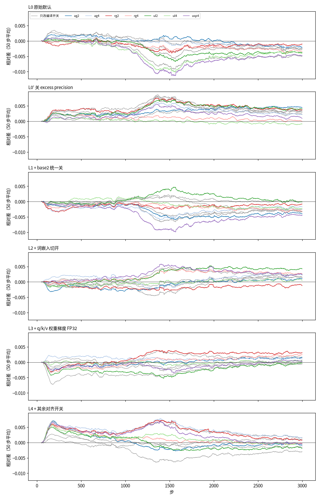
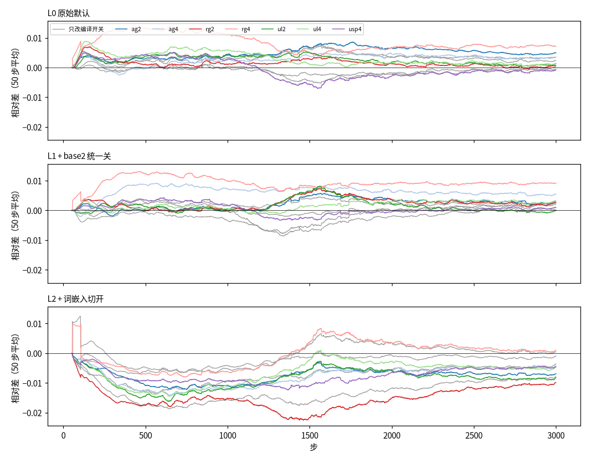

[janus](../../../../README.md) › [混元 3](../../README.md) ｜ 对齐实践 04：上下文并行（CP）方案的 loss 偏移（原问题）

# 混元 3 · 对齐实践 04：不同 CP 方案下的 loss 偏移——阶梯实验

**问题**：原问题里，混元 3 在 v5p 32 芯片上比了 CP2 / CP4 的 All-Gather、Ring、Ulysses、USP，对 DP32 基线的逐步 loss 差分三段：前约 145 步贴近 0，约 193 步起振荡到 ±1e-2，2000 步以后只剩小抖动和各臂不同的固定偏移（CP2 Ring 最大，约 −3e-3）。

**做法**：从原问题的默认设置出发，一次只加一项修复，每一级都量两样东西，一直走到没有问题为止：

- (i) **第 1 步**：每个梯度张量对 CPU FP64，各臂与基线各自离 FP64 多远；列出比同级 FSDP 参照远 1.2 倍以上的张量。
- (ii) **长跑**：3000 步，各臂对基线的逐步差，用「只改编译开关」的 4 份重复当尺子（[尺子](../../../../docs/guide/ruler.md)的算法，参照换成 TPU），判带符号均值、平均绝对差（MARE）、最大单步；同时报尺子自己的幅度。

所有臂用同一份初始权重、同一份数据、同一顺序（回放），学习率恒定。基线是**纯数据并行 8**（对应问题里的纯 DP32），各臂是同卡数的 DP×CP。设置细节见 [`setup.md`](setup.md)，运行登记见 [`runs.yaml`](runs.yaml)。阶梯实验之前的排查（真实权重截 4 层、FSDP 基线、学习率先升后降）原样留在 [`history.md`](history.md)，只作参考。

## 结论

1. **纯数据并行的基线本身就有一处真问题：词嵌入梯度在 BF16 里每加一次舍一次。** 第 1 步词嵌入梯度离 FP64 2.57e-2，是 FSDP 参照（4.30e-3）的 6.0 倍，整网 1.96 倍。DP4×CP2 的三种 CP 一样有，而且更远（All-Gather / Ring 7.1 倍、Ulysses 11.6 倍）；CP4 各臂与 USP 碰巧没有。根因是词嵌入反向那次 scatter-add 的下标数没过 TPU 后端插排序的门槛（混元 4 [案例 14](../../../hunyuan4/cases/14-ddp-fsdp-embedding.md) 查到的同一件事）。这是基线和部分 CP 臂之间**唯一**一处成倍的精度差。
2. **修法 `embedding_shard_over_data` 一项就把所有臂拉回 FSDP 水平**（阶梯 L2）：8 个臂整网 0.99–1.03 倍，词嵌入 4.0e-3–4.3e-3。再加 q/k/v 权重梯度留 FP32（L3）和混元 3 其余四个对齐开关（L4）后，8 个臂整网都在 FSDP 参照的 1.00–1.01 倍、各组对纯数据并行基线 0.99–1.00 倍，没有一个张量比参照远 1.2 倍以上（只剩 1–3 个 q/k norm、路由张量在 1.2–1.3 倍，FSDP 与纯数据并行这两个参照之间也是这个量级，见第 3 节）。
3. **长跑上，各级的 CP 臂全部落在只改编译开关的尺子里，修前修后分不开。** 恒定学习率 1e-4：7 个 CP 臂 × 6 级，后段（2000–3000 步）r 全部 ≤ 1.62，没有一格「超」。原因是尺子本身就很宽：只改片上内存上限，后段带符号均值就能偏 1e-3–5e-3（相对，约 0.005–0.02 绝对），而且这个幅度**随阶梯不收窄**（尺子 N：L0 5.3e-3、L2 2.7e-3、L4 5.9e-3）；分叉步（第 55–79 步）与分叉前的差（2e-5）各级一样。也就是说，后段偏移的量级由轨迹混沌决定，不是被 BF16 词嵌入误差放大出来的。
4. **关 excess precision（我们 10-16 曾建议过）会把问题变大**（阶梯 L0′）：排过序的 scatter 退回「每加一次舍一次」，FSDP 参照的词嵌入梯度离 FP64 从 4.30e-3 涨到 8.52e-2（20 倍），CP4 三臂与 USP 涨到 5.7e-2–7.9e-2（13–18 倍），反过来比纯数据并行基线（不排序，不受影响）还远 2.2–3.1 倍。
5. **base2 在随机初始化的模型上几乎没有影响**：第 1 步 loss 离 FP64 从 −8.7e-6 变成 −1.1e-6（基线），整网梯度不变。真实权重上它让第 1 步 loss 高 6.9e-4（[`history.md`](history.md) 第 4 节），随权重而定，建议照旧两边设成一致。

### 根因表

| 来源 | 影响哪些臂 | 第 1 步（对 FSDP 参照） | 长跑 | 修法（阶梯） | 修后 | 证据 | 实测 / 推断 |
|---|---|---|---|---|---|---|---|
| 词嵌入 scatter-add 下标数没过排序门槛（表行数 1/8 = 15104），BF16 里每加一次舍一次；纯数据并行再加一次整表 BF16 all-reduce | 纯数据并行基线（每卡 4096 个下标）；DP4×CP2 的 All-Gather、Ring、Ulysses（8192 个）。CP4 各臂与 USP 是 16384 个，过门槛、排序，不受影响 | 词嵌入 6.0 倍（基线）、7.1 倍（AG2 / RG2）、11.6 倍（UL2）；整网 1.96 / 2.25 / 3.44 倍 | 分不开（各级 r ≤ 1.62） | `embedding_shard_over_data=True`（L2） | 消失：词嵌入 0.94–1.00 倍、整网 0.99–1.03 倍 | [`results/ladder/hlo-audit.json`](results/ladder/hlo-audit.json)、[`step1-lbd-L0.json`](results/ladder/step1-lbd-L0.json)、[`step1-lbd-L2.json`](results/ladder/step1-lbd-L2.json) | 实测 |
| 关 excess precision：排过序的 scatter 退回每加一次舍一次（一次顺序加 32768 个） | 关了就影响所有排序的臂：FSDP、CP4、USP、L2 以后的全部 | FSDP 参照词嵌入 20 倍、整网 5.7 倍 | 见第 4 节 L0′ | 不关（保持默认） | — | [`step1-lbd-L0p.json`](results/ladder/step1-lbd-L0p.json) | 实测 |
| DenseGeneral 的权重梯度语义上舍一次 BF16；纯数据并行时编译器把它省掉，CP 的切分让它变成跨 context 轴的 BF16 all-reduce（q/k/v、输出投影、稠密 MLP、共享专家、norm） | All-Gather、Ring、Ulysses、USP（L0 时 BF16 all-reduce 15–26 个，基线 4 个） | 对同级基线：CP2 三臂这几组 1.01–1.02 倍，CP4 与 USP 1.00 倍（L2；第 1 步的梯度本身离 FP64 已有约 5e-3，多一次 BF16 舍入 1.1e-3 按平方叠加，只多一两个百分点） | 分不开 | q/k/v：`qkv_proj_wgrad_fp32`（L3）；其余：`dense_fp32_accumulation` 等（L4，BF16 all-reduce 降到 5–9 个） | 消失：L4 各组对基线 0.99–1.00 倍 | [`hlo-audit.json`](results/ladder/hlo-audit.json) 的 `bf16_reductions`；[`step1-lbd-L4.json`](results/ladder/step1-lbd-L4.json) | 实测 |
| USP 的 q/k/v 权重梯度 BF16 all-reduce（[`history.md`](history.md) 第 3 节，真实权重 FSDP 2 × Ring 2 × Ulysses 2 上 2.89 倍） | 只在权重按 FSDP 切开的 USP 上出现；这里的 USP 是数据并行 2 × Ring 2 × Ulysses 2，编译出来没有这几个 all-reduce | 0.99–1.00 倍（L0、L1） | — | `qkv_proj_wgrad_fp32`（L3） | 不适用 | [`hlo-audit.json`](results/ladder/hlo-audit.json) | 实测 |
| base2 不一致（Ring、USP 的内核不走 base2） | Ring、USP 对基线 | 第 1 步 loss 差 1e-5 量级；整网不变 | 分不开 | `sa_use_base2_exp=False`（L1） | — | [`step1-lbd-L0.json`](results/ladder/step1-lbd-L0.json)、[`step1-lbd-L1.json`](results/ladder/step1-lbd-L1.json) | 实测（随机初始化；真实权重上更大，见 history） |
| 近似平局的路由翻转 | 所有臂：抓了的 0、1 号专家里第 1 步 token 少的那几个（例如第 13 层 1 号专家只有 12 个 token），以及路由、q/k norm 等小张量 | 单个张量 1.2 倍到 26 倍，跟着程序走，不跟着 CP 走；FSDP 与纯数据并行两个参照之间同样有 | — | 不是精度问题，不修 | — | `step1-*.json` 的 `over_ref_routed` | 实测（机理是推断） |
| 轨迹混沌：任何改变求和顺序的改动都在第 55–79 步分叉，之后的偏移由轨迹决定 | 所有臂，也包括只改编译开关的 | — | 只改编译开关就能把后段推开 1e-3–5e-3（相对）；学习率 3e-4 时第 55–56 步有一次 loss 尖峰，推开到 1e-2 | 没有修法；判 CP 时要和只改编译开关的运行比 | 各级不收窄 | [`results/ladder/chaos-lbd.json`](results/ladder/chaos-lbd.json)、[`ruler-lbd-*.json`](results/ladder/) | 实测 |
| 步日志只打印 3 位小数（10-16 评论） | 用步日志画图时前段「差为 0」 | — | — | 用 metrics 文件里的完整数值 | — | 原问题 10-16 / 10-17 评论 | 前序评论，本实验全用完整数值 |

### 阶梯总表

第 1 步一栏是「整网离 FP64，对同级 FSDP 参照的倍数」，范围是 7 个 CP 臂（纯数据并行基线单列）；长跑一栏是 7 个 CP 臂后段（2000–3000 步）r 的范围（r = 被测 ÷ 尺子 N，三个统计量取最差，≤ 1 在噪声内，1–2 待定，> 2 超），尺子 N 是 4 份只改编译开关的运行与基线两两配对的最大带符号均值。学习率恒定 1e-4。

| 级 | 加了什么 | 第 1 步：基线 / CP 臂 | 比 FSDP 参照远 1.2 倍以上的张量 | 长跑 r（7 个 CP 臂） | 尺子 N（带符号均值） | 结论 |
|---|---|---|---|---|---|---|
| L0 | 原始默认 | 1.96 / 0.99–3.44 | 词嵌入：AG2 7.1、RG2 7.1、UL2 11.6（基线 6.0） | 0.32–1.00 | 5.3e-3 | 基线与 CP2 三臂词嵌入丢精度；长跑看不出 |
| L0′ | L0 + 关 excess precision | 0.34 / 0.39–0.92（FSDP 参照自己变成 5.7 倍） | FSDP 参照自己的词嵌入 20 倍；CP4 与 USP 词嵌入 13–18 倍 | 0.34–1.29 | 3.8e-3 | 排序的臂也退回逐次舍入，问题更大 |
| L1 | + base2 统一关 | 1.96 / 1.00–3.45 | 同 L0 | 0.56–1.55 | 3.3e-3 | base2 在随机初始化上影响很小 |
| L2 | + `embedding_shard_over_data` | 1.01 / 0.99–1.03 | 无（只剩路由张量 1.21–1.25） | 0.35–1.62 | 2.7e-3 | 词嵌入修好，所有臂回到 FSDP 水平 |
| L3 | + `qkv_proj_wgrad_fp32` | 1.00 / 1.00–1.02 | 无（AG4 一个 k norm 1.29） | 0.39–1.23 | 2.5e-3 | q/k/v 一组在所有臂上更近（4.7e-3 → 3.8e-3） |
| L4 | + 其余四个对齐开关 | 1.01 / 1.00–1.01 | 无（RG2 一个 q norm 1.23） | 0.49–0.93 | 5.9e-3 | 第 1 步全部干净；长跑全部在噪声内；尺子不收窄 |

## 1. 设置（摘要）

- 模型：16 层随机初始化混元 3（`hunyuan3-smoke` 只改尺寸：隐藏维 1024、查询头 / 键值头 16 / 4、稠密前馈 4096、专家前馈 256，192 专家选 8 + 1 共享专家，词表 120832；2.624e9 参数），同 原问题 10-29 的缩层版。纯数据并行要每卡一份完整权重与 Adam 状态，真实权重截 4 层（1.24e10 参数）放不下，所以用这个规模。
- 初始权重：一份 HF 随机权重（N(0, 0.006²)，HF 原版的 `initializer_range`）转成 MaxText 检查点，所有臂载入同一份；CPU FP64 参照读同一份 HF 权重。
- 数据：FineWeb-Edu 切词后首尾相接，3000 步 × 8 条 × 4096，写成回放目录，`train_hy3.py` 原样喂，所有臂同一顺序。
- 精度：L0 全部取 `base.yml` 默认，只开 tokamax splash（`sa_use_base2_exp` 默认开），不加任何 `XLA_FLAGS` / `LIBTPU_INIT_ARGS`。
- 学习率：恒定 1e-4（主组，运行名 `lbd-*`）；另有恒定 3e-4 一组（`lad-*`，L0–L2），见第 5 节。
- 硬件与代码：v5p-8；`maxtext` hunyuan@`5d1b0e95`（MaxText 上的一处修改 把三个词嵌入开关从混元 4 集成分支移植过来，默认关，关着时离线编译程序与基底逐字相同：[`switch-off-and-ruler-hlo.json`](results/ladder/switch-off-and-ruler-hlo.json)）；jax 0.11.1、libtpu 0.0.46。
- 臂：纯数据并行 8（基线）；FSDP 8（参照，只跑 2 步、只用第 1 步）；DP4 × CP2 / DP2 × CP4 的 All-Gather、Ring、Ulysses；DP2 × Ring 2 × Ulysses 2 的 USP。尺子：基线只改片上内存上限 64 / 56 / 40 / 24 MiB（离线编译确认 5 份程序各不相同）。
- 离线编译与上一级同一程序的臂不重跑（同程序上卡逐位相同）：L1 的 Ring、USP，L2 的 FSDP。

## 2. 离线编译：每一级程序里变了什么

先在 CPU 上把 6 级 × 9 个臂的训练步各编一遍（[`tools/hlo_audit.py`](tools/hlo_audit.py)，结果 [`results/ladder/hlo-audit.json`](results/ladder/hlo-audit.json)），读两样东西：词嵌入反向那次 scatter-add 每卡收多少个下标、排没排序；梯度的 BF16 跨卡求和有多少个。

| 臂 | 每卡词嵌入表 | scatter 下标数 | 排序 | 整表 BF16 all-reduce | 梯度的 BF16 all-reduce（L0 → L4） |
|---|---|---|---|---|---|
| 纯数据并行 8（基线） | [120832, 1024] | 4096 | 否 | 有 | 4 → 4 |
| FSDP 8（参照） | [120832, 128] | 32768 | 是 | 无 | 5 → 3 |
| DP4 × CP2：All-Gather / Ring / Ulysses | [120832, 512] | 8192 | 否 | 有（[120832, 512]） | 26 / 22 / 22 → 9 / 5 / 5 |
| DP2 × CP4：All-Gather / Ring / Ulysses | [120832, 256] | 16384 | 是 | 有（[120832, 256]） | 25 / 21 / 21 → 9 / 5 / 5 |
| USP（DP2 × Ring 2 × Ulysses 2） | [120832, 256] | 16384 | 是 | 有 | 15 → 5 |
| L2 起所有臂（`embedding_shard_over_data`） | [120832, 128] | 32768 | 是 | 无 | — |

- 排序门槛：libtpu 0.0.46、v5p 上，一次 scatter 的下标数**超过表行数的 1/8**（120832 / 8 = 15104）才插排序（[案例 14](../../../hunyuan4/cases/14-ddp-fsdp-embedding.md)）。不排序时同一个词的更新散在整串下标里，后端每碰到一次就把那一行 BF16 读出、加上、舍回，高频词加几十到几百次就舍几十到几百次；排好序时同一个词的更新在片上 FP32 里加完只舍一次。
- CP 把词嵌入表沿 context 轴按隐藏维切开（`base.yml` 的 `embed_vocab` 规则里有 `context`），每卡要收齐 CP 组里所有 token 才能算自己那几列，所以 CP2 每卡 8192 个、CP4 每卡 16384 个——CP4 正好越过门槛，CP2 没有。
- `embedding_shard_over_data` 把这张表再沿 data 轴切开，8 张卡的 token 全部收齐（32768 个），所有臂都过门槛。
- BF16 all-reduce：纯数据并行的基线只有输出层、词嵌入表和路由专家的 3–4 个；CP 的切分让 q/k/v、输出投影、稠密 MLP、共享专家、norm 的权重梯度变成跨 context 轴的 BF16 求和（L0 每个 CP 臂 14–26 个）。L4 的 `dense_fp32_accumulation` 等让它们留在 FP32，降到 5–9 个（剩下的是路由专家、输出层和注意力激活梯度的）。
- 关 excess precision（L0′）不改这张表（排序标记还在），改的是排过序的 scatter 在后端怎么加：见第 4 节。

## 3. 第 1 步对 FP64

每级每臂跑完第 1 步只读状态抓一阶动量，梯度 g = m₁ / (1 − β1) / 裁剪系数；真值是 [`fp64_step.py`](../../analysis/fp64_step.py) 在 CPU 上 FP64 前向 + 自动求导的整步梯度（同一份 BF16 权重、回放数据第 1 步的 8 条）。206 个张量：16 层的注意力、norm、稠密 MLP、共享专家、路由、0 / 1 号专家，词嵌入、输出层、最后的 norm。脚本 [`tools/ladder_step1.py`](tools/ladder_step1.py)，结果 `results/ladder/step1-lbd-<级>.json`。第 1 步的梯度与学习率无关（两组学习率的同名运行第 1 步一致），FSDP 参照在 L0–L2 用的是 3e-4 那组的 2 步运行。FSDP 参照第 1 步 loss 离 FP64 −1.2e-7。

**第 1 步：词嵌入梯度离 FP64（rel_l2）**

| 级 | dp8 | fsdp8 | ag2 | ag4 | rg2 | rg4 | ul2 | ul4 | usp4 |
|---|---|---|---|---|---|---|---|---|---|
| L0 | 2.57e-02 | 4.30e-03 | 3.05e-02 | 4.61e-03 | 3.03e-02 | 4.29e-03 | 4.98e-02 | 4.47e-03 | 4.48e-03 |
| L0′ | 2.56e-02 | 8.52e-02 | 3.05e-02 | 5.76e-02 | 3.04e-02 | 5.73e-02 | 4.99e-02 | 7.87e-02 | 5.75e-02 |
| L1 | 2.56e-02 | 4.25e-03 | 3.03e-02 | 4.55e-03 | 3.03e-02 | 4.29e-03 | 4.97e-02 | 4.36e-03 | 4.48e-03 |
| L2 | 4.12e-03 | 4.25e-03 | 4.17e-03 | 4.26e-03 | 4.01e-03 | 4.00e-03 | 4.04e-03 | 4.04e-03 | 4.19e-03 |
| L3 | 4.06e-03 | 4.17e-03 | 4.10e-03 | 4.18e-03 | 4.01e-03 | 4.00e-03 | 3.99e-03 | 3.99e-03 | 4.12e-03 |
| L4 | 4.11e-03 | 4.16e-03 | 4.10e-03 | 4.20e-03 | 4.07e-03 | 4.08e-03 | 4.01e-03 | 4.01e-03 | 4.09e-03 |

**第 1 步：整网（按 FP64 梯度能量合起来）离 FP64，括号里是对同级 FSDP 参照的倍数**

| 级 | dp8 | fsdp8 | ag2 | ag4 | rg2 | rg4 | ul2 | ul4 | usp4 |
|---|---|---|---|---|---|---|---|---|---|
| L0 | 9.03e-03（1.96） | 4.60e-03 | 1.03e-02（2.25） | 4.73e-03（1.03） | 1.03e-02（2.23） | 4.65e-03（1.01） | 1.58e-02（3.44） | 4.71e-03（1.02） | 4.56e-03（0.99） |
| L0′ | 9.03e-03（0.34） | 2.64e-02 | 1.04e-02（0.39） | 1.81e-02（0.69） | 1.03e-02（0.39） | 1.80e-02（0.68） | 1.58e-02（0.60） | 2.43e-02（0.92） | 1.80e-02（0.68） |
| L1 | 8.96e-03（1.96） | 4.57e-03 | 1.03e-02（2.25） | 4.69e-03（1.02） | 1.03e-02（2.25） | 4.65e-03（1.02） | 1.58e-02（3.45） | 4.67e-03（1.02） | 4.56e-03（1.00） |
| L2 | 4.64e-03（1.01） | 4.57e-03 | 4.73e-03（1.03） | 4.66e-03（1.02） | 4.70e-03（1.03） | 4.63e-03（1.01） | 4.70e-03（1.03） | 4.64e-03（1.01） | 4.54e-03（0.99） |
| L3 | 4.27e-03（1.00） | 4.26e-03 | 4.33e-03（1.02） | 4.29e-03（1.01） | 4.31e-03（1.01） | 4.26e-03（1.00） | 4.30e-03（1.01） | 4.26e-03（1.00） | 4.28e-03（1.01） |
| L4 | 4.03e-03（1.01） | 3.98e-03 | 4.01e-03（1.01） | 4.01e-03（1.01） | 4.03e-03（1.01） | 4.03e-03（1.01） | 3.99e-03（1.00） | 3.98e-03（1.00） | 4.01e-03（1.01） |

**第 1 步：比同级 FSDP 参照远 1.2 倍以上的张量（路由专家另列）**

| 级 | 臂 | 张量（倍数） |
|---|---|---|
| L0 | ag2 | `embedding.word_embeddings.weight`（7.09）、`decoder.layers.2.mlp.router.weight`（1.22） |
| L0 | ag4 | `decoder.layers.2.mlp.router.weight`（1.22） |
| L0 | rg2 | `embedding.word_embeddings.weight`（7.05）、`decoder.layers.4.mlp.router.weight`（1.24） |
| L0 | ul2 | `embedding.word_embeddings.weight`（11.59） |
| L0 | usp4 | `decoder.layers.4.mlp.router.weight`（1.20） |
| L0′ | rg4 | `decoder.layers.13.mlp.router.weight`（1.21） |
| L1 | ag2 | `embedding.word_embeddings.weight`（7.14） |
| L1 | rg2 | `embedding.word_embeddings.weight`（7.13）、`decoder.layers.4.mlp.router.weight`（1.25） |
| L1 | ul2 | `embedding.word_embeddings.weight`（11.68） |
| L1 | usp4 | `decoder.layers.4.mlp.router.weight`（1.21） |
| L2 | rg2 | `decoder.layers.4.mlp.router.weight`（1.25） |
| L2 | usp4 | `decoder.layers.4.mlp.router.weight`（1.21） |
| L3 | ag4 | `decoder.layers.13.self_attention.k_layernorm.weight`（1.29） |
| L4 | rg2 | `decoder.layers.12.self_attention.q_layernorm.weight`（1.23） |

**第 1 步 loss − FP64**

| 级 | dp8 | fsdp8 | ag2 | ag4 | rg2 | rg4 | ul2 | ul4 | usp4 |
|---|---|---|---|---|---|---|---|---|---|
| L0 | -8.7e-06 | -1.2e-07 | -1.6e-05 | -1.6e-05 | -1.8e-05 | -1.6e-05 | -1.6e-05 | -1.6e-05 | -1.1e-05 |
| L0′ | -3.2e-05 | -2.0e-06 | -3.4e-05 | -3.3e-05 | -1.6e-05 | -4.9e-06 | -3.7e-05 | -3.7e-05 | -8.7e-06 |
| L1 | -1.1e-06 | +2.2e-05 | -2.2e-05 | -2.2e-05 | -1.8e-05 | -1.6e-05 | -2.0e-05 | -2.0e-05 | -1.1e-05 |
| L2 | -1.1e-06 | +2.2e-05 | -2.2e-05 | -2.2e-05 | -1.8e-05 | -1.6e-05 | -2.0e-05 | -2.0e-05 | -1.1e-05 |
| L3 | -1.1e-06 | -3.9e-05 | -2.2e-05 | -2.2e-05 | -1.8e-05 | -1.6e-05 | -2.0e-05 | -2.0e-05 | -1.1e-05 |
| L4 | -1.1e-06 | -1.8e-05 | -5.8e-06 | -5.8e-06 | -3.0e-06 | -1.2e-07 | -8.7e-06 | -8.7e-06 | -6.8e-06 |

怎么读：

- **L0 / L1**：纯数据并行基线和 DP4 × CP2 三臂的词嵌入梯度离 FP64 6–12 倍远，整网跟着远 2–3.5 倍（词嵌入梯度的能量在整网里占得多）；CP4 各臂与 USP 和 FSDP 一样近。所以 L0 时「基线 vs CP 臂」两边的 BF16 误差不一样大：AG2 / RG2 比基线还远 1.2 倍，UL2 远 1.9 倍，CP4 各臂反而比基线近一半。
- **L2**：一项开关，所有臂词嵌入 4.0e-3–4.3e-3，整网 0.99–1.03 倍。
- **L3 / L4**：q/k/v 权重梯度留 FP32 让所有臂（包括基线和 FSDP）的 q/k/v 一组从 4.7e-3 降到 3.8e-3；L4 再让 CP 臂那些 BF16 跨卡求和留在 FP32：q/k/v、输出投影、稠密 MLP、共享专家几组对同级基线从 L2 的 1.01–1.02 倍（CP2 三臂）回到 0.99–1.00 倍。对 FSDP 参照这几组还差 3–6%（例如 L4 输出投影 1.04–1.06 倍），那是两个参照之间本来的差：同一级 FSDP 对纯数据并行，输出投影 0.95 倍、稠密 MLP 0.96 倍，CP 臂与纯数据并行一样。
- **剩下的 1.2 倍以上**：L2 以后每级只有 1–2 个，都是一维的 q/k norm 或路由权重，倍数 1.21–1.29，不在相邻两级重复出现。同一级的两个参照之间（FSDP 8 对纯数据并行 8）也有 3–11 个这类张量在 1.21–1.36 倍（例如 L3 第 15 层 k norm 1.36、L4 第 9 层路由 1.31），所以这是这类小张量本身的散布，不是 CP 带来的。
- **路由专家单列**（`over_ref_routed`）：抓了 0、1 号专家，第 1 步选中它们的 token 数每层从 0 到 1.3e4 不等；token 少的（第 13 层 1 号 12 个、第 6 层 0 号 21 个）一个 token 换了专家梯度就变很多，倍数可以到 20 以上，而且在两个参照之间同样出现。这是近似平局的路由翻转，和舍入精度无关。

## 4. 长跑：用只改编译开关的运行当尺子

3000 步，逐步相对差 dₜ = (aₜ − bₜ) / bₜ，第 1 步不进统计，每个窗口算带符号均值、MARE、最大单步；N = 基线与 4 份尺子两两配对（10 对）同一统计量的最大值；r = 被测 ÷ N（[`cp_tpu_ruler.py`](../../analysis/cp_tpu_ruler.py)，结果 `results/ladder/ruler-lbd-<级>.json`）。基线 loss 第 2000 / 3000 步 4.74 / 4.41，后段相对差 1e-3 约等于绝对 0.0045。

**长跑 2:3001 步：尺子 N（带符号均值 / MARE / 最大单步）与各 CP 臂的带符号均值、r（三个统计量里最差的）**

| 级 | N | ag2 | ag4 | rg2 | rg4 | ul2 | ul4 | usp4 |
|---|---|---|---|---|---|---|---|---|
| L0 | 4.0e-03 / 4.2e-03 / 2.9e-02 | +1.9e-04 / 0.82 | -3.8e-04 / 0.88 | -1.4e-03 / 0.59 | -1.6e-03 / 1.13 | -2.5e-03 / 0.79 | -4.1e-03 / 1.10 | -4.5e-03 / 1.13 |
| L0′ | 4.5e-03 / 4.5e-03 / 2.1e-02 | +3.3e-03 / 0.84 | +3.0e-03 / 0.87 | +4.4e-03 / 1.00 | +1.0e-03 / 0.50 | +3.9e-03 / 1.29 | -1.4e-05 / 0.72 | +2.1e-03 / 0.62 |
| L1 | 2.9e-03 / 3.2e-03 / 2.6e-02 | -3.2e-03 / 1.10 | -2.6e-03 / 0.95 | -1.4e-03 / 0.63 | -1.7e-03 / 1.12 | +9.7e-04 / 0.60 | -7.3e-04 / 0.45 | -4.5e-03 / 1.59 |
| L2 | 2.9e-03 / 3.0e-03 / 3.9e-02 | -8.0e-04 / 0.58 | +1.0e-03 / 0.55 | -1.6e-03 / 0.73 | +2.0e-03 / 0.73 | +2.4e-03 / 0.93 | -2.4e-04 / 0.65 | +2.5e-03 / 1.24 |
| L3 | 3.9e-03 / 4.0e-03 / 3.1e-02 | +5.3e-06 / 0.67 | +1.2e-03 / 0.41 | +1.7e-03 / 0.65 | +2.7e-04 / 0.40 | -2.4e-03 / 0.73 | -1.3e-04 / 0.37 | -1.0e-03 / 0.38 |
| L4 | 6.1e-03 / 6.2e-03 / 2.9e-02 | +1.8e-04 / 0.83 | +4.0e-03 / 0.80 | +3.5e-03 / 0.67 | +1.2e-03 / 0.52 | -2.0e-04 / 0.72 | +1.4e-03 / 0.56 | +2.6e-03 / 0.93 |

**长跑 2000:3001 步：尺子 N（带符号均值 / MARE / 最大单步）与各 CP 臂的带符号均值、r（三个统计量里最差的）**

| 级 | N | ag2 | ag4 | rg2 | rg4 | ul2 | ul4 | usp4 |
|---|---|---|---|---|---|---|---|---|
| L0 | 5.3e-03 / 5.3e-03 / 2.5e-02 | -1.3e-03 / 0.64 | -1.4e-03 / 0.62 | -1.3e-03 / 0.32 | -2.7e-03 / 0.85 | -3.9e-03 / 0.91 | -4.4e-03 / 0.87 | -5.3e-03 / 1.00 |
| L0′ | 3.8e-03 / 3.8e-03 / 1.6e-02 | +4.5e-03 / 1.19 | +2.8e-03 / 0.75 | +4.4e-03 / 1.17 | +4.9e-04 / 0.67 | +4.5e-03 / 1.18 | -6.5e-04 / 0.34 | +1.8e-03 / 0.50 |
| L1 | 3.3e-03 / 3.4e-03 / 1.7e-02 | -4.3e-03 / 1.29 | -2.1e-03 / 0.79 | -1.2e-03 / 0.56 | -2.6e-03 / 0.77 | +7.0e-04 / 0.56 | -2.0e-03 / 0.71 | -5.2e-03 / 1.55 |
| L2 | 2.7e-03 / 2.7e-03 / 2.5e-02 | +5.5e-04 / 0.51 | +2.0e-03 / 0.77 | -1.3e-03 / 0.56 | +3.1e-03 / 1.15 | +4.3e-03 / 1.62 | +5.0e-04 / 0.35 | +2.9e-03 / 1.09 |
| L3 | 2.5e-03 / 2.5e-03 / 2.2e-02 | +1.2e-03 / 0.55 | +1.1e-03 / 0.51 | +3.0e-03 / 1.23 | +1.8e-03 / 0.76 | -1.1e-03 / 0.60 | +2.0e-04 / 0.42 | -2.1e-04 / 0.39 |
| L4 | 5.9e-03 / 5.9e-03 / 1.7e-02 | -7.0e-04 / 0.70 | +2.5e-03 / 0.77 | +1.8e-03 / 0.93 | -1.7e-04 / 0.49 | -1.9e-03 / 0.73 | -7.5e-05 / 0.68 | +2.8e-04 / 0.67 |

**尺子自己：4 份只改编译开关对基线，2000–3000 步带符号均值**

| 级 | v64 | v56 | v40 | v24 | 留一法最大 r |
|---|---|---|---|---|---|
| L0 | -5.3e-03 | -2.5e-03 | -1.8e-03 | -2.4e-03 | 2.15 |
| L0′ | +3.2e-03 | +3.7e-03 | +3.0e-03 | +3.8e-03 | 4.08 |
| L1 | +9.8e-05 | -3.1e-03 | -3.2e-03 | -2.5e-03 | 1.01 |
| L2 | +1.5e-03 | +2.7e-03 | +1.5e-03 | +1.1e-03 | 1.77 |
| L3 | -5.9e-04 | +1.1e-04 | -7.9e-04 | +1.7e-03 | 1.86 |
| L4 | -3.4e-03 | -1.4e-03 | +2.5e-03 | +8.9e-04 | 0.89 |

- 7 个 CP 臂 × 6 级，后段没有一格超过 2；前段（第 2–3000 步整段）也没有。
- 尺子自己：4 份只改编译开关的运行对基线，后段带符号均值在 −5.3e-3 到 +2.7e-3 之间，各级的 N 在 2.5e-3 到 5.9e-3 之间来回，没有随阶梯变窄。
- **L0′**（关 excess precision）：第 1 步词嵌入梯度，不排序的那几臂不变（基线 2.56e-2、AG2 / RG2 3.0e-2、UL2 4.99e-2），排过序的变坏：CP4 三臂与 USP 5.73e-2–7.87e-2、FSDP 参照 8.52e-2（开着时都在 4.3e-3–4.6e-3）。所以关掉以后，CP4 与 USP 反过来比基线远 2.0–2.7 倍（整网）。长跑 7 个臂 r 0.34–1.29，仍在尺子里。

## 5. 混沌：修了以后尺子为什么不变窄

用 [`tools/ladder_chaos.py`](tools/ladder_chaos.py) 看只改编译开关那一族（基线 + 4 份尺子）每一级怎么分叉（结果 [`results/ladder/chaos-lbd.json`](results/ladder/chaos-lbd.json)、[`chaos-lad.json`](results/ladder/chaos-lad.json)）：

| 组 | 级 | 4 份尺子的分叉步 | 第 2–50 步平均 \|d\| | 第 51–100 步 | 第 2001–3000 步 | 基线族 5 份两两的后段带符号均值：标准差 / 最大 |
|---|---|---|---|---|---|---|
| 1e-4 | L0 | 75、79、69、75 | 2.0e-05 | 9.5e-04 | 3.0e-03 | 2.7e-03 / 5.3e-03 |
| 1e-4 | L0′ | 56、56、56、56 | 3.8e-05 | 8.9e-04 | 3.4e-03 | 1.6e-03 / 3.7e-03 |
| 1e-4 | L1 | 69、77、76、56 | 2.1e-05 | 9.3e-04 | 2.4e-03 | 1.7e-03 / 3.3e-03 |
| 1e-4 | L2 | 76、71、75、76 | 2.0e-05 | 7.5e-04 | 1.8e-03 | 1.3e-03 / 2.7e-03 |
| 1e-4 | L3 | 56、75、71、75 | 2.6e-05 | 1.1e-03 | 1.2e-03 | 1.2e-03 / 2.5e-03 |
| 1e-4 | L4 | 55、68、55、55 | 5.1e-05 | 2.4e-03 | 2.1e-03 | 2.8e-03 / 5.9e-03 |
| 3e-4 | L0 | 56、56、56、56 | 4.4e-05 | 2.6e-03 | 2.4e-03 | 3.0e-03 / 4.7e-03 |
| 3e-4 | L1 | 59、57、55、56 | 4.1e-05 | 1.7e-03 | 1.7e-03 | 1.3e-03 / 2.8e-03 |
| 3e-4 | L2 | 56、56、56、55 | 4.5e-05 | 6.5e-03 | 4.5e-03 | 6.3e-03 / 1.1e-02 |

- 第 2–50 步，只改编译开关的差各级都是 2e-5–5e-5（相对）；过了第 55–79 步突然长到 1e-3 量级，之后不再回到 0。分叉步和分叉前的差都不随阶梯变：词嵌入修没修，求和顺序一换，轨迹照样在同一段分开。
- 修完以后，各臂第 1 步离 FP64 都和 FSDP 一样近；但一个只改片上内存上限的运行，和基线的差在第 75 步前后就涨到 1e-3，后段停在 ±(1–5)e-3。这个幅度比第 1 步各臂之间剩下的差别（整网 1%）大得多，长跑曲线上量不出修法的效果。
- 学习率 3e-4 那组（`lad-*`，L0–L2）在第 55–56 步有一次 loss 尖峰（基线 grad_norm 2.2；第 56 步 Ring CP4 那条 loss 8.90，L2 基线 8.09，其余 7.67–7.83），所有运行都在这一步分叉，各级尺子 N（后段带符号均值）2.8e-3–1.1e-2。这一组有几格超过 2：Ring CP4（L0、L1 是同一条运行；对 L1 基线后段 +9.1e-3、r 3.22）和 L1 的 All-Gather CP4（后段 r 2.04）。Ring CP4 同一个程序只换片上内存上限再跑 2 份（[`ruler-lad-L1-rg4-replicas.json`](results/ladder/ruler-lad-L1-rg4-replicas.json)）：64 MiB 那份第 56 步没有炸开，后段 +9.2e-4、r 1.08；40 MiB 那份第 56 步 grad_norm 221、loss 8.71，后段 +1.2e-2、r 4.35。同一个程序，后段落在哪由第 56 步有没有炸开决定。3e-4 下 Ring CP4 的 4 条运行（含 L2）有 3 条在第 56–57 步 grad_norm 到 128–221，基线族 15 条里 2 条到 28–50——Ring CP4 是不是更容易在这一步炸开，4 条样本下不了结论；1e-4 下所有运行都没有这一步的尖峰。

- 「三段形态 = 轨迹混沌」这个说法因此站得住：第一段是分叉前，差只有舍入量级；第二段是分叉后的振荡；第三段的偏移是轨迹留下的余量，量级由学习率和训练动态决定，不由哪一种 CP、也不由词嵌入那一处 BF16 累加决定。

## 6. 对 原问题意味着什么

- 原问题的基线是纯 DP32。只要它是每卡整张词嵌入表、每卡一个微批的 token 数不超过 15104（libtpu 0.0.46；序列 4096 时每卡微批 ≤ 3），**基线自己的词嵌入梯度就丢精度**，而 CP 臂丢不丢取决于 CP 组里的 token 数过不过门槛——基线与各 CP 臂的 BF16 误差从第 1 步起就不一样大。修法是给纯数据并行开 `embedding_shard_over_data`（或 `embedding_grad_fp32`），已移植到 `hunyuan` 分支。
- 但这一处在长跑曲线上量不出来：后段偏移的量级和只改编译开关一样，判 CP 有没有问题，仍要在同一环境里给基线加两三条只改编译开关的运行，看 CP 的偏移是不是落在同一个分布里。
- 关 excess precision 会让排过序的那些臂（以及 FSDP）丢得更多，不要关。
- 换 libtpu 版本门槛会变（0.0.52 上随列数变，见案例 14 与 [`libtpu-052.md`](../../../hunyuan4/alignments/04-tpu-self/libtpu-052.md)），自查用离线编译看 HLO 里那次 scatter 有没有 `indices_are_sorted=true`（[`tools/hlo_audit.py`](tools/hlo_audit.py)）。

## 7. 局限

- 规模：16 层随机初始化、8 芯片；没有 32 芯片、80 层、真实权重的纯数据并行（放不下）。随机初始化上 base2 的影响比真实权重小得多（第 1 节结论 5）。
- 每个设置只有一条运行，尺子只有 4 份；各级 N 的差别（2.5e-3 到 5.9e-3）在 10 对配对的统计里分不开（推断：5 份运行的两两最大值本身就有这么大的起伏）。
- MTP 全关（开负载均衡的 Ring 与 USP 不支持 MTP）；数据是 FineWeb-Edu，不是问题原环境的数据。
- 只在 jax 0.11.1、libtpu 0.0.46 上做；这一版有已知的 jit 静默算错（混元 4 案例 16），各臂第 1 步都在 FSDP 参照的 1.01 倍内（L4），推断没有踩中，没有专门扫。

## 这个文件夹

| 文件 | 放什么 |
|---|---|
| [`setup.md`](setup.md) | 阶梯的模型、数据、臂、级、命令；之前运行的设置 |
| [`runs.yaml`](runs.yaml) | 每次运行改了什么 |
| [`knowledge.md`](knowledge.md) | 要点与出处 |
| [`history.md`](history.md) | 阶梯实验之前的排查（原 README） |
| `ladder/` | 16 层配置 `hy3-smoke16.yml`、名字映射 `name_map_smoke16.yaml` |
| `results/ladder/` | 离线编译审计、各级第 1 步、各级尺子、混沌统计 |
| `results/series/ladder/` | 每条阶梯运行的逐步 loss 与 grad_norm |
| `figures/` | `ladder-lbd.png`（主组）、`ladder-lad.png`（3e-4 组）；`e1*.png`、`shape-A.png` 属于 history |
| `tools/` | `make_ladder_inputs.py`（权重与回放数据）、`hlo_audit.py`、`ladder_step1.py`、`ladder_analyze.py`、`ladder_chaos.py`、`ladder_tables.py`、`plot_ladder.py`；其余属于 history |
