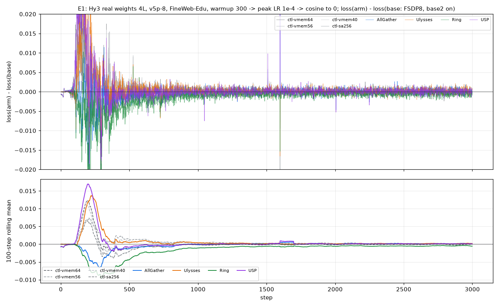
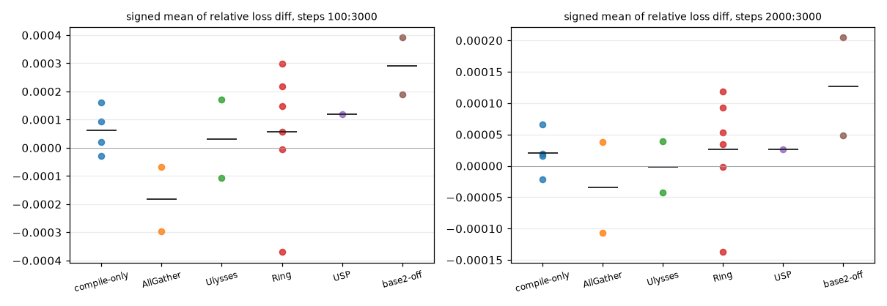

[janus](../../../../README.md) › [混元 3](../../README.md) ｜ 对齐实践 04：上下文并行（CP）方案的 loss 偏移

# 混元 3 · 对齐实践 04：不同 CP 方案下的 loss 偏移，从复现到根因

**这个实践干什么**：一次实际排查 里，用 Hy3 在 v5p 32 芯片上比了 CP2 / CP4 的 All-Gather、Ring、Ulysses、USP 四种上下文并行，相对 DP32 基线的逐步 loss 差有三段：前约 145 步贴近 0；约 193 步起振荡到 ±1e-2；振荡逐渐变小，2000 步以后只剩小抖动和各臂不同的固定偏移（CP2 Ring 最大，约 −3e-3）。这里回答三件事：

1. 三段形态能不能在我们这边复现、在什么条件下复现；
2. 每种 CP 的内核在数值上有没有偏差（第 1 步逐张量对 CPU FP64）；
3. 后段的固定偏移是不是某种 CP 固有的。

**条件先说清**：原问题没给模型权重来源（真实权重还是随机初始化）、是从头训还是续训、学习率调度、并行组合与 base2 开关。下面每个结果都写明用的是哪种条件；**没有一条是「问题原条件已复现」**。

本页结构：结论 → 1 三段形态 → 2 第 1 步对 FP64 → 3 USP 的根因 → 4 base2 → 5 用 TPU 尺子判长跑 → 6 后段偏移跟着轨迹走 → 7 排除的假设 → 8 复现不了的。设置见 [`setup.md`](setup.md)，运行登记见 [`runs.yaml`](runs.yaml)，要点与出处见 [`knowledge.md`](knowledge.md)。

## 结论

1. **三段形态在「真实权重 + 学习率先升后降」下复现**。混元 3 真实权重截 4 层，预热 300 步升到 1e-4、余弦降到 0（3000 步）：前 70–80 步贴近 0，起跳后振荡到 ±1e-2–2e-2，300 步以后抖动一路收窄，2000 步以后各臂停在各自的偏移上。**只改编译开关、完全不开 CP 的运行也走出同样的三段。** 随机初始化的缩层版只出前两段，抖动不收窄；真实权重、学习率恒定 1e-5 时没有中段。
2. **All-Gather、Ring、Ulysses 的内核没有数值偏差**：第 1 步整网梯度离 FP64 的距离是基线的 0.988–1.015 倍（CP2 / CP4，负载均衡开 / 关），只改片上内存上限的对照是 0.995–0.996。
3. **USP 多一次 BF16 舍入，根因已定**：q/k/v 投影的权重梯度在 USP 下按 BF16 做了一次跨卡求和，离 FP64 远 2.9 倍；其余张量不变。把这三个权重梯度留在 FP32 就回到基线水平。这次舍入在长跑曲线上看不出来：加不加修法，前 1510 步都落在只改编译开关的尺子里。
4. **base2 开是一处真实的精度损失**：同一批数据与权重，第 1 步 loss 比 FP64 高 6.9e-4（关时 −1.8e-5），整网梯度离 FP64 远 1.76 倍。在长跑里它主要让分叉提前（第 24 步；base2 一致时第 72–82 步），后段那份只剩 1e-4 量级。
5. **后段的固定偏移跟着轨迹走，不是 CP 方案固有的**：同一个 Ring 臂只加一个编译开关重跑，后段偏移从 −5.0e-4 变成 +4.3e-4。偏移是早期那次大振荡留下的余量。判 CP 有没有问题，要和「同调度、只改编译开关」的几条 TPU 运行比，不能拿单次运行的偏移和 0 比。

## 1. 三段形态：在什么条件下出现

统计口径同 一次实际排查的评论：逐步差 = 被测 loss − 基线 loss（完整精度，绝对值）；起跳步 = 过去 25 步 |差| 的滑动平均首次超过 2.5e-4；分段报平均绝对差与带符号均值（固定偏移）。全部在 v5p-8（2×2×2）上跑，FineWeb-Edu sample-10BT 第一个分片在线切词，每步 8 条 × 4096。

| 条件 | 模型 | 学习率 | 前段贴近 0 | 中段 ±1e-2 | 后段固定偏移 | 抖动收窄 |
|---|---|---|---|---|---|---|
| A | 随机初始化，`hunyuan3-smoke` 覆盖成 16 层（约 2.8e9 参数，同 10-29），纯 DP8 基线 | 峰值 3e-4，预热 300，余弦 3000 步 | 有（起跳 105–125 步） | 有 | 有（2000–3000 步 −2.9e-3 到 −8.6e-5） | 没有 |
| B | 真实权重截 4 层（约 1.24e10 参数），FSDP 8 基线 | 恒定 1e-5 | — | 没有：逐步差一直 5e-4–7e-4 | 很小（≤ 1.3e-4） | 没有 |
| E1 | 同 B | 预热 300 到 1e-4，余弦到 0 | 有（起跳第 72–82 步） | 有 | 有 | **有** |

条件 A，对纯 DP8 基线（完整表见 [`results/shape-A.json`](results/shape-A.json)）：

| 臂 | 起跳步 | 300–1000 步 \|差\| / 带符号 | 2000–3000 步 \|差\| / 带符号 |
|---|---|---|---|
| 同程序重跑 | — | 3000 步逐位相同 | |
| 只改片上内存上限 64 MiB | 121 | 2.4e-3 / −2.8e-5 | 2.9e-3 / −2.3e-3 |
| 只改片上内存上限 24 MiB | 125 | 2.5e-3 / +6.1e-6 | 3.3e-3 / −2.9e-3 |
| CP2 All-Gather | 105 | 2.2e-3 / +5.3e-4 | 2.1e-3 / −2.8e-4 |
| CP2 Ring | 114 | 2.7e-3 / −7.2e-4 | 2.3e-3 / −1.2e-3 |
| CP2 Ulysses | 107 | 2.4e-3 / +2.8e-4 | 2.0e-3 / −8.6e-5 |

条件 E1，对 FSDP 8、base2 开的基线（抖动 = 逐步差减去带符号均值后的标准差）：

| 臂 | 起跳步 | 100–300 步 \|差\| / 带符号 | 2000–3000 步 \|差\| / 带符号 | 抖动 300–1000 → 2000–3000 |
|---|---|---|---|---|
| 只改片上内存上限 64 MiB | 81 | 8.9e-3 / +5.3e-3 | 5.0e-4 / −7.6e-5 | 1.8e-3 → 6.2e-4 |
| CP2 All-Gather | 82 | 5.6e-3 / −4.4e-3 | 5.2e-4 / +1.4e-4 | 1.4e-3 → 6.5e-4 |
| CP2 Ulysses | 80 | 9.6e-3 / +8.0e-3 | 5.4e-4 / +1.4e-4 | |
| CP2 Ring（不走 base2） | 24 | 7.8e-3 / −7.6e-3 | 6.5e-4 / −5.0e-4 | 2.5e-3 → 6.2e-4 |
| CP4 USP 2×2（不走 base2） | 24 | 1.1e-2 / +8.9e-3 | 5.0e-4 / +9.7e-5 | |
| 基线关 base2 | 24 | 7.9e-3 / +5.7e-3 | 8.1e-4 / +7.4e-4 | 2.9e-3 → 6.3e-4 |

基线 loss：第 0 / 300 / 1000 / 2000 / 2999 步 11.50 / 4.74 / 3.88 / 3.63 / 3.56。中段那 ±1e-2 来自预热末段（学习率接近峰值）一条轨迹出现 loss 尖峰、另一条在别的步出现；过了这一段两条轨迹又靠回来。随机初始化时两条轨迹不再靠回（推断：从训练过的权重出发，损失面有一个把两条轨迹拉回来的谷，随机初始化的早期没有）。

## 2. 第 1 步逐张量对 FP64：每种 CP 的内核有没有偏差

**做法**：真实权重截 4 层，回放 GPU golden `g1k-a` 第 1 步的全局 batch（16 条 × 4096），FSDP 8 基线，tokamax splash，**base2 两边统一关**（Ring、USP 的内核不走 base2）。每个臂跑 2 步、第 1 步全量读出 Adam 一阶动量，梯度 g = m₁ / (1 − β1) / 裁剪系数（同 [`grads_from_moments.py`](../../analysis/grads_from_moments.py)）；真值是 [`fp64_step.py`](../../analysis/fp64_step.py) 在 CPU 上 FP64 前向 + 自动求导的整步梯度。对每个张量算 rel_L2(臂, FP64)，再除以基线的同一个量得 R；整体按 FP64 梯度能量合起来。脚本 [`cp_step1_fp64.py`](../../analysis/cp_step1_fp64.py)，结果 [`results/step1-cp-vs-fp64.json`](results/step1-cp-vs-fp64.json)。48 个张量（4 层的注意力、norm、稠密 MLP、共享专家、路由、专家 0 / 1，最后的 norm）。

基线整网离 FP64 9.08e-4，第 1 步 loss 离 FP64 −1.8e-5（FP64 是 11.465902；GPU golden 是 −1.46e-4）。

| 臂 | 整体 R | q/k/v 投影 | 输出投影 | q/k norm | 共享专家 | 路由 | 第 1 步 loss − FP64 |
|---|---|---|---|---|---|---|---|
| 只改片上内存上限 40 / 56 MiB | 0.995 / 0.996 | 1.012 | 1.003 | 1.012 | 1.004 | 0.996 | −8.8e-6 |
| CP2 / CP4 All-Gather | 1.001 / 1.009 | 1.09 / 1.08 | 1.00 / 1.00 | 1.06 / 1.06 | 1.00 / 1.00 | 1.03 / 1.02 | −1.2e-6 / −2.6e-5 |
| CP2 Ring（负载均衡开 / 关）、CP4 Ring | 0.988 / 1.001、1.007 | 1.00 / 1.00、1.00 | 1.00 | 1.14 / 1.08、1.13 | 1.01 | 1.00 / 1.02、1.02 | +6.2e-5 / +1.8e-5、−2.5e-5 |
| CP2 / CP4 Ulysses | 1.001 / 1.015 | 1.17 / 1.18 | 1.04 / 1.04 | 1.05 / 1.02 | 1.05 / 1.05 | 0.99 / 1.01 | −4.1e-5 / −9.6e-5 |
| **CP4 USP 2×2**（负载均衡开 / 关） | **1.103 / 1.098** | **2.89 / 2.89** | 1.01 / 1.01 | 1.22 / 1.22 | 1.03 / 1.02 | 1.04 / 1.03 | −4.5e-5 / −6.8e-5 |
| 基线 base2 开 | 1.762 | 3.66 | 2.52 | 3.23 | 4.95 | 1.10 | **+6.9e-4** |

- 逐张量 R 的最大值，All-Gather / Ring / Ulysses 在 1.43–1.84，都落在一维 norm 权重上（梯度小，受近似平局路由翻转影响大）；只改片上内存上限的对照最大 1.21。按组看都在 1.0–1.2。
- 只有 USP 的 q/k/v 投影一组明显变远。

## 3. USP 的根因：q/k/v 权重梯度多舍一次 BF16

**现象**：USP 的 q/k/v 投影权重梯度四层都离 FP64 远约 3 倍。按 KV 组把这个融合权重拆成 q / k / v 三块看（`results/step1-qkv-split.json`），v 块从 4.2e-4 涨到 1.25e-3，q、k 块从 1.1e-3–1.5e-3 涨到 1.6e-3–2.0e-3。三块多出来的绝对误差一样，约 1.2e-3，正好是「整块舍成 BF16 一次」的大小（BF16 舍入的相对均方根误差约 2⁻⁹ / √3 ≈ 1.1e-3）。

**程序里的证据**：编译后的训练步 HLO（同一批数据、同一份代码，只差 CP 方式），USP 比基线多出两个 all-reduce，结果类型是 `(bf16[4096,8,128], bf16[4096,64,128], bf16[4096,8,128])`，即 k、q、v 三个投影权重的梯度；输入是 FP32 的权重梯度矩阵乘结果，求和在 BF16 里做。基线、All-Gather、Ring、Ulysses 里都没有这类 all-reduce。

**为什么**：MaxText 的 `DenseGeneral` 先把 FP32 主权重转成 BF16 再进矩阵乘，自动求导里权重梯度在语义上就要舍成 BF16 一次（`linears.py` 里 `kernel_grad_fp32` 的说明：不开时「kernel gradient produced in dtype」）。基线里这次舍入后面紧跟着转回 FP32，XLA 的省舍入（excess precision）把这一对转换消掉了，梯度实际留在 FP32；USP 的切分让这个梯度要先跨卡求和再转回 FP32，中间隔了一次集合通信，消不掉，XLA 还把转换挪到了求和前面。

**两条验证**（都是第 1 步对 FP64）：

| 臂 | q/k/v 投影一组的 R | v 块离 FP64 |
|---|---|---|
| 基线 | 1 | 4.2e-4 |
| 基线关掉省舍入（`--xla_allow_excess_precision=false`） | 3.14 | 1.3e-3 |
| USP | 2.89 | 1.25e-3 |
| USP，q/k/v 权重梯度留在 FP32（`kernel_grad_fp32`，诊断补丁 [`tools/maxtext-qkv-wgrad-fp32-diag.patch`](tools/maxtext-qkv-wgrad-fp32-diag.patch)） | 1.09 | 4.5e-4 |
| 基线，同一补丁 | 1.000（整网逐张量 R 都是 1.00） | 4.2e-4 |

- 关掉省舍入后基线的输出投影（2.63）、共享专家（2.86）等组也一起变远：这一次舍入在所有投影上都存在，只是平时被消掉。
- 同一族的问题：代码语义里写了舍 BF16，编译器在基线里把它省掉了；换一种切分后，这一对转换中间插进了一次集合通信，省不掉，舍入就真的发生。舍入次数由编译结果决定，不由代码决定。
  - 混元 4 [案例 17](../../../hunyuan4/cases/17-late-drift-elided-rounding.md) 讲这类「被省掉的舍入」的机制，并给了全图扫描工具 [`elided_rounding_scan.py`](../../../hunyuan4/analysis/elided_rounding_scan.py)：在优化后 HLO 里找「转成 BF16、又在同一颗融合里转回 FP32」的往返。查 CP 或别的并行变体时，可以给基线与被测各离线编译一份再扫：基线里记「省掉」、被测里变成「舍了」的位置就是这类候选。（推断：这个实践没有用扫描器复核，USP 这一处是直接读 HLO 找到的。）
  - 混元 4 [案例 14](../../../hunyuan4/cases/14-ddp-fsdp-embedding.md) 是另一种形态：纯数据并行与 FSDP 下，词嵌入梯度的 scatter-add 一个每加一次舍一次、一个只舍一次，差别同样来自编译结果，不是求和顺序。
- 修法：q/k/v 投影打开 `kernel_grad_fp32`，或者让这几个权重的跨卡求和在 FP32 里做。第 1 步已验证；长跑见下。补丁只在运行名里含 `qkvf32` 时生效，是诊断用的，没合进 `maxtext`。

**长跑上的修法验证**（条件 E1，USP + 同一补丁，运行 `E1USP4qkvf32`）：抢占式节点在第 1510 步被收回，只有前 1510 步，换池重跑时 v5p-8 没有空余容量，所以按 1510 步判。尺子同第 5 节（5 份只改编译开关），窗口截到 1510 步（[`results/e1-tpu-ruler-usp-fix-1510.json`](results/e1-tpu-ruler-usp-fix-1510.json)）：

| 被测（对 base2 开的基线） | 100–1509 步带符号均值 | r（带符号 / MARE / 最大单步） | 1000–1509 步带符号均值 | r |
|---|---|---|---|---|
| USP（不加补丁） | +2.05e-4 | 0.60 / 1.13 / 1.32 | +5.7e-6 | 0.04 / 0.79 / 1.38 |
| USP + 补丁 | +1.52e-4 | 0.45 / 0.90 / 1.18 | +2.6e-5 | 0.20 / 0.75 / 0.26 |
| USP + 补丁，对不加补丁的 USP | −5.2e-5 | 0.15 / 0.71 / 0.80 | +2.0e-5 | 0.16 / 0.80 / 1.21 |

- 两条都还是第 24 步分叉（USP 不走 base2，基线走），中段振荡同量级（100–300 步 |差| 1.1e-2 对 8.4e-3）。
- 补丁去掉了第 1 步那次 BF16 舍入，但在长跑曲线上和不加补丁分不开：两者之差落在只改编译开关的尺子里。这次舍入（相对 1.1e-3，只在 q/k/v 权重梯度上）比轨迹分叉小得多，曲线量不出来，只能靠第 1 步逐张量对 FP64 查。

- 顺带看到：基线和所有 CP 臂里，路由专家的权重梯度都有 BF16 的 all-reduce（`bf16[192,4096,1536]`），和 CP 无关，这里没有展开。

## 4. base2

tokamax splash 的 base2 模式在 BF16 里做 `q *= LOG2E`，常数舍成 1.4453125，等于注意力 logits 整体乘 1.0018（[混元 4 · 06](../../../hunyuan4/alignments/06-rw3/README.md#第-1-步主-loss-为什么-tpu-偏低)）。混元 3 截 4 层上：

- 第 1 步（回放 golden）：base2 开时 loss 比 FP64 高 6.9e-4，关时 −1.8e-5；整网梯度离 FP64 远 1.76 倍。方向和混元 4 相反（混元 4 是偏低），随模型而定。
- FineWeb-Edu 第 0 步（权重相同）：Ring 对 base2 开的基线差 −7.55e-4；基线只关 base2 就差 −6.72e-4；Ring 对关 base2 的基线只剩 −8.3e-5。Ring「第 0 步偏移」约九成来自 base2 不一致。
- 长跑里：base2 不一致让分叉提前到第 24 步（Ring、USP、基线关 base2 都是）；base2 一致时，CP 臂和只改编译开关的对照都在第 72–82 步分叉（学习率恒定 1e-5 时第 89–95 步）。后段（2000–3000 步）base2 那份在学习率恒定 1e-5 时约 +1e-4；在 E1 里和轨迹分叉混在一起，分不出单独的一份（见第 6 节）。

## 5. 用 TPU 尺子判长跑（条件 E1）

没有 GPU 跑这个长跑，所以照[尺子](../../../../docs/guide/ruler.md)的算法，参照换成 TPU **同一程序只改编译开关**的 5 份：基线、片上内存上限 64 / 56 / 40 MiB、splash 反向分块 256。逐步相对差 dₜ = (aₜ − bₜ) / |bₜ|，第一步不进统计；每个窗口算带符号均值、MARE、最大单步；N = 参照两两的最大值；r = 被测 / N。脚本 [`cp_tpu_ruler.py`](../../analysis/cp_tpu_ruler.py)，结果 [`results/e1-tpu-ruler.json`](results/e1-tpu-ruler.json)。

和《尺子》口径的差别：TPU 同程序重跑逐位相同，只改编译开关的差来自换了求和顺序之后在 MoE 路由上被放大的轨迹分叉，比 GPU 重跑的差大得多。这把尺子回答「CP 和换一个编译开关分不分得开」，不回答「CP 和 GPU 分不分得开」。

参照 5 份两两 10 对的噪声上限（逐步相对差）：

| 窗口 | 带符号均值 N | MARE N | 最大单步 N | 留一法最大 r（参照自己当被测） |
|---|---|---|---|---|
| 第 100–2999 步 | 1.90e-4 | 2.90e-4 | 6.42e-3 | 1.34 |
| 第 2000–2999 步 | 8.65e-5 | 1.54e-4 | 7.06e-4 | 1.61 |

每条被测对 base2 开的基线，三个统计量的 r（带符号均值 / MARE / 最大单步）：

| 被测 | 100–2999 步带符号均值 | r | 2000–2999 步带符号均值 | r |
|---|---|---|---|---|
| CP2 All-Gather | −6.84e-5 | 0.36 / 0.83 / 1.59 | +3.85e-5 | 0.44 / 0.93 / 1.85 |
| CP2 All-Gather + 64 MiB | −2.97e-4 | 1.56 / 1.20 / 0.91 | −1.07e-4 | 1.24 / 1.08 / 1.04 |
| CP2 Ulysses | +1.71e-4 | 0.90 / 1.05 / 0.91 | +3.96e-5 | 0.46 / 0.96 / 0.82 |
| CP2 Ulysses + 64 MiB | −1.07e-4 | 0.56 / 0.86 / 1.07 | −4.28e-5 | 0.49 / 0.96 / 1.70 |
| CP2 Ring | −3.69e-4 | 1.94 / 1.39 / 0.98 | −1.37e-4 | 1.58 / 1.16 / 0.90 |
| CP2 Ring + 64 MiB | +3.00e-4 | 1.58 / 1.30 / 0.99 | +1.19e-4 | 1.38 / 1.13 / 1.13 |
| CP2 Ring + 40 MiB | +5.63e-5 | 0.30 / 1.04 / 1.06 | +3.46e-5 | 0.40 / 0.92 / 0.86 |
| CP2 Ring + 56 MiB | −5.95e-6 | 0.03 / 0.89 / 0.99 | −1.45e-6 | 0.02 / 0.89 / 0.87 |
| CP2 Ring + splash 反向分块 256 | +2.18e-4 | 1.15 / 1.09 / **2.22** | +9.24e-5 | 1.07 / 1.05 / 1.63 |
| CP2 Ring 关负载均衡 | +1.49e-4 | 0.78 / 0.96 / 0.95 | +5.38e-5 | 0.62 / 0.92 / 0.88 |
| CP4 USP 2×2 | +1.20e-4 | 0.63 / 1.11 / **3.00** | +2.68e-5 | 0.31 / 0.89 / **2.09** |
| 基线关 base2 | +3.91e-4 | **2.06** / 1.53 / 0.82 | +2.05e-4 | **2.36** / 1.46 / 1.29 |
| 基线关 base2 + 64 MiB | +1.90e-4 | 1.00 / 1.10 / 1.11 | +4.80e-5 | 0.55 / 0.92 / 1.05 |

怎么读：

- **带符号均值与 MARE**：所有 CP 臂都 ≤ 1.94，落在「在噪声内」到「待定」；同一种 CP 换编译开关重跑，r 在 0.02 到 1.94 之间来回，没有哪种 CP 一贯偏高。
- **超过 2 的三格都不是 CP 的系统偏差**：
  - USP 与「Ring + 分块 256」的最大单步都出在第 1598 步。那一批数据对轨迹特别敏感：18 份 E1 运行在这一步的 loss 从 3.787 到 3.887 都有（前后一步只在 3.798–3.800），5 份参照恰好落在 3.789–3.813，最大单步的上限就偏窄；同一步 CP2 All-Gather 是 3.852、Ulysses + 64 MiB 是 3.839，而 Ring 默认、Ring + 40 / 56 MiB 都在参照范围里。一步决定的最大单步，换一份参照就会变。
  - 基线关 base2 的带符号均值 2.06 / 2.36：同一臂加一个编译开关重跑是 1.00 / 0.55，见第 6 节。
- 和第 2 节对照：USP 第 1 步多的那一次 BF16 舍入（q/k/v 权重梯度，相对 1.1e-3）在长跑曲线上看不出来，淹没在轨迹分叉里。

## 6. 后段偏移跟着轨迹走

同一条 Ring 臂（以及 All-Gather、Ulysses、基线关 base2）各做 2–6 份只改编译开关的重复，看第 2000–2999 步逐步相对差的带符号均值怎么分布（[`results/e1-offset-spread.json`](results/e1-offset-spread.json)）：

| 族 | 各份 | 均值 | 标准差 |
|---|---|---|---|
| 只改编译（64 / 56 / 40 MiB、分块 256） | −2.1e-5、+6.5e-5、+1.6e-5、+2.0e-5 | +2.0e-5 | 3.5e-5 |
| CP2 Ring（默认、64 / 40 / 56 MiB、分块 256、关负载均衡） | −1.4e-4、+1.2e-4、+3.5e-5、−1.5e-6、+9.2e-5、+5.4e-5 | +2.7e-5 | 9.1e-5 |
| CP2 All-Gather（默认、64 MiB） | +3.8e-5、−1.1e-4 | −3.4e-5 | 1.0e-4 |
| CP2 Ulysses（默认、64 MiB） | +4.0e-5、−4.3e-5 | −1.6e-6 | 5.8e-5 |
| CP4 USP | +2.7e-5 | — | — |
| 基线关 base2（默认、64 MiB） | +2.0e-4、+4.8e-5 | +1.3e-4 | 1.1e-4 |

- **Ring 的 6 份以 0 为中心**，均值 +2.7e-5，和只改编译的那组（+2.0e-5）同一个量级；第一次跑出的 −1.4e-4（绝对 −5.0e-4）只是其中最偏的一份，同样设置换一个编译开关就是 +1.2e-4。
- Ring 一族比只改编译那组散得开（标准差 9.1e-5 对 3.5e-5）：Ring 不走 base2、基线走，第 24 步就分叉，两条轨迹分开得更早、更远（推断：分叉越早，早期大振荡留下的余量越大）。基线关 base2 的两份同理。
- 换算成绝对值（基线 loss 约 3.56）：Ring 一族后段偏移的标准差约 3.2e-4。原问题里单次运行的 Ring −3e-3 是 80 层、未知学习率下的数，和这里不能直接比；能直接借用的是做法：**在原环境给 Ring 与基线各加一两条只改编译开关的重复，看偏移是不是落在同一个分布里**。

## 7. 排除的假设（第三段「波动变小」）

| 假设 | 实验 | 结果 |
|---|---|---|
| 学习率在 2000 步附近衰减到很小 / 调度结束 | 10-17（测试模型，2000 步后学习率 0）、10-29（缩层版，余弦到 10%） | 没变小 |
| 数据第 2 轮重复 | 10-17、10-29 | 没变小 |
| 单批次合成数据 | 10-29 | 波动消失，偏移也归零 |
| 数据集很小、循环约 4.7 轮 | 缩层版，FineWeb 前 2 万篇（约 2.1e7 词元），峰值 3e-4 | 抖动不降反升（标准差 300–1000 步 3.0e-3 → 2000–3000 步 4.1e-3） |
| 各臂在 2000 步附近从同一份存档续训 | 真实权重 4 层、16 片，学习率 1e-5，从第 2000 步存档续训 300 步 | 续训后第一步各臂差 1.3e-4–3.3e-4，十几步内长到 3e-4 左右（标准差 3.6e-4），没有「只剩固定偏移」 |
| **从训练过的权重出发、学习率先升后降** | 条件 E1 | **复现**（第 1 节） |

续训本身可靠：16 片从第 2000 步存档续跑，前 97 步 loss 和不中断的运行逐位相同，没有爆显存（编译期估计 31.7 GB / 设备）。

## 8. 复现不了的、没做的

- 原问题的数据、代码分支、学习率调度、是否续训、MTP（我们全关：开负载均衡的 Ring 与 USP 不支持 MTP）。
- 32 芯片与 80 层：本项目最多 16 芯片；真实权重只有截 4 层这一份检查点，更深要重新截层转换。
- 原问题的基线是「DP32」。全尺寸混元 3（2.95e11 参数，BF16 权重 590 GB）在 v5p 上不可能每卡一份完整权重，所以要么是缩小的模型，要么其实带了 FSDP；直接决定基线怎么搭。
- 前向逐层 logsumexp 没有比：加钩子的训练步不支持梯度累积，第 1 步只比了 loss 和整网梯度。
- 没扫已知的 jit 静默算错：这里的运行都在 v5p、libtpu 0.0.46 上，正是 一次实际排查会算错的构建。各臂训练步的优化后 HLO 没有用 `models/hunyuan4/analysis/hlo_mof_dus_scan.py` 扫过；第 1 步各臂对 FP64 都在基线的同一水平（USP 那一处已经由 HLO 和补丁两头解释），所以推断没有踩中，但没核。

## 这个文件夹

| 文件 | 放什么 |
|---|---|
| [`setup.md`](setup.md) | 代码、镜像、数据、配置、命令 |
| [`runs.yaml`](runs.yaml) | 每次运行改了什么、在哪个条件下 |
| [`knowledge.md`](knowledge.md) | 要点与出处（知识库） |
| `results/` | 第 1 步对 FP64、q/k/v 拆块、条件 A / E1 的分段表、TPU 尺子判档；`series/` 是每次运行的逐步 loss |
| `figures/` | 逐步差图 |
| `tools/` | FineWeb 长跑的作业生成器、诊断补丁 |
