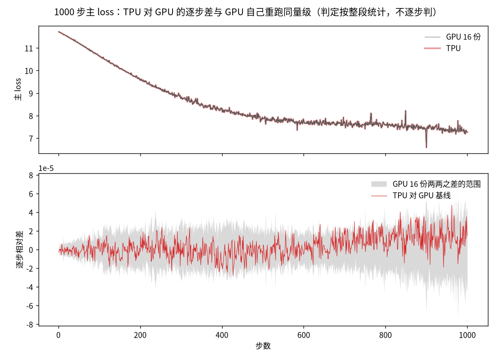
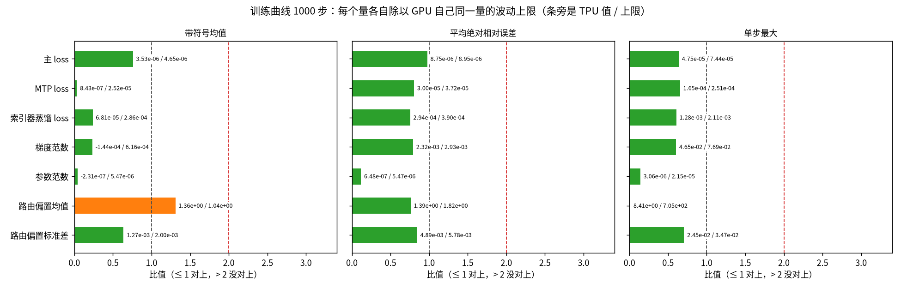

[janus](../../../../README.md) › [混元 4](../../README.md) › [mini](README.md) ｜ 对齐报告

# 混元 4 · mini · GPU → TPU 数值对齐报告

**对象**：hy4-mini（混元 4 全部结构、缩小宽度和层数的随机初始化模型，约 4.3 亿参数）。TPU（v5p，MaxText）和 GPU（B200 × 8，Megatron-Core）用同一份权重和数据各训练 1000 步，逐项比。结论只对这组条件成立（随机初始化；第 1 步只比 16 个路由专家里的 4 个；不用 8 位浮点 FP8；TPU 一侧 libtpu 0.0.46、jax 0.11.1，换版本要按 [`libtpu-052.md`](../04-tpu-self/libtpu-052.md) 的做法重测），完整范围见[对齐细节「适用范围」](DETAILS.md#适用范围)，版本见 [`setup.md`「软件版本」](setup.md#软件版本)。

**一句话现状：还不能签字**（签字＝正式宣布两边对齐了）。2026-11-11 起对齐配置改成 C 口径（项目负责人定）：TPU 在超连接（iHC，多路残差流）与 hc_head 一带用编译器省不掉的舍入，照 GPU 的写法「32 位算、16 位存」；GPU 不改。现行比较换成 C 口径的第一份运行 `tc-a`（规则事先定：取第一份，同配置 5 份都判、都报），噪声仍是 GPU 16 份。训练 1000 步的 9 项曲线 8 项对上，路由偏置均值 1 项略超（带符号均值 1.31 倍；同配置另 4 份 0.36–0.80 倍），没有一项不过；之前一直略超的主 loss 现在对上（三个量里最差的是平均绝对相对误差，0.98 倍）。主 loss 为什么偏高查清了主因：上一代 TPU 主 loss 第 500 步以后慢慢偏高，主因是超连接里流的梯度怎么舍——GPU 每份梯度先舍 16 位再逐个相加，TPU 在 32 位里加完才舍；TPU 补上 GPU 的舍法后尾部消失，GPU 反过来换成 TPU 的舍法后自己也出现同样的尾部（两头各 4–5 份，用两样本检验判）。前 100 步的小鼓包来自 hc_head 输出 TPU 没舍 16 位。C 口径下第 551–1000 步主 loss 对 GPU 16 份均值还剩约 +6.6e-6（只补流梯度那一处时 +1.9e-6），这份残余的机制待查，见「下一步」第 1 条。第一步整网与单层是在 C 口径之前的配置上判的，要重判；其余挡签字的事见「挡签字」。

## 现状

「对上」指 TPU 和 GPU 的差不超过 GPU 自己同设置重跑的波动上限；GPU 重跑量不出波动的地方，看 TPU 离精确值（CPU 上 64 位计算）是否不超过 GPU 的 1.2 倍。GPU 同设置重跑之间只差累加的先后，舍入发生的位置相同（第一步比较的结论，见 [GPU 自比](gpu-noise/README.md#为什么要做)），所以这把尺子量不到「舍入位置不同」带来的差：TPU 超出它不等于算错（第一步整网超出波动的梯度再对精确值比，就是为此）。索引器是稀疏注意力里给 token（文本切分的最小单位）打分、挑出要看的位置的部件，蒸馏 loss 让它学完整注意力；路由偏置是 MoE 给每个专家加的负载平衡偏置。

| 层级 | 判定 | 关键数字 | 还差什么 |
|---|---|---|---|
| 地基：设置、数据、权重、配置 | 全部逐位相同 | 初始权重（8 张卡共 1,968 项）、每步输入数据指纹（65,000 项）、配置（108 项：结构、训练设置与登记值 69 项，精度开关 39 项）都是 0 项不同；学习率与配置核的是现行 `tc-a`（`tc-l0-settings`、`tc-l0-config`），输入指纹核的是更早一代 `t1zg-a` | — |
| 单算子 | 15 项：12 项对上，1 项只看不判，2 项没对上：32 位对数函数（已接受：0.5–4 之间全部 2,517 万个数上 TPU 差 3 个最小精度单位、GPU 1 个；训练里实际出现的 629 万个输入上两边都是 1 个）；低阈值 QK-Clip 第一步每头最大注意力打分（关 base2 后第 4 层离精确值 GPU 2.97e-3、TPU 4.61e-3，1.55 倍；base2 开时 0.94 倍；未定责） | 逐算子回放（base2 开的上一代）99 个算子喂同一个输入，离精确值都不超过 GPU 的 1.2 倍；没对上的 2 项不在这 99 个里（对数是逐元素的最小精度单位检查，QK-Clip 第 4 层是关 base2 后另测的一项） | 低阈值 QK-Clip 第 4 层要定责（读数是 C 口径之前的配置，C 口径上要重测） |
| 单层（层输出与层输入梯度） | 对上（所用配置与现行差五处：少四个开关（注意力可学习偏置项梯度照 GPU 写法、蒸馏 loss 记录值的稳定写法（不影响单层前向和反向）、hc_head 输出舍 16 位、超连接流梯度照 GPU 舍），且 base2 开） | 每层前向、反向离精确值都不超过 GPU 的 1.2 倍；最差的第 2 层输入梯度 GPU 1.23e-2、TPU 1.42e-2 | 在现行配置上重跑 |
| 第一步整网（C 口径之前的配置 `tz-off-rep`；C 口径改了第一步的梯度，要重判） | GPU 第一步参照 2026-11-11 补到 6 份（两两 15 对）：205 个梯度里 169 个超出 GPU 6 份之间的波动：167 个离精确值不超过 GPU 的 1.2 倍，2 个比 GPU 远（1 个计入未定责、1 个另列）；另 10 个 GPU 各份相同、离精确值都不超过 GPU 的 1.0 倍；26 个在波动内 | 2 个里 1 个是超连接（多路残差流）的小参数，第 3 层注意力前 `hc_scale`：离精确值 GPU 1.19e-3、TPU 6.40e-3，超出波动 1.05 倍，计入未定责；另 1 个是 MTP 的 enorm，另列；两个都按 D11 豁免规则单列（豁免规则与沿用待复核）。GPU 只有 3 份时是 177 个超出、5 个超连接小参数未定责（3 个是关 base2 后新出现的），补到 6 份后这 3 个都在波动内 | 在 C 口径上重判第一步；第 3 层 `hc_scale` 定责，或复核 D11 豁免规则与沿用 |
| 训练曲线（1000 步） | 9 项：8 项对上，1 项略超（路由偏置均值，带符号均值 1.31 倍），没有不过；同一运行前 300 步另判也是 8 项对上、1 项略超（梯度范数 1.01 倍）。C 口径同配置 5 份都判：另 4 份里 3 份 9 项全对上，1 份（`tc-b`）主 loss 两项 1.14 倍、MTP 两项 1.06–1.07 倍略超；5 份都没有不过 | 主 loss 带符号均值 TPU +3.53e-6、上限 4.65e-6（0.76 倍）；平均绝对相对误差 TPU 8.75e-6、上限 8.95e-6（0.98 倍）。C 口径之前的 `tz-off-rep` 主 loss 全程、后段 1.55、1.52 倍略超。拿 GPU 自己比：C 口径 5 份主 loss 0.82–1.14 倍，GPU 留一法 15 份 0.77–0.97 倍，5 份里 2 份高过 GPU 全部 15 份（[`t1zc-repeats.json`](results/t1zc-repeats.json)），残余仍看得出来 | 路由偏置均值的略超定责或按 5 份判读；后段残余 +6.6e-6 的机制（下一步第 1 条） |
| 训练曲线（其他同配置运行，C 口径之前的配置） | 4 项：3 项对上，1 项略超（未定责） | 关 base2 的上一代配置重跑两份 1000 步，47 个逐步量逐位相同；这两份一份第 1 步开全量抓数、一份不抓，所以同时证明抓数不改数值（base2 开那一代另有 30 步的同类核对）；训练健康 6 条正常；最大注意力打分 1000 步平均绝对相对误差 TPU 2.02e-3、上限 1.86e-3（1.09 倍），前 300 步单步最大 1.05 倍（base2 开时已接受，关后没重做同一状态的证据） | 重做最大注意力打分的同一状态单步 |
| 其他尺寸（支线） | 中等模型 300 步曲线没有不过；真实权重截层（只取真实权重前一两层、有的另加一层 MTP 的小模型）带 MTP 的那个蒸馏 loss 不过（带符号均值 TPU +2.01e-3、上限 8.67e-4，那份运行早于修好的配置）；三个模型第一步整网都没对上 | 截层（项目的验收对象）8 条签字条件都没满足 | 下一步第 3 条 |

三条判法是看到结果后改的：路由选择按离精确值比（≤ 1.2 倍算过）、优化器一步的分辨率下限（两边离精确值都 < 2⁻⁸ ≈ 3.9e-3 就算过），这两条把原来不过的格子判成了过；第一步的分辨率下限（另要求 GPU 三份波动为 0）按它过的 5 个张量在现行数据（`tz-off-rep`）上离精确值本来只有 GPU 的 0.78–0.97 倍，不改判定。改前改后见[对齐细节「判法变更记录」](DETAILS.md#判法变更记录)。

## 训练曲线

现行比较 `t1zc-l4`：TPU `tc-a`（C 口径）对 GPU 基线 `g3-a`。GPU 同设置 16 份两两 120 对之差给出波动上限（各对之差的最大值；2026-11-11 前是 8 份 28 对）。C 口径之前的上一代 `tz-off-rep` 换尺子时只改了一格：按 8 份的上限，梯度范数带符号均值是 1.006 倍、略超，16 份下 0.55 倍；主 loss 两项 8 份下 1.91、1.94 倍，同样略超；其余 6 项两种尺子都对上（[对齐细节第 3 节](DETAILS.md#3-现行配置l4-没有不过)）。逐步相对差 =（TPU − GPU 基线那一份）÷ GPU 基线（梯度范数也一样，2026-11-10 前梯度范数除以两边均值），统计窗口第 2–1000 步。三个量：**带符号均值**（逐步相对差直接平均，即平均偏多少，主指标）、**平均绝对相对误差**（取绝对值再平均，即平均晃多少）、**单步最大**（最坏一步差多少）。每格「TPU / 上限 / 比值」；判定取三个量里比值最大的：≤ 1 对上，> 2 没对上，中间略超。第 1 步不进统计。

| 量 | 判定 | 1000 步带符号均值 | 1000 步平均绝对相对误差 | 1000 步单步最大 |
|---|---|---|---|---|
| 主 loss | 对上 | +3.53e-6 / 4.65e-6 / 0.76 | 8.75e-6 / 8.95e-6 / 0.98 | 4.75e-5 / 7.44e-5 / 0.64 |
| MTP loss | 对上 | +8.43e-7 / 2.52e-5 / 0.03 | 3.00e-5 / 3.72e-5 / 0.81 | 1.65e-4 / 2.51e-4 / 0.66 |
| 索引器蒸馏 loss | 对上 | +6.81e-5 / 2.86e-4 / 0.24 | 2.94e-4 / 3.90e-4 / 0.75 | 1.28e-3 / 2.11e-3 / 0.61 |
| 梯度范数 | 对上 | −1.44e-4 / 6.16e-4 / 0.23 | 2.32e-3 / 2.93e-3 / 0.79 | 4.65e-2 / 7.69e-2 / 0.60 |
| 参数范数（两边都比各自参数的精确范数） | 对上 | −2.31e-7 / 5.47e-6 / 0.04 | 6.48e-7 / 5.47e-6 / 0.12 | 3.06e-6 / 2.15e-5 / 0.14 |
| 路由偏置均值（注） | 略超（同配置另 4 份 0.36–0.80） | 1.36 / 1.04 / 1.31 | 1.39 / 1.82 / 0.76 | 8.41 / 705 / 0.01 |
| 路由偏置标准差（注） | 对上 | 1.27e-3 / 2.00e-3 / 0.64 | 4.89e-3 / 5.78e-3 / 0.85 | 2.45e-2 / 3.47e-2 / 0.71 |

第 101–1000 步窗口主 loss 对上（0.97 倍），MTP loss 对上（0.80），[全表](DETAILS.md#第-1011000-步)。C 口径之前的上一代（主 loss 1.55、1.52 倍略超）的全表保留在 [`t1zo-l4`](results/t1zo-l4.report.md)。

注：路由偏置每个量各取最差的一层，上限取 GPU 每对在各层里的最大值；均值接近 0，单步最大的上限因此到 705。路由偏置均值在 C 口径之前的 `tz-off-rep` 上是 0.20 倍、C 口径另 4 份 0.36–0.80 倍，`tc-a` 一份 1.31 倍没有定责。上一代主 loss 略超的查法见[对齐细节「待定的几项」](DETAILS.md#待定的几项)；base2 开的上一代（梯度范数、路由偏置标准差略超、已接受）见[历代比较](../../dashboard/history.md)。

前 300 步窗口在[对齐细节](DETAILS.md#前-300-步)（`t1zc300-l4`：8 项对上，梯度范数 1.01 倍略超）。QK-Clip（注意力打分过大时缩小相关权重）阈值 100，训练健康那份运行（上一代配置，关 base2）里最大注意力打分最高 0.1493，没触发过。

图 1：上半幅细灰线 GPU 16 份、粗淡红线 TPU（几乎重合）；下半幅是逐步相对差，灰带是每一步 GPU 120 对之差的最大绝对值（判定按整段统计）。数据：`g3-a … g3-p`、`tc-a` 的 `metrics.jsonl`，脚本 `analysis/plot_l4_figures.py`；上一代 `tz-off-rep` 的图保留在 `figures/l4-main-loss-t1zo.png`，再上一代 `t1zg-a` 的在 `figures/l4-main-loss.png`。

图 2：横条是各量（取绝对值）除以 GPU 同一量的波动上限；数取自 [`t1zc-l4.results.json`](results/t1zc-l4.results.json)。其余各量的逐步曲线在[对齐细节](DETAILS.md#训练曲线逐步图)。

## 生产配置建议

表里的开关只在 `maxtext` 的混元 4 集成分支上，上游 MaxText 大多没有（照抄会报未知键，`float32_logits` 上游有键但在 MLA 上静默不生效）；用上游的怎么办见 [MaxText 说明「这些开关在哪个分支」](../../frameworks/maxtext/README.md#这些开关在哪个分支)。

生产看两件事：离精确值更近还是更远，步时多花多少。「关掉」：只关这一个开关跑 300 步，写比值比全开升得最多的一项（倍数 = 这一项 ÷ GPU 波动上限，没写量名的是带符号均值，括号里是全开时）。这组对照的「全开」（`t1zu-a` 一代）和现行差五处：少四个开关，注意力头偏置项梯度照 GPU 写法（M42b）、蒸馏 loss 记录值的稳定写法（M50）、C 口径的 hc_head 输出舍 16 位（M52）与超连接流梯度照 GPU 舍（M58），且 base2 开（现行关；关 base2 后低阈值 QK-Clip 第 4 层和第一步超出的超连接小参数都变了，各开关的倍数在 base2 关时是否照样成立没测）。M50 不改训练数值，但改蒸馏 loss 的记录值：表里「蒸馏 loss」几行的倍数是在旧记录写法上量的，全开 1.06（300 步）；加上 M50 的 `t1zg-a`（base2 开的上一代）300 步 0.63、1000 步 0.69（8 份尺子）；以现行比较 tz-off-rep 为准，300 步 0.75（8 份尺子）、1000 步 0.33（16 份尺子）。「波动内」这条线（2026-11-11 重定）：只改执行方式的 8 份运行（base2 开、关各 4 份），截前 300 步、用同一把尺子判（学习率恒定，前 300 步与 300 步运行同设置），同组任取两份，「升得最多的一项」中位 0.60、90% 分位 0.87、最大 1.07（24 个有序对，[`exec-spread-300.json`](gpu-noise/results/exec-spread-300.json)）。每组 4 份里 3 份同一配置、只差 vmem 上限或延迟隐藏调度；另一份是早一代（开组 `t1zw-a`、关组 `t1zz-a`），少 M50（只改蒸馏 loss 的记录值）、MaxText 提交不同（`2c28a4f4` 对 `b87a55aa`，各运行 `meta.json` 核过）。最大的 1.07 来自同一配置的一对（`tz-on-vm64` 换成 `tz-on-vm32b`，蒸馏 loss 带符号均值），不受这处差别影响；去掉蒸馏 loss 一项重算，最大 0.90（[`exec-spread-300-nokd.json`](gpu-noise/results/exec-spread-300-nokd.json)）。升幅不到 1.07 的行标「波动内」，单看曲线不能归到开关；不算蒸馏 loss 时执行方式的波动最大 0.90，升幅在 0.90–1.07 之间的非蒸馏 loss 行压线（目前只有「索引器的打分用真 32 位」一行，0.90）。原来这条线是 0.45，只取自一个对照（关掉按理不改数值的「QK-Clip 不含偏置项」，0.48 → 0.93）；按新线，升幅 0.45–0.9 的 7 行退回波动内：部分和 32 位 0.48、RMSNorm 只舍一次 0.77、路由权重舍 16 位 0.69、索引器打分 32 位 0.90、重算保存路由 0.59、超连接四路按顺序相加 0.78、超连接强制舍 16 位 0.53。这几行开不开，看同一格里单层、单算子的读数。超出新线的只有输出头最高精度（5.42）、高精度指数对数（1.89）、MoE 路由权重乘的位置（1.62）、索引器权重投影（1.30）。同一批运行改用 GPU 16 份的尺子（截前 300 步），最大 1.67（[`exec-spread-300-g3.json`](gpu-noise/results/exec-spread-300-g3.json)），前 5 大都是蒸馏 loss 的带符号均值、每一对都含少 M50 的那一份，是记录写法的差，不是执行方式；去掉蒸馏 loss 一项重算，最大 0.81（[`exec-spread-300-nokd.json`](gpu-noise/results/exec-spread-300-nokd.json)）。开关各行是在 8 份的尺子上量的，不直接拿 16 份尺子的数比。其余数来自单层、单算子或其他运行。「对精度的影响」与「步时代价」两列都是只关一个开关、在 hy4-mini 上量的（libtpu 0.0.46：这批运行的 `meta.json` 只记构建号 `cl/963683785`，与记了版本号的 `tz-off-rep` 相同，见「适用范围」；步时见 [`tq-step-time.json`](results/tq-step-time.json)，「同一梯度照 GPU 写法」那行的 +3.9% 是另一种量法，见[对齐细节第 6 节](DETAILS.md#6-开关表怎样做到在可解释范围内对齐)），不能外推到生产规模：步时方面，输出头那项在中等模型上 +24.4%；精度方面，真实宽度上已经出现 mini 上看不到的差（注意力指数用 2 为底、归一化层权重梯度，见[真实权重报告](../02-real-weight/ALIGNMENT-REPORT.md)）。

一句话：生产开 9 行，再加上「梯度用 32 位」那行的前两项；不开 7 行（只为照 GPU；C 口径的三处 M36、M52、M58 都在这里）；注意力指数不用 2 为底；看情况 7 行，其中输出头最高精度（+23.7%）、索引器打分 32 位（+6.3%）、高精度指数对数（+3.0%）按精度与吞吐取舍，优化器与 loss 的 7 处看是否已有 GPU 上调好的超参，其余 3 行离精确值远近没测。

推荐组合整体跑过一次（`x5-prod` 加两份只改执行方式的重复，各 1000 步，判法同现行比较）：1000 步三份都没有不过项，主 loss 比现行对齐配置更近（全程 0.83–0.94，现行 4 份 0.93–1.55），索引器蒸馏 loss 更远（1.23–1.26 待定，现行 0.77–1.00）；**前 300 步窗口三份的索引器蒸馏 loss 都不过**（带符号均值 −6.6e-4 – −7.2e-4，4.78–5.23 倍；现行 0.94），主 loss 与梯度范数待定（1.01–1.38、1.27–1.36）；其余 6 项两份对上，`x5-prod-vm32` 那份主 loss 第 101 步起也待定（1.13）。蒸馏 loss 偏低推断主要来自不开「索引器的权重投影乘 16 位模型权重」那行（只关它的 300 步对照同样偏负、不过）；组合里没做再开回这一行的对照，对精确值也没比。按这套组合迁移时，前 300 步的蒸馏 loss 会离 GPU 曲线超出噪声。详见[对齐细节「推荐组合整体跑一次」](DETAILS.md#推荐组合整体跑一次)（[`t1zp-repeats.json`](results/t1zp-repeats.json)）。

| 开关 | 生产 | 对精度的影响 | 步时代价 | 理由 | 详情（根源一览第几行） |
|---|---|---|---|---|---|
| MoE 路由偏置每步去掉均值 | 开 | 只 TPU 去均值时（最早一代配置、前 300 步）偏置均值 19.1 倍，两边都不去均值后 0.17 倍 | 未测 | 不去均值时偏置整体漂移；原版没有这一项 | [1][r1] |
| 矩阵乘跨设备的部分和用 32 位相加 | 开 | 关掉：参数范数 1.06 倍（全开 0.57；波动内） | +0.8% | 关时部分和先舍成 16 位 | [2][r2] |
| 归一化层（RMSNorm）只舍入一次 | 开 | 关掉：主 loss 1.24 倍（全开 0.48；波动内） | −0.2% | 舍一次不比两次差 | [2][r2] |
| 路由权重先舍 16 位、激活函数每个算子各舍一次 16 位（照 GPU） | 不开 | 关掉前者：路由偏置均值 0.86 倍（全开 0.17；波动内）；关掉后者：蒸馏 loss 1.46 倍（全开 1.06；波动内） | ±0.1% | 只为照 GPU | [2][r2] |
| 索引器的打分用真 32 位 | 看情况 | 关掉：路由偏置均值 1.07 倍（全开 0.17；波动内）；蒸馏输入离精确值 4.16e-3（GPU 3.55e-3），开着 3.44e-3 | +6.3% | 按精度与吞吐取舍 | [3][r3] |
| 输出头矩阵乘用最高精度 | 看情况 | 关掉：主 loss 单步最大 6.03 倍（全开 0.61） | +23.7% | 关时只算一遍 16 位：输出离精确值 2.73e-3，开着 8.3e-8 | [5][r5] |
| 重算（反向时重算前向以省显存）保存路由结果 | 开 | 关掉：反向时 0.117% 的路由位置重选；路由偏置均值 0.75 倍（全开 0.17；波动内） | 0.0% | 前后向路由一致 | [5][r5] |
| 索引器的权重投影乘 16 位模型权重（照 GPU；TPU 默认乘 32 位主权重） | 不开 | 关掉：蒸馏 loss 2.36 倍（全开 1.06）。推荐组合整体跑时（关它）前 300 步蒸馏 loss 对 GPU 不过（r 4.78–5.23），推断主要来自关它，组合里开回它的对照没做；这只说明离 GPU 远，对 FP64 没比（[对齐细节「推荐组合整体跑一次」](DETAILS.md#推荐组合整体跑一次)） | +0.1% | 只为照 GPU | [5][r5] |
| 超连接四路相加按 GPU 的顺序依次相加（TPU 默认两两配对相加） | 看情况 | 关掉：主 loss 1.25 倍（全开 0.48；波动内） | +0.2% | 更近精确值未证实 | [6][r6] |
| 优化器与 loss 照原版 Megatron-Core 的 7 处：① Muon（一种优化器）的动量不做偏差修正（不除以 1−β^t，β 动量系数、t 步数）；② 标量参数用普通 Adam（另一种常用优化器）；③ 正交化前归一化写 x / max(‖x‖, 1e-7)；④ QK-Clip 缩放分母不加 1e-6；⑤ 蒸馏 loss 用原版截断与 log；⑥ 屏蔽文档边界时蒸馏 loss 按查询行数加权；⑦ MTP loss 按每卡 token 数重标 | 看情况 | 单测：①–③ 合计每步更新对原版 1.3e-1 → 1.3e-6；② 对 PyTorch 的 Adam 实现：开着 ≤ 1e-5，单独关时 0.56；③ 约 1e-6；④ 估算 ≤ 1e-8；⑤ 尖锐分数上 > 1e-4；⑥ 估算 ≤ 2.4e-3；⑦ 未量 | 未测 | 两种写法都合法；有 GPU 上调好的超参时开 | [7][r7]、[9][r9] |
| Muon 每步把更新矩阵正交化的迭代用 16 位操作数（照 GPU；TPU 默认 32 位） | 不开 | 关掉：蒸馏 loss 1.30 倍（全开 1.06；波动内） | +1.1% | 更新量离精确值的中位数：关时 3.0e-3，开时 3.95e-2 | [10][r10] |
| QK-Clip 的最大打分不含注意力头的可学习偏置项 | 开 | 关掉：主 loss 0.93 倍（全开 0.48；波动内；推断是编译结果变了，不是开关本身的作用） | +0.9% | 它不是查询向量与键向量（q、k）相乘得到的，缩小 q、k 压不住它 | [12][r12] |
| 指数、对数用高精度实现 | 看情况 | 关掉：蒸馏 loss 2.95 倍（全开 1.06） | +3.0% | 误差从 105 / 62 个最小精度单位降到 1 / 3 个 | [13][r13] |
| 超连接的分支输入与流强制舍 16 位（照 GPU；不强制时 TPU 后端省掉一部分往返，HLO 看不出，最小复现的 LLO 里核到；C 口径三处之一，M36） | 不开 | 关掉：主 loss 1.01 倍（全开 0.48；波动内）；更早的配置上 1000 步打开前后 2.12 → 0.76 倍（8 份尺子，上一代；单份） | +0.1% | 只为照 GPU；对齐配置开 | [16][r16] |
| 超连接把四路流收成一路（hc_head）之后强制舍 16 位（照 GPU 的 `.to(bfloat16)`；TPU 写 `astype`，推断被编译器省掉；C 口径三处之一，M52） | 不开 | 单开（3 份 1000 步）：第 51–100 步主 loss 的小鼓包消失（对只开 M36 的对照差 −5.4e-6，置换检验 p 0.029），第 551–1000 步不变（+11.2e-6，对照 +9.4e-6）；对精确值未测 | 未测 | 只为照 GPU；对齐配置开（2026-11-11 起） | [28][r28] |
| 超连接流的梯度逐份舍 16 位、按 GPU 的顺序相加，分支输出舍 16 位（照 GPU 的 autograd；TPU 不强制时在 32 位里加完才舍；C 口径三处之一，M58） | 不开 | 单开（5 份 1000 步）：第 551–1000 步主 loss 对 GPU 均值 +9.4e-6 → +1.9e-6（p 0.016），即上一代后段偏高的主因；GPU 反过来换成 TPU 的舍法 +3.9e-6（p 0.002）。离精确值远近没测 | C 口径整体（三处都开）1000 步步时中位数 0.4963 s，只开 M36 的对照 0.4960 s（单次运行，不是专门的 A/B） | 只为照 GPU；对齐配置开（2026-11-11 起） | [30][r30] |
| 小张量 Adam 的精确除法与开方 | 开 | 关掉：主 loss 0.86 倍（全开 0.48；波动内）；小张量更新离精确值 5.70e-6（GPU 1.49e-6），开着 1.49e-6 | +0.1% | 更近精确值 | [17][r17] |
| MoE 路由权重在激活之后、下投影（前馈层把放大的向量压回的那次矩阵乘）之前乘（照 GPU；TPU 默认在下投影之后乘） | 看情况 | 关掉：主 loss 2.09 倍（全开 0.48） | +0.2% | 远近没测 | [19][r19] |
| 上投影（前馈层先把向量放大的两次矩阵乘）的输入梯度合并后只舍一次（照 GPU 的融合实现） | 看情况 | 关掉：主 loss 0.73 倍（全开 0.48；波动内）；只开它、不开上一行时 1000 步主 loss 1.91 倍（两个都开 0.65、都关 0.70；8 份尺子），原因未查清；开、关各一份运行，没排除轨迹偶然 | −1.8% | 远近没测 | [20][r20] |
| 注意力头可学习偏置项的梯度用 32 位 | 开 | 不开：单层离精确值是 GPU 的 1.62–2.88 倍，开着 0.61–2.00 倍；只开它时 1000 步主 loss 0.65 → 1.32 倍（8 份尺子；开、关各一份运行，没排除轨迹偶然） | 未测 | 更近精确值 | [21][r21] |
| 同一梯度照 GPU 写法：每个位置先舍 16 位、概率与求和用 32 位（TPU 默认把概率舍成 16 位再在 16 位里求和） | 不开（生产用上一行） | 开着：单层离精确值是 GPU 写法的 1.000–1.001 倍 | +3.9% | 只为照 GPU | [21][r21] |
| 索引器蒸馏 loss 记录值改用数值稳定的写法 | 开 | 不开：1000 步蒸馏 loss 带符号均值 1.06 倍，开着 0.69 倍（三个判定量里最差的 MARE 0.85；base2 开的上一代 `t1zw-a` → `t1zg-a`，8 份尺子）；梯度逐位不变 | 无 | 只改记录下来的值 | [25][r25] |
| 词嵌入、归一化层权重、输出层权重的梯度用 32 位 | 前两项开，第三项看情况（对齐配置都没开） | 不开：编译器不留 32 位时词嵌入梯度离精确值是 GPU 的 26.1 倍（开着 1.06），默认设置 0.96 倍（开着 0.92）；截层 9 个归一化权重梯度中位数 1.60 倍（开着 0.98）；输出层未量 | 未测 | 少一次 16 位舍入 | [22][r22]、[23][r23] |
| 路由打分用 32 位和最高精度 | 开 | TPU 上 32 位矩阵乘默认只算一遍 16 位：相对误差 2.34e-3，最高精度 9.86e-8（v7x 上随机输入的单算子实测，不是混元 4，本仓库没有结果文件）；混元 4 上没做关掉的对照，开着路由打分离精确值 GPU 1.13e-6、TPU 1.20e-7 | 混元 4 上未测；混元 3 的缩小模型在 v7x 上只改路由矩阵乘的精度，在重跑波动内（−0.11% 至 +0.22%） | 更近精确值 | [26][r26] |
| 注意力指数用 2 为底 | 生产不用；对齐也不用（2026-11-11 起） | 用：前向离精确值约大 30 倍；不用：1000 步主 loss 开、关各 4 份交叠（GPU 16 份尺子、三个判定量取最大：开 0.90–1.69、关 0.93–1.55）；早先单份的 1.91 倍（用时 0.36）是 8 份尺子、只看带符号均值的读数，同一把尺子下这 8 份是开 0.36–2.08、关 0.62–1.91，同样交叠，是轨迹偶然 | 用比不用慢 0.1% | 生产看精确值；对齐与生产一致 | [24][r24] |

[r1]: ../../ROOT-CAUSES.md#r1
[r2]: ../../ROOT-CAUSES.md#r2
[r3]: ../../ROOT-CAUSES.md#r3
[r5]: ../../ROOT-CAUSES.md#r5
[r6]: ../../ROOT-CAUSES.md#r6
[r7]: ../../ROOT-CAUSES.md#r7
[r9]: ../../ROOT-CAUSES.md#r9
[r10]: ../../ROOT-CAUSES.md#r10
[r12]: ../../ROOT-CAUSES.md#r12
[r13]: ../../ROOT-CAUSES.md#r13
[r16]: ../../ROOT-CAUSES.md#r16
[r17]: ../../ROOT-CAUSES.md#r17
[r19]: ../../ROOT-CAUSES.md#r19
[r20]: ../../ROOT-CAUSES.md#r20
[r21]: ../../ROOT-CAUSES.md#r21
[r22]: ../../ROOT-CAUSES.md#r22
[r23]: ../../ROOT-CAUSES.md#r23
[r24]: ../../ROOT-CAUSES.md#r24
[r25]: ../../ROOT-CAUSES.md#r25
[r26]: ../../ROOT-CAUSES.md#r26
[r28]: ../../ROOT-CAUSES.md#r28
[r30]: ../../ROOT-CAUSES.md#r30

## 挡签字

8 条签字条件见[对齐细节「离签字还差什么」](DETAILS.md#离签字还差什么)。还没满足的：

| 事项 | 现在知道什么 | 要做什么 |
|---|---|---|
| 第一步整网 169 个梯度超出 GPU 6 份之间的波动（C 口径之前的配置，base2 关；C 口径改了第一步梯度，要重判） | 167 个离精确值不超过 GPU 的 1.2 倍、算已查明来源；另 2 个比 GPU 远：第 3 层注意力前 `hc_scale` 计入未定责（超出波动 1.05 倍，所以是待定），MTP enorm 另列，两个都按 D11 豁免规则单列（豁免规则与沿用待复核）。GPU 参照只有 3 份时是 177 个超出、5 个超连接小参数未定责，其中关 base2 后新出现的 3 个（条件数是 42 个超连接参数里最小的一批，[`t1-ihc-param-grad-conditioning.json`](results/t1-ihc-param-grad-conditioning.json)）补到 6 份后都在波动内；签字原则规定查明来源替代不了「在波动内」 | 在 C 口径上跑第一步全量抓数重判（排着）；给第 3 层 `hc_scale` 定责，或复核 D11 豁免规则与沿用；按签字原则维持未满足 |
| 训练曲线的待定项（签字条件 2a） | 以现行比较 tc-a 为准：1000 步路由偏置均值略超（1.31 倍；同配置另 4 份 0.36–0.80 倍，未定责）；前 300 步梯度范数略超（1.01 倍；同配置另 4 份 0.81–0.92 倍）；主 loss 现已对上。另一份同配置运行的最大注意力打分（1000 步 1.09 倍）是 C 口径之前的读数，base2 开时已接受，关后没有重做同一状态的证据，待定 | 路由偏置均值定责或按 5 份判读；梯度范数、最大注意力打分重做同一状态单步或决定是否沿用 |
| 低阈值 QK-Clip 第一步第 4 层每头最大注意力打分（签字条件 3a） | C 口径之前的配置上测的：关 base2 后离精确值 GPU 2.97e-3、TPU 4.61e-3，1.55 倍，最差一个头相对差 −1.19e-2；base2 开时同层 0.94 倍。线索：同一第 1 步只把累积 2 换成累积 1（全局批不变），第 4 层变成 1.83 倍（MTP 层 1.07 → 1.00，其余层两种累积都 ≤ 0.76 倍），超出不是累积带来的（不累积时反而更大）（[`t1zo-qkclip-accum-tau01`](results/t1zo-qkclip-accum-tau01.json) 的 `step1.per_layer`）；没有定责 | 定责 |
| 参照答案和 GPU 生产程序之间没比过 | 参照答案用本仓库自写的训练入口，注意力内核与生产不同；已知的那处精度差已改成和生产一样 | 用生产程序跑一份同设置训练，量差 |
| 三条事后判法的前瞻验证（真实权重；判法事先固定，再看新结果） | 三条都在看到 mini 结果后改，已在比较协议事先登记 | 真实权重截层下一批运行（第一步、优化器一步、路由选择四步）按登记判 |

## 适用范围：测过什么、没测什么

上面的结论只对「测过的取值」成立。「GPU↔TPU」指有 GPU 参照答案的跨侧比较；「TPU 自比」指 [04-tpu-self](../04-tpu-self/README.md)：只在 hy4-mini 上、同一个 TPU 起点只改一样东西，尺子借 GPU 重跑的波动。v5p 每片 1 个设备，v7x 每片 2 个设备。最后一栏是搬到新取值时建议重测的级别（L0 逐位、L1 单算子、L3 第一步整网、L4 训练曲线），是建议做法，不是已做的结果。

| 维度 | 测过的取值 | 证据 | 没测的取值 | 搬到 TPU 时怎么办 |
|---|---|---|---|---|
| 尺寸 | mini（4.3 亿）1000 步；mid（51.9 亿）300 步；真实权重截层 B / D1（约 121 亿）1000 步；真实宽度 3 层 + MTP（321 亿）1000 步 | 本报告；[mid](../03-mid/README.md)；[截层 setup](../02-real-weight/setup.md)；[rw3 setup](../06-rw3/setup.md) | 生产全尺寸，任何一侧都没跑过；完整模型的放法只有推断的显存估算（见 [Megatron 一侧 README](../../frameworks/megatron/README.md) 里讲 TP 不支持的那段） | 先用 [`aot_memory.py`](../../frameworks/maxtext/aot_memory.py) 离线编译定切分与显存；再做 L0 检查点逐位、L3 第一步对 FP64、几百步 L4 |
| 芯片与片数 | GPU↔TPU：v5p 8 片（mini、mid、B、D1）、v5p 16 片（rw3）。v7x 主要是 TPU 自比：4 片 300 步与 1000 步（H2、L7），8 片只判曲线、运行目录丢失、没有第一步数据（H3）。另有一次 v7x 4 片 1000 步（L7 那份运行）直接对 GPU 16 份比曲线：9 项都在噪声内（base2 开、libtpu 0.0.46） | [04 矩阵](../04-tpu-self/MATRIX.md) B2、H、L 类；[04 README](../04-tpu-self/README.md)「v7x 直接对 GPU 比」；[rw3 setup](../06-rw3/setup.md) | v7x 上的 GPU↔TPU 第一步整网；v7x 上 base2 关、libtpu 0.0.52 的 1000 步；超过 16 片；多切片（配置写死 `dcn_data_parallelism: 1`，仓库里没有多切片运行） | v7x：对 GPU 参照做 L3 第一步与 L4 1000 步。多切片：同一起点只改执行方式做 TPU 自比（如 2 切片 × 8 片对单切片 16 片），L4 300 步，超了做 L3 |
| GPU 机器数 | 参照答案：单机 B200 × 8；rw3 的参照 2 台。GPU 自比：2 台、4 台 | [05-gpu-scale](../05-gpu-scale/README.md) | 4 台以上；真实宽度 4 台没有尺子 | 参照换机器数时，先在 GPU 一侧按 05 的办法量同设置重跑波动，再对 TPU |
| 并行切法 · GPU | 参照：数据并行 8 + 专家并行 4（rw3 是 16 + 16），分布式优化器不开。GPU 自比：专家并行 8 / 16、流水线 2、数据并行 16 | [配置对照](config-alignment.md)「并行」行；[05-gpu-scale](../05-gpu-scale/README.md) | 张量并行（参照程序不支持）、上下文并行（只用 1） | 生产 GPU 程序用这两种时，参照里没有它们带来的差；按「挡签字」第 3 件用生产程序跑一份比 |
| 并行切法 · TPU | GPU↔TPU 全是 FSDP（8 / 16）。TPU 自比：纯数据并行、数据并行 × FSDP、张量并行 2、专家并行 2 / 4 / 8、上下文并行 2（只配普通注意力、关负载均衡） | [04 矩阵](../04-tpu-self/MATRIX.md) B、G、L 类 | 流水线并行；ZeRO-1（`shard_optimizer_over_data`，B1c 没跑通，精度一次没量过；混元 3 的已知坑是它加梯度累积时累加器是 BF16），生产要用就先补；splash 注意力下的上下文并行；上下文并行负载均衡（MTP 不支持，G1）；专家并行要先关 `moe_mcore_prob_before_fc2` | 只改切分的 TPU 自比，L4 300 步再 1000 步。纯数据并行要带词嵌入梯度的修法（B1f、B1h，见[案例 14](../../cases/14-ddp-fsdp-embedding.md)）。生产形状（词表 120832 × 隐藏维 6144）纯数据并行每卡整张表时，单算子离线编译：libtpu 0.0.52 上每卡 4096 / 8192 / 16384 个下标都不排序，0.0.46 上 16384 才排序（[`emb-scatter-sort-hy4-prod.json`](../04-tpu-self/results/emb-scatter-sort-hy4-prod.json)），所以 mini 上「v7x 0.0.52 不累积就排序」不能当成生产上可以不修 |
| 步数 | 1000 步（mini、B、D1、rw3；TPU 自比长跑 33 臂）；mid 300 步。mini 另有一组 2000 步诊断：C 口径之前的配置延长到 2000 步，GPU 2 份（`gx-1`、`gx-2`）、TPU 1 份（`tx-1`）。TPU 主 loss 对 GPU 2 份均值，第 501–1000 步 +1.37e-5，第 1001–1250 步 +2.89e-5，之后三段 +5.4e-6、+7.4e-6、+4.1e-6，落在 GPU 两份的留一法标准差 6.3e-6–7.8e-6 里；GPU 只有 2 份、1 对，尺子太粗，不判档 | 本报告；[04 矩阵](../04-tpu-self/MATRIX.md) L 类；[`mini-ihc-ablation.json`](results/mini-ihc-ablation.json) 的 `x2000` | 超过 1000 步的多份对照（能判档的尺子）；mini 以外的尺寸超过 1000 步，哪一侧都没跑过 | GPU 多份与 TPU 一起加跑到目标步数，看 L4 的趋势 |
| 序列长度与批 | 全部运行序列 4096、全局批 16（每步 65,536 个 token） | [配置对照](config-alignment.md)「序列、批」行 | 其它序列长度、其它全局批；GPU 参照程序要求数据并行数整除 16（[Megatron 一侧 README](../../frameworks/megatron/README.md)） | 每设备 token 数一变，词嵌入梯度会不会排序也跟着变（[案例 14](../../cases/14-ddp-fsdp-embedding.md) 门槛表）：先离线编译看 HLO 里有没有 `sort`，再做 L3 |
| 精度 | BF16 混合精度、FP32 主权重 | [对齐细节「适用范围」](DETAILS.md#适用范围) | FP8 | 另做一整套 L1–L4 |
| libtpu / jax 版本 | 现行比较 `tz-off-rep` 登记了 libtpu 0.0.46（`meta.json` 记构建号 `cl/963683785` 与 `libtpu==0.0.46`，见 [`setup.md`「软件版本」](setup.md#软件版本)）。训练入口 2026-11-09 起才记 pip 版本号，更早的 GPU↔TPU 运行（上一代各比较、开关表的 300 步对照）只记了构建号（都是 `cl/963683785`），按构建号认作 0.0.46（构建号到 pip 版本的对应已核：同一构建号的探针运行在 v5p、v7x 上都读到 `libtpu_pip` 0.0.46，[`jit-miscompile-probe-v5p.json`](../../results/jit-miscompile-probe-v5p.json)、[`jit-miscompile-probe-v7x.json`](../../results/jit-miscompile-probe-v7x.json)）；jax 0.11.1。TPU 自比另测了 0.0.45、0.0.47、0.0.48、0.0.52。v5p 上实测 0.0.46、0.0.48、0.0.51、0.0.52 有 jit 静默算错的已知问题（0.0.47、0.0.49 没测）：hy4-mini 在这个构建号、v5p 上存了优化后 HLO 的 167 份运行都扫过，没有一份带它的特征（特征数为 0 不等于证明没问题）；`tz-off-rep` 与推荐组合 `x5-prod` 没存 HLO，按 `meta.json` 在 CPU 上重编训练步再扫，特征也是 0（离线程序与上卡程序是同一份是推断：同一路径重编 golden `ts-g-a` 与它上卡存下的程序逐行相同，见[案例 16](../../cases/16-jit-miscompile-sub8-row-block.md#对混元-3混元-4-的影响)） | [04 setup](../04-tpu-self/setup.md)「libtpu」行；[`jit-miscompile-hlo-scan.json`](../../results/jit-miscompile-hlo-scan.json)；[`jit-miscompile-offline-scan.json`](../../results/jit-miscompile-offline-scan.json)；[libtpu-052.md](../04-tpu-self/libtpu-052.md)；[04 矩阵](../04-tpu-self/MATRIX.md) F、L、V 类 | 其它 libtpu；jax 0.11.1 以外（0.11.2 与镜像不兼容，F3）。换 libtpu 会改结论（0.0.52 上的变化见 [impacts/04](../04-tpu-self/impacts/04-rmsnorm-double-rounding.md)） | 先用 [`hlo_screen_libtpu.py`](../04-tpu-self/hlo_screen_libtpu.py) 在 CPU 上两版各编一遍比程序；再上卡在新版本上重跑起点配置 1000 步，L4 自比 |
| 检查点 | HF → MaxText 参数逐位（mini 212 / 212、rw3 111 / 111）。TPU 存档续跑：rw3 16 片、同一份存档、同一拓扑，150 步逐位；mini 8 片现行配置第 500 步存档、换另一个同拓扑切片续跑到第 1000 步，每步 47 个字段与最终训练状态都逐位（[`t1-resume-bitwise.json`](results/t1-resume-bitwise.json)）；都走本仓库的 `train_hy4.py`（Orbax）。GPU 续跑：确定性模式 20 步逐位，并行设置不变。TPU → HF 只导出 BF16 快照（输出头、索引器 k_norm 另给 FP32） | [rw3「从存档续跑」](../06-rw3/README.md)；[05「存档续跑」](../05-gpu-scale/README.md) | MaxText 原生存档（`enable_checkpointing: false`）；换卡数或拓扑续跑；v7x 续跑；**训练中途从 GPU 接到 TPU**：Megatron 存档（FP32 主权重、Muon 动量、Adam 两个矩、步数、路由偏置）转 MaxText 没有实现，也没测；TPU 训完的 FP32 主权重与优化器状态导出 | 中途迁移：先实现带全部训练状态的转换，L0 逐张量逐位（`checkpoint_equal`），再从 GPU 第 N 步接 TPU 跑若干步，对 GPU 连续训练做 L3、L4。换拓扑：「20 步」对「10 步存档再续 10 步」逐位 |
| 数据管线 | TPU 原样回放 GPU 写下的每步 batch（`dataset_type: synthetic`）；只有 mini 核了 TPU 实际吃进的输入指纹（65,000 项）。两边都把整条 4096 当一段，不按文档切注意力，只在 eod 处掩 loss。1000 步按顺序取 16,000 条，没有重复用数据 | [配置对照](config-alignment.md)「数据」行；[`replay.py`](../../frameworks/maxtext/replay.py) 开头注释（「整条 4096 是一段」） | MaxText 原生管线（分词、shuffle、按主机分片）；packing 与文档掩码；多 epoch；mid、B、D1、rw3 的 TPU 输入指纹 | 原生管线吃同一份 token，对 GPU 做 L0 输入指纹逐位（`data_fingerprint`）；生产用文档掩码时，加做 L3 第一步对 FP64 |
| 优化器与学习率 | Muon（矩阵）+ Adam（标量）；常数学习率 1e-5，无 warmup；权重衰减 0；梯度裁剪阈值 1.0，1000 步两边每一步都触发（[`t1zo-health`](results/t1zo-health.results.json)），不裁剪的情形没测。另有生产配方臂（2026-11-11）：学习率峰值 2e-5、cosine、warmup 200，与下面 YaRN 8、路由偏置零均值三项一起改，GPU 8 份、TPU 1 份各 1000 步。两边逐步学习率最大相对差 1.0e-6。用同配方 GPU 8 份两两 28 对当尺子，TPU 9 项全部对上（最差：索引器蒸馏 loss r 0.996，压线、TPU 单份；MTP loss 0.93，梯度范数 0.91，主 loss 0.76）。这是诊断，不进签字：TPU 只 1 份，8 份尺子是看过借现行尺子的判档之后才定的（事后选尺），份数也少于登记的 16 份（PROTOCOL 第 0 节「生产配方臂」）。同配方尺子比现行尺子（g3 16 份）宽：主 loss 带符号均值 4.8 倍、平均绝对相对误差 2.7 倍、单步最大 1.3 倍，梯度范数 1.5–2.7 倍，其余各项 0.86–1.42 倍（路由偏置均值例外：零均值开时偏置均值几乎不动，尺子窄到现行的 6.6e-8–1.1e-5 倍）。所以借现行尺子时主 loss 全程、后段与梯度范数的超（r 2.97、3.02、2.45）和索引器蒸馏 loss 的待定（1.04），按推断是尺子不适用，不是跨侧差 | [`PROTOCOL.md`](../../PROTOCOL.md) 第 1.2 节；[`t1pr-l4-gpu8`](results/t1pr-l4-gpu8.results.json)、[`t1pr-ruler-compare`](results/t1pr-ruler-compare.json)、[`t1pr-l4`](results/t1pr-l4.results.json)、[`t1pr-gpu-self`](results/t1pr-gpu-self.results.json)、[`t1pr-settings`](results/t1pr-settings.json) | 生产权重衰减（值未知，配方臂里仍是 0）；cosine 的终点与长度（配方臂用 MaxText 默认终点 0.1、长度 1000 步，与生产是否一样未确认）；三项分开的单因素对照（不知道是哪一项放宽了 GPU 自己的波动）；TPU 只有 1 份 | 换配方时先在 GPU 一侧按新配方重量尺子（不能借现行尺子）；要定是哪一项放宽了波动，三项各单开一组 |
| MTP、KD、DSA、QK-Clip | MTP 开（截层 B 关）；索引器蒸馏一直开、系数 0.1；DSA 一直开，但序列 ≤ 2048 时 top-k 覆盖全部可见位置，4096 下只有后半段真正稀疏；QK-Clip 阈值 100，1000 步里从没触发（mini 最大打分 0.1493，rw3 的 GPU 参照最大 76.9）。走到裁剪的只有低阈值诊断：阈值 0.1 的 30 步 GPU↔TPU；TPU 自己累积 2 对累积 1（全局批不变，阈值 0.1、0.05 各 100 步，前 50 步里大多每步都裁）：第 1 步逐头最大 logit 比值 0.997–1.003（没有被求和成 2 倍），前 30 步两者之差与 GPU 两份重跑之差同量级，判为只差求和顺序 | 上文「训练曲线」末段；[`probe_forward.py`](../../frameworks/maxtext/probe_forward.py) 开头注释；[05-gpu-scale](../05-gpu-scale/README.md)；[对齐细节](DETAILS.md) `mz-qk-a` 行；[`t1zo-qkclip-accum-tau01`](results/t1zo-qkclip-accum-tau01.json)、[`-tau005`](results/t1zo-qkclip-accum-tau005.json)；[案例 07](../../cases/07-qk-clip-bugs.md) | 关蒸馏或改系数；关 DSA；长序列下的稀疏注意力；QK-Clip 真触发之后的多步 GPU↔TPU 训练（100 步以上；累积的对比只在 TPU 上做） | 调低阈值、让 QK-Clip 在训练中真触发，做几百步 GPU↔TPU 的 L4；长序列先做 L3 第一步 |
| 路由偏置零均值 | 对齐两边都关。生产配方臂里两边都开（与学习率、YaRN 一起改；GPU 一侧新加 `--bias-zero-mean`，写法同 MaxText：更新量先减去对专家的均值）：1000 步里各层偏置均值的漂移 TPU ≤ 1.9e-8、GPU 8 份 ≤ 4.3e-8（零均值关的 `g3-a` 4.4e-2）；同配方 GPU 8 份尺子下偏置均值 r 0.40、标准差 0.90，都过（借现行尺子对零均值开时的偏置均值没有分辨力，不作依据） | [配置对照](config-alignment.md)「路由偏置更新」行；[`t1pr-settings`](results/t1pr-settings.json)、[`t1pr-l4-gpu8`](results/t1pr-l4-gpu8.results.json)、[`t1pr-ruler-compare`](results/t1pr-ruler-compare.json) | 单开零均值（只改这一项）的 1000 步对照 | 单开零均值两边各跑一组 1000 步 L4，GPU 尺子同配方 |
| RoPE | YaRN factor 1（等于普通 RoPE），θ 1e7。生产配方臂里 factor 8（与学习率、零均值一起改）：两边只做频率插值（original_max 1048576、beta 32 / 1，不乘 mscale，MaxText 的 hy4 配置就是这样）；GPU 一侧新加 `--yarn-factor`，频率在 CPU 上与 MaxText 的写法逐位相同，模型里 12 个 RoPE 模块都换。32 个频率里下标 17–31 被插值（24–31 整个除以 8），序列 4096 下就改这些 | [`PROTOCOL.md`](../../PROTOCOL.md) 第 1.2 节「RoPE」行；[`t1pr-settings`](results/t1pr-settings.json)；[`t1pr-l4-gpu8`](results/t1pr-l4-gpu8.results.json) | 生产的 original_max 与 mscale 取法（未确认）；YaRN 的 L1 单算子对 FP64、L3 第一步；长序列 | YaRN 缩放的 L1 单算子对 FP64、L3 第一步；和长序列一起测 |

## 下一步

1. 主 loss 后段的残余：主因已定位（超连接流梯度的舍入写法，[根源一览第 30 行](../../ROOT-CAUSES.md#r30)，TPU、GPU 两头验证），前段小鼓包是 hc_head 输出舍入（第 28 行）。C 口径（三处都按 GPU 写法舍）下第 551–1000 步还剩约 +6.6e-6，比只开流梯度那一处的 +1.9e-6 大（5 对 5，p 0.048；只算 4 份只改执行方式的 p 0.086），GPU 上同样两处一起改却看不出相互作用，机制待查。只开 M36 + M58 的取舍：后段平了，前段鼓包还在（第 51–100 步 +5.6e-6）；对齐配置按语义选 C，不为了后段读数去掉 M52。在跑或排着的：GPU 一侧「流梯度 + 分支输出都按 TPU 写法」4 份（看分支输出那次舍入在 GPU 上的作用）；TPU 一侧「C 口径 + 关 MTP」4 份、C 口径第 6 份、只开 M52 第 4 份、C 口径之前关 MTP 的另 2 份；C 口径的第一步全量抓数（第一步整网与单层在 C 口径上重判）。另：低阈值 QK-Clip 第 4 层、路由偏置均值一份略超一并查。依据见[知识库](../../knowledge.md#mini-主-loss-共同偏高要点与出处)。
2. GPU 补跑至少 3 份第一步参照。
3. 用 GPU 生产程序跑一份同设置的训练，和参照答案比。
4. 真实权重截层：先按事先登记的三条判法做前瞻验证；再补单算子、单层与地基缺的数据、初始权重、配置三项，给第一步的超出定责（查清来源），重跑蒸馏 loss 不过的那份。

依据都在[知识库](../../knowledge.md)：[根源一览](../../ROOT-CAUSES.md)是偏差的唯一主表；[对齐细节](DETAILS.md)放适用范围、签字清单、覆盖缺口、偏差状态索引、开关表与证据索引。
