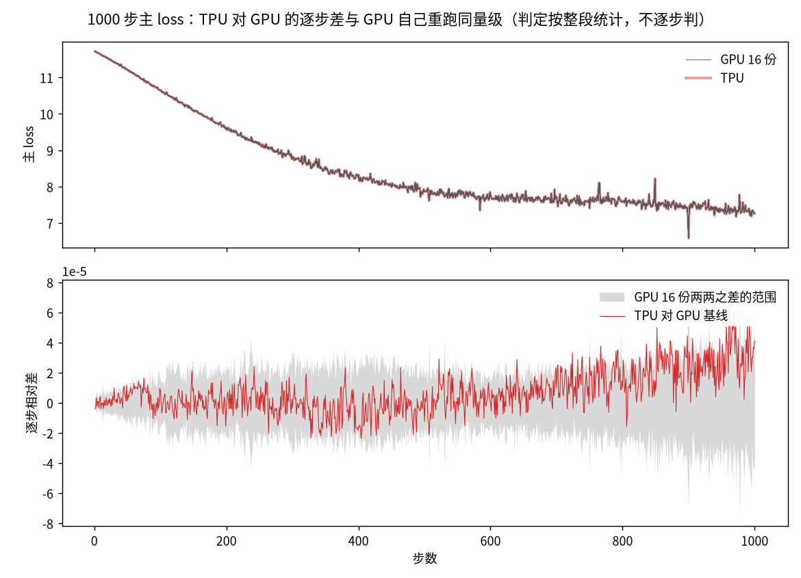
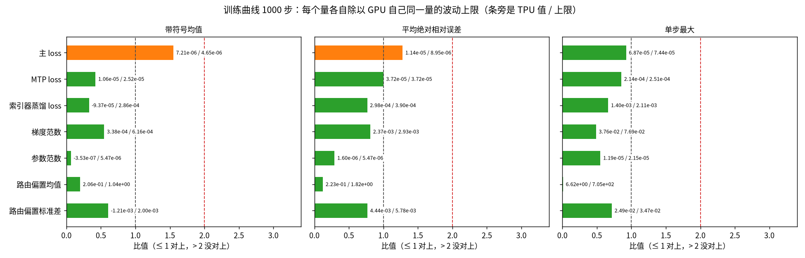

[janus](../../../../README.md) › [混元 4](../../README.md) › [mini](README.md) ｜ 对齐报告

# 混元 4 · mini · GPU → TPU 数值对齐报告

**对象**：hy4-mini（混元 4 全部结构、缩小宽度和层数的随机初始化模型，约 4.3 亿参数）。TPU（v5p，MaxText）和 GPU（B200 × 8，Megatron-Core）用同一份权重和数据各训练 1000 步，逐项比。结论只对这组条件成立（随机初始化；第 1 步只比 16 个路由专家里的 4 个；不用 8 位浮点 FP8），完整范围见[对齐细节](DETAILS.md#结论展开)。

**一句话现状：还不能签字**（签字＝正式宣布两边对齐了）。2026-11-11 起对齐配置关 splash 的 base2 指数（项目负责人定），现行比较换成关 base2 的 TPU 运行，噪声换成 GPU 16 份。训练 1000 步的 9 项曲线 7 项对上，主 loss 全程与后段 2 项略超（看的是带符号均值，即平均偏多少：TPU +7.21e-6、上限 4.65e-6，1.55 倍），没有一项不过；开、关 base2 各 4 份重复两组交叠，这份偏高与 base2 无关，8 份 TPU 主 loss 都偏高约 +4.3e-6，原因待查。挡签字的还有四件事，见「挡签字」。

## 现状

「对上」指 TPU 和 GPU 的差不超过 GPU 自己同设置重跑的波动上限；GPU 重跑量不出波动的地方，看 TPU 离精确值（CPU 上 64 位计算）是否不超过 GPU 的 1.2 倍。索引器是稀疏注意力里给 token（文本切分的最小单位）打分、挑出要看的位置的部件，蒸馏 loss 让它学完整注意力；路由偏置是 MoE 给每个专家加的负载平衡偏置。

| 层级 | 判定 | 关键数字 | 还差什么 |
|---|---|---|---|
| 地基：设置、数据、权重、配置 | 全部逐位相同 | 初始权重（8 张卡共 1,968 项）、每步输入数据指纹（65,000 项）、训练设置（69 项）都是 0 项不同 | — |
| 单算子 | 15 项：13 项对上，1 项只看不判，1 项没对上（已接受：32 位对数函数在 0.5–4 之间全部 2,517 万个数上 TPU 差 3 个最小精度单位、GPU 1 个；训练里实际出现的 629 万个输入上两边都是 1 个） | 99 个算子喂同一个输入，离精确值都不超过 GPU 的 1.2 倍 | — |
| 单层（层输出与层输入梯度） | 对上（所用配置比现行少两个开关：注意力可学习偏置项梯度照 GPU 写法、蒸馏 loss 记录值的稳定写法，后者不影响单层前向和反向） | 每层前向、反向离精确值都不超过 GPU 的 1.2 倍；最差的第 2 层输入梯度 GPU 1.23e-2、TPU 1.42e-2 | 在现行配置上重跑 |
| 第一步整网 | 205 个梯度里 177 个超出 GPU 三份之间的波动：171 个离精确值不超过 GPU 的 1.2 倍，6 个比 GPU 远（1 个已接受）；另 10 个 GPU 三份相同、离精确值都不超过 GPU 的 1.0 倍；18 个在波动内 | 6 个里 5 个是超连接（多路残差流）的小参数，最差一个离精确值 GPU 1.07e-3、TPU 6.40e-3；其中 3 个是关 base2 后新出现的，2026-11-09 对 base2 开那一代 6 个的接受不覆盖它们；另 1 个是 MTP 的 enorm（已接受） | 新出现的 3 个要定责；GPU 第一步参照只有 3 份，签字要 6 份 |
| 训练曲线（1000 步） | 9 项：7 项对上，2 项略超（主 loss 全程、后段；待查），没有不过 | 主 loss 带符号均值 TPU +7.21e-6、上限 4.65e-6；平均绝对相对误差 TPU 1.14e-5、上限 8.95e-6 | 查 TPU 主 loss 共同偏高 |
| 训练曲线（其他同配置运行） | 4 项：3 项对上，1 项略超（未定责） | 关 base2 的现行配置重跑两份 1000 步、开全量抓数 30 步，47 个逐步量都逐位相同；训练健康 6 条正常；最大注意力打分 1000 步平均绝对相对误差 TPU 2.02e-3、上限 1.86e-3（1.09 倍），前 300 步单步最大 1.05 倍（base2 开时已接受，关后没重做同一状态的证据） | 重做最大注意力打分的同一状态单步 |
| 其他尺寸（支线） | 中等模型 300 步曲线没有不过；真实权重截层（只取真实权重前一两层、有的另加一层 MTP 的小模型）带 MTP 的那个蒸馏 loss 不过（带符号均值 TPU +2.01e-3、上限 8.67e-4，那份运行早于修好的配置）；三个模型第一步整网都没对上 | 截层（项目的验收对象）8 条签字条件都没满足 | 下一步第 3 条 |

三条判法是看到结果后改的：路由选择按离精确值比（≤ 1.2 倍算过）、优化器一步的分辨率下限（两边离精确值都 < 2⁻⁸ ≈ 3.9e-3 就算过），这两条把原来不过的格子判成了过；第一步的分辨率下限（另要求 GPU 三份波动为 0）按它过的 5 个张量离精确值本来只有 GPU 的 0.72–0.95 倍，现行数据上不改判定。改前改后见[对齐细节「判法变更记录」](DETAILS.md#判法变更记录)。

## 训练曲线

GPU 同设置 16 份两两 120 对之差给出波动上限（各对之差的最大值；2026-11-11 前是 8 份 28 对）。逐步相对差 =（TPU − GPU 基线那一份）÷ GPU 基线（梯度范数也一样，2026-11-10 前梯度范数除以两边均值），统计窗口第 2–1000 步。三个量：**带符号均值**（逐步相对差直接平均，即平均偏多少，主指标）、**平均绝对相对误差**（取绝对值再平均，即平均晃多少）、**单步最大**（最坏一步差多少）。每格「TPU / 上限 / 比值」；判定取三个量里比值最大的：≤ 1 对上，> 2 没对上，中间略超。第 1 步不进统计。

| 量 | 判定 | 1000 步带符号均值 | 1000 步平均绝对相对误差 | 1000 步单步最大 |
|---|---|---|---|---|
| 主 loss | 略超，待查 | +7.21e-6 / 4.65e-6 / 1.55 | 1.14e-5 / 8.95e-6 / 1.28 | 6.87e-5 / 7.44e-5 / 0.92 |
| MTP loss | 对上 | +1.06e-5 / 2.52e-5 / 0.42 | 3.72e-5 / 3.72e-5 / 1.00 | 2.14e-4 / 2.51e-4 / 0.85 |
| 索引器蒸馏 loss | 对上 | −9.37e-5 / 2.86e-4 / 0.33 | 2.98e-4 / 3.90e-4 / 0.77 | 1.40e-3 / 2.11e-3 / 0.66 |
| 梯度范数 | 对上 | +3.38e-4 / 6.16e-4 / 0.55 | 2.37e-3 / 2.93e-3 / 0.81 | 3.76e-2 / 7.69e-2 / 0.49 |
| 参数范数（两边都比各自参数的精确范数） | 对上 | −3.53e-7 / 5.47e-6 / 0.06 | 1.60e-6 / 5.47e-6 / 0.29 | 1.19e-5 / 2.15e-5 / 0.55 |
| 路由偏置均值（注） | 对上 | 2.06e-1 / 1.04 / 0.20 | 2.23e-1 / 1.82 / 0.12 | 6.62 / 705 / 0.01 |
| 路由偏置标准差（注） | 对上 | 1.21e-3 / 2.00e-3 / 0.60 | 4.44e-3 / 5.78e-3 / 0.77 | 2.49e-2 / 3.47e-2 / 0.72 |

第 101–1000 步窗口主 loss 同样略超（1.52 倍），MTP loss 对上（1.00），[全表](DETAILS.md#第-1011000-步)。

注：路由偏置每个量各取最差的一层，上限取 GPU 每对在各层里的最大值；均值接近 0，单步最大的上限因此到 705。主 loss 略超的读数与已知情况见[对齐细节「待定的几项」](DETAILS.md#待定的几项)；base2 开的上一代（梯度范数、路由偏置标准差略超、已接受）见[历代比较](../../dashboard/history.md)。

前 300 步窗口在[对齐细节](DETAILS.md#前-300-步)。QK-Clip（注意力打分过大时缩小相关权重）阈值 100，训练健康那份运行（关 base2）里最大注意力打分最高 0.1493，没触发过。

图 1：上半幅细灰线 GPU 16 份、粗淡红线 TPU（几乎重合）；下半幅是逐步相对差，灰带是每一步 GPU 120 对之差的最大绝对值（判定按整段统计）。数据：`g3-a … g3-p`、`tz-off-rep` 的 `metrics.jsonl`，脚本 `analysis/plot_l4_figures.py`；上一代 `t1zg-a` 的图保留在 `figures/l4-main-loss.png`。

图 2：横条是各量（取绝对值）除以 GPU 同一量的波动上限；数取自 [`t1zo-l4.results.json`](results/t1zo-l4.results.json)。其余各量的逐步曲线在[对齐细节](DETAILS.md#训练曲线逐步图)。

## 生产配置建议

生产看两件事：离精确值更近还是更远，步时多花多少。「关掉」：只关这一个开关跑 300 步，写比值比全开升得最多的一项（倍数 = 这一项 ÷ GPU 波动上限，没写量名的是带符号均值，括号里是全开时）。这组对照的「全开」比现行少两个开关：注意力头偏置项梯度照 GPU 写法、蒸馏 loss 记录值的稳定写法（后者不改训练数值，但改蒸馏 loss 的记录值：表里「蒸馏 loss」几行的倍数是在旧记录写法上量的，全开 1.06（300 步）；现行配置 300 步 0.63、1000 步 0.69）。关掉按理不改数值的「QK-Clip 不含偏置项」比值也从 0.48 变到 0.93，升幅不到 0.45 的行标「波动内」，不能全归到开关。其余数来自单层、单算子或其他运行。步时代价也是只关一个开关、在 hy4-mini 上量的，不能外推到生产规模（输出头那项在中等模型上 +24.4%）。

一句话：生产开 9 行，再加上「梯度用 32 位」那行的前两项；不开 5 行（只为照 GPU）；注意力指数不用 2 为底；看情况 7 行，其中输出头最高精度（+23.7%）、索引器打分 32 位（+6.3%）、高精度指数对数（+3.0%）按精度与吞吐取舍，优化器与 loss 的 7 处看是否已有 GPU 上调好的超参，其余 3 行离精确值远近没测。

| 开关 | 生产 | 对精度的影响 | 步时代价 | 理由 | 详情（根源一览第几行） |
|---|---|---|---|---|---|
| MoE 路由偏置每步去掉均值 | 开 | 只 TPU 去均值时（最早一代配置、前 300 步）偏置均值 19.1 倍，两边都不去均值后 0.17 倍 | 未测 | 不去均值时偏置整体漂移；原版没有这一项 | [1][r1] |
| 矩阵乘跨设备的部分和用 32 位相加 | 开 | 关掉：参数范数 1.06 倍（全开 0.57） | +0.8% | 关时部分和先舍成 16 位 | [2][r2] |
| 归一化层（RMSNorm）只舍入一次 | 开 | 关掉：主 loss 1.24 倍（全开 0.48） | −0.2% | 舍一次不比两次差 | [2][r2] |
| 路由权重先舍 16 位、激活函数每个算子各舍一次 16 位（照 GPU） | 不开 | 关掉前者：路由偏置均值 0.86 倍（全开 0.17）；关掉后者：蒸馏 loss 1.46 倍（全开 1.06；波动内） | ±0.1% | 只为照 GPU | [2][r2] |
| 索引器的打分用真 32 位 | 看情况 | 关掉：路由偏置均值 1.07 倍（全开 0.17）；蒸馏输入离精确值 4.16e-3（GPU 3.55e-3），开着 3.44e-3 | +6.3% | 按精度与吞吐取舍 | [3][r3] |
| 输出头矩阵乘用最高精度 | 看情况 | 关掉：主 loss 单步最大 6.03 倍（全开 0.61） | +23.7% | 关时只算一遍 16 位：输出离精确值 2.73e-3，开着 8.3e-8 | [5][r5] |
| 重算（反向时重算前向以省显存）保存路由结果 | 开 | 关掉：反向时 0.117% 的路由位置重选；路由偏置均值 0.75 倍（全开 0.17） | 0.0% | 前后向路由一致 | [5][r5] |
| 索引器的权重投影乘 16 位模型权重（照 GPU；TPU 默认乘 32 位主权重） | 不开 | 关掉：蒸馏 loss 2.36 倍（全开 1.06） | +0.1% | 只为照 GPU | [5][r5] |
| 超连接四路相加按 GPU 的顺序依次相加（TPU 默认两两配对相加） | 看情况 | 关掉：主 loss 1.25 倍（全开 0.48） | +0.2% | 更近精确值未证实 | [6][r6] |
| 优化器与 loss 照原版 Megatron-Core 的 7 处：① Muon（一种优化器）的动量不做偏差修正（不除以 1−β^t，β 动量系数、t 步数）；② 标量参数用普通 Adam（另一种常用优化器）；③ 正交化前归一化写 x / max(‖x‖, 1e-7)；④ QK-Clip 缩放分母不加 1e-6；⑤ 蒸馏 loss 用原版截断与 log；⑥ 屏蔽文档边界时蒸馏 loss 按查询行数加权；⑦ MTP loss 按每卡 token 数重标 | 看情况 | 单测：①–③ 合计每步更新对原版 1.3e-1 → 1.3e-6；② 对 PyTorch 的 Adam 实现：开着 ≤ 1e-5，单独关时 0.56；③ 约 1e-6；④ 估算 ≤ 1e-8；⑤ 尖锐分数上 > 1e-4；⑥ 估算 ≤ 2.4e-3；⑦ 未量 | 未测 | 两种写法都合法；有 GPU 上调好的超参时开 | [7][r7]、[9][r9] |
| Muon 每步把更新矩阵正交化的迭代用 16 位操作数（照 GPU；TPU 默认 32 位） | 不开 | 关掉：蒸馏 loss 1.30 倍（全开 1.06；波动内） | +1.1% | 更新量离精确值的中位数：关时 3.0e-3，开时 3.95e-2 | [10][r10] |
| QK-Clip 的最大打分不含注意力头的可学习偏置项 | 开 | 关掉：主 loss 0.93 倍（全开 0.48；推断是编译结果变了，不是开关本身的作用） | +0.9% | 它不是查询向量与键向量（q、k）相乘得到的，缩小 q、k 压不住它 | [12][r12] |
| 指数、对数用高精度实现 | 看情况 | 关掉：蒸馏 loss 2.95 倍（全开 1.06） | +3.0% | 误差从 105 / 62 个最小精度单位降到 1 / 3 个 | [13][r13] |
| 超连接的分支输入与流强制舍 16 位（照 GPU；推断 TPU 编译器省掉了这次往返） | 不开 | 关掉：主 loss 1.01 倍（全开 0.48）；更早的配置上 1000 步打开前后 2.12 → 0.76 倍 | +0.1% | 只为照 GPU | [16][r16] |
| 小张量 Adam 的精确除法与开方 | 开 | 关掉：主 loss 0.86 倍（全开 0.48；波动内）；小张量更新离精确值 5.70e-6（GPU 1.49e-6），开着 1.49e-6 | +0.1% | 更近精确值 | [17][r17] |
| MoE 路由权重在激活之后、下投影（前馈层把放大的向量压回的那次矩阵乘）之前乘（照 GPU；TPU 默认在下投影之后乘） | 看情况 | 关掉：主 loss 2.09 倍（全开 0.48） | +0.2% | 远近没测 | [19][r19] |
| 上投影（前馈层先把向量放大的两次矩阵乘）的输入梯度合并后只舍一次（照 GPU 的融合实现） | 看情况 | 关掉：主 loss 0.73 倍（全开 0.48；波动内）；只开它、不开上一行时 1000 步主 loss 1.91 倍（两个都开 0.65、都关 0.70），原因未查清 | −1.8% | 远近没测 | [20][r20] |
| 注意力头可学习偏置项的梯度用 32 位 | 开 | 不开：单层离精确值是 GPU 的 1.62–2.88 倍，开着 0.61–2.00 倍；只开它时 1000 步主 loss 0.65 → 1.32 倍 | 未测 | 更近精确值 | [21][r21] |
| 同一梯度照 GPU 写法：每个位置先舍 16 位、概率与求和用 32 位（TPU 默认把概率舍成 16 位再在 16 位里求和） | 不开（生产用上一行） | 开着：单层离精确值是 GPU 写法的 1.000–1.001 倍 | +3.9% | 只为照 GPU | [21][r21] |
| 索引器蒸馏 loss 记录值改用数值稳定的写法 | 开 | 不开：1000 步蒸馏 loss 1.06 倍，开着 0.69 倍；梯度逐位不变 | 无 | 只改记录下来的值 | [25][r25] |
| 词嵌入、归一化层权重、输出层权重的梯度用 32 位 | 前两项开，第三项看情况（对齐配置都没开） | 不开：编译器不留 32 位时词嵌入梯度离精确值是 GPU 的 26.1 倍（开着 1.06），默认设置 0.96 倍（开着 0.92）；截层 9 个归一化权重梯度中位数 1.60 倍（开着 0.98）；输出层未量 | 无 / 未测 / 未测 | 少一次 16 位舍入 | [22][r22]、[23][r23] |
| 路由打分用 32 位和最高精度 | 开 | TPU 上 32 位矩阵乘默认只算一遍 16 位：相对误差 2.34e-3，最高精度 9.86e-8；混元 4 上没做关掉的对照，开着路由打分离精确值 GPU 1.13e-6、TPU 1.20e-7 | 在重跑波动内（−0.11% 至 +0.22%） | 更近精确值 | [26][r26] |
| 注意力指数用 2 为底 | 生产不用；对齐也不用（2026-11-11 起） | 用：前向离精确值约大 30 倍；不用：1000 步主 loss 开、关各 4 份交叠（开 0.90–1.69、关 0.93–1.55），早先单份的 1.91 倍（用时 0.36）是轨迹偶然 | +0.1% | 生产看精确值；对齐与生产一致 | [24][r24] |

[r1]: ../../ROOT-CAUSES.md#r1
[r2]: ../../ROOT-CAUSES.md#r2
[r3]: ../../ROOT-CAUSES.md#r3
[r5]: ../../ROOT-CAUSES.md#r5
[r6]: ../../ROOT-CAUSES.md#r6
[r7]: ../../ROOT-CAUSES.md#r7
[r9]: ../../ROOT-CAUSES.md#r9
[r10]: ../../ROOT-CAUSES.md#r10
[r12]: ../../ROOT-CAUSES.md#r12
[r13]: ../../ROOT-CAUSES.md#r13
[r16]: ../../ROOT-CAUSES.md#r16
[r17]: ../../ROOT-CAUSES.md#r17
[r19]: ../../ROOT-CAUSES.md#r19
[r20]: ../../ROOT-CAUSES.md#r20
[r21]: ../../ROOT-CAUSES.md#r21
[r22]: ../../ROOT-CAUSES.md#r22
[r23]: ../../ROOT-CAUSES.md#r23
[r24]: ../../ROOT-CAUSES.md#r24
[r25]: ../../ROOT-CAUSES.md#r25
[r26]: ../../ROOT-CAUSES.md#r26

## 挡签字的四件事

8 条签字条件见[对齐细节「离签字还差什么」](DETAILS.md#离签字还差什么)。还没满足的：

| 事项 | 现在知道什么 | 要做什么 |
|---|---|---|
| 第一步整网 177 个梯度超出 GPU 三份之间的波动（现行配置，base2 关） | 171 个离精确值不超过 GPU 的 1.2 倍、算已查明来源；另 6 个比 GPU 远：MTP enorm 已接受，5 个超连接小参数里 3 个是关 base2 后新出现的、没有接受；签字原则规定查明来源替代不了「在波动内」 | 给新出现的 3 个定责；按签字原则维持未满足 |
| GPU 第一步的参照只有 3 份 | 签字要求至少 6 份、两两 15 对 | GPU 再跑至少 3 份第一步 |
| 参照答案和 GPU 生产程序之间没比过 | 参照答案用本仓库自写的训练入口，注意力内核与生产不同；已知的那处精度差已改成和生产一样 | 用生产程序跑一份同设置训练，量差 |
| 三条事后判法的前瞻验证（真实权重；判法事先固定，再看新结果） | 三条都在看到 mini 结果后改，已在比较协议事先登记 | 真实权重截层下一批运行（第一步、优化器一步、路由选择四步）按登记判 |

## 下一步

1. 查 TPU 主 loss 共同偏高（8 份都高约 +4.3e-6，与 base2 无关）：先看从哪一段开始，再在同一状态上分开前向差与轨迹差；关 base2 后低阈值 QK-Clip 第 4 层与第一步新出现的 3 个超连接小参数一并查。
2. GPU 补跑至少 3 份第一步参照。
3. 用 GPU 生产程序跑一份同设置的训练，和参照答案比。
4. 真实权重截层：先按事先登记的三条判法做前瞻验证；再补单算子、单层与地基缺的数据、初始权重、配置三项，给第一步的超出定责（查清来源），重跑蒸馏 loss 不过的那份。

依据都在[知识库](../../knowledge.md)：[根源一览](../../ROOT-CAUSES.md)是偏差的唯一主表；[对齐细节](DETAILS.md)放适用范围、签字清单、覆盖缺口、偏差状态索引、开关表与证据索引。
