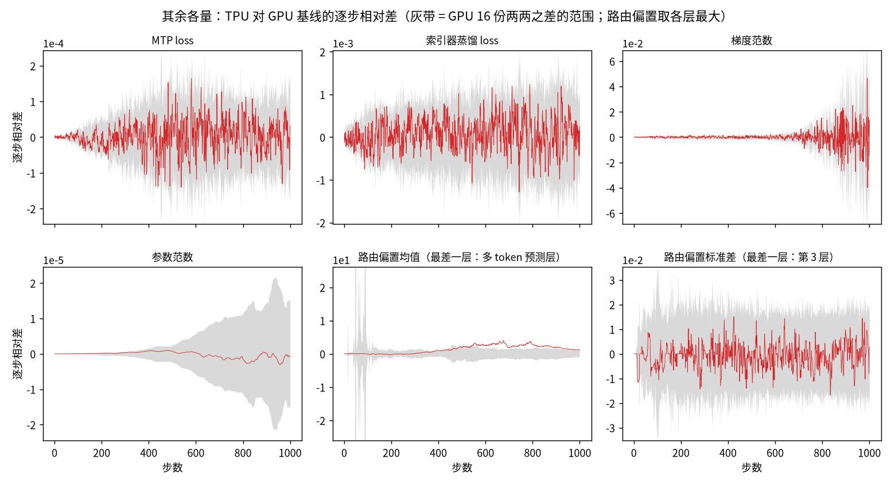

[janus](../../../../README.md) › [混元 4](../../README.md) › [mini](README.md) ｜ 对齐细节（知识库）

# 混元 4 · mini（hy4-mini）· 对齐细节

知识库页，是[对齐报告](ALIGNMENT-REPORT.md)的全部依据：带开关名与台账编号的生产建议、签字清单、判法与代号、各级现状、偏差状态索引（机制与读数在根源一览）、开关表、测量口径、证据索引。术语见[知识库的术语对照表](../../knowledge.md#术语对照表)。

**对象**：hy4-mini（混元 4 全部结构，只缩宽度与个数；427,783,489 参数，7 层 + 1 层 MTP，随机初始化），两边同一份权重、同一份数据训练 1000 步；GPU B200 × 8（Megatron-Core），TPU v5p 2x2x2（MaxText）。

逐格结果在[总览](../../dashboard/dashboard.md)与[检查清单](CHECKS.md)，根因与修法在[根源一览](../../ROOT-CAUSES.md)；N（噪声上限：GPU 同设置重跑两两配对里的最大值；前 300 步 8 份 28 对，1000 步 16 份 120 对（2026-11-11 起））、r（差 ÷ N，≤ 1 过，1–2 待定，> 2 不过）、R（离 FP64 之比，≤ 1.2 过）、MARE（逐步相对差绝对值的平均）、带符号均值（逐步相对差的平均）等读法见[总览细节「读法」](../../dashboard/detail.md#读法)，代号见第 1 节。

**现状：还不能签字。** 以现行比较 tc-a（C 口径）为准：L4 没有不过，主 loss 过；L3、L2 与低阈值 QK-Clip 是 C 口径之前的读数，要重判；挡签字的事项见「[离签字还差什么](#离签字还差什么)」第一张表。

| 级别 | 判定 | 关键数字（比什么：GPU 或 N，TPU，比值） | 还差什么 |
|---|---|---|---|
| 总览 mini 列 | ✅ 33　🟡 6　❌ 2 | — | 逐项见「[离签字还差什么](#离签字还差什么)」 |
| L0 设置 / 数据 / 权重 / 配置 | ✅ 10 | 转换往返 212 / 212 逐位；TPU 对 GPU 初始参数 0 / 1,968 不同；输入指纹 65,000 项 0 不同；配置 108 项（含 39 个精度开关）0 不同（`tc-l0-config`） | — |
| L1 单算子 | ✅ 12　🟡 1　❌ 2 | 逐算子回放 99 个全过，最差交叉熵：GPU 3.33e-8，TPU 3.82e-8，R 1.15；FP32 log：门槛 1 ulp，TPU 3 ulp；低阈值 QK-Clip 第 1 步逐头最大 logit（关 base2）第 4 层：GPU 2.97e-3，TPU 4.61e-3，R 1.55 | log 已定责、已接受（[D14](#d14)）：真实输入上 1 ulp；M51 可到 ≤ 1 ulp，但整网开它后换了轨迹，不进对齐配置；QK-Clip 第 4 层未定责（[D31](#d31)）；🟡 是 KD 值诊断 |
| L2 逐层 | ✅ 1　🟡 1（只统计） | 最差第 2 层层输入梯度：GPU 1.23e-2，TPU 1.42e-2，R 1.16 | 逐层回放没有 M42b、M50，且 base2 开；翻转统计用的也是 base2 开的抓数 |
| L3 第 1 步整网 | ✅ 2　🟡 1 | C 口径之前的配置（`tz-off-rep`；C 口径改了第 1 步梯度，没重判）训练步梯度对 GPU 第 1 步参照 6 份 15 对（2026-11-11 从 3 份补到 6 份）：205 个张量里 169 个超出 N，167 个 R ≤ 1.2；超出 N 而 R > 1.2 的 2 个：第 3 层注意力前 `hc_scale` 计入未定责（1.05 N；GPU 1.19e-3，TPU 6.40e-3，R 5.36），MTP `enorm` R 1.24 另列（[D13](#d13)），两个都按 D11 豁免规则单列（豁免规则与沿用待复核）；优化器一步对 FP64 全过；路由一致率四步都过 | 第 3 层 `hc_scale` 要定责，或复核 D11 豁免规则后单列（[D11](#d11)）；3 份 3 对时是 177 个超出 N、5 个 iHC 未定责、❌（PROTOCOL 变更记录 2026-11-11「L3 尺子 6 份」） |
| L4 1000 步 | 过 8　待定 1 | 主 loss MARE：N 8.95e-6，TPU 8.75e-6，r 0.98（带符号均值 0.76）；第 101 步起 0.97；路由偏置均值带符号均值：N 1.04，TPU 1.36，r 1.31（C 口径另 4 份 0.36–0.80）；C 口径 5 份都没有不过 | 路由偏置均值一份超，未定责；后段残余 +6.6e-6 的机制（[D30](#d30)） |
| L4 前 300 步 | 过 8　待定 1 | grad_norm MARE：N 3.85e-4，TPU 3.88e-4，r 1.01；主 loss 0.87 | grad_norm 待定（C 口径另 4 份 0.81–0.92；base2 开时的接受是否沿用尚未决定，[D2](#d2)） |
| L4 其他同配置运行（C 口径之前） | 过 3　待定 1 | 健康信号 6 条全过；同设置重跑 47 个逐步量 0 不同；开全量抓数对不抓 47 个逐步量 0 不同（现行配置 1000 步、base2 开那一代 30 步）；QK-Clip 全局最大 logit（`tz-off-qkq`）1000 步 MARE：N 1.86e-3，TPU 2.02e-3，r 1.09；前 300 步单步最大 r 1.05 | QK-Clip 待定（base2 开时的接受是否沿用尚未决定，[D29](#d29)） |
| 其他尺寸（支线） | B 无不过；D1 KD 不过；第 1 步各尺寸都不过 | D1 索引器 KD 带符号均值：N 8.67e-4，TPU +2.01e-3，r 2.32（那一代早于 M50） | D1 用 M50 重跑；截层 B、D1 逐算子与逐层没做（[跨尺寸看](#跨尺寸看)） |
| 适用范围 | — | — | 结论只对随机初始化的 hy4-mini 成立；项目的验收对象是截层真实权重，签字条件见 [real-weight 签字清单](../02-real-weight/ALIGNMENT-REPORT.md#签字清单) |

## 生产配置建议

对齐配置打开了一些只改舍入位置、生产不需要的开关。口径：**生产**一栏只写开 / 不开 / 看情况，看对真值（CPU FP64）的误差加步时代价；「不开（只为对齐）」指开着只改舍入位置以照 GPU、多舍一次 BF16，对 FP64 没实测的在理由栏注明。代价 = 全开步时 ÷ 只关这一个开关的步时 − 1，hy4-mini 上量（第 6 节，不能外推到生产规模）。

| 开关（台账） | 生产 | 代价 | 理由 | 根源一览 |
|---|---|---|---|---|
| 路由偏置零均值更新 `routed_bias_zero_mean_update: true`（G14） | 开 | 单开没测；和学习率调度、YaRN 三项一起改的生产配方臂（P1，诊断）有一组：GPU 8 份两两 28 对当尺子，9 项全过（最差索引器 KD r 0.996），TPU 只 1 份、尺子是事后选的，单开零均值没测（[`t1pr-l4-gpu8`](results/t1pr-l4-gpu8.results.json)、[对齐报告「适用范围」](ALIGNMENT-REPORT.md#适用范围测过什么没测什么)） | 不减均值时偏置的共同分量会漂移；原版 Megatron-Core 没有这一项，对齐时两边都关 | [第 1 行](../../ROOT-CAUSES.md#r1) |
| `dense_fp32_accumulation`（M12） | 开 | +0.8% | 关时分片部分和先舍 BF16 | [第 2 行](../../ROOT-CAUSES.md#r2) |
| `rmsnorm_single_rounding`（M9） | 开 | −0.2% | 只舍一次，不比两次差 | [第 2 行](../../ROOT-CAUSES.md#r2) |
| `routed_gate_bf16_rounding`（M8）、`mlp_activation_round_per_op`（M10） | 不开（只为对齐） | ±0.1% | 多舍一次 BF16（推断，对 FP64 未测） | [第 2 行](../../ROOT-CAUSES.md#r2) |
| `indexer_fp32_scores`（M23） | 看情况：开着索引器打分是真 FP32（对 FP64 更准），代价 +6.3%，按精度与吞吐取舍 | +6.3% | 关时 KD 输入离 FP64 更远（教师 q：GPU 3.55e-3，TPU 4.16e-3，R 1.17） | [第 3 行](../../ROOT-CAUSES.md#r3) |
| `logits_matmul_precision: highest`（M13） | 看情况：开着输出头是真 FP32（对 FP64 更准），代价 +23.7%，按精度与吞吐取舍 | +23.7% | 关掉时输出头 FP32 矩阵乘只算一遍 BF16（训练后权重重放：输出头 logits 对 FP64 开 8.3e-8、关 2.73e-3） | [第 5 行](../../ROOT-CAUSES.md#r5) |
| `remat_policy: custom`（M26） | 开 | 无 | `full` 重算在反向重选路由（语义） | [第 5 行](../../ROOT-CAUSES.md#r5) |
| `indexer_weights_proj_bf16_weight`（M27） | 不开（只为对齐） | +0.1% | 乘 FP32 主权重少一次舍入 | [第 5 行](../../ROOT-CAUSES.md#r5) |
| `ihc_stream_sum_unrolled`（M28） | 看情况：对 FP64 更准未证实，代价 +0.2% | +0.2% | 相加顺序同 GPU；上一代第 1 步对 FP64 的改善没复现 | [第 6 行](../../ROOT-CAUSES.md#r6) |
| 语义约定 `muon_mcore_nesterov`、`muon_adam_plain`、`muon_mcore_ns_normalize`、`qk_clip_mcore_denominator`、`indexer_kd_mcore_log`、`indexer_kd_mcore_weight`、`mtp_loss_mcore_per_rank`（M15–M18、M20–M22） | 看情况：已有在 GPU 上调好的超参时开 | 未测 | 两种写法都合法 | [第 7 行](../../ROOT-CAUSES.md#r7) |
| `muon_mcore_ns_bf16`（M30） | 不开（只为对齐） | +1.1% | 关时 Muon 增量对 FP64 中位数 3.0e-3，开时 3.95e-2 | [第 10 行](../../ROOT-CAUSES.md#r10) |
| `qk_clip_max_logit_exclude_sink`（M25，须与 M35 一起） | 开 | +0.9% | sink 不是 q·k，缩放 q / k 降不了它 | [第 12 行](../../ROOT-CAUSES.md#r12) |
| `transcendental_accuracy_highest`（M32，含 M37、M39） | 看情况：开着 FP32 exp / log 接近正确舍入，代价 +3.0%，按精度与吞吐取舍 | +3.0% | exp 105 → 1 ulp、log 62 → 3 ulp | [第 13 行](../../ROOT-CAUSES.md#r13) |
| `ihc_force_bf16_rounding`（M36） | 不开（只为对齐） | +0.1% | 多舍一次 BF16；对 FP64 未测 | [第 16 行](../../ROOT-CAUSES.md#r16) |
| `muon_adam_accurate`（M34） | 开 | +0.1% | Adam 小张量的更新对 FP64：GPU 1.49e-6，TPU 5.70e-6 → 1.49e-6，R 3.82 → 1.00 | [第 17 行](../../ROOT-CAUSES.md#r17) |
| `moe_mcore_prob_before_fc2`（M40）、`mlp_fused_fc1_dgrad`（M41） | 看情况：对 FP64 未测 | +0.2% / −1.8% | M41 少舍一次 BF16 且更快；单开 M41 时整网离 GPU 更远（1000 步主 loss 带符号均值 r 1.91，GPU 8 份尺子），但只有开、关各一份运行；同一把尺子下，base2 开、关各 4 份（组内只差执行方式）的主 loss 带符号均值 r 就在 0.36–2.08 之间（[`mini-base2-loo.json`](gpu-noise/results/mini-base2-loo.json) 的 `loss_signed_mean` ÷ 8 份尺子上限 3.78e-6），没排除轨迹偶然（[知识库](../../knowledge.md#mini-上关-base2-为什么离-gpu-更远要点与出处)） | [第 19 行](../../ROOT-CAUSES.md#r19)、[第 20 行](../../ROOT-CAUSES.md#r20) |
| `splash_dsinks_fp32`（M42） | 开 | 未测 | sink 梯度对 FP64 比默认写法近（单层 R 1.62–2.88 → 0.61–2.00） | [第 21 行](../../ROOT-CAUSES.md#r21) |
| `splash_dsinks_gpu_order`（M42b） | 不开（只为对齐） | +3.9% | 照 GPU 写法 | [第 21 行](../../ROOT-CAUSES.md#r21) |
| `indexer_kd_generalized_kl`（M50） | 开 | 无（只改记录值） | KD 记录值对 FP64 在 1 个 FP32 ulp 以内，梯度逐位不变 | [第 25 行](../../ROOT-CAUSES.md#r25) |
| `embedding_grad_fp32` | 开（对齐配置没开） | 未测 | 不依赖后端的 excess precision 行为 | [第 22 行](../../ROOT-CAUSES.md#r22) |
| `rmsnorm_scale_grad_fp32` | 开（对齐配置没开） | 未测 | 去掉 dγ 多舍的一次 BF16 | [第 23 行](../../ROOT-CAUSES.md#r23) |
| `logits_dense_wgrad_fp32` | 看情况 | 未测 | 输出层权重梯度以 FP32 落地；混元 4 上没单独量 | [第 22 行](../../ROOT-CAUSES.md#r22) |
| 路由 logits 精度 `float32_gate_logits` + `router_matmul_precision: highest` | 开（对齐配置已设：写在 MaxText 的模型配置 `configs/models/hy4-mini.yml` 里，hy4-preview、hy4-mid 同，MaxText `b87a55aa` 核过；本仓库的对齐 yml 不重复设） | 混元 4 上未测；混元 3 的缩小模型在 v7x 上在重跑波动内（−0.11% 至 +0.22%） | 路由 logits 对 FP64：GPU 1.13e-6，TPU 1.20e-7；没有关掉的对照。默认精度只算一遍 BF16 的误差（2.34e-3）来自 一次实际排查 在 v7x 上的随机输入单算子，本仓库没有结果文件 | — |
| `sa_use_base2_exp`（M43） | 生产设 `false`；对齐设 `false`（2026-11-11 起，之前对齐开） | 设 `true` 比 `false` 慢 0.1%（`false` 无代价） | 前向 logsumexp 对 FP64 最大绝对差：`true` 8.5e-5–1.5e-4，`false` 3.6e-6–4.3e-6；但设 `false` 时整网离 GPU 更远（1000 步主 loss 带符号均值：N 3.78e-6，TPU 1.36e-6 → 7.21e-6；对 8 份 GPU 的 r 中位数 0.51 → 2.06）。换 16 份尺子并各补一份只改执行方式的重跑后，开、关两组交叠（主 loss r：开 0.90、1.24，关 1.55、1.06），开、关各补到 4 份后两组完全交叠（主 loss r 开 0.90、1.24、1.02、1.69，关 1.55、1.06、0.93、0.95；GPU 16 份留一法 0.77–0.97），是轨迹偶然。8 份 TPU 主 loss 都偏高约 +4.3e-6，与 base2 无关（[知识库](../../knowledge.md#mini-上关-base2-为什么离-gpu-更远要点与出处)） | [第 24 行](../../ROOT-CAUSES.md#r24) |
| `hc_head_force_bf16_rounding`（M52） | 不开（只为对齐；T1 还没开，见第 28 行） | 未测 | 多舍一次 BF16（同 M36）；对 FP64 未测 | [第 28 行](../../ROOT-CAUSES.md#r28) |

对齐开关全开对全关：hy4-mini +44.6%（300 步，不含 M42b、M50），hy4-mid +46.8%（40 步，不含 M39–M41），两边量法不同不宜直接比；mid 上 M13 一项约占 60%。无开关、已默认生效的修 bug：M1、M19、M35。

### 推荐组合整体跑一次

上表是逐个开关各跑 300 步得出的。2026-11-11 把推荐组合整体跑了 1000 步（`x5-prod`，回放 `g3-a` 的数据）：C 口径之前的对齐配置再开 M42、`embedding_grad_fp32`、`rmsnorm_scale_grad_fp32`，关只为对齐的 M8、M10、M27、M30、M36、M42b；「看情况」各行照对齐配置；路由偏置零均值更新是语义差、GPU golden 没有，照对齐配置关。另跑两份只改执行方式的重复（scoped VMEM 上限 64 / 32 MiB）。判法同现行比较 `t1zo-l4`（GPU 16 份 120 对尺子）；对照是现行 `tz-off-rep` 与它只改执行方式的 3 份。r 是三个判定量里最大的那个（[`t1zp-l4`](results/t1zp-l4.report.md)、[`t1zp300-l4`](results/t1zp300-l4.report.md)、[`t1zp-repeats.json`](results/t1zp-repeats.json)）：

| 检查（1000 步） | C 口径之前的对齐配置 `tz-off-rep`（4 份范围） | 推荐组合 `x5-prod`（3 份范围） |
|---|---|---|
| 主 loss 全程 / 后段 | 🟡 1.55 / 🟡 1.52（0.93–1.55 / 0.92–1.52） | ✅ 0.83 / ✅ 0.80（0.83–0.94 / 0.80–0.91） |
| MTP loss | ✅ 1.00（0.88–1.00） | ✅ 0.98（0.92–0.98） |
| 索引器 KD | ✅ 0.77（0.77–1.00） | 🟡 1.26（1.23–1.26） |
| grad_norm | ✅ 0.81（0.81–0.92） | ✅ 0.86（0.84–0.88） |
| param_norm | ✅ 0.55（0.30–0.55） | ✅ 0.54（0.39–0.74） |
| 路由偏置均值 / 标准差 | ✅ 0.20 / ✅ 0.77（0.20–0.91 / 0.77–0.87） | ✅ 0.54 / ✅ 0.86（0.40–1.00 / 0.86–0.94） |
| 合计 | 过 7、待定 2 | 过 8、待定 1、不过 0（另两份：过 7–8、待定 1–2、不过 0） |

- **1000 步与现行对齐配置相当，没有不过项；前 300 步索引器 KD 不过**：1000 步三份都没有不过项，但索引器 KD 三份都待定（1.23–1.26，现行 `tz-off-rep` 0.77，见下）。前 300 步窗口（对 `g2-a`，GPU 8 份 28 对尺子）三份都是 KD 不过，主 loss 与 grad_norm 待定（1.01–1.38、1.27–1.36；现行 1.10、1.23）；`x5-prod`、`x5-prod-vm64` 两份其余 6 项都过（过 6、待定 2、不过 1），`x5-prod-vm32` 主 loss 第 101 步起也待定（1.13），过 5（[`t1zp-repeats.json`](results/t1zp-repeats.json) 的 `window_1_300`）。主 loss 偏近，但两组交叠：第 2–1000 步对 GPU 16 份逐步均值的相对差平均 −3.6e-7、+7.2e-7、+3.85e-6，现行对齐 4 份 +2.6e-6 – +7.4e-6；GPU 留一法 −2.6e-6 – +2.3e-6，组合 3 份里 2 份落在这个范围里，对齐 4 份都在范围外。其余 5 项两组交叠。
- **前 300 步合计**（[`t1zp300-l4`](results/t1zp300-l4.report.md)：默认执行方式的 `x5-prod` 一份对 `g2-a`，GPU 8 份 28 对尺子）：过 6、待定 2、不过 1。待定的是主 loss（MARE r 1.01）与 grad_norm（MARE r 1.27），不过的是索引器 KD。
- **索引器 KD 更远**：1000 步三份都待定；前 300 步窗口（对 `g2-a`）三份都不过，带符号均值 −6.6e-4 – −7.2e-4，N 1.38e-4，r 4.78–5.23（现行 0.94）。第 1 步 KD 的相对差 d0 是 +2.95e-4（现行 `t1zo300-l4` −1.39e-4），但这一项不来自 M27：单开关对照里只关 M27 时 d0 与全开相同（都是 1.13e-4，推断是第 1 步主权重还在 BF16 格点上，乘 BF16 权重与乘 FP32 主权重没有区别），改 d0 的是前向的开关（只关 M36 时 1.13e-4 → 5.05e-4，只关 M10 时 → 1.29e-4；`tq-*-l4.report.md`）。之后 300 步的偏负推断主要来自关 M27（索引器 `weights_proj` 改乘 FP32 主权重，GPU 乘 BF16 权重）：单开关 A/B 里只关 M27 时 300 步 KD 带符号均值 −3.25e-4、不过；单开关里另一个变负的是只关 `transcendental_accuracy_highest`（M32；T1 打开它记在台账 M33，−4.07e-4），组合里它照开；组合里没做再开回 M27 的对照。这一项只说明离 GPU 远，对 FP64 没比。
- 主 loss 为什么偏近没拆：组合同时改了 sink 梯度、norm 权重梯度、iHC 舍入等几处。[D30](#d30) 后段主因是 iHC 流梯度的舍入写法（M58），组合关了 M36、也没开 M58，它与后段的关系没查。
- 步时：0.472 s 对现行配置 0.496 s（第 11–1000 步中位数，−4.8%），hy4-mini 上量。

## 适用范围

| 项 | GPU | TPU |
|---|---|---|
| 硬件与程序 | B200 × 8，Megatron-Core 0.20 + TE（NeMo 26.10 镜像） | v5p 2x2x2（8 个设备），MaxText 集成分支 `b87a55aa` |
| 软件版本 | NeMo 26.10（digest `fc75bf51…`）：CUDA 13.4、Megatron-Core 0.20.0；TE 2.20.2、cuBLAS 13.8.1、cuDNN 9.26.0 在同一镜像的训练 Pod 里实测（见 [setup](setup.md#软件版本)） | jax 0.11.1、libtpu 0.0.46（构建 `cl/963683785`），镜像 digest `b152355a…`；tokamax 0.0.14（镜像自带） |
| 并行与重算 | 数据并行 8、专家并行 4、整层重算；分布式优化器不开 | FSDP 8 |
| 模型与权重 | hy4-mini 随机初始化（项目的验收对象是截层真实权重，见 [real-weight 的报告](../02-real-weight/ALIGNMENT-REPORT.md)） | 同左 |
| 训练设置 | 1000 步、常数学习率 1e-5、权重衰减 0；全局批 16（8 卡 × microbatch 1 × 累积 2）、序列 4096、fineweb-edu；BF16 混合精度，没有 FP8 | 同左 |
| 第 1 步比较范围 | 路由专家只比 16 个里的 4 个（rank 0 本地的 0–3 号） | 同左 |

版本的逐项出处见 [`setup.md`「软件版本」](setup.md#软件版本)。结论在这些版本上测得；换 libtpu 或 jax 不能假定只换了求和顺序，要按 [`libtpu-052.md`](../04-tpu-self/libtpu-052.md) 的做法重测。

## 结论展开

### 拿什么当参照

golden 是对齐的参照答案，取 GPU 一侧跑出来的结果，TPU 要做到和它的差不超过 GPU 自己重跑的噪声。**语义**以 TPU 一侧 MaxText 的混元 4 实现为准：模型结构的缺口 GPU 照它补；优化器与 loss 的细节 MaxText 加默认关的开关去对上原版 Megatron-Core（[`PROTOCOL.md`](../../PROTOCOL.md) 第 1.2 节）。golden 不是生产程序（第 3 节末）。

### 怎么比、比的结果

TPU 只和 GPU 基线一份逐步比，不取平均、不挑最差；N 来自 GPU 同设置重跑：1000 步 16 份两两 120 对（`g3-a … g3-p`，2026-11-11 起；之前 8 份 28 对），前 300 步窗口另一组 8 份两两 28 对（`g2-*`）；TPU 对 8 份各比一次只作诊断（[`PROTOCOL.md`](../../PROTOCOL.md) 第 3 节）。

### 其余各级

| 级 | 用的配置 | 结果 |
|---|---|---|
| L0 | 以现行比较 tc-a 为准：学习率（`tc-l0-settings`）与配置逐项（`tc-l0-config`）核的是 `tc-a`；输入指纹仍是 base2 开的上一代 `t1zg-a`（`t1zg-l0-data`）；权重、转换不依赖运行 | 学习率每步等于 1e-5；212 个张量名字、形状、dtype 对上，转换往返 212 / 212、RoPE 去交错 32 / 32 逐位；TPU 对 GPU 初始参数 0 / 1,968 不同，载入对检查点 0 / 1,647 不同；输入指纹 65,000 项、负对照过；Muon / Adam 分区 239 个参数一致；配置 108 项（结构 37、训练设置 20、登记值 12、精度开关 39，含 `sa_use_base2_exp` 与 C 口径的 M52、M58）不同 0（上一代 `tz-off-rep` 106 项，不同 0） |
| L1 | 各项最新的回放 | 逐算子回放 99 个全过（最差交叉熵：GPU 3.33e-8，TPU 3.82e-8，R 1.15）；优化器 8 步回放最差 R 1.03（GPU 1.36e-2，TPU 1.41e-2）；低阈值 QK-Clip 第 1 步逐头最大 logit：关 base2 的现行配置第 4 层 R 1.55，不过（GPU 2.97e-3，TPU 4.61e-3，[D31](#d31)），base2 开时最差 MTP 层 R 1.05（GPU 8.24e-3，TPU 8.64e-3，[D15](#d15)）；真实权重截层第 0 层单算子 10 个全过（最差 iHC 混合 R 1.00，GPU、TPU 都是 2.08e-3） |
| L2 逐层回放 | 上一代开关（没有 M42b、M50；base2 开） | 对 CPU FP64 全过，最差第 2 层层输入梯度：GPU 1.23e-2，TPU 1.42e-2，R 1.16 |
| L2 翻转统计（只统计） | base2 开的上一代抓数（第 1 步 `tw-ra1b`；含 M42b；M50 不改前向，选择相同） | 路由最差第 1 步第 1 层翻转率：GPU 1.54e-2，TPU 1.53e-2，R 0.988；DSA top-k 最差第 8 步第 0 层不重合率：GPU 6.68e-4，TPU 6.67e-4，R 0.999 |
| L3 | C 口径之前的配置（`tz-off-rep`；C 口径改了第 1 步梯度，要重判），训练步实际用的梯度（由第 1 步动量反推；诊断程序梯度只作旁证） | 对 CPU FP64 待定（第 4 节注 2）；噪声是 GPU 第 1 步参照 6 份两两 15 对（`g2s-a … g2s-f`；3 份 3 对时判不过）；205 个张量里 169 个超出 N、35 个超出 2N，这一级靠对 FP64 定责；优化器一步本身对 FP64 全过（更新后参数 205 个、Adam 二阶动量 99 个；这项没有 N，两边都 < u 的按下限过：二阶动量 99 个、更新后参数 98 个；用 `tz-off-rep` 第 1 步全量抓数在 CPU 上离线重算，[`t1zo-l3-optim-step1`](results/t1zo-l3-optim-step1.results.json)；base2 开那一代 `mz-opt2` 的判定相同） |

### 离签字还差什么

签字条件照[签字清单](../../../../docs/guide/05-reading-results.md#56-签字清单现在离签字还差什么)：三组全部满足才算对齐；项目的验收对象是截层真实权重，hy4-mini 是随机初始化（截层的签字清单见 [real-weight 的报告](../02-real-weight/ALIGNMENT-REPORT.md#签字清单)）。

| # | 条件 | 证据 | mini |
|---|---|---|---|
| 1a | L0 全部逐位：数据指纹、权重、配置 | 检查清单 L0 | 权重、设置、数据指纹、跨侧初始权重、Muon 分区、配置逐项 ✅ |
| 1b | TPU 同程序重跑逐位 | [`hy4-mini-tpu-determinism.json`](results/hy4-mini-tpu-determinism.json)：两组旧配置各两份 100 步，45 个逐步量 0 处不同 | ✅ 现行配置（base2 关）两份 1000 步 47 个逐步量逐位相同（[`t1zo-determinism`](results/t1zo-determinism.report.md)；base2 开的上一代见 [`t1mz-determinism`](results/t1mz-determinism.report.md)） |
| 1c | 抓数不改数值 | [`t1mz-dump-determinism`](results/t1mz-dump-determinism.report.md)：`mz-dump30`（base2 开那一代的 yml，第 1、30 步全量抓数）对不抓的 `t1zg-b`，前 30 步 | ✅ 47 个逐步量 0 不同（TPU 侧；全量抓数在训练步之外从训练状态取，`train_hy4.py`）。现行配置（base2 关）上：`tz-off-rep`（第 1 步全量抓数）对 `tz-off-qkc`（不抓）1000 步 47 个逐步量逐位相同（[`t1zo-determinism`](results/t1zo-determinism.report.md)）；两者另差一个只记录的开关 `qk_clip_log_per_head`，所以这一条同时证明抓数与这个记录开关都不改数值 |
| 2a | L4 对 golden 全过 | 第 3 节 | 不满足（以现行比较 tc-a 为准）：没有不过；1000 步路由偏置均值（r 1.31，未定责；C 口径另 4 份过）、前 300 步 grad_norm（r 1.01）待定；主 loss 两项现已过（C 口径之前 1.55、1.52 待定）；QK-Clip 全局最大 logit 是 C 口径之前的读数（待定，base2 开那一代已接受，关后没有重做同一状态单步） |
| 2b | L2、L3 用噪声判的检查全部过 | 第 4 节 | 不满足：L2 ✅（base2 开那一代）；L3 对 GPU 6 份 169 个张量超出 N，其中第 3 层注意力前 `hc_scale` 计入未定责（1.05 N，[D11](#d11)）、MTP `enorm` 另列（[D13](#d13)），两个都按 D11 豁免规则单列（豁免规则与沿用待复核）；定责也不替代「在噪声内」（[签字原则](../../../../docs/reference/principles.md#什么时候能签字)） |
| 2c | 噪声参照够多（单一设置至少 6 份、15 对） | L4：1000 步 16 份 120 对、前 300 步 8 份 28 对；第 1 步梯度：6 份 15 对（`g2s-a … g2s-f`，2026-11-11 补齐，[`g2s6-meta-vs-g2sa.json`](gpu-noise/results/g2s6-meta-vs-g2sa.json)）；优化器一步的 N 仍是 3 份 3 对 | L4 ✅；第 1 步梯度 ✅；优化器一步的 N 仍 3 份（这项判定用的是分辨率下限，没有用到 N） |
| 3a | 超线处都已用 FP64 定责 | 第 5 节台账 | 不满足：D14 已定责、已接受；D13（MTP `enorm`）与 D11 里剩下的第 3 层注意力前 `hc_scale` 按 D11 豁免规则单列（豁免规则与沿用待复核）；D30（主 loss）主因已定位、C 口径下已过，后段残余机制待查；D31（低阈值 QK-Clip 第 4 层）未定责；路由偏置均值（`tc-a` 一份 r 1.31）未定责；D2（前 300 步 grad_norm）、D29（QK-Clip 全局最大 logit）在 base2 开时已接受，是否沿用尚未决定（GPU 参照补到 6 份后，关 base2 后新出现的 3 个 iHC 张量都在噪声内）；D23 现已过 |
| 3b | 对 GPU 生产程序的差写成已解释差异 | 第 3 节末 | 不满足：golden 与生产程序之间没有比较 |

**一句话**：L0、L2 都过（base2 开那一代）；L1 除 log 3 ulp 与低阈值 QK-Clip 第 4 层都过；L4 没有不过；挡签字的事项见下表。

剩下每一项现在知道什么、下一步怎么查。

**挡签字的：**

| 项 | 现在知道什么 | 下一步 | 需要的数据 |
|---|---|---|---|
| L3 第 1 步 169 个梯度超出噪声（2b、3a，[D11](#d11)） | 对 GPU 6 份 15 对：167 个对 FP64 的 R ≤ 1.2，算已定责；待定是因为第 3 层注意力前 `hc_scale` 计入未定责（1.05 N，R 5.36）；MTP `enorm` 另列；两个都按 D11 豁免规则单列（豁免规则与沿用待复核）；3 份时未定责的另 4 个（含关 base2 后新出现的 3 个）在 6 份的噪声内；定责不替代「在噪声内」 | 给第 3 层 `hc_scale` 定责，或复核 D11 豁免规则与沿用 | TPU 侧：现行配置上的单层回放或同类诊断 |
| L4 路由偏置均值待定（2a） | `tc-a` 1000 步带符号均值 r 1.31（最差一层）；C 口径另 4 份 0.36–0.80，C 口径之前 0.20 | 定责，或按 5 份判读决定是否接受 | 无新数据；需要的话做同一状态的偏置更新方向对 FP64（同 [D23](#d23) 的做法） |
| L4 前 300 步 grad_norm、QK-Clip 全局最大 logit 待定（2a，[D2](#d2)、[D29](#d29)） | 以现行比较 tc-a 为准：grad_norm 前 300 步 MARE r 1.01（C 口径另 4 份 0.81–0.92；上一代 1.23）；QK-Clip 是 C 口径之前的读数：QK-Clip 1000 步 MARE r 1.09、前 300 步单步最大 r 1.05；base2 开那一代的同一状态证据关后没有重做 | 决定是否沿用 base2 开时的接受（尚未决定），或在关 base2 的状态上重做同一状态单步 | TPU 侧：关 base2 的同一状态单步 |
| 低阈值 QK-Clip 第 4 层（3a，[D31](#d31)） | 关 base2 后第 1 步逐头最大 logit 第 4 层 R 1.55（GPU 2.97e-3，TPU 4.61e-3），最差一个头相对差 −1.19e-2；base2 开时同层 0.94。线索：同一第 1 步只把累积 2 换成累积 1（全局批不变），第 4 层 R 1.55 → 1.83（MTP 层 1.07 → 1.00，其余层都 ≤ 0.76），超出不是累积带来的（不累积时反而更大）（[`t1zo-qkclip-accum-tau01`](results/t1zo-qkclip-accum-tau01.json) 的 `step1.per_layer`） | 定责 | — |
| 三条事后判法的前瞻验证（真实权重） | L3 分辨率下限、路由一致率按真值口径、优化器一步的下限都在看到 mini 结果之后改；PROTOCOL 变更记录 2026-11-09 已事先登记 | 真实权重截层 B、D1 下一批现行配置运行按登记判 | TPU 侧：B、D1 第 1 步诊断、优化器一步、路由一致率四步 |
| golden 对生产程序（3b） | golden 与生产程序在注意力内核、训练入口上不同 | 生产程序跑一份同设置，对 golden 量差 | GPU 生产程序同设置运行一份 |

**已定责、已接受：**（D2、D23、D11、D29 的接受针对 base2 开那一代，关 base2 后的状态写在状态栏；D11、D13 现行一律写「按 D11 豁免规则单列（豁免规则与沿用待复核）」）

| 项 | 现在知道什么 | 状态 | 需要的数据 |
|---|---|---|---|
| grad_norm（[D2](#d2)） | base2 开时：前 10 步差在 GPU 一侧，其余的接受理由登记为轨迹差 | base2 开那一代已接受；现行 1000 步已过，前 300 步待定（见上表） | — |
| 路由偏置标准差（[D23](#d23)） | base2 开时：同一状态 35 处（5 个状态 × 7 层）偏置更新方向里 TPU 与 FP64 不同 2 处、GPU 每份 1 处，都在近平局处，多步偏离的接受理由登记为轨迹差 | base2 开那一代已接受；现行两个窗口都过（1000 步 MARE r 0.77） | — |
| MTP `enorm`（[D13](#d13)） | 接受依据：两边误差都小于一次 BF16 舍入 u = 2^-8。C 口径之前（`tz-off-rep`）训练步梯度下 GPU 1.57e-3，TPU 1.94e-3，R 1.24，超 N 1.44 倍，两边仍都小于 u；base2 开的上一代 R 1.18 | 上一代已接受；现行另列，按 D11 豁免规则单列（豁免规则与沿用待复核） | — |
| 第 1 步 6 个 iHC 张量（[D11](#d11)，base2 开那一代） | 接受理由登记为整网的差经各层传播、叠加路由翻转，落在病态小参数上；病态程度后来量了（GPU `g2s-a` 第 1 步一条序列，κ = Σ\|c_t\| ÷ \|Σc_t\|）：这 6 个的 κ 10.6–762，在 42 个 iHC 张量里排第 2–23，κ 与 R 只弱相关（名次相关 0.25）；GPU 3 份时关 base2 后新出现的 3 个 κ 只有 3.4–8.0，病态解释对它们不成立，补到 6 份后这 3 个都在噪声内（[`t1-ihc-param-grad-conditioning.json`](results/t1-ihc-param-grad-conditioning.json)；整批 16 条序列上的 κ 没量）；单算子在线内，单层回放 6 个里 5 个 R ≤ 1.2 | base2 开那一代已接受；现行（GPU 6 份）超 N 且 R > 1.2 的 1 个（第 3 层注意力前 `hc_scale`，计入未定责），按 D11 豁免规则单列（豁免规则与沿用待复核）（见上表） | — |
| L4 QK-Clip 全局最大 logit（[D29](#d29)） | base2 开时：同一状态单步四次 TPU 都更近 FP64，GPU 的偏差在第 1 步 8 份、第 8 / 30 / 100 步各 2 份里同向 | base2 开那一代已接受；现行待定（见上表） | — |
| FP32 log 3 ulp（[D14](#d14)） | GPU 实测 1 ulp；TPU 现行 3 ulp、真实输入上 1 ulp；1 ulp 写法已有（M51），打开会换轨迹，按规则不进对齐配置 | 已定责、已接受 | — |

**不挡签字（改进与支线）：**

| 项 | 现在知道什么 | 下一步 | 需要的数据 |
|---|---|---|---|
| GPU 自比与故障演练 | 尺子没有人为埋错的阳性对照 | 同设置 GPU 两份逐位比，开、不开全量抓数逐位比（TPU 侧已做，1c）；在确定性基线上埋 9 种错（主权重扰动、数据错位、路由改 BF16 等），看尺子能否抓到 | GPU 侧：新运行 |
| param_norm 余下一半的漂移（[D12](#d12)，param_norm 已过线） | 输出头约占 91%、词嵌入 9%，M28 去掉约一半；1000 步 param_norm 已过 | 现行配置上重做逐张量定位 | TPU 侧：第 300 步全量抓数一份 |
| real-weight D1 的索引器 KD（[D21](../02-real-weight/ALIGNMENT-REPORT.md#d21)） | 那一代运行早于 M50 | 用打开 M50 的配置重跑 1000 步 | TPU 侧：D1 1000 步一份 |
| 截层 L1 / L2（项目验收） | 只有阶段 A 第 0 层前向 10 个算子（GPU 一侧是 HF 写法）；截层 B、D1 的逐算子、逐层没做 | 截层 B、D1 第 1 步逐算子抓数后回放 | GPU 侧：截层第 1 步逐算子抓数；TPU 侧：回放 |
| mid 第 1 步（[D28](../03-mid/ALIGNMENT-REPORT.md#d28)） | 7 个张量未定责，另 9 个 TPU 梯度文件损坏 | 用带 M42b 的第 1 步诊断重比 | TPU 侧：mid 第 1 步诊断一份 |
| GPU 侧 KD 记录值（[D1](#d1)） | GPU 记录值也偏高 | GPU 训练入口也改记广义 KL，两边同口径 | GPU 侧：代码改动 |
| 单开 M41 整网差变大（[D25](#d25)）、M36 的往返被省掉（[D26](#d26)） | 前者前向逐位不变、dX 更近 GPU；后者已核到 HLO 与后端：整网优化后 HLO 里 convert 都在，v5p 最小复现的 LLO 里 RMSNorm 均方那颗 kernel 用没舍的 FP32（[TPU 自比影响逐件](../04-tpu-self/impacts/05-ihc-bf16-rounding.md)）；第 1 步要三处一起才对上第 0、1 层，第 5 层对不上 | 拆层看 dX 的影响；第 5 层的差从哪来 | TPU 侧：诊断运行 |

## 1. 先说怎么判「对上了」

### 尺子

读法见[总览细节「读法」](../../dashboard/detail.md#读法)，这里只列三把尺子：

| 尺子 | 量什么 | 判定线 |
|---|---|---|
| N（GPU 重跑的噪声） | TPU 对 GPU 的差 ÷ N = r，像不像 GPU 又多跑了一次；TPU 同设置重跑逐位相同，不进尺子 | ≤ 1 过，1–2 待定，> 2 不过 |
| R（对 CPU FP64） | 噪声量不到的地方：两边离真值谁远；真值是 GPU 同一套代码在 CPU 上全程 FP64 重算，离散选择由 FP64 自己选 | ≤ 1.2 过 |
| 分辨率下限 | N = 0 且两边对真值都 < u = 2^-8 的张量 | 直接判过 |

### 五级检查

| 级 | 比什么 | 参照 | 尺子 |
|---|---|---|---|
| L0 | 设置（逐步学习率）、权重转换、跨侧初始权重、数据、Muon 分区、配置 | 共同的 HF 目录；登记的设置 | 逐位相同 |
| L1 | 单个算子；逐元素函数；优化器连续 8 步 | GPU 抓到的算子输入；CPU FP64 | R ≤ 1.2（逐元素函数按 ulp 门槛） |
| L2 | 单层，每层输入取 GPU 的 | CPU FP64 单层重算 | R ≤ 1.2 |
| L3 | 第 1 步整网参数梯度（205 个张量）；第 1 步路由一致率 | GPU 第 1 步参照（梯度 6 份，路由一致率 3 份）；CPU FP64 整网重算 | 超出 GPU 噪声的对 FP64 定责；路由翻转率对 FP64 的 R ≤ 1.2 |
| L4 | 1000 步（另看前 300 步）的逐步标量 | GPU 基线；噪声 1000 步 16 份两两 120 对、前 300 步 8 份两两 28 对 | 对 GPU 重跑的噪声 |

### 判法变更记录

改前的结果文件全部保留，全文与「之前 / 之后」在 [`PROTOCOL.md`](../../PROTOCOL.md) 第 7 节。L3 分辨率下限、路由一致率、优化器一步的下限三条在看到结果之后改；路由一致率、优化器一步两条把改前不过的格子改判为过，与 PROTOCOL 开头「之后的改动不能把不过改成过」一条冲突；L3 分辨率下限在改的当时也翻过判定，在现行数据（`tz-off-rep`）上按它过的 5 个张量离精确值本来只有 GPU 的 0.78–0.97 倍，不改判定。2026-11-11 关 base2、T1 1000 步换 16 份尺子两条，改的时候也已看到 `tz-off-rep` 的结果（PROTOCOL 变更记录同日）；换尺子把 `tz-off-rep` 的 grad_norm 一格由待定改判为过。改前、改后并列如下。

| 改了什么 | 依据 | 改前 | 改后 |
|---|---|---|---|
| TPU 关掉路由偏置的零均值更新（G14） | 原版 Megatron-Core 没有这个选项，是协议设置的差，不是数值差 | 路由偏置均值带符号均值 r 19.1 | 带符号均值 r 0.17；最差判定量 MARE r 0.31（[D4](#d4)） |
| 噪声撤回两侧并集，只用 GPU 重跑 | 尺子只来自参照一侧 | — | L4 用 GPU 8 份 28 对；L3 用 GPU 第 1 步三份 |
| GPU 注意力 q·k 留 FP32（G17），golden 换一代 | GPU 参照路径（janus 的 eager 实现）与生产内核不同（第 2 节） | 主 loss 最大单步 r 7.00（N 3.74e-5，差 2.62e-4） | 见第 2 节 |
| param_norm 两边比精确值（J13） | TPU 自己的 FP32 全局求和单步误差就和 N 同量级（第 8 节） | 比各自记的 FP32 范数 | 比更新后参数范数的精确值 |
| L3 超出 N 的张量都要定责（不只超出 2N 的） | 按协议第 5 节原文 | — | 更严 |
| L3 的定责参照由 TPU 一侧的 FP32 + HIGHEST 运行换成 CPU FP64 整网重算（2026-11-08） | 参照不能由被测一侧产出 | 早一代未定责 3 个 | 早一代未定责 5 个（4 个 iHC 张量与 enorm） |
| L3 加分辨率下限（2026-11-08） | N = 0 且两边都小于一次 BF16 舍入时，R 只是两次舍入实现之比 | 这类张量按 R 判 | 按下限过 |
| L3 加优化器一步，两边都 < u 的按下限过（2026-11-09） | 这项没有 GPU 噪声 | 改判时（base2 开的上一代 `mz-opt2`）无此规则 Adam 二阶动量 R 4.55（GPU 2.23e-8，TPU 1.02e-7），不过；以现行比较 tz-off-rep 为准是 1.61（GPU 8.61e-8，TPU 1.38e-7），同样不过 | 按下限过 |
| L3 的 TPU 梯度改用训练步实际用的（2026-11-09） | 诊断程序与训练步分开编译，梯度相对差中位数 2.9e-4 | 当时的现行（`t1zg-a`），诊断程序梯度：6 个 iHC 张量与 enorm 未定责 | 当时的现行（`t1zg-a`），训练步梯度：6 个 iHC 张量未定责（enorm R 1.18，过） |
| L3 灌 GPU 选择的结果只作诊断（2026-11-09） | 正式判定用 TPU 自选的路由与 top-k | — | 只说明差从哪来（D11） |
| 现行比较换成打开 M50 的一代（2026-11-09） | KD 的记录写法在 FP32 下病态，M50 只改记录值、梯度不变 | 索引器 KD 带符号均值：N 1.83e-4，TPU +1.93e-4，r 1.06，待定 | 最差判定量 MARE：N 3.49e-4，TPU 2.96e-4，r 0.85，过（[D1](#d1)） |
| 路由一致率改按对真值口径判（2026-11-09） | GPU 三份第 1 个 MoE 层的路由逐位相同，对 GPU 两两的尺子在这一层宽度为 0；改成和 L3 一样看谁离 FP64 远 | 对 GPU 两两：第 1 步不过 | 对 FP64：第 1、8、30、100 步各层 R 0.89–1.00，过 |
| 接受的差算已定责（2026-11-09） | MTP `enorm`、grad_norm、路由偏置标准差定责证据齐；同日另记 6 个 iHC 张量、QK-Clip 全局最大 logit、FP32 log | 早一代 L3 未定责 5 个（含 enorm） | 格子判定照结果文件：L3 仍 ❌（[D11](#d11)），L4 三格仍 🟡（[D2](#d2)、[D23](#d23)、[D29](#d29)），log 仍 ❌（[D14](#d14)）；这批接受在现行 `tz-off-rep` 上是否沿用尚未决定；其中 iHC 小参数与 MTP `enorm` 按 D11 豁免规则单列（豁免规则与沿用待复核） |
| 曲线分母统一（2026-11-10） | 所有曲线检查同一规则，便于解释；混元 4 上两边均值带来的偏置远小于噪声 | grad_norm 以两边均值作分母 | 一律以参照作分母；同一批运行重跑，判定只变 1 项（历史诊断比较 `t1zz-l4` 的 grad_norm 过 → 待定），当时的现行比较 grad_norm 1.25 → 1.23（[`grad-norm-denominator-rejudge.md`](../../results/grad-norm-denominator-rejudge.md)） |
| 对齐配置改 C 口径，现行比较换成 `tc-a`（2026-11-11） | 项目负责人定：三处都照 GPU 写法舍；mini 后段主因定到 iHC 流梯度的舍法（[根源一览第 30 行](../../ROOT-CAUSES.md#r30)） | 现行 `tz-off-rep`（M52、M58 不开）：过 7、待定 2 | 现行 `tc-a`（`t1zc-l4`）：过 8、待定 1，主 loss 过；C 口径 5 份都判，都没有不过；`tz-off-rep` 降为上一代，结果保留 |
| 对齐配置关 base2，现行比较换成 `tz-off-rep`（2026-11-11） | 真实宽度上关掉对 FP64 更准；mini 上「关掉离 GPU 更远」查明是轨迹偶然；生产本来就建议关（[根源一览第 24 行](../../ROOT-CAUSES.md#r24)） | 现行 `t1zg-a`（base2 开） | 现行 `tz-off-rep`（`t1zo-l4`）；`t1zg-a` 降为上一代，结果保留 |
| L3 第 1 步梯度的尺子从 GPU 3 份 3 对补到 6 份 15 对（2026-11-11） | PROTOCOL 第 1.1 节：少于 6 份（15 对）判「参照不足」，签字条件 2c 也要 15 对；新补的 `g2s-d … f` 与 `g2s-a … c` 同一代码包、镜像与参数，两批之间没有批次差（[`g2s6-meta-vs-g2sa.json`](gpu-noise/results/g2s6-meta-vs-g2sa.json)）。看到 3 份的结果之后补的，改前不过、改后待定 | ❌：177 个超出 N、46 个超出 2N，5 个 iHC 未定责（[`t1zo-step1-train-grad-vs-fp64.json`](results/t1zo-step1-train-grad-vs-fp64.json)） | 🟡：169 个超出 N、35 个超出 2N，1 个 iHC 未定责（1.05 N）（[`t1zo-step1-train-grad-vs-fp64-n6.json`](results/t1zo-step1-train-grad-vs-fp64-n6.json)） |
| L4 1000 步尺子换成 GPU 16 份 120 对（2026-11-11） | 与 TPU 自比同一把尺子（2026-11-10 已换）；8 份时 1000 步上纯换顺序的 TPU 臂就到过 r 2.33、2.50 | GPU 8 份 28 对 | GPU 16 份 120 对（前 300 步仍是 8 份 28 对）；现行 `tz-off-rep` 1000 步 9 项过 7、待定 2 |

### 代号

正文尽量不用运行代号；表格的出处栏里出现的代号如下。全部运行（含诊断、续跑、扰动臂、2000 步等）的登记在 [`runs.yaml`](runs.yaml)；[`goldens.md`](goldens.md) 只写 golden、噪声与各次主比较的运行是怎么来的；各代 TPU 设置在 [`config-alignment.md`](config-alignment.md)。

| 代号 | 是什么 |
|---|---|
| `g3-*`、`g2-*` | GPU golden 的同设置重跑：1000 步用 `g3-a … g3-p` 16 份（2026-11-11 起；`g3-a … g3-h` 是之前的 8 份）；前 300 步窗口用 `g2-a … g2-h` 8 份（同一设置）；`-a` 是基线 |
| `g2s-*` | GPU 第 1 步全量抓数：`g2s-a … c` 三份（2026-11-07），`g2s-d … f` 同设置再三份（2026-11-11），现行 L3 梯度用 6 份 |
| `tc-a … tc-e` | 现行一代 TPU 运行（2026-11-11 起，C 口径）：`tz-off-rep` 的配置再开 M52、M58，MaxText `8d3d7561`；`tc-a` 默认执行方式（现行比较），`tc-b` / `tc-d` scoped VMEM 64 / 32 MiB，`tc-c` 关延迟隐藏调度，`tc-e` `remat_policy=full`。实际生效的配置对 `tz-off-rep` 只差 M52、M58 两个开关（新代码另带 9 个默认关的诊断键） |
| `tz-off-rep` | 上一代 TPU 运行（C 口径之前：T1 配置的全部开关，含 M50，base2 关，MaxText `b87a55aa`）；相对 `t1zz-a`（MaxText `2c28a4f4`，没有 M50）多 M50、换了提交，M50 只改 KD 记录值，所以主 loss、MTP、grad_norm 1000 步逐位等于 `t1zz-a`，KD 记录值不同 |
| `t1zg-a` | 上一代 TPU 运行（base2 开，含 M50）；再上一代 `t1zw-a` 没有 M50，参数逐位相同 |
| `mz-opt2`、`mz-diag1` | base2 开的上一代 L3：`mz-opt2` 训练步第 1 步梯度，`mz-diag1` 诊断程序；现行 L3 用 `tz-off-rep` 的第 1 步全量抓数 |
| `tw-*` | TPU 上的工具运行（逐算子、逐元素、优化器回放、逐层回放、灌选择诊断） |
| `tq-*` | 步时消融：以 `t1zu-a` 一代的全开（没有 M42b、M50）为底，每次只关一个开关的 300 步运行；`tq-alloff` 是对齐开关全关 |
| `tz-off-qk01`、`mz-qk-a`、`g6-qk-*` | 低阈值 QK-Clip（τ 0.1）30 步：TPU 现行配置（base2 关）`tz-off-qk01`、base2 开的上一代 `mz-qk-a`，GPU 两份 |
| `tz-off-qkc`、`tz-off-qkq` | C 口径之前的配置（base2 关）的另一份 TPU 运行，多开 `qk_clip_log_per_head`、不抓数；`tz-off-qkq` 由它派生每步全局最大 logit；与 `tz-off-rep` 47 个逐步量逐位相同（`t1zo-determinism`） |
| `mz-g1`、`mz-g1q` | base2 开那一代的另一份 TPU 运行（`mz-g1q` 多记全局最大 logit） |
| `mz-dump30` | base2 开那一代配置 30 步、第 1 与 30 步全量抓数的 TPU 运行（只用于抓数不改数值） |
| `g2o-a` | GPU 优化器 8 步回放的输入（每步的梯度与主权重） |
| `g7-l1-a` | GPU 第 1 步逐算子、逐层的输入抓数（L1、L2 回放用） |
| T1 | mini 的 TPU 对齐配置（[`hy4-mini-t1.yml`](../../frameworks/maxtext/hy4-mini-t1.yml)），现行含 M42b、M50 |
| `t1t` … `t1zz` | 历代 TPU 运行，逐代设置见 [`config-alignment.md`](config-alignment.md)，判定见[历代比较](../../dashboard/history.md) |
| M、G、J | 台账编号：MaxText 一侧、GPU 一侧、工具（[`CHANGES-LEDGER.md`](../../CHANGES-LEDGER.md)） |
| D | 本报告第 5 节偏差台账的行 |

## 2. 参照为什么改过一处

GPU golden 改过一处（台账 G17），同一代 TPU 也改了四处（[根源一览第 5 行](../../ROOT-CAUSES.md#r5)、[第 12 行](../../ROOT-CAUSES.md#r12)）。主 loss 最大单步：N 3.74e-5、差 2.62e-4、r 7.00 → N 4.53e-5、TPU 3.10e-5、r 0.69；那一代主 loss 三个判定量里最差的是 MARE（N 6.72e-6，TPU 6.88e-6，r 1.02，待定）。

| 方面 | 事实 |
|---|---|
| 改的是什么 | GPU 参照路径（janus 自写的 eager 稀疏注意力）原来把 q·k 先舍成 BF16 再进 softmax；生产融合内核与 TPU 内核都留 FP32。改完 GPU 与生产内核同精度；更接近精确值：单测 `test_attn_scores_fp32.py` 同一组输入（CPU 上重算）对 FP64 的相对 L2 误差，舍 BF16 8.18e-3、留 FP32 1.62e-3；种子 0–9 十组都是留 FP32 更近，比值中位数 0.27（[`attn-scores-fp32-unit.json`](results/attn-scores-fp32-unit.json)） |
| 第 1 步变化 | lm_loss 相对变化 +8.1e-7，在 GPU 8 份相对极差 2.1e-6 之内 |
| 噪声带 | 两两最大相对差 lm_loss 3.7e-5 → 4.5e-5、grad_norm 2.3e-3 → 2.2e-3（台账 G17） |
| 没拆开的部分 | r 7.00 → 0.69 是几处一起的效果（[案例 06](../../cases/06-gpu-attn-scores-bf16.md)） |

## 3. 现行配置：L4 没有不过

2026-11-11 起对齐配置改成 C 口径（M36、M52、M58 都开，PROTOCOL 变更记录 2026-11-11「C 口径」），现行比较从 `tz-off-rep` 换成 `tc-a`：C 口径同配置 5 份 `tc-a … tc-e` 取第一份，5 份都判、都报（[`t1zc-repeats.json`](results/t1zc-repeats.json)）。噪声仍是 GPU `g3-a … g3-p` 16 份两两 120 对（1000 步）、`g2-*` 8 份 28 对（前 300 步）。C 口径之前的上一代 `tz-off-rep` 是过 7、待定 2（主 loss 全程、后段 1.55、1.52；[`t1zo-l4`](results/t1zo-l4.report.md)、[`t1zo300-l4`](results/t1zo300-l4.report.md)）；它换尺子时（8 份 → 16 份）只改了 grad_norm 一格的判定，读数见 [`g3x16-noise-vs-8.json`](gpu-noise/results/g3x16-noise-vs-8.json)。再上一代（base2 开的 `t1zg-a`，8 份尺子）各项见[历代比较](../../dashboard/history.md)，它的接受理由保留在 [D2](#d2)、[D23](#d23)、[D29](#d29)。

### 第一层结果

每格是带符号均值、MARE、最大单步三个判定量里对 N 最差的比值 r，≤ 1 过、1–2 待定、> 2 不过。GPU 自己重跑的散布随步数变宽，300 步与 1000 步的 r 不能直接比大小。

| 窗口 | 主 loss 全程 | 主 loss 101 步起 | MTP loss | MTP 101 步起 | 索引器 KD | grad_norm | param_norm | 路由偏置均值 | 路由偏置标准差 | 结果 |
|---|---|---|---|---|---|---|---|---|---|---|
| 1000 步 | 0.98 ✅ | 0.97 ✅ | 0.81 ✅ | 0.80 ✅ | 0.75 ✅ | 0.79 ✅ | 0.14 ✅ | 1.31 🟡 | 0.85 ✅ | [`t1zc-l4`](results/t1zc-l4.report.md) |
| 前 300 步 | 0.87 ✅ | 0.81 ✅ | 0.62 ✅ | 0.61 ✅ | 0.94 ✅ | 1.01 🟡 | 0.18 ✅ | 0.88 ✅ | 0.83 ✅ | [`t1zc300-l4`](results/t1zc300-l4.report.md) |

C 口径 5 份（同一把尺子）：1000 步 `tc-b` 过 5、待定 4（主 loss 全程、后段 1.14，MTP 两项 1.06、1.07），`tc-c`、`tc-d`、`tc-e` 9 项全过；前 300 步 `tc-b … tc-e` 9 项全过；5 份都没有不过。`tc-b … tc-d` 只改 scoped VMEM 上限或关延迟隐藏调度；`tc-e` 用 `remat_policy=full`（反向重算路由，不是纯执行方式）。

### 待定的几项

| 项 | 读数（N，TPU，r） | 现在知道什么 |
|---|---|---|
| 路由偏置均值（1000 步，带符号均值，最差一层） | N 1.04，TPU 1.36，r 1.31；MARE 0.76、最大单步 0.01 | C 口径另 4 份 0.36–0.80，C 口径之前的 `tz-off-rep` 0.20；`tc-a` 一份超，没有定责 |
| grad_norm（前 300 步，MARE） | N 3.85e-4，TPU 3.88e-4，r 1.01；1000 步过（0.79） | C 口径另 4 份前 300 步 0.81–0.92；C 口径之前 1.23，base2 开的再上一代 1.32 倍已定责、已接受（[D2](#d2)），那套同一状态证据是在开 base2 的状态上做的 |
| QK-Clip 全局最大 logit（C 口径之前的 `tz-off-qkq`） | 1000 步 MARE：N 1.86e-3，TPU 2.02e-3，r 1.09；前 300 步单步最大：N 4.34e-2，TPU 4.54e-2，r 1.05 | base2 开的上一代（1000 步 1.02、前 300 步带符号均值 1.77）已定责、已接受（[D29](#d29)）；关 base2 后同一状态单步没有重做；C 口径上没测 |

主 loss 两项在 C 口径下过了（上一代 1.55、1.52 待定）；后段主因与残余见 [D30](#d30)。

### 第 101–1000 步

只有两种 loss 另判这个窗口（[`t1zc-l4`](results/t1zc-l4.report.md)），每格「TPU / 上限 / 比值」：

| 量 | 判定 | 带符号均值 | 平均绝对相对误差 | 单步最大 |
|---|---|---|---|---|
| 主 loss | 对上 | +3.94e-6 / 5.02e-6 / 0.78 | 9.30e-6 / 9.63e-6 / 0.97 | 4.75e-5 / 7.44e-5 / 0.64 |
| MTP loss | 对上 | +7.56e-7 / 2.80e-5 / 0.03 | 3.28e-5 / 4.10e-5 / 0.80 | 1.65e-4 / 2.51e-4 / 0.66 |

### 前 300 步

同一 TPU 运行的前 300 步，对 GPU 另一组 8 份同设置运行（`g2-*`，基线 `g2-a`）判（[`t1zc300-l4`](results/t1zc300-l4.report.md)）。每格「TPU / 上限 / 比值」；路由偏置各层取绝对值最大的一层，表里写绝对值。

| 量 | 判定 | 带符号均值 | 平均绝对相对误差 | 单步最大 |
|---|---|---|---|---|
| 主 loss（第 1–300 步） | 对上 | 1.51e-6 / 3.01e-6 / 0.50 | 5.86e-6 / 6.72e-6 / 0.87 | 3.03e-5 / 4.53e-5 / 0.67 |
| 主 loss（第 101–300 步） | 对上 | 2.00e-6 / 4.54e-6 / 0.44 | 6.89e-6 / 8.46e-6 / 0.81 | 3.03e-5 / 4.53e-5 / 0.67 |
| MTP loss（第 1–300 步） | 对上 | −4.66e-6 / 1.96e-5 / 0.24 | 1.37e-5 / 2.22e-5 / 0.62 | 6.98e-5 / 1.24e-4 / 0.56 |
| MTP loss（第 101–300 步） | 对上 | −7.71e-6 / 2.66e-5 / 0.29 | 1.84e-5 / 3.00e-5 / 0.61 | 6.98e-5 / 1.24e-4 / 0.56 |
| 索引器蒸馏 loss | 对上 | −7.37e-5 / 1.38e-4 / 0.54 | 2.37e-4 / 2.52e-4 / 0.94 | 1.22e-3 / 1.34e-3 / 0.91 |
| 梯度范数 | 待定 | 7.28e-6 / 9.92e-5 / 0.07 | 3.88e-4 / 3.85e-4 / 1.01 | 1.70e-3 / 2.24e-3 / 0.76 |
| 参数范数 | 对上 | 1.74e-8 / 1.90e-7 / 0.09 | 3.37e-8 / 1.90e-7 / 0.18 | 1.14e-7 / 6.95e-7 / 0.16 |
| 路由偏置均值 | 对上 | 1.32 / 1.52 / 0.87 | 1.32 / 1.52 / 0.87 | 38.4 / 43.6 / 0.88 |
| 路由偏置标准差 | 对上 | 1.66e-3 / 3.08e-3 / 0.54 | 5.40e-3 / 6.77e-3 / 0.80 | 2.68e-2 / 3.25e-2 / 0.83 |

### 训练曲线逐步图

多 token 预测层 loss、索引器蒸馏 loss、梯度范数（分母取 GPU 基线）、参数范数（两边比精确值）、路由偏置均值与标准差（红线取判定最差的一层，灰带取各层的最大值；分母过零的个别步纵轴截断）：TPU `tc-a`（C 口径）对 GPU `g3-a` 的逐步相对差，灰带是每一步 GPU 16 份两两 120 对之差的最大绝对值。判定按窗口统计（第 3 节表），不逐步判。主 loss 与七项比值图在[对齐报告「训练曲线」](ALIGNMENT-REPORT.md#训练曲线)。脚本 `models/hunyuan4/analysis/plot_l4_figures.py`；上一代 `tz-off-rep` 的图保留在 `figures/l4-other-series-t1zo.png`，再上一代 `t1zg-a` 的图（8 份尺子）在 `figures/l4-other-series.png`。

### 这把尺子能看出多大的差

GPU 一侧的故障演练还没做，现有的阳性证据都来自真实的差别：

| 差别 | 尺子的读数 | 出处 |
|---|---|---|
| 协议设置写错（TPU 路由偏置零均值更新） | 路由偏置均值：带符号均值 N 0.799、差 15.3，r 19.1 | `t1-l4` |
| GPU 注意力分数先舍 BF16 + TPU 少四处修正 | 主 loss 最大单步：N 3.74e-5、差 2.62e-4，r 7.00 | `t1s-l4` |
| 输出头矩阵乘只算一遍 BF16（只关 M13） | 前 300 步主 loss 最大单步：N 4.53e-5，TPU 2.73e-4，r 6.03 | `tq-m13` |

### 对 GPU 生产程序

golden 是 janus 的 Megatron-Core 训练入口加 eager 注意力，不是生产程序（融合注意力内核、生产训练配方）。已知差别是注意力 q·k 精度（[D9](#d9)，已改成和生产内核一样留 FP32）；两者没有逐步比较过（3b 未满足）。

## 4. 各级现状（严格档 / 参考档）

每一项检查的逐格结果在[总览](../../dashboard/dashboard.md)的 mini 列与[检查清单](CHECKS.md)。以现行比较 tc-a 为准，总览 mini 列共 ✅ 33、🟡 6、❌ 2；下表列不是「严格档过」的格子。参考档（同类迁移项目的经验门槛）：L4 有参考门槛的格子都过。

| 级 · 检查 | mini（严格档） | 参考档 | 为什么（台账） |
|---|---|---|---|
| L1 · 逐元素函数（现行开关写法） | [❌ log 3 ulp（门槛 1）](../../ROOT-CAUSES.md#r13) | 无对应门槛 | 已定责、已接受（[D14](#d14)：真实输入上 1 ulp），见注 1 |
| L1 · 低阈值 QK-Clip 第 1 步逐头最大 logit | [❌ 第 4 层 R 1.55](#d31) | 无对应门槛 | 关 base2 后出现，未定责（[D31](#d31)） |
| L1 · 索引器 KD 的值（诊断） | [🟡 只报](#d1) | 无对应门槛 | [D1](#d1) |
| L2 · 逐层翻转统计 | 🟡 只统计 | 无对应门槛 | 不设过线（[PROTOCOL 第 5 节](../../PROTOCOL.md#5-第-1-步与逐层l0l3)）；判定在 L3 路由一致率（过） |
| L3 · 第 1 步全部参数梯度（对 CPU FP64） | [🟡 1 个未定责](#d11) | 无对应门槛 | 对 GPU 6 份：第 3 层注意力前 `hc_scale` 计入未定责（1.05 N），MTP `enorm` 另列，两个都按 D11 豁免规则单列（豁免规则与沿用待复核）；3 份时 5 个未定责、❌（[D11](#d11)、注 2） |
| L4 · 路由偏置均值 | 🟡 r 1.31（1000 步，带符号均值）；前 300 步 0.88 过 | 无对应门槛 | `tc-a` 一份超，C 口径另 4 份 0.36–0.80，未定责 |
| L4 · grad_norm | [🟡 r 1.01（前 300 步）；1000 步 0.79 过](#d2) | 无对应门槛 | 待定：base2 开那一代已接受，关后没有重做同一状态单步（base2 开时的接受是否沿用尚未决定，[D2](#d2)） |
| L4 · QK-Clip 全局最大 logit（C 口径之前的读数） | [🟡 r 1.09（1000 步）、1.05（前 300 步）](#d29) | 无对应门槛 | 待定：base2 开那一代已接受（同一状态单步四次 TPU 更近 FP64，R 0.04–0.40），关后没有重做（base2 开时的接受是否沿用尚未决定，[D29](#d29)） |

1. **逐元素函数**（[`tpu-elementwise-ulp.json`](results/tpu-elementwise-ulp.json)）：XLA 默认的 FP32 超越函数是近似实现（exp 105、log 62、sigmoid 83、silu 86 ulp）；开关写法下 exp 1、log 3、sigmoid 3、silu 4、sqrt 1、除法 1 ulp。门槛取 CUDA 文档给 GPU 的上限；GPU 在 B200 上实测 log 1 ulp（[`t1-log-ulp.results.json`](results/t1-log-ulp.results.json)）、sigmoid / silu 最大 3.4 ulp（台账 G26）。TPU 的精确 log 已进 MaxText（M51，默认关，同一批输入 ≤ 1 ulp），对齐配置不开（见 D14）。
2. **第 1 步梯度**（[`t1zo-step1-train-grad-vs-fp64-n6.json`](results/t1zo-step1-train-grad-vs-fp64-n6.json)，C 口径之前的配置 `tz-off-rep` 训练步梯度对 GPU 第 1 步参照 `g2s-a … g2s-f` 6 份 15 对；C 口径改了第 1 步梯度，没重判）：205 个张量里 169 个超出 N、35 个超出 2N；超出 N 而 R > 1.2 的 2 个是第 3 层注意力前 `hc_scale`（1.05 N，计入未定责）与 MTP `enorm`（另列，[D13](#d13)），两个都按 D11 豁免规则单列（豁免规则与沿用待复核）；另有 11 个 iHC 张量 R > 1.2 但在噪声内，不用定责；逐张量 R 中位数 0.97，第 4–6 层 q 低秩投影 R 0.93–0.99。GPU 3 份 3 对时（[`t1zo-step1-train-grad-vs-fp64.json`](results/t1zo-step1-train-grad-vs-fp64.json)，2026-11-11 前的尺子）是 177 个超出 N、46 个超出 2N，6 个超出 N 而 R > 1.2（5 个 iHC 未定责，判不过）；iHC 小参数的 GPU 两两差尾巴重：加 3 份后这 5 个 iHC 张量的 N 涨到原来的 1.5–7.2 倍，TPU 到最近一份 GPU 的距离也随份数变小（第 6 层 FFN 前 `hc_base` 1.46e-2 → 4.26e-3），两样一起把超出 N 的倍数压下来（下表）。base2 开的上一代（[`t1zg-step1-train-grad-vs-fp64.json`](results/t1zg-step1-train-grad-vs-fp64.json)）超线的 6 个 iHC 张量里只有第 2、3 层注意力前 `hc_scale` 还在；第 3 层 FFN 前 `hc_base` / `hc_fn`、第 4 层注意力前 `hc_base` / `hc_scale` 退出，下表标「新」的 3 个是新出现的。单层回放（[`t1zg-l2-param-grads.json`](results/t1zg-l2-param-grads.json)）是 base2 开时做的，只覆盖第 2–4 层，关 base2 后没有重做。

   | 张量 | GPU 对 FP64（3 份 → 6 份中位数） | TPU 对 FP64 | R（3 份 → 6 份） | 超出 N（3 份 → 6 份） | 关 base2 后 |
   |---|---|---|---|---|---|
   | 第 6 层 FFN 前 `hc_base` | 1.27e-2 → 1.34e-2 | 2.81e-2 | 2.21 → 2.11 | 5.09 → 0.21 | 新 |
   | 第 0 层注意力前 `hc_base` | 5.66e-3 → 5.10e-3 | 7.57e-3 | 1.34 → 1.48 | 1.19 → 0.60 | 新 |
   | 第 2 层注意力前 `hc_scale` | 2.15e-3 → 2.17e-3 | 6.57e-3 | 3.05 → 3.02 | 1.88 → 0.74 | 上一代已在（R 3.30） |
   | 第 3 层注意力前 `hc_scale` | 1.07e-3 → 1.19e-3 | 6.40e-3 | 5.97 → 5.36 | 1.68 → 1.05 | 上一代已在（R 4.63）；现行唯一未定责 |
   | 第 6 层 FFN 前 `hc_fn` | 1.44e-2 → 1.70e-2 | 2.33e-2 | 1.62 → 1.37 | 1.99 → 0.59 | 新 |
   | MTP `enorm` | 1.57e-3 → 1.57e-3 | 1.94e-3 | 1.24 → 1.24 | 1.44 → 1.44 | 上一代 R 1.18（过）；现行另列，按 D11 豁免规则单列（豁免规则与沿用待复核）（D13） |

### 跨尺寸看

其他尺寸是支线，逐格结果在[支线总览](../../dashboard/other-sizes.md)。**换尺寸或换真实权重，mini 的结论大体还在**：L4 只有真实权重 D1 的索引器 KD 超过 2 倍噪声（那一代没有 M50）；第 1 步整网每个尺寸都不过。覆盖：mid 300 步、真实权重 1000 步，都没有 L1 / L2（项目的验收要求有）。按问题看：

| 问题 | mini | mid | 真实权重 B | 真实权重 D1 | 根源 / 台账 |
|---|---|---|---|---|---|
| 索引器 KD 略超或不过 | ✅（M50 后） | 🟡 | ✅ | ❌ | mini [D1](#d1)；real-weight [D21](../02-real-weight/ALIGNMENT-REPORT.md#d21) |
| 第 1 步整网有张量超线 | 🟡（GPU 6 份：1 个未定责，1.05 N；3 份时 ❌ 5 个） | ❌ | ❌ | ❌ | 各尺寸都有 iHC 张量；mid、B、D1 另有 sink（[第 21 行](../../ROOT-CAUSES.md#r21)） |
| sink 梯度离 FP64 比 GPU 远 | ✅ 第 1 步 8 个 R ≤ 1.17（第 6 层：GPU 3.28e-2，TPU 3.84e-2） | ❌ | ❌ | ❌ | [第 21 行](../../ROOT-CAUSES.md#r21) |
| RMSNorm 权重梯度离 FP64 比 GPU 远 | 不明显 | 不明显 | ❌ | ❌ | [第 23 行](../../ROOT-CAUSES.md#r23)，只在真实权重上显出来 |
| 主 loss、param_norm 略超 | 🟡 主 loss r 1.55（关 base2 的现行比较；base2 开那一代过） | 🟡 | 🟡 | 🟡 | mid、B、D1 都是宽 6144，mini 是 1024；mid、B、D1 那几次运行都是 base2 开；推断与宽度有关，没有单独验证；mini 的见 [D30](#d30) |
| grad_norm 略超 | ✅ 1000 步（前 300 步 🟡） | ✅ | 🟡 | ✅ | mini [D2](#d2) |
| 路由偏置略超 | ✅（base2 开那一代标准差 r 1.14） | ✅ | ✅ | 🟡 均值最大单步：N 7.16e-3，TPU 1.20e-2，r 1.68 | mini [D23](#d23) |
| MTP loss 略超 | ✅ | ✅ | — | 🟡 MARE：N 5.83e-5，TPU 7.89e-5，r 1.35 | real-weight [D19](../02-real-weight/ALIGNMENT-REPORT.md#d19) |

### 覆盖缺口

不改变上面任何一格的判定，但限定了结论的范围；按算子列的缺口在检查清单「[已知的覆盖缺口](CHECKS.md#已知的覆盖缺口)」。

| 缺口 | 影响 | 补做的办法 |
|---|---|---|
| L2 不在现行配置上 | 逐层回放没有 M42b、M50，且 base2 开；翻转统计第 8、30、100 步只有 base2 开的抓数 | 在现行配置上重跑 |
| 现行一代的扰动运行只有 1000 步 3 份 | 只改执行方式的 `tz-off-nolhs`、`tz-off-vm32`、`tz-off-vm64`（主 loss r 1.06、0.93、0.95，[`mini-base2-loo.json`](gpu-noise/results/mini-base2-loo.json)），只作诊断；前 300 步已对全部 9 项逐项算了 r 与组内极差（[`exec-spread-300.json`](gpu-noise/results/exec-spread-300.json)、[`-g3`](gpu-noise/results/exec-spread-300-g3.json) 的 `per_item_range`），1000 步除主 loss 外各项没有逐项看 | 需要时再补 |
| Muon 动量 | GPU 抓数里没有，只报 TPU 对 FP64 | GPU 第 1 步抓 Muon 动量 |
| GPU 一侧没有自比与故障演练；逐元素 ulp 只实测了 log、exp、sigmoid、silu | 尺子没有人为埋错的阳性对照 | [`gpu-noise/`](gpu-noise/README.md) 的计划 |
| 早两代 GPU 运行的命令行没有入库 | 现行 1000 步 golden `g3-*` 的完整附加参数在 [`05-gpu-scale/setup.md`](../05-gpu-scale/setup.md) 的 `G3`；`g2-*`、`g2s-*` 各运行自己的 `train.log` 里没有命令行，但作业的 `pod.log` 里有 `RUN_START` 行（2026-11-11 核过 `g2-a … c`、`g2-g`、`g2-h`、`g2s-a … c`）；`g2s-*` 的附加参数照抄在 [`g2s6-meta-vs-g2sa.json`](gpu-noise/results/g2s6-meta-vs-g2sa.json) 的 `setting`，补跑的 `g2s-d … f` 用的就是它。另用 `meta.json` 逐字段对 `g3-a`（[`g2-meta-vs-g3a.json`](gpu-noise/results/g2-meta-vs-g3a.json)）：`g2-a … g2-h` 只差步数（及随步数变的输入指纹行数）与代码包名，模型与训练程序的 sha256 相同；`g2s-a … g2s-c` 另外关了整层重算（`config.recompute` false），推断只影响显存与步时，没有单独验证。meta 没记的参数比不到 | — |

## 5. 全部偏差台账（状态索引）

每条差别的机制、读数与证据只写在[根源一览](../../ROOT-CAUSES.md)；这里只列状态与去处。层号按 HF 检查点从 0 数。

| # | 现象 | 状态 | 根源一览 |
|---|---|---|---|
| D1 | 索引器蒸馏 loss 的记录值 TPU 略偏高 | 已修（记录写法；GPU 同口径未做） | [第 25 行](../../ROOT-CAUSES.md#r25)、[第 13 行](../../ROOT-CAUSES.md#r13) |
| D2 | 梯度范数略超（base2 开时 1000 步与前 300 步；现行 1000 步已过，前 300 步 MARE r 1.23） | base2 开那一代已定责、已接受；现行前 300 步待定（base2 开时的接受是否沿用尚未决定） | [定责、不修](../../ROOT-CAUSES.md#a-grad-norm) |
| D3 | 第 1 步逐张量梯度普遍离 GPU 远（GEMM 累加、RMSNorm、路由 GEMM、激活、索引器打分的舍入位置） | 已修 | [第 2 行](../../ROOT-CAUSES.md#r2)、[第 3 行](../../ROOT-CAUSES.md#r3) |
| D4 | 路由偏置均值第一次 L4 远超噪声 | 已解决（协议设置） | [第 1 行](../../ROOT-CAUSES.md#r1) |
| D5 | QK-Clip 扫描层下各层共用缩放、梯度累积时最大 logit 被求和 | 已修 | [第 8 行](../../ROOT-CAUSES.md#r8) |
| D7 | eod 掩码下 KD 权重、MTP loss 重标写法不同 | 已修 | [第 9 行](../../ROOT-CAUSES.md#r9) |
| D8 | 输出头、整层重算、QK-Clip 最大 logit、weights_proj 四处写法不同 | 已修 | [第 5 行](../../ROOT-CAUSES.md#r5)、[第 12 行](../../ROOT-CAUSES.md#r12) |
| D9 | GPU 参照路径的注意力 q·k 先舍 BF16 | 已修（GPU 参照） | [第 4 行](../../ROOT-CAUSES.md#r4) |
| D10 | 注意力输出门 sigmoid 两边精度不同 | 定责，不处理 | [定责、不修](../../ROOT-CAUSES.md#a-out-gate) |
| D11 | 第 1 步 iHC 小参数超线（base2 开时 6 个；现行对 GPU 3 份是 5 个，3 个是关 base2 后新出现的；GPU 参照补到 6 份后 1 个） | base2 开那一代已定责、已接受；现行（GPU 6 份）超 N 且 R > 1.2 的 1 个：第 3 层注意力前 `hc_scale`（1.05 N），计入未定责，按 D11 豁免规则单列（豁免规则与沿用待复核）；3 份时另 4 个（含新出现的 3 个）在 6 份的噪声内 | [定责、不修](../../ROOT-CAUSES.md#u-mini-step1)、[第 6 行](../../ROOT-CAUSES.md#r6) |
| D12 | param_norm 漂移（余下一半） | 待查（param_norm 已过线） | [还没查明](../../ROOT-CAUSES.md#u-param-norm)、[第 6 行](../../ROOT-CAUSES.md#r6) |
| D13 | MTP `enorm` 第 1 步梯度 R 随写法摆动 | 上一代已定责、已接受；现行 R 1.24（两边都小于 u），另列，按 D11 豁免规则单列（豁免规则与沿用待复核） | [定责、不修](../../ROOT-CAUSES.md#a-enorm) |
| D14 | FP32 超越函数离正确舍入远；log 余 3 ulp | 已修；log 已定责、已接受 | [第 11 行](../../ROOT-CAUSES.md#r11)、[第 13 行](../../ROOT-CAUSES.md#r13)、[第 14 行](../../ROOT-CAUSES.md#r14)、[定责、不修](../../ROOT-CAUSES.md#a-log) |
| D15 | 低阈值 QK-Clip 第 3 层逐头最大 logit | 已解决 | [定责、不修](../../ROOT-CAUSES.md#a-qkclip-lowtau) |
| D16 | QK-Clip 裁剪后的 BF16 模型权重 | 定责，不处理 | [定责、不修](../../ROOT-CAUSES.md#a-qk-bf16w) |
| D17 | 优化器更新量（Muon 增量、Adam 小张量） | 已修 | [第 10 行](../../ROOT-CAUSES.md#r10)、[第 17 行](../../ROOT-CAUSES.md#r17) |
| D18 | 逐算子回放第 1 层 MoE 的路由近乎平局 | 已修 | [第 11 行](../../ROOT-CAUSES.md#r11) |
| D23 | 路由偏置标准差 1000 步略超（base2 开时） | base2 开那一代已定责、已接受；现行已过 | [定责、不修](../../ROOT-CAUSES.md#a-bias-std) |
| D24 | 注意力 sink 梯度离 FP64 比 GPU 远 | 已修（对齐用 M42b，生产用 M42） | [第 21 行](../../ROOT-CAUSES.md#r21) |
| D25 | 路由权重乘的位置；SwiGLU 上投影 dX 的舍入次数 | 已修；单开 M41 变差待查 | [第 19 行](../../ROOT-CAUSES.md#r19)、[第 20 行](../../ROOT-CAUSES.md#r20)、[还没查明](../../ROOT-CAUSES.md#u-m41) |
| D26 | 开 M28 后 1000 步主 loss TPU 同号偏高 | 已修 | [第 16 行](../../ROOT-CAUSES.md#r16) |
| D29 | L4 QK-Clip 全局最大 logit 略超 | base2 开那一代已定责、已接受；现行（1000 步 MARE r 1.09、前 300 步单步最大 r 1.05）待定（base2 开时的接受是否沿用尚未决定） | [定责、不修](../../ROOT-CAUSES.md#u-qkclip-l4) |
| D30 | C 口径之前现行比较主 loss 略超；开、关 base2 各 4 份 TPU 都偏高约 +4.3e-6 | **主因已定位（实测，两头验证）**：前段小鼓包是 hc_head 输出没舍 BF16（[第 28 行](../../ROOT-CAUSES.md#r28)）；后段是 iHC 流梯度的舍入写法（[第 30 行](../../ROOT-CAUSES.md#r30)：TPU 补上 GPU 的舍法后第 551–1000 步 +9.4e-6 → +1.9e-6，p 0.016；GPU 换成 TPU 的舍法后 GPU 自己 +3.9e-6，p 0.002）。对齐配置 2026-11-11 起改 C 口径，现行比较 `tc-a` 主 loss 过（r 0.98）。**残余待查**：C 口径 5 份第 551–1000 步 +6.6e-6，比只开 M58 大（p 0.048；只算 4 份只改执行方式的 p 0.086），机制没查清 | [第 28 行](../../ROOT-CAUSES.md#r28)、[第 30 行](../../ROOT-CAUSES.md#r30)、[知识库](../../knowledge.md#mini-主-loss-共同偏高要点与出处) |
| D31 | 关 base2 后低阈值 QK-Clip 第 1 步第 4 层逐头最大 logit 超线 | 待查；已排除梯度累积（累积 1 时 R 1.83，累积 2 是 1.55，[案例 07](../../cases/07-qk-clip-bugs.md)） | [还没查明](../../ROOT-CAUSES.md#u-qkclip-base2off) |

D6 空缺（那一行记的是量法，见 [TPU 与 GPU 差异清单](../../../../docs/reference/tpu-vs-gpu-differences.md) G9）；D19–D22 在 [real-weight 的报告](../02-real-weight/ALIGNMENT-REPORT.md#3-偏差台账)，D27、D28 在 [mid 的报告](../03-mid/ALIGNMENT-REPORT.md)。

## 6. 开关表：怎样做到在可解释范围内对齐

打开全部开关以后，仍剩待查的 D12（param_norm 已过线）、D30（主 loss 后段的轨迹差）、D31；已定责、已接受的 D13、D14；base2 开那一代已接受、现行待定的 D2、D11、D29（D11 另有 3 个新出现的张量未定责）；D23 现已过。

每个开关的代价与生产建议在首屏「生产配置建议」。代价是 hy4-mini 上的单开关 A/B：全开 0.4767 s/步，每次只关一个开关跑 300 步，取第 11–300 步的中位数，代价 = 全开 ÷ 只关该开关 − 1（[`tq-step-time.json`](results/tq-step-time.json)，由 `analysis/tq_step_time.py` 从各运行 `metrics.jsonl` 的 `step_time` 算出）。M42b 的 +3.9% 量法不同：诊断程序第 1 步编译后连跑 4 次、去掉第 1 次取中位数（`tw-t42b-on` / `off`，同一文件的 `m42b`），不能和其余各行直接比。显存只有 M42b 量了（峰值 +10 MB），其余开关没有逐个量。

### GPU 一侧（只影响 golden 的制作，不影响 TPU 训练）

| 开关 | 改什么 | 去掉哪一处差 | 代价 | 对齐必需？ |
|---|---|---|---|---|
| `--attn-scores-fp32`（G17） | 注意力 q·k 在 FP32 里算再进 softmax | D9 | 未测 | 必需（参照路径的修正） |
| `--head-chunk 1024`（G19） | FP32 输出头的 dgrad 每 1024 个词分段、段间 FP32 相加 | B200 上的长求和偏差：不分段时输出头 dgrad 沿输出层行均值方向 ŵ̄ 有朝 0 的系统偏差（混元 3 实测，B200、CUDA 13.4、cuBLAS 13.8、词表 120832：cuBLAS FP32 一次累加在第 299 步的状态上偏 −2.6e-4，见混元 3 [对齐报告](../../../hunyuan3/ALIGNMENT-REPORT.md)）；混元 4 沿用这个修法，自己没量，推断同样成立 | 未测 | golden 的组成部分 |
| `--qk-clip-mtp`（G7）、`--eod-mask on`、`--per-token-loss on`（G9）、`--indexer-loss 0.1`（G4） | MTP 层也做 QK-Clip；eod 不算 loss、按全局有效 token 平均；KD 系数按产出层平均 | 训练设置对上 MaxText | — | 必需（两边设成一样） |

### TPU 一侧（MaxText 对齐配置 [`hy4-mini-t1.yml`](../../frameworks/maxtext/hy4-mini-t1.yml)，现行运行 `tc-a` 用 MaxText `8d3d7561`，上一代 `tz-off-rep` 用 `b87a55aa`）

| 开关 | 改什么 | 去掉哪一处差 | 对齐必需？ |
|---|---|---|---|
| `dense_fp32_accumulation`（M12）、`rmsnorm_single_rounding`（M9） | GEMM 累加只舍一次；RMSNorm 只舍一次 | D3 | 必需 |
| `routed_gate_bf16_rounding`（M8）、`mlp_activation_round_per_op`（M10） | 路由权重先舍 BF16；门控激活按算子舍入 | D3 | 必需（只为照 GPU） |
| `indexer_fp32_scores`（M23） | 索引器打分与 KD 教师 q·k 用真 FP32 | D3 | 必需 |
| `logits_matmul_precision: highest`（M13） | 输出头真 FP32 矩阵乘 | D8 | 必需 |
| `remat_policy: custom`（M26）、`qk_clip_max_logit_exclude_sink`（M25）、`indexer_weights_proj_bf16_weight`（M27） | 路由索引存下不重选；最大 logit 不含 sink；weights_proj 乘 BF16 权重 | D8 | 必需 |
| `transcendental_accuracy_highest`（M32；含 M37、M39） | FP32 exp / log 用 `accuracy=HIGHEST`；sigmoid / silu 改用 HIGHEST 的 exp 搭，反向用 PyTorch 解析式 | D1、D14 | 必需 |
| `muon_mcore_ns_bf16`（M30） | Newton–Schulz 在 BF16 上迭代，同 GPU | D17 | 必需（只为照 GPU） |
| `muon_adam_accurate`（M34） | Adam 用精确的 FP32 除法、sqrt 与 1 − β^t | D17 | 必需 |
| `ihc_stream_sum_unrolled`（M28） | iHC 四路流加权和的相加顺序同 GPU | D11、D12 | 必需 |
| `ihc_force_bf16_rounding`（M36） | iHC 分支输入与流照 GPU 舍成 BF16 | D26 | 必需（只为照 GPU） |
| `moe_mcore_prob_before_fc2`（M40）、`mlp_fused_fc1_dgrad`（M41） | 路由权重在 fc2 之前乘；gate / up 的输入梯度只舍一次 | D25 | 必需（两者一起开） |
| `splash_dsinks_gpu_order`（M42b） | sink 梯度照 GPU 写法 | D24 | 必需（只为照 GPU） |
| `indexer_kd_generalized_kl`（M50） | 索引器 KD 改记广义 KL，梯度不变 | D1 | 必需 |
| `splash_dsinks_fp32`（M42） | sink 梯度全程 FP32 | D24 | 否：单开时整网离 GPU 更远（r 0.65 → 1.32，开、关各一份，没排除轨迹偶然）；生产开 |
| `sa_use_base2_exp`（M43） | splash 走 base2 指数 | — | 对齐设 `false`（2026-11-11 起；之前保持 MaxText 默认 `true`）；生产建议 `false` |
| `embedding_grad_fp32`、`rmsnorm_scale_grad_fp32` | 嵌入、RMSNorm scale 的梯度以 FP32 落地 | 根源一览第 22、23 行 | 对齐配置没开；生产开 |
| `routed_bias_zero_mean_update: false` | 路由偏置不做零均值更新 | D4 | 必需（两边都关） |
| 语义约定（M15–M18、M20–M22） | Muon、标量 Adam、QK-Clip 分母、KD 权重、MTP 重标照原版 Megatron-Core | D7 与优化器语义 | 必需 |

三处修 bug 没有开关：M1、M19（D5），M35（QK-Clip 对最大 logit 不是正数的头缩放取 1）。

#### TPU 开关的补充说明

**第 1 步量不到权重侧开关。** 起训时主权重在 BF16 格点上，只作用在权重一侧的开关（M13、M27、M8）第 1 步逐位不变，效果看训练后权重重放与单开关 A/B（[D8](#d8)、[案例 13](../../cases/13-weight-side-switch-step1-blind-spot.md)）。

**M40 与 M41 一起开。** 单开 M41 时整网的差变大（D25），逐层核对排除了「M41 改了前向」，原因没查清。

## 7. GPU 一侧相对原版 Megatron-Core 改了什么

GPU 一侧是 janus 的训练入口 `frameworks/megatron/train_hy4mg.py`，建在 Megatron-Core 0.20 + TE 之上；优化器与 loss 的细节保持原版，由 MaxText 加开关对上。逐项的提交、测试与数值核验在[台账](../../CHANGES-LEDGER.md)，两边的逐项配置在 [`config-alignment.md`](config-alignment.md)。

| # | 改了什么 | golden | 为什么 | 改不改数值 |
|---|---|---|---|---|
| 1 | 模型结构照 MaxText 补齐（G1） | 门控 MLA、sink、iHC、索引器、SwiGLU 截断、FP32 输出头、MTP | 语义以 MaxText 为准 | 对 HF `hy_v4` FP32 逐层核过 |
| 2 | 注意力 q·k 精度（G17） | 留 FP32 | D9 | 改：GPU 向生产内核 |
| 3 | 学习率 | 常数 1e-5，无 warmup | 1000 步的对齐里不让调度器成为变量 | 两边设成一样 |
| 4 | 批与梯度累积 | 全局批 16 = 8 卡 × microbatch 1 × 累积 2 | 累加分组决定舍入位置 | 两边设成一样 |
| 5 | 数据 | fineweb-edu；TPU 回放 GPU 每一步每个 rank 的 batch（G9） | 两边每步输入相同 | 两边设成一样 |
| 6 | 并行 | 数据并行 8、专家并行 4，TP / CP 1 | golden 与噪声参照同一种切分 | 是 golden 的一部分 |
| 7 | 重算 | 整层重算 | 生产配置开重算 | 是 golden 的一部分 |
| 8 | 权重衰减 | 0 | 两边照现状 | 两边设成一样 |
| 9 | 训练入口的设置（G4–G7、G9、G12、G13） | 索引器 KD、iHC 不走 Muon、载入自检、MTP 层 QK-Clip、eod 掩码等 | 对上 MaxText | 两边设成一样 |
| 10 | 诊断工具（G15、G16、G20–G23） | 梯度导出、KD 原始输入、Muon 动量、QK-Clip 记录、全量与逐算子抓数 | 观测 | 不改 |

## 8. 测量口径

| 量 | 口径 | 为什么 |
|---|---|---|
| param_norm | 两边比更新之后参数范数的精确值：GPU `param_norm_fp64`，TPU `param_norm_exact`（每 128 个元素一段 FP32 求平方和、FP64 合成，不含路由偏置） | TPU 自己的 FP32 全局求和单步误差就和 N（1.90e-7）同量级（D12） |
| grad_norm | 裁剪前；相对差的分母用参照（GPU 基线），与其他曲线同一规则 | 2026-11-10 前用两边均值（混元 3 的理由：交换两边对称、避开 +E[d²] 偏置）；混元 4 上偏置远小于噪声，统一后重判只有 `t1zz-l4` 一项判定变化（[对照表](../../results/grad-norm-denominator-rejudge.md)，PROTOCOL 变更记录 2026-11-10） |
| MTP loss | 两边都读 MaxText 口径 `mtp_loss_mt` | 两边原生的重标写法不同（D7） |
| 索引器 KD loss | 各产出层平均 × 0.1，两边同口径 | — |
| 路由偏置 | 每层（第 1–6 层与 MTP 层）的均值、标准差，逐步 | — |

## 9. 证据索引

| 内容 | 文件 |
|---|---|
| 每一项检查的对象、门槛、结果 | [检查清单](CHECKS.md)；[总览](../../dashboard/dashboard.md)；历代见[历代比较](../../dashboard/history.md) |
| 现行 L4（2026-11-11 起，base2 关） | [`t1zo-l4`](results/t1zo-l4.report.md)、[`t1zo300-l4`](results/t1zo300-l4.report.md)、[`t1zo-l4-qkclip`](results/t1zo-l4-qkclip.report.md)、[`t1zo300-l4-qkclip`](results/t1zo300-l4-qkclip.report.md)、[`t1zo-health`](results/t1zo-health.results.json)、[`t1zo-determinism`](results/t1zo-determinism.report.md)；开、关各 4 份与 GPU 留一法 [`mini-base2-loo.json`](gpu-noise/results/mini-base2-loo.json) |
| 上一代 L4（base2 开） | [`t1zga-l4`](results/t1zga-l4.report.md)、[`t1zga300-l4`](results/t1zga300-l4.report.md)、[`t1mz300-l4-qkclip`](results/t1mz300-l4-qkclip.report.md)、[`t1mz-health`](results/t1mz-health.results.json) |
| 第 1 步整网 | 现行 [`t1zo-step1-train-grad-vs-fp64.json`](results/t1zo-step1-train-grad-vs-fp64.json)；base2 开的上一代 [`t1zg-step1-train-grad-vs-fp64.json`](results/t1zg-step1-train-grad-vs-fp64.json)（生成：`frameworks/megatron/step1_ref.py`、`analysis/step1_vs_fp64.py`） |
| 每条偏差的证据 | [根源一览](../../ROOT-CAUSES.md)最后一栏（第 5 节台账只列状态与去处） |
| 运行来历、两边配置、两边改动 | [`goldens.md`](goldens.md)、[`config-alignment.md`](config-alignment.md)、[`CHANGES-LEDGER.md`](../../CHANGES-LEDGER.md) |
| 其他尺寸 | [real-weight](../02-real-weight/ALIGNMENT-REPORT.md)、[mid](../03-mid/ALIGNMENT-REPORT.md)、[tiny](../00-tiny/ALIGNMENT-REPORT.md) |
