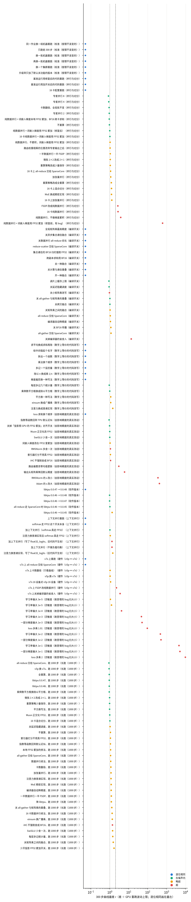
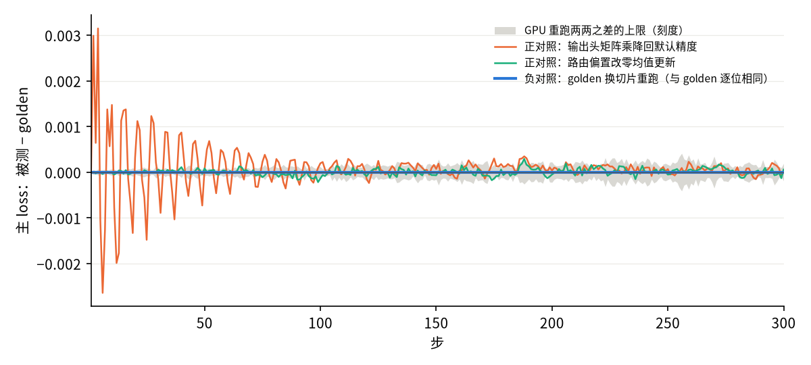

[janus](../../../../README.md) › [混元 4](../../README.md) › [TPU 自比](README.md) ｜ 实验矩阵

# 混元 4 · 04 · TPU 自比 · 实验矩阵

改完代码以后，生成物往往没法逐位比，很难判断有没有改出 bug。这张表把日常会碰到的改动分成十一类（A–H，加上 S 灵敏度、L 长跑、V libtpu 0.0.52 重测），每一类都量一遍：变不变、变多少、在不在噪声里。给人读的版本是 [TPU 自比 README](README.md)；这一页是知识库，保留术语，第一次出现时给白话，全部术语见[术语对照表](../../knowledge.md#术语对照表)。

**几个词**：

- **臂**：一次实验，即从 golden 出发只改一样东西的那次运行。编号（A1、B1……）的字母是类别。
- **golden**：基准运行 `ts-g-a`，一次确认过、换机器重跑每一位都相同的 TPU 运行。它是 C 口径之前的一代配置：base2 开，M52 `hc_head_force_bf16_rounding`、M58 `ihc_stream_grad_gpu_order` 不开，MaxText `b87a55aa`。现行对齐配置（C 口径，mini 现行比较 `tc-a`）关 base2、开 M52 与 M58，MaxText 是 `8d3d7561`；新提交关着这两个开关时与 `b87a55aa` 是否逐位相同，没有直接核：M58 的代码在中间提交 `751fdc6d` 上关着时，离线编出的程序与基底相同（mini 的 `ti-o-a`），`8d3d7561` 再带进的 M52 代码没核。这页全部臂都在 golden 这一代上测，C 口径上没重测（[setup「golden」](setup.md#golden)）。
- **尺子 / 噪声上限 N**：GPU 同设置重跑之间本来就有的差（几份两两比，取最大）。
- **r**：r = 差 ÷ N，即差是尺子的几倍。
- **底**：有的改动要连带改一样别的东西才跑得起来，就先跑一次只改连带项的运行当对照，这个对照叫底。
- **领头**：r 最大的那条曲线和那个统计量。
- **HLO、程序指纹**：HLO 是 XLA 编译出来的程序；程序指纹是去掉元数据与源码位置后对它算的哈希，指纹相同就是同一个程序。
- **excess precision**（省舍入）：编译器把本该舍成 BF16 的中间结果留在 FP32，少舍几次。C1 就是把它关掉。

**判法**（[`setup.md`](setup.md)）：被测对 golden `ts-g-a` 比，看 r 落在哪一档。

| 档 | 条件 |
|---|---|
| 逐位相同 | 每一步的记录量、第 1 步全部状态都逐位相同 |
| 在噪声内 | 不逐位；300 步曲线最差 r ≤ 1；第 1 步梯度超出噪声上限的张量都能对 CPU FP64 定责为「换了顺序」（只是加法先后不同，离 FP64 不比 golden 远） |
| 超出噪声上限 · 略超 | 曲线最差 r 在 1–2 之间，第 1 步没有定不了责的张量 |
| 超出噪声上限 · 超 | 曲线最差 r > 2，或第 1 步有超出 GPU 尺子且 R > 1.2 的张量（定不了责；丢了精度：某处多舍入了一次，或在低精度里累加）。iHC 小参数除外，见下「iHC 豁免」 |

R = 被测离 FP64 ÷ max(对照离 FP64, GPU 三份离 FP64 的中位数)。分母取两者里较大的那个，取法会改 R 的大小：G2 第 6 层 sink 只对对照比是 4.16e-2 ÷ 2.10e-2 ≈ 1.98，分母取 GPU 中位数 3.28e-2 后是 1.27（见 [G 节](#g--上下文并行)）。

定责：查明一个差别来自哪边、是「换了顺序」还是「丢了精度」。这里的依据是对 CPU 上 64 位浮点（FP64）重算的精确梯度比远近，比法就是上面的 R。

**iHC 豁免**：iHC 的小参数（各层的 `hc_base` / `hc_fn` / `hc_scale` 与 `hc_head` 三个）超出噪声上限、定不了责时不算「未定责」，单列在结果文件的 `ihc_accepted` 里，不挡判档。这个豁免没有倍数上限，盖住过 18–46 倍、变号的 `hc_head` 偏差。定义、受影响的运行见下面[「iHC 豁免：定义与受影响的运行」](#ihc-豁免定义与受影响的运行)；这类张量按 TPU 自比的 iHC 豁免单列（这是另一条规则：iHC 张量一律不算未定责，没有倍数上限；与 mini 的 D11 条文不同；是否收窄待拍板），见 PROTOCOL 变更记录 2026-11-11。表里「靠 iHC 豁免」标的是：档不是「超」、解读也不是「分得开」，而第 1 步有被豁免的张量 R > 5（PROTOCOL 提议的收窄口径）。

**怎么跑**：每个臂从 golden 的命令出发只改一样东西，300 步，第 1 步全量抓数，存训练步优化后 HLO（[`setup.md`](setup.md)）。

- 原计划先跑 1 步、逐位相同的不再跑长曲线；实测一次运行的固定开销（起 Pod、编译、取回第 1 步抓数）约 10 分钟，300 步只多约 4 分钟，所以每个臂直接跑 300 步。
- 有的改动要连带改一样东西才跑得起来（如专家并行要先关一个开关）。这类臂先跑一个「只改那个连带项」的臂当底（对照），再对这个底比，表里写明。

**结果列**（由 [`build_tables.py`](build_tables.py) 按 [`arms.yaml`](arms.yaml) 与 `results/` 生成，不手写）：

| 列 | 意思 |
|---|---|
| 曲线最差 r | 前 300 步 8 条曲线、三个判定量（带符号均值：平均偏多少；MARE：平均晃多少；最大单步：最坏一步差多少）里最大的 r |
| 和 GPU 重跑比 | 事后解读，不改判档：曲线最差 r 不超过 GPU 留一法的最大值、第 1 步没有离 FP64 更远的张量，记「和 GPU 重跑分不开」；留一法见下面「GPU 重跑的留一法 r」 |
| 第 1 步梯度相对差中位数 | 205 个张量对 golden 的相对差取中位数；GPU 三份两两的尺子中位数是 2.7e-3 |
| 对 FP64 | 被测离 CPU FP64 的距离 ÷ golden 离 FP64 的距离，205 个张量取中位数；< 1 是被测更近 |
| 步时 | 第 11 步起的中位数；golden 0.494 s |
| 程序相同 | 训练步优化后 HLO 的程序指纹是否与对照相同 |

## 总表

给人读的报告是 [TPU 自比 README](README.md)，按「对 TPU 精度有没有影响」分堆；这里是按类的汇总、每一行的脾气表全表，以及报告里删去的要点。

### 要点

1. **不逐位不等于有 bug。** 有一类改动只换了加法的先后顺序：换并行切分、换梯度累积的切法、专家并行、重算策略、数学上等价的改写、升 libtpu（0.0.46 换 0.0.45 / 0.0.47 / 0.0.48；换到 0.0.52 不只换了顺序，不开 RMSNorm 单次舍入时 r 1.06 → 5.50，见 [V 节](#v--libtpu-0052-上重测) 与 [impacts/04](impacts/04-rmsnorm-double-rounding.md)）、换到 v7x。浮点数换个顺序相加，末几位就会变，所以结果不再逐位相同；但差别和 GPU 自己重跑分不开：300 步曲线最差 r 多在 0.8–1.3，最高的是注意力换普通实现（1.41，libtpu 0.0.52 上 1.42），而 GPU 8 份互相比，本身就能到 2.47；第 1 步变了的梯度，离精确值也不比原来远（换到 v7x、einsum 换广播乘这两种，`hc_head` 三个张量其实偏了 18–46 倍，靠 iHC 豁免才不算，见[「iHC 豁免」](#ihc-豁免定义与受影响的运行)）。
2. **出问题的地方集中在词嵌入梯度。** 有两种改动会出事。一是纯数据并行：每张卡在 BF16 里就地累加词嵌入梯度，高频 token 在一张卡上要被 BF16 累加几十到几百次（见 [B1 梯度的跨卡归约](b1-grad-reduction.md)）。二是关掉编译器的省舍入。以下数字除注明的外都是 v5p、libtpu 0.0.46。这两种都让词嵌入梯度离精确值变远，R 3.6–26（R = 离 FP64 ÷ max(golden, GPU 中位数)；只对 golden 比是 3.8–27 倍），曲线 r 2.6–13（v7x 上纯数据并行是 R 3.54、r 2.21）。修法是让词嵌入梯度在 FP32 里累加：纯数据并行 8 卡、16 卡都回到噪声内（r 0.98、0.99）；libtpu 0.0.52 上同样两种修法是略超、和 GPU 重跑分不开（r 1.55、1.20，V2、V3）。这个开关原本在「数据并行 + 梯度累积」下会丢掉前面几个微批的梯度（r 611），已修（MaxText `d5c9b113`）。修复不碰默认路径：golden 用修复后的代码重跑，逐位相同。只把本卡的累加换成 FP32、跨卡仍用 BF16 求和也够（MaxText `f70d74cb` 的 `embedding_grad_fp32_local_bf16_comm`，r 0.93，第 1 步词嵌入梯度离精确值和 golden 一样近）；在混元 4 上三种写法词嵌入整表求和的字节数相同（每步每设备 9.90e8），`embedding_grad_fp32` 另多 16 次 `collective-permute`（6.7e7 字节，全部通信 +2.7%），步时差 1% 以内。
3. **多小的问题抓得到。** 学习率偏大 1e-4 就抓得到（r 4.1），3e-5 以下和重跑分不开。只动一部分梯度的 bug 要大到 1e-2 才在训练曲线上显出来；但它改了记下的那项 loss，逐项比记下的 loss，1e-3 就能看到。挑 33 种改动跑到 1000 步（尺子换成 GPU 1000 步的 16 份重跑），32 种和重跑分不开：最差 r 1.64，是少开「投影照 GPU 的 FP32 累加」，而 GPU 16 份互相比最大 1.82。其中 L7（换 v7x）、L21（einsum 换写法）靠 iHC 豁免（`hc_head` 最大 R 46.2），查下来是动了精度，见[前瞻验证](#前瞻验证protocol-2026-11-09-登记的解读规则)。剩下 1 种（iHC 不强制舍成 BF16）曲线 r 只有 1.36，判「超」来自第 1 步：把每个梯度和精确值比才查出来。

### TPU 脾气表

按类汇总。「和 GPU 重跑分不开」包括在噪声内的，也包括略超但和 GPU 重跑分不开的，贴着最大值的临界情况也算在这里。长跑一类按 1000 步算，尺子是 GPU 1000 步 16 份。「未出结果」是登记了但没有结果文件的实验（不支持、跑不起来或被抢占），原因见下面各类结果表的「档」一列。每一行四个数加起来等于实验数。

<!-- BEGIN:summary -->
| 类 | 实验数 | 逐位相同 | 和 GPU 重跑分不开 | 分得开 | 未出结果 | 分得开的是哪几个 |
|---|---|---|---|---|---|---|
| 校准（按理不该变的） | 8 | 8 | 0 | 0 | 0 | — |
| 并行与切分 | 31 | 4 | 21 | 4 | 2 | FSDP 改成纯数据并行（r 2.62）；纯数据并行 + 词嵌入梯度用 FP32 累加（修复前，有 bug）（r 611.29）；纯数据并行、不做梯度累积（r 3.69）；16 卡纯数据并行（r 2.65） |
| 编译开关 | 20 | 9 | 9 | 2 | 0 | 关掉编译器的省舍入（r 13.28）；关小矩阵乘改写（第 1 步有梯度离精确值更远） |
| 数学上等价的代码改写 | 12 | 7 | 5 | 0 | 0 | — |
| 会影响精度的真实改动 | 14 | 1 | 6 | 7 | 0 | 输出头矩阵乘降回默认精度（r 5.94）；路由偏置改零均值更新（r 2.97）；RMSNorm 的 ε 改小（r 342.70）；RMSNorm 多舍一次（第 1 步有梯度离精确值更远）；只让最后一层 RMSNorm 真的舍两次（r 6.83）；Adam 的 ε 改大（r 412.01）；iHC 不强制舍成 BF16（第 1 步有梯度离精确值更远） |
| 软件版本 | 8 | 1 | 5 | 0 | 2 | — |
| 上下文并行 | 8 | 2 | 3 | 2 | 1 | 加上下文并行（写了 float32_logits，旧代码不生效）（第 1 步有梯度离精确值更远）；加上下文并行（不做负载均衡）（第 1 步有梯度离精确值更远） |
| 硬件（v5p ↔ v7x） | 9 | 2 | 3 | 3 | 1 | v7x 上关掉编译器的省舍入（r 3.43）；v7x 上 FSDP 改纯数据并行（第 1 步有梯度离精确值更远）；v7x 上纯数据并行、不做梯度累积（r 4.06） |
| 灵敏度（故意埋的 bug 扫大小） | 11 | 0 | 2 | 9 | 0 | 学习率偏大 1e-4（r 4.11）；学习率偏大 1e-3（r 46.25）；学习率偏大 1e-2（r 461.42）；学习率偏大 1e-1（r 4505.22）；一部分梯度偏大 1e-3（r 50.12）；一部分梯度偏大 1e-2（r 501.85）；一部分梯度偏大 1e-1（r 5010.57）；loss 多乘 1.01（r 94.50）；loss 多乘 2（r 9676.75） |
| 长跑（1000 步） | 33 | 0 | 32 | 1 | 0 | iHC 不强制舍成 BF16、跑 1000 步（第 1 步有梯度离精确值更远） |
| libtpu 0.0.52 上重测（只换 libtpu，对 0.0.52 的 golden ts-g52-a 或同版本的底比；V16 是 v7x 0.0.46 → 0.0.52 的跨版本对比） | 25 | 5 | 14 | 6 | 0 | libtpu 0.0.52：FSDP 改成纯数据并行（r 2.82）；libtpu 0.0.52：关掉编译器的省舍入（r 12.56）；libtpu 0.0.52：关小矩阵乘改写（第 1 步有梯度离精确值更远）；libtpu 0.0.52：RMSNorm 多舍一次（r 5.50）；libtpu 0.0.52：iHC 不强制舍成 BF16（第 1 步有梯度离精确值更远）；libtpu 0.0.52：只让最后一层 RMSNorm 真的舍两次（r 6.97） |
<!-- END:summary -->

「会影响精度的真实改动」里 RMSNorm 多舍一次（E6）的「分得开」只靠第 1 步一个压线张量（R 1.2025）：GPU 第 1 步参照用 6 份时 R 1.1955、变成已定责，这一行就会挪到「和 GPU 重跑分不开」。用 3 份还是 6 份待拍板，见[前瞻验证](#前瞻验证protocol-2026-11-09-登记的解读规则)。

每一行：改动、场景、档、300 步与 1000 步的 r、差得最多的曲线、和 GPU 重跑比、多花的算力、要怎么办

<!-- BEGIN:temper -->
| 类 | 改动 | 场景 | 档 | 300 步曲线最差 r | 1000 步 | 差得最多的曲线·统计量 | 和 GPU 重跑比 | 多花的算力 | 要怎么办 |
|---|---|---|---|---|---|---|---|---|---|
| 校准（按理不该变的） | 同一作业换一组机器重跑 | 重跑 / 换机器 | 逐位相同 | 0.00 | — | — | — | +0.6% | 不用管 |
| 校准（按理不该变的） | 只跑前 300 步 | 短跑冒烟 | 逐位相同 | 0.00 | — | — | — | +0.1% | 不用管 |
| 校准（按理不该变的） | 换一批机器重跑 | 换节点池 | 逐位相同 | 0.00 | — | — | — | +0.4% | 不用管 |
| 校准（按理不该变的） | 再换一批机器重跑 | 换节点池 | 逐位相同 | 0.00 | — | — | — | +0.6% | 不用管 |
| 校准（按理不该变的） | 换一个集群重跑 | 换集群 / 换区域 | 逐位相同 | 0.00 | — | — | — | +0.5% | 不用管 |
| 校准（按理不该变的） | 升级到只加了默认关功能的版本 | 升级代码 | 逐位相同 | 0.00 | — | — | — | +0.1% | 不用管 |
| 校准（按理不该变的） | libtpu 0.0.52 的基准运行换一组机器重跑 | 重跑 / 换机器 | 逐位相同 | 0.00 | — | — | — | -0.1% | 不用管 |
| 校准（按理不该变的） | libtpu 0.0.52 的基准运行重跑 1000 步 | 重跑 / 换机器 | 逐位相同 | 0.00 | — | — | — | +0.1% | 不用管 |
| 并行与切分 | FSDP 改成纯数据并行 | DDP ↔ FSDP | 超 | 2.62 | — | 梯度范数·带符号均值 | 分得开 | -3.4% | 打开词嵌入梯度 FP32 累加（MaxText d5c9b113 起梯度累积下也可用），或只在本地 FP32 累加、跨卡仍 BF16（f70d74cb 起），或只把词嵌入表沿数据并行轴切开（9099c8ce 起） |
| 并行与切分 | 纯数据并行 + 词嵌入梯度用 FP32 累加（修复前，有 bug） | DDP 的修法 | 超 | 611.29 | — | 主 loss·带符号均值 | 分得开 | -4.3% | 已修（MaxText d5c9b113），见下一行 |
| 并行与切分 | 纯数据并行 + 词嵌入梯度用 FP32 累加（修复后） | DDP 的修法 | 在噪声内 | 0.98 | 略超 1.09（和 GPU 重跑分不开） | 梯度范数·MARE | — | -2.8% | 不用管 |
| 并行与切分 | 基准运行用修复后的代码重跑 | 修复不碰默认路径 | 逐位相同 | 0.00 | — | — | — | +0.2% | 不用管 |
| 并行与切分 | 纯数据并行 + 词嵌入梯度本地 FP32 累加、BF16 跨卡求和 | DDP 的修法（跨卡仍传 BF16） | 在噪声内 | 0.93 | 略超 1.07（和 GPU 重跑分不开） | 梯度范数·MARE | — | -2.6% | 不用管 |
| 并行与切分 | 基准运行用加开关后的代码重跑 | 新开关不碰默认路径 | 逐位相同 | 0.00 | — | — | — | +0.5% | 不用管 |
| 并行与切分 | 纯数据并行 + 只把词嵌入表按 FSDP 的方式切开 | DDP 的修法（词嵌入不再整表跨卡求和） | 略超 | 1.02 | 略超 1.15（和 GPU 重跑分不开） | 梯度范数·MARE | 和 GPU 重跑分不开 | -3.3% | 不用管 |
| 并行与切分 | 基准运行用加开关后的代码重跑 | 新开关不碰默认路径 | 逐位相同 | 0.00 | — | — | — | +0.3% | 不用管 |
| 并行与切分 | 纯数据并行、不做梯度累积 | DDP | 超 | 3.69 | — | 主 loss·带符号均值 | 分得开 | -6.4% | 打开词嵌入梯度 FP32 累加 |
| 并行与切分 | 纯数据并行、不累积，词嵌入梯度用 FP32 累加 | DDP 的修法 | 略超 | 1.01 | — | 索引器 loss·MARE | 和 GPU 重跑分不开 | -6.1% | — |
| 并行与切分 | 卡数翻倍、全局批不变 | 扩卡 | 在噪声内 | 0.90 | 略超 1.11（和 GPU 重跑分不开） | 主 loss·MARE | — | +30.0% | 不用管 |
| 并行与切分 | 16 卡配置重跑 | 重跑 | 逐位相同 | 0.00 | — | — | — | -0.0% | 不用管 |
| 并行与切分 | 16 卡上混合切分 | 扩卡 + 混合切分 | 略超 | 1.20 | 在噪声内 1.00 | 路由偏置标准差·带符号均值 | 和 GPU 重跑分不开 | +25.3% | — |
| 并行与切分 | 16 卡纯数据并行 + 词嵌入梯度用 FP32 累加 | 扩卡 + DDP 的修法 | 在噪声内 | 0.99 | 略超 1.30（和 GPU 重跑分不开） | 路由偏置标准差·带符号均值 | — | +6.1% | 不用管 |
| 并行与切分 | 16 卡上加张量并行 | 扩卡 + TP | 略超 | 1.24 | — | 主 loss·MARE | 和 GPU 重跑分不开 | +83.9% | — |
| 并行与切分 | 16 卡纯数据并行 | 扩卡 + DDP | 超 | 2.65 | — | 主 loss（第 101 步起）·带符号均值 | 分得开 | +6.0% | 打开词嵌入梯度 FP32 累加 |
| 并行与切分 | 16 卡上 all-reduce 交给 SparseCore | 通信卸载 | 略超 | 1.08 | — | MTP loss·最大单步 | 和 GPU 重跑分不开 | -2.6% | — |
| 并行与切分 | 加张量并行 | 加 TP | 略超 | 1.09 | 略超 1.14（和 GPU 重跑分不开） | 主 loss·MARE | 和 GPU 重跑分不开 | +72.4% | — |
| 并行与切分 | 微批 1×2 改成 2×1 | 调微批与累积 | 略超 | 1.03 | 在噪声内 0.96 | 梯度范数·MARE | 和 GPU 重跑分不开 | -3.1% | — |
| 并行与切分 | 一半数据并行一半 FSDP | 混合切分 | 略超 | 1.03 | 略超 1.19（和 GPU 重跑分不开） | 路由偏置标准差·带符号均值 | 和 GPU 重跑分不开 | +1.4% | — |
| 并行与切分 | 路由权重相乘的位置改到专家输出之后 | 开专家并行前必须改 | 略超 | 1.01 | — | 路由偏置标准差·带符号均值 | 和 GPU 重跑分不开 | -0.1% | — |
| 并行与切分 | 专家并行 2 | 加 EP | 在噪声内 | 0.93 | — | 主 loss·MARE | — | +11.9% | 不用管 |
| 并行与切分 | 专家并行 4 | 加 EP | 在噪声内 | 0.87 | — | 路由偏置标准差·最大单步 | — | +17.8% | 不用管 |
| 并行与切分 | 专家并行 8 | 加 EP | 在噪声内 | 0.84 | — | 梯度范数·最大单步 | — | +16.8% | 不用管 |
| 并行与切分 | 重算策略改成全重算 | 省显存 | 略超 | 1.18 | 在噪声内 0.92 | 路由偏置标准差·带符号均值 | 和 GPU 重跑分不开 | +0.4% | — |
| 并行与切分 | 重算策略改成少量保存 | 省显存 | 略超 | 1.04 | 在噪声内 0.96 | 梯度范数·带符号均值 | 和 GPU 重跑分不开 | -3.0% | — |
| 并行与切分 | 不重算 | 换速度 | 在噪声内 | 0.95 | 略超 1.05（和 GPU 重跑分不开） | 梯度范数·MARE | — | -5.7% | 不用管 |
| 并行与切分 | MoE 换成稠密实现 | 换 MoE 实现 | 略超 | 1.20 | 略超 1.16（和 GPU 重跑分不开） | 路由偏置标准差·带符号均值 | 和 GPU 重跑分不开 | +1.4% | — |
| 并行与切分 | 两个切片走跨切片网络（DCN）做数据并行 | 多切片 | 在噪声内 | 0.91 | — | 梯度范数·MARE | 靠 iHC 豁免 | +47.1% | 曲线不用管；第 1 步 hc_head 偏差和 H2、V17 同一型（离线核：主输出头反向卷积 kernel 里并进了末层 RMSNorm 的行和 S，同一切法的单切片 B2c 没有、不偏；逐元素差同号接近常数），靠 iHC 豁免才判在噪声内；LLO 与上卡因果没核。上多切片前用 analysis/hc_head_dgrad_fusion.py 查自己的程序（MATRIX「hc_head」） |
| 编译开关 | 关掉编译器的省舍入 | 编译开关 | 超 | 13.28 | — | 梯度范数·带符号均值 | 分得开 | +1.4% | 别关（关了词嵌入梯度真按 BF16 累加） |
| 编译开关 | 全局矩阵乘最高精度 | 提精度 | 逐位相同 | 0.00 | — | — | — | +0.4% | 不用管 |
| 编译开关 | 关延迟隐藏调度 | 调性能 | 在噪声内 | 0.91 | 略超 1.02（和 GPU 重跑分不开） | 梯度范数·MARE | — | +0.6% | 不用管 |
| 编译开关 | 关异步集合通信融合 | 调性能 | 逐位相同 | 0.00 | — | — | — | +0.5% | 不用管 |
| 编译开关 | 关数据并行 all-reduce 优化 | 调性能 | 逐位相同 | 0.00 | — | — | — | +0.6% | 不用管 |
| 编译开关 | all-reduce 交给 SparseCore | 通信卸载 | 略超 | 1.03 | 在噪声内 0.88 | 梯度范数·MARE | 和 GPU 重跑分不开 | -0.9% | — |
| 编译开关 | reduce-scatter 交给 SparseCore | 通信卸载 | 逐位相同 | 0.00 | — | — | — | +0.6% | 不用管 |
| 编译开关 | all-gather 交给 SparseCore | 通信卸载 | 略超 | 1.14 | 略超 1.08（和 GPU 重跑分不开） | 路由偏置标准差·带符号均值 | 和 GPU 重跑分不开 | -3.4% | — |
| 编译开关 | 集合通信的 BF16 归约强制 FP32 | 提精度 | 逐位相同 | 0.00 | — | — | — | +0.6% | 不用管 |
| 编译开关 | 跨副本求和用 BF16 | 省带宽 | 逐位相同 | 0.00 | — | — | — | +0.5% | 不用管 |
| 编译开关 | 编译器自动降精度 | 调性能 | 略超 | 1.06 | 略超 1.17（和 GPU 重跑分不开） | 梯度范数·带符号均值 | 和 GPU 重跑分不开 | +0.6% | — |
| 编译开关 | 关 all-gather 与矩阵乘的重叠 | 调性能 | 在噪声内 | 1.00 | 略超 1.26（和 GPU 重跑分不开） | 梯度范数·带符号均值 | — | -2.5% | 不用管 |
| 编译开关 | 关一种融合 | 调性能 | 逐位相同 | 0.00 | — | — | — | +0.6% | 不用管 |
| 编译开关 | 关矩阵乘之间的融合 | 调性能 | 略超 | 1.02 | 略超 1.49（和 GPU 重跑分不开） | 梯度范数·MARE | 和 GPU 重跑分不开 | +0.2% | — |
| 编译开关 | 关小矩阵乘改写 | 调性能 | 超 | 0.94 | — | 梯度范数·MARE | 分得开 | +10.4% | 别关（关了还更慢） |
| 编译开关 | 关拷贝融合 | 调性能 | 在噪声内 | 1.00 | — | 参数范数·最大单步 | — | +0.5% | 不用管 |
| 编译开关 | 关 BF16 传播 | 调精度 | 略超 | 1.12 | — | 主 loss·MARE | 和 GPU 重跑分不开 | +0.9% | — |
| 编译开关 | 关计算与通信重叠 | 调性能 | 逐位相同 | 0.00 | — | — | — | +0.1% | 不用管 |
| 编译开关 | 调片上缓存上限 | 调性能 | 在噪声内 | 0.89 | — | 梯度范数·MARE | — | +2.9% | 不用管 |
| 编译开关 | 开一种融合 | 调性能 | 逐位相同 | 0.00 | — | — | — | +0.2% | 不用管 |
| 数学上等价的代码改写 | 平方换一种写法 | 改写法 | 略超 | 1.09 | 在噪声内 0.96 | 路由偏置标准差·带符号均值 | 和 GPU 重跑分不开 | -0.4% | — |
| 数学上等价的代码改写 | 求平均换成求和再除 | 改写法 | 逐位相同 | 0.00 | — | — | — | +0.6% | 不用管 |
| 数学上等价的代码改写 | einsum 换成广播乘 | 改写法 | 略超 | 1.10 | 略超 1.33（和 GPU 重跑分不开）（靠 iHC 豁免） | 梯度范数·MARE | 和 GPU 重跑分不开，靠 iHC 豁免 | -0.0% | — |
| 数学上等价的代码改写 | 乘倒数平方根换成除以平方根 | 改写法 | 在噪声内 | 0.98 | 在噪声内 0.93 | 梯度范数·MARE | — | -0.2% | 不用管 |
| 数学上等价的代码改写 | 给中间值起个名字 | 加标注 | 逐位相同 | 0.00 | — | — | — | +0.2% | 不用管 |
| 数学上等价的代码改写 | 拆出一个函数 | 重构 | 逐位相同 | 0.00 | — | — | — | +0.5% | 不用管 |
| 数学上等价的代码改写 | 乘法换个顺序 | 改写法 | 逐位相同 | 0.00 | — | — | — | +0.4% | 不用管 |
| 数学上等价的代码改写 | 每层多记几个统计量 | 加日志 | 在噪声内 | 0.91 | 略超 1.40（和 GPU 重跑分不开） | 索引器 loss·MARE | — | +1.9% | 不用管 |
| 数学上等价的代码改写 | 多记一个监控量 | 加日志 | 逐位相同 | 0.00 | — | — | — | +0.6% | 不用管 |
| 数学上等价的代码改写 | 除以 n 换成乘 1/n | 改写法 | 逐位相同 | 0.00 | — | — | — | -0.0% | 不用管 |
| 数学上等价的代码改写 | 梯度裁剪换一种写法 | 改写法 | 逐位相同 | 0.00 | — | — | — | +0.4% | 不用管 |
| 数学上等价的代码改写 | 注意力换成普通实现 | 换实现 | 略超 | 1.41 | 略超 1.15（和 GPU 重跑分不开） | 参数范数·最大单步 | 和 GPU 重跑分不开 | -3.2% | — |
| 会影响精度的真实改动 | 输出头矩阵乘降回默认精度 | 真改坏 | 超 | 5.94 | — | 主 loss·最大单步 | 分得开 | -18.4% | 输出头矩阵乘用最高精度 |
| 会影响精度的真实改动 | 路由偏置改零均值更新 | 真改坏（改语义） | 超 | 2.97 | — | 路由偏置均值·最大单步 | 分得开 | +0.5% | 照原版更新 |
| 会影响精度的真实改动 | 关掉「投影照 GPU 的 FP32 累加」对齐开关 | 少开一个对齐开关 | 在噪声内 | 0.97 | 略超 1.64（和 GPU 重跑分不开） | 梯度范数·MARE | — | -0.3% | 不用管 |
| 会影响精度的真实改动 | 指数等函数回到 TPU 默认近似 | 少开一个对齐开关 | 在噪声内 | 0.91 | 略超 1.07（和 GPU 重跑分不开） | 主 loss（第 101 步起）·带符号均值 | — | -2.5% | 不用管 |
| 会影响精度的真实改动 | RMSNorm 的 ε 改小 | 改超参 | 超 | 342.70 | — | 索引器 loss·带符号均值 | 分得开 | +0.1% | — |
| 会影响精度的真实改动 | RMSNorm 多舍一次 | 少开一个对齐开关 | 超 | 1.06 | — | 路由偏置标准差·带符号均值 | 分得开 | +0.6% | 开着 rmsnorm_single_rounding。判超只靠第 1 步一个压线张量（第 0 层 input_layernorm，R 1.2025）；GPU 第 1 步参照换成 6 份时 R 1.1955、变成已定责，就是略超、和 GPU 重跑分不开。用 3 份还是 6 份待拍板（setup「比较」） |
| 会影响精度的真实改动 | 只让最后一层 RMSNorm 真的舍两次 | 诊断：最后一层多舍一次单独的影响 | 超 | 6.83 | — | 主 loss·带符号均值 | 分得开 | +0.0% | 开着 rmsnorm_single_rounding |
| 会影响精度的真实改动 | Adam 的 ε 改大 | 改超参 | 超 | 412.01 | — | 参数范数·MARE | 分得开 | +0.6% | — |
| 会影响精度的真实改动 | iHC 不强制舍成 BF16 | 少开一个对齐开关 | 超 | 1.09 | 超 1.36（分得开） | 索引器 loss·MARE | 分得开 | +0.5% | 对齐时开着 ihc_force_bf16_rounding |
| 会影响精度的真实改动 | SwiGLU 少舍一次 | 少开一个对齐开关 | 在噪声内 | 0.98 | 略超 1.37（和 GPU 重跑分不开） | 梯度范数·MARE | — | +0.6% | 不用管 |
| 会影响精度的真实改动 | Muon 正交化改 FP32 | 少开一个对齐开关 | 在噪声内 | 0.98 | 在噪声内 0.97 | 梯度范数·MARE | — | -0.8% | 不用管 |
| 会影响精度的真实改动 | loss 求和换个顺序 | 改写法 | 逐位相同 | 0.00 | — | — | — | +0.4% | 不用管 |
| 会影响精度的真实改动 | 词嵌入梯度改在 FP32 里累加 | 提精度 | 略超 | 1.02 | — | 梯度范数·MARE | 和 GPU 重跑分不开 | +0.3% | — |
| 会影响精度的真实改动 | 索引器打分不用真 FP32 | 少开一个对齐开关 | 略超 | 1.06 | 略超 1.06（和 GPU 重跑分不开） | 路由偏置标准差·带符号均值 | 和 GPU 重跑分不开 | -5.5% | — |
| 软件版本 | libtpu 0.0.46 → 0.0.48 | 升版本 | 在噪声内 | 0.97 | 在噪声内 0.92 | 梯度范数·MARE | — | -1.2% | 不用管 |
| 软件版本 | libtpu 0.0.46 → 0.0.45 | 降版本 | 略超 | 1.30 | 略超 1.19（和 GPU 重跑分不开） | 路由偏置标准差·带符号均值 | 和 GPU 重跑分不开 | -0.2% | — |
| 软件版本 | libtpu 0.0.46 → 0.0.47 | 升版本 | 在噪声内 | 0.97 | 在噪声内 0.92 | 梯度范数·MARE | — | -0.2% | 不用管 |
| 软件版本 | libtpu 0.0.47 → 0.0.48 | 升版本 | 逐位相同 | 0.00 | — | — | — | -1.0% | 不用管 |
| 软件版本 | all-reduce 走 SparseCore 时 libtpu 0.0.46 → 0.0.45 | 实际排查中遇到的路径 | 在噪声内 | 0.99 | 在噪声内 0.93 | 梯度范数·最大单步 | — | -0.3% | 不用管 |
| 软件版本 | libtpu 0.0.46 → 0.0.52 | 升版本 | 在噪声内 | 0.99 | 在噪声内 0.96 | 路由偏置标准差·带符号均值 | — | -5.5% | 不用管 |
| 上下文并行 | 上下文并行重跑 | 重跑 | 逐位相同 | 0.00 | — | — | — | -0.2% | 不用管 |
| 上下文并行 | 注意力换普通实现、写了 float32_logits（旧代码不生效） | 上下文并行修法的对照 | 略超 | 1.41 | — | 参数范数·最大单步 | 和 GPU 重跑分不开 | -3.2% | — |
| 上下文并行 | softmax 走 FP32 这个开关本身 | 核开关有没有生效 | 逐位相同 | 0.00 | — | — | — | -0.0% | 不用管 |
| 上下文并行 | 加上下文并行（写了 float32_logits，旧代码不生效） | #10 sink 线索的修法（旧代码开关没生效） | 超 | 1.27 | — | 主 loss·带符号均值 | 分得开 | +36.9% | MaxText 56492817 起打开 float32_logits（见 G4） |
| 上下文并行 | 加上下文并行（不做负载均衡） | 长序列 | 超 | 1.27 | — | 主 loss·带符号均值 | 分得开 | +37.1% | — |
| 上下文并行 | 注意力换普通实现且 softmax 真走 FP32 | 上下文并行修法的底 | 略超 | 1.03 | — | 路由偏置标准差·带符号均值 | 和 GPU 重跑分不开 | +1.7% | — |
| 上下文并行 | 加上下文并行（softmax 真走 FP32） | #10 sink 线索的修法 | 在噪声内 | 1.00 | — | 主 loss·带符号均值 | — | +46.7% | 不用管 |
| 硬件（v5p ↔ v7x） | v7x 上重跑 | 重跑 | 逐位相同 | 0.00 | — | — | — | -0.0% | 不用管 |
| 硬件（v5p ↔ v7x） | v5p 换 v7x | 换硬件 | 略超 | 1.02 | 在噪声内 0.91（靠 iHC 豁免） | 梯度范数·MARE | 和 GPU 重跑分不开，靠 iHC 豁免 | -65.3% | 曲线不用管；第 1 步 hc_head 偏差是 TPU 侧真实的数值缺陷（输出头反向卷积 kernel 省掉一次 BF16 舍入，已离线定位 ；v7x 上因果没上卡验证），靠 iHC 豁免才没判超。处理办法待拍板：barrier 修法只在 MaxText 测试分支 1747a7f8 上，没合。现行对齐配置开的 M52（hc_head_force_bf16_rounding）不是这处的修法：读代码，M52 舍的是 hc_head 输出（末层 RMSNorm 的输入）和它的余切，这处缺陷在末层 RMSNorm 输出的余切上；C 口径 tc-a（v5p 0.0.46）离线核过：主头卷积 kernel 里没有 S，与 golden 同型，按判据不偏；上卡读数来自同为 C 口径的第 1 步全量抓数 s1f-c：hc_head 三个张量对 GPU 6 份在噪声内（R 0.45 / 0.81 / 1.62），hc_head_base 离 FP64 0.022，与离线结论一致（s1f-c 不是 tc-a 本身，抓数改不改程序这一代没核）。自检（判据只在 15 次 mini 程序上核过）：用 analysis/hc_head_dgrad_fusion.py 查主输出头反向的卷积 kernel 里有没有并进末层 RMSNorm 反向的行和 S（脚本默认 mini 形状，生产要传 --hidden 6144）；有 S 时再看 LLO 里这颗 kernel 的 vpack.i 舍入指令（0.0.46 写 vpack.i.bf16，0.0.52 写 vpack.i.f32.bf16；vpack.c 不算）：excess precision 开着时 0 条、关掉后编同一程序变多，就是这一型（MATRIX「hc_head」） |
| 硬件（v5p ↔ v7x） | v7x 上卡数翻倍（只看曲线） | 换硬件 + 扩卡 | 略超 | 1.01 | — | 梯度范数·带符号均值 | 和 GPU 重跑分不开 | -57.0% | — |
| 硬件（v5p ↔ v7x） | v7x 16 设备对 v5p 16 设备 | 换硬件 | 略超 | 1.08 | — | MTP loss·最大单步 | 和 GPU 重跑分不开 | -66.9% | — |
| 硬件（v5p ↔ v7x） | v7x 上 all-reduce 交给 SparseCore | 换硬件后重测开关 | 逐位相同 | 0.00 | — | — | — | +0.0% | 不用管 |
| 硬件（v5p ↔ v7x） | v7x 上关掉编译器的省舍入 | 换硬件后重测开关 | 超 | 3.43 | — | 梯度范数·带符号均值 | 分得开 | -0.3% | — |
| 硬件（v5p ↔ v7x） | v7x 上 FSDP 改纯数据并行 | 换硬件后重测 | 超 | 2.21 | — | 梯度范数·带符号均值 | 分得开 | -11.1% | — |
| 硬件（v5p ↔ v7x） | v7x 上纯数据并行、不做梯度累积 | 换硬件后重测 | 超 | 4.06 | — | 主 loss·带符号均值 | 分得开 | -6.9% | 打开词嵌入梯度 FP32 累加。升 libtpu 0.0.52 只在 v7x、这张 120832 × 1024 的表上排序（门槛 7181，每卡 8192 个下标过线；v5p 0.0.52 门槛 14420，同样跑法不排序），且 V17 判在噪声内靠 iHC 豁免，不算修法；生产形状（列数 6144）上 0.0.52 每卡 4096–16384 个下标两代芯片都不排序，搬不过去（results/emb-scatter-sort-hy4-prod.json） |
| 灵敏度（故意埋的 bug 扫大小） | 学习率偏大 1e-5 | 故意埋 bug，逐档加大 | 略超 | 1.21 | — | 路由偏置标准差·带符号均值 | 和 GPU 重跑分不开 | +0.1% | — |
| 灵敏度（故意埋的 bug 扫大小） | 学习率偏大 3e-5 | 故意埋 bug，逐档加大 | 略超 | 1.06 | — | 主 loss·带符号均值 | 和 GPU 重跑分不开 | +0.5% | — |
| 灵敏度（故意埋的 bug 扫大小） | 学习率偏大 1e-4 | 故意埋 bug，逐档加大 | 超 | 4.11 | — | 主 loss·带符号均值 | 分得开 | +0.6% | — |
| 灵敏度（故意埋的 bug 扫大小） | 学习率偏大 1e-3 | 故意埋 bug，逐档加大 | 超 | 46.25 | — | 主 loss·带符号均值 | 分得开 | +0.6% | — |
| 灵敏度（故意埋的 bug 扫大小） | 学习率偏大 1e-2 | 故意埋 bug，逐档加大 | 超 | 461.42 | — | 主 loss·带符号均值 | 分得开 | +0.3% | — |
| 灵敏度（故意埋的 bug 扫大小） | 学习率偏大 1e-1 | 故意埋 bug，逐档加大 | 超 | 4505.22 | — | 主 loss·带符号均值 | 分得开 | +0.5% | — |
| 灵敏度（故意埋的 bug 扫大小） | 一部分梯度偏大 1e-3 | 故意埋 bug，逐档加大 | 超 | 50.12 | — | MTP loss·带符号均值 | 分得开 | +0.4% | — |
| 灵敏度（故意埋的 bug 扫大小） | 一部分梯度偏大 1e-2 | 故意埋 bug，逐档加大 | 超 | 501.85 | — | MTP loss·带符号均值 | 分得开 | +0.1% | — |
| 灵敏度（故意埋的 bug 扫大小） | 一部分梯度偏大 1e-1 | 故意埋 bug，逐档加大 | 超 | 5010.57 | — | MTP loss·带符号均值 | 分得开 | +0.6% | — |
| 灵敏度（故意埋的 bug 扫大小） | loss 多乘 1.01 | 故意埋 bug（漏除常数） | 超 | 94.50 | — | 梯度范数·带符号均值 | 分得开 | +0.2% | — |
| 灵敏度（故意埋的 bug 扫大小） | loss 多乘 2 | 故意埋 bug（漏除常数） | 超 | 9676.75 | — | 梯度范数·带符号均值 | 分得开 | +0.6% | — |
| libtpu 0.0.52 上重测（只换 libtpu，对 0.0.52 的 golden ts-g52-a 或同版本的底比；V16 是 v7x 0.0.46 → 0.0.52 的跨版本对比） | libtpu 0.0.52：FSDP 改成纯数据并行 | DDP ↔ FSDP | 超 | 2.82 | — | 主 loss（第 101 步起）·带符号均值 | 分得开 | -0.1% | 同 B1 |
| libtpu 0.0.52 上重测（只换 libtpu，对 0.0.52 的 golden ts-g52-a 或同版本的底比；V16 是 v7x 0.0.46 → 0.0.52 的跨版本对比） | libtpu 0.0.52：纯数据并行 + 词嵌入梯度用 FP32 累加 | DDP 的修法 | 略超 | 1.55 | 在噪声内 0.92 | 主 loss·带符号均值 | 和 GPU 重跑分不开 | +0.2% | 不用管 |
| libtpu 0.0.52 上重测（只换 libtpu，对 0.0.52 的 golden ts-g52-a 或同版本的底比；V16 是 v7x 0.0.46 → 0.0.52 的跨版本对比） | libtpu 0.0.52：纯数据并行 + 词嵌入梯度本地 FP32 累加、BF16 跨卡求和 | DDP 的修法（跨卡仍传 BF16） | 略超 | 1.20 | 略超 1.28（和 GPU 重跑分不开） | 主 loss·带符号均值 | 和 GPU 重跑分不开 | +1.4% | 不用管 |
| libtpu 0.0.52 上重测（只换 libtpu，对 0.0.52 的 golden ts-g52-a 或同版本的底比；V16 是 v7x 0.0.46 → 0.0.52 的跨版本对比） | libtpu 0.0.52：纯数据并行 + 只把词嵌入表按 FSDP 的方式切开 | DDP 的修法（词嵌入不再整表跨卡求和） | 略超 | 1.23 | 在噪声内 0.97 | 主 loss（第 101 步起）·带符号均值 | 和 GPU 重跑分不开 | -2.6% | 不用管 |
| libtpu 0.0.52 上重测（只换 libtpu，对 0.0.52 的 golden ts-g52-a 或同版本的底比；V16 是 v7x 0.0.46 → 0.0.52 的跨版本对比） | libtpu 0.0.52：关掉编译器的省舍入 | 编译开关 | 超 | 12.56 | — | 梯度范数·带符号均值 | 分得开 | +0.8% | 别关 |
| libtpu 0.0.52 上重测（只换 libtpu，对 0.0.52 的 golden ts-g52-a 或同版本的底比；V16 是 v7x 0.0.46 → 0.0.52 的跨版本对比） | libtpu 0.0.52：关小矩阵乘改写 | 调性能 | 超 | 1.00 | — | 梯度范数·带符号均值 | 分得开 | +11.2% | 别关 |
| libtpu 0.0.52 上重测（只换 libtpu，对 0.0.52 的 golden ts-g52-a 或同版本的底比；V16 是 v7x 0.0.46 → 0.0.52 的跨版本对比） | libtpu 0.0.52：RMSNorm 多舍一次 | 少开一个对齐开关 | 超 | 5.50 | 超 3.68（分得开） | 主 loss·带符号均值 | 分得开 | +0.4% | 开着 rmsnorm_single_rounding |
| libtpu 0.0.52 上重测（只换 libtpu，对 0.0.52 的 golden ts-g52-a 或同版本的底比；V16 是 v7x 0.0.46 → 0.0.52 的跨版本对比） | libtpu 0.0.52 上 RMSNorm 多舍一次重跑 | 重跑 | 逐位相同 | 0.00 | — | — | — | +0.1% | 不用管 |
| libtpu 0.0.52 上重测（只换 libtpu，对 0.0.52 的 golden ts-g52-a 或同版本的底比；V16 是 v7x 0.0.46 → 0.0.52 的跨版本对比） | libtpu 0.0.52：iHC 不强制舍成 BF16 | 少开一个对齐开关 | 超 | 1.18 | 超 1.02（分得开） | 索引器 loss·MARE | 分得开 | -0.2% | 对齐时开着 ihc_force_bf16_rounding |
| libtpu 0.0.52 上重测（只换 libtpu，对 0.0.52 的 golden ts-g52-a 或同版本的底比；V16 是 v7x 0.0.46 → 0.0.52 的跨版本对比） | libtpu 0.0.52：注意力换成普通实现 | 上下文并行的底 | 略超 | 1.42 | — | 梯度范数·带符号均值 | 和 GPU 重跑分不开 | -3.9% | — |
| libtpu 0.0.52 上重测（只换 libtpu，对 0.0.52 的 golden ts-g52-a 或同版本的底比；V16 是 v7x 0.0.46 → 0.0.52 的跨版本对比） | libtpu 0.0.52：加上下文并行（不做负载均衡） | 长序列 | 在噪声内 | 0.95 | — | 路由偏置标准差·带符号均值 | — | +35.2% | 不用管 |
| libtpu 0.0.52 上重测（只换 libtpu，对 0.0.52 的 golden ts-g52-a 或同版本的底比；V16 是 v7x 0.0.46 → 0.0.52 的跨版本对比） | libtpu 0.0.52：注意力换普通实现且 softmax 真走 FP32 | 上下文并行修法的底 | 在噪声内 | 0.96 | — | MTP loss·最大单步 | — | +1.2% | 不用管 |
| libtpu 0.0.52 上重测（只换 libtpu，对 0.0.52 的 golden ts-g52-a 或同版本的底比；V16 是 v7x 0.0.46 → 0.0.52 的跨版本对比） | libtpu 0.0.52：加上下文并行（softmax 真走 FP32） | #10 sink 线索的修法 | 在噪声内 | 0.84 | — | 路由偏置标准差·最大单步 | — | +45.7% | 不用管 |
| libtpu 0.0.52 上重测（只换 libtpu，对 0.0.52 的 golden ts-g52-a 或同版本的底比；V16 是 v7x 0.0.46 → 0.0.52 的跨版本对比） | libtpu 0.0.52：基准运行用加开关后的代码重跑 | 抽查「程序相同就不用上卡」 | 逐位相同 | 0.00 | — | — | — | +0.1% | 不用管 |
| libtpu 0.0.52 上重测（只换 libtpu，对 0.0.52 的 golden ts-g52-a 或同版本的底比；V16 是 v7x 0.0.46 → 0.0.52 的跨版本对比） | libtpu 0.0.52：关异步集合通信融合 | 抽查「程序相同就不用上卡」 | 逐位相同 | 0.00 | — | — | — | +0.1% | 不用管 |
| libtpu 0.0.52 上重测（只换 libtpu，对 0.0.52 的 golden ts-g52-a 或同版本的底比；V16 是 v7x 0.0.46 → 0.0.52 的跨版本对比） | libtpu 0.0.52：跨副本求和用 BF16 | 抽查「程序相同就不用上卡」 | 逐位相同 | 0.00 | — | — | — | -0.1% | 不用管 |
| libtpu 0.0.52 上重测（只换 libtpu，对 0.0.52 的 golden ts-g52-a 或同版本的底比；V16 是 v7x 0.0.46 → 0.0.52 的跨版本对比） | v7x 上 libtpu 0.0.46 → 0.0.52 | 升版本 | 在噪声内 | 0.92 | — | 梯度范数·MARE | — | -0.8% | 不用管 |
| libtpu 0.0.52 上重测（只换 libtpu，对 0.0.52 的 golden ts-g52-a 或同版本的底比；V16 是 v7x 0.0.46 → 0.0.52 的跨版本对比） | v7x 上 libtpu 0.0.52：纯数据并行、不做梯度累积 | 换版本后排序门槛变了 | 在噪声内 | 0.89 | — | 索引器 loss·MARE | 靠 iHC 豁免 | -0.8% | 词嵌入梯度不用管；第 1 步 hc_head 偏差和 H2 同一型，是 TPU 侧真实的数值缺陷（已离线定位 ，因果没上卡验证），靠 iHC 豁免才判在噪声内。处理办法待拍板：barrier 修法只在 MaxText 测试分支 1747a7f8 上，没合。现行对齐配置开的 M52（hc_head_force_bf16_rounding）不是这处的修法：读代码，M52 舍的是 hc_head 输出（末层 RMSNorm 的输入）和它的余切，这处缺陷在末层 RMSNorm 输出的余切上；C 口径 tc-a（v5p 0.0.46）离线核过：主头卷积 kernel 里没有 S，与 golden 同型，按判据不偏；上卡读数来自同为 C 口径的第 1 步全量抓数 s1f-c：hc_head 三个张量对 GPU 6 份在噪声内（R 0.45 / 0.81 / 1.62），hc_head_base 离 FP64 0.022，与离线结论一致（s1f-c 不是 tc-a 本身，抓数改不改程序这一代没核）。自检（判据只在 15 次 mini 程序上核过）：用 analysis/hc_head_dgrad_fusion.py 查主输出头反向的卷积 kernel 里有没有并进末层 RMSNorm 反向的行和 S（脚本默认 mini 形状，生产要传 --hidden 6144）；有 S 时再看 LLO 里这颗 kernel 的 vpack.i 舍入指令（0.0.46 写 vpack.i.bf16，0.0.52 写 vpack.i.f32.bf16；vpack.c 不算）：excess precision 开着时 0 条、关掉后编同一程序变多，就是这一型（MATRIX「hc_head」） |
| libtpu 0.0.52 上重测（只换 libtpu，对 0.0.52 的 golden ts-g52-a 或同版本的底比；V16 是 v7x 0.0.46 → 0.0.52 的跨版本对比） | libtpu 0.0.52：基准运行用加开关后的代码重跑 | 给同一份权重上的前向对照存快照，顺带核新开关关着时不碰默认路径 | 逐位相同 | 0.00 | — | — | — | +0.1% | 不用管 |
| libtpu 0.0.52 上重测（只换 libtpu，对 0.0.52 的 golden ts-g52-a 或同版本的底比；V16 是 v7x 0.0.46 → 0.0.52 的跨版本对比） | libtpu 0.0.52：只让最后一层 RMSNorm 真的舍两次 | 诊断：最后一层多舍一次单独的影响 | 超 | 6.97 | — | 主 loss·带符号均值 | 分得开 | -0.0% | 开着 rmsnorm_single_rounding |
| libtpu 0.0.52 上重测（只换 libtpu，对 0.0.52 的 golden ts-g52-a 或同版本的底比；V16 是 v7x 0.0.46 → 0.0.52 的跨版本对比） | libtpu 0.0.52：RMSNorm 多舍一次，只有最后一层改回舍一次 | 诊断：0.0.52 上的偏高是不是全在最后一层 | 在噪声内 | 0.84 | — | 路由偏置标准差·MARE | — | +0.0% | 不用管 |
| libtpu 0.0.52 上重测（只换 libtpu，对 0.0.52 的 golden ts-g52-a 或同版本的底比；V16 是 v7x 0.0.46 → 0.0.52 的跨版本对比） | v7x 上 libtpu 0.0.52：RMSNorm 多舍一次 | 换硬件后 0.0.52 的放大还在不在 | 略超 | 1.22 | — | 梯度范数·带符号均值 | 和 GPU 重跑分不开 | +0.2% | 开着 rmsnorm_single_rounding |
| libtpu 0.0.52 上重测（只换 libtpu，对 0.0.52 的 golden ts-g52-a 或同版本的底比；V16 是 v7x 0.0.46 → 0.0.52 的跨版本对比） | libtpu 0.0.52：路由权重相乘的位置改到专家输出之后 | 专家并行的底 | 在噪声内 | 0.99 | — | 参数范数·最大单步 | — | -0.2% | 不用管 |
| libtpu 0.0.52 上重测（只换 libtpu，对 0.0.52 的 golden ts-g52-a 或同版本的底比；V16 是 v7x 0.0.46 → 0.0.52 的跨版本对比） | libtpu 0.0.52：专家并行 4 | 加 EP | 在噪声内 | 0.91 | — | 主 loss·MARE | — | +7.4% | 不用管 |
| libtpu 0.0.52 上重测（只换 libtpu，对 0.0.52 的 golden ts-g52-a 或同版本的底比；V16 是 v7x 0.0.46 → 0.0.52 的跨版本对比） | libtpu 0.0.52：专家并行 8 | 加 EP | 在噪声内 | 0.96 | — | 梯度范数·MARE | — | +7.3% | 不用管 |
<!-- END:temper -->

多花的算力按芯片·秒算：被测的步时 × 芯片数，对各自的对照（vs 那次；没写 vs 的是 golden，8 片 × 0.494 s）的变化。卡数翻倍时每步快了，芯片·秒却可能更多。每一行的改法、出处、编译出来的程序差在哪、机制，见下面各类的结果表与[「机制」](#机制)。

### 其他发现

- **改完代码先比编译出来的程序。** 程序指纹相同，结果就逐位相同：加重算名字、拆函数、求平均换成求和再除，都是这样。指纹变了，结果也不一定变：乘法换序、除以 n 换乘 1/n、换梯度裁剪写法，程序变了，结果仍然逐位相同。所以指纹变了再跑 300 步看档。`lax.square(x)` 换 `x * x`、多记几个统计量，程序就变了，结果不再逐位（`x * x` 略超 1.09、多记统计量在噪声内 0.91，都和 GPU 重跑分不开）。
- **集合通信换一条硬件路径，结果就会变。** v5p 上把 all-reduce 交给 SparseCore，第 1 步 loss 逐位不变，专家梯度变了，第 2 步起分开。所以「第 1 步一样、后面分开」不一定是 bug。v7x 上同一个开关编出的程序和默认相同。
- **换到 v7x**：同一镜像、同一程序，曲线和 GPU 重跑分不开；按芯片·秒省 65%。但第 1 步 `hc_head` 三个张量离 FP64 1.25–1.30（golden 0.03–0.07），`hc_head_base` 四个元素都变号，靠 iHC 豁免才判「略超」。原因不是两代芯片的算术不同，是编 v7x 时融合切分不同：libtpu 0.0.46 编 v7x FSDP 8 这个程序时，把末层 RMSNorm 反向的行和并进了输出头反向的卷积 kernel，省掉一次舍入（v5p 上 C15、D3 也是这样偏的；同版本、同 FSDP 8 的 v5p golden 没被切成这样）。0.0.52 上同一程序没被切成这样，回到 FP64 附近（V16，`hc_head_base` 1.4e-2）；但 0.0.52 上 v7x 纯数据并行不累积（V17）又被切成这样，偏到 0.56。所以升 0.0.52 不是修法，见[「hc_head」](#hc_head被-ihc-豁免盖住的三个张量)「离线核」。v7x 上自己重跑逐位相同。关省舍入、纯数据并行在 v7x 上也判「超」，但不能说两代芯片脾气一致：关省舍入在 v7x 上词嵌入梯度不变远（1.11 倍，这次 scatter 交给了 SparseCore），超的是两代都有的主干梯度整体变小（v5p 上同样有，被词嵌入梯度 R 26.1 盖住；机理在 v5p 上定位，v7x 上同一机制是推断）（[影响逐件「关掉编译器的省舍入」](impacts/02-excess-precision.md)）；纯数据并行在 v7x 上第 1 步同样是词嵌入梯度变远（R 3.54），曲线 r 2.21 本身没超过 GPU 重跑的最大值 2.47，靠第 1 步分开。
- **曲线和第 1 步要一起看。** 有的精度改动 300 步曲线看不出，第 1 步和精确值一比就查出来了（iHC 不强制舍成 BF16）；有的两样都看不出，跑到 1000 步也和重跑分不开（少开投影 FP32 累加 1.64、SwiGLU 少舍一次 1.37）。

## A · 校准

<!-- BEGIN:matrix-A -->
| 编号 | 运行 | libtpu | 改什么 | 预期 | 档 | 曲线最差 r | 领头 | 和 GPU 重跑比（事后解读） | 第 1 步梯度相对差中位数 | 对 FP64 | 步时 s | 显存峰值 B | 程序相同 | 离线筛 | 出处 |
|---|---|---|---|---|---|---|---|---|---|---|---|---|---|---|---|
| A1 | `ts-g-b` | 0.0.46 | 不改，换切片重跑 | 逐位相同 | 逐位相同 | 0.00 | — | — | 0.00e+00 | 1.000 | 0.497 | 1.82e+09 | 是 | 相同 | [结果](results/ts-g-b-vs-golden.json) |
| A2 | `ts-c300` | 0.0.46 | 同一命令跑 300 步（golden 1000 步，学习率恒定） | 逐位相同 | 逐位相同 | 0.00 | — | — | 0.00e+00 | 1.000 | 0.494 | 1.82e+09 | 是 | 相同 | [结果](results/ts-c300-vs-golden.json) |
| A3 | `ts-a-8c` | 0.0.46 | 换到另一个节点池重跑 | 逐位相同 | 逐位相同 | 0.00 | — | — | 0.00e+00 | 1.000 | 0.496 | 1.82e+09 | 是 | 相同 | [结果](results/ts-a-8c-vs-golden.json) |
| A4 | `ts-a-8f` | 0.0.46 | 再换一个节点池重跑 | 逐位相同 | 逐位相同 | 0.00 | — | — | 0.00e+00 | 1.000 | 0.497 | 1.82e+09 | 是 | 相同 | [结果](results/ts-a-8f-vs-golden.json) |
| A6 | `ts-a-shared` | 0.0.46 | golden 的命令在另一个 v5p 集群（另一个区域）上跑 | 逐位相同 | 逐位相同 | 0.00 | — | — | 0.00e+00 | 1.000 | 0.496 | 1.82e+09 | 是 | 相同 | [结果](results/ts-a-shared-vs-golden.json) |
| A5 | `t1zg-b` | 0.0.46 | 上一个 MaxText 提交（只少一个默认关的开关）；没有第 1 步抓数，「逐位相同」只比了逐步量 | 逐位相同 | 逐位相同 | 0.00 | — | — | — | — | 0.494 | 1.82e+09 | — | 相同 | [结果](results/t1zg-b-vs-golden.json) |
| A7 | `ts-g52-b` 对 `ts-g52-a` | 0.0.52 | F5（libtpu 0.0.52 的 golden）换一组机器重跑 300 步，对 F5 的前 300 步比 | 逐位相同 | 逐位相同 | 0.00 | — | — | 0.00e+00 | 1.000 | 0.466 | 1.79e+09 | 是 | — | [结果](results/ts-g52-b-vs-ts-g52-a.json) |
| A8 | `ts-g52-c` 对 `ts-g52-a-1000` | 0.0.52 | F5（libtpu 0.0.52 的 golden）换一组机器重跑 1000 步，对 F5 的 1000 步比 | 逐位相同 | 逐位相同 | 0.00 | — | — | 0.00e+00 | 1.000 | 0.467 | 1.79e+09 | 是 | — | [结果](results/ts-g52-c-vs-ts-g52-a-1000.json) |
<!-- END:matrix-A -->

## B · 并行与切分

- 专家并行要先关 `moe_mcore_prob_before_fc2`（MaxText 在专家并行时拒绝它），所以 B7–B9 对 B6 比。开专家并行对 golden 的总效果没有直接测；B6 对 golden 和 B7–B9 对 B6 的 r 不能相加。
- 张量并行时 batch 只切在 FSDP 轴上（4 份各 4 行），回放的行序不变。
- **多切片（B15）**：两个 v5p 2x2x2 切片（16 个设备）之间走 DCN 做数据并行 2，切片内 FSDP 8，累积 1，全局批不变；`run.sh` 用 `SLICES=2` 起（JobSet 两个副本、每个副本独占一个节点池、`MEGASCALE_*` 交给 JAX 认切片）。对 golden 在噪声内（曲线最差 r 0.91），对单切片 16 设备的同一切法 B2c（`ts-f16-dp2`，ICI 上的数据并行 2）也在噪声内（0.99，[结果](results/ts-ms2-dp2-r2-vs-ts-f16-dp2.json)）。两次比较的「在噪声内」都靠 iHC 豁免：第 1 步 `hc_head` 三个张量离 FP64 0.51–0.57（golden 0.03–0.07，B2c 0.02–0.05），对 golden 的 R 8.4 / 7.5 / 21.1；按 PROTOCOL 2026-11-11 提议的口径（R > 5 记未定责）档会变成「超」。非 iHC 张量全部定责为换了顺序（R 最大 1.17），词嵌入梯度 R 1.07。离线查过，这个偏差和 V17、v7x 默认配置（H2）是同一型（[「hc_head」](#hc_head被-ihc-豁免盖住的三个张量)「离线核」）：B15 存下的训练步程序里，主输出头反向的卷积 kernel 并进了末层 RMSNorm 的行和 S；同一切法的单切片 B2c 没有，不偏。从第 1 步动量反推，`hc_head_base` 四个元素对 FP64 的差是 −4.49、−4.70、−4.79、−4.39 e-6，同号、接近同一个常数，约为 D3、C15、H2 那几次的四成，和 V17 相近，没变号。所以是走 DCN 改了融合切分，触发了同一处缺陷；LLO 里省没省那次舍入、上卡加 barrier 都没核。只跑了 300 步一份；步时 0.363 s（B2c 0.309 s）。

<!-- BEGIN:matrix-B -->
| 编号 | 运行 | libtpu | 改什么 | 预期 | 档 | 曲线最差 r | 领头 | 和 GPU 重跑比（事后解读） | 第 1 步梯度相对差中位数 | 对 FP64 | 步时 s | 显存峰值 B | 程序相同 | 离线筛 | 出处 |
|---|---|---|---|---|---|---|---|---|---|---|---|---|---|---|---|
| B1 | `ts-dp8` | 0.0.46 | 纯数据并行 8（ici_data_parallelism=8、ici_fsdp_parallelism=1） | 不逐位 | 超 | 2.62 | 梯度范数·带符号均值 | 分得开 | 4.23e-03 | 0.993 | 0.477 | 6.16e+09 | 否 | 不同 | [结果](results/ts-dp8-vs-golden.json) |
| B1b | `ts-dp8-embf32` | 0.0.46 | 在 B1 上词嵌入梯度改在 FP32 里累加（embedding_grad_fp32=true） | 词嵌入梯度回到噪声内 | 超 | 611.29 | 主 loss·带符号均值 | 分得开 | 4.23e-03 | 0.993 | 0.472 | 6.16e+09 | 否 | 不同 | [结果](results/ts-dp8-embf32-vs-golden.json) |
| B1f | `ts-fx-dp8-embf32` | 0.0.46 | B1b 换成修复后的 MaxText（d5c9b113） | 在噪声内 | 在噪声内 | 0.98 | 梯度范数·MARE | — | 4.20e-03 | 1.003 | 0.480 | 6.16e+09 | 否 | 不同 | [结果](results/ts-fx-dp8-embf32-vs-golden.json) |
| B1g | `ts-fx-g` | 0.0.46 | golden 换成修复后的 MaxText（d5c9b113）重跑 | 逐位相同 | 逐位相同 | 0.00 | — | — | 0.00e+00 | 1.000 | 0.495 | 1.82e+09 | 是 | 相同 | [结果](results/ts-fx-g-vs-golden.json) |
| B1h | `ts-ebc-dp8` | 0.0.46 | 在 B1 上 embedding_grad_fp32_local_bf16_comm=true（MaxText 6d2179a0，MaxText 上的一处修改，合并提交 f70d74cb：本地 FP32 scatter-add、舍一次 BF16、BF16 跨卡 all-reduce） | 词嵌入梯度回到噪声内 | 在噪声内 | 0.93 | 梯度范数·MARE | — | 4.20e-03 | 1.003 | 0.481 | 6.16e+09 | 否 | 不同 | [结果](results/ts-ebc-dp8-vs-golden.json) |
| B1i | `ts-ebc-g` | 0.0.46 | golden 换成加了这个开关（关着）的 MaxText（6d2179a0）重跑 | 逐位相同 | 逐位相同 | 0.00 | — | — | 0.00e+00 | 1.000 | 0.496 | 1.82e+09 | 是 | 相同 | [结果](results/ts-ebc-g-vs-golden.json) |
| B1j | `ts-esd-dp8` | 0.0.46 | 在 B1 上 embedding_shard_over_data=true（MaxText 9099c8ce：只把词嵌入表的隐藏维再沿 data 轴切开，其余参数仍是纯数据并行） | 词嵌入梯度回到噪声内、跨卡字节减少 | 略超 | 1.02 | 梯度范数·MARE | 和 GPU 重跑分不开 | 4.21e-03 | 0.992 | 0.478 | 4.46e+09 | 否 | 不同 | [结果](results/ts-esd-dp8-vs-golden.json) |
| B1k | `ts-esd-g` | 0.0.46 | golden 换成加了这个开关（关着）的 MaxText（9099c8ce）重跑 | 逐位相同 | 逐位相同 | 0.00 | — | — | 0.00e+00 | 1.000 | 0.495 | 1.82e+09 | 是 | 相同 | [结果](results/ts-esd-g-vs-golden.json) |
| B1d | `ts-dp8-ga1` | 0.0.46 | 纯数据并行 8，每设备微批 2 × 累积 1 | 不逐位 | 超 | 3.69 | 主 loss·带符号均值 | 分得开 | 4.35e-03 | 1.024 | 0.462 | 6.16e+09 | 否 | 不同 | [结果](results/ts-dp8-ga1-vs-golden.json) |
| B1e | `ts-dp8-embf32-ga1` | 0.0.46 | 在 B1d 上 embedding_grad_fp32=true | 词嵌入梯度回到噪声内 | 略超 | 1.01 | 索引器 loss·MARE | 和 GPU 重跑分不开 | 4.35e-03 | 1.024 | 0.464 | 6.16e+09 | 否 | 不同 | [结果](results/ts-dp8-embf32-ga1-vs-golden.json) |
| B1c | — | 0.0.46 | 在 B1 上优化器状态按数据并行切分（shard_optimizer_over_data=true，ZeRO-1） | 不逐位 | 未跑通：本仓库训练入口载入检查点时的状态切分与 ZeRO-1 不一致（jit 报 sharding 不符）。这是测试入口的限制，没量到 ZeRO-1 的精度；用 ZeRO-1 要自己按尺子测 |  |  |  |  |  |  |  |  | — |  |
| B2 | `ts-f16` | 0.0.46 | v5p 2x2x4（16 设备）FSDP 16、累积 2→1、全局批不变 | 在噪声内 | 在噪声内 | 0.90 | 主 loss·MARE | — | 3.89e-03 | 1.018 | 0.321 | 1.48e+09 | 否 | 不同 | [结果](results/ts-f16-vs-golden.json) |
| B2b | `ts-f16b` 对 `ts-f16` | 0.0.46 | B2 在同一个 16 片池子上重跑 | 逐位相同 | 逐位相同 | 0.00 | — | — | 0.00e+00 | 1.000 | 0.321 | 1.48e+09 | 是 | 相同 | [结果](results/ts-f16b-vs-ts-f16.json) |
| B2c | `ts-f16-dp2` | 0.0.46 | v5p 16 设备 数据并行 2 × FSDP 8、累积 1 | 不逐位 | 略超 | 1.20 | 路由偏置标准差·带符号均值 | 和 GPU 重跑分不开 | 4.27e-03 | 1.008 | 0.309 | 1.74e+09 | 否 | 不同 | [结果](results/ts-f16-dp2-vs-golden.json) |
| B2g | `ts-fx-dp16-embf32` | 0.0.46 | B2e + embedding_grad_fp32=true（修复后的 MaxText，累积 1） | 在噪声内 | 在噪声内 | 0.99 | 路由偏置标准差·带符号均值 | — | 4.32e-03 | 1.009 | 0.262 | 6.16e+09 | 否 | 不同 | [结果](results/ts-fx-dp16-embf32-vs-golden.json) |
| B2d | `ts-f16-tp2` | 0.0.46 | v5p 16 设备 FSDP 8 × 张量并行 2、累积 1 | 不逐位 | 略超 | 1.24 | 主 loss·MARE | 和 GPU 重跑分不开 | 4.14e-03 | 0.989 | 0.454 | 1.63e+09 | 否 | 不同 | [结果](results/ts-f16-tp2-vs-golden.json) |
| B2e | `ts-f16-dp16` | 0.0.46 | v5p 16 设备 纯数据并行 16、累积 1 | 超（词嵌入梯度在本卡 BF16 scatter 里累加，每卡仍 4096 个下标、不排序；与跨卡几路求和无关） | 超 | 2.65 | 主 loss（第 101 步起）·带符号均值 | 分得开 | 4.36e-03 | 1.009 | 0.262 | 6.16e+09 | 否 | 不同 | [结果](results/ts-f16-dp16-vs-golden.json) |
| B2f | `ts-f16-scar` 对 `ts-f16` | 0.0.46 | 在 B2 上 all-reduce 交给 SparseCore | 同 C6 | 略超 | 1.08 | MTP loss·最大单步 | 和 GPU 重跑分不开 | 0.00e+00 | 1.000 | 0.313 | 1.41e+09 | 否 | 判不了 | [结果](results/ts-f16-scar-vs-ts-f16.json) |
| B3 | `ts-tp2` | 0.0.46 | FSDP 4 × 张量并行 2 | 不逐位 | 略超 | 1.09 | 主 loss·MARE | 和 GPU 重跑分不开 | 3.89e-03 | 0.972 | 0.851 | 1.92e+09 | 否 | 不同 | [结果](results/ts-tp2-vs-golden.json) |
| B4 | `ts-mb2` | 0.0.46 | 每设备微批 2 × 累积 1（全局批不变） | 不逐位 | 略超 | 1.03 | 梯度范数·MARE | 和 GPU 重跑分不开 | 2.46e-03 | 0.999 | 0.479 | 1.91e+09 | 否 | 不同 | [结果](results/ts-mb2-vs-golden.json) |
| B5 | `ts-dp2f4` | 0.0.46 | 数据并行 2 × FSDP 4 | 不逐位 | 略超 | 1.03 | 路由偏置标准差·带符号均值 | 和 GPU 重跑分不开 | 4.23e-03 | 0.992 | 0.501 | 2.35e+09 | 否 | 不同 | [结果](results/ts-dp2f4-vs-golden.json) |
| B6 | `ts-ep-base` | 0.0.46 | 关 moe_mcore_prob_before_fc2（专家并行的前提） | 不逐位 | 略超 | 1.01 | 路由偏置标准差·带符号均值 | 和 GPU 重跑分不开 | 2.57e-03 | 1.000 | 0.493 | 1.81e+09 | 否 | 不同 | [结果](results/ts-ep-base-vs-golden.json) |
| B7 | `ts-ep2` 对 `ts-ep-base` | 0.0.46 | 在 B6 上专家并行 2 | 不逐位 | 在噪声内 | 0.93 | 主 loss·MARE | — | 1.91e-03 | 1.000 | 0.552 | 1.36e+09 | 否 | 不同 | [结果](results/ts-ep2-vs-ts-ep-base.json) |
| B8 | `ts-ep4` 对 `ts-ep-base` | 0.0.46 | 在 B6 上专家并行 4 | 不逐位 | 在噪声内 | 0.87 | 路由偏置标准差·最大单步 | — | 1.90e-03 | 1.000 | 0.581 | 1.34e+09 | 否 | 不同 | [结果](results/ts-ep4-vs-ts-ep-base.json) |
| B9 | `ts-ep8` 对 `ts-ep-base` | 0.0.46 | 在 B6 上专家并行 8 | 不逐位 | 在噪声内 | 0.84 | 梯度范数·最大单步 | — | 1.90e-03 | 1.000 | 0.576 | 1.33e+09 | 否 | 不同 | [结果](results/ts-ep8-vs-ts-ep-base.json) |
| B10 | `ts-remat-full` | 0.0.46 | 重算策略 custom → full | 逐位或极近 | 略超 | 1.18 | 路由偏置标准差·带符号均值 | 和 GPU 重跑分不开 | 1.86e-03 | 1.000 | 0.496 | 1.82e+09 | 否 | 不同 | [结果](results/ts-remat-full-vs-golden.json) |
| B11 | `ts-remat-min` | 0.0.46 | 重算策略 → minimal | 逐位或极近 | 略超 | 1.04 | 梯度范数·带符号均值 | 和 GPU 重跑分不开 | 2.66e-03 | 1.007 | 0.479 | 1.79e+09 | 否 | 不同 | [结果](results/ts-remat-min-vs-golden.json) |
| B12 | `ts-remat-all` | 0.0.46 | 重算策略 → save_everything | 逐位或极近 | 在噪声内 | 0.95 | 梯度范数·MARE | — | 4.41e-03 | 1.017 | 0.466 | 1.74e+09 | 否 | 不同 | [结果](results/ts-remat-all-vs-golden.json) |
| B13 | — | 0.0.46 | scan_layers=false | — | 不支持：索引器隔层共享要求层扫描，配置检查拒绝 |  |  |  |  |  |  |  |  | — |  |
| B14 | `ts-dense-moe` | 0.0.46 | MoE 稠密实现（sparse_matmul=false、megablox=false） | 不逐位 | 略超 | 1.20 | 路由偏置标准差·带符号均值 | 和 GPU 重跑分不开 | 2.70e-03 | 1.001 | 0.501 | 1.81e+09 | 否 | 不同 | [结果](results/ts-dense-moe-vs-golden.json) |
| B15 | `ts-ms2-dp2-r2` | 0.0.46 | 两个 v5p 2x2x2 切片走 DCN：dcn_data_parallelism=2 × ici_fsdp_parallelism=8、累积 2→1、全局批不变（run.sh SLICES=2；前两次 spot 被收回，-r2 跑成） | 不逐位 | 在噪声内（靠 iHC 豁免：3 个张量（含 hc_head）R > 5，最大 21.1） | 0.91 | 梯度范数·MARE | — | 4.51e-03 | 0.983 | 0.363 | 1.83e+09 | 否 | — | [结果](results/ts-ms2-dp2-r2-vs-golden.json) |
<!-- END:matrix-B -->

## C · 编译开关

开关名与默认值取自 golden 编译时记下的开关表（`hlo/train_step.0.flagfile`）；每个臂把一个开关改成非默认值，用 `LIBTPU_INIT_ARGS` 传入，C1 是 XLA 开关，用 `XLA_FLAGS`。

<!-- BEGIN:matrix-C -->
| 编号 | 运行 | libtpu | 改什么 | 预期 | 档 | 曲线最差 r | 领头 | 和 GPU 重跑比（事后解读） | 第 1 步梯度相对差中位数 | 对 FP64 | 步时 s | 显存峰值 B | 程序相同 | 离线筛 | 出处 |
|---|---|---|---|---|---|---|---|---|---|---|---|---|---|---|---|
| C1 | `ts-c-noexcess` | 0.0.46 | XLA_FLAGS --xla_allow_excess_precision=false | 不逐位 | 超 | 13.28 | 梯度范数·带符号均值 | 分得开 | 4.46e-03 | 1.022 | 0.501 | 1.82e+09 | 否 | 不同 | [结果](results/ts-c-noexcess-vs-golden.json) |
| C2 | `ts-c-mmhigh` | 0.0.46 | matmul_precision=highest | 不逐位、离 FP64 更近 | 逐位相同 | 0.00 | — | — | 0.00e+00 | 1.000 | 0.496 | 1.82e+09 | 否 | 不同 | [结果](results/ts-c-mmhigh-vs-golden.json) |
| C3 | `ts-c-nolhs` | 0.0.46 | xla_tpu_enable_latency_hiding_scheduler=false | 逐位或极近 | 在噪声内 | 0.91 | 梯度范数·MARE | — | 6.50e-08 | 1.000 | 0.497 | 1.82e+09 | 否 | 不同 | [结果](results/ts-c-nolhs-vs-golden.json) |
| C4 | `ts-c-noacf` | 0.0.46 | xla_tpu_enable_async_collective_fusion=false | 逐位或极近 | 逐位相同 | 0.00 | — | — | 0.00e+00 | 1.000 | 0.496 | 1.82e+09 | 是 | 相同 | [结果](results/ts-c-noacf-vs-golden.json) |
| C5 | `ts-c-nodparb` | 0.0.46 | xla_tpu_enable_data_parallel_all_reduce_opt=false | 逐位或极近 | 逐位相同 | 0.00 | — | — | 0.00e+00 | 1.000 | 0.497 | 1.82e+09 | 是 | 相同 | [结果](results/ts-c-nodparb-vs-golden.json) |
| C6 | `ts-c-scar` | 0.0.46 | xla_tpu_enable_sparse_core_collective_offload_all_reduce=true | 可能不逐位 | 略超 | 1.03 | 梯度范数·MARE | 和 GPU 重跑分不开 | 0.00e+00 | 1.000 | 0.489 | 1.73e+09 | 否 | 判不了 | [结果](results/ts-c-scar-vs-golden.json) |
| C7 | `ts-c-scrs` | 0.0.46 | xla_tpu_enable_sparse_core_collective_offload_reduce_scatter=true | 可能不逐位 | 逐位相同 | 0.00 | — | — | 0.00e+00 | 1.000 | 0.497 | 1.82e+09 | 否 | 判不了 | [结果](results/ts-c-scrs-vs-golden.json) |
| C8 | `ts-c-scag` | 0.0.46 | xla_tpu_enable_sparse_core_collective_offload_all_gather=true | 逐位 | 略超 | 1.14 | 路由偏置标准差·带符号均值 | 和 GPU 重跑分不开 | 8.93e-04 | 1.000 | 0.477 | 1.63e+09 | 否 | 判不了 | [结果](results/ts-c-scag-vs-golden.json) |
| C9 | `ts-c-scf32` | 0.0.46 | xla_sc_force_bf16_collective_reductions_to_f32=true | 可能变 | 逐位相同 | 0.00 | — | — | 0.00e+00 | 1.000 | 0.497 | 1.82e+09 | 是 | 判不了 | [结果](results/ts-c-scf32-vs-golden.json) |
| C10 | `ts-c-crsbf16b` | 0.0.46 | xla_jf_bf16_inside_cross_replica_sum=true（v5p FSDP 8 下不改程序；别的切法下生不生效没测） | 不逐位 | 逐位相同 | 0.00 | — | — | 0.00e+00 | 1.000 | 0.496 | 1.82e+09 | 是 | 相同 | [结果](results/ts-c-crsbf16b-vs-golden.json) |
| C11 | `ts-c-autorp` | 0.0.46 | xla_tpu_auto_reduce_precision=true | 不逐位 | 略超 | 1.06 | 梯度范数·带符号均值 | 和 GPU 重跑分不开 | 0.00e+00 | 1.000 | 0.497 | 1.42e+09 | 否 | 不同 | [结果](results/ts-c-autorp-vs-golden.json) |
| C12 | `ts-c-nowe` | 0.0.46 | xla_tpu_enable_windowed_einsum_for_all_gather=false | 逐位或极近 | 在噪声内 | 1.00 | 梯度范数·带符号均值 | — | 4.22e-03 | 0.988 | 0.481 | 1.80e+09 | 否 | 不同 | [结果](results/ts-c-nowe-vs-golden.json) |
| C13 | `ts-c-norwb` | 0.0.46 | xla_tpu_rwb_fusion=false | 可能不逐位 | 逐位相同 | 0.00 | — | — | 0.00e+00 | 1.000 | 0.497 | 1.82e+09 | 是 | 相同 | [结果](results/ts-c-norwb-vs-golden.json) |
| C14 | `ts-c-nodd` | 0.0.46 | xla_tpu_dot_dot_fusion=false | 可能不逐位 | 略超 | 1.02 | 梯度范数·MARE | 和 GPU 重跑分不开 | 0.00e+00 | 1.000 | 0.495 | 1.82e+09 | 否 | 不同 | [结果](results/ts-c-nodd-vs-golden.json) |
| C15 | `ts-c-nosrb` | 0.0.46 | xla_tpu_enable_dot_strength_reduction=false | 可能不逐位 | 超（另有 iHC 豁免：3 个张量（含 hc_head）R > 5，最大 46.1） | 0.94 | 梯度范数·MARE | 分得开 | 1.18e-03 | 1.000 | 0.545 | 1.83e+09 | 否 | 不同 | [结果](results/ts-c-nosrb-vs-golden.json) |
| C16 | `ts-c-nocopy` | 0.0.46 | xla_tpu_enable_copy_fusion=false | 逐位 | 在噪声内 | 1.00 | 参数范数·最大单步 | — | 0.00e+00 | 1.000 | 0.496 | 1.81e+09 | 否 | 不同 | [结果](results/ts-c-nocopy-vs-golden.json) |
| C17 | `ts-c-nobf16p` | 0.0.46 | xla_jf_bf16_propagation=false | 不逐位 | 略超 | 1.12 | 主 loss·MARE | 和 GPU 重跑分不开 | 4.07e-03 | 0.986 | 0.498 | 1.81e+09 | 否 | 不同 | [结果](results/ts-c-nobf16p-vs-golden.json) |
| C18 | `ts-c-noovl` | 0.0.46 | xla_tpu_overlap_compute_collective_tc=false | 逐位或极近 | 逐位相同 | 0.00 | — | — | 0.00e+00 | 1.000 | 0.494 | 1.82e+09 | 是 | 相同 | [结果](results/ts-c-noovl-vs-golden.json) |
| C19 | `ts-c-vmem` | 0.0.46 | xla_tpu_scoped_vmem_limit_kib=65536 | 可能不逐位 | 在噪声内 | 0.89 | 梯度范数·MARE | — | 2.58e-03 | 1.009 | 0.508 | 1.97e+09 | 否 | 不同 | [结果](results/ts-c-vmem-vs-golden.json) |
| C20 | `ts-c-mfags` | 0.0.46 | xla_tpu_megacore_fusion_allow_ags=true | 可能不逐位 | 逐位相同 | 0.00 | — | — | 0.00e+00 | 1.000 | 0.495 | 1.82e+09 | 是 | 相同 | [结果](results/ts-c-mfags-vs-golden.json) |
<!-- END:matrix-C -->

## D · 数学上等价的代码改写

在 MaxText 上各开一个提交（都从 `b87a55aa` 出发，一个提交只改一处，分支 `test/68-tpu-self-<臂名>`）；D8、D9、D12 只改配置。

<!-- BEGIN:matrix-D -->
| 编号 | 运行 | libtpu | 改什么 | 预期 | 档 | 曲线最差 r | 领头 | 和 GPU 重跑比（事后解读） | 第 1 步梯度相对差中位数 | 对 FP64 | 步时 s | 显存峰值 B | 程序相同 | 离线筛 | 出处 |
|---|---|---|---|---|---|---|---|---|---|---|---|---|---|---|---|
| D1 | `ts-d-square` | 0.0.46 | RMSNorm：lax.square(x) → x * x | 逐位 | 略超 | 1.09 | 路由偏置标准差·带符号均值 | 和 GPU 重跑分不开 | 3.84e-04 | 1.000 | 0.492 | 1.82e+09 | 否 | 不同 | [结果](results/ts-d-square-vs-golden.json) |
| D2 | `ts-d-meansum` | 0.0.46 | RMSNorm：mean(x²) → sum(x²) / n | 可能不逐位 | 逐位相同 | 0.00 | — | — | 0.00e+00 | 1.000 | 0.497 | 1.82e+09 | 是 | 相同 | [结果](results/ts-d-meansum-vs-golden.json) |
| D3 | `ts-d-einsum` | 0.0.46 | RMSNorm：einsum("...k,k->...k") → 广播乘 | 逐位或极近 | 略超（靠 iHC 豁免：3 个张量（含 hc_head）R > 5，最大 46.2） | 1.10 | 梯度范数·MARE | 和 GPU 重跑分不开 | 1.04e-03 | 1.001 | 0.494 | 1.82e+09 | 否 | 不同 | [结果](results/ts-d-einsum-vs-golden.json) |
| D4 | `ts-d-rsqrt` | 0.0.46 | RMSNorm：x * rsqrt(m + ε) → x / sqrt(m + ε) | 不逐位 | 在噪声内 | 0.98 | 梯度范数·MARE | — | 3.20e-03 | 1.012 | 0.493 | 1.82e+09 | 否 | 不同 | [结果](results/ts-d-rsqrt-vs-golden.json) |
| D5 | `ts-d-ckname` | 0.0.46 | RMSNorm 输出加一个重算名字（重算策略里没有它） | 逐位 | 逐位相同 | 0.00 | — | — | 0.00e+00 | 1.000 | 0.495 | 1.82e+09 | 是 | 相同 | [结果](results/ts-d-ckname-vs-golden.json) |
| D6 | `ts-d-helper` | 0.0.46 | RMSNorm 的计算挪进辅助函数 | 逐位 | 逐位相同 | 0.00 | — | — | 0.00e+00 | 1.000 | 0.496 | 1.82e+09 | 是 | 相同 | [结果](results/ts-d-helper-vs-golden.json) |
| D7 | `ts-d-commute` | 0.0.46 | x * rsqrt(·) → rsqrt(·) * x | 逐位 | 逐位相同 | 0.00 | — | — | 0.00e+00 | 1.000 | 0.496 | 1.82e+09 | 否 | 不同 | [结果](results/ts-d-commute-vs-golden.json) |
| D8 | `ts-d-metrics` | 0.0.46 | record_internal_nn_metrics=1（每层多记三个统计量） | 逐位 | 在噪声内 | 0.91 | 索引器 loss·MARE | — | 7.95e-04 | 1.000 | 0.503 | 1.82e+09 | 否 | 不同 | [结果](results/ts-d-metrics-vs-golden.json) |
| D9 | `ts-d-qklog` | 0.0.46 | qk_clip_log_per_head=true（多记逐头最大 logit） | 逐位 | 逐位相同 | 0.00 | — | — | 0.00e+00 | 1.000 | 0.497 | 1.82e+09 | 否 | 不同 | [结果](results/ts-d-qklog-vs-golden.json) |
| D10 | `ts-d-lossdiv` | 0.0.46 | 梯度累积：g / n → g * (1 / n) | 不逐位 | 逐位相同 | 0.00 | — | — | 0.00e+00 | 1.000 | 0.494 | 1.82e+09 | 否 | 不同 | [结果](results/ts-d-lossdiv-vs-golden.json) |
| D11 | `ts-d-clip` | 0.0.46 | 梯度裁剪：optax 写法 → 手写 g · min(1, 阈值 / 范数) | 可能不逐位 | 逐位相同 | 0.00 | — | — | 0.00e+00 | 1.000 | 0.496 | 1.81e+09 | 否 | 不同 | [结果](results/ts-d-clip-vs-golden.json) |
| D12 | `ts-d-dotattn` | 0.0.46 | attention=dot_product（不走 splash 核） | 不逐位 | 略超 | 1.41 | 参数范数·最大单步 | 和 GPU 重跑分不开 | 4.04e-03 | 0.998 | 0.478 | 1.79e+09 | 否 | 不同 | [结果](results/ts-d-dotattn-vs-golden.json) |
<!-- END:matrix-D -->

## E · 会影响精度的真实改动

用来量「真改坏了」的典型 r，证明工具抓得到。

- 「少开一个对齐开关」只覆盖 golden 那一代开着的开关（M36 `ihc_force_bf16_rounding`、`rmsnorm_single_rounding`、`dense_fp32_accumulation` 等）。C 口径新开的 M52、M58 golden 本来就没开，没有单开关臂；按 C 口径配置迁移时，这两个开关单独关掉的影响这里量不到（mini 上只开 M52、只开 M58 的单因素交叉见 [01-mini 对齐细节 D30](../01-mini/DETAILS.md#d30)）。

<!-- BEGIN:matrix-E -->
| 编号 | 运行 | libtpu | 改什么 | 预期 | 档 | 曲线最差 r | 领头 | 和 GPU 重跑比（事后解读） | 第 1 步梯度相对差中位数 | 对 FP64 | 步时 s | 显存峰值 B | 程序相同 | 离线筛 | 出处 |
|---|---|---|---|---|---|---|---|---|---|---|---|---|---|---|---|
| E1 | `ts-pc-logits` | 0.0.46 | logits_matmul_precision=default | 超 | 超 | 5.94 | 主 loss·最大单步 | 分得开 | 7.82e-04 | 1.000 | 0.403 | 1.81e+09 | 否 | 不同 | [结果](results/ts-pc-logits-vs-golden.json) |
| E2 | `ts-pc-zm` | 0.0.46 | routed_bias_zero_mean_update=true | 超 | 超 | 2.97 | 路由偏置均值·最大单步 | 分得开 | 0.00e+00 | 1.000 | 0.496 | 1.82e+09 | 否 | 不同 | [结果](results/ts-pc-zm-vs-golden.json) |
| E3 | `ts-e-bf16acc` | 0.0.46 | dense_fp32_accumulation=false（对齐开关关掉，投影回到 MaxText 默认写法） | 超 | 在噪声内 | 0.97 | 梯度范数·MARE | — | 6.25e-03 | 0.947 | 0.492 | 1.81e+09 | 否 | 不同 | [结果](results/ts-e-bf16acc-vs-golden.json) |
| E4 | `ts-e-approx` | 0.0.46 | transcendental_accuracy_highest=false（指数 / log / sigmoid 回到 TPU 默认近似） | 超 | 在噪声内 | 0.91 | 主 loss（第 101 步起）·带符号均值 | — | 3.38e-03 | 0.995 | 0.481 | 1.77e+09 | 否 | 不同 | [结果](results/ts-e-approx-vs-golden.json) |
| E5 | `ts-e-eps` | 0.0.46 | normalization_layer_epsilon 1e-5 → 1e-6 | 超 | 超（另有 iHC 豁免：10 个张量（含 hc_head）R > 5，最大 70.8） | 342.70 | 索引器 loss·带符号均值 | 分得开 | 4.64e-02 | 5.576 | 0.494 | 1.82e+09 | 否 | 不同 | [结果](results/ts-e-eps-vs-golden.json) |
| E6 | `ts-e-rms2r` | 0.0.46 | rmsnorm_single_rounding=false | 超或略超 | 超 | 1.06 | 路由偏置标准差·带符号均值 | 分得开 | 5.35e-04 | 1.000 | 0.497 | 1.82e+09 | 否 | 不同 | [结果](results/ts-e-rms2r-vs-golden.json) |
| E6d | `ts-e-rmsfdb` | 0.0.46 | 只有最后一层 RMSNorm（输出头前）用两次舍入，三处舍入都用 reduce_precision 强制（rmsnorm_final_rounding=double_strict，MaxText 76ba907d），其余 norm 仍单次舍入；76ba907d 开关关着不碰默认路径只在 libtpu 0.0.52 上核过（V18），0.0.46 上没有同一提交关开关的对照 | 超 | 超 | 6.83 | 主 loss·带符号均值 | 分得开 | 1.94e-03 | 1.014 | 0.494 | 1.82e+09 | 否 | — | [结果](results/ts-e-rmsfdb-vs-golden.json) |
| E7 | `ts-e-adameps` | 0.0.46 | adam_eps 1e-10 → 1e-8 | 超 | 超 | 412.01 | 参数范数·MARE | 分得开 | 0.00e+00 | 1.000 | 0.497 | 1.82e+09 | 否 | 不同 | [结果](results/ts-e-adameps-vs-golden.json) |
| E8 | `ts-e-ihcr` | 0.0.46 | ihc_force_bf16_rounding=false | 略超或超 | 超 | 1.09 | 索引器 loss·MARE | 分得开 | 5.52e-03 | 0.931 | 0.496 | 1.82e+09 | 否 | 不同 | [结果](results/ts-e-ihcr-vs-golden.json) |
| E9 | `ts-e-swiglu` | 0.0.46 | mlp_activation_round_per_op=false | 略超或超 | 在噪声内 | 0.98 | 梯度范数·MARE | — | 3.60e-03 | 0.994 | 0.497 | 1.82e+09 | 否 | 不同 | [结果](results/ts-e-swiglu-vs-golden.json) |
| E10 | `ts-e-nsfp32` | 0.0.46 | muon_mcore_ns_bf16=false | 超 | 在噪声内 | 0.98 | 梯度范数·MARE | — | 0.00e+00 | 1.000 | 0.490 | 1.81e+09 | 否 | 不同 | [结果](results/ts-e-nsfp32-vs-golden.json) |
| E11 | `ts-e-lossorder` | 0.0.46 | loss 先按行求和再求总和 | 不逐位 | 逐位相同 | 0.00 | — | — | 0.00e+00 | 1.000 | 0.496 | 1.82e+09 | 是 | 相同 | [结果](results/ts-e-lossorder-vs-golden.json) |
| E13 | `ts-e-embf32` | 0.0.46 | embedding_grad_fp32=true | 不逐位、词嵌入梯度更近 FP64 | 略超 | 1.02 | 梯度范数·MARE | 和 GPU 重跑分不开 | 5.97e-08 | 1.000 | 0.495 | 1.81e+09 | 否 | 不同 | [结果](results/ts-e-embf32-vs-golden.json) |
| E12 | `ts-e-idx32` | 0.0.46 | indexer_fp32_scores=false | 超 | 略超 | 1.06 | 路由偏置标准差·带符号均值 | 和 GPU 重跑分不开 | 2.28e-03 | 1.001 | 0.467 | 1.81e+09 | 否 | 不同 | [结果](results/ts-e-idx32-vs-golden.json) |
<!-- END:matrix-E -->

## F · 软件版本

golden 的 libtpu 是 0.0.46、jax 0.11.1。`ts-g-a` 自己没记 pip 版本号，这是由同一镜像、不换装的 `ts-c300` 记下的版本推得（`ts-c300` 起运行记录里写 pip 版本号）。用 `PIP_EXTRA` 在 Pod 里换装。jax 只测过 0.11.1（F3、F4 升 0.11.2 没跑起来），全部结论只对 jax 0.11.1。

<!-- BEGIN:matrix-F -->
| 编号 | 运行 | libtpu | 改什么 | 预期 | 档 | 曲线最差 r | 领头 | 和 GPU 重跑比（事后解读） | 第 1 步梯度相对差中位数 | 对 FP64 | 步时 s | 显存峰值 B | 程序相同 | 离线筛 | 出处 |
|---|---|---|---|---|---|---|---|---|---|---|---|---|---|---|---|
| F1 | `ts-f-ltpu48` | 0.0.48 | libtpu 0.0.46 → 0.0.48 | 不逐位 | 在噪声内 | 0.97 | 梯度范数·MARE | — | 8.63e-04 | 0.999 | 0.488 | 1.83e+09 | 否 | 判不了 | [结果](results/ts-f-ltpu48-vs-golden.json) |
| F2 | `ts-f-ltpu45` | 0.0.45 | libtpu 0.0.46 → 0.0.45 | 不逐位或装不上 | 略超 | 1.30 | 路由偏置标准差·带符号均值 | 和 GPU 重跑分不开 | 3.11e-04 | 1.000 | 0.493 | 1.82e+09 | 否 | 判不了 | [结果](results/ts-f-ltpu45-vs-golden.json) |
| F1b | `ts-f-ltpu47` | 0.0.47 | libtpu 0.0.46 → 0.0.47 | 不逐位 | 在噪声内 | 0.97 | 梯度范数·MARE | — | 8.63e-04 | 0.999 | 0.493 | 1.82e+09 | 否 | 判不了 | [结果](results/ts-f-ltpu47-vs-golden.json) |
| F1c | `ts-f-ltpu48` 对 `ts-f-ltpu47` | 0.0.48 | libtpu 0.0.47 → 0.0.48（对 F1b 比） | 不逐位 | 逐位相同 | 0.00 | — | — | 0.00e+00 | 1.000 | 0.488 | 1.83e+09 | 否 | 判不了 | [结果](results/ts-f-ltpu48-vs-ts-f-ltpu47.json) |
| F2b | `ts-f-sc45s2` 对 `ts-c-scar` | 0.0.45 | 两版都强制 all-reduce 走 SparseCore：libtpu 0.0.45 对 0.0.46（C6） | — | 在噪声内 | 0.99 | 梯度范数·最大单步 | — | 3.11e-04 | 1.000 | 0.488 | 1.74e+09 | 否 | 判不了 | [结果](results/ts-f-sc45s2-vs-ts-c-scar.json) |
| F3 | — | 0.0.46 | jax / jaxlib 0.11.1 → 0.11.2 | 不逐位或装不上 | 跑不起来：镜像里的库与 jax 0.11.2 不兼容（jax.experimental.hijax 没有 HiPrimitive） |  |  |  |  |  |  |  |  | — |  |
| F4 | — | 0.0.46 | 在 F1 上 jax / jaxlib 0.11.1 → 0.11.2 | 不逐位 | 跑不起来：同 F3 |  |  |  |  |  |  |  |  | — |  |
| F5 | `ts-g52-a` | 0.0.52 | libtpu 0.0.46 → 0.0.52（jax 0.11.1 不动，Pod 里 pip 换 libtpu；同一命令跑 1000 步，前 300 步对 golden 前 300 步比） | 不逐位 | 在噪声内 | 0.99 | 路由偏置标准差·带符号均值 | — | 3.41e-03 | 1.006 | 0.466 | 1.79e+09 | 否 | — | [结果](results/ts-g52-a-vs-golden.json) |
<!-- END:matrix-F -->

## G · 上下文并行

MaxText 对混元 4 的上下文并行：splash 注意力下 all_gather / ring / ulysses / usp 都被配置检查拒绝（sink、索引器、QK-Clip 任一不支持），只有 `attention=dot_product` + all_gather 没有被拒，所以 G1 对 D12 比。

适用范围：上下文并行的结论只在普通注意力（dot_product）、上下文并行 2、序列 4096、不做负载均衡（MTP 不支持负载均衡，G1 跑不起来）上测过；上下文并行 4 只看了第 1 步。生产用的 splash 注意力配不了上下文并行，更长的序列也没测，要用时单独立项。

<!-- BEGIN:matrix-G -->
| 编号 | 运行 | libtpu | 改什么 | 预期 | 档 | 曲线最差 r | 领头 | 和 GPU 重跑比（事后解读） | 第 1 步梯度相对差中位数 | 对 FP64 | 步时 s | 显存峰值 B | 程序相同 | 离线筛 | 出处 |
|---|---|---|---|---|---|---|---|---|---|---|---|---|---|---|---|
| G1 | — | 0.0.46 | 在 D12 上上下文并行 2（all_gather，默认负载均衡） | 不逐位 | 不支持：MTP 不支持上下文并行的负载均衡（MaxText 运行时报错） |  |  |  |  |  |  |  |  | — |  |
| G2b | `ts-cp2c` 对 `ts-cp2b` | 0.0.46 | G2 重跑（核 TPU 自己可复现） | 与 G2 逐位相同 | 逐位相同 | 0.00 | — | — | 0.00e+00 | 1.000 | 0.654 | 1.84e+09 | 是 | 相同 | [结果](results/ts-cp2c-vs-ts-cp2b.json) |
| G3a | `ts-dotattn-f32e` | 0.0.46 | attention=dot_product + float32_logits=true（旧代码里 MLA 没接这个开关，不生效） | — | 略超 | 1.41 | 参数范数·最大单步 | 和 GPU 重跑分不开 | 4.04e-03 | 0.998 | 0.478 | 1.79e+09 | 否 | 不同 | [结果](results/ts-dotattn-f32e-vs-golden.json) |
| G3c | `ts-dotattn-f32e` 对 `ts-d-dotattn` | 0.0.46 | G3a 对 D12（只差 float32_logits=true） | 不逐位 | 逐位相同 | 0.00 | — | — | 0.00e+00 | 1.000 | 0.478 | 1.79e+09 | 是 | 相同 | [结果](results/ts-dotattn-f32e-vs-ts-d-dotattn.json) |
| G3 | `ts-cp2-f32` 对 `ts-dotattn-f32e` | 0.0.46 | 在 G3a 上上下文并行 2（关负载均衡）；开关没生效，程序与 G2 一样，判超同样只来自第 6 层 sink（R 1.27） | sink 梯度不再离 FP64 更远 | 超 | 1.27 | 主 loss·带符号均值 | 分得开 | 3.66e-03 | 1.012 | 0.654 | 1.84e+09 | 否 | 不同 | [结果](results/ts-cp2-f32-vs-ts-dotattn-f32e.json) |
| G2 | `ts-cp2b` 对 `ts-d-dotattn` | 0.0.46 | 在 D12 上上下文并行 2（all_gather，关负载均衡 context_parallel_load_balance=false）；判超只来自第 6 层 sink 一个张量（R 1.27），这个张量在普通注意力只换顺序的运行里就在 2.1e-2–4.2e-2 之间跳 | 不逐位 | 超 | 1.27 | 主 loss·带符号均值 | 分得开 | 3.66e-03 | 1.012 | 0.655 | 1.84e+09 | 否 | 不同 | [结果](results/ts-cp2b-vs-ts-d-dotattn.json) |
| G4a | `ts-n2-dotf32w-300` | 0.0.46 | attention=dot_product + float32_logits=true（MaxText 56492817，开关接上之后） | — | 略超 | 1.03 | 路由偏置标准差·带符号均值 | 和 GPU 重跑分不开 | 4.21e-03 | 0.987 | 0.502 | 1.79e+09 | 否 | 不同 | [结果](results/ts-n2-dotf32w-300-vs-golden.json) |
| G4 | `ts-n2-cp2f32w-300` 对 `ts-n2-dotf32w-300` | 0.0.46 | 在 G4a 上上下文并行 2（关负载均衡） | sink 梯度不再离 FP64 更远 | 在噪声内 | 1.00 | 主 loss·带符号均值 | — | 3.41e-03 | 1.000 | 0.737 | 1.84e+09 | 否 | 不同 | [结果](results/ts-n2-cp2f32w-300-vs-ts-n2-dotf32w-300.json) |
<!-- END:matrix-G -->

- **G2 的线索**：上下文并行 2 后，第 1 步只有一个张量离 FP64 更远——第 6 层注意力的 sink 参数（`learnable_sink_param`），被测离 FP64 4.16e-2，对照 2.10e-2，GPU 三份中位数 3.28e-2，比值 1.27（> 1.2）；其余梯度都是换求和顺序。
- **更正 G3c 的解读**：之前写「dot_product 注意力里 q·k 的打分本来就是 FP32，所以 `float32_logits` 不改程序」，不对。真正原因是 MaxText 建混元 4 的注意力（`deepseek.py` 里的 MLA）时没把 `float32_qk_product`、`float32_logits` 传给 AttentionOp，一直用构造默认值 False；打分与 softmax 实际是 BF16。MaxText 上的一处修改（`56492817`，合并 `f76a136f`）接上了这两个配置；默认关时训练步程序指纹与之前相同（`ts-n2-dotw` 对 `ts-d-dotattn` 都是 `6b4fee34…`）。
- **机制（第 1 步，`results/night2-g-sink.json`）**：训练步 HLO 里 sink 梯度来自 BF16 的 softmax 反向张量（`bf16[1,8,4096,4097]`，最后一列是 sink），每张卡每个微批对本卡 token 求和、舍成 `bf16[8]`，再转 FP32 累加。这种算法下第 6 层 sink 梯度对求和顺序很敏感，普通注意力 5 次只换顺序的运行离 FP64：对照 2.10e-2、一半数据并行一半 FSDP 2.53e-2、上下文并行 4 2.91e-2、累积 1 3.20e-2、上下文并行 2 4.16e-2。切得更碎的上下文并行 4 比不切的累积 1 更近，所以不是「多一次跨分片求和」。golden 的 splash 注意力下同一个张量 3.84e-2，只换顺序的运行里到过 4.49e-2。
- **G2、G3 判「超」的保留**：两次判超都只来自这一个张量，R 1.27 刚过 1.2 线；它在只换顺序的运行里就在 2.1e-2–4.2e-2 之间跳一倍（普通注意力 5 次；splash 下 3.8e-2–4.5e-2），R 的分母是 max(对照, GPU 三份中位数)：这次对照 2.10e-2 低于 GPU 中位数 3.28e-2，分母取 GPU 中位数；对照要是高于 3.28e-2（它在只换顺序的运行里到过 4.2e-2），就会进分母、R 降到 1 附近。过线是因为被测自己落在 4.16e-2，超过 1.2 × 3.28e-2 = 3.93e-2；而 splash 下只换顺序的运行就到过 4.49e-2，比这条线还远。同一改动在 libtpu 0.0.52 上（V10）在噪声内，sink R 0.69。所以 G2、G3 的「分得开」是靠一个随顺序跳一倍的张量压线判出来的，不能当作上下文并行算错了的证据。按 R 的定义，只换顺序就能让这个张量过线：在下面「前瞻验证」里，G2、G3 记作「只换顺序、规则判分得开」，是规则对这类张量的误判。这类张量要不要另定阈值没拍板，PROTOCOL 里也没登记，暂时沿用 1.2。
- **修法与验证**：打分与 softmax 真走 FP32 后，上下文并行与不切一样准：

| 第 6 层 sink 梯度离 FP64 | 默认（BF16） | `float32_logits` | 再加 `float32_qk_product` |
|---|---|---|---|
| 不切 | 2.10e-2 | 1.68e-2 | 1.92e-2 |
| 上下文并行 2 | 4.16e-2 | 1.94e-2 | 1.93e-2 |

  300 步（G4 对 G4a）：在噪声内，曲线最差 r 1.00，第 1 步没有离 FP64 更远的张量。代价：只开 `float32_logits`，不切时步时 0.502 s 对 0.478 s（+5.0%），上下文并行 2 时 0.737 s 对 0.655 s（+12.4%）。

## H · 硬件（v5p ↔ v7x）

同一镜像、同一 libtpu，只换芯片。v7x 每片 2 个 TensorCore，各算一个 JAX 设备，所以 4 片就是 8 个设备。H4a–H4d 是在 v7x 上重测 C、B 类最敏感的几项（SparseCore all-reduce、关省舍入、纯数据并行、纯数据并行不累积），都对 H2 比。

- H2 本身第 1 步 `hc_head` 三个张量偏 18–46 倍（libtpu 0.0.46），判「略超」靠 iHC 豁免（见[「hc_head」](#hc_head被-ihc-豁免盖住的三个张量)）；H1、H4a–H4d 对 H2 比，对照本身带这个偏差。
- H3、H3b 没有第 1 步抓数，v7x 16 设备上有没有同样的偏差看不到。

<!-- BEGIN:matrix-H -->
| 编号 | 运行 | libtpu | 改什么 | 预期 | 档 | 曲线最差 r | 领头 | 和 GPU 重跑比（事后解读） | 第 1 步梯度相对差中位数 | 对 FP64 | 步时 s | 显存峰值 B | 程序相同 | 离线筛 | 出处 |
|---|---|---|---|---|---|---|---|---|---|---|---|---|---|---|---|
| H1 | `ts-h-v7c` 对 `ts-h-v7b` | 0.0.46 | v7x 2x2x1（8 设备）同配置跑两次 | 逐位相同 | 逐位相同 | 0.00 | — | — | 0.00e+00 | 1.000 | 0.343 | 1.02e+09 | 是 | 相同 | [结果](results/ts-h-v7c-vs-ts-h-v7b.json) |
| H2 | `ts-h-v7b` | 0.0.46 | 同程序换到 v7x 2x2x1（4 片 8 设备） | 不逐位 | 略超（靠 iHC 豁免：3 个张量（含 hc_head）R > 5，最大 46.2） | 1.02 | 梯度范数·MARE | 和 GPU 重跑分不开 | 3.89e-03 | 1.013 | 0.343 | 1.02e+09 | 否 | 判不了 | [结果](results/ts-h-v7b-vs-golden.json) |
| H3 | `ts-h-v7f16c` | 0.0.46 | v7x 2x2x2（16 设备）FSDP 16、累积 1；运行目录取回时节点被回收，只判曲线（逐步指标来自运行中镜像）；没有第 1 步抓数，看不到 hc_head 那类第 1 步偏差 | 不逐位 | 略超 | 1.01 | 梯度范数·带符号均值 | 和 GPU 重跑分不开 | — | — | 0.212 | — | — | 判不了 | [结果](results/ts-h-v7f16c-vs-golden.json) |
| H3b | `ts-h-v7f16c` 对 `ts-f16` | 0.0.46 | H3 对 v5p 16 片 FSDP 16（B2）比：换硬件与换切分叠不叠加 | — | 略超 | 1.08 | MTP loss·最大单步 | 和 GPU 重跑分不开 | — | — | 0.212 | — | — | 判不了 | [结果](results/ts-h-v7f16c-vs-ts-f16.json) |
| H4a | `ts-h-v7-scar2` 对 `ts-h-v7b` | 0.0.46 | v7x 上 all-reduce 交给 SparseCore（对 v7x 的 FSDP 8 比） | 同 C6 | 逐位相同 | 0.00 | — | — | 0.00e+00 | 1.000 | 0.343 | 1.02e+09 | 是 | 判不了 | [结果](results/ts-h-v7-scar2-vs-ts-h-v7b.json) |
| H4b | `ts-h-v7-noexcess3` 对 `ts-h-v7b` | 0.0.46 | v7x 上关 excess precision | 同 C1 | 超 | 3.43 | 梯度范数·带符号均值 | 分得开 | 4.40e-03 | 1.007 | 0.342 | 1.02e+09 | 否 | 不同 | [结果](results/ts-h-v7-noexcess3-vs-ts-h-v7b.json) |
| H4c | `ts-h-v7-dp8b` 对 `ts-h-v7b` | 0.0.46 | v7x 上纯数据并行 8 | 同 B1 | 超 | 2.21 | 梯度范数·带符号均值 | 分得开 | 5.42e-03 | 0.964 | 0.305 | 6.20e+09 | 否 | 不同 | [结果](results/ts-h-v7-dp8b-vs-ts-h-v7b.json) |
| H4d | `ts-h-v7-dp8-ga1` 对 `ts-h-v7b` | 0.0.46 | v7x 上纯数据并行 8、每设备微批 2 × 累积 1（每卡 8192 个下标），libtpu 0.0.46，对 H2 比（V17 的 0.0.46 对照） | 同 B1d | 超 | 4.06 | 主 loss·带符号均值 | 分得开 | 5.88e-03 | 0.998 | 0.319 | 6.20e+09 | 否 | — | [结果](results/ts-h-v7-dp8-ga1-vs-ts-h-v7b.json) |
| H5 | — | 0.0.46 | 8 个设备落在 4 片 vs 8 片各用一个 TensorCore | — | 没做：能否在 8 片的切片上每片只用一个 TensorCore 未核，v7x 2x2x2 的抢占式节点也一直没起稳 |  |  |  |  |  |  |  |  | — |  |
<!-- END:matrix-H -->

## S · 灵敏度（故意埋的 bug 扫大小）

故意埋一个已知大小的 bug，看多大才被抓到：学习率 × (1 + ε)、MTP loss 权重 × (1 + ε)（只改一部分梯度）、loss 多乘一个常数（漏除常数）。

<!-- BEGIN:matrix-S -->
| 编号 | 运行 | libtpu | 改什么 | 预期 | 档 | 曲线最差 r | 领头 | 和 GPU 重跑比（事后解读） | 第 1 步梯度相对差中位数 | 对 FP64 | 步时 s | 显存峰值 B | 程序相同 | 离线筛 | 出处 |
|---|---|---|---|---|---|---|---|---|---|---|---|---|---|---|---|
| S0a | `ts-s-lr1e-5` | 0.0.46 | 学习率 × (1 + 1e-5) | — | 略超 | 1.21 | 路由偏置标准差·带符号均值 | 和 GPU 重跑分不开 | 0.00e+00 | 1.000 | 0.494 | 1.82e+09 | 否 | 不同 | [结果](results/ts-s-lr1e-5-vs-golden.json) |
| S0b | `ts-s-lr3e-5` | 0.0.46 | 学习率 × (1 + 3e-5) | — | 略超 | 1.06 | 主 loss·带符号均值 | 和 GPU 重跑分不开 | 0.00e+00 | 1.000 | 0.496 | 1.82e+09 | 否 | 不同 | [结果](results/ts-s-lr3e-5-vs-golden.json) |
| S1 | `ts-s-lr1e-4` | 0.0.46 | 学习率 × (1 + 1e-4) | — | 超 | 4.11 | 主 loss·带符号均值 | 分得开 | 0.00e+00 | 1.000 | 0.497 | 1.82e+09 | 否 | 不同 | [结果](results/ts-s-lr1e-4-vs-golden.json) |
| S2 | `ts-s-lr1e-3` | 0.0.46 | 学习率 × (1 + 1e-3) | — | 超 | 46.25 | 主 loss·带符号均值 | 分得开 | 0.00e+00 | 1.000 | 0.496 | 1.82e+09 | 否 | 不同 | [结果](results/ts-s-lr1e-3-vs-golden.json) |
| S3 | `ts-s-lr1e-2` | 0.0.46 | 学习率 × (1 + 1e-2) | — | 超 | 461.42 | 主 loss·带符号均值 | 分得开 | 0.00e+00 | 1.000 | 0.495 | 1.82e+09 | 否 | 不同 | [结果](results/ts-s-lr1e-2-vs-golden.json) |
| S4 | `ts-s-lr1e-1` | 0.0.46 | 学习率 × (1 + 1e-1) | — | 超 | 4505.22 | 主 loss·带符号均值 | 分得开 | 0.00e+00 | 1.000 | 0.496 | 1.82e+09 | 否 | 不同 | [结果](results/ts-s-lr1e-1-vs-golden.json) |
| S5 | `ts-s-mtp1e-3` | 0.0.46 | MTP loss 权重 × (1 + 1e-3) | — | 超 | 50.12 | MTP loss·带符号均值 | 分得开 | 8.18e-04 | 1.001 | 0.496 | 1.82e+09 | 否 | 不同 | [结果](results/ts-s-mtp1e-3-vs-golden.json) |
| S6 | `ts-s-mtp1e-2` | 0.0.46 | MTP loss 权重 × (1 + 1e-2) | — | 超 | 501.85 | MTP loss·带符号均值 | 分得开 | 1.26e-03 | 1.007 | 0.494 | 1.82e+09 | 否 | 不同 | [结果](results/ts-s-mtp1e-2-vs-golden.json) |
| S7 | `ts-s-mtp1e-1` | 0.0.46 | MTP loss 权重 × (1 + 1e-1) | — | 超 | 5010.57 | MTP loss·带符号均值 | 分得开 | 7.75e-03 | 1.463 | 0.497 | 1.82e+09 | 否 | 不同 | [结果](results/ts-s-mtp1e-1-vs-golden.json) |
| S8 | `ts-s-loss101` | 0.0.46 | 梯度累积路径的 loss 多乘 1.01（MaxText 提交） | 只有梯度范数变 | 超（另有 iHC 豁免：1 个张量 R > 5，最大 5.3） | 94.50 | 梯度范数·带符号均值 | 分得开 | 9.96e-03 | 1.359 | 0.495 | 1.82e+09 | 否 | 不同 | [结果](results/ts-s-loss101-vs-golden.json) |
| S9 | `ts-s-loss2` | 0.0.46 | 梯度累积路径的 loss 多乘 2（MaxText 提交） | 只有梯度范数变 | 超（另有 iHC 豁免：10 个张量 R > 5，最大 553.2） | 9676.75 | 梯度范数·带符号均值 | 分得开 | 9.87e-01 | 97.758 | 0.497 | 1.82e+09 | 否 | 不同 | [结果](results/ts-s-loss2-vs-golden.json) |
<!-- END:matrix-S -->

## L · 长跑（1000 步）

300 步和 GPU 重跑分不开的改动（外加 iHC 不强制舍入），跑到 1000 步会不会显形；对 golden 的 1000 步比（[`catalogs/vs-golden-1000.yaml`](catalogs/vs-golden-1000.yaml)，尺子换成 GPU 1000 步的 16 份两两 120 对）。L3 是只换顺序的对照。2026-11-10 起尺子从 8 份 28 对换成 16 份 120 对，全部 1000 步臂重判；8 份时的结果在 git 历史里（`d2747c9`），变化见下面「L 长跑」。

<!-- BEGIN:matrix-L -->
| 编号 | 运行 | libtpu | 改什么 | 预期 | 档 | 曲线最差 r | 领头 | 和 GPU 重跑比（事后解读） | 第 1 步梯度相对差中位数 | 对 FP64 | 步时 s | 显存峰值 B | 程序相同 | 离线筛 | 出处 |
|---|---|---|---|---|---|---|---|---|---|---|---|---|---|---|---|
| L1 | `ts-e-bf16acc-1k` 对 `ts-g-a-1000` | 0.0.46 | E3 跑 1000 步，对 golden 1000 步比（尺子 GPU g3 16 份 120 对） | — | 略超 | 1.64 | 梯度范数·带符号均值 | 和 GPU 重跑分不开 | 6.25e-03 | 0.947 | 0.492 | 1.81e+09 | 否 | — | [结果](results/ts-e-bf16acc-1k-vs-ts-g-a-1000.json) |
| L2 | `ts-e-approx-1k` 对 `ts-g-a-1000` | 0.0.46 | E4 跑 1000 步 | — | 略超 | 1.07 | 梯度范数·带符号均值 | 和 GPU 重跑分不开 | 3.38e-03 | 0.995 | 0.481 | 1.77e+09 | 否 | — | [结果](results/ts-e-approx-1k-vs-ts-g-a-1000.json) |
| L3 | `ts-mb2-1k` 对 `ts-g-a-1000` | 0.0.46 | B4 跑 1000 步（只换顺序的对照） | — | 在噪声内 | 0.96 | 路由偏置标准差·MARE | — | 2.46e-03 | 0.999 | 0.478 | 1.91e+09 | 否 | — | [结果](results/ts-mb2-1k-vs-ts-g-a-1000.json) |
| L4 | `ts-tp2-1k` 对 `ts-g-a-1000` | 0.0.46 | B3（FSDP 4 × 张量并行 2）跑 1000 步 | — | 略超 | 1.14 | 参数范数·最大单步 | 和 GPU 重跑分不开 | 3.89e-03 | 0.972 | 0.853 | 1.92e+09 | 否 | — | [结果](results/ts-tp2-1k-vs-ts-g-a-1000.json) |
| L5 | `ts-remat-full-1k` 对 `ts-g-a-1000` | 0.0.46 | B10（全重算）跑 1000 步 | — | 在噪声内 | 0.92 | 梯度范数·MARE | — | 1.86e-03 | 1.000 | 0.495 | 1.82e+09 | 否 | — | [结果](results/ts-remat-full-1k-vs-ts-g-a-1000.json) |
| L6 | `ts-f-ltpu45-1k` 对 `ts-g-a-1000` | 0.0.45 | F2（libtpu 0.0.45）跑 1000 步 | — | 略超 | 1.19 | 梯度范数·带符号均值 | 和 GPU 重跑分不开 | 3.11e-04 | 1.000 | 0.495 | 1.82e+09 | 否 | — | [结果](results/ts-f-ltpu45-1k-vs-ts-g-a-1000.json) |
| L7 | `ts-h-v7-1k3` 对 `ts-g-a-1000` | 0.0.46 | H2（同程序换 v7x）跑 1000 步 | — | 在噪声内（靠 iHC 豁免：3 个张量（含 hc_head）R > 5，最大 46.2） | 0.91 | 梯度范数·MARE | — | 3.89e-03 | 1.013 | 0.343 | 1.02e+09 | 否 | — | [结果](results/ts-h-v7-1k3-vs-ts-g-a-1000.json) |
| L8 | `ts-f16-1k` 对 `ts-g-a-1000` | 0.0.46 | B2（16 设备 FSDP 16、累积 1）跑 1000 步 | — | 略超 | 1.11 | 主 loss（第 101 步起）·带符号均值 | 和 GPU 重跑分不开 | 3.89e-03 | 1.018 | 0.321 | 1.48e+09 | 否 | — | [结果](results/ts-f16-1k-vs-ts-g-a-1000.json) |
| L9 | `ts-f-ltpu47-1k` 对 `ts-g-a-1000` | 0.0.47 | F1b（libtpu 0.0.47）跑 1000 步 | — | 在噪声内 | 0.92 | 梯度范数·MARE | — | 8.63e-04 | 0.999 | 0.493 | 1.82e+09 | 否 | — | [结果](results/ts-f-ltpu47-1k-vs-ts-g-a-1000.json) |
| L10 | `ts-f-ltpu48-1k` 对 `ts-g-a-1000` | 0.0.48 | F1（libtpu 0.0.48）跑 1000 步 | — | 在噪声内 | 0.92 | 梯度范数·MARE | — | 8.63e-04 | 0.999 | 0.487 | 1.83e+09 | 否 | — | [结果](results/ts-f-ltpu48-1k-vs-ts-g-a-1000.json) |
| L11 | `ts-c-scar-1k` 对 `ts-g-a-1000` | 0.0.46 | C6（all-reduce 交给 SparseCore）跑 1000 步 | — | 在噪声内 | 0.88 | 主 loss·MARE | — | 0.00e+00 | 1.000 | 0.488 | 1.73e+09 | 否 | — | [结果](results/ts-c-scar-1k-vs-ts-g-a-1000.json) |
| L12 | `ts-d-square-1ks` 对 `ts-g-a-1000` | 0.0.46 | D1（x*x 代替 lax.square）跑 1000 步 | — | 在噪声内 | 0.96 | 梯度范数·MARE | — | 3.84e-04 | 1.000 | 0.494 | 1.82e+09 | 否 | — | [结果](results/ts-d-square-1ks-vs-ts-g-a-1000.json) |
| L13 | `ts-dense-moe-1k` 对 `ts-g-a-1000` | 0.0.46 | B14（MoE 稠密实现）跑 1000 步 | — | 略超 | 1.16 | 梯度范数·最大单步 | 和 GPU 重跑分不开 | 2.70e-03 | 1.001 | 0.499 | 1.81e+09 | 否 | — | [结果](results/ts-dense-moe-1k-vs-ts-g-a-1000.json) |
| L14 | `ts-e-ihcr-1k` 对 `ts-g-a-1000` | 0.0.46 | E8（iHC 不强制舍成 BF16）跑 1000 步 | — | 超 | 1.36 | 主 loss（第 101 步起）·带符号均值 | 分得开 | 5.52e-03 | 0.931 | 0.496 | 1.82e+09 | 否 | — | [结果](results/ts-e-ihcr-1k-vs-ts-g-a-1000.json) |
| L15 | `ts-fx-dp8-embf32-1ks2` 对 `ts-g-a-1000` | 0.0.46 | B1f（数据并行 8 + 累积 2 + FP32 词嵌入梯度，修复后）跑 1000 步 | — | 略超 | 1.09 | 梯度范数·带符号均值 | 和 GPU 重跑分不开 | 4.20e-03 | 1.003 | 0.480 | 6.16e+09 | 否 | — | [结果](results/ts-fx-dp8-embf32-1ks2-vs-ts-g-a-1000.json) |
| L16 | `ts-fx-dp16-embf32-1ks` 对 `ts-g-a-1000` | 0.0.46 | B2g（16 设备纯数据并行 + FP32 词嵌入梯度）跑 1000 步 | — | 略超 | 1.30 | 参数范数·最大单步 | 和 GPU 重跑分不开 | 4.32e-03 | 1.009 | 0.263 | 6.16e+09 | 否 | — | [结果](results/ts-fx-dp16-embf32-1ks-vs-ts-g-a-1000.json) |
| L17 | `ts-e-swiglu-1ks` 对 `ts-g-a-1000` | 0.0.46 | E9（SwiGLU 少舍一次）跑 1000 步 | — | 略超 | 1.37 | 梯度范数·带符号均值 | 和 GPU 重跑分不开 | 3.60e-03 | 0.994 | 0.496 | 1.82e+09 | 否 | — | [结果](results/ts-e-swiglu-1ks-vs-ts-g-a-1000.json) |
| L18 | `ts-e-nsfp32-1ks` 对 `ts-g-a-1000` | 0.0.46 | E10（Muon 正交化 FP32）跑 1000 步 | — | 在噪声内 | 0.97 | 梯度范数·MARE | — | 0.00e+00 | 1.000 | 0.490 | 1.81e+09 | 否 | — | [结果](results/ts-e-nsfp32-1ks-vs-ts-g-a-1000.json) |
| L19 | `ts-e-idx32-1ks` 对 `ts-g-a-1000` | 0.0.46 | E12（索引器打分不用真 FP32）跑 1000 步 | — | 略超 | 1.06 | 梯度范数·MARE | 和 GPU 重跑分不开 | 2.28e-03 | 1.001 | 0.468 | 1.81e+09 | 否 | — | [结果](results/ts-e-idx32-1ks-vs-ts-g-a-1000.json) |
| L20 | `ts-dp2f4-1k` 对 `ts-g-a-1000` | 0.0.46 | 一半数据并行一半 FSDP、跑 1000 步 | — | 略超 | 1.19 | 梯度范数·MARE | 和 GPU 重跑分不开 | 4.23e-03 | 0.992 | 0.500 | 2.35e+09 | 否 | — | [结果](results/ts-dp2f4-1k-vs-ts-g-a-1000.json) |
| L21 | `ts-d-einsum-1k` 对 `ts-g-a-1000` | 0.0.46 | einsum 换广播乘、跑 1000 步 | — | 略超（靠 iHC 豁免：3 个张量（含 hc_head）R > 5，最大 46.2） | 1.33 | 梯度范数·最大单步 | 和 GPU 重跑分不开 | 1.04e-03 | 1.001 | 0.492 | 1.82e+09 | 否 | — | [结果](results/ts-d-einsum-1k-vs-ts-g-a-1000.json) |
| L22 | `ts-c-scag-1k` 对 `ts-g-a-1000` | 0.0.46 | all-gather 交给 SparseCore、跑 1000 步 | — | 略超 | 1.08 | 梯度范数·MARE | 和 GPU 重跑分不开 | 8.93e-04 | 1.000 | 0.476 | 1.63e+09 | 否 | — | [结果](results/ts-c-scag-1k-vs-ts-g-a-1000.json) |
| L23 | `ts-c-autorp-1k` 对 `ts-g-a-1000` | 0.0.46 | 编译器自动降精度、跑 1000 步 | — | 略超 | 1.17 | 参数范数·最大单步 | 和 GPU 重跑分不开 | 0.00e+00 | 1.000 | 0.498 | 1.42e+09 | 否 | — | [结果](results/ts-c-autorp-1k-vs-ts-g-a-1000.json) |
| L24 | `ts-d-metrics-1k` 对 `ts-g-a-1000` | 0.0.46 | 每层多记统计量、跑 1000 步 | — | 略超 | 1.40 | 梯度范数·带符号均值 | 和 GPU 重跑分不开 | 7.95e-04 | 1.000 | 0.504 | 1.82e+09 | 否 | — | [结果](results/ts-d-metrics-1k-vs-ts-g-a-1000.json) |
| L25 | `ts-d-dotattn-1k` 对 `ts-g-a-1000` | 0.0.46 | 注意力换普通实现、跑 1000 步 | — | 略超 | 1.15 | 主 loss（第 101 步起）·带符号均值 | 和 GPU 重跑分不开 | 4.04e-03 | 0.998 | 0.478 | 1.79e+09 | 否 | — | [结果](results/ts-d-dotattn-1k-vs-ts-g-a-1000.json) |
| L26 | `ts-remat-min-1k` 对 `ts-g-a-1000` | 0.0.46 | 重算策略少量保存、跑 1000 步 | — | 在噪声内 | 0.96 | 梯度范数·MARE | — | 2.66e-03 | 1.007 | 0.480 | 1.79e+09 | 否 | — | [结果](results/ts-remat-min-1k-vs-ts-g-a-1000.json) |
| L27 | `ts-remat-all-1k` 对 `ts-g-a-1000` | 0.0.46 | 不重算、跑 1000 步 | — | 略超 | 1.05 | MTP loss（第 101 步起）·带符号均值 | 和 GPU 重跑分不开 | 4.41e-03 | 1.017 | 0.465 | 1.74e+09 | 否 | — | [结果](results/ts-remat-all-1k-vs-ts-g-a-1000.json) |
| L28 | `ts-c-nolhs-1k` 对 `ts-g-a-1000` | 0.0.46 | 关延迟隐藏调度、跑 1000 步 | — | 略超 | 1.02 | 主 loss·MARE | 和 GPU 重跑分不开 | 6.50e-08 | 1.000 | 0.497 | 1.82e+09 | 否 | — | [结果](results/ts-c-nolhs-1k-vs-ts-g-a-1000.json) |
| L29 | `ts-c-nowe-1k` 对 `ts-g-a-1000` | 0.0.46 | 关 all-gather 与矩阵乘的重叠、跑 1000 步 | — | 略超 | 1.26 | 参数范数·最大单步 | 和 GPU 重跑分不开 | 4.22e-03 | 0.988 | 0.480 | 1.80e+09 | 否 | — | [结果](results/ts-c-nowe-1k-vs-ts-g-a-1000.json) |
| L30 | `ts-d-rsqrt-1k` 对 `ts-g-a-1000` | 0.0.46 | 乘倒数平方根换除以平方根、跑 1000 步 | — | 在噪声内 | 0.93 | 路由偏置标准差·MARE | — | 3.20e-03 | 1.012 | 0.494 | 1.82e+09 | 否 | — | [结果](results/ts-d-rsqrt-1k-vs-ts-g-a-1000.json) |
| L31 | `ts-c-nodd-1k` 对 `ts-g-a-1000` | 0.0.46 | 关矩阵乘之间的融合、跑 1000 步 | — | 略超 | 1.49 | 梯度范数·带符号均值 | 和 GPU 重跑分不开 | 0.00e+00 | 1.000 | 0.497 | 1.82e+09 | 否 | — | [结果](results/ts-c-nodd-1k-vs-ts-g-a-1000.json) |
| L32 | `ts-f16-dp2-1k` 对 `ts-g-a-1000` | 0.0.46 | 16 卡混合切分、跑 1000 步 | — | 在噪声内 | 1.00 | 梯度范数·MARE | — | 4.27e-03 | 1.008 | 0.309 | 1.74e+09 | 否 | — | [结果](results/ts-f16-dp2-1k-vs-ts-g-a-1000.json) |
| L33 | `ts-ebc-dp8-1k` 对 `ts-g-a-1000` | 0.0.46 | B1h（数据并行 8 + 累积 2 + 本地 FP32 累加、BF16 跨卡）跑 1000 步 | — | 略超 | 1.07 | 梯度范数·MARE | 和 GPU 重跑分不开 | 4.20e-03 | 1.003 | 0.481 | 6.16e+09 | 否 | — | [结果](results/ts-ebc-dp8-1k-vs-ts-g-a-1000.json) |
<!-- END:matrix-L -->

## V · libtpu 0.0.52 上重测

只换 libtpu（Pod 里 `pip install --no-deps libtpu==0.0.52`，jax 0.11.1 不动），其余同对应的 0.0.46 臂；对 0.0.52 的 golden `ts-g52-a`（F5）或同版本的底比，尺子不变（[`catalogs/vs-ts-g52-a.yaml`](catalogs/vs-ts-g52-a.yaml)、1000 步 [`vs-ts-g52-a-1000.yaml`](catalogs/vs-ts-g52-a-1000.yaml)）。两个版本的对照与解读见 [`libtpu-052.md`](libtpu-052.md)。

<!-- BEGIN:matrix-V -->
| 编号 | 运行 | libtpu | 改什么 | 预期 | 档 | 曲线最差 r | 领头 | 和 GPU 重跑比（事后解读） | 第 1 步梯度相对差中位数 | 对 FP64 | 步时 s | 显存峰值 B | 程序相同 | 离线筛 | 出处 |
|---|---|---|---|---|---|---|---|---|---|---|---|---|---|---|---|
| V1 | `ts52-dp8` 对 `ts-g52-a` | 0.0.52 | B1（纯数据并行 8）换 libtpu 0.0.52 | 同 B1 | 超 | 2.82 | 主 loss（第 101 步起）·带符号均值 | 分得开 | 4.26e-03 | 0.998 | 0.466 | 6.16e+09 | 否 | — | [结果](results/ts52-dp8-vs-ts-g52-a.json) |
| V2 | `ts52-fx-dp8-embf32` 对 `ts-g52-a` | 0.0.52 | B1f（纯数据并行 + 词嵌入梯度 FP32 累加，MaxText d5c9b113）换 libtpu 0.0.52 | 在噪声内 | 略超 | 1.55 | 主 loss·带符号均值 | 和 GPU 重跑分不开 | 4.20e-03 | 1.009 | 0.468 | 6.16e+09 | 否 | — | [结果](results/ts52-fx-dp8-embf32-vs-ts-g52-a.json) |
| V3 | `ts52-ebc-dp8` 对 `ts-g52-a` | 0.0.52 | B1h（本地 FP32 累加、BF16 跨卡，MaxText 6d2179a0）换 libtpu 0.0.52 | 在噪声内 | 略超 | 1.20 | 主 loss·带符号均值 | 和 GPU 重跑分不开 | 4.20e-03 | 1.009 | 0.473 | 6.16e+09 | 否 | — | [结果](results/ts52-ebc-dp8-vs-ts-g52-a.json) |
| V4 | `ts52-esd-dp8` 对 `ts-g52-a` | 0.0.52 | B1j（只把词嵌入表沿数据并行轴切开，MaxText 9099c8ce）换 libtpu 0.0.52 | 在噪声内 | 略超 | 1.23 | 主 loss（第 101 步起）·带符号均值 | 和 GPU 重跑分不开 | 4.16e-03 | 0.998 | 0.454 | 4.43e+09 | 否 | — | [结果](results/ts52-esd-dp8-vs-ts-g52-a.json) |
| V5 | `ts52-c-noexcess` 对 `ts-g52-a` | 0.0.52 | C1（--xla_allow_excess_precision=false）换 libtpu 0.0.52 | 同 C1 | 超 | 12.56 | 梯度范数·带符号均值 | 分得开 | 4.83e-03 | 1.013 | 0.470 | 1.39e+09 | 否 | — | [结果](results/ts52-c-noexcess-vs-ts-g52-a.json) |
| V6 | `ts52-c-nosrb` 对 `ts-g52-a` | 0.0.52 | C15（xla_tpu_enable_dot_strength_reduction=false）换 libtpu 0.0.52 | 同 C15 | 超 | 1.00 | 梯度范数·带符号均值 | 分得开 | 1.03e-03 | 1.000 | 0.518 | 1.80e+09 | 否 | — | [结果](results/ts52-c-nosrb-vs-ts-g52-a.json) |
| V7 | `ts52-e-rms2r` 对 `ts-g52-a` | 0.0.52 | E6（rmsnorm_single_rounding=false）换 libtpu 0.0.52 | 同 E6 | 超 | 5.50 | 主 loss·带符号均值 | 分得开 | 8.89e-04 | 1.000 | 0.468 | 1.79e+09 | 否 | — | [结果](results/ts52-e-rms2r-vs-ts-g52-a.json) |
| V7b | `ts52-e-rms2r-b` 对 `ts52-e-rms2r` | 0.0.52 | V7 换一组机器重跑（核 0.0.52 上 E6 的结果可复现） | 逐位相同 | 逐位相同 | 0.00 | — | — | 0.00e+00 | 1.000 | 0.469 | 1.79e+09 | 是 | — | [结果](results/ts52-e-rms2r-b-vs-ts52-e-rms2r.json) |
| V8 | `ts52-e-ihcr` 对 `ts-g52-a` | 0.0.52 | E8（ihc_force_bf16_rounding=false）换 libtpu 0.0.52 | 同 E8 | 超 | 1.18 | 索引器 loss·MARE | 分得开 | 5.54e-03 | 0.923 | 0.465 | 1.79e+09 | 否 | — | [结果](results/ts52-e-ihcr-vs-ts-g52-a.json) |
| V9 | `ts52-d-dotattn-r2` 对 `ts-g52-a` | 0.0.52 | D12（attention=dot_product）换 libtpu 0.0.52（第一次 spot 被收回，-r2 跑成） | 不逐位 | 略超 | 1.42 | 梯度范数·带符号均值 | 和 GPU 重跑分不开 | 4.01e-03 | 0.987 | 0.448 | 1.77e+09 | 否 | — | [结果](results/ts52-d-dotattn-r2-vs-ts-g52-a.json) |
| V10 | `ts52-cp2b` 对 `ts52-d-dotattn-r2` | 0.0.52 | G2（在 D12 上上下文并行 2、关负载均衡）换 libtpu 0.0.52，对 V9 比 | 同 G2 | 在噪声内 | 0.95 | 路由偏置标准差·带符号均值 | — | 3.49e-03 | 1.004 | 0.606 | 1.80e+09 | 否 | — | [结果](results/ts52-cp2b-vs-ts52-d-dotattn-r2.json) |
| V11 | `ts52-n2-dotf32w` 对 `ts-g52-a` | 0.0.52 | G4a（attention=dot_product + float32_logits=true，MaxText 56492817）换 libtpu 0.0.52 | — | 在噪声内 | 0.96 | MTP loss·最大单步 | — | 4.12e-03 | 0.970 | 0.472 | 1.77e+09 | 否 | — | [结果](results/ts52-n2-dotf32w-vs-ts-g52-a.json) |
| V12 | `ts52-n2-cp2f32w` 对 `ts52-n2-dotf32w` | 0.0.52 | G4（在 G4a 上上下文并行 2、关负载均衡）换 libtpu 0.0.52，对 V11 比 | 在噪声内 | 在噪声内 | 0.84 | 路由偏置标准差·最大单步 | — | 3.26e-03 | 1.005 | 0.688 | 1.81e+09 | 否 | — | [结果](results/ts52-n2-cp2f32w-vs-ts52-n2-dotf32w.json) |
| V13 | `ts52-esd-g` 对 `ts-g52-a` | 0.0.52 | B1k（golden 换成加了 embedding_shard_over_data 开关、关着的 MaxText 9099c8ce）换 libtpu 0.0.52；离线判「程序相同」，上卡抽查 | 逐位相同 | 逐位相同 | 0.00 | — | — | 0.00e+00 | 1.000 | 0.467 | 1.79e+09 | 是 | — | [结果](results/ts52-esd-g-vs-ts-g52-a.json) |
| V14 | `ts52-c-noacf` 对 `ts-g52-a` | 0.0.52 | C4（xla_tpu_enable_async_collective_fusion=false）换 libtpu 0.0.52；离线判「程序相同」，上卡抽查 | 逐位相同 | 逐位相同 | 0.00 | — | — | 0.00e+00 | 1.000 | 0.467 | 1.79e+09 | 是 | — | [结果](results/ts52-c-noacf-vs-ts-g52-a.json) |
| V15 | `ts52-c-crsbf16` 对 `ts-g52-a` | 0.0.52 | C10（xla_jf_bf16_inside_cross_replica_sum=true）换 libtpu 0.0.52；离线判「程序相同」，上卡抽查 | 逐位相同 | 逐位相同 | 0.00 | — | — | 0.00e+00 | 1.000 | 0.466 | 1.79e+09 | 是 | — | [结果](results/ts52-c-crsbf16-vs-ts-g52-a.json) |
| V16 | `ts52-h-v7b-r1` 对 `ts-h-v7b` | 0.0.52 | H2（v7x 2x2x1 FSDP 8）libtpu 0.0.46 → 0.0.52（第一次没取回，-r1 跑成） | 不逐位 | 在噪声内 | 0.92 | 梯度范数·MARE | — | 3.96e-03 | 0.996 | 0.340 | 9.62e+08 | 否 | — | [结果](results/ts52-h-v7b-r1-vs-ts-h-v7b.json) |
| V17 | `ts52-h-v7-dp8-ga1-r1` 对 `ts52-h-v7b-r1` | 0.0.52 | v7x 上纯数据并行 8、每设备微批 2 × 累积 1（每卡 8192 个下标），libtpu 0.0.52，对 V16 比：0.0.52 在这里开始排序（libtpu-052.md） | 词嵌入梯度不再变远 | 在噪声内（靠 iHC 豁免：3 个张量（含 hc_head）R > 5，最大 25.7） | 0.89 | 索引器 loss·MARE | — | 4.62e-03 | 1.003 | 0.337 | 6.21e+09 | 否 | — | [结果](results/ts52-h-v7-dp8-ga1-r1-vs-ts52-h-v7b-r1.json) |
| V18 | `ts52-g-snapb` 对 `ts-g52-a` | 0.0.52 | F5（libtpu 0.0.52 的 golden）换成加了 rmsnorm_final_rounding 开关、关着的 MaxText 76ba907d 重跑 301 步，第 301 步前存 HF 快照（给同一份权重上的前向对照用）；上卡存下的训练步 HLO 程序指纹相同（离线筛没跑这一臂） | 逐位相同 | 逐位相同 | 0.00 | — | — | 0.00e+00 | 1.000 | 0.467 | 1.79e+09 | 是 | — | [结果](results/ts52-g-snapb-vs-ts-g52-a.json) |
| V19 | `ts52-e-rmsfdb` 对 `ts-g52-a` | 0.0.52 | E6d（只有最后一层 RMSNorm 强制舍两次）换 libtpu 0.0.52 | 同 E6d | 超 | 6.97 | 主 loss·带符号均值 | 分得开 | 1.89e-03 | 1.011 | 0.466 | 1.79e+09 | 否 | — | [结果](results/ts52-e-rmsfdb-vs-ts-g52-a.json) |
| V20 | `ts52-e-rms2r-fsb` 对 `ts-g52-a` | 0.0.52 | V7（RMSNorm 默认两次舍入）但最后一层改回单次舍入（rmsnorm_single_rounding=false、rmsnorm_final_rounding=single，MaxText 76ba907d），libtpu 0.0.52 | 在噪声内 | 在噪声内 | 0.84 | 路由偏置标准差·MARE | — | 5.37e-04 | 1.000 | 0.466 | 1.79e+09 | 否 | — | [结果](results/ts52-e-rms2r-fsb-vs-ts-g52-a.json) |
| V21 | `ts52-h-v7-rms2r` 对 `ts52-h-v7b-r1` | 0.0.52 | E6（rmsnorm_single_rounding=false）在 v7x 2x2x1、libtpu 0.0.52 上，对 V16 比（MaxText 76ba907d，开关关着） | 在噪声内（离线编译里最后一层没有单独写回内存） | 略超 | 1.22 | 梯度范数·带符号均值 | 和 GPU 重跑分不开 | 6.84e-04 | 1.000 | 0.341 | 9.62e+08 | 否 | — | [结果](results/ts52-h-v7-rms2r-vs-ts52-h-v7b-r1.json) |
| V22 | `ts52-ep-base` 对 `ts-g52-a` | 0.0.52 | B6（关 moe_mcore_prob_before_fc2，专家并行的前提）换 libtpu 0.0.52 | 同 B6 | 在噪声内 | 0.99 | 参数范数·最大单步 | — | 3.48e-03 | 0.995 | 0.466 | 1.78e+09 | 否 | — | [结果](results/ts52-ep-base-vs-ts-g52-a.json) |
| V23 | `ts52-ep4` 对 `ts52-ep-base` | 0.0.52 | B8（在 B6 上专家并行 4）换 libtpu 0.0.52，对 V22 比：离线编译里 0.0.52 在 24 个 FP32 scatter 前多了排序 | 只换加法顺序 | 在噪声内 | 0.91 | 主 loss·MARE | — | 1.95e-03 | 1.000 | 0.500 | 1.34e+09 | 否 | — | [结果](results/ts52-ep4-vs-ts52-ep-base.json) |
| V24 | `ts52-ep8-r2` 对 `ts52-ep-base` | 0.0.52 | B9（在 B6 上专家并行 8）换 libtpu 0.0.52，对 V22 比：离线编译里 0.0.52 在 24 个 FP32 scatter 前多了排序（第一次 spot 被收回、第二次没起来，-r2 跑成） | 只换加法顺序 | 在噪声内 | 0.96 | 梯度范数·MARE | — | 1.95e-03 | 1.000 | 0.500 | 1.33e+09 | 否 | — | [结果](results/ts52-ep8-r2-vs-ts52-ep-base.json) |
<!-- END:matrix-V -->

- **1000 步**（目录 [`vs-ts-g52-a-1000.yaml`](catalogs/vs-ts-g52-a-1000.yaml)，结果表只列 300 步，1000 步的档在上面脾气表「1000 步」一列）：V2 在噪声内 0.92；V3 略超 1.28（主 loss 后段，和 GPU 重跑分不开）；V4 在噪声内 0.97；V7 超 3.68（RMSNorm，见 [impacts/04](impacts/04-rmsnorm-double-rounding.md)）；V8 超，但曲线最差只有 1.02（主 loss 后段），判超来自第 1 步第 1 层索引器 `k_norm` 未定责（R 1.61，和 300 步同一份第 1 步），和 0.0.46 的 E8 是同一件（[影响逐件 05](impacts/05-ihc-bf16-rounding.md)）。
- **V17 的「在噪声内」靠 iHC 豁免。** 第 1 步有 11 个 iHC 张量被豁免，其中 `hc_head` 三个离 FP64 0.62 / 0.56 / 0.58（scale / base / fn），对照 V16 只有 0.024 / 0.014 / 0.045，R 25.7 / 17.3 / 8.8；结果文件 `verdict.why` 只写「没有未定责的张量」。按 PROTOCOL 2026-11-11 提议的口径（R > 5 记未定责）这三个会进判档，档随之变成「超」。词嵌入梯度确实不再变远（离 FP64 4.63e-3，R 1.10），所以「0.0.52 上这种跑法开始排序」这一条成立；不成立的是「整个第 1 步都在噪声内」。这次的 `hc_head` 偏差离线核过，和 C15 / D3 / H2 是同一型：主输出头 dgrad 卷积 kernel 里并进了末层 RMSNorm 反向的行和 S，LLO 里省掉了 S 那份 dy 的舍入（`vpack.i.f32.bf16` 0 条，关 excess precision 后 768 条）；逐元素差 −4.26、−5.51、−5.06、−5.13 e-6，同号、接近常数，约为 H2 的一半。0.0.52 上 V16、V6 不偏，是因为它们的程序没被切成这样。没上卡加 barrier 验证（见[「hc_head」](#hc_head被-ihc-豁免盖住的三个张量)「离线核」）。iHC 张量按 TPU 自比的 iHC 豁免单列（这是另一条规则：iHC 张量一律不算未定责，没有倍数上限；与 mini 的 D11 条文不同；是否收窄待拍板）。
- **V22–V24：专家并行在 0.0.52 上只换了求和顺序。** 离线编译看到 0.0.52 在专家并行 4、8 的 24 个 FP32 scatter 前多了排序（[`libtpu-052.md`](libtpu-052.md)），上卡存下的程序也是这样（31 个 FP32 scatter 全标 sorted，0.0.46 上卡 7 个）。照 B6–B9 的做法先跑底 V22、再对它比：专家并行 4、8 曲线最差 r 0.91、0.96，第 1 步超出 GPU 尺子的 37 个、36 个梯度全部定责为换了顺序，没有走 iHC 豁免（R 最大 1.19，是 iHC 小参数；非 iHC 最大 1.03）。0.0.46 上 B8、B9 各有 2 个 iHC 张量走豁免（`hc_head_scale` R 3.54），0.0.52 上没有。专家并行 2 在 0.0.52 上没跑（离线编译里它和 0.0.46 的差只是和 golden 同一类变化）。
- **V16：0.0.52 上 v7x 默认的 `hc_head` 偏差消失。** `hc_head_base` 离 FP64 从 1.267（H2，0.0.46）降到 0.014，fn 1.298 → 0.045，scale 1.253 → 0.024。同样，V6（关小矩阵乘改写，v5p）上 `hc_head_base` 5.2e-2，与 0.0.52 的 golden `ts-g52-a`（5.0e-2）一样。V17 又偏到 0.56：不是 0.0.52 修好了这类偏差，是 0.0.52 编 v7x FSDP 8 这个程序时没把 S 并进输出头卷积 kernel，V17 的程序又并进去了（见[「hc_head」](#hc_head被-ihc-豁免盖住的三个张量)「离线核」）。

## 跑前离线筛：回测

上 TPU 之前先在 CPU 上编一次、比程序（[`hlo_screen.py`](hlo_screen.py)，用法与规则见 [`setup.md`「跑前离线筛」](setup.md#跑前离线筛)）。下表拿已经有 TPU 结论的臂回测：每个臂的规格从 `arms.yaml` 的 `screen` 推出，并核对过与运行时 `meta.json` 记的一致。

- 「CPU 编的与 TPU 存的程序相同」：CPU 上编出的被测、对照两个程序，和这两次运行在 TPU 上实际存下的训练步 HLO 是否一字不差（规范化以后）。
- 「符不符」：预判程序相同的，实际必须逐位相同（不是的话 `build_tables.py` 直接报错）；预判程序不同的，TPU 上存下的程序也必须不同；结果仍逐位相同的另外注明（多跑了一次，不会漏）。
- 由 `build_tables.py` 按 [`results/hlo-screen.json`](results/hlo-screen.json) 与各臂的结果文件生成。
- 「TPU 上程序相同」用同一套规范化比两次运行在 TPU 上存下的 HLO。各臂结果文件里的程序指纹（`tpu_self_compare.py`）2026-11-11 起也用这套规范化：之前不做名字重编号，C13（关一种融合）、E11（loss 求和换顺序）被记成程序不同，重算后是同一个程序（`analysis/refresh_program_fingerprint.py`，只改了这两份的判定）。

<!-- BEGIN:screen -->
筛了 109 个臂：判程序相同 23 个、程序不同 72 个、无法离线判断 14 个；对上 TPU 实际的「符」95 个、「不符」0 个。
一共编了 95 份不同的规格，每份一次：XLA 编译 75–215 s，连追踪与建抽象状态整次 114–265 s（中位数 184 s）；单进程峰值内存 13.2–16.9 GiB。

| 编号 | 改什么 | 离线筛 | 理由 | CPU 编的与 TPU 存的程序相同 | TPU 上程序相同 | 实际档 | 符不符 |
|---|---|---|---|---|---|---|---|
| A1 | 同一作业换一组机器重跑 | 相同 | 程序规格与对照完全相同（只换机器、集群或重跑），不用编 | — | 是 | 逐位相同 | 符 |
| A2 | 只跑前 300 步 | 相同 | 优化后程序逐字相同（去掉元数据、重编号后） | 是 | 是 | 逐位相同 | 符 |
| A3 | 换一批机器重跑 | 相同 | 优化后程序逐字相同（去掉元数据、重编号后） | 是 | 是 | 逐位相同 | 符 |
| A4 | 再换一批机器重跑 | 相同 | 优化后程序逐字相同（去掉元数据、重编号后） | 是 | 是 | 逐位相同 | 符 |
| A6 | 换一个集群重跑 | 相同 | 优化后程序逐字相同（去掉元数据、重编号后） | 是 | 是 | 逐位相同 | 符 |
| A5 | 升级到只加了默认关功能的版本 | 相同 | 优化后程序逐字相同（去掉元数据、重编号后） | 是 | — | 逐位相同 | 符 |
| B1 | FSDP 改成纯数据并行 | 不同 | 优化后程序不同 | 是 | 否 | 超 | 符 |
| B1b | 纯数据并行 + 词嵌入梯度用 FP32 累加（修复前，有 bug） | 不同 | 优化后程序不同 | 是 | 否 | 超 | 符 |
| B1f | 纯数据并行 + 词嵌入梯度用 FP32 累加（修复后） | 不同 | 优化后程序不同 | 是 | 否 | 在噪声内 | 符 |
| B1g | 基准运行用修复后的代码重跑 | 相同 | 优化后程序逐字相同（去掉元数据、重编号后） | 是 | 是 | 逐位相同 | 符 |
| B1h | 纯数据并行 + 词嵌入梯度本地 FP32 累加、BF16 跨卡求和 | 不同 | 优化后程序不同 | 是 | 否 | 在噪声内 | 符 |
| B1i | 基准运行用加开关后的代码重跑 | 相同 | 优化后程序逐字相同（去掉元数据、重编号后） | 是 | 是 | 逐位相同 | 符 |
| B1j | 纯数据并行 + 只把词嵌入表按 FSDP 的方式切开 | 不同 | 优化后程序不同 | 是 | 否 | 略超 | 符 |
| B1k | 基准运行用加开关后的代码重跑 | 相同 | 优化后程序逐字相同（去掉元数据、重编号后） | 是 | 是 | 逐位相同 | 符 |
| B1d | 纯数据并行、不做梯度累积 | 不同 | 优化后程序不同 | 是 | 否 | 超 | 符 |
| B1e | 纯数据并行、不累积，词嵌入梯度用 FP32 累加 | 不同 | 优化后程序不同 | 是 | 否 | 略超 | 符 |
| B2 | 卡数翻倍、全局批不变 | 不同 | 优化后程序不同 | 是 | 否 | 在噪声内 | 符 |
| B2b | 16 卡配置重跑 | 相同 | 程序规格与对照完全相同（只换机器、集群或重跑），不用编 | — | 是 | 逐位相同 | 符 |
| B2c | 16 卡上混合切分 | 不同 | 优化后程序不同 | 是 | 否 | 略超 | 符 |
| B2g | 16 卡纯数据并行 + 词嵌入梯度用 FP32 累加 | 不同 | 优化后程序不同 | 是 | 否 | 在噪声内 | 符 |
| B2d | 16 卡上加张量并行 | 不同 | 优化后程序不同 | 是 | 否 | 略超 | 符 |
| B2e | 16 卡纯数据并行 | 不同 | 优化后程序不同 | 是 | 否 | 超 | 符 |
| B2f | 16 卡上 all-reduce 交给 SparseCore | 判不了 | SparseCore 开关 --xla_tpu_enable_sparse_core_collective_offload_all_reduce | 是 | 否 | 略超 | —（不判） |
| B3 | 加张量并行 | 不同 | 优化后程序不同 | 是 | 否 | 略超 | 符 |
| B4 | 微批 1×2 改成 2×1 | 不同 | 优化后程序不同 | 是 | 否 | 略超 | 符 |
| B5 | 一半数据并行一半 FSDP | 不同 | 优化后程序不同 | 是 | 否 | 略超 | 符 |
| B6 | 路由权重相乘的位置改到专家输出之后 | 不同 | 优化后程序不同 | 是 | 否 | 略超 | 符 |
| B7 | 专家并行 2 | 不同 | 优化后程序不同 | 是 | 否 | 在噪声内 | 符 |
| B8 | 专家并行 4 | 不同 | 优化后程序不同 | 是 | 否 | 在噪声内 | 符 |
| B9 | 专家并行 8 | 不同 | 优化后程序不同 | 是 | 否 | 在噪声内 | 符 |
| B10 | 重算策略改成全重算 | 不同 | 优化后程序不同 | 是 | 否 | 略超 | 符 |
| B11 | 重算策略改成少量保存 | 不同 | 优化后程序不同 | 是 | 否 | 略超 | 符 |
| B12 | 不重算 | 不同 | 优化后程序不同 | 是 | 否 | 在噪声内 | 符 |
| B14 | MoE 换成稠密实现 | 不同 | 优化后程序不同 | 是 | 否 | 略超 | 符 |
| C1 | 关掉编译器的省舍入 | 不同 | 优化后程序不同 | 是 | 否 | 超 | 符 |
| C2 | 全局矩阵乘最高精度 | 不同 | 优化后程序不同 | 是 | 否 | 逐位相同 | 符（程序不同，结果仍逐位：多跑一次，不漏） |
| C3 | 关延迟隐藏调度 | 不同 | 优化后程序不同 | 是 | 否 | 在噪声内 | 符 |
| C4 | 关异步集合通信融合 | 相同 | 优化后程序逐字相同（去掉元数据、重编号后） | 是 | 是 | 逐位相同 | 符 |
| C5 | 关数据并行 all-reduce 优化 | 相同 | 优化后程序逐字相同（去掉元数据、重编号后） | 是 | 是 | 逐位相同 | 符 |
| C6 | all-reduce 交给 SparseCore | 判不了 | SparseCore 开关 --xla_tpu_enable_sparse_core_collective_offload_all_reduce | 是 | 否 | 略超 | —（不判） |
| C7 | reduce-scatter 交给 SparseCore | 判不了 | SparseCore 开关 --xla_tpu_enable_sparse_core_collective_offload_reduce_scatter | 是 | 否 | 逐位相同 | —（不判） |
| C8 | all-gather 交给 SparseCore | 判不了 | SparseCore 开关 --xla_tpu_enable_sparse_core_collective_offload_all_gather | 是 | 否 | 略超 | —（不判） |
| C9 | 集合通信的 BF16 归约强制 FP32 | 判不了 | SparseCore 开关 --xla_sc_force_bf16_collective_reductions_to_f32 | 是 | 是 | 逐位相同 | —（不判） |
| C10 | 跨副本求和用 BF16 | 相同 | 优化后程序逐字相同（去掉元数据、重编号后） | 是 | 是 | 逐位相同 | 符 |
| C11 | 编译器自动降精度 | 不同 | 优化后程序不同 | 是 | 否 | 略超 | 符 |
| C12 | 关 all-gather 与矩阵乘的重叠 | 不同 | 优化后程序不同 | 是 | 否 | 在噪声内 | 符 |
| C13 | 关一种融合 | 相同 | 优化后程序逐字相同（去掉元数据、重编号后） | 是 | 是 | 逐位相同 | 符 |
| C14 | 关矩阵乘之间的融合 | 不同 | 优化后程序不同 | 是 | 否 | 略超 | 符 |
| C15 | 关小矩阵乘改写 | 不同 | 优化后程序不同 | 是 | 否 | 超 | 符 |
| C16 | 关拷贝融合 | 不同 | 优化后程序不同 | 是 | 否 | 在噪声内 | 符 |
| C17 | 关 BF16 传播 | 不同 | 优化后程序不同 | 是 | 否 | 略超 | 符 |
| C18 | 关计算与通信重叠 | 相同 | 优化后程序逐字相同（去掉元数据、重编号后） | 是 | 是 | 逐位相同 | 符 |
| C19 | 调片上缓存上限 | 不同 | 优化后程序不同 | 是 | 否 | 在噪声内 | 符 |
| C20 | 开一种融合 | 相同 | 优化后程序逐字相同（去掉元数据、重编号后） | 是 | 是 | 逐位相同 | 符 |
| D1 | 平方换一种写法 | 不同 | 优化后程序不同 | 是 | 否 | 略超 | 符 |
| D2 | 求平均换成求和再除 | 相同 | 优化后程序逐字相同（去掉元数据、重编号后） | 是 | 是 | 逐位相同 | 符 |
| D3 | einsum 换成广播乘 | 不同 | 优化后程序不同 | 是 | 否 | 略超 | 符 |
| D4 | 乘倒数平方根换成除以平方根 | 不同 | 优化后程序不同 | 是 | 否 | 在噪声内 | 符 |
| D5 | 给中间值起个名字 | 相同 | 优化后程序逐字相同（去掉元数据、重编号后） | 是 | 是 | 逐位相同 | 符 |
| D6 | 拆出一个函数 | 相同 | 优化后程序逐字相同（去掉元数据、重编号后） | 是 | 是 | 逐位相同 | 符 |
| D7 | 乘法换个顺序 | 不同 | 优化后程序不同 | 是 | 否 | 逐位相同 | 符（程序不同，结果仍逐位：多跑一次，不漏） |
| D8 | 每层多记几个统计量 | 不同 | 优化后程序不同 | 是 | 否 | 在噪声内 | 符 |
| D9 | 多记一个监控量 | 不同 | 优化后程序不同 | 是 | 否 | 逐位相同 | 符（程序不同，结果仍逐位：多跑一次，不漏） |
| D10 | 除以 n 换成乘 1/n | 不同 | 优化后程序不同 | 是 | 否 | 逐位相同 | 符（程序不同，结果仍逐位：多跑一次，不漏） |
| D11 | 梯度裁剪换一种写法 | 不同 | 优化后程序不同 | 是 | 否 | 逐位相同 | 符（程序不同，结果仍逐位：多跑一次，不漏） |
| D12 | 注意力换成普通实现 | 不同 | 优化后程序不同 | 是 | 否 | 略超 | 符 |
| E1 | 输出头矩阵乘降回默认精度 | 不同 | 优化后程序不同 | 是 | 否 | 超 | 符 |
| E2 | 路由偏置改零均值更新 | 不同 | 优化后程序不同 | 是 | 否 | 超 | 符 |
| E3 | 关掉「投影照 GPU 的 FP32 累加」对齐开关 | 不同 | 优化后程序不同 | 是 | 否 | 在噪声内 | 符 |
| E4 | 指数等函数回到 TPU 默认近似 | 不同 | 优化后程序不同 | 是 | 否 | 在噪声内 | 符 |
| E5 | RMSNorm 的 ε 改小 | 不同 | 优化后程序不同 | 是 | 否 | 超 | 符 |
| E6 | RMSNorm 多舍一次 | 不同 | 优化后程序不同 | 是 | 否 | 超 | 符 |
| E7 | Adam 的 ε 改大 | 不同 | 优化后程序不同 | 是 | 否 | 超 | 符 |
| E8 | iHC 不强制舍成 BF16 | 不同 | 优化后程序不同 | 是 | 否 | 超 | 符 |
| E9 | SwiGLU 少舍一次 | 不同 | 优化后程序不同 | 是 | 否 | 在噪声内 | 符 |
| E10 | Muon 正交化改 FP32 | 不同 | 优化后程序不同 | 是 | 否 | 在噪声内 | 符 |
| E11 | loss 求和换个顺序 | 相同 | 优化后程序逐字相同（去掉元数据、重编号后） | 是 | 是 | 逐位相同 | 符 |
| E13 | 词嵌入梯度改在 FP32 里累加 | 不同 | 优化后程序不同 | 是 | 否 | 略超 | 符 |
| E12 | 索引器打分不用真 FP32 | 不同 | 优化后程序不同 | 是 | 否 | 略超 | 符 |
| F1 | libtpu 0.0.46 → 0.0.48 | 判不了 | 换 libtpu 版本（0.0.46 cl/963683785 → 0.0.48 cl/981334199） | — | 否 | 在噪声内 | —（不判） |
| F2 | libtpu 0.0.46 → 0.0.45 | 判不了 | 换 libtpu 版本（0.0.46 cl/963683785 → 0.0.45 cl/957406610） | — | 否 | 略超 | —（不判） |
| F1b | libtpu 0.0.46 → 0.0.47 | 判不了 | 换 libtpu 版本（0.0.46 cl/963683785 → 0.0.47 cl/972931731） | — | 否 | 在噪声内 | —（不判） |
| F1c | libtpu 0.0.47 → 0.0.48 | 判不了 | 换 libtpu 版本（0.0.47 cl/972931731 → 0.0.48 cl/981334199） | — | 否 | 逐位相同 | —（不判） |
| F2b | all-reduce 走 SparseCore 时 libtpu 0.0.46 → 0.0.45 | 判不了 | 换 libtpu 版本（0.0.46 cl/963683785 → 0.0.45 cl/957406610） | — | 否 | 在噪声内 | —（不判） |
| G2b | 上下文并行重跑 | 相同 | 程序规格与对照完全相同（只换机器、集群或重跑），不用编 | — | 是 | 逐位相同 | 符 |
| G3a | 注意力换普通实现、写了 float32_logits（旧代码不生效） | 不同 | 优化后程序不同 | 是 | 否 | 略超 | 符 |
| G3c | softmax 走 FP32 这个开关本身 | 相同 | 优化后程序逐字相同（去掉元数据、重编号后） | 是 | 是 | 逐位相同 | 符 |
| G3 | 加上下文并行（写了 float32_logits，旧代码不生效） | 不同 | 优化后程序不同 | 是 | 否 | 超 | 符 |
| G2 | 加上下文并行（不做负载均衡） | 不同 | 优化后程序不同 | 是 | 否 | 超 | 符 |
| G4a | 注意力换普通实现且 softmax 真走 FP32 | 不同 | 优化后程序不同 | 是 | 否 | 略超 | 符 |
| G4 | 加上下文并行（softmax 真走 FP32） | 不同 | 优化后程序不同 | 是 | 否 | 在噪声内 | 符 |
| H1 | v7x 上重跑 | 相同 | 程序规格与对照完全相同（只换机器、集群或重跑），不用编 | — | 是 | 逐位相同 | 符 |
| H2 | v5p 换 v7x | 判不了 | 换硬件代际（v5p → v7x） | — | 否 | 略超 | —（不判） |
| H3 | v7x 上卡数翻倍（只看曲线） | 判不了 | 换硬件代际（v5p → v7x-16） | — | — | 略超 | —（不判） |
| H3b | v7x 16 设备对 v5p 16 设备 | 判不了 | 换硬件代际（v5p-16 → v7x-16） | — | — | 略超 | —（不判） |
| H4a | v7x 上 all-reduce 交给 SparseCore | 判不了 | SparseCore 开关 --xla_tpu_enable_sparse_core_collective_offload_all_reduce | 是 | 是 | 逐位相同 | —（不判） |
| H4b | v7x 上关掉编译器的省舍入 | 不同 | 优化后程序不同 | 是 | 否 | 超 | 符 |
| H4c | v7x 上 FSDP 改纯数据并行 | 不同 | 优化后程序不同 | 是 | 否 | 超 | 符 |
| S0a | 学习率偏大 1e-5 | 不同 | 优化后程序不同 | 是 | 否 | 略超 | 符 |
| S0b | 学习率偏大 3e-5 | 不同 | 优化后程序不同 | 是 | 否 | 略超 | 符 |
| S1 | 学习率偏大 1e-4 | 不同 | 优化后程序不同 | 是 | 否 | 超 | 符 |
| S2 | 学习率偏大 1e-3 | 不同 | 优化后程序不同 | 是 | 否 | 超 | 符 |
| S3 | 学习率偏大 1e-2 | 不同 | 优化后程序不同 | 是 | 否 | 超 | 符 |
| S4 | 学习率偏大 1e-1 | 不同 | 优化后程序不同 | 是 | 否 | 超 | 符 |
| S5 | 一部分梯度偏大 1e-3 | 不同 | 优化后程序不同 | 是 | 否 | 超 | 符 |
| S6 | 一部分梯度偏大 1e-2 | 不同 | 优化后程序不同 | 是 | 否 | 超 | 符 |
| S7 | 一部分梯度偏大 1e-1 | 不同 | 优化后程序不同 | 是 | 否 | 超 | 符 |
| S8 | loss 多乘 1.01 | 不同 | 优化后程序不同 | 是 | 否 | 超 | 符 |
| S9 | loss 多乘 2 | 不同 | 优化后程序不同 | 是 | 否 | 超 | 符 |
<!-- END:screen -->

## 已修

### MaxText：数据并行 + 梯度累积时 `embedding_grad_fp32` 丢掉前面微批的词嵌入梯度

| 项 | 内容 |
|---|---|
| 现象 | 第 1 步词嵌入梯度范数是正确值的 0.51 倍，正确值里有梯度的行有 2.6e-1 整行为 0；第 1 步 raw grad_norm 6.19（正确 6.36）；300 步主 loss 带符号均值 r 611（B1b） |
| 触发条件 | 三个同时成立：数据并行（mesh 的 data 轴 > 1）、梯度累积 > 1、`embedding_grad_fp32=true`。去掉任何一个都正常：FSDP 8 + 累积 2 + 开关（E13，r 1.02）；数据并行 8 + 累积 1 + 开关（B1e，r 1.01） |
| 根因 | XLA 把这份 FP32 scatter 累加梯度的数据并行 all-reduce 挪出了累积循环，同时在循环体里每次迭代都对 `partition-id != 0` 的分区把累加器清零（训练步优化后 HLO 里 `select(convert(partition-id), 0, acc)` 在循环体内），于是除 0 号分区外只剩最后一个微批。不开开关时这份梯度是 BF16，all-reduce 留在循环里（每个微批一次），没有这个问题 |
| 最小复现 | golden 的命令加 `ici_data_parallelism=8 ici_fsdp_parallelism=1 embedding_grad_fp32=true`（`ts-dp8-embf32`），看第 1 步 `raw_grad_norm` 是否比正确值小 2.6e-2 以上 |
| 修法 | MaxText 上的一处修改（提交 `d5c9b113`，合进混元 4 集成分支）：三者同时成立时，在 `utils/gradient_accumulation.py` 里每个微批的梯度累加前加 `optimization_barrier`，挡住这次挪动；其余配置的 Python 路径不变。单测 `tests/unit/gradient_accumulation_embedding_dp_test.py`（CPU 上做正确性检查；回归在 TPU 上量） |
| 修后验证 | golden 用修复后的代码重跑逐位相同、程序相同（B1g）；数据并行 8 + 累积 2 + 开关：词嵌入梯度离 FP64 3.79e-3（golden 4.00e-3），第 1 步 raw grad_norm 6.3596（FP64 6.3594），300 步最差 r 0.98（B1f）；16 设备纯数据并行 + 开关 r 0.99（B2g） |

## 机制

### 「换了顺序」的正常幅度

只换求和顺序、不丢精度的臂（B2、B2c、B3、B4、B5、D4、F1），第 1 步梯度相对差中位数：换并行切分与改写的六个 2.5e-3 到 4.3e-3，换 libtpu 版本的 F1（0.0.48）8.6e-4，小一个数量级；对 FP64 的比值中位数 0.97 到 1.02；超出 GPU 尺子的张量几乎都能定责为换序，定不了的只有 iHC 的 `hc_scale` / `hc_base` 小参数（和 base2 开那一代 GPU↔TPU 第 1 步定不了的是同一批，01-mini 对齐细节 D11），按下一节的 iHC 豁免单列。GPU↔TPU 第 1 步对 GPU 6 份：C 口径之前（`tz-off-rep`）计入未定责的只剩 1 个，是第 3 层注意力前 `hc_scale`；C 口径重判（第 1 步全量抓数 `s1f-c`，`t1zc-step1-train-grad-vs-fp64-n6`）后也只剩 1 个 iHC 张量，换成第 3 层 FFN 前 `hc_fn`（1.14 N，R 1.43），原来那个 `hc_scale` 在 C 口径下 0.66 N（[PROTOCOL](../../PROTOCOL.md) 第 0 节 L3 一行）。300 步曲线最差 r 0.90 到 1.20，最常见的是梯度范数、路由偏置标准差、主 loss 带符号均值略过 1。所以：**不逐位、曲线最差 r 不超过 GPU 留一法最大值（300 步 2.47、1000 步 1.82）、第 1 步没有离 FP64 更远的张量，就是换了顺序，不是 bug。** 上面这几个臂的 r 都在 1.2 以内，但判法不用 1.2 作线（D12、V9 到 1.4 左右也归为换了顺序）。

### iHC 豁免：定义与受影响的运行

出处：`analysis/tpu_self_compare.py`（`IHC`、`ihc_accepted`）；PROTOCOL 变更记录 2026-11-09「前瞻登记」一行（TPU 自比解读里 iHC 小参数单列）与 2026-11-11（收窄提议）。同日 2026-11-09 第 0 节「接受」一行接受的是 GPU↔TPU 第 1 步的 6 个 iHC 张量（D11），不是这条自比规则。

- **定义**：张量名匹配 `.hc_attn_layer.`、`.hc_mlp_layer.` 或以 `model.hc_head.` 开头（各层 iHC 的 `hc_base` / `hc_fn` / `hc_scale`，与 `hc_head` 的三个），超出 GPU 尺子、R = 离 FP64 ÷ max(对照, GPU 中位数) > 1.2 时，不记「未定责」，单列 `ihc_accepted`，不挡判档。当初的依据是 [01-mini 对齐细节 D11](../01-mini/DETAILS.md#d11)：这些参数病态，GPU↔TPU 第 1 步也定不了责，单层回放多数在线内。但规则本身和 mini 的 [D11 豁免规则](../01-mini/DETAILS.md#d11-rule)不同：D11 条文只对登记过、理由能复核的张量另列，其余计入未定责；这里 iHC 张量一律不计入。
- **局限**：豁免没有倍数上限，也不看符号。`hc_head` 三个张量在下表几次里离 FP64 18–46 倍（V17 是 8.8–25.7 倍）、`hc_head_base` 前三个（D3、C15）或四个（v7x 默认）元素变号（V17 偏得少一半，没变号：2.61、2.60、3.97、6.05 e-6），照样被单列。这处偏差已定位到真实的数值缺陷（见下面[「hc_head」](#hc_head被-ihc-豁免盖住的三个张量)），不是「1.5–2 倍的小偏差」。
- **现状**：iHC 张量按 TPU 自比的 iHC 豁免单列（这是另一条规则：iHC 张量一律不算未定责，没有倍数上限；与 mini 的 D11 条文不同；是否收窄待拍板）。PROTOCOL 2026-11-11 登记了收窄提议（R ≤ 5 且与 FP64 逐元素同号才单列），判档暂不改。

第 1 步有被豁免、R > 5 的 iHC 张量，且档或解读因此没判「超」/「分得开」的运行（结果表里标「靠 iHC 豁免」）：

| 臂 | 运行 | 档 · 曲线最差 r | `hc_head` base / fn / scale 离 FP64：被测 | 对照 | 最大 R |
|---|---|---|---|---|---|
| D3 | `ts-d-einsum` | 略超 · 1.10 | 1.26 / 1.29 / 1.25 | 0.061 / 0.070 / 0.027 | 46.2 |
| L21（D3 跑 1000 步） | `ts-d-einsum-1k` | 略超 · 1.33 | 同 D3（第 1 步同一份） | 同上 | 46.2 |
| H2（换 v7x） | `ts-h-v7b` | 略超 · 1.02 | 1.27 / 1.30 / 1.25 | 0.061 / 0.070 / 0.027 | 46.2 |
| L7（H2 跑 1000 步） | `ts-h-v7-1k3` | 在噪声内 · 0.91 | 同 H2 | 同上 | 46.2 |
| V17（v7x 0.0.52 纯数据并行不累积） | `ts52-h-v7-dp8-ga1-r1` 对 V16 | 在噪声内 · 0.89 | 0.56 / 0.58 / 0.62 | 0.014 / 0.045 / 0.024 | 25.7 |
| B15（两个 v5p 切片走 DCN） | `ts-ms2-dp2-r2` | 在噪声内 · 0.91 | 0.51 / 0.53 / 0.57 | 0.061 / 0.070 / 0.027 | 21.1 |
| B15 对单切片同一切法 B2c | `ts-ms2-dp2-r2` 对 `ts-f16-dp2` | 在噪声内 · 0.99 | 同上 | 0.024 / 0.050 / 0.048 | 15.9 |

另有几次也有 R > 5 的豁免张量，但档本来就是「超」，不受影响：C15 关小矩阵乘改写（`hc_head` 1.26 / 1.29 / 1.25，最大 R 46.1；判超来自 MTP `enorm`）、E5 RMSNorm ε 改小（最大 R 70.8）、S8 / S9 loss 多乘 1.01 / 2（5.3 / 553）。这几行在结果表里标「另有 iHC 豁免」。

### B1 纯数据并行：词嵌入梯度的归约

出处：`results/ts-dp8-vs-golden.json`；逐个 all-reduce 的数据类型、对应参数、舍入次数与证据见 [B1 梯度的跨卡归约](b1-grad-reduction.md)。

| | FSDP 8（golden） | 纯数据并行 8 |
|---|---|---|
| 词嵌入梯度怎么来（HLO） | token 号 all-gather、本卡 128 列上全部 32768 个 token 的梯度 all-to-all 到齐，先按 token 号排序，再做一次 BF16 scatter-add（`indices_are_sorted=true`）；没有跨卡求和 | 本卡 4096 个 token 做不排序的 BF16 scatter-add，再在累积循环里每个微批两次 BF16 all-reduce（主输入、MTP 输入各一次） |
| 第 1 步离 FP64 | 4.00e-3 | 1.51e-2（R 3.62，分母取 GPU 三份中位数 4.17e-3；只对 golden 是 3.77 倍） |

- 其余 204 个张量离 FP64 和 golden 一样近（比值中位数 0.99）。纯数据并行下以 BF16 跨卡求和的还有路由专家和索引器 `wk`/`wq_b`，但它们在 FSDP 下同样是 BF16；注意力投影与共享专家的 all-reduce 是 FP32 求和、求完舍一次 BF16，和 FSDP 的 FP32 窗口化 reduce-scatter 舍入次数相同。
- 词嵌入多出的误差集中在 39 个高频 token 的行（占梯度范数平方 0.90），这 39 行的误差随每张卡一次 scatter 的 token 数涨（4096 个 1.57e-2、8192 个 3.07e-2；整表是 1.51e-2、2.92e-2），与 all-reduce 是 8 路还是 16 路无关。主因是本卡那次不排序的 BF16 scatter-add 累加，不是 BF16 跨卡求和；FSDP 那次排好序的 scatter 在 excess precision 下不丢精度（关掉 excess precision 后同一个 scatter 远 35 倍）。后半句已由单算子实验核实：scatter 标了 `indices_are_sorted=true` 时 TPU 后端把表按块搬进片上 FP32 缓冲，块内所有更新加完再写回，每行只舍一次；下标有序时块才能顺序推进（LLO 实验确认）（要 excess precision 开着），没标时每加一次舍一次 BF16；排序是 pass `tpu_scatter_gather_optimizer` 在一次 scatter 的下标数超过词表行数 1/8（libtpu 0.0.46，v5p 与 v7x 上列数 1024 的表，即超过 15104 个；v7x 上列数 128 的表交给 SparseCore，下标数到 2 就排序；0.0.52 上门槛随列宽、芯片代际变，见 [`libtpu-052.md` 的门槛表](libtpu-052.md#词嵌入那次-scatter排不排序)）时插的，FSDP 每卡 32768 个过线、纯数据并行每卡 4096 个不过线（[B1 梯度的跨卡归约](b1-grad-reduction.md)第七节）。训练里实测的门槛只有 hy4-mini 的表形状（120832 行、列数 1024）；生产形状只做过单算子离线编译（见 [`libtpu-052.md` 的门槛表](libtpu-052.md#词嵌入那次-scatter排不排序)）。每卡一次 scatter 的下标数是序列长 × 每卡微批（FSDP 再乘 FSDP 组的卡数），和累积步数无关：B1 微批 1 × 累积 2 每卡 4096 个，B1d 微批 2 × 累积 1 才是 8192 个。生产的词表行数、列宽、每卡下标数都和 mini 不同，要拿生产形状离线编译，看 HLO 里那次 scatter 前有没有 `sort`、有没有标 `indices_are_sorted=true`。
- HLO 里集合通信整体换了：FSDP 的 622 个 all-gather、900 对 collective-permute 没了，all-reduce 从 38 个变成 32 个。

### B1h 修法②：本地 FP32 累加、跨卡仍 BF16

出处：`results/ts-ebc-dp8-vs-golden.json`、`results/ts-ebc-g-vs-golden.json`；MaxText `6d2179a0`（合并提交 `f70d74cb`；结果文件记的是 `6d2179a0`）的开关 `embedding_grad_fp32_local_bf16_comm`。

做法：每张卡把本卡 token 的词嵌入梯度用 FP32 做 scatter-add，舍一次 BF16，再做 BF16 跨卡 all-reduce。实现用 `custom_vjp` + `shard_map`，在舍成 BF16 之后放 `optimization_barrier`：不放的话，编译器可能把这次舍入并进 all-reduce，变成「FP32 输入、FP32 归约、BF16 输出」，跨卡传的就还是 FP32。梯度累积 2 的路径沿用 d5c9b113 的微批屏障，每个微批的 all-reduce 留在循环里。

三份纯数据并行 8 + 累积 2 的对比（都对 FSDP golden 比，300 步）：

| | 默认（B1，全程 BF16） | `embedding_grad_fp32`（B1f，全程 FP32） | 本地 FP32、跨卡 BF16（B1h） |
|---|---|---|---|
| 本地 scatter-add | BF16 | FP32 | FP32 |
| 词嵌入梯度的 all-reduce（训练步优化后 HLO） | 2 个 `bf16[120832,1024]`（主输入、MTP 输入各一个），BF16 归约，循环内 | 1 个 `f32[120832,1024]`（两路先在本卡合成一次 scatter），FP32 归约，循环内 | 2 个 `bf16[120832,1024]`，操作数是 FP32 scatter 之后的 `convert`，BF16 归约，循环内 |
| 词嵌入整表 all-reduce，每步字节（每设备，按输入算） | 2 × 2 × 2.47e8 = 9.90e8 | 1 × 2 × 4.95e8 = 9.90e8 | 2 × 2 × 2.47e8 = 9.90e8 |
| 另外的词嵌入通信 | 无 | 16 次 `collective-permute`，6.72e7 | 无 |
| 第 1 步词嵌入梯度离 FP64（rel_L2） | 1.51e-2 | 3.79e-3 | 4.24e-3 |
| R（÷ max(golden 4.00e-3, GPU 中位数 4.17e-3)） | 3.62 | 0.91 | 1.02 |
| 300 步判档 · 曲线最差 r | 超 · 2.62 | 在噪声内 · 0.98 | 在噪声内 · 0.93 |
| 步时中位数（第 11 步起） | 0.477 s | 0.480 s | 0.481 s |
| 1000 步（对 golden 1000 步，GPU 16 份尺子） | 没跑 | 略超 · 1.09（和 GPU 重跑分不开） | 略超 · 1.07（和 GPU 重跑分不开） |

- 本地 FP32 累加就修好了：R 3.62 → 1.02，300 步回到噪声内，第 1 步没有离 FP64 更远的张量。和 B1 的分解一致：主因是本地 BF16 累加，BF16 跨卡求和只贡献很小一部分（R 1.02 对全程 FP32 的 0.91）。
- **「不增加通讯量」在这个模型上不成立，但原因是 FP32 那份本来就没多传。** `embedding_grad_fp32` 把主输入、MTP 输入两路合进一次 FP32 scatter，只做 1 个 FP32 all-reduce；默认和新开关各做 2 个 BF16 all-reduce。三份整表求和的字节数都是 9.90e8；`embedding_grad_fp32` 在 scatter 前还多 16 次 `collective-permute`（每步 6.72e7 字节，全部集合通信 2.70e9 → 2.77e9，+2.7%），本地 FP32 那份全部通信只多 0.2%。步时差别在 1% 以内。没有 MTP、只有一路输入的模型，FP32 那份才会多传一倍（推断）。
- golden（FSDP，开关关着）用 `6d2179a0` 重跑：逐步量与第 1 步全部状态逐位相同，训练步程序指纹相同（文件指纹因源码行号表不同）。

### B1j 修法③：只把词嵌入表沿数据并行轴切开

出处：`results/ts-esd-dp8-vs-golden.json`、`results/ts-esd-dp8-1k-vs-ts-g-a-1000.json`、`results/emb-shard-over-data-comm.json`；MaxText `9099c8ce` 的开关 `embedding_shard_over_data`。设计、通信怎么从编译产物里看、全部对比见[案例 14 第二阶段](../../cases/14-ddp-fsdp-embedding.md#第二阶段只把词嵌入表沿数据并行轴切开)。

做法：其余参数仍是纯数据并行，只给词嵌入表的隐藏维换一个逻辑轴 `embed_vocab_table`（`data` 加上 `embed_vocab` 原来的轴）。编译器对这一个参数自动生成和 FSDP 一样的路径：前向收齐 token id、从本卡那 128 列取行、all-to-all 换回；反向 all-to-all 交换原始 token 梯度，32768 个 id 排序后一次 scatter，没有整表的跨卡求和。

| | B1（不修） | B1f（`embedding_grad_fp32`） | B1h（本地 FP32、跨卡 BF16） | B1j（只切词嵌入表） |
|---|---|---|---|---|
| 词嵌入的集合通信（训练步优化后 HLO，每步） | 4 × `all-reduce bf16[120832,1024]` | 2 × `all-reduce f32[120832,1024]`，另 16 次 `collective-permute` | 4 × `all-reduce bf16[120832,1024]` | 8 × id `all-gather s32[8,4096,1]`、4 + 4 × `all-to-all`（前向 `bf16[8,1,4096,128]`、反向 `bf16[1,4096,8,128]`） |
| 词嵌入通信，每步每设备字节（按形状） | 9.90e8 | 1.06e9 | 9.90e8 | 6.82e7 |
| 全部集合通信，每步每设备字节 | 2.70e9 | 2.77e9 | 2.70e9 | 1.78e9 |
| 本卡 scatter | `bf16[120832,1024]`，不排序 | `f32[120832,1024]`，不排序 | `f32[120832,1024]`，不排序 | `bf16[120832,128]`，排序，`indices_are_sorted=true` |
| 第 1 步词嵌入梯度离 FP64 · R | 1.51e-2 · 3.62 | 3.79e-3 · 0.91 | 4.24e-3 · 1.02 | 3.97e-3 · 0.95 |
| 300 步判档 · 曲线最差 r | 超 · 2.62 | 在噪声内 · 0.98 | 在噪声内 · 0.93 | 略超 · 1.02（梯度范数 MARE，和 GPU 重跑分不开） |
| 1000 步（GPU 16 份尺子） | 没跑 | 略超 · 1.09 | 略超 · 1.07 | 略超 · 1.15（和 GPU 重跑分不开） |
| 步时中位数（第 11 步起） | 0.477 s | 0.480 s | 0.481 s | 0.478 s |
| 显存峰值（实测，每设备） | 6.16e9 | 6.16e9 | 6.16e9 | 4.46e9 |

- 词嵌入那一部分的通信和 FSDP 8（golden）逐条相同；前向没有整表的 all-gather。重算策略换成 `full` 离线再编，词嵌入的通信不变（两份 `full` 的统计只记在[案例 14](../../cases/14-ddp-fsdp-embedding.md#重算有没有把通信再做一遍)正文里，没有进结果文件）。
- 步时和不修的 B1 一样（0.478 对 0.477 s），比 B1f、B1h 快 0.4–0.7 个百分点；显存少 1.70e9 字节，其中 1.30e9 是表的主权重和两份动量只存 1/8。

### B1b 数据并行 + embedding_grad_fp32：词嵌入梯度丢了一块

出处：`results/ts-dp8-embf32-vs-golden.json`。

- 第 1 步词嵌入梯度范数是 golden 的 0.51 倍，golden 里有梯度的 10911 行中 2829 行（2.6e-1）整行为 0，离 FP64 远 130 倍；第 1 步 raw grad_norm 6.19（golden 6.36）。
- HLO 里这个 FP32 梯度的 `f32[120832,1024] all-reduce` 被挪到了累积循环外，每步 1 次；循环体里对非 0 号分区把累加器每次清零（HLO 原文见 [B1 梯度的跨卡归约](b1-grad-reduction.md#五embedding_grad_fp32修复前后)）。BF16 版是两个 all-reduce 留在循环里，每步各 2 次。
- 同一开关在 FSDP 8 下正常（E13，r 1.02）。
- 累积 1（每设备微批 2）时同一开关正常：词嵌入梯度离 FP64 3.76e-3（golden 4.00e-3），300 步最差 r 1.01（B1e）；不开时 7.0 倍远、r 3.69（B1d）。所以 bug 只在数据并行 + 梯度累积 + 这个开关同时出现时发生。
- 根因与修法见上「已修」。

### C6 all-reduce 交给 SparseCore

出处：`results/ts-c-scar-vs-golden.json`。

- 第 1 步 loss、梯度范数、162 个梯度张量逐位不变；变的是 14 个路由专家权重（每个 MoE 层与 MTP 层的 `gate_up_proj`、`down_proj`）的梯度，相对差 2.5e-3 到 2.9e-3（这些张量的 GPU 尺子 3.4e-3 到 3.6e-2），离 FP64 一样近；另有 29 个小张量差在 FP32 末位量级（≤ 1.4e-7）。
- 更新后的参数因此不同，第 2 步 loss 起分开；300 步最差 r 1.03（梯度范数）。
- HLO 里 all-reduce 从 38 个变成 55 个。
- 「同一份代码、第 1 步一样、第 2–3 步起分开」这种现象，一个集合通信换硬件路径就能造出来。

### D 等价改写：逐位与否看编译器生不生成同一个程序

| 改写 | 训练步 HLO（只看程序的指纹） | 结果 |
|---|---|---|
| 加重算名字、拆辅助函数、mean 换 sum / n | 相同 | 逐位相同 |
| 乘法换顺序、除以 n 换乘 1 / n、梯度裁剪换写法 | 不同 | 逐位相同 |
| `lax.square(x)` → `x * x` | 不同（指令个数相同，融合内部不同） | 第 1 步梯度相对差中位数 3.8e-4，r 1.09 |
| `einsum` → 广播乘 | 不同（融合少 18 个、convert 少 50 个） | 1.0e-3，r 1.10 |
| `x * rsqrt(·)` → `x / sqrt(·)` | 不同 | r 0.98 |

- 程序相同就一定逐位相同；程序不同也可能逐位（reduce-scatter 交给 SparseCore 那一臂）。
- 做法：改完代码先在 CPU 上只编译、和对照比训练步优化后的程序（[`hlo_screen.py`](hlo_screen.py)，见下面[跑前离线筛：回测](#跑前离线筛回测)）。相同就不用再跑；不同再跑 300 步看档。
- 推断：`jnp.mean` 本身就展开成求和再除以 n，所以 mean 换 sum / n 还是同一个程序。除以 n 换乘 1 / n 编出的程序不同（两次运行在 TPU 上存下的 HLO 规范化后比），结果仍逐位相同。

### B10–B12 重算策略

重算策略改变的是哪些前向中间值保存、哪些在反向里重算，数学上应当逐位相同。实测三种都不逐位：

- 训练步 HLO 的集合通信与融合都变了（如 full：all-gather 622 → 626，collective-permute 900 → 889；save_everything：all-gather 527、reduce-precision 2505 → 3505）。
- 第 1 步梯度相对差中位数 1.9e-3（full）、2.7e-3（minimal）、4.4e-3（save_everything），对 FP64 比值 1.00 到 1.02；300 步 r 0.95 到 1.18。
- 也就是说，换重算策略和换并行切分是同一个量级的「换顺序」：编译器按不同的保存方案重新安排融合与通信，求和顺序随之变。

### F 软件版本

| 版本 | 训练步 HLO 的变化 | 第 1 步梯度相对差中位数 | r |
|---|---|---|---|
| libtpu 0.0.45 | 只有 custom-call 个数变（789 → 995） | 3.1e-4 | 1.30（路由偏置标准差） |
| libtpu 0.0.48 | 融合、convert、reduce-precision 各变几个 | 8.6e-4 | 0.97 |
| jax 0.11.2 | — | — | 跑不起来（镜像里的库不兼容） |

libtpu 换版本第 1 步的变化比换并行切分小一个数量级，但 300 步曲线照样分开到同一个 r 量级：轨迹对任何不逐位的扰动都会放大到「换序」的幅度。

### H v5p ↔ v7x

- 同一镜像、同一 libtpu 0.0.46、同一程序（FSDP 8、微批 1 × 累积 2），v7x 2x2x1（4 片 8 个 TensorCore）对 v5p 2x2x2（8 片）：第 1 步梯度相对差中位数 3.9e-3，对 FP64 比值 1.01；300 步最差 r 1.02（梯度范数）；v7x 上两次重跑逐位相同。
- 编译出的程序不同：v7x 直接用 reduce-scatter（21 个，v5p 是 0 个），融合多了 2941 个。
- 步时 0.343 s 对 0.494 s；按芯片·秒少 65%。
- v7x 上关掉省舍入（H4b，`ts-h-v7-noexcess3`）：词嵌入的 scatter 在 v7x 上编成 SparseCore 卸载（`scatter_offload_custom_fusion`，v5p 是 TensorCore 上的 `scatter_custom_fusion`），关掉后不变远；曲线超的是梯度范数的带符号均值（r 3.43），来自主干全部权重梯度一起小约 4e-4（v5p 关掉也有），输出头与 MTP 层不变；定到 iHC 残差更新反向里算 d layer_out 的那颗 reduce：HLO 相同，后端（LLO）关掉省舍入后每个 FP32 乘积先舍成 BF16 再累加；开着省舍入时只把这一处照此改写（`ts-n3-dlo-prodround`）就复现了 MLP 的全部、注意力约 2/3 的缩小（剩下约 1/3 未定责）。这几次消融都在 v5p 2x2x2、libtpu 0.0.46 上做（按各运行目录 meta.json 核过），v7x 上只看到同样的现象。详见[影响逐件 02](impacts/02-excess-precision.md)，数字在 `results/night2-noexcess-grad-sq.json`。
- v7x 默认设置下（libtpu 0.0.46）`hc_head` 三个参数的第 1 步梯度偏了一个常数（`hc_head_base` 离 FP64 1.27，被 iHC 单列），关掉省舍入后回到 FP64 的值，把 RMSNorm 的 4 处 einsum 改 HIGHEST 修不好（`ts-n2-v7-hi3`）；同样的偏差在关小矩阵乘改写、D3 einsum 改写里也有，见[影响逐件 03](impacts/03-small-matmul-rewrite.md)。libtpu 0.0.52 上 v7x 默认回到 FP64 附近（V16，`hc_head_base` 1.4e-2）；0.0.52 上的纯数据并行不累积（V17）又偏到 0.56，离线核过是同一型（见[「hc_head」](#hc_head被-ihc-豁免盖住的三个张量)「离线核」）。

### GPU 重跑的留一法 r（事后解读，不改判档）

出处：`results/gpu-rerun-loo-r-300.json`、`results/gpu-rerun-loo-r-1000.json`（`analysis/gpu_loo_r.py`，只用已有的 GPU 运行）。

留一法是拿 GPU 重跑自己来试这把尺子：GPU 同设置 n 份，轮流一份当被测、另一份当 golden（n × (n − 1) 种），波动上限用被测之外 n − 1 份两两重算，检查与 TPU 自比相同。300 步 8 份（56 种，每种 21 对）；1000 步原来 8 份，2026-11-10 扩到 16 份（240 种，每种 105 对）：

| 窗口 | 最差 r > 1 的比例 | > 2 的比例 | 最差 r 中位数 | 90% 分位 | 最大 |
|---|---|---|---|---|---|
| 300 步（g2） | 0.59 | 0.11 | 1.06 | 2.02 | 2.47 |
| 1000 步（g3，8 份，已被下一行取代） | 0.64 | 0.00 | 1.06 | 1.77 | 2.00 |
| 1000 步（g3，16 份） | 0.22 | 0.00 | 0.93 | 1.07 | 1.82 |

- 一次比较看 300 步 8 项（1000 步 9 项）检查 × 3 个判定量，任意一个过 1 就记略超（多重比较：要看的数越多，纯噪声碰上一个过线的机会越大）；按正式判档用的 28 对（8 份）算，单个量超过最大值的概率约 1 / 29（留一法每种只有 21 对，约 1 / 22），合起来纯重跑也有一半以上落到略超。
- 份数越多，上限是越多对里的最大值，就越不容易被单次运行超过：1000 步 16 份时超过 1 的比例从 0.64 降到 0.22，最大值从 2.00 降到 1.82。
- 解读：曲线最差 r 不超过对应窗口的 GPU 最大值、且第 1 步没有定不了责的张量，记「和 GPU 重跑分不开」（表里「和 GPU 重跑比」一列）。PROTOCOL 变更记录 2026-11-09 登记为事后解读，并对之后的新臂与真实宽度截层做前瞻验证。现状：仍是解读列，没有升为正式判档；回看结果见下面[「前瞻验证」](#前瞻验证protocol-2026-11-09-登记的解读规则)。这一列同样受 iHC 豁免影响（见[「iHC 豁免」](#ihc-豁免定义与受影响的运行)）。

### S 灵敏度：多大的 bug 抓得到

| 埋的 bug | ε | 曲线最差 r | 领头 |
|---|---|---|---|
| 学习率 × (1 + ε) | 1e-5 / 3e-5 / 1e-4 / 1e-3 / 1e-2 / 1e-1 | 1.21 / 1.06 / 4.11 / 46.3 / 461 / 4505 | 主 loss 带符号均值 |
| MTP loss 权重 × (1 + ε) | 1e-3 / 1e-2 / 1e-1 | 主 loss 0.88 / 6.18 / 48.0；记下的 MTP loss 本身 50 / 502 / 5011 | 记下的值直接变；训练效果 1e-2 起才显 |
| loss 多乘常数（漏除常数） | 1.01 | 梯度范数 94.5，主 loss 5.23 | 梯度范数带符号均值 |

- ε ≥ 1e-4 时 r 和 ε 成正比（学习率：r ≈ (4.1–4.6)e4 × ε），来自带符号的系统偏差；换序只让 r 在 1 附近抖，没有系统偏差。
- ε ≤ 3e-5 时系统偏差被轨迹的混沌放大淹没，r 1.06–1.21，和 GPU 重跑分不开。所以对学习率这类全局 bug，**抓得到的下限在 3e-5 到 1e-4 之间**。
- 只影响一部分梯度的 bug（MTP 权重）要大到 1e-2 才在训练轨迹上显出来；但它改了记下的 loss 值本身，所以靠记录量 1e-3 也一眼可见。自查时，**记下的每一项 loss 都要逐项比**，不能只看总 loss。

### L 长跑：300 步在噪声内的改动，1000 步会不会显形

对 golden 1000 步比，尺子是 GPU 1000 步 16 份两两 120 对（留一法最大 1.82）。结果见上面 L 类的表与脾气表「1000 步」一列。

- 尺子从 8 份换成 16 份，上限放大 1.0–2.1 倍：梯度范数带符号均值 1.70 倍（2026-11-10 统一以参照作分母后 1.84 倍，见 `g3x16-noise-vs-8.json` 的 `rejudge_2026_11_10`）、路由偏置均值带符号均值 2.07 倍、参数范数 1.35 倍、主 loss 1.1–1.3 倍（[`ts-e-bf16acc-1k-vs-ts-g-a-1000.curves.results.json`](results/ts-e-bf16acc-1k-vs-ts-g-a-1000.curves.results.json) 与 git 历史里的 8 份版本逐项相除；GPU 一侧的同一对照见 [`g3x16-noise-vs-8.json`](../01-mini/gpu-noise/results/g3x16-noise-vs-8.json)）。8 份时过 2 的四臂领头都是梯度范数带符号均值，正是上限放大最多的那一项。
- 原来的灰区（8 份时 r 2–3）逐个落定，都和重跑噪声分不开：

| 臂 | 300 步 | 1000 步（8 份尺子） | 1000 步（16 份尺子） | 改动性质 |
|---|---|---|---|---|
| 少开投影 FP32 累加 | 0.97 | 2.75 | 1.64 | 动了精度 |
| 关矩阵乘之间的融合 | 1.02 | 2.50 | 1.49 | 只换顺序 |
| SwiGLU 少舍一次 | 0.98 | 2.34 | 1.37 | 动了精度 |
| 每层多记几个统计量 | 0.91 | 2.33 | 1.40 | 只换顺序 |
| 16 设备纯数据并行 + FP32 词嵌入梯度 | 0.99 | 2.07 | 1.30 | 修法 |
| libtpu 0.0.46 → 0.0.45 | 1.30 | 2.00（临界） | 1.19 | 版本 |

- 1000 步其余各臂（16 份尺子）：只换顺序的改动（不重算 1.05、少量保存 0.96、关延迟隐藏调度 1.02、关 all-gather 与矩阵乘重叠 1.26、除以平方根 0.93、16 卡混合切分 1.00、数据并行 2 × FSDP 4 1.19、注意力换普通实现 1.15、x*x 0.96、all-gather 卸载 1.08、编译器自动降精度 1.17、微批切法 0.96、张量并行 1.14、全重算 0.92、MoE 稠密实现 1.16、卡数翻倍 1.11、SparseCore all-reduce 0.88、libtpu 0.0.47 / 0.0.48 0.92）；einsum 换广播乘 1.33（L21）、换 v7x 0.91（L7）事先记作只换顺序，查下来动了精度，靠 iHC 豁免才分不开（见[「前瞻验证」](#前瞻验证protocol-2026-11-09-登记的解读规则)）；指数等函数默认近似（1.07）、Muon 正交化 FP32（0.97）、索引器打分不用真 FP32（1.06）、8 设备数据并行修法（1.09）、本卡 FP32 累加、跨卡仍 BF16 的修法（1.07）、两版 libtpu 都走 SparseCore all-reduce 时的版本差（0.93）。
- 纯换顺序与动了精度的臂在 1000 步上落在同一个范围（0.9–1.6），这把尺子在 1000 步上也量不出这几种精度改动。
- 没测过的：全部自比最长 1000 步、学习率恒定 1e-5、随机初始化的 7 层 mini；更长的训练（2000 步以上）、带 warmup / 衰减的学习率、生产尺寸下精度改动会不会累积成看得见的偏差，没有数据。
- 第 1 步就定不了责的 iHC 不强制舍入，1000 步曲线 1.36，判档仍是「超」（来自第 1 步）。

### C 编译开关：在哪一处开始不同

把每个开关的第一处不同按「第 1 步梯度 → 更新后的参数 → 之后的步」分开看（出处：各臂 `results/*-vs-golden.json` 的 `bitwise`、`hlo`）：

| 第一处不同在 | 开关 | 训练步 HLO 的变化 | 结果 |
|---|---|---|---|
| 不变 | 全局矩阵乘最高精度、关异步集合通信融合、关一种融合（rwb）、集合通信 BF16 归约强制 FP32、reduce-scatter 交给 SparseCore | 程序相同或只差个别融合 | 逐位相同 |
| 只有更新后的参数（梯度、动量逐位相同） | 编译器自动降精度、关拷贝融合、关矩阵乘之间的融合 | 优化器那段的融合变（自动降精度多 3845 个 convert、569 个 reduce-precision） | 更新后 2 到 106 个参数不同，第 2 步起分开；r 1.00 到 1.06 |
| 第 1 步梯度，只差 FP32 末位 | 关延迟隐藏调度 | 指令个数不变，调度变 | 梯度相对差中位数 6.5e-8；r 0.91 |
| 第 1 步梯度，只有一部分张量 | all-reduce 交给 SparseCore | all-reduce 38 → 55 | 14 个专家权重梯度 2.5e-3 到 2.9e-3；r 1.03 |
| 第 1 步梯度，全部张量 | 关 all-gather 与矩阵乘的重叠、all-gather 交给 SparseCore | 前者集合通信整体换（all-gather +87、collective-permute −430）；后者指令个数不变 | 4.2e-3、8.9e-4；r 1.00、1.14 |
| 第 1 步梯度，且离 FP64 更远 | 关 excess precision | reduce-precision +673 | 词嵌入梯度 R 26.1；r 13.3 |

- all-gather 本身不求和，交给 SparseCore 后梯度照样全变：编译器为它重排了前向的融合与调度。
- 丢精度的是两个开关：excess precision（关掉后词嵌入梯度 R 26.1），和关小矩阵乘改写（C15，RMSNorm 的乘法改走 MXU 单遍 BF16，多舍一次，见下一节；曲线在噪声内，第 1 步判超）。其余要么不改，要么只换顺序（和 GPU 重跑分不开）。

### C15 关小矩阵乘改写：改了哪一处

出处：`results/ts-c-nosrb-vs-golden.json`；消融 `results/night2-c15-norm-highest.json`（`analysis/step1_probe.py`，第 1 步训练梯度对 CPU FP64）。

- 训练步 HLO：关掉 `xla_tpu_enable_dot_strength_reduction` 后卷积多 55 个、reduce 少 59 个。多出来的卷积里 37 个来自 RMSNorm 乘 scale 的 `einsum("...k,k->...k")`（前向乘法、scale 梯度、对归一化值的梯度），8 个在 splash 的 dkv 内核里（`hsd,hsd->hs`），10 个在索引器打分（`btsh, bth -> bts`）。RMSNorm 那 37 个的两个操作数全是 `bf16`、默认精度（MXU 单遍）；默认开着改写时，同一处是 `reduce(multiply(convert(dy), x·rsqrt))`，归一化值留在 FP32。
- 第 1 步：

| 运行 | MTP `enorm` 离 FP64 | `hc_head_base` 离 FP64 | `hc_head_scale` 离 FP64 |
|---|---|---|---|
| golden（`ts-g-a`） | 1.85e-3 | 6.13e-2 | 2.71e-2 |
| 关改写（`ts-c-nosrb`） | 2.60e-3 | 1.26 | 1.25 |
| 关改写 + 这 4 处 einsum 用 HIGHEST（`ts-n2-nosrb-hi`，MaxText `880e3cd5`，只作消融） | 1.85e-3 | 6.00e-2 | 3.33e-2 |
| 不关改写 + HIGHEST（`ts-n2-hi`） | 1.85e-3 | 6.13e-2 | 2.71e-2（训练步程序指纹与 golden 相同） |

- 所以：关改写后 RMSNorm 的乘法改走 MXU 单遍 BF16，归一化值多舍一次；`enorm`、`hc_head`（经过最后一层 RMSNorm 的反向）这些大量抵消的梯度先显出来。给这几处 einsum 写明 HIGHEST 就恢复，且在默认设置下不改程序。
- `hc_head` 的偏差另在两次运行里出现，数值几乎一样：D3 把单次舍入那处 einsum 改成普通乘法（`ts-d-einsum`，`hc_head_base` 离 FP64 1.26），H2 换 v7x（`ts-h-v7b`，1.27）。它们的 `enorm` 都没变远。iHC 小参数在判档里单列（`ihc_accepted`），这三次的 `hc_head` 都被单列了，没有挡判档。

### hc_head：被 iHC 豁免盖住的三个张量

出处：`results/night2-c15-norm-highest.json`（各运行第 1 步 `hc_head` 梯度对 FP64）、`results/night3-hc-head-replay.json`（单算子回放）；脚本 `analysis/fp64_capture_final_norm.py`、`analysis/hc_head_replay.py`、`analysis/hc_head_conditioning.py`。

**各运行离 FP64 多远**（`hc_head_base` / `hc_head_fn` / `hc_head_scale` 的第 1 步梯度，rel_L2）：

| 运行 | base | fn | scale | `hc_head_base` 四个元素（e-6） |
|---|---|---|---|---|
| CPU FP64 | — | — | — | 6.87, 8.11, 9.03, 11.18 |
| GPU 三份中位数 | 3.2e-2 | 6.6e-2 | 1.3e-2 | — |
| golden（`ts-g-a`） | 6.1e-2 | 7.0e-2 | 2.7e-2 | 6.02, 7.76, 9.62, 11.23 |
| v5p 关省舍入（`ts-c-noexcess`） | 4.5e-2 | 7.6e-2 | 8.7e-2 | 6.67, 8.13, 9.77, 10.94 |
| v7x 关省舍入（`ts-h-v7-noexcess3`） | 4.1e-2 | 7.7e-2 | 8.2e-3 | 6.58, 8.78, 9.05, 11.29 |
| D3 einsum 改广播乘 + 关省舍入（`ts-n2-dein-noexc`） | 4.5e-2 | — | — | 6.67, 8.13, 9.77, 10.94 |
| D3（`ts-d-einsum`） | 1.26 | 1.29 | 1.25 | −5.08, −3.33, −1.47, 0.15 |
| D3 只改末层 RMSNorm（`ts-n3-d3final`） | 1.26 | 1.29 | 1.25 | −5.08, −3.33, −1.47, 0.15 |
| D3 只改末层以外的 RMSNorm（`ts-n3-d3nonfinal`） | 1.26 | 1.29 | 1.25 | −5.08, −3.33, −1.47, 0.15 |
| 关小矩阵乘改写（`ts-c-nosrb`） | 1.26 | 1.29 | 1.25 | −5.05, −3.31, −1.45, 0.16 |
| v7x 默认，libtpu 0.0.46（`ts-h-v7b`） | 1.27 | 1.30 | 1.25 | −4.35, −3.08, −2.10, −0.58 |
| v7x 默认，libtpu 0.0.52（`ts52-h-v7b-r1`，V16） | 1.4e-2 | 4.5e-2 | 2.4e-2 | 6.82, 7.99, 8.86, 11.05 |
| v7x 纯数据并行不累积，libtpu 0.0.46（`ts-h-v7-dp8-ga1`，H4d） | 2.1e-2 | 4.3e-2 | 1.7e-3 | 6.72, 8.15, 9.26, 10.93 |
| v7x 纯数据并行不累积，libtpu 0.0.52（`ts52-h-v7-dp8-ga1-r1`，V17） | 0.56 | 0.58 | 0.62 | 2.61, 2.60, 3.97, 6.05 |
| v5p 单切片 16 设备，数据并行 2 × FSDP 8（`ts-f16-dp2`，B2c） | 2.4e-2 | 5.0e-2 | 4.8e-2 | 7.26, 8.21, 9.19, 11.14 |
| 两个 v5p 切片走 DCN，同一切法（`ts-ms2-dp2-r2`，B15） | 0.51 | 0.53 | 0.57 | 2.38, 3.41, 4.24, 6.80 |
| golden，libtpu 0.0.52（`ts-g52-a`） | 5.0e-2 | 6.4e-2 | 8.6e-2 | 6.74, 7.66, 8.28, 11.35 |
| 关小矩阵乘改写，libtpu 0.0.52（`ts52-c-nosrb`，V6） | 5.2e-2 | 6.7e-2 | 8.9e-2 | 6.84, 7.69, 8.21, 11.30 |
| RMSNorm ε 1e-5 → 1e-6（`ts-e-eps`） | 0.88 | 0.87 | 0.99 | — |

偏的那几次（libtpu 0.0.46）对 FP64 的差几乎是同一个常数：四个元素分别 −11.95、−11.44、−10.49、−11.03（D3），−11.22、−11.19、−11.13、−11.76（v7x）e-6。libtpu 0.0.52 上 v7x 默认、关小矩阵乘改写都不再偏；V17 偏到 0.56：从运行目录的第 1 步动量反推出逐元素数（`analysis/step1_probe.py`，[`hc-head-dgrad-fusion.json`](results/hc-head-dgrad-fusion.json)），对 FP64 的差是 −4.26、−5.51、−5.06、−5.13 e-6，同号、四个元素接近同一个常数，约为 0.0.46 那几次的一半，所以没有变号。幅度为什么是一半，没查。B15（libtpu 0.0.46，两个切片走 DCN）也偏到 0.51：同样反推，差是 −4.49、−4.70、−4.79、−4.39 e-6，同号、接近常数，约为 D3、C15、H2 那几次的四成，也没变号；同一切法的单切片 B2c 不偏（+0.39、+0.10、+0.16、−0.04 e-6）。

**为什么符号会反：这个梯度的大部分是末层 RMSNorm 的 ε 项（FP64 的 6.87–11.18e-6 里有 8.8–9.2e-6）。** 用 FP64 参照抓到的真实输入（16 行全批的 hc_head 输入流与末层 RMSNorm 输出的梯度）在 CPU 上回放 hc_head + 末层 RMSNorm，FP64 回放与参照的参数梯度逐位相同：
- RMSNorm 除 ε 外是尺度不变的，它的输入梯度和输入正交，只剩 ε/(均方 + ε) 那一份。hc_head 输出的均方中位数 4.9e-3，ε 1e-5，这一份约 2.2e-3；逐 token 的 Σ_k pre_k·g_k 只有 |dout|·|out| 的 3.8e-5 到 4.5e-5（中位数）。
- 只把反向里的 ε 去掉（`<dx, x>` 恰为 0），`hc_head_base` 四个元素各变 −8.89、−9.15、−8.82、−8.87 e-6：FP64 的 6.87–11.18 里有 8.8–9.2 来自 ε 项，没有它就是 −2.0、−1.0、0.2、2.3。
- 跨 token 还有一层相消：逐 token 贡献的绝对值之和是总和的 6.0–9.2 倍（16 行合起来；单行 4.9–28 倍）。
- 所以 D3、关小矩阵乘改写、v7x 那个 −11e-6 的常数偏差约等于 ε 项的 1.26 倍：四个元素一起被推过零，前三个变号。改 ε（`ts-e-eps`）把 ε 项缩小十倍，偏 0.88，和这个解释同一量级。

**偏差从哪来：不在 hc_head 和末层 RMSNorm 本身，在输出头反向那颗卷积 kernel 里两处用的余切精度不一致（v5p 上「D3 只改末层」的程序里定位并验证；幅度一环是推断）。**
- 回放里在这两段内部按 TPU 可能的方式舍入（输入舍 BF16、hc_head 输出转 BF16 的前向与梯度、均方与乘法用舍过 / 没舍的值不一致、归一化值或门控 `flat_norm` 先舍、反向里 S、r、每 token 系数舍 BF16、S 用没舍的余切），16 行合起来离 FP64 都在 1.4e-2 到 7.9e-2 之间，最大的单项 2e-1（`hc_head_scale`），没有一种到 1.26。反向里的每 token 系数出错会产生「四个元素同一个常数」的偏差（S 舍 BF16、r 舍 BF16 分别让四个元素一起偏约 −0.2e-6、+0.4e-6），但要偏 −11e-6，得错到和 ε 项一样大。
- 什么样的误差能产生这么大的常数偏差：回放里只有「系统性偏一个方向」的才行。反向里每 token 用的 (均方 + ε) 就近舍成 BF16，四个元素只偏约 −0.2e-6；向零截断成 BF16（相对偏置约 −2e-3 量级），偏 −13.21、−13.47、−13.14、−13.19 e-6，形状和大小都接近实测的 −11e-6。所以要找的是偏的那些程序里，末层 RMSNorm 这一带某个每 token 的量带了约 −2e-3 的同向偏差（或前反向用的均方不是同一个值且同向偏），而不是普通的就近舍入。
- D3 只改末层 RMSNorm、只改末层以外的 RMSNorm，三个程序指纹都不同，`hc_head` 梯度却与 D3 逐值相同；关掉省舍入后 v5p、v7x、D3 都回到 FP64 附近（4.1e-2–4.5e-2）。所以偏的一侧是同一个状态，golden 恰好不在那个状态；和省舍入有关，但不在 hc_head 与末层 RMSNorm 这两段的计算里，推断在它们的输入（输出头回来的余切，或主干送来的流）上；下面的整步 LLO 把它定到了输出头回传的余切。
- **结构上的差别（整步 AOT 的 LLO，`results/night3-aot-llo-final-norm.json`）**：在 CPU 上对 v5p-16 把 golden、只改末层（`433df3b1`）、只改末层以外（`237ee28d`）、D3 关省舍入四个程序整步 AOT 编译，看 LLO：差别在输出头反向（dgrad）那颗卷积 kernel 的融合切分。偏的两个程序里，末层 RMSNorm 反向的每 token 行和 S = Σ_d x·s·dy 被并进了卷积 kernel，直接用卷积出来的 FP32 dy（这对 convert 在生成 LLO 时被省掉，`vpack.i.bf16` 0 条），而主项 r·s·dy 读的是写进显存的 BF16 dy；golden 里这两处读的都是显存里同一份 BF16 dy。关掉省舍入后，同一颗 kernel 先舍（`vpack.i.bf16` 256 条）再打包，两处用的值逐位相同——这对上了「关掉后都回到 FP64 附近」。之前按 HLO 片段判断「这一带 golden 与 D3 语义相同」不对：hc_head 本体一样，S 并进了哪颗 kernel 两边不同。
- **幅度还差一截**：回放里「主项用就近舍入的 dy、S 用没舍的 dy」只让四个元素一起偏约 −0.1e-6（实测 −11e-6 的约 1/100）；要是写进显存那次是向零截断，偏 −11.3e-6（同单位换算自子任务回放的 −0.742），正好对上。LLO 文本看不出 `vpack.c.bf16` 的舍入模式（libtpu 另有就近舍入与截断两种专门指令，这一带都没用到），所以幅度这一环是推断。
- **TPU 上验证了因果**：在只改末层的程序上，给末层 RMSNorm 输出的余切加一个 `optimization_barrier`（测试分支 `1747a7f8`：前向不变，逼输出头回传的 dy 先写成 BF16 再给 RMSNorm 反向的各处用），`hc_head_base` 回到 6.018、7.755、9.618、11.226（e-6），离 FP64 6.1e-2，与 golden 相同（`ts-n3-d3final-barrier`）。所以偏差就是这处「S 用卷积 kernel 里没舍的 dy、主项用写进显存的 BF16 dy」造成的；既然就近舍入只能解释约 1/100，推断那次写出相对 kernel 里的 FP32 值带了约 −2e-3 的同向偏差（截断式），没有直接测。这条因果只在 v5p、只改末层的程序上上卡验证过。v7x 默认（libtpu 0.0.46）后来编了 LLO，结构与 v5p 偏的程序相同（见下面「离线核」）；关小矩阵乘改写只核了 HLO 里的融合切分，没编 LLO。这两个程序都没加 barrier 上卡核，因果是推断。
- 输出头和 MTP 两路回来的余切里，MTP 一路排除了：把 MTP loss 系数设成 0（`ts-n3-nomtploss`、`ts-n3-d3-nomtploss`），golden 仍是 5.88、8.08、9.68、10.99，D3 仍是 −5.22、−3.02、−1.41、−0.09（e-6），偏差照旧。

**离线核：哪些程序会偏，V17 是不是同一种**（`results/hc-head-dgrad-fusion.json`；脚本 `analysis/hc_head_dgrad_fusion.py`、`analysis/step1_probe.py`）。

判据只读优化后 HLO：主输出头反向（dgrad）那颗卷积 kernel 里，有没有并进末层 RMSNorm 反向的每 token 行和 S。主头与 MTP 头按相邻 kernel 是否来自 `mhc.py` 区分。下表是挑出的 15 次（存了 HLO、有第 1 步抓数，覆盖 v5p / v7x、0.0.46 / 0.0.52、excess precision 开关两态、偏与不偏两类），加上 2026-11-11 补查的多切片 B15 与它的单切片对照 B2c，共 17 次，不是全部存了 HLO 的运行：

| 主头卷积 kernel 里有 S | excess precision | 运行 | `hc_head_base` 离 FP64 |
|---|---|---|---|
| 有 | 开（默认） | H2 / H1（v7x 0.0.46）、C15、D3（v5p 0.0.46）、V17（v7x 0.0.52）、B15（两个 v5p 切片走 DCN，0.0.46） | 0.51–1.27 |
| 有 | 关 | H4b（`ts-h-v7-noexcess3`，v7x 0.0.46） | 4.1e-2 |
| 没有 | 开 | golden（v5p 0.0.46 / 0.0.52）、V16、V6、V1、H4c、H4d、D3 只改末层加 barrier、B2c（v5p 单切片 16 设备） | 1.1e-2–6.1e-2 |
| 没有 | 关 | C1（`ts-c-noexcess`） | 4.5e-2 |

- **这 17 次里，偏的正好是「有 S、且 excess precision 开着」的那 6 次**，其余 11 次都在 FP64 附近。只看融合切分不够：H4b 有 S，但关了 excess precision，不偏。判据只在这 17 次上核过。同样偏 1.26 的 D3 只改末层 / 只改末层以外（`ts-n3-d3final`、`ts-n3-d3nonfinal`）没收进表，它们的结构在上面「结构上的差别」里用整步 LLO 核过（S 并进了卷积 kernel）。E5（改 ε）、S8 / S9（loss 乘常数）的 `hc_head` 偏差是别的原因，不在这条判据范围内。
- **哪种程序会被切成「有 S」，随芯片、版本和切分变**：
  - FSDP 8、0.0.46：v5p 没有（golden），v7x 有（H2）；
  - v7x FSDP 8：0.0.46 有（H2），0.0.52 没有（V16）；
  - v7x 纯数据并行不累积：0.0.46 没有（H4d），0.0.52 有（V17）；
  - v5p 0.0.46、数据并行 2 × FSDP 8、不累积：单切片 16 设备没有（B2c），数据并行那一维改走 DCN、两个切片就有（B15）。

  所以「0.0.52 上 v7x 不再偏」只对 FSDP 8 这个程序成立。
- **LLO**：CPU 上整步 AOT，看主头那颗卷积 kernel 的 final_bundles。离线程序与上卡存下的规范化后逐行相同（V17、V16、H2、H4b 四份都核过，`cpu_vs_tpu`）。

  | 程序 | in-kernel 舍入的打包指令 | 关 excess precision 后 |
  |---|---|---|
  | H2（v7x 0.0.46） | `vpack.i.bf16` 0 条 | 256 条（H4b） |
  | V17（v7x 0.0.52） | `vpack.i.f32.bf16` 0 条 | 768 条（V17 再关 excess precision，只离线编，没上卡） |

  - 0.0.52 的助记符写法与 0.0.46 不同。
  - V17 关掉 excess precision 前后，这颗 kernel 其余向量指令的条数逐条相同。
  - 和 v5p「只改末层」（`vpack.i.bf16` 0 → 256）是同一型：HLO 里卷积结果到 S 之间写着 convert(bf16)→convert(f32)，默认设置下这对 convert 在 LLO 里被省掉，S 用的是没舍的 dy。
  - V16 的主头卷积 kernel 里没有 S，S 在另一颗 kernel 里，读写进显存的 BF16 dy。
- **结论**：V17 的 `hc_head` 偏差和 C15 / D3 / H2 同一型。依据有三条：
  - 融合切分相同；
  - LLO 里省掉了同一次舍入；
  - 逐元素差同号、接近常数：−4.26、−5.51、−5.06、−5.13 e-6。

  没核的有两处：
  - 幅度约是 0.0.46 那几次的一半，原因没查；
  - V17 没有上卡加 barrier 验证因果。

  B15 也是同一型，依据少一条：融合切分相同，逐元素差同号、接近常数；没编 LLO（不知道那次舍入在 LLO 里省没省），也没上卡加 barrier。
- **MTP 头**：结果文件里 MTP 头的 dgrad 卷积 kernel 也并进了每 token 行和（H2、V17，以及主头不偏的 V16），H2、V17 的 MTP 头 kernel 里 `vpack.i` 也是 0 条（关 excess precision 后 H4b 1024 条、V17 再关 384 条）。也就是同一种省舍入在 MTP 头也发生。后来 15 次存了 HLO 的程序都查了（含 golden），MTP 头 kernel 全部并进了行和；第 1 步 MTP 三个 norm 权重（末层 norm、`enorm`、`hnorm`）离 FP64，关 excess precision 前后之比 0.96–1.04（C1、H4b、0.0.52 三对），没有 `hc_head` 那种放大（结果文件 `mtp_head`）。上面的判据只看主头。
- **和 C 口径的关系**：现行对齐配置开的 M52（`hc_head_force_bf16_rounding`）不是这处的修法。读代码（MaxText `8d3d7561` 的 `layers/mhc.py`），M52 在 hc_head 收拢之后、进末层 RMSNorm 之前加 `reduce_precision`，舍的是末层 RMSNorm 的输入和它的余切；这处缺陷在末层 RMSNorm 输出的余切 dy 上，S 用了输出头卷积 kernel 里没舍的 dy，上面 barrier 加的也是这个位置。M58 在 hc_head 输入的流上拆梯度，也不在这里。C 口径的现行比较 `tc-a`（v5p 0.0.46，MaxText `8d3d7561`）按 `meta.json` 在 CPU 上重编后跑过 `hc_head_dgrad_fusion.py`：主头卷积 kernel 里没有 S，与 golden 同型，按判据不偏（`cpu_aot_llo`「tc-a」）；`tc-a` 没存 TPU 上的 HLO，第 1 步也没抓数。上卡读数来自同为 C 口径、同一 MaxText 提交的第 1 步全量抓数 `s1f-c`（mini 的 [`t1zc-step1-train-grad-vs-fp64-n6.json`](../01-mini/results/t1zc-step1-train-grad-vs-fp64-n6.json)）：`hc_head` 三个张量对 GPU 6 份都在噪声内（base / fn / scale：R 0.45 / 0.81 / 1.62，0.19 / 0.72 / 0.07 N），`hc_head_base` 离 FP64 0.022，没有上面偏的那种 0.5–1.3，与离线结论一致。`s1f-c` 不是 `tc-a` 本身，它带着抓数跑；抓数改不改程序，这一代没核。

### E 真实改动：曲线抓不到时，第 1 步定责能不能抓到

| 改动 | 300 步曲线最差 r | 第 1 步 | 结论 |
|---|---|---|---|
| RMSNorm ε 1e-5 → 1e-6 | 343 | 157 个张量离 FP64 更远（FP64 参照用的是 1e-5） | 改的是超参，一眼可见 |
| Adam ε 1e-10 → 1e-8 | 412 | 梯度逐位相同（ε 只进更新） | 曲线抓到 |
| RMSNorm 两次舍入 | 1.06 | 1 个张量离 FP64 远 1.2 倍（第 0 层 `input_layernorm`，正好压线，R 1.2025） | 按 3 份 GPU 参照勉强抓到；按 6 份 R 1.1955、抓不到（用哪种待拍板，见[前瞻验证](#前瞻验证protocol-2026-11-09-登记的解读规则)） |
| iHC 不强制舍成 BF16 | 1.09 | 1 个张量离 FP64 远 1.61 倍（第 1 层索引器 `k_norm`） | 第 1 步抓到，曲线抓不到 |
| 索引器打分不用真 FP32 | 1.06 | 没有离 FP64 更远的张量 | 抓不到（300 步） |
| SwiGLU 少舍一次 | 0.98 | 同上 | 抓不到（300 步） |
| Muon 正交化改 FP32 | 0.98 | 梯度逐位相同（只进更新） | 抓不到（300 步） |
| 少开投影 FP32 累加 | 0.97（1000 步 1.64） | 没有离 FP64 更远的张量 | 抓不到（300 步、1000 步） |

- 「对齐开关」管的是和 GPU 一致，单个开关在 TPU 自己的尺子上多半只相当于换顺序；跑到 1000 步也显不出来（L1），要看累积效果得多个一起关。
- 第 1 步对 FP64 定责能抓到一部分曲线抓不到的改动（iHC 舍入），所以两样都要看。
- iHC 不强制舍入（E8）查到哪一处：消融定位到「分支输入」那一次舍入（只舍分支输入、或关掉省舍入都回到 golden，与重算无关）；LLO 里看到不强制时 RMSNorm 均方那颗 kernel 省掉了这次舍入、归一化那颗没省。单模拟这一处不一致（FP64，16 行）对不上 TPU；把不强制时 HLO 与 LLO 里看到的三处（这处均方、第 0 层分支输入不舍、层内的流不舍）一起模拟，第 0、1 层 KD 的变化对上（−1.7e-4 / +8.2e-4，TPU −2.3e-4 / +9.0e-4），第 5 层对不上（−2.2e-4，TPU +1.55e-3）。详见[影响逐件 05](impacts/05-ihc-bf16-rounding.md)，数字在 `results/night2-e8-ihc.json`、`results/night3-kd-emu.json`。

### F libtpu 版本

- 适用范围：F 类各版本对比都在 hy4-mini、v5p 8 片上做；v7x 上和版本有关的只有 V 类的 V16（v7x 默认配置 0.0.46 → 0.0.52）和在 v7x 0.0.52 上重测的 V17、V21。都是最长 1000 步、学习率恒定 1e-5；更长的训练、带调度的学习率、更大的卡数都没测。同一改动换版本后影响可能变大（0.0.52 上的 RMSNorm 一件，见[影响逐件 04](impacts/04-rmsnorm-double-rounding.md)）。
- golden 的 libtpu 是 0.0.46（镜像自带，构建标签 `libtpu_lts_20260812_b_RC00`；同一镜像不换装的 `ts-c300` 记下的 pip 版本号是 0.0.46）。
- 0.0.45 对 0.0.46：训练步 HLO 里集合通信个数相同（all-reduce 38、all-gather 622、collective-permute 900），多了 103 对异步调用的包装（`PrepareAsyncCallStart` / `Done`）；两个版本的训练步都没有走 SparseCore 的 all-reduce（只在 C6 强制卸载时出现）。第 1 步前向逐位相同、反向不同：梯度相对差中位数 3.1e-4，专家权重最大（1.3e-3）。
- 带符号均值的方向：0.0.45 的主 loss 比 0.0.46 高（300 步 +1.4e-6，1000 步 +3.6e-6，相对值），大小在噪声内（300 步主 loss 带符号均值 r 0.47）。1000 步最差 r 1.19（梯度范数带符号均值，16 份尺子）；8 份尺子时是 2.00、正好贴着当时的 GPU 最大值记临界，换成 16 份后不再临界。
- 两版都强制 all-reduce 走 SparseCore（实际排查中遇到的路径；F2b，0.0.45 跑在另一个 v5p 集群上）：在噪声内（300 步 r 0.99），第 1 步梯度相对差中位数 3.1e-4，和不走 SparseCore 时一样大；两版训练步里 28 个 SparseCore all-reduce 的卸载配置逐字相同，差别仍是异步调用的包装（custom-call 789 → 1051）。跑到 1000 步（对同样走 SparseCore 的 0.0.46 比）r 0.93（16 份尺子；8 份时 1.03）。在 hy4-mini、v5p 8 片上，版本差不来自 SparseCore all-reduce 这条路径；更大卡数下 SparseCore 的归约实现可能不同，没测。
- 相邻版本两两比：0.0.45 ↔ 0.0.46 略超（300 步 1.30、1000 步 1.19）；0.0.46 ↔ 0.0.47 在噪声内（0.97）；0.0.47 ↔ 0.0.48 逐位相同（HLO 只差 5 个 all-gather 的编排）。0.0.47 与 0.0.48 数值上没有差别；有差别的是 0.0.45 → 0.0.46 与 0.0.46 → 0.0.47 两步，都和重跑噪声分不开。

### 前瞻验证（PROTOCOL 2026-11-09 登记的解读规则）

libtpu 0.0.46 上的全部臂（含登记前跑的）按这条规则给出的解读，与「这个改动是只换顺序还是动了精度」的事先分类对照（1000 步用 16 份尺子与 16 份的留一法最大值 1.82；0.0.52 上的 V 类见表后）。事先分类按改动本身定：换并行切分、换实现、换版本记「只换顺序」，改舍入或累加精度记「动了精度」；查下来分类不对的在表后说明，表里仍按事先分类放：

| 事先分类 | 规则给「分不开」 | 规则给「分得开」 |
|---|---|---|
| 只换顺序（300 步） | 张量并行 16 片、SparseCore 卸载 16 片、libtpu 0.0.47、MoE 稠密实现、重算三种、all-gather 卸载等 | 关小矩阵乘改写（第 1 步一个 MTP `enorm` 张量离 FP64 远 1.4 倍）；纯数据并行（B1 等，词嵌入梯度 R 3.6）；上下文并行 2（G2，以及程序与它相同的 G3；第 1 步第 6 层 sink 一个张量 R 1.27） |
| 只换顺序（1000 步） | 张量并行、重算三种、libtpu 0.0.47 / 0.0.48、SparseCore 卸载、换 v7x、数据并行 2 × FSDP 4、einsum 换写法、注意力换实现、关延迟隐藏调度、多记统计量 1.40、关矩阵乘之间的融合 1.49 等二十几臂 | — |
| 动了精度 | 指数等函数默认近似、Muon 正交化 FP32、索引器打分不用真 FP32、少开投影 FP32 累加、SwiGLU 少舍一次（300 步与 1000 步都分不开） | 关掉编译器的省舍入、RMSNorm 两次舍入、iHC 不强制舍入（第 1 步） |

- 规则在 300 步上：只换顺序的臂里有三件被判分得开。两件查下来不是只换顺序，分类应改成「动了精度」，规则判对了：关小矩阵乘改写后 RMSNorm 的乘法走 MXU 单遍 BF16，多舍一次（见上「C15」）；纯数据并行那次词嵌入 scatter 没过排序门槛，加一次舍一次（[B1](b1-grad-reduction.md)）。第三件上下文并行 2（G2、G3）是规则的误判：判超只来自第 6 层 sink 一个张量压线（R 1.27），这个张量只换顺序就能跳一倍，1.2 倍的门槛对它太紧（见 [G 节](#g--上下文并行)）。所以规则对这类随顺序跳得大的压线张量会误判。
- 规则还有一类漏判，靠 iHC 豁免：H2（换 v7x）、D3（einsum 换写法）和它们的 1000 步 L7、L21，表里按事先分类放在「只换顺序、分不开」，查下来动了精度，应和 C15 一样改记「动了精度」。这几个程序在主输出头反向的卷积 kernel 里省掉了一次 BF16 舍入，`hc_head` 三个张量第 1 步离 FP64 1.25–1.30（golden 0.03–0.07）、`hc_head_base` 变号，最大 R 46.2（见[「hc_head」](#hc_head被-ihc-豁免盖住的三个张量)）；能判「分不开」全靠 iHC 豁免不挡判档（[「iHC 豁免」](#ihc-豁免定义与受影响的运行)）。规则在这几次是漏判，不是判对。B15（两个切片走 DCN）也一样：同一处缺陷，`hc_head` 0.51–0.57，最大 R 21.1，靠 iHC 豁免判在噪声内。其余只换顺序的臂判对了。
- 第 1 步 GPU 参照换成 6 份重判（[`step1-n6-rejudge.json`](results/step1-n6-rejudge.json)，[setup「比较」](setup.md#比较)）：RMSNorm 两次舍入（E6）第 0 层 `input_layernorm` R 1.2025 → 1.1955，不再有未定责张量，曲线 r 1.06，会从「分得开」变成「分不开」；G2、G3 的 sink R 1.27 → 1.29，C15 的 `enorm` 1.40 不变（这三个判定没变，结果文件只存判定变了的张量，这几个 6 份数没入库）。表里仍按 3 份；用 3 份还是 6 份待拍板（要在 PROTOCOL 登记后整体重生成）。所以「规则判对了 RMSNorm 两次舍入」只在 3 份参照下成立；汇总表「会影响精度的真实改动」分得开 7 个、脾气表、E 节结果表里 E6 的「分得开」也一样。
- 1000 步上 8 份尺子偏紧：纯换顺序的两臂到了 2.33、2.50，超过当时的留一法最大值 2.00。扩到 16 份后，上限本身变宽、留一法最大值降到 1.82，两臂落到 1.40、1.49，规则在 1000 步上也站得住。教训：份数少时上限会低估噪声，最受影响的是带符号均值（梯度范数 1.70 倍，统一分母后 1.84 倍）。
- 有几类精度改动在 300 步和 1000 步都和重跑分不开：这把尺子量不出它们，不等于它们没有影响。
- V 类（libtpu 0.0.52 上的 25 次重测，300 步）按同一规则，事先分类沿用对应的 0.0.46 臂：只换顺序的 V9（注意力换普通实现，1.42）、V10、V12（上下文并行）和换版本的 V16 都判分不开；判分得开的 V1（纯数据并行）、V6（关小矩阵乘改写）和 0.0.46 上一样，查下来都是动了精度。动了精度的 V5、V7、V8、V19 判分得开；V2–V4（三种修法）、V11（FP32 logits）、V20、V21 判分不开；专家并行的底 V22（0.99）与对它比的专家并行 4、8（V23 0.91、V24 0.96）判分不开（事先分类沿用 B6、B8、B9）；V17 判在噪声内靠 iHC 豁免（见 [V 节](#v--libtpu-0052-上重测)）。V7b、V13–V15、V18 逐位相同，不进对照。0.0.52 上只换顺序的臂没有误判；但 V17 和 0.0.46 的 H2、D3 一样是漏判：它省掉了同一次舍入，`hc_head` 偏 0.56–0.62（R 最大 25.7），查下来动了精度，判「在噪声内」全靠 iHC 豁免。V20 是诊断臂（回到噪声内是预期），V21 是动了精度、这把尺子量不出来的一次（README「量不出来的」）。
