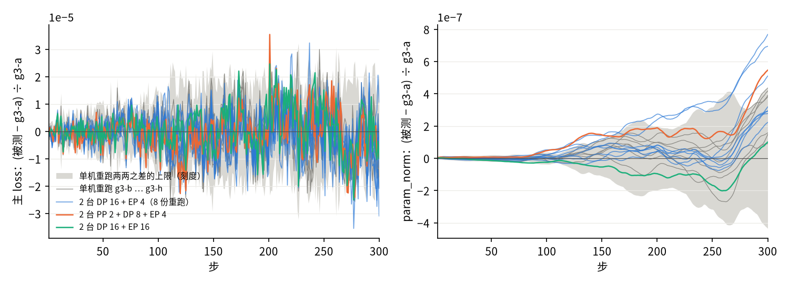

[janus](../../../../README.md) › [混元 4](../../README.md) ｜ 05 · GPU 扩展

# 混元 4 · 05 · GPU 扩展：换机器数和并行方式，GPU 的结果变不变

**结论**：hy4-mini 从 1 台换到 2 台、4 台，换 DP / EP / PP（数据并行 / 专家并行 / 流水线并行）的切法，前 300 步训练曲线都没有超出单机自己重跑的波动，也没有系统偏移。存档续跑与不断开逐位相同：GPU、确定性模式、同一并行设置，存 1 次、续跑 10 步。真实宽度截层（第 0–2 层 + MTP）2 台对单机前 30 步同样没有超出、没有偏移。TPU 一侧的续跑见 [06](../06-rw3/README.md#从存档续跑为什么装不下已修)，只核过同一切片规模。

同一个模型、同一份权重和数据、同一套训练设置，只改执行方式，和单机 GPU golden `g3-a` 比。尺子是单机同设置 8 份（`g3-a … g3-h`，即 1000 步 golden 16 份里的前 8 份）两两 28 对的波动上限（即单机自己重跑能差多少），前 300 步。设置与判法见 [`setup.md`](setup.md)，运行登记 [`runs.yaml`](runs.yaml)。为以后 TPU 与 GPU 的大规模对比打底：GPU 一侧先证明自己扩到多机、换并行方式后还是同一个程序。

## 现状

### 曲线：对单机 `g3-a` 前 300 步

8 项检查，每项取三个判定量里对尺子倍数最大的那个；下表 14 份 mini 运行都与 `g3-a` 逐样本吃同一批数据（[核对](results/data-same-batches.json)）。真实宽度截层的 21 份运行（`rws-a … f`、`rw-a … e`、`rw1k-a … h`、`rw-pp2`、`rw4-pp2`；`rw1k-b … h` 是 06 的 GPU 尺子，登记在 [06 的 `runs.yaml`](../06-rw3/runs.yaml)）同样核过，也都与 `g3-a` 逐样本相同，0 处不同（[核对](results/data-same-batches-rw.json)）。

| 被测 | 机器 | 并行 | 步时 | 在噪声内 | 1–2 倍 | 超出 | 最大倍数（哪项） |
|---|---|---|---|---|---|---|---|
| [`sn-a`](results/sn-a-vs-single-node.report.md) | 1 | DP 8 + EP 4（新代码重跑 `g3-a`） | 1.06 s | 8 | 0 | 0 | 0.93（索引器 KD） |
| [`sn-ep8`](results/sn-ep8-vs-single-node.report.md) | 1 | DP 8 + EP 8 | 1.04 s | 8 | 0 | 0 | 0.95（主 loss） |
| `mn-a` … `mn-h`（[a](results/mn-a-vs-single-node.report.md) [b](results/mn-b-vs-single-node.report.md) [c](results/mn-c-vs-single-node.report.md) [d](results/mn-d-vs-single-node.report.md) [e](results/mn-e-vs-single-node.report.md) [f](results/mn-f-vs-single-node.report.md) [g](results/mn-g-vs-single-node.report.md) [h](results/mn-h-vs-single-node.report.md)） | 2 | DP 16 + EP 4，8 份同设置重跑 | 0.64 s | 5 份 8 项全在，3 份 4–6 项在 | 3 份各 2–4 项 | 0 | 1.76（`mn-a` param_norm） |
| [`mn-ep16`](results/mn-ep16-vs-single-node.report.md) | 2 | DP 16 + EP 16 | 0.61 s | 8 | 0 | 0 | 0.89（主 loss） |
| [`mn-pp2`](results/mn-pp2-vs-single-node.report.md) | 2 | PP 2（层 0–4 / 5–6 + MTP）+ DP 8 + EP 4 | 0.86 s | 4 | 4 | 0 | 1.25（param_norm） |
| [`mn4-pp2`](results/mn4-pp2-vs-single-node.report.md) | 4 | PP 2（层 0–4 / 5–6 + MTP）+ DP 16 + EP 16 | 0.58 s | 7 | 1 | 0 | 1.50（param_norm）；用多机尺子判 8 项全在（[结果](results/mn4-pp2-vs-multi-node.report.md)） |
| [`mn-lr`](results/mn-lr-vs-single-node.report.md)（正对照：故意改坏） | 2 | 同 `mn-a`，学习率大 10% | 0.64 s | 1 | 0 | 7 | 4149（param_norm） |

- 没有一份超出噪声上限；正对照 8 项里 7 项超出，工具判得出来。
- 步时取第 11–300 步中位数（`metrics.jsonl` 的 `step_time`），只是单次读数。

### 多机自己的尺子

8 份多机重跑两两 28 对另算一个尺子（[`catalogs/multi-node-self.yaml`](catalogs/multi-node-self.yaml)），和单机的尺子比，再看两组有没有系统偏移：

| 看什么 | 结果 |
|---|---|
| 多机尺子 ÷ 单机尺子 | 主 loss、grad_norm、param_norm 的三个判定量 1.0–1.3 倍；路由偏置均值 0.17–0.38 倍（[尺子对比](results/yardstick-multi-vs-single.json)、[多机两两](results/mn-self-pairs.json)） |
| 反过来：单机 `g3-a` 对多机 `mn-a`，用多机尺子 | 6 项在噪声内、2 项 1–2 倍（最大 1.41 倍，param_norm），和多机对单机的情形对称（[结果](results/g3-a-vs-multi-node.report.md)） |
| 两组有没有系统偏移（7 份单机、8 份多机对 `g3-a` 的带符号均值，Welch t：比两组平均值有没有系统差别的统计量） | 窗口带符号均值：5 条曲线的 \|t\| 都 ≤ 1.3（param_norm 1.27，主 loss 0.56）；第 300 步单步值：除索引器 KD 外 \|t\| ≤ 1.5；索引器 KD 第 300 步 t −3.0，单步上两组有差，原因没查，同一项的窗口均值 t 是 −0.19（[结果](results/groups-single-vs-multi.json)） |

多机重跑本身的波动比单机略大（按上表 1.0–1.3 倍），所以拿单机尺子量多机，偶尔会落在 1–2 倍；两组之间没有看到系统偏移。

### 存档续跑：逐位

确定性模式（`--deterministic`），「跑 20 步」对「跑 10 步、存、续跑 10 步」：

| 设置 | 两次 20 步重跑 | 续跑的第 11–20 步 | 比了什么 |
|---|---|---|---|
| 2 台，PP 2 + DP 8 + EP 8 | [逐位相同](results/ckpt-rerun-pp2.json) | [逐位相同](results/ckpt-resume-pp2.json) | 记录量：重跑比全程 20 步 1500 个，续跑比第 11–20 步 750 个；16 个 rank 的 1752 个参数与 buffer、8760 个状态张量（FP32 主权重、Muon 动量、Adam 两个矩与步数） |
| 1 台，DP 8 + EP 4 | [逐位相同](results/ckpt-rerun-dp8.json) | [逐位相同](results/ckpt-resume-dp8.json) | 记录量：重跑比全程 20 步 1620 个，续跑比第 11–20 步 810 个；8 个 rank 的 1968 个参数与 buffer（这一组没比状态张量） |
| 2 台，真实宽度第 0–2 层 + MTP，DP 16 + EP 16 | 没有单跑（续跑逐位相同已经包含确定性） | [逐位相同](results/ckpt-resume-rw.json) | 480 个记录量；16 个 rank 的 3152 个参数与 buffer、14512 个状态张量 |

负对照（故意拿不同的东西比，确认工具认得出）：跑 10 步与跑 20 步的最终参数清单 1968 个里 1680 个不同（[结果](results/ckpt-negative-control.json)），比较工具认得出不同。

### 真实宽度截层

hy4-preview 第 0–2 层 + MTP（真实权重，`hf/hy4-4l`），设置同上。尺子是单机 DP 8 + EP 8 同设置 6 份（`rws-a … rws-f`）两两 15 对，前 30 步（[`catalogs/rw-vs-single-node.yaml`](catalogs/rw-vs-single-node.yaml)）：

| 被测 | 机器 | 并行 | 步时 | 每卡峰值 | 对单机 `rws-a`，7 项检查 |
|---|---|---|---|---|---|
| `rw-a` … `rw-e`（[a](results/rw-a-vs-rws.report.md) [b](results/rw-b-vs-rws.report.md) [c](results/rw-c-vs-rws.report.md) [d](results/rw-d-vs-rws.report.md) [e](results/rw-e-vs-rws.report.md)） | 2 | DP 16 + EP 16，5 份重跑 | 2.12 s | 91.5 GiB | 3 份 7 项全在噪声内，2 份各 1 项 1.03 倍（主 loss、grad_norm 的最大单步） |
| `rw-pp2` | 2 | PP 2（层 0 / 层 1–2 + MTP）+ DP 8 + EP 8 | 3.42 s | 105.7 GiB（末段） | 不判档；主 loss 对 `rw-a` 逐步相对差最大 2.4e-5（[逐步差](results/rw-pp2-vs-rw-a.json)） |
| [`rw1k-a`](results/rw1k-a-summary.json) | 2 | DP 16 + EP 16，1000 步 | 2.06 s | 91.5 GiB | 前 30 步：5 项在噪声内，2 项 1–2 倍（grad_norm 1.33、param_norm 1.34 倍，[结果](results/rw1k-a-vs-rws.report.md)） |
| [`rw4-pp2`](results/rw4-pp2-summary.json) | 4 | 第 0–3 层 + MTP，PP 2（层 0 / 层 1–3 + MTP）+ DP 16 + EP 16 | 2.38 s | 93.9 GiB | 不判档（这一截层没有尺子）；对单机 DP 8 + EP 8 同设置前 10 步（4.11 s / 步、135.3 GiB），主 loss 逐步相对差最大 5.9e-6（[逐步差](results/rw4-pp2-vs-single-node.json)） |
| `rws-a`（参照） | 1 | DP 8 + EP 8 | 3.68 s | 115.3 GiB | — |

两组（单机 5 份、多机 5 份对 `rws-a`）的带符号均值同样没有系统偏移：5 条曲线 Welch \|t\| ≤ 1.7（[结果](results/groups-rw-single-vs-multi.json)）。

`rw1k-a` 是 2 台的 1000 步长跑，一个作业 37 分钟跑完，没有用到分段续跑；主 loss 从 12.0 降到 5.61，全程最大注意力 logit 76.9，QK-Clip（阈值 100）没有触发（[概况](results/rw1k-a-summary.json)）。它是 TPU 回放（[06](../06-rw3/README.md)）用的多机 golden：

| 项 | 值 |
|---|---|
| 放在哪 | `gs://<POC 桶>/janus/hunyuan4/gpu-scale/rw1k-a/`：`meta.json`、`metrics.jsonl`、`data/rank<r>.jsonl`（逐 rank 输入指纹）、`data/batches/rank<r>.{bin,jsonl}`（16 个 rank × 1 个 microbatch × 1000 步，tokens / labels / loss_mask / position_ids） |
| 对应配置 | hy4-preview 第 0–2 层 + MTP（`hf/hy4-4l`，`--layers 3 --mtp`），附加参数见 [`setup.md`](setup.md) 的 `C2` 加 `--ep=16`；2 台 DP 16 + EP 16，每卡微批 1，全局批 16 × 4096；数据与 mini 同一份 `tokens.npy`，第 s 步第 (s−1)·16 … 条 |
| 回放能读吗 | 能：TPU 回放读 batch 的同一段代码 `frameworks/maxtext/replay.py check` 核过 1000 步、16000 个单元，拼成全局 batch 再还原，指纹与 golden 不同 0 处（[输出](results/rw1k-a-replay-check.txt)） |
| 怎么回放 | 已回放：D3 的 MaxText 检查点已转换、v5p 16 片放得下，TPU 1000 步两臂回放已跑完，命令、显存与结果见 [06](../06-rw3/README.md) |

## 下一步

- 真实宽度截层的 TPU 回放已在 [06](../06-rw3/README.md) 做完；后续在那里跟。
- 规模往上：更多层用 PP 分段，切分点落在 full 索引器层上（完整模型可切在第 1 + 4k 层前）。

## 适用范围

- 只在 B200 上；曲线判定 mini 前 300 步、真实宽度前 30 步（`rw1k-a` 1000 步只判前 30 步），超过这个窗口多机是否仍无偏移没测。
- 真实宽度截层最多 4 层（`rw4-pp2`）；PP 在真实宽度上只有逐步差，没有尺子判定（`rw-pp2`、`rw4-pp2` 不判档）。
- 存档续跑只在确定性模式、同一并行设置、存 1 次续 10 步上核过；换并行设置续跑没测。

## 这个文件夹

| 文件 | 放什么 |
|---|---|
| [`setup.md`](setup.md)、[`runs.yaml`](runs.yaml) | 设置、命令、判法；运行登记 |
| [`catalogs/`](catalogs/) | `vs-single-node.yaml`（被测对单机 `g3-a`）、`multi-node-self.yaml`（多机自己的尺子）、`rw-vs-single-node.yaml`（真实宽度截层对单机） |
| [`results/`](results/) | `<被测>-vs-single-node.*`、`<被测>-vs-rws.*`、`g3-a-vs-multi-node.*`；数据核对、多机两两、两组偏移、存档续跑的 JSON；两机 NCCL 冒烟日志 |
| [`figures/`](figures/) | 图与画图脚本 |
