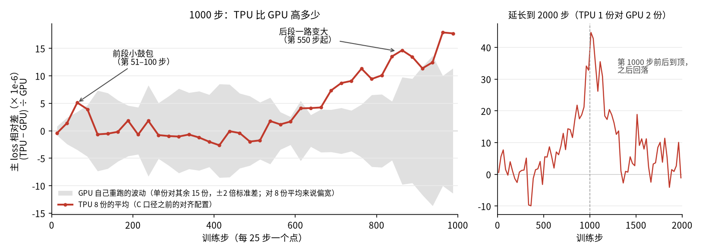
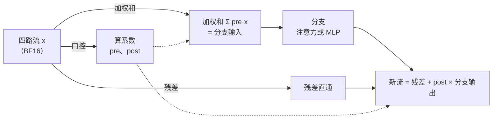
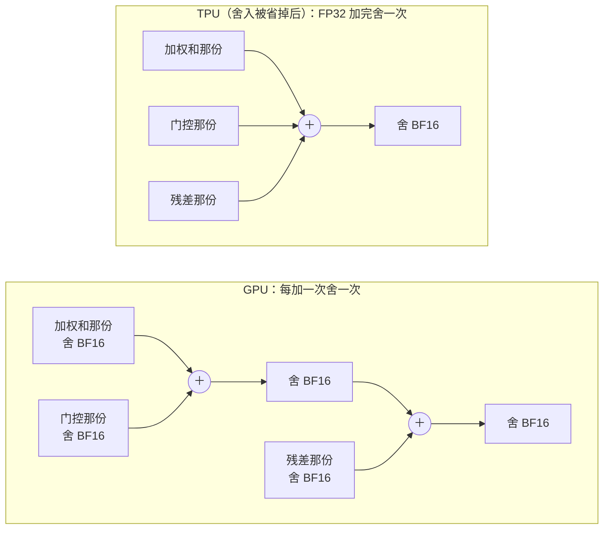
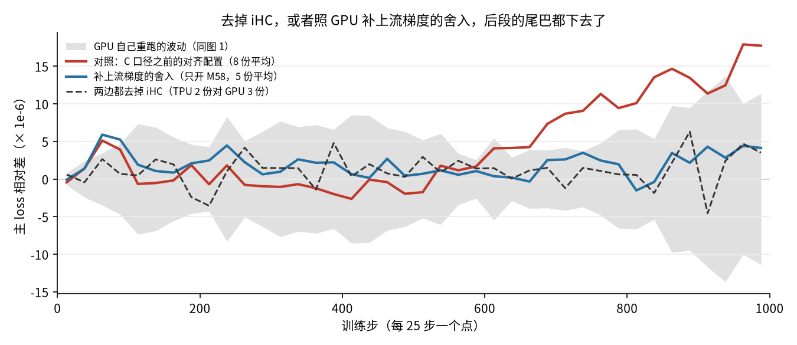
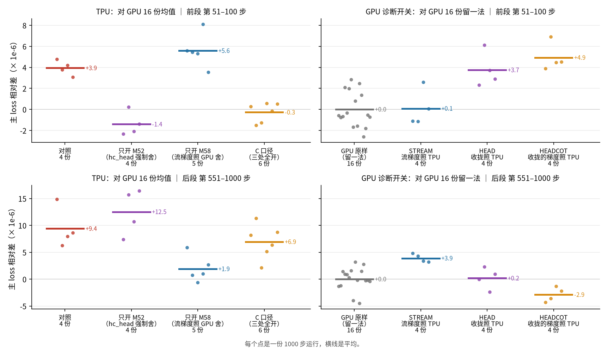
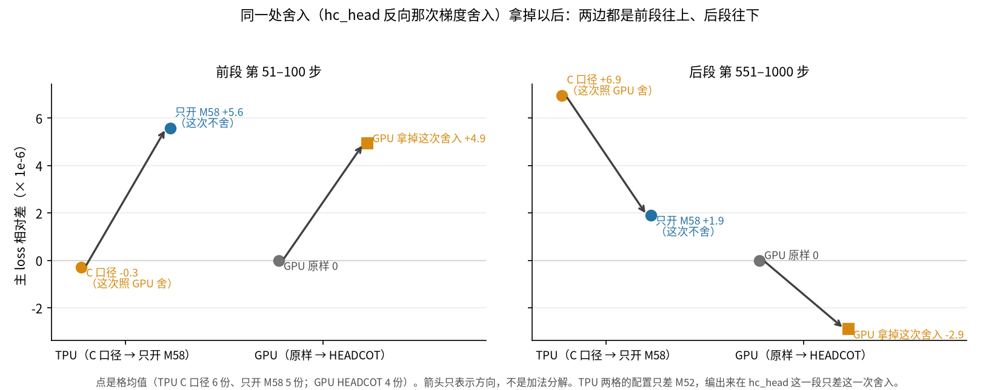
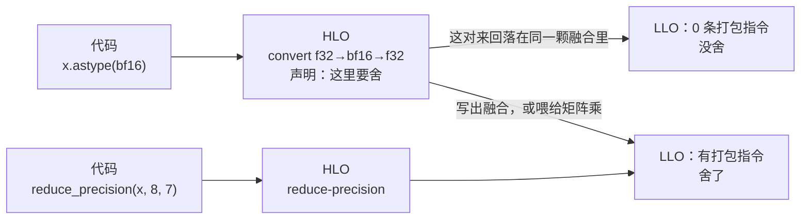
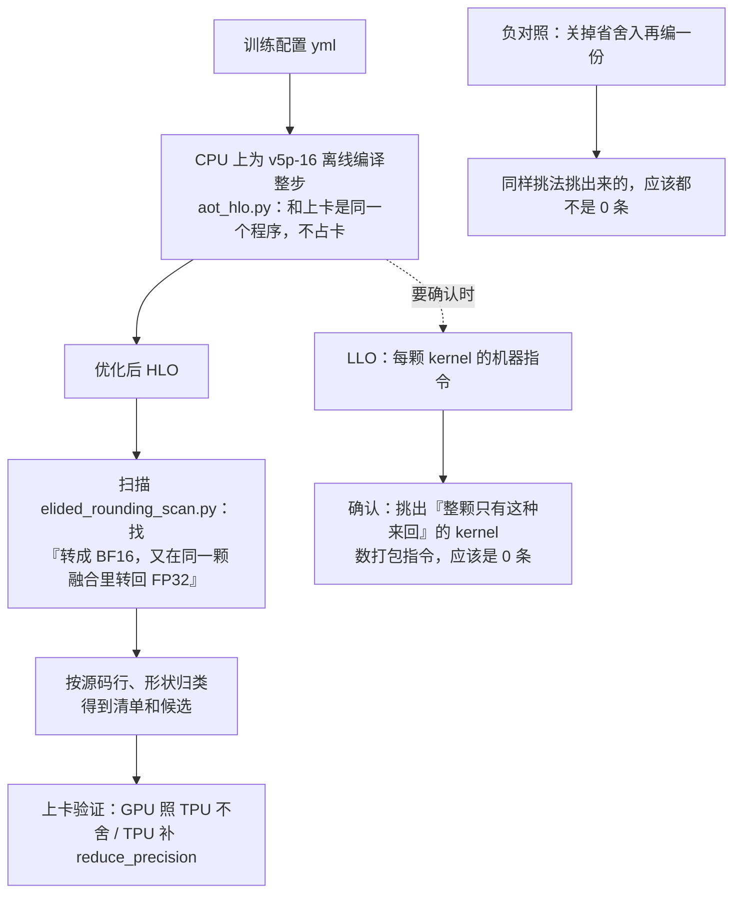
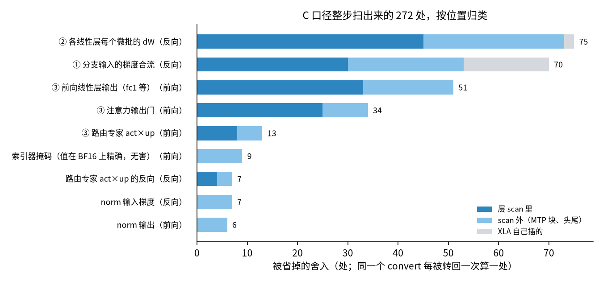
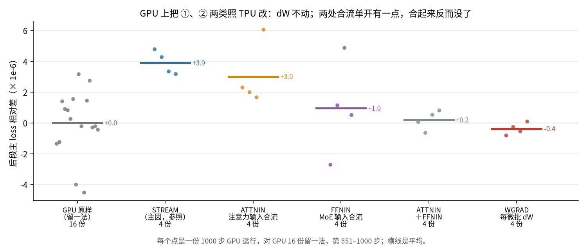

[janus](../../../README.md) › [混元 4](../README.md) ｜ [案例](README.md) 17

# 案例 17：后段为什么慢慢偏开：被编译器省掉的 BF16 舍入，以及「先编译、再扫描」

**一句话：** 代码里写了「这里舍成 BF16」，TPU 的编译器有时会把这次舍入省掉。省掉一处，每步差一点点，1000 步就攒成一条看得见的尾巴。我们先一处一处找到了主因（iHC 的流梯度），然后换了个办法：把整个训练步离线编译出来，在编译产物里一次扫出**所有**被省掉的舍入。

> **状态：主因已定位，两头都验证过；还有残余在查。** 现在的对齐配置（代号「C 口径」，定义见[下文](#c-口径反转三处全照-gpu-改后段反而没好)）主 loss 刚好判过，但后段的尾巴还看得出来。全图扫描列出了残余的候选；优先级最高的 ①、② 两类拆成三处在 GPU 上验证过，都没坐实（权重梯度排除；两处梯度合流单开有一点、合开消失，推断是偶然）。下一步在 TPU 上补注意力输入那一处，在跑。
>
> **只想拿方法的，直接跳到[「先编译、再扫描」](#先编译再扫描)。** 它不依赖混元 4，任何「TPU 和 GPU 舍入位置对不齐」的问题都能用；工具是 [`analysis/elided_rounding_scan.py`](../analysis/elided_rounding_scan.py)。

整条故事线：


## 先懂一件事：为什么「写了舍入」却可能没舍

这一节回答：TPU 的代码明明照 GPU 写了舍 BF16，为什么实际没舍。

**打个比方。** 报销规定每张发票先抹到「分」，每加一张，总数也抹到「分」。GPU 就这样老实记账：PyTorch 里写 `.to(bfloat16)`，这次舍入一定发生。TPU 的编译器像个聪明的会计：发现「这个数刚抹完，马上又要拿去算」，就直接用没抹的原数往下算。结果更准，但和 GPU 的账在最后一位上对不上。

落到代码上：

- 混元 4 的习惯是「FP32 算、BF16 存」。MaxText（JAX）里写 `x.astype(bf16)`，下一步要 FP32 时再转回来。编译后是一对 `convert(f32→bf16)` → `convert(bf16→f32)`。
- XLA 会把相邻的小运算合成一颗 kernel，叫**融合**；融合内部的中间值留在片上，不写回显存。
- TPU 编译器默认开着 **excess precision**（允许中间结果多留精度）。上面那对来回如果落在同一颗融合里，编译器直接用 FP32 的值，**这次舍入就没了**。（这是实测出来的规律，见下文[「为什么能扫」](#为什么能扫)。）
- 另一种写法 `jax.lax.reduce_precision(x, 8, 7)`：值还是 FP32，但尾数截到 BF16 的 7 位。编译器把它当成一次真的运算，**不会省**。

为什么不干脆把 excess precision 整个关掉？试过，离 GPU 更远。全局关掉，所有融合里的中间值都要舍一次，很可能比 GPU 舍得还多（推断）。所以只能逐处补：哪一处要「照 GPU 一定舍」，就把那里的 `astype` 换成 `reduce_precision`。本案例的三处改动都是这么做的。

## 现象：前段一个小鼓包，后段一条尾巴

这一节回答：偏差长什么样，是不是真的。

先说尺子，后文都用它：

- **纵轴**是主 loss 的相对差：(TPU − GPU 16 份的逐步均值) ÷ GPU，1e-6 量级。
- **一份**是一次 1000 步运行。GPU 重跑 16 份量自己的波动；TPU 是确定性的，各份只换执行方式，量自己的扰动（明细见出处一节）。
- **灰带**是 GPU 自己的波动，用**留一法**量：轮流拿一份 GPU 去比其余 15 份。红线明显跑出灰带，就不是 GPU 自己的随机波动能解释的。
- 两组运行有没有真差别，用**置换检验**给 p 值，越小越不像巧合。
- **前段**指第 51–100 步，**后段**指第 551–1000 步。后文「后段 +x」都是这一段的平均。



图 1：左边 1000 步，右边延长到 2000 步。数据 [`mini-main-loss-drift.json`](../alignments/01-mini/results/mini-main-loss-drift.json)、[`mini-ihc-ablation.json`](../alignments/01-mini/results/mini-ihc-ablation.json) 的 `x2000`。

读图：

- **第 550 步起一路往上**，到第 976–1000 步高 1.8e-5，远出灰带。这是本案例要查的「尾巴」。
- **不会无限变大。** 2000 步那 1 份在第 1000 步前后到顶，之后落回 GPU 两份的范围里（第 1001–1250 步平均 +2.9e-5；GPU 只有 2 份，尺子很粗，图上没画）。
- **第 51–100 步有个小鼓包，原因另有一处**：混元 4 最后一层之后，由 **hc_head** 把多路隐藏状态收回一路，GPU 在这里舍一次 BF16，TPU 这次被省掉了（[根源一览第 28 行](../ROOT-CAUSES.md#r28)）。先记住它，后面它会和尾巴纠缠在一起。

<details>
<summary>两件先排除掉的事：不是前向的差，也不是学习率；逐块数字</summary>

- **不是前向。** 同一份权重上 TPU、CPU FP64、CPU 上照 GPU 写法各算同几批：6 个状态 19 批，TPU 比 GPU 写法高 +0.83e-6 ± 1.15e-6，不到后段差距的一成（[`mini-main-loss-same-state.json`](../alignments/01-mini/results/mini-main-loss-same-state.json)）。所以偏差是训练里一步步攒出来的，要查更新路径。
- **学习率是常数**，和它无关。分块偏差和 GPU 的 param_norm 同步（第 501 步起相关 0.96），和梯度范数无关（−0.11）。同一批运行的 MTP loss 反方向走，第 751–1000 步 −3.2e-5。

逐块数字（TPU 8 份对 GPU 16 份；鼓包那一行按 10 步分块，所以比图上 25 步一个点的峰值高）：

| 步 | 偏差 | 读法 |
|---|---|---|
| 第 1 步 | −2.0e-6 | 8 份都偏低 |
| 第 51–90 步 | 最高 +7.2e-6（第 71–80 步） | 小鼓包，8 份都偏高 |
| 第 100–550 步 | 0 附近 | |
| 第 601–625 步 | +4.1e-6 | 第 550 步起一路变大 |
| 第 751–775 步 | +1.1e-5 | |
| 第 976–1000 步 | +1.8e-5 | 每块 8 份里 7–8 份偏高；GPU 尺子 2–7e-6 |

</details>

## 排除：不是哪项 loss，也不是 libtpu 版本

这一节回答：最先怀疑的那几样，为什么都不是。

- **不是哪项 loss。** 两边同时关掉 MTP（多 token 预测的 loss）、关掉 KD（索引器的蒸馏 loss）、两个都关，尾巴都还在。
- **不是 GPU 那边的已知问题。** GPU 索引器 RoPE 改成 FP32，TPU 对它仍飘。
- **不是 libtpu 版本。** 0.0.52 和 0.0.46 一样飘。
- **不是执行方式。** TPU 自比的 35 个 1000 步运行（换 libtpu、换芯片、换并行方式、换重算、换注意力实现等），第 751–1000 步全部为正；另试的五个小改动也都去不掉。

<details>
<summary>排除实验的数字</summary>

每种配置 GPU 4 份、TPU 2 份，TPU 对同配置 GPU 均值（[`mini-loss-isolation.json`](../alignments/01-mini/results/mini-loss-isolation.json)）：

| 配置 | 后段 | 两份的后段斜率 | GPU 留一法斜率范围 |
|---|---|---|---|
| 对照（同一条提交路径，1 份） | +1.48e-5 | — | — |
| A 关 MTP | +1.16e-5 | +4.3e-6、+2.3e-6 | −0.7e-6 到 +0.4e-6 |
| B 关 KD | +9.0e-6 | +0.5e-6、+4.0e-6 | −2.3e-6 到 +1.9e-6 |
| C 都关 | +8.7e-6 | +1.2e-6、+2.7e-6 | −0.7e-6 到 +1.0e-6 |

- GPU 索引器 RoPE 改 FP32（`HY4_INDEXER_ROPE_FP32`，台账 G34）跑 1 份，TPU 对它后段仍 +1.24e-5。
- libtpu 0.0.52 的 golden 对 GPU 16 份后段 +7.7e-6，同配置 0.0.46 的 4 份 +9.8e-6。
- 更早排除的五个（#385，每个 2 份）：MTP 不给 hc_head 参数梯度、MTP 与输出头共用末层 norm、RoPE 照 GPU 的 BF16 写法、MTP 残差强制舍 BF16、RMSNorm 输出处的反向梯度强制舍 BF16。第 751–1000 步都落在 70 份 TPU 运行的范围里。第 1 步梯度相对差改到 6e-3 的改动也去不掉尾巴。

</details>

## 定主因：iHC 流梯度少舍了几次

这一节回答：问题在哪一块结构里，是什么差别，怎么证明它就是原因。

### 先缩范围：去掉 iHC 就平

两边一起把 iHC 拿掉（GPU 换成普通残差，MaxText 设 `mhc_expansion_rate=1`，其余权重逐位相同），后段落回 GPU 的范围（图 2 虚线）。范围从整个模型缩到了 iHC 一带。

### iHC 里哪里不一样

iHC 每一层里，同一份流被用了三次：



用了三次，反向时这份流就收到三份梯度，要加成一份。两边的加法不一样：



GPU 一共舍 5 次（三份各一次，两次相加各一次），这是 autograd 的行为，我们在 CPU 上用 GPU 同一段代码逐位核过。TPU 的代码同样写了 BF16，但按前面那条规律，这几处舍入落在融合里会被省掉，三份在 FP32 里加完、最后只舍 1 次。这一段没有单独看 LLO，所以 TPU 这半边是推断；下面两头验证会给它撑腰。

用记账的比方：三张发票，GPU 每加一张抹一次零，TPU 拿计算器加完再抹一次。每步每层差在最后一位，1000 步攒出尾巴。

### 补上它：流梯度照 GPU 舍

对应的改动叫 **流梯度照 GPU 舍**（`ihc_stream_grad_gpu_order`，台账 M58）。在 `mhc.py` 里新增 `stream_fanout(x, 3)`，把流复制成三份分给加权和、门控、残差；反向时照 GPU 的顺序先把每份梯度舍 BF16，再逐个相加、每加一次舍一次，全用 `reduce_precision`。它另外还把分支输出补舍了一次 BF16。



图 2：数据同图 1；只开 M58 与去掉 iHC 两条取自 [`mini-ihc-ablation.json`](../alignments/01-mini/results/mini-ihc-ablation.json) 的 `ihc`、`noihc`。C 口径没有存逐块曲线，它的前段、后段见图 3。

图 2 的蓝线：补上以后，尾巴下去了，和去掉 iHC 的虚线差不多。数字见下一小节的表。

<details>
<summary>「对照」指哪批运行</summary>

图 1、图 2 的红线是 8 份（base2 开、关各 4）；改前改后的比较用另一批 4 份（与 8 份部分重叠），正文的对照数字都指这 4 份。

</details>

### 两头验证：GPU 照 TPU 写，GPU 自己也飘

只在 TPU 一侧看，变平也可能是巧合。所以反过来，在 GPU 上**故意照 TPU 的样子不舍**，看 GPU 自己会不会长出尾巴（GPU 诊断开关台账 G37）：

| 在哪边改 | 改成什么 | 后段 | 份数 | 检验 |
|---|---|---|---|---|
| TPU | 照 GPU 补上舍入（M58） | +9.4e-6 → +1.9e-6 | 对照 4、改后 5 | p 0.016 |
| GPU | 照 TPU 不舍（`HY4_TPU_LIKE_STREAM`） | GPU 自己对 GPU：+3.9e-6，4 份都正 | 4 | p 0.0025 |

TPU 照 GPU 写就平，GPU 照 TPU 写就飘，两边都去掉 iHC 就都不飘。三件事合起来，主因定为 **iHC 流梯度的舍入写法**（[根源一览第 30 行](../ROOT-CAUSES.md#r30)）。

GPU 上另一个开关只把 hc_head 收拢改成 TPU 的样子（`HY4_TPU_LIKE_HEAD`）：它不长尾巴，却**正好复现了 TPU 的前段鼓包**（+3.7e-6，p 0.001），鼓包的来历也坐实了。

**TPU 算错了吗？没有。** 按单次运算看，少舍几次离精确值更近（按舍入次数推的；整条轨迹上谁更近没测）。TPU 只是和 GPU 舍的位置不同。对齐要的是同样的舍入位置，所以对齐配置要补；生产训练不需要。

<details>
<summary>去掉 iHC、M58 拆半的细节</summary>

- 去掉 iHC：GPU 用 Megatron-Core 的 TransformerLayer 加 bias-dropout-add（与 MTP 层同一种写法）；随机初始化用 `make_tiny_hf.py --no-ihc`，其余 167 个张量与 `hy4-mini-seed0` 逐位相同；CPU 上同一份权重、同一批数据，两边第 1 步 loss 相对差 −1.9e-6。1000 步 GPU 3 份、TPU 2 份：TPU 后段 +1.9e-6、+0.7e-6，斜率 +0.5e-6、+0.15e-6，都在 GPU 范围（−1.0e-6 到 +1.2e-6）里（GPU 3 份只有 3 对，尺子粗）。
- M58 可以拆成两半单开（M59），各 1 份：只补流梯度 +0.6e-6、只补分支输出 +3.0e-6，斜率都平。只说明两半都在起作用，分不出谁大。
- libtpu 0.0.52 上开 M58，后段从 +1.19e-5 降到 +5.2e-6。

</details>

## C 口径反转：三处全照 GPU 改，后段反而没好

这一节回答：三处都照 GPU 改了以后，结果怎样。

前段鼓包和后段尾巴各找到了一处原因，自然想把两处一起照 GPU 补上。再加上早就开着的一处，就是现在的对齐配置 **C 口径**。三处改动都只是把 `astype` 换成 `reduce_precision`，都在 `maxtext` 的混元 4 分支上：

| 改动（开关，台账号） | 管哪里 | 代码怎么改 |
|---|---|---|
| **iHC 强制舍**（`ihc_force_bf16_rounding`，M36，早就开着） | iHC 每层的分支输入和新流这两个值 | `mhc.py` 的 `_xla_call` 里，这两处的 `.astype(x.dtype)` 前面套一层 `self._round(...)`，即 `reduce_precision` |
| **hc_head 强制舍**（`hc_head_force_bf16_rounding`，M52） | hc_head 收拢的输出（修前段鼓包） | hc_head 的 `return out.astype(self.dtype)` 前加一行 `out = jax.lax.reduce_precision(out, 8, 7)`；这一行的反向也会把传回来的梯度舍一次 |
| **流梯度照 GPU 舍**（`ihc_stream_grad_gpu_order`，M58） | 三份流梯度怎么加（修后段尾巴） | 上一节的 `stream_fanout`，外加分支输出补舍一次 |

四种配置（M36 都开着）：

| 配置 | iHC 强制舍（M36） | hc_head 强制舍（M52） | 流梯度照 GPU 舍（M58） |
|---|---|---|---|
| 对照（C 口径之前的对齐配置） | 开 | 关 | 关 |
| 只开 M52 | 开 | 开 | 关 |
| 只开 M58 | 开 | 关 | 开 |
| **C 口径**（2026-11-11 起） | 开 | 开 | 开 |

照理前段、后段都该好。实测前段好了，后段没好：



图 3：每个点是一份 1000 步运行，横线是平均。左边 TPU 对 GPU 16 份均值（[`mini-factorial-tpu-6.json`](../alignments/01-mini/results/mini-factorial-tpu-6.json)），右边 GPU 对 GPU 16 份留一法（[`mini-gpu-tpulike.json`](../alignments/01-mini/results/mini-gpu-tpulike.json)、[`mini-gpu-headcot.json`](../alignments/01-mini/results/mini-gpu-headcot.json)）。

- **前段（左上）：** 只要开了 M52，鼓包就没了。C 口径 6 份 −0.3e-6，对照 4 份 +3.9e-6，p 0.005。
- **后段（左下）：** C 口径 +6.9e-6，6 份里 5 份尾巴在，和对照分不开（p 0.32），比只开 M58 高 5.0e-6（p 0.024）。
- 也就是说，**M52 开着时，M58 的作用测不出来了**。（只开 M58 的前段比对照还高一点，因为 M58 本来就不管鼓包。）

M52 一边修好了前段，一边让 M58 在后段的效果看不见了。把 M52 拆开看（台账 M62）：**只在前向舍、反向梯度原样传回**时，后段又和只开 M58 一样低了，但前段鼓包回来了。前段的好处和后段的麻烦，看来都跟 **hc_head 反向那次梯度舍入**有关。具体差在哪，下一节编出来看。

<details>
<summary>拆格的数字</summary>

M52 开着时，再补 M58 全套或任一半都测不出作用（[`mini-factorial-c-parts-vs-m52.json`](../alignments/01-mini/results/mini-factorial-c-parts-vs-m52.json)）：

| 在 M36 + M52 之上，各 4 份 | 后段 | 对只开 M52 |
|---|---|---|
| M58 全套 | +6.7e-6 | −5.9e-6，p 0.14 |
| 只补流梯度一半 | +7.9e-6 | −4.6e-6，p 0.14 |
| 只补分支输出一半 | +10.8e-6 | −1.7e-6，p 0.54 |

把 M52 拆成两半（各 4 份，[`mini-factorial-c-ab-vs-m52.json`](../alignments/01-mini/results/mini-factorial-c-ab-vs-m52.json)）：

- **M52 只在前向舍，反向梯度原样传回**（配 M58）：后段 +3.7e-6（对只开 M52 p 0.029），和只开 M58 分不开；前段鼓包回来了。
- **M58 不碰 hc_head**（配完整 M52）：后段 +4.3e-6，p 0.057；前段鼓包没有。

</details>

## 抵消：只修一处时，两个偏差互相抵掉

这一节回答：为什么「更像 GPU」的 C 口径，后段反而比「不像 GPU」的只开 M58 差。

先把 hc_head 这一段编出来看（v5p 离线编译，读 HLO 和 LLO，，[`hc-head-llo-probe.json`](../alignments/01-mini/results/hc-head-llo-probe.json)）：C 口径和只开 M58 在这一段**只差一处**：hc_head 反向那次梯度舍入（传回 hc_head 收拢处的梯度舍不舍 BF16）。C 舍，和 GPU 一样；只开 M58 留 FP32。

那就在 GPU 上把这一次舍入拿掉，看 GPU 往哪边走（GPU 开关 `HY4_TPU_LIKE_HEADCOT`，，4 份）：



图 4：点是格均值，箭头只表示方向。数据同图 3。

两边方向一样：**拿掉这次舍入，前段往上鼓，后段往下压。** GPU 上前段 +4.9e-6（p 0.0002），后段 −2.9e-6，4 份都负（p 0.018）。大小对不上（TPU 两格后段差 5.0e-6，GPU 只动了 2.9e-6），所以下面的「抵消」是按方向推断的，不是加法分解。

用一个比方把这个推断串起来。一台秤有三个毛病：

- 甲让读数偏重：iHC 流梯度少舍（主因，已找到）；
- 乙让读数偏轻：hc_head 反向那次梯度少舍；
- 丙让读数偏重：还没找到，在别处。

只修甲（只开 M58）：乙和丙大致抵掉，读数看上去「准了」。甲、乙都修（C 口径）：只剩丙，读数偏重。所以 C 口径后段那约 +7e-6 不是修坏了，而是把被乙遮住的丙露了出来。

由此推断两件事：

1. 只开 M58 时后段变平，有一部分是抵消，**不全是修好了**。
2. 剩下的约 +7e-6 主要来自 hc_head 这一段以外（下一节说为什么）。

## 只剩编译器：下一个怀疑对象

这一节回答：丙可能是什么，为什么先怀疑编译器。

丙有两种可能：两边**算的东西**不一样（语义差），或者算的一样、**舍的位置**不一样。

- **hc_head 这一段先排除。** CPU 上逐位比过，C 口径和 GPU 只差一处语义（MaxText 给 MTP 另做一次末层 norm）；把它也照 GPU 改掉，就只差 FP32 累加顺序。这样上卡，后段照旧（4 份 +5.0e-6，和 C 口径分不开，p 0.40）。这一段里还有两次 norm 梯度的 BF16 舍入被省掉，四种配置都一样，所以不是配置之间差别的来源，但可能是丙的一部分（扫描清单把它们归在 norm 类）。
- **别处的语义**没有逐段核过。
- **舍入位置：** 这一案到目前为止坐实的每一处差别（流梯度、hc_head 收拢、hc_head 那次梯度）都是同一种：代码写了舍，编译器省了。这一种有一个好处：**能机械地找全**。

所以下一步先找编译器省掉的舍入。只是不能再一处一处读代码猜了，猜不完。

<details>
<summary>CPU 逐位对照的细节</summary>

，[`hc-head-order-probe.json`](../alignments/01-mini/results/hc-head-order-probe.json)：GPU 写法、MaxText 关省舍入、MaxText 开省舍入三方各算一遍 hc_head 加末层 norm 的反向。唯一实质不同是 MaxText 给 MTP 另做一次末层 norm，两路各做一次 norm 反向再相加；GPU 先把两路梯度加起来，只做一次。不开它时流梯度 dx 逐位相同 63.9%；C 口径再开 `mtp_input_shared_final_norm`（台账 M53）后 dx 差 2.1e-5，逐位相同 99.993%。上卡见 #455。

</details>

## 先编译、再扫描

这一节回答：怎么不靠猜，一次把全图所有「被省掉的舍入」找出来。**这是整个排查里最值得带走的方法。**

前面每查一处都要：读代码、写开关、上卡每格跑 4 份 1000 步。这一步改成**在整个训练步的编译产物里，按一个精确的模式一次扫出所有同类位置**。不占卡：编译约 2 分钟、扫描约 1 秒；要 LLO 确认时编译约 15 分钟。

### 为什么能扫

**比方：** 代码里写 `astype(bf16)`，像在稿子上批了一句「这里四舍五入」。编译产物有两层：**优化后的 HLO** 像排好版但还留着批注的稿子，看它知道**代码声明了**要舍；**LLO** 像印出来的成品，是每颗 kernel 真正执行的机器指令，真舍 BF16 要用打包指令（`vpack.*.bf16`），看它知道**到底舍没舍**。



这条规律是先在两小段代码上实测出来的：把 iHC、hc_head 各自写成最小复现，离线编译看 LLO（[`ihc_llo_probe.py`](../analysis/ihc_llo_probe.py)、[`hc_head_llo_probe.py`](../analysis/hc_head_llo_probe.py)）。来回落在同一颗融合里时，那颗 kernel 一条打包指令都没有；换成 `reduce_precision`，同一颗 kernel 就多出打包指令（iHC 那颗多 256 条，hc_head 那颗多 688 条）。

所以「HLO 里有这对来回，而且两头在同一颗融合里」就是一个可以机械匹配的模式，LLO 用来确认。这也说明了 C 口径那三处改动为什么管用：`reduce_precision` 编译器省不掉。

### 怎么扫



扫描器对每一处 `bf16 convert` 判四种情况：

| 看到的样子 | 判成 |
|---|---|
| 转成 BF16 后，在**同一个融合**里又被转回 FP32 用（中间可以隔着 reshape、transpose 这类只搬数据的运算） | **省掉**：声明了舍入，编译器没做 |
| 转回 FP32 后紧跟一个 `reduce_precision(8, 7)` | **已补**：有人用 reduce_precision 补上了 |
| BF16 结果写出融合、喂给矩阵乘，或给别的 BF16 运算 | **舍了** |
| 输入本来就在 BF16 网格上 | 跳过：来回是精确的，舍不舍都一样 |

每处再从 metadata 归类：最内层的 MaxText 源码行号、在不在层 scan 里、是前向还是反向（op_name 里有没有 `transpose(`）。

<details>
<summary>一处真实命中长什么样；编译耗时与内存</summary>

一处 ③ 类命中，反向里重算的注意力输出门（删去布局和 metadata）：

```text
%convolution.2585.clone.3 = f32[4096,8,256] convolution(%fusion.5209.clone.3, %fusion.5539.clone.3), ...
%convert_element_type.27396.clone.3 = bf16[4096,8,256] convert(%convolution.2585.clone.3)        ← 声明：舍 BF16
%convert_element_type.25993.clone.3 = f32[4096,8,256] convert(%convert_element_type.27396.clone.3)  ← 同一颗融合里转回
%abs.1481.clone.3 = f32[4096,8,256] abs(%convert_element_type.25993.clone.3)                     ← 拿去做 sigmoid
```

| | 只要 HLO | HLO + LLO |
|---|---|---|
| 编译耗时 | 约 110 s | 830–1010 s |
| 进程峰值内存 | 约 15 GiB | 41–43 GiB |
| 扫描耗时 | 约 1 s | 约 11 s |
| 产物 | 优化后 HLO 一份（约 35 MB） | 另有 LLO 目录约 720 MB，1666 颗 kernel（相同的只编一次） |

离线编译工具 [`frameworks/maxtext/aot_hlo.py`](../frameworks/maxtext/aot_hlo.py) 的来历见[案例 14「怎么从编译产物看通信」](14-ddp-fsdp-embedding.md#怎么从编译产物看通信)。

</details>

### 扫出了什么

先说结论：**全图 272 处被省掉的舍入，其中 ①、② 两类共 145 处在反向的梯度路径上，是头号嫌疑。**

C 口径训练步（`hy4-mini-t1.yml`，v5p-16，libtpu 0.0.46，jax 0.11.1），结果文件 [`mini-c-elided-rounding-scan.json`](../alignments/01-mini/results/mini-c-elided-rounding-scan.json)：

- **被省掉的舍入 272 处**（同一个 convert 在同一融合里每被转回一次算一处；输入本来就在 BF16 网格上、来回精确的 1475 处已跳过）。
- **已补 55 处**不在其中，其中 30 处在 iHC 与 hc_head（`mhc.py`）。`mhc.py`（iHC 与 hc_head 本身的代码）在 272 处里一处都没有：M36、M52、M58 已经把那里补上了，这正好是一次自检。（hc_head 后面末层 norm 的两次梯度舍入算在 norm 一类里。）



图 5：数据 `mini-c-elided-rounding-scan.json` 的 `elided_uses_by_class`。

排优先级只看三条：GPU 那边会舍；TPU 这边省了；在反向的梯度路径上（梯度一步步累进参数，最像主因那样攒出尾巴）。三条都满足的是 ① 和 ②：

| 候选 | 是什么 | GPU 那边 | 优先级 |
|---|---|---|---|
| **① 分支输入的梯度合流** | 和主因是同一种模式：几份梯度在 FP32 里加完才舍。典型是注意力输入处 q、kv 下投影和输出门三份梯度 | 三份 BF16 梯度在 BF16 里相加 | 高（上卡没坐实，见下一节） |
| **② 每个微批的权重梯度 dW** | 各线性层每个微批算出的 dW 没舍 BF16，就直接累加 | GPU golden 关了 `gradient_accumulation_fusion`，每个微批的 dW 先出 BF16，再加进 FP32 的累加器 | 高（上卡后已排除，见下一节） |
| ③ 前向的几处 | 线性层输出（fc1 等）、注意力输出门、路由专家的 act×up | 线性层输出是 BF16 | 中 |

### LLO 确认：能单独核的都没舍

- 整颗 kernel 只含「省掉」的来回、没有别的真舍入的，有 **41 颗**，41 颗的打包指令**全部是 0 条**（34 颗是 ② 每微批 dW，4 颗是索引器掩码，3 颗是 norm）。
- **负对照**：同配置关掉省舍入（`--xla_allow_excess_precision=false`）再编，同样挑法挑出 35 颗，**没有一颗是 0 条**。
- ① 和 ③ 的来回都落在同时含有真舍入的 kernel 里，那颗 kernel 的打包指令条数没法单独归给它们。所以它们的证据是 HLO 规则加上两个最小复现的规律，没有逐颗 LLO 核对。

### 边界：这个方法找不到什么

- **只找得到一类：代码声明了、编译器省掉了。** 代码里根本没写舍入的地方（比如 TPU 一开始就用 FP32 算、GPU 却舍了 BF16），HLO 里没有 convert，扫不出来，要靠读代码对照 GPU。累加顺序不同、超越函数近似不同，也不在这个模式里。
- **清单只说 TPU 省了，不说 GPU 舍了。** 比如 ② 成立，是因为 GPU golden 关了 `gradient_accumulation_fusion`（`frameworks/megatron/train_hy4mg.py`）；要是开着，GPU 的 dW 也在 FP32 里累加，这一类就不算差异。
- **找到的是候选，因果要上卡验证。** 272 处里哪些真影响轨迹，要像前面那样做两头验证。这次优先级最高的 ①、② 两类，上卡后都没坐实（下一节）。
- **分类规则是按混元 4 mini 定的经验规则。** 靠源码行号和形状判，换模型、换 MaxText 提交要重核。① 里注意力输入和 MLP 输入的命中多在 `linears.py` 同一行，按行分不开。
- **结论绑定编译器版本。** 融合怎么切会随 libtpu 版本、芯片代际变（[案例 15](15-libtpu-upgrade-final-norm-double-rounding.md) 就是融合变了导致舍入次数变了），换版本要重扫。

<details>
<summary>扫描结果的完整分类表</summary>

按类的数字来自 MaxText `98a80d92` 的那次编译；在 `8d3d7561` 的 C 口径编译上复算，按类数字逐个相同。

| 位置类 | 来回（处） | 层 scan 里 / scan 外 / XLA 自插 | GPU 那边 | 方向 | 优先级 |
|---|---|---|---|---|---|
| ① 分支输入的梯度合流（注意力输入处 q、kv 下投影和输出门三份梯度；另有 MoE 路由输入 7 处、XLA 自插 17 处） | 70 | 30 / 23 / 17 | 三份 BF16 梯度在 BF16 里相加 | 反向 | 高（上卡没坐实） |
| ② 各线性层每个微批的 dW | 75 | 45 / 28 / 2 | 每个微批的 dW 先出 BF16，再加进 FP32 的 main_grad | 反向 | 高（上卡已排除） |
| ③a 前向线性层输出（fc1 等） | 51 | 33 / 18 / — | 线性层输出 BF16 | 前向 | 中 |
| ③b 注意力输出门 | 34 | 25 / 9 / — | 同上 | 前向 | 中 |
| ③c 路由专家 act×up | 13（另有反向 7） | 8 / 5 / — | 同上 | 前向 | 中 |
| norm 输入梯度、norm 输出 | 7、6 | scan 外 | | | 低 |
| 索引器掩码 | 9 | scan 外 | | | 无害：值是 0 和 −∞ 这类在 BF16 上精确的数 |

其他细节：栈帧表是截短的，只看得到最内层几帧，scan 外的未进 scan 的层和 MTP 块分不开；op_name 里带 `transpose(` 的也包括反向里重算的前向（`checkpoint/rematted_computation`）。

</details>

## 上卡验证：残余查到哪了

这一节回答：扫出来的候选，哪些真的造成了后段的残余。

判据照主因那次：**GPU 照 TPU 改了会长出尾巴，TPU 补上舍入尾巴会下去**，两头都成立才算坐实。先做 GPU 一头，把 ①、② 两类拆成三处，在 GPU 上照 TPU 改（GPU 诊断开关台账 G38，各 4 份）：

| 候选 | 对应扫描类 | GPU 照 TPU 改成什么 |
|---|---|---|
| 注意力输入的梯度合流（ATTNIN） | ① 里注意力输入那部分 | q、kv 下投影和输出门三份梯度在 FP32 里加完、只舍一次 |
| MoE 输入的梯度合流（FFNIN） | ① 里 MoE 输入那部分（路由输入 7 处，加 XLA 自插的一部分） | 路由、共享专家、路由专家三份梯度同上，路由那份不先舍 BF16 |
| 每个微批的 dW（WGRAD） | ② | dW 直接在 FP32 里累加，不先舍 BF16 |



图 6：数据 [`mini-gpu-tpulike-fanin-wgrad.json`](../alignments/01-mini/results/mini-gpu-tpulike-fanin-wgrad.json)；STREAM 一格是主因在 GPU 上的大小，作参照（[`mini-gpu-tpulike.json`](../alignments/01-mini/results/mini-gpu-tpulike.json)）。

读图：

- **dW 排除。** WGRAD −0.4e-6（p 0.73）：GPU 不舍它，后段不动。
- **两处梯度合流没坐实。** ATTNIN 单开 +3.0e-6（4 份都正，p 0.021），像是有一点；但和 FFNIN 一起开，反而回到 +0.2e-6（p 0.87）。同一类舍入，合起来应该叠加（推断），这里对不上。四格一起看，0.021 按格数校正（× 4）是 0.084，很可能是 4 份样本里的偶然（推断）。ATTNIN 还把 MTP loss 推高了 +2.1e-5，方向和 TPU 上 MTP 偏低相反。
- 所以 C 口径的残余，**在 ①、② 两类里没找到**。

接下来：

- 在 TPU 上补 ATTNIN 那一处（C 口径之上，4 份），看另一头：**在跑**。
- 剩下的候选：清单里前向那几类（输出门、fc1 输出、路由专家 act×up），以及扫描找不到的差（代码没写舍入、GPU 却舍了的地方；累加顺序）。

更细的对照（逐处 TPU 怎么省、GPU 怎么舍）见[知识库「整个训练步：被省掉的舍入全局清单」](../knowledge.md#整个训练步被省掉的舍入全局清单)。

## 在自己的模型上怎么用

前提：MaxText 训练镜像（jax、libtpu 和上卡一致；镜像 digest 见 `frameworks/maxtext/run.sh`），一台 CPU 机器，内存 ≥ 48 GiB（要 LLO 时）。

**1. 离线编译，存 HLO 和 LLO。**

```bash
OUT=/tmp/elided/c
JAX_PLATFORMS=cpu ALLOW_MULTIPLE_LIBTPU_LOAD=1 TPU_SKIP_MDS_QUERY=1 \
HY4_YML=models/hunyuan4/frameworks/maxtext/hy4-mini-t1.yml \
XLA_FLAGS="--xla_dump_to=$OUT/xla --xla_dump_hlo_as_text --xla_dump_hlo_module_re=.*train_step.*" \
LIBTPU_INIT_ARGS="--xla_jf_dump_to=$OUT/jf --xla_jf_dump_llo_text=true" \
  python models/hunyuan4/frameworks/maxtext/aot_hlo.py --stage mini --topology v5p-16 --steps 1000 --out $OUT
```

只要清单、不要 LLO 确认时，去掉 `LIBTPU_INIT_ARGS` 那一行，编译快 8 倍左右。已经在用 TPU 自比[跑前离线筛](../alignments/04-tpu-self/setup.md#跑前离线筛)的，把 `--xla_jf_dump_to=/out/jf --xla_jf_dump_llo_text=true` 写进臂的 `libtpu_args`，`hlo_screen.py run` 的缓存目录里就会有 `train_step.after_optimizations.txt` 和 `jf/`，直接拿来扫。

**2. 扫描。**

```bash
python models/hunyuan4/analysis/elided_rounding_scan.py \
  --hlo $OUT/xla/module_*.jit_train_step.*.after_optimizations.txt \
  --jf $OUT/jf --out $OUT/elided.json --positions
```

`--jf` 可以不给（只做 HLO 匹配）；`--out` 不给就只打印。屏幕上先打印 LLO 核对，再打印按模块的计数和逐个源码位置。

**3. 负对照（建议做一次）。** 同一条命令在 `XLA_FLAGS` 里加 `--xla_allow_excess_precision=false` 再编、再扫，`llo_check` 里 0 条打包的 kernel 应该变成 0 颗。不是 0 就说明规律在你的版本上不成立，清单不能直接用。

**4. 读清单。** 逐类问三个问题：GPU 那边在这里舍不舍（读 GPU 代码、看训练参数）；在不在反向梯度路径上；有没有现成的 reduce_precision 开关能补。三条都满足的，排进上卡验证，照[两头验证](#两头验证gpu-照-tpu-写gpu-自己也飘)那样做：TPU 补上看偏差下不下去，GPU 照 TPU 不舍看偏差出不出来。

换模型时，`classify_position` 里的源码行号和形状要按自己的模型改；`elided_uses_by_module` 与 `sites` 不依赖这些规则，可以先看。

<details>
<summary>输出 JSON 的字段</summary>

| 字段 | 内容 |
|---|---|
| `llo_check` | 只含来回的 kernel 数、其中打包指令 0 条的数、非 0 的例子 |
| `elided_uses_by_class` | 按位置类、按区域（层 scan 里 / scan 外 / XLA 自插）的来回处数 |
| `elided_uses_by_module` | 按区域 / 模块的来回处数 |
| `sites` | 每个源码位置一行：省掉、舍了、已补各几处，前向、反向各几处，形状，所在的 kernel 和每颗的打包指令条数 |
| `skipped_exact_converts` | 输入已在 BF16 网格上、来回精确而跳过的处数 |
| `positions`（加 `--positions` 时） | 逐处清单：每一处来回所在的计算、kernel、区域 / 模块、源码位置、前向还是反向、省掉 / 已补 / 舍了各几路、位置类、那颗 kernel 的打包指令条数、是不是「整颗只含来回」 |

</details>

## 实测与推断

| 结论 | 性质 |
|---|---|
| 后段偏差从第 550 步起变大，2000 步时回落 | 实测 |
| 不是前向差；不是 MTP、KD、GPU 索引器 RoPE、libtpu 版本 | 实测 |
| 两边去掉 iHC 后不飘 | 实测（GPU 3 份、TPU 2 份，尺子粗） |
| 主因是 iHC 流梯度的舍入写法 | 实测，两头验证（TPU p 0.016，GPU p 0.0025） |
| TPU 的写法单次运算离精确值更近 | 推断（按舍入次数）；轨迹上谁更近没测 |
| C 口径（三处全开）前段鼓包没了，后段和对照分不开 | 实测（前段 p 0.005；后段 p 0.32） |
| M52 与 M58 相冲在 hc_head 反向那次梯度舍入 | 拆格是实测；「相冲点在这里」是推断 |
| 只开 M58 的后段变平有一部分是抵消 | 推断（GPU HEADCOT 方向一致，实测） |
| 只剩编译器省掉的舍入值得先查 | 推断（hc_head 一段语义已对齐、上卡不变是实测；别处语义没逐段核） |
| 融合内部的来回 convert 不产生舍入指令 | 实测（两个最小复现；整步 41 颗只含来回的 kernel 全 0 条，负对照 35 颗全非 0） |
| 全图 272 处被省掉的舍入、三类候选 | 实测（HLO 匹配） |
| 残余不来自 ② 每微批 dW | 实测（GPU WGRAD −0.4e-6，p 0.73） |
| 残余不来自 ① 两处梯度合流 | 数字是实测（单开 +3.0e-6、p 0.021；合开 +0.2e-6、p 0.87）；判为偶然是推断 |
| 残余来自哪里 | **在查**（TPU 补注意力输入合流在跑；前向几类与扫描外的差待查） |

## 出处与工具

所有数字出自 [mini 对齐细节 D30](../alignments/01-mini/DETAILS.md#d30)、[知识库「mini 主 loss 共同偏高」](../knowledge.md#mini-主-loss-共同偏高要点与出处)和上文各图注里的结果文件；排查过程的 PR 是 。比较的口径：TPU 对 GPU 16 份的逐步均值；GPU 自己的波动用 16 份轮流当被测的留一法量；两组运行之间的差用置换检验，每格 4–6 份，份与份之间只换执行方式（默认、scoped VMEM 64 / 32 MiB、关延迟隐藏调度等）；例外是只开 M58、C 口径两格各有 1 份换了重算策略（`remat_policy=full`），对照格的 `ti-o-a` 是另一个代码提交，都按 D30 计入。图由 [`analysis/plot_case17_figures.py`](../analysis/plot_case17_figures.py) 从这些结果文件画出。

<details>
<summary>这次排查用到的 janus 能力</summary>

| 能力 | 在本案例中的作用 |
|---|---|
| 逐步均值对 GPU 16 份、25 步分块、GPU 留一法尺子（[`mini_main_loss_drift.py`](../analysis/mini_main_loss_drift.py)、[`mini_loss_isolation.py`](../analysis/mini_loss_isolation.py)） | 看出偏差集中在后段、斜率超出 GPU 范围 |
| 同状态前向（[`mini_main_loss_same_state.py`](../analysis/mini_main_loss_same_state.py)、[`cpu_bf16_gpu_forward.py`](../analysis/cpu_bf16_gpu_forward.py)） | 排除前向，把问题定为训练里攒出来的 |
| 单因素交叉与置换检验（[`mini_factorial_cells.py`](../analysis/mini_factorial_cells.py)，`--control gpu-loo`） | 每格 4–6 份，给出 p 值，区分真作用和轨迹偶然 |
| GPU 一侧的诊断开关（台账 G37：STREAM、HEAD、BRANCH、HEADCOT） | 两头验证；发现抵消 |
| CPU 逐位对照（[`hc_head_order_probe.py`](../analysis/hc_head_order_probe.py)） | 把 hc_head 一段的语义差缩到只差累加顺序 |
| 最小复现的 HLO / LLO 计数（[`ihc_llo_probe.py`](../analysis/ihc_llo_probe.py)、[`hc_head_llo_probe.py`](../analysis/hc_head_llo_probe.py)） | 确立「融合内来回不舍」的规律 |
| 整步离线编译（[`aot_hlo.py`](../frameworks/maxtext/aot_hlo.py)、[`hlo_screen.py`](../alignments/04-tpu-self/hlo_screen.py)） | 不占卡拿到上卡同一个程序 |
| **全图扫描（[`elided_rounding_scan.py`](../analysis/elided_rounding_scan.py)）** | **一次列出全部被省掉的舍入，给出残余的候选范围** |

</details>
