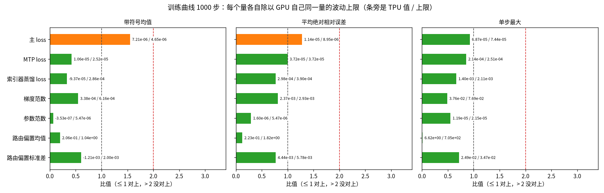

# 混元 4 · 对齐总览

**现状：还不能签字**（签字＝正式宣布两边对齐了）。以现行比较 tz-off-rep 为准（2026-11-11 起对齐配置关 splash 的 base2 指数，1000 步的波动上限换成 GPU 16 份）：hy4-mini（混元 4 全部结构、缩小尺寸的随机初始化模型）在 TPU 和 GPU 上用同一份权重、同一份数据训练 1000 步，9 项曲线 7 项对上、2 项略超（主 loss 全程与第 101 步起；带符号均值，即逐步相对差的平均：全程 TPU +7.21e-6、GPU 自己重跑的波动上限 4.65e-6，1.55 倍，第 101 步起 1.52 倍；后段根因待查），没有不过；梯度范数（0.81 倍）、路由偏置标准差（0.77 倍）都已对上（路由偏置是 MoE 给每个专家加的负载平衡偏置）。同一运行前 300 步梯度范数略超（平均绝对相对误差 1.23 倍）；另一份同配置运行的每步最大注意力打分 1000 步略超（平均绝对相对误差 1.09 倍）。这两项在 base2 开的上一代已接受，关 base2 后没有重做同一状态的证据，状态待定（base2 开时的接受是否沿用尚未决定）。挡签字的还有：第一步整网 205 个梯度里 177 个超出 GPU 的波动（171 个离精确值不超过 GPU 的 1.2 倍、算已查明来源；另 6 个比 GPU 远，1 个已接受，5 个超连接小参数未定责，其中 3 个是关 base2 后新出现的），低阈值下第一步第 4 层每头最大注意力打分离精确值是 GPU 的 1.55 倍（未定责），GPU 第一步参照只有 3 份，参照答案（GPU 上同设置的标准训练）没和 GPU 生产程序比过，三条事后改的判法要在真实权重上做前瞻验证（判法事先固定，再看新结果）。

为什么、生产怎么配、还差什么，见[对齐报告](../alignments/01-mini/ALIGNMENT-REPORT.md)。

TPU 自己只改一样东西（并行方式、编译开关、代码写法、版本、硬件）结果变不变、变多少，见 [TPU 自比](../alignments/04-tpu-self/README.md)；真有影响的几件逐件讲在 [`impacts/`](../alignments/04-tpu-self/impacts/README.md)。

| 符号 | 意思 |
|---|---|
| ✅ / 🟡 / ❌ | 对上 / 略超或只看不判（GPU 列是做过、没写成结果文件）/ 没对上 |
| ⬜ / — | 还没做 / 不适用 |
| 对上 | 差别不超过 GPU 自己重跑的波动；量不出波动的地方，TPU 离精确值（CPU 上 64 位计算）不超过 GPU 的 1.2 倍 |
| 细节 | 每一格的数字、门槛与推导在[总览细节](detail.md)，术语见[知识库的术语对照表](../knowledge.md#术语对照表) |

## 地基：设置、数据、权重、配置（必须逐位相同）

| 检查项 | GPU 自己 | TPU 对 GPU | 说明 |
|---|---|---|---|
| 两边每一步的学习率都等于登记值 | — | ✅ |  |
| 检查点里每个张量的名字、形状、类型和参数量 | — | ✅ |  |
| 权重转换到 TPU 格式再转回来，逐位不变 | — | ✅ |  |
| 位置编码相关的列重排，逐位可逆 | — | ✅ |  |
| 故意给错的检查点，检查会报错 | — | ✅ |  |
| TPU 载入后的权重等于检查点 | — | ✅ |  |
| TPU 载入后的权重等于 GPU 的初始权重 | — | ✅ |  |
| TPU 每一步吃的数据和 GPU 完全相同 | — | ✅ |  |
| 哪些参数用 Muon、哪些用 Adam（两种优化器），两边一致 | — | ✅ |  |
| 69 项训练设置逐项一致 | — | ✅ |  |
| GPU 载入后的权重等于检查点 | 🟡 | — | GPU 自己：做过、通过（每个参数等于检查点里的张量），还没写成结果文件（[GPU 自比计划](../alignments/01-mini/gpu-noise/README.md)） |

## 单算子：同一个输入，各算一次，比谁离精确值远

| 检查项 | GPU 自己 | TPU 对 GPU | 说明 |
|---|---|---|---|
| 超连接（多路残差流）的混合、写回与输出合并 | — | ✅ |  |
| 归一化层（RMSNorm） | — | ✅ |  |
| 注意力输出门的投影 | — | ✅ |  |
| 注意力整块（含稀疏注意力的索引器，即给 token——文本切分的最小单位——打分、挑出要看的位置的部件） | — | ✅ |  |
| 稠密前馈层 | — | ✅ |  |
| MoE 整块（路由、路由专家、共享专家） | — | ✅ |  |
| 输出头（32 位） | — | ✅ |  |
| 词嵌入、MTP 层的投影、交叉熵 | — | ✅ |  |
| 索引器蒸馏 loss（让索引器学完整注意力的分布）的输入 | — | ✅ |  |
| 索引器蒸馏 loss 的数值（只看不判） | — | 🟡 | TPU 对 GPU：只测了 TPU：第 0 层第 0 行的蒸馏 loss 值离精确值高精度指数开关关时 −1.155e-3、开时 +9.67e-5（现行配置开着）；只看不判（[细节](../alignments/01-mini/DETAILS.md#d1)） |
| 优化器连续 8 步 | — | ✅ |  |
| 指数、对数等基本函数的精度 | ✅ | ❌ | TPU 对 GPU：32 位对数函数的最大误差：0.5 到 4 之间全部 2,517 万个 32 位数上，GPU 1 个最小精度单位、TPU 3 个（28.7 万个超过 1 个）；训练里实际出现的输入（索引器蒸馏的目标分布，629 万个数）上 TPU、GPU 都是 1 个。已接受：训练里测到的实际输入上没有超出（[细节](../alignments/01-mini/DETAILS.md#d14)） |
| 加减乘、截断、类型转换（逐位） | — | ✅ |  |
| QK-Clip（注意力打分过大时缩小相关权重）的裁剪公式，低阈值下强制触发 | — | ✅ |  |
| 低阈值下第一步每个头的最大注意力打分 | — | ❌ | TPU 对 GPU：第 4 层每层 8 个头离精确值：GPU 2.97e-3、TPU 4.61e-3（1.55 倍）；base2 开的上一代是 0.94 倍。其余 7 层 0.35–1.07 倍 |
| GPU 算子对精确值、极端输入 | ⬜ | — | GPU 自己：还没做（[GPU 自比计划](../alignments/01-mini/gpu-noise/README.md)） |

## 单层：同一份权重和输入，逐层比

| 检查项 | GPU 自己 | TPU 对 GPU | 说明 |
|---|---|---|---|
| 每一层的输出与层输入梯度 | — | ✅ | TPU 对 GPU：所用配置与现行差三处：少两个开关（注意力可学习偏置项梯度照 GPU 写法、蒸馏 loss 记录值的稳定写法，后者不影响单层前向和反向），且 base2 开；要在现行配置上重跑；最差的第 2 层输入梯度离精确值 GPU 1.23e-2、TPU 1.42e-2 |
| 每层路由和稀疏注意力选中的 token 有多少不同（只统计） | — | 🟡 | TPU 对 GPU：只统计不判：路由选择最差一层的翻转率 GPU 1.54e-2、TPU 1.53e-2；稀疏注意力最差一层 GPU 6.68e-4、TPU 6.67e-4；判定在下面的「路由选择」一行（[细节](../alignments/01-mini/DETAILS.md#4-各级现状严格档--参考档)） |

## 第一步整网：训练第一步的全部梯度

| 检查项 | GPU 自己 | TPU 对 GPU | 说明 |
|---|---|---|---|
| 205 个参数梯度 | — | ❌ | TPU 对 GPU：177 个超出 GPU 三份之间的波动，其中 171 个离精确值不超过 GPU 的 1.2 倍；离精确值的中位数 TPU 6.40e-3、GPU 6.83e-3；最差一个（第 3 层注意力侧 hc_scale）GPU 1.07e-3、TPU 6.40e-3（5.97 倍）。base2 开的上一代（mz-opt2）是 175 个超出、6 个 iHC 未定责（[历代](history.md)；[细节](../alignments/01-mini/DETAILS.md#d11)） |
| 路由和稀疏注意力的选择，不比 GPU 离精确值远 | — | ✅ | TPU 对 GPU：判法事后变更：原来对 GPU 三份之间的差判，第一个 MoE 层 GPU 三份完全相同、波动为 0，第 2–5 层 TPU 是 GPU 三份之间差的 2.0–5.7 倍，判不过；改成看谁离精确值远，各层 TPU 翻转率 ÷ GPU 三份最大值为 0.87–1.00（≤ 1.2 算过；第 1 步用 base2 关的 tw-ra1z，第 8、30、100 步是 base2 开的一代）；真实权重上做前瞻验证（[细节](../alignments/01-mini/DETAILS.md#判法变更记录)） |
| 优化器走一步本身的误差 | — | ✅ | TPU 对 GPU：判法事后变更：两边离精确值都小于一次 16 位舍入（2⁻⁸ ≈ 3.9e-3）时直接算过，不要求 GPU 波动为 0；不加这条时最差一个是 GPU 的 4.55 倍，判不过；Adam 二阶动量（Adam 优化器记的梯度平方均值）99 个全部如此，最差一个离精确值 GPU 2.23e-8、TPU 1.02e-7；真实权重上做前瞻验证（[细节](../alignments/01-mini/DETAILS.md#判法变更记录)） |
| GPU 第一步三份之间的差 | 🟡 | — | GPU 自己：量过（早一代三份的中位数相对差 2.7e-3），没写成单独的检查（[GPU 自比计划](../alignments/01-mini/gpu-noise/README.md)） |
| 只换并行方式、重算方式 | ⬜ | — | GPU 自己：还没做（[GPU 自比计划](../alignments/01-mini/gpu-noise/README.md)） |

## 训练曲线：1000 步（另看前 300 步）

| 检查项 | GPU 自己 | TPU 对 GPU | 说明 |
|---|---|---|---|
| 主 loss（全程） | — | 🟡 | TPU 对 GPU：1000 步主 loss 逐步相对差的带符号平均：TPU +7.21e-6，GPU 16 份的波动上限 4.65e-6（1.55 倍）；前 300 步 1.10 倍。开、关 base2 各 4 份重复两组交叠，这份偏高与 base2 无关；TPU 8 份都偏高（平均 +4.3e-6），原因待查（[知识库](../knowledge.md#mini-上关-base2-为什么离-gpu-更远要点与出处)） |
| 主 loss（第 101 步起） | — | 🟡 | TPU 对 GPU：第 101–1000 步主 loss 逐步相对差的带符号平均：TPU +7.62e-6，GPU 16 份的波动上限 5.02e-6（1.52 倍）；前 300 步的第 101 步起对上（0.78 倍）。开、关 base2 各 4 份重复两组交叠，这份偏高与 base2 无关；TPU 8 份都偏高（平均 +4.3e-6），原因待查（[知识库](../knowledge.md#mini-上关-base2-为什么离-gpu-更远要点与出处)） |
| MTP loss | — | ✅ |  |
| 索引器蒸馏 loss | — | ✅ |  |
| 梯度范数 | — | 🟡 | TPU 对 GPU：前 300 步平均绝对相对误差：TPU 4.74e-4，GPU 波动上限 3.85e-4（1.23 倍）；1000 步平均绝对相对误差 TPU 2.37e-3、上限 2.93e-3（0.81 倍）。base2 开的上一代前 300 步是 1.32 倍（[细节](../alignments/01-mini/DETAILS.md#d2)） |
| 参数范数 | — | ✅ |  |
| MoE 路由偏置（每层均值、标准差） | — | ✅ | TPU 对 GPU：均值、标准差两个窗口都过（1000 步：标准差 r 0.77、均值 0.20）。base2 开的上一代标准差 1000 步 1.14 倍，当时已定责、已接受（[细节](../alignments/01-mini/DETAILS.md#4-各级现状严格档--参考档)） |
| 每步的最大注意力打分（QK-Clip 用的量） | — | 🟡 | TPU 对 GPU：1000 步平均绝对相对误差：TPU 2.02e-3，GPU 16 份的波动上限 1.86e-3（1.09 倍）；前 300 步单步最大 TPU 4.54e-2、上限 4.34e-2（1.05 倍）。base2 开的上一代前 300 步带符号均值 1.77 倍，关后降到 0.70 倍 |
| 训练健康：无 NaN、无跳步、无丢 token、无尖峰（某步超过前 20 步中位数 10 倍算尖峰） | — | ✅ |  |
| GPU 自己同设置多份之间的差 | 🟡 | — | GPU 自己：量过，就是判定用的波动上限，没写成单独的检查（[GPU 自比计划](../alignments/01-mini/gpu-noise/README.md)） |
| 开全量抓数不改训练数值 | ⬜ | ✅ | GPU 自己：GPU 侧还没做（[GPU 自比计划](../alignments/01-mini/gpu-noise/README.md)） |
| 故意埋错，检查能不能抓到 | ⬜ | — | GPU 自己：还没做（[GPU 自比计划](../alignments/01-mini/gpu-noise/README.md)） |
| 同设置重跑逐位相同 | 🟡 | ✅ | GPU 自己：GPU 8 卡重跑本来就不逐位（8 份第 1 步 loss 相对极差 2.9e-6）；小模型 2 卡 20 步两份逐位相同，没写成结果文件（[GPU 自比计划](../alignments/01-mini/gpu-noise/README.md)） |

图：三个小图各画一个量（带符号均值、平均绝对相对误差、单步最大），横条是这个量（取绝对值）除以 GPU 同一量的波动上限，条旁是 TPU 值 / 上限；图里 7 行是七个量的全程窗口，数取自现行比较 `t1zo-l4.results.json`（GPU 16 份）。

开头说的 9 项是上表前 7 行的 1000 步窗口：MTP loss 一行含全程与第 101 步起两个窗口，路由偏置一行含均值和标准差。表里每格取 1000 步与前 300 步里较差的，所以梯度范数一行按前 300 步记 🟡，按 1000 步它过（0.81 倍）。主 loss 的逐步曲线见[对齐报告「训练曲线」](../alignments/01-mini/ALIGNMENT-REPORT.md#训练曲线)。

## 汇总

| 列 | ✅ | 🟡 | ❌ | ⬜ |
|---|---|---|---|---|
| GPU 自己 | 1 | 4 | 0 | 4 |
| TPU 对 GPU | 32 | 6 | 3 | 0 |
