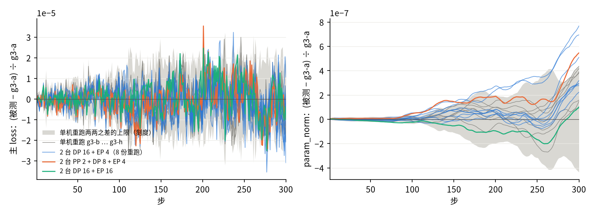

[janus](../../../../README.md) › [混元 4](../../README.md) ｜ GPU 侧 Megatron 版（T1 / T2 的 GPU golden）

# 混元 4 · GPU 侧 Megatron 版

> **现状（2026-11-08）**：语义以 TPU 一侧为准（[`PROTOCOL.md`](../../PROTOCOL.md) 第 1.2 节），这个程序就是 T1 / T2 的 GPU golden，语义以 TPU 一侧 MaxText 为准（GPU 照它补齐结构，台账 G1）。T1 的训练设置是 Muon、权重衰减 0、索引器 KD 系数 0.1（`--indexer-loss 0.1`，台账 G4）、数据并行 8 + 专家并行 4，逐项见 [`../../alignments/01-mini/config-alignment.md`](../../alignments/01-mini/config-alignment.md)。下面提到「HF golden」、AdamW、分布式优化器与「索引器不训练」的几处（紧接着的两段、文件表 `train_hy4mg.py` 一行、「Megatron 没有、在这里补的」第 8 行、「和 HF golden 的数值差别」「等价性」两节）是 AdamW 时期的记录，保留作出处；那时的 `PLAN.md` 小节号见 git 历史。T1 / T2 的 golden 不开分布式优化器（`meta.json` 记 `distributed_optimizer: false`）。

在 Megatron-Core 0.20.0（NeMo 26.10 镜像）上把混元 4（Hy4-preview）搭起来，作为 HF golden（[`../hf/`](../hf/)）之外的第二条 GPU 程序：Megatron 的 TE 层、分组 GEMM 的 MoE、EP 分发、分布式优化器、MTP 都是原样的，Megatron 没有的几样（下面「Megatron 没有、在这里补的」一表）在 janus 一侧补，不 fork Megatron。

语义以 HF transformers `hy_v4` v5.22.1（`modeling_hy_v4.py` sha256 `e27ec64d…`）加公开 config 为准，再加 项目定下的两处读法（交错 RoPE；MLA latent norm eps 1e-5、索引器 k_norm eps 1e-6），与 HF golden 一侧相同。

## 文件

| 文件 | 作用 |
|---|---|
| [`hy4_mcore.py`](hy4_mcore.py) | 模型：config 映射、门控 MLA、DSA（逐层 full / shared、索引器 RoPE 放后段、带 sink 的稀疏注意力）、iHC、hc_head、FP32 输出头（可选 dgrad 分段）、MTP spec |
| [`hy4_weights.py`](hy4_weights.py) | checkpoint 名 → Megatron 参数名的对照表；直接载入（TP = 1，EP 按 Megatron 切法） |
| [`hy4_bridge.py`](hy4_bridge.py) | Megatron-Bridge v0.7.0 的桥：`Hy4ModelProvider` + `HYV4Bridge`（`model_type: hy_v4`），同一张对照表 |
| [`equiv_hf.py`](equiv_hf.py) | 对 HF 参考实现的等价性检查：FP32、截层、真实权重，比逐层输出、DSA 选中位置、logits、MTP、loss 与逐参数梯度 |
| [`bridge_check.py`](bridge_check.py) | 核桥：Bridge 载入的每个参数与 `hy4_weights` 直接载入的逐位相同 |
| [`train_hy4mg.py`](train_hy4mg.py) | 训练入口：Megatron-Core 自己的循环（DDP + `forward_backward_func`，分布式优化器可选，T1 / T2 不开）；T1 / T2 用 Muon（照原版 Megatron-Core / emerging_optimizers），AdamW 时期的数据排法与指标名与当时的 HF golden 相同 |
| [`hy4_capture.py`](hy4_capture.py) | 逐算子 / 逐层抓数（L1 / L2）：`--l1-capture-step N`，第 N 步 rank 0 第 0 个 microbatch，名字与布局照 HF 一侧，格式见下文「逐算子与逐层抓数」 |
| [`step1_ref.py`](step1_ref.py) | 第 1 步整网梯度的 CPU 参照（L3 定责用）：同一套模型代码与本目录训练入口的 loss 语义，在 CPU 上全程 FP64（或 FP32 自检）跑全局批 16 条，写 HF 名字的逐参数梯度、loss、离散选择；比较脚本 `analysis/step1_vs_fp64.py`，串联 `analysis/step1_fp64_ref.sh` |
| [`pod_run.sh`](pod_run.sh)、[`pget.py`](pget.py) | Pod 里的整条流程（不依赖进 Pod 执行命令）：拉代码 / HF / 数据 → L0 → Bridge 自检 → GPU 等价性 → 训练 → 传桶；单机多机同一个脚本 |
| [`jobset.yaml`](jobset.yaml) | 多机作业模板（每台一个 Pod，GPU 与 RDMA 网卡走 DRA） |

## Megatron 没有、在这里补的

| # | 结构 | Megatron-Core 0.20.0 的现状 | 这里怎么做 |
|---|---|---|---|
| 1 | 门控 MLA（逐元素，每头 v_head_dim 个门） | MLA 上开 `attention_output_gate` 报 `NotImplementedError` | `Hy4MLASelfAttention`：`linear_gate`（列并行线性层），core_attention 输出乘 `sigmoid(gate)` 再进 `linear_proj` |
| 2 | DSA 里每头一个可学习 sink | `softmax_type: learnable` 只在普通注意力；DSA 稀疏核没有 sink | `Hy4DSAttention` + `sparse_sink_attention`：与 HF eager 同一算法（分数在计算精度里算，与 FP32 sink 拼起来 FP32 softmax，丢掉 sink 列再乘 V） |
| 3 | iHC 超连接（hc_mult 4，无 Sinkhorn / comb，强制 FP32） | mHC 要求 Sinkhorn 迭代 ≥ 1，混合系数转回激活精度 | `Hy4HyperConnection`（每层两处）、`Hy4FinalNorm`（hc_head + RMSNorm，放在 final_layernorm 位置）；层间传 n 路流 [s, b, n·H] |
| 4 | 索引器按逐层表排布（full：0、1、5、9…；shared 复用上一个 full） | 只有规则排布 `dsa_indexer_topk_freq` | `hy4_indexer_types` 显式列表；MTP 层强制 full |
| 5 | 索引器 RoPE 在每头后 64 维 | `DSAIndexer` 按 DeepSeek-V3.2 放前 64 维 | `Hy4Indexer._apply_rope` |
| 6 | 只有路由专家做 SwiGLU 截断（10） | `activation_func_clamp_value` 对所有 MLP 生效 | 稠密层与共享专家换一份不截断的 config |
| 7 | FP32 输出头 | 0.20.0 的 GPTModel 没有 `logit_dtype` | 输出头权重留 FP32、输入转 FP32；可选 dgrad 分段（与 HF golden 一侧同一写法） |
| 8 | 索引器不训练（HF 在 `no_grad` 里；AdamW 时期） | DSA 默认带索引器 KL loss | AdamW 时期：`dsa_indexer_loss_coeff = 0`，索引器参数 `requires_grad=False`。T1 / T2 改为训练索引器 KD（`--indexer-loss 0.1`，台账 G4） |

其余直接用 Megatron 的配置：sigmoid 路由 + 只用于选择的 expert_bias + 归一化 top-k + `routed_scaling_factor` 2.827（`moe_router_*`）、1 个共享专家、首层稠密（`moe_layer_freq`）、RoPE θ 1e7（MLA 用 `mla_rotary_interleaved`、索引器用 `dsa_indexer_rope_interleaved`：先去交错再按拼接式转，对 q、k 是同一个置换，q·k 与交错式逐项相同）、MTP 1 层（`mtp_num_layers`，因子 0.1，输入取主干 `norm(hc_head(·))` 之后，与 HF golden 一侧、vLLM 同）。

## 和 HF golden 的数值差别（AdamW 时期的记录；实现层面，语义相同）

| 处 | HF golden | 这里 |
|---|---|---|
| 注意力 | eager，整张 S×S 分数 | 同一算法（也是整张分数）；Megatron 的融合 DSA 核（tilelang / cuDNN）不支持 sink，没用 |
| 路由专家的概率 | 乘在 fc2 之后 | Megatron 乘在激活之后、fc2 之前（线性，数学相同，BF16 下舍入位置不同） |
| RMSNorm | 先转 BF16 再乘权重（两次舍入） | TE / torch 的 RMSNorm（FP32 里乘完舍一次） |
| 索引分数 | `matmul` 后按头加权 | Megatron 的 `einsum` 后乘权重再求和（求和顺序不同；FP32 下第 1 层 6/4096 行翻转，都是平局，见下） |
| 权重衰减 | AdamW 对全部参数 | 同：`config_overrides={}`，不按「一维参数 / 偏置不衰减」分组（T1 / T2 用 Muon，权重衰减 0） |

## 等价性（FP32，CPU，真实权重，seq 4096，fineweb 第 0 条）

命令（Megatron-Core 0.20.0 源码在 `PYTHONPATH`）：

```bash
python equiv_hf.py --hf <截好的 4 层 HF 目录> --layers 1 --seq 4096 --tokens tokens.npy --backward --json A.json
```

结果见当时的 PR 正文。判据：每层输出、logits 相对 L2 ≤ 1e-5；DSA 选中集合逐 query 相同，或不同的 query 在 FP64 下第 2048 / 2049 名的相对分差 ≤ 1e-5（平局）；梯度相对 L2 ≤ 1e-4。负对照（`--hf-unpatched`，HF 原样 NeoX RoPE 与原样 eps）必须判不一致。

## 跑

```bash
# Pod 里（环境变量见 pod_run.sh 开头）
RUNS="mg-a:1:10: mg-c:3:10:" EQUIV="1:fwdbwd" BRIDGE=2 bash pod_run.sh
```

- 训练只要 Megatron-Core 与 TE，不用 transformers；等价性检查要 transformers 5.22.1（`pod_run.sh` 现装并核 sha256）。
- `NVIDIA_TF32_OVERRIDE=0` 真关 TF32；`meta.json` 的 `tf32` 一栏是启动时 FP32 GEMM 对 FP64 的实测。
- 只支持 TP = 1、CP = 1、不打包序列；DP、EP、PP 可以组合（T1 / T2 的 golden 用 DP 8 + EP 4，每份运行的 `meta.json` 记 `parallelism`）。

## 多机、并行与存档

一句话：2 台、4 台，试过的 DP / EP / PP 切法，训练曲线都没有超出单机重跑的波动；存档续跑与不断开逐位相同。



### 怎么起

每台机器一个 Pod，跑同一个 `pod_run.sh`。模板是 [`jobset.yaml`](jobset.yaml)，与单机相比多三样：

| 多出来的 | 写法 |
|---|---|
| RDMA 网卡 | 每台再要 8 张，和 GPU 一样走 DRA（`deviceClassName: mrdma.google.com`，count 8）；容器 `privileged` |
| 机器数与 0 号机地址 | 环境变量 `NNODES`、`MASTER_ADDR`（JobSet 的 `<名字>-w-0-0.<名字>`）；`NODE_RANK` 自动取 `JOB_COMPLETION_INDEX` |
| 网络库 | 不用另装：镜像自带 NCCL 2.31 和 GCP 的网络插件（gIB），`NNODES > 1` 时 `pod_run.sh` 不再关插件 |

结果照旧传桶：0 号机写运行目录，每台机器传自己那些 rank 的 `data/`、`params_sha/` 和日志（`train-node<i>.log`）。

### 并行参数

| 参数 | 含义 | 约束 |
|---|---|---|
| （自动）DP | 卡数 ÷ PP | 全局批固定 16 条，每卡微批 1，累积 16 ÷ DP 次；DP 要整除 16 |
| `--ep` | 专家并行 | 整除专家数，不超过 DP |
| `--pp` | 流水线段数 | 层间传 4 路残差流，P2P 先交换形状（`variable_seq_lengths`）；MTP 与输出头在末段 |
| `--pp-first` / `--pp-last` | 首段 / 末段层数 | 切分点要落在 full 索引器层上（shared 层复用的 top-k 不跨段传，切错了启动时报错） |

数据的排法只由步号决定：第 s 步吃第 (s−1)·16 … (s−1)·16+15 条，换 DP、EP、PP 吃的是同一批数据。

TP 不支持。完整模型每卡一份的非专家参数靠 PP 分段放下（推断：非专家参数约 2.6e10，主要是 77 层 × 每层约 3.0e8 的注意力、共享专家与路由，加嵌入与输出头 1.5e9；按每参数 14 字节，PP 8 段约 45 GB / 卡）。

### 存档与续跑

| 参数 | 作用 |
|---|---|
| `--save-at 10` | 第 10 步做完后存档，每个 rank 一个文件 `<运行目录>/ckpt/step_10/rank<r>.pt` |
| `--resume <…/step_10>` | 从第 11 步接着跑；`pod_run.sh` 里可写相对路径（`--resume=<运行名>/ckpt/step_10`） |
| `--deterministic` | 确定性模式（同 Megatron-Bridge）：同配置重跑逐位相同，逐位检查都用它 |
| `--state-sha` | 最后一步后写全部状态的逐张量 sha256（`state_sha/rank<r>.json`） |

存档里有：模型（含路由偏置）、优化器（FP32 主权重、Muon 动量、Adam 两个矩与步数）、RNG、已吃数据的 sha256 与下一步的步号。续跑要求并行设置相同；存档在每台机器的本地盘上，续跑要落在同一组机器上，或者先把存档拷过去。

### 已验证

细节与结果文件见 [05 · GPU 扩展](../../alignments/05-gpu-scale/README.md)。hy4-mini 的对照是单机 golden `g3-a` 前 300 步，尺子是单机同设置 8 份两两的波动上限。

| 验证 | 设置 | 结果 |
|---|---|---|
| 多机 | 2 台 DP 16 + EP 4，8 份重跑 | 没有一项超出噪声上限；5 份 8 项全在噪声内，3 份各有 2–4 项在 1–2 倍（最大 1.76 倍，param_norm）。多机重跑本身的波动是单机的 1.0–1.3 倍，两组没有系统偏移 |
| 换 EP | 2 台 DP 16 + EP 16；1 台 DP 8 + EP 8 | 8 项全在噪声内 |
| 加 PP | 2 台 PP 2（层 0–4 / 5–6 + MTP）+ DP 8 + EP 4 | 4 项在噪声内，4 项在 1–2 倍（最大 1.25 倍） |
| 4 台 | PP 2 + DP 16 + EP 16 | 7 项在噪声内，1 项 1.50 倍；用多机自己的尺子判 8 项全在 |
| 正对照 | 2 台，学习率大 10% | 7 项超出噪声上限（工具判得出来） |
| 存档续跑 | 确定性模式，2 台 PP 2 + DP 8 + EP 8；1 台 DP 8 + EP 4；2 台真实宽度截层 DP 16 + EP 16 | 「跑 20 步」与「跑 10 步、存、续跑 10 步」逐位相同（真实宽度时 16 个 rank 共 14512 个状态张量） |
| 真实宽度 | hy4-preview 第 0–2 层 + MTP，2 台 DP 16 + EP 16 对单机 DP 8 + EP 8（前 30 步，各 5–6 份） | 没有超出：3 份 7 项全在噪声内，2 份各 1 项 1.03 倍；2.12 s / 步（单机 3.68 s），每卡 91.5 GiB（单机 115.3 GiB） |
| 长跑 | 同上截层，2 台 DP 16 + EP 16，1000 步（`rw1k-a`） | 一个作业 37 分钟跑完；主 loss 12.0 → 5.61；每步的 batch 存下，是以后 TPU 回放的多机 golden（放在哪、怎么回放见 [05](../../alignments/05-gpu-scale/README.md#真实宽度截层)） |

| 步时（hy4-mini） | 1 台 DP 8 + EP 4 | 2 台 DP 16 + EP 4 | 2 台 DP 16 + EP 16 | 2 台 PP 2 + DP 8 + EP 4 | 4 台 PP 2 + DP 16 + EP 16 |
|---|---|---|---|---|---|
| 第 11–300 步中位数 | 1.06 s | 0.64 s | 0.61 s | 0.86 s | 0.58 s |

全局批只有 16 条，DP 16 时每卡每步只有 1 个 microbatch，PP 没有 microbatch 可以填流水线，4 台 PP 2 比 2 台 DP 16 快得不多；PP 是为放下更多层，不是为提速。

## 逐算子与逐层抓数

`train_hy4mg.py --l1-capture-step N`（不能和 `--recompute` 同开）在第 N 步 rank 0 的第 0 个 microbatch 上挂钩子，写运行目录下 `l1/`：

| 文件 | 内容 |
|---|---|
| `step_<N>_fwd.safetensors` | 前向张量，原 dtype（BF16 激活、FP32 的路由 logits / 概率 / iHC 系数等） |
| `step_<N>_bwd.safetensors` | 反向梯度，名字是前向名加 `.grad`：embedding 输出、每层输入 / 输出、iHC 两处混合的输出（`<层>.attn_hc.out.grad`、`<层>.ffn_hc.out.grad`）、MTP 的 `eh_proj` 输出 |
| `step_<N>_grad_micro0.safetensors` | 只在加 `--l1-grad-micro0` 时写：第 0 个 microbatch 反向做完时本 rank 各参数的 main_grad（逐层回放的参数梯度对照） |
| `step_<N>_index.json` | 每个张量一条：`src`（Megatron 模块名）、`port`（`input` / `output` / `grad` / `buffer`）、`layout`、`shape`、`dtype`；另有 `extra`（lm_loss 等） |

- 名字：`hf.model.layers.<L>.<子模块>.<量>`、`hf.model.mtp_layers.0.<子模块>.<量>`、`hf.model.embed_tokens.out`、`hf.model.hc_head.out`、`hf.model.norm.out`、`hf.lm_head.out`、`hf.mtp.lm_head.out`、`input.tokens` / `input.labels` / `input.loss_mask`、`loss.per_token`。
- 布局以每条的 `layout` 为准：激活大多是 HF 的 `b,s,…`（Megatron 的 `[s, b, …]` 已转置）；iHC 的 4 路流 `b,s,n,H`；共享专家的输入输出保留 Megatron 的 `s,b,…`；路由是 token 展平的 `tokens,H` / `tokens,E`（Megatron 的 token 顺序，即 s 在外、b 在内）；路由专家的输入是置换后按本 rank 专家排的 `tokens,…`，按 `tokens_per_expert` 切。
- 每层：`in0` / `out0`（层输入 / 输出，4 路流）、`attn_hc` / `ffn_hc` 的 `in` / `post` / `out`、两个 RMSNorm 的输出、注意力内部（`self_attn.core.{query,key,value,qr,x,out}`、`gate_proj.out`、`topk`）、MLP（稠密层 `fc1.out` / `fc2.in`；MoE 层路由 `mlp.gate.{in,logits,probs,routing_map,expert_bias}`、共享专家、路由专家 `fc1.out` / `fc2.in` / `permuted_probs` / `tokens_per_expert` / `out`）。
- 层的真正输入是 `in0`；janus 抓数里的 `layers.<L>.in` 是 input_layernorm 的输出，不是层输入。
- FP64 标准答案：`analysis/fp64_l1_gpu.py --hf <HF 目录> --l1 <运行目录>/l1 --mtp --json … --save …`，每个算子取 GPU 抓到的输入在 CPU 上 FP64 重算，与 GPU 输出比 rel_L2；路由用 GPU 当时的 `expert_bias`，选中集合不同的 token 单独计数。
- 抓数前后输出逐位一致这一条**未验证**：GPU 重跑本身不逐位一致（见 mini 的 [`goldens.md`](../../alignments/01-mini/goldens.md) 的噪声），只能核在噪声内。

## sigmoid / silu 各处的实际算法

T1 的 g2 / g3 设置（代码 `hy4_mcore.py` sha256 `4dab75aa…`，Megatron-Core 0.20.0，TE 版本未核（各运行的 `meta.json` 没有记；单卡探针 `analysis/sigmoid_silu_probe.py` 会打印 `te.__version__`，但输出没有入库），镜像 NeMo 26.10）。「实际执行」一栏的依据是源码路径，加上 L1 抓数里挂在 `linear_fc1` / `linear_fc2` 模块上的钩子都触发了（TE op fuser 的融合路径不经过这两个模块）。

| # | 位置 | 输入 dtype | 计算 dtype | 实际执行 | 输出 dtype；舍入成 BF16 的地方 |
|---|---|---|---|---|---|
| 1 | iHC 的 pre：`sigmoid(pre_l·pre_s + pre_b) + hc_eps`；post：`magnitude·sigmoid(…) + hc_eps`（`Hy4HyperConnection`，autocast 关） | FP32（流先 `.float()`） | FP32 | PyTorch eager `torch.sigmoid` | FP32。pre 加权求和在 FP32 里做，结果 `attn_hc.out` / `ffn_hc.out` 舍入一次成 BF16；post 保持 FP32，与注意力 / MLP 输出（BF16）、残差流（BF16）在 FP32 里乘加，结果（`ffn_hc.in`、层输出）舍入一次成 BF16 |
| 2 | hc_head：`sigmoid(mixes·scale + base) + eps`（`Hy4FinalNorm`） | FP32 | FP32 | PyTorch eager `torch.sigmoid` | FP32；加权求和后 `hc_head.out` 舍入一次成 BF16，再进最后的 RMSNorm |
| 3 | 路由：`moe_utils.topk_routing_with_score_function` 里的 `torch.sigmoid(logits.float())`（`moe_router_fusion=False`，走 eager 路径） | FP32（`moe_router_dtype=fp32`：输入与权重都转 FP32 做矩阵乘） | FP32 | PyTorch eager `torch.sigmoid` | FP32；加偏置选 top-k、归一化、乘缩放系数都在 FP32 里，`permuted_probs` 是 FP32，到第 7 行乘激活时才舍入 |
| 4 | 输出门控：`out × sigmoid(linear_gate(x))`（`Hy4MLASelfAttention._run_core_attention`；按头只影响 Muon 怎么拆，算法与按头无关） | BF16（`linear_gate` 的 TE GEMM 输出） | FP32（ATen 的 opmath） | PyTorch eager `torch.sigmoid` | sigmoid 结果舍入成 BF16（第 1 次），再与 BF16 的 `out` 相乘舍入成 BF16（第 2 次） |
| 5 | 稠密 MLP 的 SwiGLU：`MLP.forward` 不融合分支里的 `glu()`（`use_te_activation_func=False`、`bias_activation_fusion=False`；`_no_clamp` 把截断去掉） | BF16（fc1 输出按最后一维对半分成 gate / up） | FP32（ATen 的 opmath） | PyTorch eager `F.silu`，再做 BF16 乘法（`up + glu_linear_offset`，后者是 0.0，不改值） | `silu(gate)` 舍入成 BF16（第 1 次），乘 up 舍入成 BF16（第 2 次），进 fc2 |
| 6 | 共享专家的 SwiGLU | 同第 5 行（`SharedExpertMLP` 走同一个 `MLP.forward`，同样去掉截断） | 同左 | 同左 | 同第 5 行 |
| 7 | 路由专家的 SwiGLU（带截断）：`TEGroupedMLP` 的 `bias_act_func` 里的不融合 `glu()` | BF16（TE GroupedLinear fc1 输出） | FP32（ATen 的 opmath） | `use_transformer_engine_op_fuser=False`，不走融合路径（`ScaledClampedQGeGLU` 那段检查只在融合路径里用到）。先 BF16 clamp（gate ≤ 10，up 截到 ±10，结果精确），再 eager `F.silu`、BF16 乘法，再乘 FP32 的 `permuted_probs`，最后 `.to(BF16)` | `silu(gate)` 舍入成 BF16（第 1 次），乘 up 舍入成 BF16（第 2 次），乘路由权重时按类型提升算成 FP32，再舍入成 BF16（第 3 次） |
| 8a | 注意力 softmax（`sparse_sink_attention`） | FP32（`hy4_attn_scores_fp32` 开时 q·k 在 FP32 里算；sink 是 FP32） | FP32 | PyTorch eager `torch.softmax` | 概率 `.to(v.dtype)` 舍入成 BF16，再乘 V |
| 8b | 索引器 | — | — | 打分用 ReLU，没有 sigmoid / exp；`weights_proj` 输出 FP32 | — |
| 8c | 索引器 KD（`compute_dsa_indexer_loss`） | FP32 | FP32 | 教师 `masked_softmax`、学生 `masked_log_softmax`，都是 eager | FP32 |
| 8d | 交叉熵（`cross_entropy_loss_fusion=False`：`vocab_parallel_cross_entropy`） | FP32（FP32 输出头） | FP32 | eager `torch.exp` / 求和 / log | FP32 |

- MTP 层的第 3–8 行与主干相同（MTP 层没有 iHC）。
- PyTorch 的 CUDA 实现（上游源码）：
  - sigmoid 是 `one / (one + std::exp(-opmath_t{a}))`（`aten/src/ATen/native/cuda/UnarySpecialOpsKernel.cu`）；
  - silu 是 `x_acc / (opmath_t(1) + ::exp(-x_acc))`（`ActivationSiluKernel.cu`）；
  - BF16 输入时 opmath 是 FP32。
  - 是 `expf` 还是 fast-math 的 `__expf`：镜像里 PyTorch 的编译选项未确认。实测 FP32 `torch.exp` 在 [-30, 30] 上最大误差 1.89 ulp，在 CUDA 文档给 `expf` 的 2 ulp 上界之内；推断不是 `__expf`（它的误差随 |x| 增大）。
- B200 实测（[`analysis/sigmoid_silu_probe.py`](../../analysis/sigmoid_silu_probe.py)，对 FP64）：

| 运算 | 输入 | 结果 |
|---|---|---|
| `torch.sigmoid` | FP32，2000 万个 [-30, 30] 均匀随机 | 最大 3.43 ulp，平均 0.38 ulp，正确舍入 66.4% |
| `F.silu` | 同上 | 最大 3.42 ulp，平均 0.35 ulp，正确舍入 71.3% |
| `torch.exp` | 同上 | 最大 1.89 ulp，平均 0.38 ulp，正确舍入 69.7% |
| `torch.sigmoid` | BF16 进 BF16 出，[-30, 30] 内全部 33,762 个 BF16 值 | 100% 与 FP64 结果正确舍入到 BF16 相同 |
| `F.silu` | 同上 | 100% 相同 |
| `out × sigmoid(gate)` | BF16，400 万个 | 75.7% 等于 FP64 结果正确舍入到 BF16，其余差 1 个 BF16 ulp（两次舍入） |
| `silu(a) × b`（第 5、6 行的写法） | BF16，400 万个 | 73.0% 相等，其余差 1 ulp |
| TE `ops.SwiGLU`（只作参照，训练路径没用到） | BF16，400 万个 | 99.9994% 相等，最大 1 ulp（只在输出舍入一次） |

  结果文件：POC 桶 `analysis/sigmoid-silu-probe/probe_result.json`。
